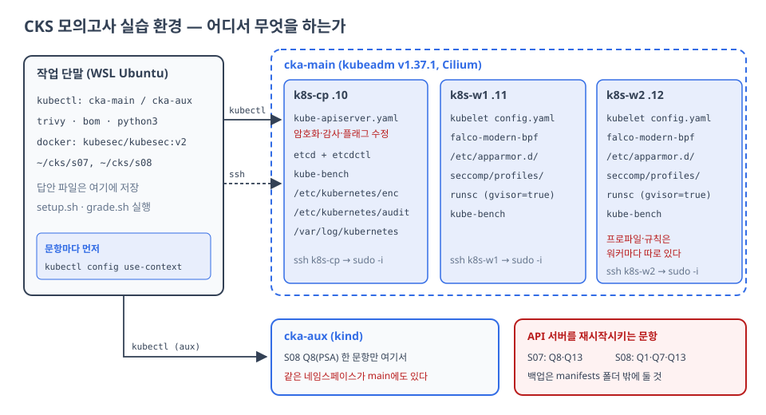

> **자격증 준비 · CKS** | 난이도 ★★★★☆ | 예상 소요 시험 2시간 + 채점·복기 1.5시간

> ⚠️ **이 모의고사의 모든 문항은 CNCF가 공개한 CKS 커리큘럼(github.com/cncf/curriculum, 2026-11-15 확인 시 `CKS_Curriculum v1.37.pdf`)의 6개 도메인 항목을 바탕으로 이 시리즈가 직접 창작한 연습 과제입니다.** 실제 시험 문제나 유출 문제(덤프)가 아니고, 그런 것을 재현하지도 않습니다. Linux Foundation 시험은 응시 정책과 NDA로 보호되므로 "실제 출제 문제"라고 주장하는 자료는 믿지도, 퍼뜨리지도 마세요. 네임스페이스·이름·수치는 모두 새로 지은 것입니다.

> 💡 **실습 환경 — S00 실습 환경 고정값 기준.** `cka-main` = kubeadm v1.37.1 클러스터(k8s-cp 192.168.56.10 / k8s-w1 .11 / k8s-w2 .12, Cilium), `cka-aux` = kind 클러스터. 작업 단말은 두 context가 들어 있는 CKA K00의 작업 셸이고, 스크립트와 답안 파일은 `~/cks/` 아래에 둡니다. 노드 작업은 `ssh <노드>` 후 `sudo -i`. 초기화 지점은 S00에서 보안 도구를 설치한 뒤 찍은 스냅샷 **`cks-clean`** 입니다. 이 모의고사는 S00에서 다음 도구를 설치해 두었다고 가정합니다(셋업 스크립트가 먼저 확인합니다).
>
> | 도구 | 위치 |
> |---|---|
> | Trivy, bom, python3, Docker(kubesec은 `kubesec/kubesec:v2` 이미지를 감싼 셸 함수) | 작업 단말(WSL) |
> | kube-bench | k8s-cp, k8s-w1, k8s-w2 |
> | Falco(apt 설치, systemd 서비스 `falco-modern-bpf`, 출력은 journald + `file_output`) | k8s-w1, k8s-w2 |
> | AppArmor(`apparmor_parser`) | k8s-w1, k8s-w2 (Ubuntu 24.04 기본) |
> | gVisor(`runsc`) + containerd 런타임 핸들러 `runsc`, 노드 레이블 `runtime/gvisor=true` | k8s-w1, k8s-w2 |

## 🎯 오늘의 목표

- S01~S06에서 익힌 6개 도메인을 **2시간 안에** 한 번에 풀어 본다
- API 서버 매니페스트를 고치는 문항(암호화·감사 로그)에서 **수정 → 재기동 확인 → 다음 문항**의 리듬을 몸에 붙인다
- 노드 작업(kubelet 설정, AppArmor, Falco)과 클러스터 작업을 **오가며 위치를 잃지 않는** 습관을 만든다
- 자동 채점 스크립트(`grade.sh`)로 PASS/FAIL과 총점을 보고, 틀린 문항을 **다시 볼 편(S01~S06)** 으로 연결한다

---

## 1. 시험 안내

### 1-1. 형식과 규칙

| 항목 | 이 모의고사 | 실제 시험(공식 페이지 기준, 응시 전 재확인) |
|---|---|---|
| 제한 시간 | **2시간** | 2시간, 온라인 감독, 실기(명령줄) 시험 |
| 문항 수·배점 | 15문항, 합계 100점, 문항 단위 PASS/FAIL | 문항 수는 회차마다 다름. 문항 안의 부분 점수가 있을 수 있음 |
| 합격 참고선 | **67점** | 67%가 널리 알려진 값. **Candidate Handbook으로 확인**([S00](./s00-exam-overview-lab.md) 참고) |
| 클러스터 | `cka-main`(kubeadm), `cka-aux`(kind) | 문항마다 다른 클러스터·context가 지정됨 |
| 허용 문서 | kubernetes.io/docs, kubernetes.io/blog, falco.org/docs, etcd.io/docs, docs.cilium.io, istio.io/latest/docs, kubernetes-sigs.github.io/bom, ingress-nginx 설정 문서 | Linux Foundation "Resources Allowed" 페이지(2026-11-15 확인). Trivy·kubesec·kube-bench는 **`--help`와 배포판 문서(`/usr/share`)** 로 확인 |
| 버전 | cka-main v1.37.1(`cks-clean`) | 커리큘럼 파일 이름의 v1.37 = 시험 Kubernetes 버전 |

도메인과 배점(공식 비중과 같게 나눔):

| 도메인 (커리큘럼 v1.37) | 공식 비중 | 이 모의고사 |
|---|---|---|
| Cluster Setup | 15% | Q1·Q2 = 15점 |
| Cluster Hardening | 15% | Q3·Q4 = 15점 |
| System Hardening | 10% | Q5·Q6 = 10점 |
| Minimize Microservice Vulnerabilities | 20% | Q7·Q8·Q9 = 20점 |
| Supply Chain Security | 20% | Q10·Q11·Q12 = 20점 |
| Monitoring, Logging and Runtime Security | 20% | Q13·Q14·Q15 = 20점 |

시험 중 지킬 규칙:

1. **문항 머리에 적힌 context를 먼저 실행**합니다. 이번 모의고사는 모두 `cka-main`이지만, 습관이 점수입니다.
2. 노드 작업(`[ssh k8s-w1]` 표시)은 `ssh <노드>` 후 `sudo -i`로 하고, 끝나면 `exit`로 **작업 단말로 돌아옵니다**.
3. 파일로 답을 내는 문항은 문항에 적힌 위치에 저장합니다. `~/cks/s07/...`는 **작업 단말**, `/etc/kubernetes/...`는 **k8s-cp 노드**의 경로입니다.
4. **API 서버 매니페스트를 고치기 전에는 반드시 manifests 폴더 밖에 백업**합니다(`cp /etc/kubernetes/manifests/kube-apiserver.yaml /root/`). 폴더 안에 백업을 두면 kubelet이 그것도 정적 Pod로 읽습니다.
5. 사전 준비 스크립트는 **실행만 하고 내용은 시험 후에** 보세요.



### 1-2. 준비 확인

```bash
kubectl config get-contexts                     # cka-main, cka-aux
kubectl --context cka-main get nodes            # 세 노드 Ready, v1.37.1
for n in k8s-cp k8s-w1 k8s-w2; do ssh -o BatchMode=yes $n sudo true && echo "$n ssh-ok"; done
trivy --version; python3 --version
docker image inspect kubesec/kubesec:v2 --format '{{.Id}}'
ssh k8s-w1 systemctl is-active falco-modern-bpf           # active
kubectl --context cka-main get nodes -l runtime/gvisor=true   # k8s-w1, k8s-w2
ssh k8s-w1 'sudo containerd config dump | grep -c runsc'   # 1 이상
```

세 노드 모두 **비밀번호 없이** `ssh <노드> sudo`가 되어야 셋업·채점 스크립트가 노드 상태를 만들고 확인할 수 있습니다. 도구가 하나라도 없으면 [S00](./s00-exam-overview-lab.md)의 도구 설치 절을 다시 보세요.

### 1-3. 진행 순서

```bash
# 작업 단말에서. 먼저 S00 방식으로 초기화:
#   vagrant snapshot restore cks-clean --no-provision   (Vagrantfile 폴더)
mkdir -p ~/cks && cd ~/cks
vi s07-setup.sh        # 3절 내용을 붙여 넣고 저장 (LF 줄바꿈)
bash s07-setup.sh      # 이미지를 내려받아 4~6분 걸림
```

```
[*] preflight ...
[*] etcd client tools on k8s-cp ...
[*] node files ...
[*] workloads on cka-main ...
[*] weakening kubelet on k8s-w1 ...
[*] ready. Start the 2-hour timer now.
```

> 💡 시험 시간은 마지막 줄이 나온 순간부터 잽니다. 끝나면 5절의 `grade.sh`로 채점합니다.

---

## 2. 문항 한눈에 보기

| # | context | 도메인 | 주제 | 배점 |
|---|---|---|---|---|
| Q1 | cka-main | Cluster Setup | NetworkPolicy 기본 거부 + 허용 | 8 |
| Q2 | cka-main `[ssh k8s-w1]` | Cluster Setup | kube-bench 지적(kubelet) 수정 | 7 |
| Q3 | cka-main | Cluster Hardening | 과한 RBAC 줄이기 | 8 |
| Q4 | cka-main | Cluster Hardening | ServiceAccount 토큰 자동 마운트 끄기 | 7 |
| Q5 | cka-main `[ssh k8s-w1]` | System Hardening | AppArmor 프로파일 적용 | 5 |
| Q6 | cka-main | System Hardening | seccomp Localhost 프로파일 | 5 |
| Q7 | cka-main | Microservice | PSA restricted + securityContext | 7 |
| Q8 | cka-main `[ssh k8s-cp]` | Microservice | etcd Secret 암호화(at rest) | 7 |
| Q9 | cka-main | Microservice | gVisor RuntimeClass | 6 |
| Q10 | cka-main | Supply Chain | Trivy로 취약 이미지 Pod 정리 | 7 |
| Q11 | cka-main | Supply Chain | ValidatingAdmissionPolicy로 허용 레지스트리 | 7 |
| Q12 | cka-main | Supply Chain | kubesec 정적 분석 후 매니페스트 수정 | 6 |
| Q13 | cka-main `[ssh k8s-cp]` | Monitoring | 감사 로그(audit) 켜기 | 8 |
| Q14 | cka-main `[ssh k8s-w1/w2]` | Monitoring | Falco 경보로 Pod 찾아 조치 | 6 |
| Q15 | cka-main | Monitoring | 불변(immutable) 컨테이너 | 6 |
| | | | **합계** | **100** |

> 💡 **API 서버를 재시작시키는 문항은 Q8과 Q13 두 개**입니다. 한 번에 몰아서 고치면 재기동 대기(1~2분)를 한 번만 하면 되지만, 실수했을 때 원인을 찾기 어려워집니다. 처음에는 **하나씩 고치고 매번 `kubectl get nodes`로 확인**하세요.

---

## 3. 사전 준비 스크립트

작업 단말에서 실행합니다. 노드 작업은 `ssh <노드> sudo ...`로 합니다. k8s-cp에 etcd 클라이언트(`etcdctl`)가 없으면 클러스터의 etcd 이미지와 같은 버전을 GitHub 릴리스에서 받아 설치합니다.

<details><summary>s07-setup.sh (작업 단말에서 실행 — 시험 후에 열어 보기)</summary>

```bash
#!/bin/bash
# s07-setup.sh -- CKS mock exam 1 setup
# run on the work terminal (cka-main in kubeconfig, passwordless 'ssh <node> sudo')
set -euo pipefail

MAIN=${MAIN_CTX:-cka-main}
WORK=~/cks/s07
STATE=/var/lib/s07-setup            # on nodes
MANI=/etc/kubernetes/manifests       # on k8s-cp

km() { kubectl --context "$MAIN" "$@"; }
die() { echo "ERROR: $*" >&2; exit 1; }
node_sh() {   # node_sh <node> <command...> : run a command as root on a node
  local n=$1; shift
  if [[ $(hostname -s) == "$n" ]]; then
    sudo bash -c "$*"
  else
    ssh -o BatchMode=yes -o ConnectTimeout=5 "$n" "sudo bash -c $(printf '%q' "$*")"
  fi
}
ensure_ns() { km create namespace "$1" --dry-run=client -o yaml | km apply -f - >/dev/null; }
wait_for() {  # wait_for <seconds> <command...> : retry every 5s until the command succeeds
  local t=$1; shift
  while (( t > 0 )); do "$@" >/dev/null 2>&1 && return 0; sleep 5; t=$((t - 5)); done
  return 1
}

# --- preflight ---------------------------------------------------------
echo "[*] preflight ..."
kubectl config get-contexts "$MAIN" >/dev/null 2>&1 || die "context $MAIN not found"
km get nodes k8s-cp k8s-w1 k8s-w2 >/dev/null
for n in k8s-cp k8s-w1 k8s-w2; do
  node_sh "$n" true || die "'ssh $n sudo' must work without a password"
done
for t in trivy python3 docker; do
  command -v "$t" >/dev/null || die "$t not found on the work terminal (see S00)"
done
# S00 runs kubesec as a shell function around the kubesec/kubesec:v2 image
docker image inspect kubesec/kubesec:v2 >/dev/null 2>&1 || docker pull -q kubesec/kubesec:v2 >/dev/null ||
  die "kubesec/kubesec:v2 image is not available (see S00)"
for n in k8s-cp k8s-w1 k8s-w2; do
  node_sh "$n" "command -v kube-bench >/dev/null" || die "kube-bench not found on $n (see S00)"
done
for n in k8s-w1 k8s-w2; do
  node_sh "$n" "command -v runsc >/dev/null && containerd config dump 2>/dev/null | grep -q 'runtimes.runsc'" ||
    die "gVisor runsc handler is not configured on $n (see S00)"
  km get nodes -l runtime/gvisor=true -o name | grep -qx "node/$n" ||
    die "node $n has no runtime/gvisor=true label (see S00)"
  node_sh "$n" "systemctl is-active -q falco-modern-bpf" ||
    die "falco-modern-bpf service is not running on $n (see S00)"
  node_sh "$n" "command -v apparmor_parser >/dev/null && grep -qx Y /sys/module/apparmor/parameters/enabled" ||
    die "AppArmor is not enabled on $n"
done
node_sh k8s-cp "! grep -qE 'encryption-provider-config|audit-policy-file' $MANI/kube-apiserver.yaml" ||
  die "kube-apiserver already has encryption/audit flags -- restore the cks-clean snapshot first"

echo "[*] etcd client tools on k8s-cp ..."
img=$(km -n kube-system get pod -l component=etcd -o jsonpath='{.items[0].spec.containers[0].image}')
ver=${img##*:}; ver="v${ver%%-*}"
node_sh k8s-cp "command -v etcdctl >/dev/null && exit 0
  arch=\$(dpkg --print-architecture); tmp=\$(mktemp -d)
  curl -fsSL https://github.com/etcd-io/etcd/releases/download/${ver}/etcd-${ver}-linux-\$arch.tar.gz | tar xz -C \$tmp
  install -m 0755 \$tmp/etcd-${ver}-linux-\$arch/etcdctl \$tmp/etcd-${ver}-linux-\$arch/etcdutl /usr/local/bin/
  rm -rf \$tmp"

# --- node files --------------------------------------------------------
echo "[*] node files ..."
for n in k8s-cp k8s-w1 k8s-w2; do node_sh "$n" "mkdir -p $STATE"; done

# Q5: AppArmor profile file on k8s-w1 (written, NOT loaded)
node_sh k8s-w1 "cat > /etc/apparmor.d/s07-deny-write <<'EOF'
#include <tunables/global>

profile s07-deny-write flags=(attach_disconnected) {
  #include <abstractions/base>

  file,

  # deny all file writes
  deny /** w,
}
EOF
apparmor_parser -R /etc/apparmor.d/s07-deny-write 2>/dev/null || true"

# Q6: seccomp profile on both workers
for n in k8s-w1 k8s-w2; do
  node_sh "$n" "mkdir -p /var/lib/kubelet/seccomp/profiles && cat > /var/lib/kubelet/seccomp/profiles/s07-strict.json <<'EOF'
{
  \"defaultAction\": \"SCMP_ACT_ALLOW\",
  \"syscalls\": [
    { \"names\": [\"mkdir\", \"mkdirat\"], \"action\": \"SCMP_ACT_ERRNO\" }
  ]
}
EOF"
done

# --- workloads ---------------------------------------------------------
echo "[*] workloads on cka-main ..."
mkdir -p "$WORK"
km delete runtimeclass gvisor --ignore-not-found >/dev/null   # Q9 starts without it
rm -f "$WORK/falco-alert.txt"
for ns in s07-net s07-mon s07-team s07-legacy s07-sys s07-psa s07-vault s07-sbx \
          s07-img s07-policy s07-audit s07-ops s07-imm; do
  ensure_ns "$ns"
done
km label namespace s07-mon purpose=monitoring --overwrite >/dev/null

km apply -f - >/dev/null <<'EOF'
apiVersion: apps/v1
kind: Deployment
metadata: {name: web, namespace: s07-net}
spec:
  replicas: 1
  selector: {matchLabels: {app: web}}
  template:
    metadata: {labels: {app: web}}
    spec:
      containers: [{name: nginx, image: "nginx:1.27-alpine"}]
---
apiVersion: apps/v1
kind: Deployment
metadata: {name: api, namespace: s07-net}
spec:
  replicas: 1
  selector: {matchLabels: {app: api}}
  template:
    metadata: {labels: {app: api}}
    spec:
      containers: [{name: nginx, image: "nginx:1.27-alpine"}]
---
apiVersion: apps/v1
kind: Deployment
metadata: {name: client, namespace: s07-net}
spec:
  replicas: 1
  selector: {matchLabels: {app: client}}
  template:
    metadata: {labels: {app: client}}
    spec:
      containers: [{name: nginx, image: "nginx:1.27-alpine"}]
---
apiVersion: apps/v1
kind: Deployment
metadata: {name: prober, namespace: s07-mon}
spec:
  replicas: 1
  selector: {matchLabels: {app: prober}}
  template:
    metadata: {labels: {app: prober}}
    spec:
      containers: [{name: nginx, image: "nginx:1.27-alpine"}]
---
apiVersion: v1
kind: ServiceAccount
metadata: {name: ci-bot, namespace: s07-team}
---
apiVersion: rbac.authorization.k8s.io/v1
kind: ClusterRoleBinding
metadata: {name: ci-bot-admin}
roleRef: {apiGroup: rbac.authorization.k8s.io, kind: ClusterRole, name: cluster-admin}
subjects:
- {kind: ServiceAccount, name: ci-bot, namespace: s07-team}
---
apiVersion: apps/v1
kind: Deployment
metadata: {name: legacy, namespace: s07-legacy}
spec:
  replicas: 1
  selector: {matchLabels: {app: legacy}}
  template:
    metadata: {labels: {app: legacy}}
    spec:
      containers: [{name: nginx, image: "nginx:1.27-alpine"}]
---
apiVersion: apps/v1
kind: Deployment
metadata: {name: api, namespace: s07-psa}
spec:
  replicas: 2
  selector: {matchLabels: {app: api}}
  template:
    metadata: {labels: {app: api}}
    spec:
      containers:
      - name: api
        image: busybox:1.37
        command: ["sh", "-c", "sleep 604800"]
---
apiVersion: v1
kind: Secret
metadata: {name: old-secret, namespace: s07-vault}
type: Opaque
stringData: {password: s07-Pa55w0rd}
---
apiVersion: v1
kind: Pod
metadata: {name: web-old, namespace: s07-img}
spec:
  containers: [{name: app, image: "nginx:1.19"}]
---
apiVersion: v1
kind: Pod
metadata: {name: httpd-old, namespace: s07-img}
spec:
  containers: [{name: app, image: "httpd:2.4.48"}]
---
apiVersion: v1
kind: Pod
metadata: {name: tools, namespace: s07-img}
spec:
  containers: [{name: app, image: "busybox:1.37", command: ["sh", "-c", "sleep 604800"]}]
---
apiVersion: v1
kind: Pod
metadata: {name: pause, namespace: s07-img}
spec:
  containers: [{name: app, image: "registry.k8s.io/pause:3.10"}]
---
apiVersion: v1
kind: Pod
metadata: {name: audit-target, namespace: s07-audit}
spec:
  containers: [{name: app, image: "nginx:1.27-alpine"}]
---
apiVersion: apps/v1
kind: Deployment
metadata: {name: collector, namespace: s07-ops}
spec:
  replicas: 1
  selector: {matchLabels: {app: collector}}
  template:
    metadata: {labels: {app: collector}}
    spec:
      containers:
      - name: app
        image: alpine:3.22
        command: ["sh", "-c", "while true; do ls /etc >/dev/null; sleep 10; done"]
---
apiVersion: apps/v1
kind: Deployment
metadata: {name: indexer, namespace: s07-ops}
spec:
  replicas: 1
  selector: {matchLabels: {app: indexer}}
  template:
    metadata: {labels: {app: indexer}}
    spec:
      containers:
      - name: app
        image: alpine:3.22
        command: ["sh", "-c", "while true; do cat /etc/shadow >/dev/null; sleep 10; done"]
---
apiVersion: apps/v1
kind: Deployment
metadata: {name: shipper, namespace: s07-ops}
spec:
  replicas: 1
  selector: {matchLabels: {app: shipper}}
  template:
    metadata: {labels: {app: shipper}}
    spec:
      containers:
      - name: app
        image: alpine:3.22
        command: ["sh", "-c", "while true; do date >/dev/null; sleep 10; done"]
---
apiVersion: apps/v1
kind: Deployment
metadata: {name: web, namespace: s07-imm}
spec:
  replicas: 2
  selector: {matchLabels: {app: web}}
  template:
    metadata: {labels: {app: web}}
    spec:
      containers: [{name: nginx, image: "nginx:1.27-alpine"}]
EOF

# Q12: manifest to analyse
cat > "$WORK/pod-risky.yaml" <<'EOF'
apiVersion: v1
kind: Pod
metadata:
  name: risky
  namespace: s07-sys
spec:
  hostNetwork: true
  containers:
  - name: app
    image: busybox:1.37
    command: ["sh", "-c", "sleep 604800"]
    securityContext:
      privileged: true
EOF

# --- weaken kubelet on k8s-w1 (Q2) ------------------------------------------
echo "[*] weakening kubelet on k8s-w1 ..."
node_sh k8s-w1 "cp -a /var/lib/kubelet/config.yaml $STATE/config.yaml.orig
  sed -i '/^  anonymous:/{n;s/enabled: false/enabled: true/}' /var/lib/kubelet/config.yaml
  sed -i 's/^  mode: Webhook\$/  mode: AlwaysAllow/' /var/lib/kubelet/config.yaml
  grep -A1 '^  anonymous:' /var/lib/kubelet/config.yaml | grep -q 'enabled: true'
  grep -q '^  mode: AlwaysAllow' /var/lib/kubelet/config.yaml
  systemctl restart kubelet"
w1_ready() { [[ $(km get node k8s-w1 -o jsonpath='{.status.conditions[?(@.type=="Ready")].status}') == True ]]; }
wait_for 120 w1_ready || die "k8s-w1 did not come back Ready"

km -n s07-ops rollout status deploy/indexer --timeout=180s >/dev/null
kubectl config use-context "$MAIN" >/dev/null
echo "[*] ready. Start the 2-hour timer now."
```

</details>

> 💡 다시 풀 때는 `cks-clean` 스냅샷으로 되돌린 뒤 스크립트를 다시 실행하세요. API 서버 매니페스트에 이미 암호화·감사 플래그가 있으면 스크립트가 멈춥니다(같은 상태에서 두 번 푸는 것을 막기 위해).

---

## 4. 문항

> 공통 조건: 별도 언급이 없으면 이미지는 `nginx:1.27-alpine`, 파일 답안은 작업 단말의 `~/cks/s07/` 아래에 저장합니다. 이름·네임스페이스·숫자는 **문항에 적힌 그대로** 써야 채점됩니다. 모든 문항의 context는 `kubectl config use-context cka-main`입니다.

### Q1. NetworkPolicy — 8점

```bash
kubectl config use-context cka-main
```

네임스페이스 `s07-net`에 다음 두 NetworkPolicy를 만들어라.

- `default-deny-ingress`: 이 네임스페이스의 **모든 Pod**로 들어오는 트래픽을 모두 막는다(이그레스는 건드리지 않는다).
- `api-allow`: `app=api` Pod로 들어오는 **TCP 80**을 다음 두 출처에서만 허용한다. ① 같은 네임스페이스의 `app=web` Pod ② 레이블 `purpose=monitoring`이 붙은 **모든 네임스페이스의 모든 Pod**.

### Q2. kube-bench — 7점

```bash
kubectl config use-context cka-main
```

`ssh k8s-w1`로 접속해 `kube-bench run --targets node`를 실행하라. **kubelet의 인증·인가에 관한 FAIL 두 건**(익명 요청 허용, 인가 모드)을 kubelet 설정 파일 `/var/lib/kubelet/config.yaml`을 고쳐 해결하라. kubelet이 다시 실행 중이어야 하고 노드는 Ready여야 한다.

### Q3. RBAC 최소화 — 8점

```bash
kubectl config use-context cka-main
```

네임스페이스 `s07-team`의 ServiceAccount `ci-bot`이 지나치게 큰 권한을 갖고 있다. 이 계정에 걸린 **클러스터 범위 바인딩을 제거**하고, 대신 Role `ci-bot-role`과 RoleBinding `ci-bot-rb`를 만들어 `s07-team` 안에서 **pods에 대한 `get`, `list`, `watch`** 와 **deployments에 대한 `get`, `list`** 만 허용하라.

### Q4. ServiceAccount 토큰 — 7점

```bash
kubectl config use-context cka-main
```

네임스페이스 `s07-legacy`의 Deployment `legacy`는 API 서버와 통신할 필요가 없다.

- ServiceAccount `legacy-sa`를 만들고, 이 계정은 **토큰을 자동 마운트하지 않게** 하라.
- Deployment `legacy`가 `legacy-sa`를 쓰게 하라. 새 Pod 안에 `/var/run/secrets/kubernetes.io/serviceaccount/token`이 **없어야** 한다.
- 이 네임스페이스의 `default` ServiceAccount도 토큰을 자동 마운트하지 않게 하라.

### Q5. AppArmor — 5점

```bash
kubectl config use-context cka-main
```

`k8s-w1`의 `/etc/apparmor.d/s07-deny-write`에 AppArmor 프로파일이 있지만 아직 로드되지 않았다. 이 프로파일을 **enforce 모드로 로드**하고, `s07-sys`에 Pod `apparmor-pod`(이미지 `busybox:1.37`, 명령 `sleep 3600`)를 **노드 `k8s-w1`에** 만들어 이 프로파일을 적용하라. 어노테이션이 아니라 **`securityContext`의 필드**를 쓴다.

### Q6. seccomp — 5점

```bash
kubectl config use-context cka-main
```

두 워커 노드의 kubelet seccomp 폴더에 프로파일 `profiles/s07-strict.json`이 있다. `s07-sys`에 Pod `seccomp-pod`(이미지 `busybox:1.37`, 명령 `sleep 3600`)를 만들어 이 **Localhost 프로파일**을 적용하라. Pod 안에서 `mkdir`이 실패해야 한다.

### Q7. Pod Security Admission — 7점

```bash
kubectl config use-context cka-main
```

네임스페이스 `s07-psa`에 **Pod Security Standard `restricted`를 enforce**(버전 `latest`)하라. 그다음 이 네임스페이스의 Deployment `api`를 고쳐 restricted 정책을 통과하는 Pod 2개가 Ready가 되게 하라. 이미지와 명령은 바꾸지 않으며, 컨테이너는 UID `1000`으로 실행한다.

### Q8. Secret 암호화 — 7점

```bash
kubectl config use-context cka-main
```

`ssh k8s-cp`로 접속해, etcd에 저장되는 **Secret을 `secretbox`로 암호화**하라.

- 설정 파일: k8s-cp의 `/etc/kubernetes/enc/enc.yaml`, 키 이름 `s07key`(32바이트 임의 키)
- 새로 쓰는 Secret은 `secretbox`로 암호화되고, 아직 암호화되지 않은 데이터도 읽을 수 있어야 한다
- **이미 있는 Secret도 모두 암호화된 상태로 다시 저장**하라(채점은 `s07-vault/old-secret`을 etcd에서 직접 확인)

### Q9. gVisor RuntimeClass — 6점

```bash
kubectl config use-context cka-main
```

두 워커 노드의 containerd에는 gVisor 런타임이 핸들러 이름 `runsc`로 등록되어 있고, 이 노드들에는 레이블 `runtime/gvisor=true`가 붙어 있다. RuntimeClass `gvisor`를 만들되 **이 레이블이 있는 노드에만 스케줄**되도록 RuntimeClass에 설정하고, `s07-sbx`에 Pod `sandboxed`(이미지 `busybox:1.37`, 명령 `sleep 3600`)를 이 RuntimeClass로 실행하라.

### Q10. Trivy — 7점

```bash
kubectl config use-context cka-main
```

네임스페이스 `s07-img`에 Pod 4개가 있다. 작업 단말의 `trivy`로 각 Pod의 이미지를 검사해, **심각도 `CRITICAL` 취약점이 하나라도 있는 이미지를 쓰는 Pod를 삭제**하라. CRITICAL이 없는 이미지의 Pod는 그대로 둔다.

### Q11. ValidatingAdmissionPolicy — 7점

```bash
kubectl config use-context cka-main
```

레이블 `s07-policy=enforced`가 붙은 네임스페이스에서는 **이미지가 `registry.k8s.io/`로 시작하지 않는 컨테이너(initContainers 포함)를 가진 Pod의 생성을 거부**하라.

- ValidatingAdmissionPolicy `s07-registry`와 ValidatingAdmissionPolicyBinding `s07-registry-binding`을 만든다(동작은 **Deny**)
- 네임스페이스 `s07-policy`에 레이블 `s07-policy=enforced`를 붙인다
- 다른 네임스페이스에는 영향이 없어야 한다

### Q12. kubesec — 6점

```bash
kubectl config use-context cka-main
```

`~/cks/s07/pod-risky.yaml`을 kubesec(S00의 `kubesec/kubesec:v2` 이미지)으로 분석하라. **critical 항목이 하나도 없고 점수가 3 이상**이 되도록 이 파일을 고친 뒤, 그 파일로 Pod `risky`를 만들어 Running이 되게 하라. 이름·네임스페이스·이미지·명령은 바꾸지 않는다.

### Q13. 감사 로그 — 8점

```bash
kubectl config use-context cka-main
```

`ssh k8s-cp`로 접속해 kube-apiserver의 감사 로그를 켜라.

- 정책 파일 `/etc/kubernetes/audit/policy.yaml`(직접 작성)
  - 모든 규칙에서 `RequestReceived` 단계는 기록하지 않는다
  - `secrets`, `configmaps`는 `Metadata` 수준
  - 네임스페이스 `s07-audit`의 `pods`는 `RequestResponse` 수준
  - 그 밖의 요청은 `Metadata` 수준
- 로그 파일 `/var/log/kubernetes/audit/audit.log`, 보존 7일, 백업 2개, 파일당 최대 50MB

### Q14. Falco — 6점

```bash
kubectl config use-context cka-main
```

네임스페이스 `s07-ops`의 Deployment 3개 중 하나의 컨테이너가 주기적으로 **민감한 파일을 읽고** 있다. 워커 노드의 Falco 출력에서 이 경보를 찾아 어느 Deployment인지 확인하라.

- 경보 줄 하나 이상을 작업 단말의 `~/cks/s07/falco-alert.txt`에 저장한다
- 그 Deployment의 replicas를 `0`으로 줄인다(삭제 금지). 나머지 두 Deployment는 건드리지 않는다

### Q15. 불변 컨테이너 — 6점

```bash
kubectl config use-context cka-main
```

`s07-imm`의 Deployment `web`을 고쳐 컨테이너의 **루트 파일 시스템을 읽기 전용**으로 만들어라. nginx가 정상 동작하도록 쓰기가 필요한 경로(`/var/cache/nginx`, `/var/run`)에만 `emptyDir`를 붙인다. 2개 Pod 모두 Ready여야 하고, 권한 상승(`allowPrivilegeEscalation`)도 막는다.

---

## 5. 채점

### 5-1. 채점 절차

시간이 끝나면 손을 떼고 작업 단말의 `~/cks`에서 실행합니다. 채점 스크립트는 기본적으로 읽기만 합니다. 예외는 셋입니다. Q11은 `--dry-run=server`로 Pod 생성을 **시도만** 하고, Q13은 확인용 ConfigMap 하나를 만들었다가 지우며, Q10은 Trivy로 이미지를 다시 검사합니다(처음이면 DB 다운로드로 1~2분 걸림).

```bash
vi grade.sh      # 5-3 전문 붙여 넣기
bash grade.sh
```

```
== CKS mock exam 1 (s07) grading  2026-11-15 15:02 ==
Q01  PASS    8/  8  NetworkPolicy s07-net
Q02  PASS    7/  7  kubelet authn/authz on k8s-w1
Q03  FAIL    0/  8  RBAC ci-bot least privilege
...
---------------------------------------------------
TOTAL: 79 / 100   (PASS 12, FAIL 3)
RESULT: reference line (67) reached
```

### 5-2. 채점 체크리스트 (수동 확인용)

| # | 검증 명령 | 기대 결과 |
|---|---|---|
| Q1 | `kubectl -n s07-net exec deploy/web -- wget -qO- -T3 <api-PodIP>` / `deploy/client`에서 같은 명령 | web은 성공, client는 timeout |
| Q2 | `ssh k8s-w1 curl -sk -o /dev/null -w '%{http_code}' https://127.0.0.1:10250/pods` | `401` |
| Q3 | `kubectl auth can-i delete pods -n s07-team --as=system:serviceaccount:s07-team:ci-bot` | `no` (`get pods`는 `yes`) |
| Q4 | `kubectl -n s07-legacy exec deploy/legacy -- ls /var/run/secrets/kubernetes.io/serviceaccount` | 없음(오류) |
| Q5 | `kubectl -n s07-sys exec apparmor-pod -- touch /tmp/x` | `Permission denied` |
| Q6 | `kubectl -n s07-sys exec seccomp-pod -- mkdir /tmp/d` | `Operation not permitted` |
| Q7 | `kubectl label --dry-run=server --overwrite ns s07-psa pod-security.kubernetes.io/enforce-version=v1.36` | 경고 없음, `api` 2/2 |
| Q8 | `ssh k8s-cp sudo etcdctl ... get /registry/secrets/s07-vault/old-secret \| hexdump -C \| head -3` | `k8s:enc:secretbox:v1:s07key` |
| Q9 | `kubectl -n s07-sbx exec sandboxed -- dmesg \| head -2` | `Starting gVisor...` |
| Q10 | `kubectl -n s07-img get pod` | CRITICAL 이미지 Pod만 사라짐 |
| Q11 | `kubectl -n s07-policy run t --image=nginx:1.27-alpine --dry-run=server` | `denied` |
| Q12 | `docker run -i --rm kubesec/kubesec:v2 scan /dev/stdin < ~/cks/s07/pod-risky.yaml` | `"score"` ≥ 3, `critical` 없음 |
| Q13 | `ssh k8s-cp sudo tail -n1 /var/log/kubernetes/audit/audit.log` | JSON 한 줄 |
| Q14 | `kubectl -n s07-ops get deploy` | 경보 대상만 `0/0` |
| Q15 | `kubectl -n s07-imm exec deploy/web -- touch /x` | `Read-only file system` |

### 5-3. 자동 채점 스크립트 `grade.sh` 전문

```bash
#!/bin/bash
# grade.sh -- CKS mock exam 1 (s07) auto grader
# run on the work terminal, like s07-setup.sh.
# read-only except: Q11 server-side dry-run, Q13 one probe ConfigMap (created and deleted)
MAIN=${MAIN_CTX:-cka-main}
SCORE=0; MAX=0; NPASS=0; NFAIL=0
MANI=/etc/kubernetes/manifests/kube-apiserver.yaml
ETCDCTL='etcdctl --endpoints=https://127.0.0.1:2379 --cacert=/etc/kubernetes/pki/etcd/ca.crt --cert=/etc/kubernetes/pki/etcd/server.crt --key=/etc/kubernetes/pki/etcd/server.key'

km() { kubectl --context "$MAIN" --request-timeout=15s "$@"; }
node_sh() {
  local n=$1; shift
  if [[ $(hostname -s) == "$n" ]]; then
    sudo bash -c "$*"
  else
    ssh -o BatchMode=yes -o ConnectTimeout=5 "$n" "sudo bash -c $(printf '%q' "$*")"
  fi
}
check() {   # check <no> <points> <title> <function>
  local no=$1 pts=$2 title=$3 fn=$4
  MAX=$((MAX + pts))
  if ( "$fn" ) >/dev/null 2>&1; then
    SCORE=$((SCORE + pts)); NPASS=$((NPASS + 1))
    printf 'Q%02d  PASS  %3d/%3d  %s\n' "$no" "$pts" "$pts" "$title"
  else
    NFAIL=$((NFAIL + 1))
    printf 'Q%02d  FAIL  %3d/%3d  %s\n' "$no" 0 "$pts" "$title"
  fi
}
jp() { "$1" "${@:2:$#-2}" -o jsonpath="${!#}"; }   # jp km -n ns get x y '{...}'
eq() { [[ "$1" == "$2" ]]; }
node_ready() { eq "$(jp km get node "$1" '{.status.conditions[?(@.type=="Ready")].status}')" True; }
pod_ip() { jp km -n "$1" get pod -l "app=$2" '{.items[0].status.podIP}'; }
reach() { km -n "$1" exec deploy/"$2" -- wget -q -T 3 -O /dev/null "http://$3/"; }   # reach <ns> <deploy> <ip>
can() { km auth can-i "$@"; }
kubesec_scan() {  # S00 runs kubesec from the kubesec/kubesec:v2 image
  if command -v kubesec >/dev/null; then kubesec scan "$1"
  else docker run -i --rm kubesec/kubesec:v2 scan /dev/stdin < "$1"; fi
}
dry_pod() {  # dry_pod <ns> <image> [init-image] : 0 if the API server would admit the pod
  local init=""
  [[ -n ${3:-} ]] && init="  initContainers: [{name: init, image: \"$3\"}]"
  km create --dry-run=server -f - <<EOF
apiVersion: v1
kind: Pod
metadata: {name: grade-probe, namespace: $1}
spec:
$init
  containers: [{name: app, image: "$2"}]
EOF
}
trivy_crit() {  # 0 = image has CRITICAL vulns, 1 = clean, 2 = scan error
  local rc=0
  trivy image -q --scanners vuln --severity CRITICAL --exit-code 3 "$1" >/dev/null 2>&1 || rc=$?
  case $rc in 3) return 0 ;; 0) return 1 ;; *) return 2 ;; esac
}

# --- checks ------------------------------------------------------------
q01() {
  local api web
  eq "$(jp km -n s07-net get netpol default-deny-ingress '{.spec.podSelector}|{.spec.policyTypes[*]}')" '{}|Ingress' &&
  km -n s07-net get netpol api-allow || return 1
  api=$(pod_ip s07-net api); web=$(pod_ip s07-net web)
  reach s07-net web "$api" && reach s07-mon prober "$api" &&
  ! reach s07-net client "$api" && ! reach s07-net api "$web"
}

q02() {
  node_ready k8s-w1 &&
  node_sh k8s-w1 'f=/var/lib/kubelet/config.yaml
    grep -A1 "^  anonymous:" $f | grep -q "enabled: false" &&
    grep -q "^  mode: Webhook" $f && systemctl is-active -q kubelet' &&
  eq "$(node_sh k8s-w1 "curl -sk -o /dev/null -w '%{http_code}' https://127.0.0.1:10250/pods")" 401
}

q03() {
  local sa=system:serviceaccount:s07-team:ci-bot v
  ! km get clusterrolebinding ci-bot-admin &&
  km -n s07-team get role ci-bot-role && km -n s07-team get rolebinding ci-bot-rb || return 1
  for v in get list watch; do eq "$(can "$v" pods -n s07-team --as="$sa")" yes || return 1; done
  eq "$(can list deployments.apps -n s07-team --as="$sa")" yes &&
  eq "$(can delete pods -n s07-team --as="$sa")" no &&
  eq "$(can create deployments.apps -n s07-team --as="$sa")" no &&
  eq "$(can get secrets -n s07-team --as="$sa")" no &&
  eq "$(can list pods -n default --as="$sa")" no &&
  eq "$(can list nodes --as="$sa")" no
}

q04() {
  eq "$(jp km -n s07-legacy get sa legacy-sa '{.automountServiceAccountToken}')" false &&
  eq "$(jp km -n s07-legacy get sa default '{.automountServiceAccountToken}')" false &&
  eq "$(jp km -n s07-legacy get deploy legacy '{.spec.template.spec.serviceAccountName}|{.status.readyReplicas}')" 'legacy-sa|1' &&
  ! km -n s07-legacy exec deploy/legacy -- test -e /var/run/secrets/kubernetes.io/serviceaccount/token
}

q05() {
  local p='{.spec.securityContext.appArmorProfile.type}{.spec.containers[0].securityContext.appArmorProfile.type}|{.spec.securityContext.appArmorProfile.localhostProfile}{.spec.containers[0].securityContext.appArmorProfile.localhostProfile}'
  eq "$(jp km -n s07-sys get pod apparmor-pod "$p")" 'Localhost|s07-deny-write' &&
  eq "$(jp km -n s07-sys get pod apparmor-pod '{.spec.nodeName}|{.status.phase}')" 'k8s-w1|Running' &&
  node_sh k8s-w1 'grep -q "^s07-deny-write (enforce)" /sys/kernel/security/apparmor/profiles' &&
  ! km -n s07-sys exec apparmor-pod -- touch /tmp/grade-x
}

q06() {
  local p='{.spec.securityContext.seccompProfile.localhostProfile}{.spec.containers[0].securityContext.seccompProfile.localhostProfile}'
  eq "$(jp km -n s07-sys get pod seccomp-pod "$p")" profiles/s07-strict.json &&
  eq "$(jp km -n s07-sys get pod seccomp-pod '{.status.phase}')" Running &&
  km -n s07-sys exec seccomp-pod -- true &&
  ! km -n s07-sys exec seccomp-pod -- mkdir /tmp/grade-d
}

q07() {
  local c='{.spec.template.spec.containers[0]'
  eq "$(jp km get ns s07-psa '{.metadata.labels.pod-security\.kubernetes\.io/enforce}')" restricted &&
  eq "$(jp km -n s07-psa get deploy api "${c}.image}|${c}.command[2]}")" 'busybox:1.37|sleep 604800' &&
  eq "$(jp km -n s07-psa get deploy api '{.status.readyReplicas}|{.status.updatedReplicas}|{.status.replicas}')" '2|2|2' &&
  jp km -n s07-psa get deploy api '{.spec.template.spec}' | grep -q '"runAsUser":1000' &&
  # change the version label in a dry-run only: PSA re-evaluates every existing pod and warns on violations
  ! km label --dry-run=server --overwrite ns s07-psa pod-security.kubernetes.io/enforce-version=v1.36 2>&1 | grep -qi warning
}

q08() {
  node_sh k8s-cp "grep -q -- '--encryption-provider-config=/etc/kubernetes/enc/enc.yaml' $MANI &&
    grep -m1 -E '^[[:space:]]*- (identity|aescbc|aesgcm|secretbox|kms)' /etc/kubernetes/enc/enc.yaml | grep -q secretbox &&
    grep -q 'name: s07key' /etc/kubernetes/enc/enc.yaml &&
    $ETCDCTL get /registry/secrets/s07-vault/old-secret --print-value-only | grep -a -q 'k8s:enc:secretbox:v1:s07key:'" &&
  eq "$(jp km -n s07-vault get secret old-secret '{.data.password}' | base64 -d)" s07-Pa55w0rd
}

q09() {
  eq "$(jp km get runtimeclass gvisor '{.handler}')" runsc &&
  jp km get runtimeclass gvisor '{.scheduling.nodeSelector}' | grep -q '"runtime/gvisor":"true"' &&
  eq "$(jp km -n s07-sbx get pod sandboxed '{.spec.runtimeClassName}|{.status.phase}')" 'gvisor|Running' &&
  km -n s07-sbx exec sandboxed -- dmesg | grep -qi gvisor
}

q10() {
  local pod img rc
  for pod in web-old:nginx:1.19 httpd-old:httpd:2.4.48 tools:busybox:1.37 pause:registry.k8s.io/pause:3.10; do
    img=${pod#*:}; pod=${pod%%:*}
    rc=0; trivy_crit "$img" || rc=$?
    case $rc in
      0) km -n s07-img get pod "$pod" && return 1 ;;
      1) eq "$(jp km -n s07-img get pod "$pod" '{.status.phase}')" Running || return 1 ;;
      *) return 1 ;;
    esac
  done
  return 0
}

q11() {
  km get validatingadmissionpolicy s07-registry || return 1
  jp km get validatingadmissionpolicybinding s07-registry-binding '{.spec.validationActions[*]}' | grep -qw Deny &&
  eq "$(jp km get ns s07-policy '{.metadata.labels.s07-policy}')" enforced &&
  dry_pod s07-policy registry.k8s.io/pause:3.10 &&
  ! dry_pod s07-policy nginx:1.27-alpine &&
  ! dry_pod s07-policy docker.io/library/nginx:1.27-alpine &&
  ! dry_pod s07-policy registry.k8s.io/pause:3.10 busybox:1.37 &&
  dry_pod s07-img nginx:1.27-alpine
}

q12() {
  local f=~/cks/s07/pod-risky.yaml out
  out=$(kubesec_scan "$f" 2>/dev/null) || true
  python3 -c '
import json, sys
d = json.loads(sys.stdin.read())[0]
crit = (d.get("scoring") or {}).get("critical") or []
sys.exit(0 if d.get("valid", True) and d.get("score", -99) >= 3 and not crit else 1)' <<<"$out" &&
  ! grep -Eq 'privileged: *true|hostNetwork: *true' "$f" &&
  eq "$(jp km -n s07-sys get pod risky '{.spec.containers[0].image}|{.status.phase}')" 'busybox:1.37|Running' &&
  ! eq "$(jp km -n s07-sys get pod risky '{.spec.hostNetwork}')" true
}

q13() {
  local probe="grade-probe-$RANDOM"
  node_sh k8s-cp "grep -q -- '--audit-policy-file=/etc/kubernetes/audit/policy.yaml' $MANI &&
    grep -q -- '--audit-log-path=/var/log/kubernetes/audit/audit.log' $MANI &&
    grep -q -- '--audit-log-maxage=7' $MANI && grep -q -- '--audit-log-maxbackup=2' $MANI &&
    grep -q -- '--audit-log-maxsize=50' $MANI" || return 1
  km -n s07-audit create configmap "$probe" --from-literal=k=v || return 1
  km -n s07-audit get pods >/dev/null
  sleep 5
  km -n s07-audit delete configmap "$probe" --wait=false
  node_sh k8s-cp "L=/var/log/kubernetes/audit/audit.log
    grep -a '\"name\":\"$probe\"' \$L | grep -q '\"level\":\"Metadata\"' &&
    ! grep -a '\"name\":\"$probe\"' \$L | grep -q '\"level\":\"RequestResponse\"' &&
    ! grep -a '\"name\":\"$probe\"' \$L | grep -q '\"stage\":\"RequestReceived\"' &&
    tail -n 5000 \$L | grep -a '\"resource\":\"pods\",\"namespace\":\"s07-audit\"' | grep -q '\"level\":\"RequestResponse\"'"
}

q14() {
  eq "$(jp km -n s07-ops get deploy indexer '{.spec.replicas}')" 0 &&
  eq "$(jp km -n s07-ops get deploy collector '{.spec.replicas}|{.status.readyReplicas}')" '1|1' &&
  eq "$(jp km -n s07-ops get deploy shipper '{.spec.replicas}|{.status.readyReplicas}')" '1|1' &&
  grep -q '/etc/shadow' ~/cks/s07/falco-alert.txt
}

q15() {
  local c='{.spec.template.spec.containers[0]'
  eq "$(jp km -n s07-imm get deploy web "${c}.securityContext.readOnlyRootFilesystem}|${c}.securityContext.allowPrivilegeEscalation}")" 'true|false' &&
  eq "$(jp km -n s07-imm get deploy web '{.status.readyReplicas}|{.status.updatedReplicas}')" '2|2' &&
  jp km -n s07-imm get deploy web "${c}.volumeMounts[*].mountPath}" | grep -qw /var/cache/nginx &&
  ! km -n s07-imm exec deploy/web -- touch /usr/share/nginx/html/grade-x &&
  km -n s07-imm exec deploy/web -- wget -q -T 3 -O /dev/null http://127.0.0.1/
}

# --- run ---------------------------------------------------------------
echo "== CKS mock exam 1 (s07) grading  $(date '+%F %H:%M') =="
check  1  8 "NetworkPolicy s07-net"            q01
check  2  7 "kubelet authn/authz on k8s-w1"    q02
check  3  8 "RBAC ci-bot least privilege"      q03
check  4  7 "SA token automount off"           q04
check  5  5 "AppArmor s07-deny-write"          q05
check  6  5 "seccomp s07-strict"               q06
check  7  7 "PSA restricted + api"             q07
check  8  7 "Secret encryption at rest"        q08
check  9  6 "gVisor RuntimeClass"              q09
check 10  7 "Trivy CRITICAL pods removed"      q10
check 11  7 "VAP allowed registry"             q11
check 12  6 "kubesec fixed manifest"           q12
check 13  8 "audit logging"                    q13
check 14  6 "Falco alert + scale to 0"         q14
check 15  6 "immutable web"                    q15
echo "---------------------------------------------------"
printf 'TOTAL: %d / %d   (PASS %d, FAIL %d)\n' "$SCORE" "$MAX" "$NPASS" "$NFAIL"
if (( SCORE >= 67 )); then
  echo "RESULT: reference line (67) reached"
else
  echo "RESULT: below reference line (67)"
fi
```

> 💡 **기능으로 채점합니다.** NetworkPolicy는 실제 `wget`으로, AppArmor·seccomp·불변 컨테이너는 실제 쓰기 시도로, 암호화는 etcd에 저장된 바이트로, 감사 로그는 실제 요청이 남긴 줄로 확인합니다. YAML이 그럴듯해도 동작하지 않으면 FAIL입니다. 시험에서도 마지막 1분은 이렇게 **동작으로 확인**하는 데 쓰세요.

> ⚠️ Q10의 정답은 **채점 시점의 Trivy 취약점 DB**로 다시 계산합니다. 같은 이미지라도 DB가 갱신되면 결과가 바뀔 수 있으니, 풀 때 본 결과와 채점 결과가 다르면 `trivy image --severity CRITICAL <이미지>`를 다시 돌려 비교하세요.

---

## 6. 풀이

각 풀이는 한 가지 정답 예시입니다. 요구 사항을 만족하면 다른 방법도 정답입니다. 📖 표시는 시험 중 허용 문서에서 찾을 페이지입니다.

<details><summary>풀이 — Q1. NetworkPolicy</summary>

```bash
kubectl config use-context cka-main
kubectl apply -f - <<'EOF'
apiVersion: networking.k8s.io/v1
kind: NetworkPolicy
metadata:
  name: default-deny-ingress
  namespace: s07-net
spec:
  podSelector: {}
  policyTypes: ["Ingress"]
---
apiVersion: networking.k8s.io/v1
kind: NetworkPolicy
metadata:
  name: api-allow
  namespace: s07-net
spec:
  podSelector:
    matchLabels: {app: api}
  policyTypes: ["Ingress"]
  ingress:
  - from:
    - podSelector:
        matchLabels: {app: web}
    - namespaceSelector:
        matchLabels: {purpose: monitoring}
    ports:
    - protocol: TCP
      port: 80
EOF
API=$(kubectl -n s07-net get pod -l app=api -o jsonpath='{.items[0].status.podIP}')
kubectl -n s07-net exec deploy/web -- wget -qO- -T3 http://$API | head -1      # 성공
kubectl -n s07-net exec deploy/client -- wget -qO- -T3 http://$API              # timeout
```

**흔한 감점:** `from` 아래 두 항목을 **한 항목**(`- podSelector: ... namespaceSelector: ...`)으로 묶으면 AND가 되어 "monitoring 네임스페이스의 app=web Pod"만 허용됩니다. 여기서는 OR이므로 `-`가 두 개여야 합니다. ②의 `namespaceSelector`만 쓰면 그 네임스페이스의 **모든** Pod가 허용되는 것이 문항 의도와 같습니다. `policyTypes`에 Egress를 넣으면 이그레스까지 막혀 문항 조건 위반입니다.

📖 Concepts → Services, Load Balancing, and Networking → Network Policies

</details>

<details><summary>풀이 — Q2. kube-bench</summary>

```bash
kubectl config use-context cka-main
ssh k8s-w1
sudo -i
kube-bench run --targets node 2>/dev/null | grep -E '^\[FAIL\]'
#   [FAIL] 4.2.1 Ensure that the --anonymous-auth argument is set to false (Automated)
#   [FAIL] 4.2.2 Ensure that the --authorization-mode argument is not set to AlwaysAllow (Automated)
#   (번호는 kube-bench가 고른 CIS 벤치마크 버전에 따라 다를 수 있음)
cp /var/lib/kubelet/config.yaml /root/kubelet-config.bak
vi /var/lib/kubelet/config.yaml
#   authentication:
#     anonymous:
#       enabled: false          # true → false
#   authorization:
#     mode: Webhook             # AlwaysAllow → Webhook
systemctl restart kubelet
systemctl is-active kubelet                                     # active
curl -sk -o /dev/null -w '%{http_code}\n' https://127.0.0.1:10250/pods   # 401
kube-bench run --targets node --check 4.2.1,4.2.2 2>/dev/null | grep -E 'PASS|FAIL'
exit; exit
kubectl get node k8s-w1                                          # Ready
```

**흔한 감점:** kube-bench의 Remediation 문구는 "`--anonymous-auth=false` 인자를 넣어라"처럼 **플래그** 기준으로 적혀 있어, `/etc/default/kubelet`에 플래그를 덧붙이는 사람이 많습니다. 동작은 하지만 문항은 **설정 파일**을 고치라고 했고, 채점도 설정 파일을 봅니다. 고친 뒤 `restart`를 잊으면 파일만 바뀌고 kubelet은 옛 설정으로 돌고 있습니다. `mode: Webhook`으로 바꿨는데 노드가 NotReady가 되면 `authentication.webhook.enabled: true`가 지워지지 않았는지 보세요.

📖 Reference → Access Authn/Authz → Kubelet authentication/authorization, Reference → Configuration APIs → Kubelet Configuration (v1beta1)

</details>

<details><summary>풀이 — Q3. RBAC 최소화</summary>

```bash
kubectl config use-context cka-main
# 이 SA를 가리키는 모든 바인딩 찾기 (ClusterRoleBinding까지)
kubectl get clusterrolebindings,rolebindings -A -o wide | grep 's07-team/ci-bot'
kubectl delete clusterrolebinding ci-bot-admin

kubectl -n s07-team create role ci-bot-role --verb=get,list,watch --resource=pods
kubectl -n s07-team get role ci-bot-role -o yaml > /tmp/r.yaml    # deployments 규칙 추가
kubectl apply -f - <<'EOF'
apiVersion: rbac.authorization.k8s.io/v1
kind: Role
metadata:
  name: ci-bot-role
  namespace: s07-team
rules:
- apiGroups: [""]
  resources: ["pods"]
  verbs: ["get", "list", "watch"]
- apiGroups: ["apps"]
  resources: ["deployments"]
  verbs: ["get", "list"]
EOF
kubectl -n s07-team create rolebinding ci-bot-rb --role=ci-bot-role --serviceaccount=s07-team:ci-bot

SA=system:serviceaccount:s07-team:ci-bot
kubectl auth can-i --list -n s07-team --as=$SA | head
kubectl auth can-i delete pods -n s07-team --as=$SA      # no
```

**흔한 감점:** RoleBinding만 새로 만들고 **ClusterRoleBinding을 지우지 않으면** 권한은 합집합이라 여전히 cluster-admin입니다(RBAC에는 거부 규칙이 없음). `kubectl create role`에 리소스 두 종류를 `--verb`가 다르게 넣을 수는 없어서, 위처럼 YAML로 두 규칙을 쓰는 편이 빠릅니다. deployments의 `apiGroups`는 `apps`입니다.

📖 Reference → Access Authn/Authz → Using RBAC Authorization

</details>

<details><summary>풀이 — Q4. ServiceAccount 토큰</summary>

```bash
kubectl config use-context cka-main
kubectl apply -f - <<'EOF'
apiVersion: v1
kind: ServiceAccount
metadata:
  name: legacy-sa
  namespace: s07-legacy
automountServiceAccountToken: false
EOF
kubectl -n s07-legacy patch sa default -p '{"automountServiceAccountToken": false}'
kubectl -n s07-legacy set serviceaccount deployment legacy legacy-sa
kubectl -n s07-legacy rollout status deploy/legacy
kubectl -n s07-legacy exec deploy/legacy -- ls /var/run/secrets/kubernetes.io/serviceaccount   # No such file
```

**흔한 감점:** SA에 `automountServiceAccountToken: false`를 넣어도 **Pod 스펙에 `automountServiceAccountToken: true`가 있으면 Pod 쪽이 이깁니다.** 이 Deployment에는 없지만 실제 과제에서는 반드시 확인하세요. 이미 떠 있던 Pod에는 토큰이 남아 있으므로 **새 Pod로 교체**(위 `set serviceaccount`가 롤아웃을 일으킴)되어야 합니다. `serviceAccount`(옛 필드)가 아니라 `serviceAccountName`을 씁니다.

📖 Tasks → Configure Pods and Containers → Configure Service Accounts for Pods

</details>

<details><summary>풀이 — Q5. AppArmor</summary>

```bash
kubectl config use-context cka-main
ssh k8s-w1
sudo -i
apparmor_parser -q /etc/apparmor.d/s07-deny-write      # 로드 (기본이 enforce)
aa-status | grep s07-deny-write                        # enforce 목록에 보임
exit; exit

kubectl apply -f - <<'EOF'
apiVersion: v1
kind: Pod
metadata:
  name: apparmor-pod
  namespace: s07-sys
spec:
  nodeName: k8s-w1
  securityContext:
    appArmorProfile:
      type: Localhost
      localhostProfile: s07-deny-write
  containers:
  - name: app
    image: busybox:1.37
    command: ["sh", "-c", "sleep 3600"]
EOF
kubectl -n s07-sys exec apparmor-pod -- touch /tmp/x       # Permission denied
kubectl -n s07-sys exec apparmor-pod -- cat /proc/1/attr/current   # s07-deny-write (enforce)
```

**흔한 감점:** `localhostProfile`에는 **파일 이름이 아니라 프로파일 이름**(`profile s07-deny-write ...`의 이름)을 씁니다. 이번에는 둘이 같지만 다를 때가 있으니 파일 안의 `profile` 줄을 확인하세요. 예전 글의 `container.apparmor.security.beta.kubernetes.io/<컨테이너>` 어노테이션은 v1.30에 필드가 GA된 뒤 사용 중단 경로에 있으므로 문항이 금지했습니다. 프로파일이 **Pod가 뜰 노드에** 로드되어 있지 않으면 컨테이너가 시작되지 않습니다(S08에서 다시 만납니다).

📖 Tutorials → Security → Restrict a Container's Access to Resources with AppArmor

</details>

<details><summary>풀이 — Q6. seccomp</summary>

```bash
kubectl config use-context cka-main
kubectl apply -f - <<'EOF'
apiVersion: v1
kind: Pod
metadata:
  name: seccomp-pod
  namespace: s07-sys
spec:
  securityContext:
    seccompProfile:
      type: Localhost
      localhostProfile: profiles/s07-strict.json
  containers:
  - name: app
    image: busybox:1.37
    command: ["sh", "-c", "sleep 3600"]
EOF
kubectl -n s07-sys get pod seccomp-pod                     # Running
kubectl -n s07-sys exec seccomp-pod -- mkdir /tmp/d        # Operation not permitted
```

**흔한 감점:** `localhostProfile`은 kubelet의 seccomp 루트(`/var/lib/kubelet/seccomp`)에 대한 **상대 경로**입니다. 절대 경로(`/var/lib/kubelet/seccomp/profiles/...`)를 쓰면 Pod가 `CreateContainerError`로 멈춥니다. 프로파일 파일이 없는 노드에 스케줄되어도 같은 오류가 납니다(이번엔 두 워커 모두에 있음).

📖 Tutorials → Security → Restrict a Container's Syscalls with seccomp

</details>

<details><summary>풀이 — Q7. Pod Security Admission</summary>

```bash
kubectl config use-context cka-main
kubectl label ns s07-psa pod-security.kubernetes.io/enforce=restricted \
  pod-security.kubernetes.io/enforce-version=latest --overwrite
#   Warning: existing pods in namespace "s07-psa" violate the new PodSecurity enforce level "restricted:latest"
#   Warning: api-xxx: allowPrivilegeEscalation != false, unrestricted capabilities, runAsNonRoot != true, seccompProfile

kubectl -n s07-psa patch deploy api --type=strategic -p '
spec:
  template:
    spec:
      securityContext:
        runAsNonRoot: true
        runAsUser: 1000
        seccompProfile: {type: RuntimeDefault}
      containers:
      - name: api
        securityContext:
          allowPrivilegeEscalation: false
          capabilities: {drop: ["ALL"]}
'
kubectl -n s07-psa rollout status deploy/api
# 같은 값으로 다시 붙이면 PSA가 검사를 건너뛰므로, 버전 레이블만 dry-run으로 바꿔 기존 Pod를 재평가
kubectl label --dry-run=server --overwrite ns s07-psa pod-security.kubernetes.io/enforce-version=v1.36   # 경고 없음
```

**흔한 감점:** 레이블을 붙여도 **이미 떠 있는 Pod는 지워지지 않습니다**. 경고만 보고 끝내면 기존 Pod가 그대로 돌고, 다음 롤아웃 때 새 Pod가 전부 거부되어 ReplicaSet 이벤트에만 `forbidden`이 남습니다. 경고 문구가 곧 고칠 항목 목록입니다. `runAsNonRoot: true`만 주고 `runAsUser`를 빼면 busybox 이미지는 root(0)로 시작하려다 `CreateContainerConfigError`가 납니다.

📖 Tasks → Configure Pods and Containers → Enforce Pod Security Standards with Namespace Labels, Concepts → Security → Pod Security Standards

</details>

<details><summary>풀이 — Q8. Secret 암호화</summary>

```bash
kubectl config use-context cka-main
ssh k8s-cp
sudo -i
mkdir -p /etc/kubernetes/enc
KEY=$(head -c 32 /dev/urandom | base64)
cat > /etc/kubernetes/enc/enc.yaml <<EOF
apiVersion: apiserver.config.k8s.io/v1
kind: EncryptionConfiguration
resources:
  - resources:
      - secrets
    providers:
      - secretbox:
          keys:
            - name: s07key
              secret: ${KEY}
      - identity: {}
EOF
chmod 600 /etc/kubernetes/enc/enc.yaml
cp /etc/kubernetes/manifests/kube-apiserver.yaml /root/kube-apiserver.yaml.bak   # 폴더 밖에 백업
vi /etc/kubernetes/manifests/kube-apiserver.yaml
```

```yaml
    - --encryption-provider-config=/etc/kubernetes/enc/enc.yaml     # command에 추가
    volumeMounts:
    - name: enc
      mountPath: /etc/kubernetes/enc
      readOnly: true
  volumes:
  - name: enc
    hostPath:
      path: /etc/kubernetes/enc
      type: DirectoryOrCreate
```

```bash
watch crictl ps --name kube-apiserver          # 새 컨테이너가 Running (1~2분)
exit; exit
kubectl get nodes                              # API 응답 확인
kubectl get secrets -A -o json | kubectl replace -f -     # 기존 Secret 전부 다시 쓰기 → 암호화
ssh k8s-cp "sudo etcdctl --endpoints=https://127.0.0.1:2379 \
  --cacert=/etc/kubernetes/pki/etcd/ca.crt --cert=/etc/kubernetes/pki/etcd/server.crt \
  --key=/etc/kubernetes/pki/etcd/server.key \
  get /registry/secrets/s07-vault/old-secret | hexdump -C | head -3"
#   ... |/registry/secrets/s07-vault/old-secret.k8s:enc:secretbox:v1:s07key:...|
```

**흔한 감점:** ① `identity: {}`를 **맨 앞**에 두면 새 데이터가 평문으로 저장됩니다. 첫 번째 provider가 쓰기에 쓰입니다. ② 볼륨 마운트를 빠뜨리면 API 서버가 파일을 못 찾아 죽습니다(`crictl ps -a`, `crictl logs`로 확인). ③ 설정만 바꾸면 **기존 Secret은 평문 그대로**입니다. `kubectl replace`로 다시 써야 암호화되고, 이 문항은 그것까지 채점합니다.

📖 Tasks → Administer a Cluster → Encrypting Confidential Data at Rest

</details>

<details><summary>풀이 — Q9. gVisor RuntimeClass</summary>

```bash
kubectl config use-context cka-main
kubectl apply -f - <<'EOF'
apiVersion: node.k8s.io/v1
kind: RuntimeClass
metadata:
  name: gvisor
handler: runsc
scheduling:
  nodeSelector:
    runtime/gvisor: "true"
---
apiVersion: v1
kind: Pod
metadata:
  name: sandboxed
  namespace: s07-sbx
spec:
  runtimeClassName: gvisor
  containers:
  - name: app
    image: busybox:1.37
    command: ["sh", "-c", "sleep 3600"]
EOF
kubectl -n s07-sbx get pod sandboxed -o wide
kubectl -n s07-sbx exec sandboxed -- dmesg | head -3       # Starting gVisor...
```

**흔한 감점:** `handler`는 RuntimeClass 이름이 아니라 **containerd 설정의 런타임 이름**(`runtimes.runsc`)입니다. 틀리면 Pod가 `ContainerCreating`에 머물고 이벤트에 `no runtime for "<이름>" is configured`가 남습니다. RuntimeClass는 **클러스터 범위**라 `-n`이 필요 없습니다. `scheduling.nodeSelector`를 넣으면 이 RuntimeClass를 쓰는 Pod에 그 nodeSelector가 **자동으로 합쳐져** runsc가 없는 k8s-cp로는 가지 않습니다. 값 `"true"`는 문자열이라 따옴표가 필요합니다.

📖 Concepts → Containers → Runtime Class

</details>

<details><summary>풀이 — Q10. Trivy</summary>

```bash
kubectl config use-context cka-main
kubectl -n s07-img get pods -o custom-columns=NAME:.metadata.name,IMAGE:.spec.containers[*].image
for img in nginx:1.19 httpd:2.4.48 busybox:1.37 registry.k8s.io/pause:3.10; do
  printf '%-32s ' "$img"
  trivy image -q --scanners vuln --severity CRITICAL "$img" | grep -E '^Total' | head -1 || echo "Total: 0"
done
#   nginx:1.19                       Total: N (CRITICAL: N)     ← N > 0
#   httpd:2.4.48                     Total: N (CRITICAL: N)     ← N > 0
#   busybox:1.37                     Total: 0 (OS 미식별 등)
#   registry.k8s.io/pause:3.10       Total: 0
kubectl -n s07-img delete pod web-old httpd-old
```

**흔한 감점:** `--severity HIGH,CRITICAL`로 보면 HIGH만 있는 이미지까지 지우게 됩니다. 결과 숫자는 Trivy DB 날짜에 따라 달라지므로 위 표의 N은 일부러 비워 두었습니다. 시험에서는 **직접 돌린 결과**로 판단하세요. 한 Pod에 컨테이너가 여럿이면 모든 이미지(`initContainers` 포함)를 검사해야 합니다(S08).

📖 허용 문서 밖 도구 → `trivy image --help`

</details>

<details><summary>풀이 — Q11. ValidatingAdmissionPolicy</summary>

```bash
kubectl config use-context cka-main
kubectl apply -f - <<'EOF'
apiVersion: admissionregistration.k8s.io/v1
kind: ValidatingAdmissionPolicy
metadata:
  name: s07-registry
spec:
  failurePolicy: Fail
  matchConstraints:
    resourceRules:
    - apiGroups: [""]
      apiVersions: ["v1"]
      operations: ["CREATE", "UPDATE"]
      resources: ["pods"]
  validations:
  - expression: >-
      object.spec.containers.all(c, c.image.startsWith('registry.k8s.io/')) &&
      (!has(object.spec.initContainers) ||
       object.spec.initContainers.all(c, c.image.startsWith('registry.k8s.io/')))
    message: "images must come from registry.k8s.io/"
---
apiVersion: admissionregistration.k8s.io/v1
kind: ValidatingAdmissionPolicyBinding
metadata:
  name: s07-registry-binding
spec:
  policyName: s07-registry
  validationActions: ["Deny"]
  matchResources:
    namespaceSelector:
      matchLabels:
        s07-policy: enforced
EOF
kubectl label ns s07-policy s07-policy=enforced
kubectl -n s07-policy run t --image=nginx:1.27-alpine --dry-run=server              # denied
kubectl -n s07-policy run t --image=registry.k8s.io/pause:3.10 --dry-run=server     # created (server dry run)
```

**흔한 감점:** 정책만 만들고 **Binding을 빼면 아무 일도 일어나지 않습니다.** `validationActions`에 `Warn`이나 `Audit`만 넣으면 경고만 나오고 생성됩니다. initContainers는 없을 수도 있는 필드라 `has()`로 감싸지 않으면 표현식 평가 오류로 **모든 Pod가 거부**됩니다(`failurePolicy: Fail`). 이미지 문자열은 정규화되기 전 값이라, `nginx`는 `docker.io/library/nginx`로 바뀌지 않은 채 검사됩니다.

📖 Reference → Access Authn/Authz → Validating Admission Policy

</details>

<details><summary>풀이 — Q12. kubesec</summary>

```bash
kubectl config use-context cka-main
docker run -i --rm kubesec/kubesec:v2 scan /dev/stdin < ~/cks/s07/pod-risky.yaml | head -30
#   "score": -39,  "critical": [ Privileged ..., HostNetwork ... ]
cat > ~/cks/s07/pod-risky.yaml <<'EOF'
apiVersion: v1
kind: Pod
metadata:
  name: risky
  namespace: s07-sys
spec:
  containers:
  - name: app
    image: busybox:1.37
    command: ["sh", "-c", "sleep 604800"]
    securityContext:
      privileged: false
      allowPrivilegeEscalation: false
      runAsNonRoot: true
      runAsUser: 10001
      readOnlyRootFilesystem: true
      capabilities:
        drop: ["ALL"]
    resources:
      requests: {cpu: 50m, memory: 32Mi}
      limits: {cpu: 100m, memory: 64Mi}
EOF
docker run -i --rm kubesec/kubesec:v2 scan /dev/stdin < ~/cks/s07/pod-risky.yaml | grep -E '"score"|"critical"'
kubectl apply -f ~/cks/s07/pod-risky.yaml
kubectl -n s07-sys get pod risky
```

**흔한 감점:** 점수만 올리고 `hostNetwork: true`를 남기면 critical이 그대로입니다. `runAsUser`를 10000 이하로 주면 kubesec의 해당 가점이 없습니다(점수 기준은 `kubesec scan` 출력의 `advise` 항목에서 확인). 파일을 고치고 **클러스터에 적용하지 않으면** 절반만 한 것입니다.

📖 허용 문서 밖 도구 → `docker run --rm kubesec/kubesec:v2 scan --help` / 필드는 Tasks → Configure Pods and Containers → Configure a Security Context for a Pod or Container

</details>

<details><summary>풀이 — Q13. 감사 로그</summary>

```bash
kubectl config use-context cka-main
ssh k8s-cp
sudo -i
mkdir -p /etc/kubernetes/audit /var/log/kubernetes/audit
cat > /etc/kubernetes/audit/policy.yaml <<'EOF'
apiVersion: audit.k8s.io/v1
kind: Policy
omitStages:
  - "RequestReceived"
rules:
  - level: Metadata
    resources:
    - group: ""
      resources: ["secrets", "configmaps"]
  - level: RequestResponse
    namespaces: ["s07-audit"]
    resources:
    - group: ""
      resources: ["pods"]
  - level: Metadata
EOF
cp /etc/kubernetes/manifests/kube-apiserver.yaml /root/kube-apiserver.yaml.bak2
vi /etc/kubernetes/manifests/kube-apiserver.yaml
```

```yaml
    - --audit-policy-file=/etc/kubernetes/audit/policy.yaml
    - --audit-log-path=/var/log/kubernetes/audit/audit.log
    - --audit-log-maxage=7
    - --audit-log-maxbackup=2
    - --audit-log-maxsize=50
    volumeMounts:
    - name: audit-policy
      mountPath: /etc/kubernetes/audit/policy.yaml
      readOnly: true
    - name: audit-log
      mountPath: /var/log/kubernetes/audit/
  volumes:
  - name: audit-policy
    hostPath:
      path: /etc/kubernetes/audit/policy.yaml
      type: File
  - name: audit-log
    hostPath:
      path: /var/log/kubernetes/audit/
      type: DirectoryOrCreate
```

```bash
watch crictl ps --name kube-apiserver
tail -n 2 /var/log/kubernetes/audit/audit.log      # JSON 줄이 계속 쌓임
exit; exit
kubectl -n s07-audit get pods >/dev/null
ssh k8s-cp "sudo grep -a '\"namespace\":\"s07-audit\"' /var/log/kubernetes/audit/audit.log | tail -1"
```

**흔한 감점:** ① 플래그만 넣고 **hostPath 마운트 두 개**(정책 파일, 로그 폴더)를 빠뜨리면 API 서버가 죽거나, 로그가 컨테이너 안에만 쌓였다가 재시작 때 사라집니다. ② 규칙은 **위에서부터 첫 일치**로 결정됩니다. 마지막의 catch-all `Metadata`를 맨 위에 두면 아래 규칙이 모두 무시됩니다. ③ `omitStages`를 규칙 안에만 넣으면 그 규칙에만 적용됩니다(문항은 "모든 규칙").

📖 Tasks → Debug → Debug Cluster → Auditing

</details>

<details><summary>풀이 — Q14. Falco</summary>

```bash
kubectl config use-context cka-main
kubectl -n s07-ops get pod -o wide                     # 어느 노드에 무엇이 떠 있는지
for n in k8s-w1 k8s-w2; do
  ssh $n "sudo journalctl -u falco-modern-bpf --since '-10 min' --no-pager | grep -i 'sensitive file' | tail -2"
done
#   ... Warning Sensitive file opened for reading by non-trusted program | file=/etc/shadow ... proc_name=cat ...
#       container_id=3f2a9c1b7e44 ... k8s_pod_name=indexer-xxxx k8s_ns_name=s07-ops ...
```

S00에서 `file_output`도 켰으므로 같은 경보를 파일에서도 볼 수 있습니다(`grep -A3 '^file_output' /etc/falco/falco.yaml`의 `filename`). 출력에 Pod 이름이 없다면(Falco 버전·플러그인 설정에 따라 다름) 컨테이너 ID로 찾습니다.

```bash
ssh k8s-w1 "sudo crictl ps --id 3f2a9c1b7e44 -o json | grep -E 'io.kubernetes.pod.(name|namespace)'"
```

```bash
ssh k8s-w1 "sudo journalctl -u falco-modern-bpf --since '-10 min' --no-pager | grep /etc/shadow | tail -3" > ~/cks/s07/falco-alert.txt
kubectl -n s07-ops scale deploy indexer --replicas=0
kubectl -n s07-ops get deploy
```

**흔한 감점:** Pod만 지우면 Deployment가 새 Pod를 만들어 경보가 계속 납니다(문항은 replicas 0). 경보를 보지 않고 `kubectl exec`로 세 컨테이너를 뒤지는 방식은 시간이 오래 걸리고, 실제 과제에서는 명령 줄이 감춰져 있을 수 있습니다. 파일은 **작업 단말**에 저장합니다. ssh한 채로 `>`를 쓰면 노드에 생깁니다.

📖 falco.org/docs → Outputs, Rules → Default rules(허용 문서)

</details>

<details><summary>풀이 — Q15. 불변 컨테이너</summary>

```bash
kubectl config use-context cka-main
kubectl -n s07-imm patch deploy web --type=strategic -p '
spec:
  template:
    spec:
      containers:
      - name: nginx
        securityContext:
          readOnlyRootFilesystem: true
          allowPrivilegeEscalation: false
        volumeMounts:
        - {name: cache, mountPath: /var/cache/nginx}
        - {name: run, mountPath: /var/run}
      volumes:
      - {name: cache, emptyDir: {}}
      - {name: run, emptyDir: {}}
'
kubectl -n s07-imm rollout status deploy/web
kubectl -n s07-imm exec deploy/web -- touch /x        # Read-only file system
```

**흔한 감점:** emptyDir 없이 `readOnlyRootFilesystem: true`만 넣으면 nginx가 `/var/cache/nginx/client_temp`를 만들지 못해 CrashLoopBackOff에 빠집니다. 고칠 때는 **로그가 알려 주는 경로**(`kubectl logs`의 `mkdir() ... failed (30: Read-only file system)`)만 쓰기 가능하게 여는 것이 원칙입니다. 루트 전체에 emptyDir를 거는 식의 우회는 불변성을 없앱니다.

📖 Tasks → Configure Pods and Containers → Configure a Security Context for a Pod or Container

</details>

---

## 7. 결과 해석

### 7-1. 점수대별 다음 행동

| 점수 | 해석 | 다음 행동 |
|---|---|---|
| 90~100 | 기본기 충분 | 바로 [S08 모의고사 2](./s08-mock-exam-2.md)로. 이 모의고사는 시간을 90분으로 줄여 한 번 더 |
| 67~89 | 참고선 통과, 구멍 있음 | 틀린 문항의 편만 연습 과제까지 복습 → `cks-clean`으로 초기화 후 **처음부터** 다시 |
| 45~66 | 도메인 하나 이상이 비어 있음 | 아래 표에서 틀린 도메인의 편을 다시 풀고, API 서버 매니페스트 수정을 5분 안에 끝내는 연습 |
| 0~44 | 도구·필드 위치가 손에 안 붙음 | [S00](./s00-exam-overview-lab.md)의 시험 요령부터 다시 보고 S01~S06 연습 과제를 한 바퀴 |

### 7-2. 틀린 문항 → 다시 볼 편

| 틀린 문항 | 도메인 | 다시 볼 편 |
|---|---|---|
| Q1, Q2 | Cluster Setup | [S01 클러스터 설정](./s01-cluster-setup.md) |
| Q3, Q4 | Cluster Hardening | [S02 클러스터 하드닝](./s02-cluster-hardening.md) |
| Q5, Q6 | System Hardening | [S03 시스템 하드닝](./s03-system-hardening.md) |
| Q7, Q8, Q9 | Minimize Microservice Vulnerabilities | [S04 마이크로서비스 취약점 최소화](./s04-microservice-vulnerabilities.md) |
| Q10, Q11, Q12 | Supply Chain Security | [S05 공급망 보안](./s05-supply-chain.md) |
| Q13, Q14, Q15 | Monitoring, Logging and Runtime Security | [S06 모니터링·로깅·런타임 보안](./s06-monitoring-runtime.md) |

> 💡 **"API 서버를 고치다 시간을 다 썼다"** 가 가장 흔한 실패입니다. 플래그 → volumeMounts → volumes 세 군데를 **항상 같은 순서로** 고치고, 저장 후에는 `crictl ps -a --name kube-apiserver`와 `crictl logs <ID>`로 바로 확인하는 리듬을 S04·S06의 연습 과제로 반복하세요.

---

## 트러블슈팅

| 증상 | 원인 | 해결 |
|---|---|---|
| 셋업이 `trivy not found on the work terminal`로 멈춤 | S00에서 Trivy를 다른 곳(k8s-cp)에 설치 | 작업 단말에도 설치하거나, Q10·채점을 k8s-cp에서 진행 |
| 셋업이 `gVisor runsc handler is not configured`로 멈춤 | containerd 설정에 `runtimes.runsc`가 없거나 containerd 재시작 누락 | S00의 gVisor 절대로 설정 후 `systemctl restart containerd` |
| 셋업이 `already has encryption/audit flags`로 멈춤 | 이미 한 번 푼 클러스터 | `vagrant snapshot restore cks-clean --no-provision` |
| Q8·Q13 후 `kubectl`이 `connection refused` | 매니페스트 오류로 API 서버가 뜨지 못함 | k8s-cp에서 `crictl ps -a --name kube-apiserver`, `crictl logs <ID>`, 또는 `/var/log/pods/kube-system_kube-apiserver-*` 확인 |
| Q14에서 Falco 경보가 안 보임 | `falco-modern-bpf`가 멈춤, 또는 journald 대신 파일을 봐야 하는 설정 | `systemctl status falco-modern-bpf`, `/etc/falco/falco.yaml`의 `file_output.filename` 파일 확인 |
| grade.sh Q10이 계속 FAIL | Trivy DB 다운로드 실패(오프라인) | `trivy image --download-db-only`로 DB를 받은 뒤 재채점 |
| grade.sh Q13이 FAIL인데 로그는 쌓임 | 정책 규칙 순서 때문에 ConfigMap이 RequestResponse로 기록 | 정책 맨 위 규칙부터 다시 읽기 |

---

## 핵심 정리

- **API 서버 매니페스트 수정 = 플래그 + volumeMounts + volumes**, 백업은 manifests 폴더 **밖에**. 저장 후 `crictl`로 재기동을 확인하고 나서 다음 문항으로.
- 암호화는 **첫 provider가 쓰기를 결정**하고, 설정 뒤에는 `kubectl get secrets -A -o json | kubectl replace -f -`로 **기존 Secret을 다시 써야** 끝납니다.
- 감사 정책은 **위에서부터 첫 일치**. catch-all은 맨 아래, `omitStages`는 최상위에.
- RBAC는 거부가 없는 **합집합**이라, 줄일 때는 그 주체를 가리키는 **모든 바인딩(ClusterRoleBinding 포함)** 을 먼저 찾습니다.
- AppArmor·seccomp는 **Pod가 뜰 노드에** 프로파일이 있어야 하고, 필드는 `securityContext.appArmorProfile` / `seccompProfile`입니다.
- 채점은 "YAML이 맞나"가 아니라 **"막히는가, 돌아가는가"** 입니다. 문항마다 마지막에 동작으로 확인하세요.

---

## ⏭️ 다음 예고 — CKS S08. 모의고사 2 (함정 난이도)

S08은 **API 서버가 이미 죽어 있는 클러스터**에서 시작합니다. 앞 관리자가 하드닝 플래그를 넣다가 실수한 매니페스트를 `crictl`과 로그만으로 살리고, 같은 파일을 감사 로그·암호화 문항에서 두 번 더 고칩니다. 이번에는 문항이 친절하지 않습니다. 암호화 설정을 넣고도 **기존 Secret을 다시 쓰지 않으면** 감점되고, 감사 로그 플래그만 넣고 **hostPath 마운트를 빠뜨리면** API 서버가 또 죽습니다. AppArmor 프로파일은 **다른 노드에만** 로드되어 있고, 시작할 때 선택된 context도 믿으면 안 됩니다. 문항 수는 같지만 **한 문항의 실수가 다른 문항을 모두 막을 수 있다**는 점이 가장 큰 함정입니다.
