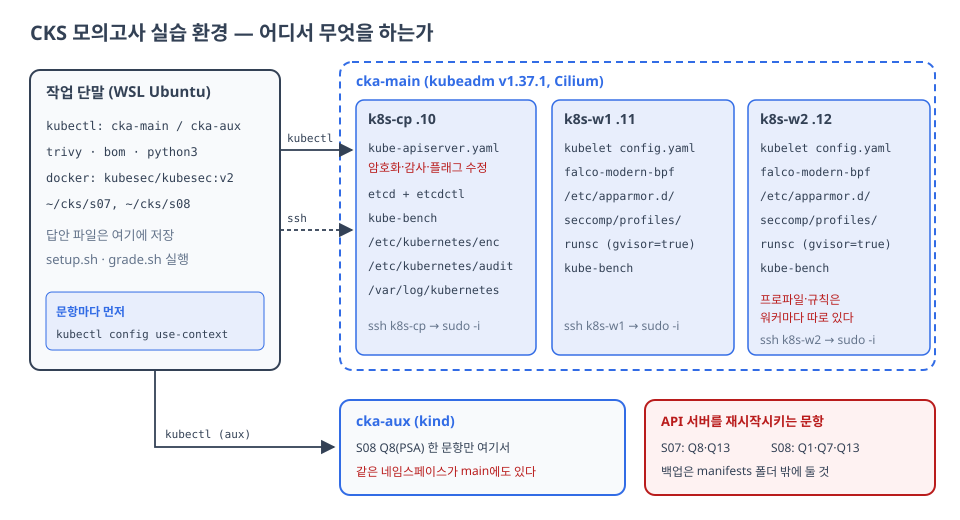

> **자격증 준비 · CKS** | 난이도 ★★★★★ | 예상 소요 시험 2시간 + 채점·복기 2시간

> ⚠️ **이 모의고사의 모든 문항은 CNCF가 공개한 CKS 커리큘럼(github.com/cncf/curriculum, 2026-11-15 확인 시 `CKS_Curriculum v1.37.pdf`)의 6개 도메인 항목을 바탕으로 이 시리즈가 직접 창작한 연습 과제입니다.** 실제 시험 문제나 유출 문제(덤프)가 아니고, 그런 것을 재현하지도 않습니다. Linux Foundation 시험은 응시 정책과 NDA로 보호되므로 "실제 출제 문제"라고 주장하는 자료는 믿지도, 퍼뜨리지도 마세요. 함정의 형태도 실제 시험을 옮긴 것이 아니라, 클러스터를 하드닝하다가 운영 중에 실제로 자주 저지르는 실수를 모아 만든 것입니다.

> 💡 **실습 환경 — S00 실습 환경 고정값 기준.** `cka-main` = kubeadm v1.37.1 클러스터(k8s-cp 192.168.56.10 / k8s-w1 .11 / k8s-w2 .12, Cilium), `cka-aux` = kind 클러스터. 작업 단말은 두 context가 들어 있는 CKA K00의 작업 셸, 스크립트와 답안 파일은 `~/cks/` 아래, 노드 작업은 `ssh <노드>` 후 `sudo -i`. 초기화 지점은 S00의 스냅샷 **`cks-clean`** 이고, 도구 위치는 [S07](./s07-mock-exam-1.md) 서두의 표와 같습니다(Trivy·bom·python3·kubesec 이미지는 작업 단말, kube-bench는 세 노드, Falco(`falco-modern-bpf`)·AppArmor·gVisor(`runtime/gvisor=true`)는 두 워커).

## 🎯 오늘의 목표

- `kubectl`이 응답하지 않는 상태에서 **`crictl`과 로그만으로** API 서버를 살리고, 같은 매니페스트를 두 번 더 안전하게 고친다
- "설정했다"와 "적용됐다"를 구분한다 — **기존 Secret 재암호화**, 플래그가 설정 파일을 덮어쓰는 kubelet, 다른 노드에만 있는 프로파일
- 시작할 때 선택된 **context를 의심**하고, 같은 이름의 네임스페이스가 두 클러스터에 있을 때 엉뚱한 곳에서 "성공"하는 실수를 막는다
- 조치(scale 0, 삭제)보다 **증거 확보(Falco 출력 저장)를 먼저** 하는 순서를 지킨다

---

## 1. 시험 안내

### 1-1. 형식과 규칙

[S07](./s07-mock-exam-1.md)과 같습니다. 다른 점만 표시합니다.

| 항목 | 이 모의고사 | 비고 |
|---|---|---|
| 제한 시간 | **2시간** | 실제 시험과 같음(온라인 감독, 실기) |
| 문항 수·배점 | 15문항, 합계 100점, 문항 단위 PASS/FAIL | 문항당 요구 사항이 2~4개씩 겹쳐 있음 |
| 합격 참고선 | 67점 | 공식 합격 점수는 Candidate Handbook에서 확인 |
| 출발 상태 | **cka-main의 API 서버가 응답하지 않음** | current-context가 무엇인지는 직접 확인할 것 |
| 허용 문서 | S07과 같음(kubernetes.io/docs·blog, falco.org/docs, etcd.io/docs 등) | 이 시리즈·노트·검색 엔진 금지 |
| 버전 | cka-main v1.37.1(`cks-clean`) | |

도메인별 배점은 공식 비중과 같습니다: Cluster Setup 15(Q3·Q4) / Cluster Hardening 15(Q1·Q2) / System Hardening 10(Q5·Q6) / Microservice 20(Q7·Q8·Q9) / Supply Chain 20(Q10·Q11·Q12) / Monitoring·Runtime 20(Q13·Q14·Q15).

시험 중 규칙:

1. **문항 머리의 `use-context` 명령을 건너뛰지 않습니다.** 이번에는 건너뛰면 **조용히 다른 클러스터에서 성공**하는 문항이 있습니다.
2. 노드 작업은 `ssh <노드>` → `sudo -i`, 끝나면 `exit`로 작업 단말에 돌아옵니다.
3. 셋업 스크립트는 시험이 끝난 뒤 읽으세요. 함정이 그대로 보입니다.
4. **API 서버 매니페스트를 고치는 문항이 셋(Q1·Q7·Q13)** 입니다. 하나를 잘못 고치면 나머지 모든 문항이 멈춥니다. 고칠 때마다 manifests 폴더 **밖에** 백업하세요.
5. k8s-cp와 워커의 `/var/lib/s08-setup/`은 셋업이 쓰는 폴더입니다. 시험 중 열어 보지 않습니다.



### 1-2. 준비와 진행 순서

준비 조건은 S07 1-2와 같고, 하나가 더 필요합니다. **`cka-aux`도 살아 있어야** 합니다(`kubectl --context cka-aux get nodes`). 꺼져 있으면 CKA K00의 `reset-aux.sh`로 다시 만드세요.

```bash
# 작업 단말에서. 먼저 S00 방식으로 초기화:
#   vagrant snapshot restore cks-clean --no-provision   (Vagrantfile 폴더)
mkdir -p ~/cks && cd ~/cks
vi s08-setup.sh        # 3절 내용 붙여 넣기 (LF)
bash s08-setup.sh      # 5~8분
```

```
[*] preflight ...
[*] etcd client tools on k8s-cp ...
[*] node files ...
[*] workloads on cka-main ...
[*] objects on cka-aux ...
[*] weakening kubelet on k8s-w2 ...
[*] "previous admin" edits kube-apiserver ...
[*] ready. Start the 2-hour timer now.
```

---

## 2. 문항 한눈에 보기

| # | context | 도메인 | 주제 | 배점 |
|---|---|---|---|---|
| Q1 | cka-main `[ssh k8s-cp]` | Cluster Hardening | 하드닝 중 죽은 API 서버 복구 | 8 |
| Q2 | cka-main | Cluster Hardening | RBAC 최소화 + 바운드 SA 토큰 | 7 |
| Q3 | cka-main | Cluster Setup | 기본 거부 NetworkPolicy + 허용 | 8 |
| Q4 | cka-main `[ssh k8s-w2]` | Cluster Setup | kube-bench 지적(kubelet) 수정 | 7 |
| Q5 | cka-main `[ssh k8s-w2]` | System Hardening | AppArmor 프로파일로 Pod 실행 | 5 |
| Q6 | cka-main | System Hardening | seccomp 프로파일 배포 + Deployment | 5 |
| Q7 | cka-main `[ssh k8s-cp]` | Microservice | Secret 암호화 + 기존 데이터 | 8 |
| Q8 | **cka-aux** | Microservice | PSA baseline enforce + 워크로드 수정 | 6 |
| Q9 | cka-main | Microservice | 동작하지 않는 gVisor RuntimeClass | 6 |
| Q10 | cka-main | Supply Chain | Trivy로 취약 워크로드 중지 | 7 |
| Q11 | cka-main | Supply Chain | 효과 없는 ValidatingAdmissionPolicy 고치기 | 7 |
| Q12 | cka-main | Supply Chain | kubesec 정적 분석 + 적용 | 6 |
| Q13 | cka-main `[ssh k8s-cp]` | Monitoring | 감사 로그 켜기(준비된 정책) | 8 |
| Q14 | cka-main `[ssh k8s-w1/w2]` | Monitoring | Falco 사용자 규칙 + 조치 | 6 |
| Q15 | cka-main | Monitoring | 불변 컨테이너(2개 컨테이너) | 6 |
| | | | **합계** | **100** |

---

## 3. 사전 준비 스크립트

작업 단말에서 실행합니다. 마지막 단계에서 cka-main의 API 서버 매니페스트가 바뀌므로, 스크립트가 끝난 뒤에는 cka-main에 kubectl이 통하지 않는 것이 정상입니다.

<details><summary>s08-setup.sh (작업 단말에서 실행 — 시험 후에 열어 보기)</summary>

```bash
#!/bin/bash
# s08-setup.sh -- CKS mock exam 2 (trap level) setup
# run on the work terminal (both contexts in kubeconfig, passwordless 'ssh <node> sudo')
set -euo pipefail

MAIN=${MAIN_CTX:-cka-main}
AUX=${AUX_CTX:-cka-aux}
WORK=~/cks/s08
STATE=/var/lib/s08-setup            # on nodes
MANI=/etc/kubernetes/manifests       # on k8s-cp

km() { kubectl --context "$MAIN" "$@"; }
ka() { kubectl --context "$AUX" "$@"; }
die() { echo "ERROR: $*" >&2; exit 1; }
node_sh() {   # node_sh <node> <command...> : run a command as root on a node
  local n=$1; shift
  if [[ $(hostname -s) == "$n" ]]; then
    sudo bash -c "$*"
  else
    ssh -o BatchMode=yes -o ConnectTimeout=5 "$n" "sudo bash -c $(printf '%q' "$*")"
  fi
}
ensure_ns() { "$1" create namespace "$2" --dry-run=client -o yaml | "$1" apply -f - >/dev/null; }
wait_for() {  # wait_for <seconds> <command...> : retry every 5s until the command succeeds
  local t=$1; shift
  while (( t > 0 )); do "$@" >/dev/null 2>&1 && return 0; sleep 5; t=$((t - 5)); done
  return 1
}

# --- preflight ---------------------------------------------------------
echo "[*] preflight ..."
for c in "$MAIN" "$AUX"; do
  kubectl config get-contexts "$c" >/dev/null 2>&1 || die "context $c not found"
done
km get nodes k8s-cp k8s-w1 k8s-w2 >/dev/null
ka get nodes >/dev/null || die "$AUX is not reachable (recreate it with reset-aux.sh)"
for n in k8s-cp k8s-w1 k8s-w2; do
  node_sh "$n" true || die "'ssh $n sudo' must work without a password"
done
for t in trivy python3 docker; do
  command -v "$t" >/dev/null || die "$t not found on the work terminal (see S00)"
done
# S00 runs kubesec as a shell function around the kubesec/kubesec:v2 image
docker image inspect kubesec/kubesec:v2 >/dev/null 2>&1 || docker pull -q kubesec/kubesec:v2 >/dev/null ||
  die "kubesec/kubesec:v2 image is not available (see S00)"
node_sh k8s-w2 "command -v kube-bench >/dev/null" || die "kube-bench not found on k8s-w2 (see S00)"
for n in k8s-w1 k8s-w2; do
  node_sh "$n" "command -v runsc >/dev/null && containerd config dump 2>/dev/null | grep -q 'runtimes.runsc'" ||
    die "gVisor runsc handler is not configured on $n (see S00)"
  km get nodes -l runtime/gvisor=true -o name | grep -qx "node/$n" ||
    die "node $n has no runtime/gvisor=true label (see S00)"
  node_sh "$n" "systemctl is-active -q falco-modern-bpf" ||
    die "falco-modern-bpf service is not running on $n (see S00)"
  node_sh "$n" "command -v falco >/dev/null && test -d /etc/falco" || die "falco binary/config missing on $n"
  node_sh "$n" "command -v apparmor_parser >/dev/null && grep -qx Y /sys/module/apparmor/parameters/enabled" ||
    die "AppArmor is not enabled on $n"
done
node_sh k8s-cp "grep -q -- '--enable-admission-plugins=NodeRestriction\$' $MANI/kube-apiserver.yaml &&
  ! grep -qE 'encryption-provider-config|audit-policy-file|profiling' $MANI/kube-apiserver.yaml" ||
  die "kube-apiserver manifest is not in the cks-clean state -- restore the snapshot first"

echo "[*] etcd client tools on k8s-cp ..."
img=$(km -n kube-system get pod -l component=etcd -o jsonpath='{.items[0].spec.containers[0].image}')
ver=${img##*:}; ver="v${ver%%-*}"
node_sh k8s-cp "command -v etcdctl >/dev/null && exit 0
  arch=\$(dpkg --print-architecture); tmp=\$(mktemp -d)
  curl -fsSL https://github.com/etcd-io/etcd/releases/download/${ver}/etcd-${ver}-linux-\$arch.tar.gz | tar xz -C \$tmp
  install -m 0755 \$tmp/etcd-${ver}-linux-\$arch/etcdctl \$tmp/etcd-${ver}-linux-\$arch/etcdutl /usr/local/bin/
  rm -rf \$tmp"

# --- node files --------------------------------------------------------
echo "[*] node files ..."
for n in k8s-cp k8s-w1 k8s-w2; do node_sh "$n" "mkdir -p $STATE"; done

# Q5: AppArmor profile -- file and loaded profile on k8s-w1 ONLY
node_sh k8s-w1 "cat > /etc/apparmor.d/s08-readonly <<'EOF'
#include <tunables/global>

profile s08-readonly flags=(attach_disconnected) {
  #include <abstractions/base>

  file,

  # read-only container: deny all file writes
  deny /** w,
}
EOF
apparmor_parser -r -q /etc/apparmor.d/s08-readonly"
node_sh k8s-w2 "apparmor_parser -R /etc/apparmor.d/s08-readonly 2>/dev/null || true; rm -f /etc/apparmor.d/s08-readonly"

# Q6: seccomp profile only on k8s-cp:/opt/s08
node_sh k8s-cp "mkdir -p /opt/s08 && cat > /opt/s08/s08-no-chmod.json <<'EOF'
{
  \"defaultAction\": \"SCMP_ACT_ALLOW\",
  \"syscalls\": [
    { \"names\": [\"chmod\", \"fchmod\", \"fchmodat\"], \"action\": \"SCMP_ACT_ERRNO\" }
  ]
}
EOF"
for n in k8s-w1 k8s-w2; do node_sh "$n" "rm -f /var/lib/kubelet/seccomp/profiles/s08-no-chmod.json"; done

# Q7: half-done encryption config (identity first)
key=$(head -c 32 /dev/urandom | base64)
node_sh k8s-cp "mkdir -p /etc/kubernetes/enc && cat > /etc/kubernetes/enc/enc.yaml <<EOF
apiVersion: apiserver.config.k8s.io/v1
kind: EncryptionConfiguration
resources:
  - resources:
      - secrets
    providers:
      - identity: {}
      - secretbox:
          keys:
            - name: s08key
              secret: ${key}
EOF
chmod 600 /etc/kubernetes/enc/enc.yaml"

# Q13: prepared audit policy (rule order is wrong on purpose)
node_sh k8s-cp "mkdir -p /etc/kubernetes/audit && cat > /etc/kubernetes/audit/s08-policy.yaml <<'EOF'
apiVersion: audit.k8s.io/v1
kind: Policy
omitStages:
  - \"RequestReceived\"
rules:
  # everything in the shop namespace with full bodies
  - level: RequestResponse
    namespaces: [\"s08-shop\"]
    resources:
    - group: \"\"
  # secrets: metadata only
  - level: Metadata
    resources:
    - group: \"\"
      resources: [\"secrets\"]
  # everything else
  - level: Metadata
EOF"

# --- workloads on cka-main ----------------------------------------------
echo "[*] workloads on cka-main ..."
mkdir -p "$WORK"
rm -f "$WORK/falco-pkg.txt"
for ns in s08-team s08-shop s08-sys s08-vault s08-tenant s08-sbx s08-img s08-prod s08-dev s08-ops s08-imm; do
  ensure_ns km "$ns"
done

km apply -f - >/dev/null <<'EOF'
apiVersion: v1
kind: ServiceAccount
metadata: {name: reporter, namespace: s08-team}
---
apiVersion: rbac.authorization.k8s.io/v1
kind: RoleBinding
metadata: {name: reporter-admin, namespace: s08-team}
roleRef: {apiGroup: rbac.authorization.k8s.io, kind: ClusterRole, name: admin}
subjects:
- {kind: ServiceAccount, name: reporter, namespace: s08-team}
---
apiVersion: rbac.authorization.k8s.io/v1
kind: ClusterRoleBinding
metadata: {name: reporter-view}
roleRef: {apiGroup: rbac.authorization.k8s.io, kind: ClusterRole, name: view}
subjects:
- {kind: ServiceAccount, name: reporter, namespace: s08-team}
---
apiVersion: v1
kind: Pod
metadata: {name: reporter, namespace: s08-team}
spec:
  serviceAccountName: reporter
  containers:
  - {name: app, image: "busybox:1.37", command: ["sh", "-c", "sleep 604800"]}
---
apiVersion: apps/v1
kind: Deployment
metadata: {name: frontend, namespace: s08-shop}
spec:
  replicas: 1
  selector: {matchLabels: {app: frontend}}
  template:
    metadata: {labels: {app: frontend}}
    spec:
      containers: [{name: nginx, image: "nginx:1.27-alpine"}]
---
apiVersion: apps/v1
kind: Deployment
metadata: {name: backend, namespace: s08-shop}
spec:
  replicas: 1
  selector: {matchLabels: {app: backend}}
  template:
    metadata: {labels: {app: backend}}
    spec:
      containers: [{name: nginx, image: "nginx:1.27-alpine", ports: [{containerPort: 80}]}]
---
apiVersion: v1
kind: Service
metadata: {name: backend, namespace: s08-shop}
spec:
  selector: {app: backend}
  ports: [{port: 8080, targetPort: 80}]
---
apiVersion: apps/v1
kind: Deployment
metadata: {name: intruder, namespace: s08-shop}
spec:
  replicas: 1
  selector: {matchLabels: {app: intruder}}
  template:
    metadata: {labels: {app: intruder}}
    spec:
      containers: [{name: nginx, image: "nginx:1.27-alpine"}]
---
apiVersion: apps/v1
kind: Deployment
metadata: {name: hardened, namespace: s08-sys}
spec:
  replicas: 2
  strategy: {type: Recreate}
  selector: {matchLabels: {app: hardened}}
  template:
    metadata: {labels: {app: hardened}}
    spec:
      affinity:
        podAntiAffinity:
          requiredDuringSchedulingIgnoredDuringExecution:
          - labelSelector: {matchLabels: {app: hardened}}
            topologyKey: kubernetes.io/hostname
      containers:
      - {name: app, image: "busybox:1.37", command: ["sh", "-c", "sleep 604800"]}
---
apiVersion: v1
kind: Secret
metadata: {name: db-cred, namespace: s08-vault}
type: Opaque
stringData: {password: S08-db-Pa55}
---
apiVersion: v1
kind: Secret
metadata: {name: api-token, namespace: s08-vault}
type: Opaque
stringData: {token: s08-tok-7f3a}
---
apiVersion: node.k8s.io/v1
kind: RuntimeClass
metadata: {name: sandbox}
handler: gvisor
scheduling:
  nodeSelector: {runtime/gvisor: "true"}
---
apiVersion: apps/v1
kind: Deployment
metadata: {name: untrusted, namespace: s08-sbx}
spec:
  replicas: 1
  selector: {matchLabels: {app: untrusted}}
  template:
    metadata: {labels: {app: untrusted}}
    spec:
      runtimeClassName: sandbox
      containers:
      - {name: app, image: "busybox:1.37", command: ["sh", "-c", "sleep 604800"]}
---
apiVersion: apps/v1
kind: Deployment
metadata: {name: frontend, namespace: s08-img}
spec:
  replicas: 1
  selector: {matchLabels: {app: frontend}}
  template:
    metadata: {labels: {app: frontend}}
    spec:
      containers: [{name: app, image: "nginx:1.27-alpine"}]
---
apiVersion: apps/v1
kind: Deployment
metadata: {name: legacy-api, namespace: s08-img}
spec:
  replicas: 1
  selector: {matchLabels: {app: legacy-api}}
  template:
    metadata: {labels: {app: legacy-api}}
    spec:
      initContainers:
      - {name: render, image: "nginx:1.19", command: ["sh", "-c", "nginx -v"]}
      containers:
      - {name: app, image: "busybox:1.37", command: ["sh", "-c", "sleep 604800"]}
---
apiVersion: apps/v1
kind: Deployment
metadata: {name: cache, namespace: s08-img}
spec:
  replicas: 1
  selector: {matchLabels: {app: cache}}
  template:
    metadata: {labels: {app: cache}}
    spec:
      containers: [{name: app, image: "redis:6.0.5"}]
---
apiVersion: apps/v1
kind: Deployment
metadata: {name: pause-svc, namespace: s08-img}
spec:
  replicas: 1
  selector: {matchLabels: {app: pause-svc}}
  template:
    metadata: {labels: {app: pause-svc}}
    spec:
      containers: [{name: app, image: "registry.k8s.io/pause:3.10"}]
---
apiVersion: admissionregistration.k8s.io/v1
kind: ValidatingAdmissionPolicy
metadata: {name: s08-no-latest}
spec:
  failurePolicy: Fail
  matchConstraints:
    resourceRules:
    - apiGroups: [""]
      apiVersions: ["v1"]
      operations: ["CREATE", "UPDATE"]
      resources: ["pods"]
  validations:
  - expression: "object.spec.containers.all(c, !c.image.endsWith(':latest'))"
    message: "latest tag is not allowed"
---
apiVersion: admissionregistration.k8s.io/v1
kind: ValidatingAdmissionPolicyBinding
metadata: {name: s08-no-latest-binding}
spec:
  policyName: s08-no-latest
  validationActions: ["Warn"]
  matchResources:
    namespaceSelector:
      matchLabels: {env: prod}
---
apiVersion: apps/v1
kind: Deployment
metadata: {name: patcher, namespace: s08-ops}
spec:
  replicas: 1
  selector: {matchLabels: {app: patcher}}
  template:
    metadata: {labels: {app: patcher}}
    spec:
      containers:
      - name: app
        image: alpine:3.22
        command: ["sh", "-c", "while true; do apk info >/dev/null 2>&1; sleep 20; done"]
---
apiVersion: apps/v1
kind: Deployment
metadata: {name: sleeper, namespace: s08-ops}
spec:
  replicas: 1
  selector: {matchLabels: {app: sleeper}}
  template:
    metadata: {labels: {app: sleeper}}
    spec:
      containers:
      - name: app
        image: alpine:3.22
        command: ["sh", "-c", "while true; do sleep 20; done"]
---
apiVersion: apps/v1
kind: Deployment
metadata: {name: cache, namespace: s08-imm}
spec:
  replicas: 2
  selector: {matchLabels: {app: cache}}
  template:
    metadata: {labels: {app: cache}}
    spec:
      containers:
      - name: app
        image: nginx:1.27-alpine
        securityContext: {privileged: true}
      - name: log-agent
        image: busybox:1.37
        command: ["sh", "-c", "mkdir -p /var/log/agent; while true; do date >> /var/log/agent/out.log; sleep 5; done"]
EOF

# Q8 decoy: the same namespace/workload also exists on cka-main
tenant_yaml() {
  cat <<'EOF'
apiVersion: apps/v1
kind: Deployment
metadata: {name: legacy, namespace: s08-tenant}
spec:
  replicas: 1
  selector: {matchLabels: {app: legacy}}
  template:
    metadata: {labels: {app: legacy}}
    spec:
      hostNetwork: true
      containers:
      - name: app
        image: busybox:1.37
        command: ["sh", "-c", "sleep 604800"]
        securityContext: {privileged: true}
EOF
}
tenant_yaml | km apply -f - >/dev/null

# Q12: manifest to analyse
cat > "$WORK/report-gen.yaml" <<'EOF'
apiVersion: apps/v1
kind: Deployment
metadata:
  name: report-gen
  namespace: s08-sys
spec:
  replicas: 1
  selector:
    matchLabels:
      app: report-gen
  template:
    metadata:
      labels:
        app: report-gen
    spec:
      hostPID: true
      initContainers:
      - name: prep
        image: busybox:1.37
        command: ["sh", "-c", "echo prep"]
        securityContext:
          privileged: true
      containers:
      - name: app
        image: busybox:1.37
        command: ["sh", "-c", "sleep 604800"]
        securityContext:
          capabilities:
            add: ["SYS_ADMIN"]
EOF

# --- objects on cka-aux ------------------------------------------------
echo "[*] objects on cka-aux ..."
ensure_ns ka s08-tenant
ensure_ns ka s08-team
ka -n s08-team create serviceaccount reporter --dry-run=client -o yaml | ka apply -f - >/dev/null
tenant_yaml | ka apply -f - >/dev/null

# --- weaken kubelet on k8s-w2 (Q4) ------------------------------------------
echo "[*] weakening kubelet on k8s-w2 ..."
node_sh k8s-w2 "f=/var/lib/kubelet/config.yaml; d=/etc/default/kubelet
  cp -a \$f $STATE/config.yaml.orig; touch \$d; cp -a \$d $STATE/default-kubelet.orig
  sed -i 's/^  mode: Webhook\$/  mode: AlwaysAllow/' \$f
  grep -q '^readOnlyPort:' \$f || echo 'readOnlyPort: 10255' >> \$f
  if grep -q '^KUBELET_EXTRA_ARGS=' \$d; then
    sed -i -E 's/^KUBELET_EXTRA_ARGS=\"?([^\"]*)\"?\$/KUBELET_EXTRA_ARGS=\"\\1 --read-only-port=10255\"/' \$d
  else
    echo 'KUBELET_EXTRA_ARGS=\"--read-only-port=10255\"' >> \$d
  fi
  grep -q '^  mode: AlwaysAllow' \$f && grep -q -- '--read-only-port=10255' \$d
  systemctl restart kubelet"
ro_open() { node_sh k8s-w2 "curl -s -m 3 -o /dev/null http://127.0.0.1:10255/healthz"; }
wait_for 120 ro_open || die "kubelet read-only port did not open on k8s-w2"
w2_ready() { [[ $(km get node k8s-w2 -o jsonpath='{.status.conditions[?(@.type=="Ready")].status}') == True ]]; }
wait_for 120 w2_ready || die "k8s-w2 did not come back Ready"
km -n s08-ops rollout status deploy/patcher --timeout=180s >/dev/null
km -n s08-img rollout status deploy/legacy-api --timeout=300s >/dev/null || true

# --- the "previous admin" breaks kube-apiserver (Q1) -------------------------
echo "[*] \"previous admin\" edits kube-apiserver ..."
node_sh k8s-cp "cp -a $MANI/kube-apiserver.yaml $STATE/kube-apiserver.yaml.orig
  sed -i 's/--enable-admission-plugins=NodeRestriction\$/--enable-admission-plugins=NodeRestriction,AlwaysPullImage/' $MANI/kube-apiserver.yaml
  sed -i 's/^    - kube-apiserver\$/    - kube-apiserver\n    - --profiling=flase/' $MANI/kube-apiserver.yaml
  grep -q 'NodeRestriction,AlwaysPullImage\$' $MANI/kube-apiserver.yaml
  grep -q -- '--profiling=flase' $MANI/kube-apiserver.yaml"
kubectl config use-context "$AUX" >/dev/null
echo "[*] ready. Start the 2-hour timer now."
```

</details>

> 💡 다시 풀 때는 반드시 `cks-clean` 스냅샷으로 되돌린 뒤 실행하세요. API 서버 매니페스트가 깨끗한 상태가 아니면 스크립트가 멈춥니다.

---

## 4. 문항

> 공통 조건: 파일 답안은 작업 단말의 `~/cks/s08/` 아래. 이름·네임스페이스·숫자는 문항에 적힌 그대로. **"삭제 금지", "바꾸지 않는다"는 채점 조건입니다.**

### Q1. API 서버 — 8점

```bash
kubectl config use-context cka-main
```

앞 관리자가 kube-bench 지적을 고치려고 k8s-cp의 kube-apiserver 매니페스트를 수정한 뒤 cka-main의 API 서버가 응답하지 않는다. `ssh k8s-cp`로 접속해 원인을 찾아 고쳐라. 앞 관리자가 의도한 하드닝은 **유지**해야 한다: 어드미션 플러그인 `NodeRestriction`과 `AlwaysPullImages`가 켜져 있고, 프로파일링이 꺼져 있어야 한다. `/etc/kubernetes/manifests/`에는 원래 있던 4개 매니페스트 외에 **다른 파일을 남기지 않는다.**

### Q2. RBAC와 SA 토큰 — 7점

```bash
kubectl config use-context cka-main
```

네임스페이스 `s08-team`의 ServiceAccount `reporter`는 Pod 목록과 로그만 읽으면 된다.

- 이 계정에 걸린 **기존 권한을 모두 제거**하고(어디에 걸려 있든), Role `reporter-role`과 RoleBinding `reporter-rb`로 `s08-team`의 `pods`와 `pods/log`에 대한 `get`, `list`만 허용하라.
- `reporter`는 토큰을 자동 마운트하지 않게 하라.
- Pod `reporter`(이미지 `busybox:1.37`, 명령 `sleep 604800`)가 이 계정을 쓰되, **projected 볼륨**으로 audience `s08-api`, 유효 기간 `3600`초의 토큰을 `/var/run/secrets/s08/token`에 받게 하라. 기본 경로(`/var/run/secrets/kubernetes.io/serviceaccount`)에는 토큰이 없어야 한다.

### Q3. NetworkPolicy — 8점

```bash
kubectl config use-context cka-main
```

네임스페이스 `s08-shop`에 다음을 만족하는 NetworkPolicy를 만들어라(이름과 개수는 자유).

- 이 네임스페이스의 **모든 Pod는 기본적으로 인그레스·이그레스가 모두 막힌다**(`podSelector: {}`, 두 방향 모두를 막는 정책 하나 이상).
- `app=frontend` Pod는 Service `backend`(포트 8080)를 **이름으로** 호출할 수 있어야 한다.
- `app=backend` Pod는 `app=frontend` Pod에서 오는 트래픽만 받는다. 그 밖의 통신은 모두 막힌다.

### Q4. kube-bench — 7점

```bash
kubectl config use-context cka-main
```

`ssh k8s-w2`로 접속해 `kube-bench run --targets node`를 실행하라. kubelet에 관한 FAIL 중 **인가 모드**와 **읽기 전용 포트** 두 건을 해결하라. 해결 후 kubelet의 읽기 전용 포트(10255)로는 **어떤 요청도 응답하지 않아야** 하고, kubelet은 실행 중, 노드는 Ready여야 한다.

### Q5. AppArmor — 5점

```bash
kubectl config use-context cka-main
```

보안팀이 AppArmor 프로파일 `s08-readonly`를 배포했다고 한다. `s08-sys`에 Pod `guarded`(이미지 `busybox:1.37`, 명령 `sleep 3600`)를 **반드시 노드 `k8s-w2`에서** 이 프로파일로 실행하라(`securityContext` 필드 사용). 노드를 재부팅해도 프로파일이 다시 로드되어야 한다.

### Q6. seccomp — 5점

```bash
kubectl config use-context cka-main
```

k8s-cp의 `/opt/s08/s08-no-chmod.json`에 seccomp 프로파일이 있다. `s08-sys`의 Deployment `hardened`(replicas 2)의 Pod 템플릿에 이 프로파일을 **Localhost 타입, `profiles/s08-no-chmod.json`** 으로 적용하라. 두 Pod 모두 Ready여야 하고, 두 Pod 모두에서 `chmod`가 실패해야 한다. Deployment의 다른 설정은 바꾸지 않는다.

### Q7. Secret 암호화 — 8점

```bash
kubectl config use-context cka-main
```

k8s-cp의 `/etc/kubernetes/enc/enc.yaml`에 앞 관리자가 만들어 둔 EncryptionConfiguration이 있다(키 이름 `s08key`). 이 파일을 kube-apiserver에 적용해, **`s08-vault` 네임스페이스의 Secret이 etcd에 평문으로 남아 있지 않게** 하라. 키 값은 바꾸지 않는다.

### Q8. Pod Security Admission — 6점

```bash
kubectl config use-context cka-aux
```

네임스페이스 `s08-tenant`에 다음 PSA 레이블을 붙여라(버전은 모두 `latest`).

- `enforce`: `baseline`
- `warn`: `restricted`
- `audit`: `restricted`

그다음 이 네임스페이스의 Deployment `legacy`를 고쳐 **baseline을 통과하는 Pod 1개가 Ready**가 되게 하라. 이미지와 명령은 바꾸지 않는다.

### Q9. gVisor — 6점

```bash
kubectl config use-context cka-main
```

`s08-sbx`의 Deployment `untrusted`는 RuntimeClass `sandbox`로 gVisor에서 실행되어야 하지만 Pod가 시작되지 않는다. 워커 노드의 containerd에는 gVisor가 핸들러 `runsc`로 등록되어 있다. **Deployment는 수정하지 말고** 원인을 고쳐 Pod가 gVisor 안에서 Running이 되게 하라. RuntimeClass 이름은 `sandbox`를 유지한다.

### Q10. Trivy — 7점

```bash
kubectl config use-context cka-main
```

`s08-img`의 Deployment 4개(`frontend`, `legacy-api`, `cache`, `pause-svc`)가 쓰는 **모든 이미지**를 작업 단말의 `trivy`로 검사하라. `CRITICAL` 취약점이 하나라도 있는 이미지를 쓰는 Deployment는 **replicas를 0으로** 줄여 그 이미지로 도는 Pod가 하나도 없게 하라. Deployment 삭제·이미지 변경은 금지, CRITICAL이 없는 Deployment는 그대로 둔다.

### Q11. ValidatingAdmissionPolicy — 7점

```bash
kubectl config use-context cka-main
```

ValidatingAdmissionPolicy `s08-no-latest`와 바인딩 `s08-no-latest-binding`이 있지만, 네임스페이스 `s08-prod`에서 `nginx:latest` Pod가 여전히 만들어진다. 이 두 객체를 고쳐(이름 유지) 다음을 만족하게 하라.

- `s08-prod`에서 **태그가 `latest`이거나 태그가 없는 이미지**를 쓰는 컨테이너(initContainers 포함)가 있으면 Pod 생성을 **거부**한다. 다이제스트(`@sha256:...`)로 고정한 이미지는 허용한다.
- 다른 네임스페이스(예: `s08-dev`)에는 영향이 없다.

### Q12. kubesec — 6점

```bash
kubectl config use-context cka-main
```

`~/cks/s08/report-gen.yaml`을 kubesec(S00의 `kubesec/kubesec:v2` 이미지)으로 분석해 **critical 항목이 하나도 없고 점수가 3 이상**이 되도록 고쳐라. 이 파일에 남아 있는 위험 설정(특권 실행, 호스트 PID 공유, 위험한 capability)은 컨테이너 종류와 상관없이 모두 없애야 한다. 이름·네임스페이스·이미지·명령은 바꾸지 않고, 고친 파일을 적용해 Deployment가 Ready 1/1이 되게 하라.

### Q13. 감사 로그 — 8점

```bash
kubectl config use-context cka-main
```

k8s-cp의 `/etc/kubernetes/audit/s08-policy.yaml`에 감사 정책이 준비되어 있다. 이 정책이 아래 요구 사항을 **실제로** 만족하는지 확인하고 필요하면 고친 뒤, kube-apiserver에 감사 로그를 켜라.

- 모든 네임스페이스의 `secrets`는 **`Metadata` 수준만**(Secret 내용이 로그에 남으면 안 된다)
- 네임스페이스 `s08-shop`의 그 밖의 core 그룹 리소스는 `RequestResponse`
- 그 밖의 요청은 `Metadata`, `RequestReceived` 단계는 기록하지 않음
- 로그 파일 `/var/log/kubernetes/audit/s08-audit.log`, 보존 30일, 백업 5개, 파일당 최대 100MB

### Q14. Falco — 6점

```bash
kubectl config use-context cka-main
```

컨테이너 안에서 패키지 관리자가 실행되는 것을 잡는 Falco 규칙을 **모든 워커 노드**의 `/etc/falco/falco_rules.local.yaml`에 추가하라.

- 규칙 이름 `s08 package manager in container`, 우선순위 `WARNING`
- 조건: 컨테이너 안에서 새로 실행된 프로세스의 이름이 `apk`, `apt`, `apt-get`, `dpkg`, `yum`, `dnf` 중 하나
- 출력은 `s08-pkg:`로 시작하고 `%proc.cmdline`과 `%container.id`를 포함

그다음 `s08-ops`에서 이 규칙에 걸리는 Deployment를 찾아라. 이 규칙이 만든 **경보 줄 하나 이상을 `~/cks/s08/falco-pkg.txt`에 저장**하고, 그 Deployment의 replicas를 `0`으로 줄여라(다른 Deployment는 건드리지 않는다).

### Q15. 불변 컨테이너 — 6점

```bash
kubectl config use-context cka-main
```

`s08-imm`의 Deployment `cache`의 **모든 컨테이너**를 루트 파일 시스템 읽기 전용으로 바꾸고, 특권 실행을 없애라. 컨테이너 이름·이미지·명령은 바꾸지 않으며, 두 컨테이너가 본래 기능(nginx 응답, `log-agent`의 로그 파일 기록)을 계속해야 한다. 2개 Pod 모두 Ready여야 한다.

---

## 5. 채점

### 5-1. 채점 절차

시간이 끝나면 작업 단말의 `~/cks`에서 실행합니다. 예외적으로 클러스터에 손대는 동작은 S07과 같습니다. Q8·Q11은 `--dry-run=server`로 생성을 시도만 하고, Q13은 확인용 Secret과 ConfigMap을 `s08-shop`에 하나씩 만들었다가 지웁니다. Q10은 Trivy로 이미지를 다시 검사합니다.

```bash
vi grade.sh      # 5-3 전문 붙여 넣기
bash grade.sh
```

```
== CKS mock exam 2 (s08) grading  2026-11-15 17:31 ==
Q01  PASS    8/  8  kube-apiserver recovered + hardening kept
Q02  FAIL    0/  7  reporter RBAC + bound token
...
---------------------------------------------------
TOTAL: 58 / 100   (PASS 9, FAIL 6)
RESULT: below reference line (67)
```

> ⚠️ Q1이 FAIL이면 cka-main을 쓰는 다른 문항도 대부분 FAIL입니다. 채점 결과가 0점에 가깝다면 `kubectl --context cka-main get nodes`부터 확인하세요.

### 5-2. 채점 체크리스트

| # | 검증 명령(context 생략 시 cka-main) | 기대 결과 |
|---|---|---|
| Q1 | `kubectl get --raw=/readyz`; `ssh k8s-cp ls /etc/kubernetes/manifests` | `ok`; 파일 4개 |
| Q2 | `kubectl auth can-i list pods -n default --as=system:serviceaccount:s08-team:reporter` | `no` |
| Q3 | `kubectl -n s08-shop exec deploy/frontend -- wget -qO- -T3 http://backend:8080` | nginx 페이지 |
| Q4 | `ssh k8s-w2 curl -s -m3 http://127.0.0.1:10255/healthz` | 연결 거부 |
| Q5 | `kubectl -n s08-sys get pod guarded -o wide` | `k8s-w2`, Running |
| Q6 | `kubectl -n s08-sys exec <각 Pod> -- sh -c 'touch /tmp/f; chmod 600 /tmp/f'` | `Operation not permitted` |
| Q7 | `ssh k8s-cp sudo etcdctl ... get /registry/secrets/s08-vault/db-cred \| hexdump -C \| head -3` | `k8s:enc:secretbox:v1:s08key` |
| Q8 | `kubectl --context cka-aux get ns s08-tenant --show-labels` | 세 PSA 레이블 |
| Q9 | `kubectl -n s08-sbx exec deploy/untrusted -- dmesg \| head -2` | `Starting gVisor...` |
| Q10 | `kubectl -n s08-img get deploy` | CRITICAL 대상만 `0/0` |
| Q11 | `kubectl -n s08-prod run t --image=nginx --dry-run=server` | `denied` |
| Q12 | `docker run -i --rm kubesec/kubesec:v2 scan /dev/stdin < ~/cks/s08/report-gen.yaml` | score ≥ 3, critical 없음 |
| Q13 | `ssh k8s-cp "sudo grep -c '\"resource\":\"secrets\"' /var/log/kubernetes/audit/s08-audit.log"` | 1 이상, Secret 값 없음 |
| Q14 | `cat ~/cks/s08/falco-pkg.txt` | `s08-pkg:` 줄 |
| Q15 | `kubectl -n s08-imm exec deploy/cache -c log-agent -- touch /x` | `Read-only file system` |

### 5-3. 자동 채점 스크립트 `grade.sh` 전문

```bash
#!/bin/bash
# grade.sh -- CKS mock exam 2 (s08) auto grader
# run on the work terminal, like s08-setup.sh.
# read-only except: Q8/Q11 server-side dry-run, Q13 one probe Secret + ConfigMap (created and deleted)
MAIN=${MAIN_CTX:-cka-main}
AUX=${AUX_CTX:-cka-aux}
SCORE=0; MAX=0; NPASS=0; NFAIL=0
MANI=/etc/kubernetes/manifests/kube-apiserver.yaml
ETCDCTL='etcdctl --endpoints=https://127.0.0.1:2379 --cacert=/etc/kubernetes/pki/etcd/ca.crt --cert=/etc/kubernetes/pki/etcd/server.crt --key=/etc/kubernetes/pki/etcd/server.key'

km() { kubectl --context "$MAIN" --request-timeout=15s "$@"; }
ka() { kubectl --context "$AUX" --request-timeout=15s "$@"; }
node_sh() {
  local n=$1; shift
  if [[ $(hostname -s) == "$n" ]]; then
    sudo bash -c "$*"
  else
    ssh -o BatchMode=yes -o ConnectTimeout=5 "$n" "sudo bash -c $(printf '%q' "$*")"
  fi
}
check() {   # check <no> <points> <title> <function>
  local no=$1 pts=$2 title=$3 fn=$4
  MAX=$((MAX + pts))
  if ( "$fn" ) >/dev/null 2>&1; then
    SCORE=$((SCORE + pts)); NPASS=$((NPASS + 1))
    printf 'Q%02d  PASS  %3d/%3d  %s\n' "$no" "$pts" "$pts" "$title"
  else
    NFAIL=$((NFAIL + 1))
    printf 'Q%02d  FAIL  %3d/%3d  %s\n' "$no" 0 "$pts" "$title"
  fi
}
jp() { "$1" "${@:2:$#-2}" -o jsonpath="${!#}"; }   # jp km -n ns get x y '{...}'
eq() { [[ "$1" == "$2" ]]; }
node_ready() { eq "$(jp km get node "$1" '{.status.conditions[?(@.type=="Ready")].status}')" True; }
ready_cp() { eq "$(jp km -n kube-system get pod "$1-k8s-cp" '{.status.conditions[?(@.type=="Ready")].status}')" True; }
pod_ip() { jp km -n "$1" get pod -l "app=$2" '{.items[0].status.podIP}'; }
can() { km auth can-i "$@"; }
kubesec_scan() {  # S00 runs kubesec from the kubesec/kubesec:v2 image
  if command -v kubesec >/dev/null; then kubesec scan "$1"
  else docker run -i --rm kubesec/kubesec:v2 scan /dev/stdin < "$1"; fi
}
dry_pod() {  # dry_pod <ns> <image> [init-image] : 0 if cka-main would admit the pod
  local init=""
  [[ -n ${3:-} ]] && init="  initContainers: [{name: init, image: \"$3\"}]"
  km create --dry-run=server -f - <<EOF
apiVersion: v1
kind: Pod
metadata: {name: grade-probe, namespace: $1}
spec:
$init
  containers: [{name: app, image: "$2"}]
EOF
}
trivy_crit() {  # 0 = image has CRITICAL vulns, 1 = clean, 2 = scan error
  local rc=0
  trivy image -q --scanners vuln --severity CRITICAL --exit-code 3 "$1" >/dev/null 2>&1 || rc=$?
  case $rc in 3) return 0 ;; 0) return 1 ;; *) return 2 ;; esac
}
kubesec_ok() {  # kubesec_ok <file> : valid, score >= 3, no critical findings
  local out
  out=$(kubesec_scan "$1" 2>/dev/null) || true
  python3 -c '
import json, sys
d = json.loads(sys.stdin.read())[0]
crit = (d.get("scoring") or {}).get("critical") or []
sys.exit(0 if d.get("valid", True) and d.get("score", -99) >= 3 and not crit else 1)' <<<"$out"
}

# --- checks ------------------------------------------------------------
q01() {
  node_sh k8s-cp "grep -Eq -- '--enable-admission-plugins=.*\bAlwaysPullImages\b' $MANI &&
    grep -Eq -- '--enable-admission-plugins=.*\bNodeRestriction\b' $MANI &&
    grep -q -- '--profiling=false' $MANI &&
    [ \"\$(ls -A /etc/kubernetes/manifests | wc -l)\" -eq 4 ]" &&
  eq "$(km get --raw=/readyz)" ok && ready_cp kube-apiserver
}

q02() {
  local sa=system:serviceaccount:s08-team:reporter v
  km -n s08-team get role reporter-role && km -n s08-team get rolebinding reporter-rb || return 1
  for v in get list; do eq "$(can "$v" pods -n s08-team --as="$sa")" yes || return 1; done
  eq "$(can get pods --subresource=log -n s08-team --as="$sa")" yes &&
  eq "$(can delete pods -n s08-team --as="$sa")" no &&
  eq "$(can get secrets -n s08-team --as="$sa")" no &&
  eq "$(can create deployments.apps -n s08-team --as="$sa")" no &&
  eq "$(can list pods -n default --as="$sa")" no &&
  eq "$(can list nodes --as="$sa")" no &&
  eq "$(jp km -n s08-team get sa reporter '{.automountServiceAccountToken}')" false &&
  eq "$(jp km -n s08-team get pod reporter '{.spec.serviceAccountName}|{.status.phase}')" 'reporter|Running' &&
  eq "$(jp km -n s08-team get pod reporter '{.spec.volumes[*].projected.sources[*].serviceAccountToken.audience}|{.spec.volumes[*].projected.sources[*].serviceAccountToken.expirationSeconds}')" 's08-api|3600' &&
  km -n s08-team exec reporter -- test -s /var/run/secrets/s08/token &&
  ! km -n s08-team exec reporter -- test -e /var/run/secrets/kubernetes.io/serviceaccount/token
}

q03() {
  local be intr n
  n=$(jp km -n s08-shop get netpol '{range .items[*]}{.spec.podSelector}|{.spec.policyTypes[*]}{"\n"}{end}' |
      grep -cE '^\{\}\|(Ingress Egress|Egress Ingress)$')
  (( n >= 1 )) || return 1
  be=$(pod_ip s08-shop backend); intr=$(pod_ip s08-shop intruder)
  km -n s08-shop exec deploy/frontend -- wget -q -T 3 -O /dev/null http://backend:8080/ &&
  ! km -n s08-shop exec deploy/intruder -- wget -q -T 3 -O /dev/null "http://$be/" &&
  ! km -n s08-shop exec deploy/frontend -- wget -q -T 3 -O /dev/null "http://$intr/" &&
  ! km -n s08-shop exec deploy/backend -- wget -q -T 3 -O /dev/null "http://$intr/"
}

q04() {
  node_ready k8s-w2 &&
  node_sh k8s-w2 'f=/var/lib/kubelet/config.yaml
    systemctl is-active -q kubelet &&
    grep -q "^  mode: Webhook" $f &&
    ! grep -Eq "^readOnlyPort: *[1-9]" $f &&
    ! grep -qs -- "--read-only-port=[1-9]" /etc/default/kubelet &&
    ! curl -s -m 3 -o /dev/null http://127.0.0.1:10255/healthz'
}

q05() {
  local p='{.spec.securityContext.appArmorProfile.type}{.spec.containers[0].securityContext.appArmorProfile.type}|{.spec.securityContext.appArmorProfile.localhostProfile}{.spec.containers[0].securityContext.appArmorProfile.localhostProfile}'
  eq "$(jp km -n s08-sys get pod guarded "$p")" 'Localhost|s08-readonly' &&
  eq "$(jp km -n s08-sys get pod guarded '{.spec.nodeName}|{.status.phase}')" 'k8s-w2|Running' &&
  node_sh k8s-w2 'grep -q "^s08-readonly (enforce)" /sys/kernel/security/apparmor/profiles &&
                  test -f /etc/apparmor.d/s08-readonly' &&
  ! km -n s08-sys exec guarded -- touch /tmp/grade-x
}

q06() {
  local t='{.spec.template.spec' nodes pod
  eq "$(jp km -n s08-sys get deploy hardened "${t}.securityContext.seccompProfile.localhostProfile}${t}.containers[0].securityContext.seccompProfile.localhostProfile}")" profiles/s08-no-chmod.json &&
  eq "$(jp km -n s08-sys get deploy hardened '{.spec.replicas}|{.status.readyReplicas}')" '2|2' || return 1
  nodes=$(jp km -n s08-sys get pod -l app=hardened '{range .items[*]}{.spec.nodeName}{"\n"}{end}' | sort -u | xargs)
  eq "$nodes" "k8s-w1 k8s-w2" || return 1
  for pod in $(jp km -n s08-sys get pod -l app=hardened '{.items[*].metadata.name}'); do
    km -n s08-sys exec "$pod" -- touch /tmp/grade-f || return 1
    km -n s08-sys exec "$pod" -- chmod 600 /tmp/grade-f && return 1
  done
  return 0
}

q07() {
  node_sh k8s-cp "grep -q -- '--encryption-provider-config=/etc/kubernetes/enc/enc.yaml' $MANI &&
    grep -m1 -E '^[[:space:]]*- (identity|aescbc|aesgcm|secretbox|kms)' /etc/kubernetes/enc/enc.yaml | grep -q secretbox &&
    for s in db-cred api-token; do
      $ETCDCTL get /registry/secrets/s08-vault/\$s --print-value-only | grep -a -q 'k8s:enc:secretbox:v1:s08key:' || exit 1
    done" &&
  eq "$(jp km -n s08-vault get secret db-cred '{.data.password}' | base64 -d)" S08-db-Pa55 &&
  eq "$(jp km -n s08-vault get secret api-token '{.data.token}' | base64 -d)" s08-tok-7f3a
}

q08() {
  local l='{.metadata.labels.pod-security\.kubernetes\.io/enforce}|{.metadata.labels.pod-security\.kubernetes\.io/warn}|{.metadata.labels.pod-security\.kubernetes\.io/audit}'
  eq "$(jp ka get ns s08-tenant "$l")" 'baseline|restricted|restricted' &&
  eq "$(jp ka -n s08-tenant get deploy legacy '{.spec.template.spec.containers[0].image}|{.status.readyReplicas}|{.status.updatedReplicas}')" 'busybox:1.37|1|1' &&
  ! eq "$(jp ka -n s08-tenant get deploy legacy '{.spec.template.spec.hostNetwork}')" true &&
  ! jp ka -n s08-tenant get deploy legacy '{.spec.template.spec.containers[*].securityContext.privileged}' | grep -q true &&
  ! ka create --dry-run=server -f - <<'EOF'
apiVersion: v1
kind: Pod
metadata: {name: grade-probe, namespace: s08-tenant}
spec:
  containers:
  - name: app
    image: busybox:1.37
    securityContext: {privileged: true}
EOF
}

q09() {
  eq "$(jp km get runtimeclass sandbox '{.handler}')" runsc &&
  eq "$(jp km -n s08-sbx get deploy untrusted '{.spec.template.spec.runtimeClassName}|{.status.readyReplicas}')" 'sandbox|1' &&
  km -n s08-sbx exec deploy/untrusted -- dmesg | grep -qi gvisor
}

q10() {
  local d imgs img rc bad
  for d in frontend:nginx:1.27-alpine legacy-api:nginx:1.19,busybox:1.37 \
           cache:redis:6.0.5 pause-svc:registry.k8s.io/pause:3.10; do
    imgs=${d#*:}; d=${d%%:*}
    eq "$(jp km -n s08-img get deploy "$d" '{.spec.template.spec.initContainers[*].image} {.spec.template.spec.containers[*].image}' | xargs | tr ' ' ',')" "$imgs" || return 1
    bad=no
    for img in ${imgs//,/ }; do
      rc=0; trivy_crit "$img" || rc=$?
      case $rc in 0) bad=yes ;; 1) ;; *) return 1 ;; esac
    done
    if [[ $bad == yes ]]; then
      eq "$(jp km -n s08-img get deploy "$d" '{.spec.replicas}')" 0 || return 1
      [[ -z $(jp km -n s08-img get pod -l "app=$d" '{.items[*].metadata.name}') ]] || return 1
    else
      eq "$(jp km -n s08-img get deploy "$d" '{.spec.replicas}|{.status.readyReplicas}')" '1|1' || return 1
    fi
  done
  return 0
}

q11() {
  km get validatingadmissionpolicy s08-no-latest && km get validatingadmissionpolicybinding s08-no-latest-binding || return 1
  dry_pod s08-prod nginx:1.27-alpine &&
  dry_pod s08-prod "nginx@sha256:$(printf '%064d' 0)" &&
  ! dry_pod s08-prod nginx:latest &&
  ! dry_pod s08-prod nginx &&
  ! dry_pod s08-prod registry.local:5000/team/app &&
  ! dry_pod s08-prod nginx:1.27-alpine busybox:latest &&
  dry_pod s08-dev nginx:latest
}

q12() {
  local f=~/cks/s08/report-gen.yaml
  kubesec_ok "$f" &&
  ! grep -Eq 'privileged: *true|hostPID: *true|SYS_ADMIN' "$f" &&
  eq "$(jp km -n s08-sys get deploy report-gen '{.spec.template.spec.containers[0].image}|{.status.readyReplicas}')" 'busybox:1.37|1' &&
  ! eq "$(jp km -n s08-sys get deploy report-gen '{.spec.template.spec.hostPID}')" true &&
  ! jp km -n s08-sys get deploy report-gen '{.spec.template.spec.initContainers[*].securityContext.privileged}' | grep -q true &&
  ! jp km -n s08-sys get deploy report-gen '{.spec.template.spec.containers[*].securityContext.capabilities.add}' | grep -q SYS_ADMIN
}

q13() {
  local probe="grade-probe-$RANDOM" val="grade-secret-value-$RANDOM" b64
  b64=$(printf '%s' "$val" | base64)
  node_sh k8s-cp "grep -q -- '--audit-policy-file=/etc/kubernetes/audit/s08-policy.yaml' $MANI &&
    grep -q -- '--audit-log-path=/var/log/kubernetes/audit/s08-audit.log' $MANI &&
    grep -q -- '--audit-log-maxage=30' $MANI && grep -q -- '--audit-log-maxbackup=5' $MANI &&
    grep -q -- '--audit-log-maxsize=100' $MANI" || return 1
  km -n s08-shop create secret generic "$probe" --from-literal=k="$val" || return 1
  km -n s08-shop create configmap "$probe" --from-literal=k=v || return 1
  sleep 5
  km -n s08-shop delete secret "$probe" --wait=false
  km -n s08-shop delete configmap "$probe" --wait=false
  node_sh k8s-cp "L=/var/log/kubernetes/audit/s08-audit.log
    grep -a '\"resource\":\"secrets\",\"namespace\":\"s08-shop\",\"name\":\"$probe\"' \$L | grep -q '\"level\":\"Metadata\"' &&
    ! grep -a -q -e '$val' -e '$b64' \$L &&
    grep -a '\"resource\":\"configmaps\",\"namespace\":\"s08-shop\",\"name\":\"$probe\"' \$L | grep -q '\"level\":\"RequestResponse\"' &&
    ! grep -a '\"name\":\"$probe\"' \$L | grep -q '\"stage\":\"RequestReceived\"'"
}

q14() {
  local n
  for n in k8s-w1 k8s-w2; do
    node_sh "$n" 'f=/etc/falco/falco_rules.local.yaml
      grep -q "rule: s08 package manager in container" $f &&
      grep -Eq "priority: *WARNING" $f &&
      grep -q "s08-pkg:" $f && grep -q "%proc.cmdline" $f && grep -q "%container.id" $f &&
      falco -V /etc/falco/falco_rules.yaml -V $f' || return 1
  done
  eq "$(jp km -n s08-ops get deploy patcher '{.spec.replicas}')" 0 &&
  eq "$(jp km -n s08-ops get deploy sleeper '{.spec.replicas}|{.status.readyReplicas}')" '1|1' &&
  grep 's08-pkg:' ~/cks/s08/falco-pkg.txt | grep -q apk
}

q15() {
  local t='{.spec.template.spec.containers'
  eq "$(jp km -n s08-imm get deploy cache "${t}[*].name}")" 'app log-agent' &&
  eq "$(jp km -n s08-imm get deploy cache "${t}[*].image}")" 'nginx:1.27-alpine busybox:1.37' &&
  eq "$(jp km -n s08-imm get deploy cache "${t}[*].securityContext.readOnlyRootFilesystem}")" 'true true' &&
  ! jp km -n s08-imm get deploy cache "${t}[*].securityContext.privileged}" | grep -q true &&
  eq "$(jp km -n s08-imm get deploy cache '{.status.readyReplicas}|{.status.updatedReplicas}')" '2|2' &&
  ! km -n s08-imm exec deploy/cache -c app -- touch /usr/share/nginx/html/grade-x &&
  ! km -n s08-imm exec deploy/cache -c log-agent -- touch /grade-x &&
  km -n s08-imm exec deploy/cache -c log-agent -- test -s /var/log/agent/out.log &&
  km -n s08-imm exec deploy/cache -c app -- wget -q -T 3 -O /dev/null http://127.0.0.1/
}

# --- run ---------------------------------------------------------------
echo "== CKS mock exam 2 (s08) grading  $(date '+%F %H:%M') =="
check  1  8 "kube-apiserver recovered + hardening kept" q01
check  2  7 "reporter RBAC + bound token"        q02
check  3  8 "NetworkPolicy s08-shop (+DNS)"      q03
check  4  7 "kubelet authz + read-only port"     q04
check  5  5 "AppArmor on k8s-w2"                 q05
check  6  5 "seccomp on both workers"            q06
check  7  8 "Secret encryption incl. existing"   q07
check  8  6 "PSA on cka-aux s08-tenant"          q08
check  9  6 "gVisor RuntimeClass handler"        q09
check 10  7 "Trivy CRITICAL workloads stopped"   q10
check 11  7 "VAP no-latest enforced"             q11
check 12  6 "kubesec report-gen"                 q12
check 13  8 "audit logging (policy + mounts)"    q13
check 14  6 "Falco rule + evidence + scale 0"    q14
check 15  6 "immutable cache (2 containers)"     q15
echo "---------------------------------------------------"
printf 'TOTAL: %d / %d   (PASS %d, FAIL %d)\n' "$SCORE" "$MAX" "$NPASS" "$NFAIL"
if (( SCORE >= 67 )); then
  echo "RESULT: reference line (67) reached"
else
  echo "RESULT: below reference line (67)"
fi
```

> 💡 **"설정했다"가 아니라 "적용됐다"를 채점합니다.** Q7은 설정 파일이 아니라 etcd에 저장된 **기존 Secret 두 개**의 바이트를 보고, Q4는 설정 파일이 아니라 **10255 포트가 실제로 닫혔는지**를 보며, Q13은 Secret 값이 **로그 어디에도 없는지** 확인합니다.

---

## 6. 풀이

### 6-1. 함정 지도

시험을 마친 뒤 먼저 이 표로 "어디에 함정이 있었는지"를 훑고, 아래 풀이를 보세요.

| 문항 | 숨은 함정 | 놓치면 |
|---|---|---|
| 시작 | current-context가 **cka-aux**. `kubectl get nodes`가 멀쩡히 동작해 "클러스터 정상"으로 착각 | 시간 낭비, 여러 문항을 엉뚱한 클러스터에 적용 |
| Q1 | 오류가 **두 개**(`--profiling=flase`, `AlwaysPullImage`). 하나를 고치면 다음 오류가 나타남 / "하드닝 유지" 조건 때문에 줄을 지우면 안 됨 / 백업을 manifests 안에 두면 파일 5개 | Q1, 그리고 cka-main 문항 전부 |
| Q2 | 권한이 **RoleBinding(admin)과 ClusterRoleBinding(view) 두 곳**에서 옴 / `s08-team`과 SA `reporter`가 **cka-aux에도 있음** → context를 안 바꾸면 aux에서 조용히 성공 / Pod 볼륨은 수정 불가라 **다시 만들어야** 함 | Q2 |
| Q3 | 기본 거부 아래에서 **DNS 이그레스(53/UDP·TCP)** 를 빠뜨리면 "이름으로" 호출이 실패 / Service 포트(8080)가 아니라 **Pod 포트(80)** 를 허용해야 함 | Q3 |
| Q4 | 설정 파일의 `readOnlyPort`를 지워도 `/etc/default/kubelet`의 **플래그 `--read-only-port=10255`가 이김** | Q4 |
| Q5 | 프로파일은 **k8s-w1에만** 로드되어 있음. k8s-w2에는 파일도 없음 / 재부팅 대비로 `/etc/apparmor.d/`에 파일을 둬야 함 | Q5 |
| Q6 | 프로파일이 k8s-cp에만 있음. Pod 2개가 **두 워커에 하나씩** 뜨므로 양쪽 모두에 복사해야 함 | Q6 |
| Q7 | 준비된 설정의 **첫 provider가 `identity`** → 적용해도 평문 저장 / hostPath 마운트 누락 시 API 사망 / 적용 후 **기존 Secret을 다시 쓰지 않으면** 평문 그대로 | Q7 (재암호화 누락이 가장 흔한 감점) |
| Q8 | **cka-aux** 문항. 같은 네임스페이스·Deployment가 cka-main에도 있어, context를 안 바꾸면 main에서 다 끝낸 것처럼 보임 / `privileged`와 `hostNetwork` 둘 다 baseline 위반 | Q8 |
| Q9 | RuntimeClass의 `handler`는 **변경 불가** → 지우고 다시 만들기 / 실패한 Pod는 다시 만들어야 빨리 반영 | Q9 |
| Q10 | **initContainer 이미지**까지 검사 / Pod를 지우면 Deployment가 다시 만듦(replicas 0이 답) | Q10 |
| Q11 | 바인딩이 `Warn` / 바인딩 selector(`env=prod`)에 맞는 레이블이 네임스페이스에 없음 / 식이 `:latest`만 보고 **태그 없음·initContainers**를 놓침 | Q11 |
| Q12 | 위험 설정이 **initContainer**에 숨어 있음(kubesec 점수만 보면 놓칠 수 있음) | Q12 |
| Q13 | 준비된 정책의 **규칙 순서**: `s08-shop` 전체 RequestResponse가 secrets 규칙보다 위 → Secret 값이 로그에 남음 / **hostPath 마운트 2개** 누락 시 API 사망 | Q13, 마운트 누락이면 cka-main 전부 |
| Q14 | 규칙을 **Pod가 뜬 워커에만** 넣으면 다른 워커에서 FAIL / **증거를 저장하기 전에 scale 0** 하면 경보가 다시 안 남 | Q14 |
| Q15 | `log-agent`도 읽기 전용이 되면 `/var/log/agent`에 emptyDir 필요 / nginx는 `/var/cache/nginx`, `/var/run` 필요 | Q15 |

**권장 순서:** `current-context` 확인 → **Q1** → Q7·Q13(API 서버를 하나씩 고치고 매번 확인) → Q4·Q5·Q6·Q14(노드 작업 묶음) → 나머지. Q14는 **규칙 추가 → 경보 확인·저장 → scale 0** 순서를 지켜야 합니다.

### 6-2. 문항별 풀이

<details><summary>풀이 — Q1. API 서버</summary>

```bash
kubectl config current-context            # cka-aux ← 함정
kubectl config use-context cka-main
kubectl get nodes                         # connection refused / timeout
ssh k8s-cp
sudo -i
crictl ps -a --name kube-apiserver        # Exited, 재시작 반복
crictl logs $(crictl ps -a --name kube-apiserver -q | head -1) 2>&1 | tail -3
#   Error: invalid argument "flase" for "--profiling" flag: strconv.ParseBool: parsing "flase": invalid syntax
#   (crictl에 컨테이너가 안 보이면: ls /var/log/pods/ | grep apiserver 후 그 폴더의 로그)

cp /etc/kubernetes/manifests/kube-apiserver.yaml /root/kube-apiserver.yaml.broken   # 폴더 밖에!
sed -i 's/--profiling=flase/--profiling=false/' /etc/kubernetes/manifests/kube-apiserver.yaml
sleep 30; crictl logs $(crictl ps -a --name kube-apiserver -q | head -1) 2>&1 | tail -3
#   ... enable-admission-plugins plugin "AlwaysPullImage" is unknown
sed -i 's/NodeRestriction,AlwaysPullImage$/NodeRestriction,AlwaysPullImages/' /etc/kubernetes/manifests/kube-apiserver.yaml
grep -E 'profiling|admission-plugins' /etc/kubernetes/manifests/kube-apiserver.yaml
ls /etc/kubernetes/manifests                # 4개만
watch crictl ps --name kube-apiserver       # Running이 유지되는지
exit; exit
kubectl get --raw=/readyz; echo             # ok
```

**흔한 감점:** 오류 메시지를 처음 하나만 보고 "고쳤다"고 넘어가면 두 번째 오류로 계속 죽어 있습니다. 고칠 때마다 **로그를 다시** 봅니다. `--profiling` 줄을 통째로 지우거나 `AlwaysPullImage`를 빼 버리면 API는 살아도 "하드닝 유지" 조건 위반입니다. `vi`로 열었다가 `.swp`나 `kube-apiserver.yaml~` 같은 파일이 manifests 폴더에 남는지도 확인하세요(`ls -A`).

📖 Tasks → Debug → Debug Cluster → Troubleshooting Clusters, Reference → Command line tool reference → kube-apiserver(`--enable-admission-plugins`의 플러그인 이름 목록)

</details>

<details><summary>풀이 — Q2. RBAC와 SA 토큰</summary>

```bash
kubectl config use-context cka-main       # aux에도 s08-team/reporter가 있다
kubectl get rolebindings,clusterrolebindings -A -o wide | grep 's08-team/reporter'
#   s08-team   rolebinding.../reporter-admin   ClusterRole/admin ...
#              clusterrolebinding.../reporter-view   ClusterRole/view ...
kubectl -n s08-team delete rolebinding reporter-admin
kubectl delete clusterrolebinding reporter-view

kubectl -n s08-team create role reporter-role --verb=get,list --resource=pods,pods/log
kubectl -n s08-team create rolebinding reporter-rb --role=reporter-role --serviceaccount=s08-team:reporter
kubectl -n s08-team patch sa reporter -p '{"automountServiceAccountToken": false}'

kubectl -n s08-team get pod reporter -o yaml > /tmp/reporter.yaml   # 참고용
kubectl -n s08-team delete pod reporter --now
kubectl apply -f - <<'EOF'
apiVersion: v1
kind: Pod
metadata:
  name: reporter
  namespace: s08-team
spec:
  serviceAccountName: reporter
  containers:
  - name: app
    image: busybox:1.37
    command: ["sh", "-c", "sleep 604800"]
    volumeMounts:
    - name: s08-token
      mountPath: /var/run/secrets/s08
      readOnly: true
  volumes:
  - name: s08-token
    projected:
      sources:
      - serviceAccountToken:
          path: token
          audience: s08-api
          expirationSeconds: 3600
EOF
SA=system:serviceaccount:s08-team:reporter
kubectl auth can-i list pods -n default --as=$SA          # no
kubectl auth can-i get pods --subresource=log -n s08-team --as=$SA   # yes
kubectl -n s08-team exec reporter -- ls /var/run/secrets/  # s08 만 있음
```

**흔한 감점:** RoleBinding만 지우면 ClusterRoleBinding의 `view` 때문에 **모든 네임스페이스의 Pod 목록**을 여전히 읽습니다. 바인딩은 `-A`와 ClusterRoleBinding까지 한 번에 찾으세요. `pods/log`는 하위 리소스라 `--resource=pods`만으로는 포함되지 않습니다. 실행 중인 Pod에 볼륨을 `kubectl edit`로 추가하려 하면 거부됩니다(Pod 스펙의 대부분은 변경 불가). `expirationSeconds`는 600 이상이어야 합니다.

📖 Reference → Access Authn/Authz → Using RBAC Authorization, Tasks → Configure Pods and Containers → Configure Service Accounts for Pods(ServiceAccount token volume projection)

</details>

<details><summary>풀이 — Q3. NetworkPolicy</summary>

```bash
kubectl config use-context cka-main
kubectl -n s08-shop get svc backend        # 8080 → targetPort 80
kubectl apply -f - <<'EOF'
apiVersion: networking.k8s.io/v1
kind: NetworkPolicy
metadata: {name: default-deny-all, namespace: s08-shop}
spec:
  podSelector: {}
  policyTypes: ["Ingress", "Egress"]
---
apiVersion: networking.k8s.io/v1
kind: NetworkPolicy
metadata: {name: allow-dns, namespace: s08-shop}
spec:
  podSelector: {}
  policyTypes: ["Egress"]
  egress:
  - to:
    - namespaceSelector:
        matchLabels: {kubernetes.io/metadata.name: kube-system}
      podSelector:
        matchLabels: {k8s-app: kube-dns}
    ports:
    - {protocol: UDP, port: 53}
    - {protocol: TCP, port: 53}
---
apiVersion: networking.k8s.io/v1
kind: NetworkPolicy
metadata: {name: frontend-to-backend, namespace: s08-shop}
spec:
  podSelector:
    matchLabels: {app: frontend}
  policyTypes: ["Egress"]
  egress:
  - to:
    - podSelector:
        matchLabels: {app: backend}
    ports:
    - {protocol: TCP, port: 80}
---
apiVersion: networking.k8s.io/v1
kind: NetworkPolicy
metadata: {name: backend-from-frontend, namespace: s08-shop}
spec:
  podSelector:
    matchLabels: {app: backend}
  policyTypes: ["Ingress"]
  ingress:
  - from:
    - podSelector:
        matchLabels: {app: frontend}
    ports:
    - {protocol: TCP, port: 80}
EOF
kubectl -n s08-shop exec deploy/frontend -- wget -qO- -T3 http://backend:8080 | head -1
```

**흔한 감점:** ① DNS 이그레스를 빠뜨리면 `wget http://<IP>:8080`은 되는데 `http://backend:8080`은 `bad address`로 실패합니다. ② NetworkPolicy는 Service 변환(DNAT) **뒤의** 패킷을 보므로 포트는 Service의 8080이 아니라 **Pod의 80**입니다. 8080만 허용하면 모든 요청이 timeout입니다. ③ DNS 허용 규칙을 `podSelector: {}`로 네임스페이스 전체에 줘도 되지만, 그때도 대상은 kube-dns로 좁힙니다.

📖 Concepts → Services, Load Balancing, and Networking → Network Policies

</details>

<details><summary>풀이 — Q4. kube-bench</summary>

```bash
kubectl config use-context cka-main
ssh k8s-w2
sudo -i
kube-bench run --targets node 2>/dev/null | grep -E '^\[FAIL\]'
#   [FAIL] 4.2.2 Ensure that the --authorization-mode argument is not set to AlwaysAllow (Automated)
#   [FAIL] 4.2.4 Verify that the --read-only-port argument is set to 0 (Manual)   ← 번호는 벤치마크 버전에 따라 다름
cp /var/lib/kubelet/config.yaml /root/kubelet-config.bak
sed -i 's/^  mode: AlwaysAllow$/  mode: Webhook/' /var/lib/kubelet/config.yaml
sed -i 's/^readOnlyPort: .*/readOnlyPort: 0/' /var/lib/kubelet/config.yaml
systemctl restart kubelet
curl -s -m3 http://127.0.0.1:10255/healthz; echo     # ok ← 아직 열려 있다!
ps -o args= -C kubelet | tr ' ' '\n' | grep read-only  # --read-only-port=10255
systemctl cat kubelet | grep -E 'EnvironmentFile|KUBELET_EXTRA_ARGS'
cat /etc/default/kubelet
sed -i 's/ --read-only-port=10255//; s/--read-only-port=10255//' /etc/default/kubelet
systemctl restart kubelet
curl -s -m3 http://127.0.0.1:10255/healthz || echo closed   # closed
kube-bench run --targets node 2>/dev/null | grep -E '4\.2\.(2|4)'
exit; exit
kubectl get node k8s-w2
```

**흔한 감점:** kubelet은 **명령줄 플래그가 설정 파일보다 우선**합니다. kube-bench가 PASS를 보여 주지 않으면 설정 파일만 보지 말고 `ps`로 **실제 실행 인자**를 확인하세요. `/etc/default/kubelet`을 통째로 비우면 Vagrant 환경의 `--node-ip` 같은 다른 인자까지 사라져 노드 IP가 바뀔 수 있습니다. 바꾼 줄만 지우세요.

📖 Reference → Access Authn/Authz → Kubelet authentication/authorization, Tasks → Administer a Cluster → Set Kubelet Parameters Via A Configuration File

</details>

<details><summary>풀이 — Q5. AppArmor</summary>

```bash
kubectl config use-context cka-main
ssh k8s-w2 "sudo aa-status | grep s08 || echo 'not loaded on w2'"     # 없음
ssh k8s-w1 "sudo aa-status | grep s08; ls /etc/apparmor.d/s08-readonly" # 여기에만 있음
# 작업 단말을 거쳐 k8s-w1 → k8s-w2로 복사
ssh k8s-w1 "sudo cat /etc/apparmor.d/s08-readonly" | ssh k8s-w2 "sudo tee /etc/apparmor.d/s08-readonly >/dev/null"
ssh k8s-w2 "sudo apparmor_parser -r -q /etc/apparmor.d/s08-readonly && sudo aa-status | grep s08-readonly"

kubectl apply -f - <<'EOF'
apiVersion: v1
kind: Pod
metadata:
  name: guarded
  namespace: s08-sys
spec:
  nodeName: k8s-w2
  securityContext:
    appArmorProfile:
      type: Localhost
      localhostProfile: s08-readonly
  containers:
  - name: app
    image: busybox:1.37
    command: ["sh", "-c", "sleep 3600"]
EOF
kubectl -n s08-sys get pod guarded -o wide
kubectl -n s08-sys exec guarded -- touch /tmp/x       # Permission denied
```

**흔한 감점:** "배포했다"는 말만 믿고 바로 Pod를 만들면 k8s-w2에서 컨테이너가 시작되지 않습니다(이벤트에 프로파일을 찾을 수 없다는 오류). 증상을 보고 `nodeName`을 k8s-w1로 바꾸면 문항 조건 위반입니다. `apparmor_parser`로만 로드하고 `/etc/apparmor.d/`에 파일을 두지 않으면 재부팅 후 사라집니다.

📖 Tutorials → Security → Restrict a Container's Access to Resources with AppArmor

</details>

<details><summary>풀이 — Q6. seccomp</summary>

```bash
kubectl config use-context cka-main
for n in k8s-w1 k8s-w2; do
  ssh k8s-cp "sudo cat /opt/s08/s08-no-chmod.json" |
    ssh $n "sudo mkdir -p /var/lib/kubelet/seccomp/profiles && sudo tee /var/lib/kubelet/seccomp/profiles/s08-no-chmod.json >/dev/null"
done
kubectl -n s08-sys patch deploy hardened --type=strategic -p '
spec:
  template:
    spec:
      securityContext:
        seccompProfile:
          type: Localhost
          localhostProfile: profiles/s08-no-chmod.json
'
kubectl -n s08-sys rollout status deploy/hardened
for p in $(kubectl -n s08-sys get pod -l app=hardened -o name); do
  kubectl -n s08-sys exec $p -- sh -c 'touch /tmp/f; chmod 600 /tmp/f'   # Operation not permitted
done
```

**흔한 감점:** Pod가 뜬 노드 하나에만 복사하면 다른 노드의 Pod가 `CreateContainerError`로 멈춥니다. 이 Deployment는 **노드마다 하나씩** 뜨도록 anti-affinity가 걸려 있어 반드시 두 노드가 필요합니다. anti-affinity를 지워서 한 노드에 몰아넣는 것은 "다른 설정 변경"으로 FAIL입니다.

📖 Tutorials → Security → Restrict a Container's Syscalls with seccomp

</details>

<details><summary>풀이 — Q7. Secret 암호화</summary>

```bash
kubectl config use-context cka-main
ssh k8s-cp
sudo -i
cat /etc/kubernetes/enc/enc.yaml          # providers: identity 가 맨 위 ← 이대로면 평문 저장
```

`secretbox` 블록을 위로 올리고 `identity`는 아래(기존 평문 데이터를 읽기 위해)로 둡니다. 키 값은 그대로.

```yaml
    providers:
      - secretbox:
          keys:
            - name: s08key
              secret: <그대로>
      - identity: {}
```

```bash
cp /etc/kubernetes/manifests/kube-apiserver.yaml /root/kube-apiserver.yaml.q7
vi /etc/kubernetes/manifests/kube-apiserver.yaml
#   - --encryption-provider-config=/etc/kubernetes/enc/enc.yaml
#   volumeMounts: - {name: enc, mountPath: /etc/kubernetes/enc, readOnly: true}
#   volumes:      - {name: enc, hostPath: {path: /etc/kubernetes/enc, type: DirectoryOrCreate}}
watch crictl ps --name kube-apiserver
exit; exit
kubectl get nodes
kubectl get secrets -A -o json | kubectl replace -f -          # ← 기존 Secret 재암호화
ssh k8s-cp "sudo etcdctl --endpoints=https://127.0.0.1:2379 \
  --cacert=/etc/kubernetes/pki/etcd/ca.crt --cert=/etc/kubernetes/pki/etcd/server.crt \
  --key=/etc/kubernetes/pki/etcd/server.key \
  get /registry/secrets/s08-vault/db-cred | hexdump -C | head -3"
#   ...k8s:enc:secretbox:v1:s08key:...
```

**흔한 감점:** ① 준비된 파일을 "이미 만들어져 있으니" 그대로 연결하면 첫 provider가 `identity`라 **아무것도 암호화되지 않습니다.** ② `identity`를 아예 지우면, 재암호화 전의 평문 Secret을 읽지 못해 Secret을 쓰는 컨트롤러·Pod가 오류를 냅니다. ③ 설정 적용만으로 끝내면 `db-cred`, `api-token`은 **평문 그대로**라 FAIL입니다. 이 모의고사에서 가장 많이 잃는 점수입니다. 문항이 "새 Secret"이라고 하지 않고 "평문으로 남아 있지 않게"라고 한 것이 신호입니다.

📖 Tasks → Administer a Cluster → Encrypting Confidential Data at Rest(Ensure all relevant data are encrypted)

</details>

<details><summary>풀이 — Q8. Pod Security Admission</summary>

```bash
kubectl config use-context cka-aux          # ← main에도 같은 ns/Deployment가 있다
kubectl label ns s08-tenant \
  pod-security.kubernetes.io/enforce=baseline pod-security.kubernetes.io/enforce-version=latest \
  pod-security.kubernetes.io/warn=restricted pod-security.kubernetes.io/warn-version=latest \
  pod-security.kubernetes.io/audit=restricted pod-security.kubernetes.io/audit-version=latest --overwrite
#   Warning: existing pods ... violate the new PodSecurity enforce level "baseline:latest"
#   Warning: legacy-xxx: host namespaces (hostNetwork=true), privileged (container "app" must not set securityContext.privileged=true)
kubectl -n s08-tenant patch deploy legacy --type=json -p '[
  {"op":"remove","path":"/spec/template/spec/hostNetwork"},
  {"op":"remove","path":"/spec/template/spec/containers/0/securityContext/privileged"}
]'
kubectl -n s08-tenant rollout status deploy/legacy
kubectl -n s08-tenant get pod -o wide
```

**흔한 감점:** context를 바꾸지 않으면 cka-main에서 같은 명령이 **모두 성공**합니다. 채점은 cka-aux만 봅니다. `privileged`만 지우고 `hostNetwork`를 남기면 새 Pod가 계속 거부되어 롤아웃이 멈춥니다(ReplicaSet 이벤트에 `forbidden`). warn이 restricted라 패치 후에도 경고가 나오는 것은 정상입니다(enforce는 baseline).

📖 Tasks → Configure Pods and Containers → Enforce Pod Security Standards with Namespace Labels, Concepts → Security → Pod Security Standards

</details>

<details><summary>풀이 — Q9. gVisor</summary>

```bash
kubectl config use-context cka-main
kubectl -n s08-sbx describe pod -l app=untrusted | tail -3
#   Failed to create pod sandbox: ... no runtime for "gvisor" is configured
kubectl get runtimeclass sandbox -o yaml        # handler: gvisor
ssh k8s-w1 "sudo containerd config dump | grep 'runtimes\.'"   # runtimes.runsc
kubectl get runtimeclass sandbox -o yaml | sed 's/^handler: gvisor$/handler: runsc/' > /tmp/rc.yaml
kubectl replace --force -f /tmp/rc.yaml          # handler는 변경 불가 → 지우고 다시 만들기
kubectl -n s08-sbx rollout restart deploy/untrusted
kubectl -n s08-sbx rollout status deploy/untrusted
kubectl -n s08-sbx exec deploy/untrusted -- dmesg | head -2     # Starting gVisor...
```

**흔한 감점:** `kubectl edit runtimeclass`로 handler를 바꾸면 `field is immutable`로 거부됩니다. Deployment의 `runtimeClassName`을 다른 이름으로 바꾸는 것은 문항이 금지했습니다. 기존 실패 Pod는 재시도 간격이 길어질 수 있으니 `rollout restart`로 새로 만드세요.

📖 Concepts → Containers → Runtime Class

</details>

<details><summary>풀이 — Q10. Trivy</summary>

```bash
kubectl config use-context cka-main
kubectl -n s08-img get deploy -o custom-columns='NAME:.metadata.name,INIT:.spec.template.spec.initContainers[*].image,IMAGES:.spec.template.spec.containers[*].image'
#   legacy-api   nginx:1.19   busybox:1.37    ← init 이미지도 검사 대상
for img in nginx:1.27-alpine nginx:1.19 busybox:1.37 redis:6.0.5 registry.k8s.io/pause:3.10; do
  printf '%-32s ' "$img"
  trivy image -q --scanners vuln --severity CRITICAL "$img" | grep -E '^Total' | head -1 || echo "Total: 0"
done
# CRITICAL이 있는 이미지를 쓰는 Deployment만 (결과는 DB 날짜에 따라 다름)
kubectl -n s08-img scale deploy legacy-api cache --replicas=0
kubectl -n s08-img get deploy,pod
```

**흔한 감점:** `kubectl delete pod`는 Deployment가 즉시 다시 만들어 소용이 없습니다. 메인 컨테이너(`busybox:1.37`)만 보고 `legacy-api`를 넘기면 init 이미지의 CRITICAL을 놓칩니다. `nginx:1.27-alpine`의 결과는 DB 날짜에 따라 바뀔 수 있으니 반드시 직접 돌린 결과로 판단하세요(채점도 채점 시점에 다시 계산).

📖 허용 문서 밖 도구 → `trivy image --help`

</details>

<details><summary>풀이 — Q11. ValidatingAdmissionPolicy</summary>

```bash
kubectl config use-context cka-main
kubectl get validatingadmissionpolicybinding s08-no-latest-binding -o yaml   # Warn, selector env=prod
kubectl get ns s08-prod --show-labels                                         # env=prod 없음
kubectl apply -f - <<'EOF'
apiVersion: admissionregistration.k8s.io/v1
kind: ValidatingAdmissionPolicy
metadata:
  name: s08-no-latest
spec:
  failurePolicy: Fail
  matchConstraints:
    resourceRules:
    - apiGroups: [""]
      apiVersions: ["v1"]
      operations: ["CREATE", "UPDATE"]
      resources: ["pods"]
  variables:
  - name: images
    expression: >-
      object.spec.containers.map(c, c.image) +
      (has(object.spec.initContainers) ? object.spec.initContainers.map(c, c.image) : [])
  validations:
  - expression: >-
      variables.images.all(i, i.contains('@sha256:') ||
        (i.matches('^.+:[^/:]+$') && !i.endsWith(':latest')))
    message: "image must have an explicit, non-latest tag or a digest"
---
apiVersion: admissionregistration.k8s.io/v1
kind: ValidatingAdmissionPolicyBinding
metadata:
  name: s08-no-latest-binding
spec:
  policyName: s08-no-latest
  validationActions: ["Deny"]
  matchResources:
    namespaceSelector:
      matchLabels:
        kubernetes.io/metadata.name: s08-prod
EOF
kubectl -n s08-prod run t1 --image=nginx:latest --dry-run=server        # denied
kubectl -n s08-prod run t2 --image=nginx --dry-run=server               # denied
kubectl -n s08-prod run t3 --image=nginx:1.27-alpine --dry-run=server   # ok
kubectl -n s08-dev run t4 --image=nginx:latest --dry-run=server         # ok
```

**흔한 감점:** ① 바인딩의 `Warn`을 그대로 두면 경고만 뜨고 생성됩니다. ② selector를 맞추려고 `s08-prod`에 `env=prod`를 붙이는 것도 정답이지만, **다른 네임스페이스에 같은 레이블이 이미 있는지** 확인해야 합니다. 위처럼 자동 레이블 `kubernetes.io/metadata.name`을 쓰면 안전합니다. ③ `nginx`(태그 없음)는 `:latest`로 끝나지 않으므로 `endsWith`만으로는 통과합니다. `registry.local:5000/team/app`처럼 **포트의 콜론**이 태그로 오인되지 않게 마지막 `/` 뒤에서 콜론을 찾아야 합니다.

📖 Reference → Access Authn/Authz → Validating Admission Policy

</details>

<details><summary>풀이 — Q12. kubesec</summary>

```bash
kubectl config use-context cka-main
docker run -i --rm kubesec/kubesec:v2 scan /dev/stdin < ~/cks/s08/report-gen.yaml | grep -E '"score"|"id"|"selector"' | head -20
vi ~/cks/s08/report-gen.yaml
```

```yaml
    spec:
      initContainers:
      - name: prep
        image: busybox:1.37
        command: ["sh", "-c", "echo prep"]
        securityContext:
          allowPrivilegeEscalation: false
          capabilities: {drop: ["ALL"]}
      containers:
      - name: app
        image: busybox:1.37
        command: ["sh", "-c", "sleep 604800"]
        securityContext:
          runAsNonRoot: true
          runAsUser: 10001
          readOnlyRootFilesystem: true
          allowPrivilegeEscalation: false
          capabilities: {drop: ["ALL"]}
        resources:
          requests: {cpu: 50m, memory: 32Mi}
          limits: {cpu: 100m, memory: 64Mi}
```

```bash
docker run -i --rm kubesec/kubesec:v2 scan /dev/stdin < ~/cks/s08/report-gen.yaml | grep -E '"score"|"critical"'
kubectl apply -f ~/cks/s08/report-gen.yaml
kubectl -n s08-sys rollout status deploy/report-gen
```

**흔한 감점:** `hostPID: true` 줄과 메인 컨테이너의 `SYS_ADMIN`만 지우고 **initContainer의 `privileged: true`** 를 남기는 경우가 많습니다. kubesec 버전에 따라 initContainer를 critical로 잡지 않을 수도 있어서, 점수만 믿지 말고 파일 전체를 `grep -nE 'privileged|hostPID|hostNetwork|SYS_ADMIN'`로 훑으세요.

📖 허용 문서 밖 도구 → `docker run --rm kubesec/kubesec:v2 scan --help` / Tasks → Configure Pods and Containers → Configure a Security Context for a Pod or Container

</details>

<details><summary>풀이 — Q13. 감사 로그</summary>

```bash
kubectl config use-context cka-main
ssh k8s-cp
sudo -i
cat /etc/kubernetes/audit/s08-policy.yaml
#   1번 규칙: s08-shop의 core 그룹 전체 RequestResponse ← secrets도 여기서 먼저 걸림
```

secrets 규칙을 **맨 위로** 올립니다.

```yaml
apiVersion: audit.k8s.io/v1
kind: Policy
omitStages:
  - "RequestReceived"
rules:
  - level: Metadata
    resources:
    - group: ""
      resources: ["secrets"]
  - level: RequestResponse
    namespaces: ["s08-shop"]
    resources:
    - group: ""
  - level: Metadata
```

```bash
mkdir -p /var/log/kubernetes/audit
cp /etc/kubernetes/manifests/kube-apiserver.yaml /root/kube-apiserver.yaml.q13
vi /etc/kubernetes/manifests/kube-apiserver.yaml
```

```yaml
    - --audit-policy-file=/etc/kubernetes/audit/s08-policy.yaml
    - --audit-log-path=/var/log/kubernetes/audit/s08-audit.log
    - --audit-log-maxage=30
    - --audit-log-maxbackup=5
    - --audit-log-maxsize=100
    volumeMounts:
    - {name: audit-policy, mountPath: /etc/kubernetes/audit/s08-policy.yaml, readOnly: true}
    - {name: audit-log, mountPath: /var/log/kubernetes/audit/}
  volumes:
  - {name: audit-policy, hostPath: {path: /etc/kubernetes/audit/s08-policy.yaml, type: File}}
  - {name: audit-log, hostPath: {path: /var/log/kubernetes/audit/, type: DirectoryOrCreate}}
```

```bash
watch crictl ps --name kube-apiserver
#   마운트를 빠뜨렸다면: crictl logs → "open /etc/kubernetes/audit/s08-policy.yaml: no such file or directory"
exit; exit
kubectl -n s08-shop create secret generic t --from-literal=k=hello
ssh k8s-cp "sudo grep -a '\"name\":\"t\"' /var/log/kubernetes/audit/s08-audit.log | grep -o '\"level\":\"[A-Za-z]*\"' | sort -u"   # Metadata만
kubectl -n s08-shop delete secret t
```

**흔한 감점:** ① 플래그만 넣고 **hostPath 마운트 2개**를 빠뜨리면 API 서버가 정책 파일을 찾지 못해 다시 죽습니다. Q1에서 살린 클러스터를 이 문항이 다시 죽이는 셈입니다. ② 정책을 "준비되어 있으니" 그대로 쓰면 `s08-shop`의 Secret이 **요청 본문(값 포함)** 까지 기록됩니다. 감사 로그가 오히려 Secret 유출 경로가 됩니다. 규칙은 **첫 일치**로 결정됩니다.

📖 Tasks → Debug → Debug Cluster → Auditing

</details>

<details><summary>풀이 — Q14. Falco</summary>

```bash
kubectl config use-context cka-main
cat > /tmp/s08-rule.yaml <<'EOF'
- rule: s08 package manager in container
  desc: A package manager was executed inside a container
  condition: >
    spawned_process and container and
    proc.name in (apk, apt, apt-get, dpkg, yum, dnf)
  output: >
    s08-pkg: package manager in container
    (user=%user.name command=%proc.cmdline container_id=%container.id)
  priority: WARNING
  tags: [s08, container]
EOF
for n in k8s-w1 k8s-w2; do
  ssh $n "sudo tee -a /etc/falco/falco_rules.local.yaml >/dev/null" < /tmp/s08-rule.yaml
  ssh $n "sudo falco -V /etc/falco/falco_rules.yaml -V /etc/falco/falco_rules.local.yaml && sudo systemctl restart falco-modern-bpf"
done
sleep 40
kubectl -n s08-ops get pod -o wide                      # patcher가 뜬 노드 확인
for n in k8s-w1 k8s-w2; do
  ssh $n "sudo journalctl -u falco-modern-bpf --since '-5 min' --no-pager | grep 's08-pkg:'"
done | tee ~/cks/s08/falco-pkg.txt
#   ... Warning s08-pkg: package manager in container (user=root command=apk info container_id=8c1e...)
kubectl -n s08-ops scale deploy patcher --replicas=0    # 증거 저장 뒤에
```

**흔한 감점:** ① `patcher`가 지금 떠 있는 워커에만 규칙을 넣으면 다른 워커에서 FAIL입니다(Pod는 언제든 옮겨 갑니다). ② `ps`로 범인을 먼저 찾아 scale 0부터 하면 **경보가 한 줄도 남지 않아** 증거 파일을 만들 수 없습니다. ③ 규칙 파일 YAML이 깨지면 Falco 서비스가 재시작하다 멈춥니다. 반드시 `falco -V`로 기본 규칙 파일과 **함께** 검증한 뒤 재시작하세요(매크로 `spawned_process`, `container`가 기본 파일에 정의되어 있음). 설정의 `watch_config_files`가 켜져 있으면 재시작 없이도 다시 읽습니다.

📖 falco.org/docs → Rules(Basic elements, Default macros), Outputs

</details>

<details><summary>풀이 — Q15. 불변 컨테이너</summary>

```bash
kubectl config use-context cka-main
kubectl -n s08-imm patch deploy cache --type=strategic -p '
spec:
  template:
    spec:
      containers:
      - name: app
        securityContext:
          privileged: false
          readOnlyRootFilesystem: true
          allowPrivilegeEscalation: false
        volumeMounts:
        - {name: nginx-cache, mountPath: /var/cache/nginx}
        - {name: nginx-run, mountPath: /var/run}
      - name: log-agent
        securityContext:
          readOnlyRootFilesystem: true
          allowPrivilegeEscalation: false
        volumeMounts:
        - {name: agent-log, mountPath: /var/log/agent}
      volumes:
      - {name: nginx-cache, emptyDir: {}}
      - {name: nginx-run, emptyDir: {}}
      - {name: agent-log, emptyDir: {}}
'
kubectl -n s08-imm rollout status deploy/cache
kubectl -n s08-imm exec deploy/cache -c log-agent -- tail -1 /var/log/agent/out.log
```

**흔한 감점:** nginx 컨테이너만 고치고 `log-agent`를 빠뜨리면 문항의 "모든 컨테이너" 위반이고, `log-agent`까지 읽기 전용으로 바꾸면서 emptyDir를 잊으면 `mkdir: can't create directory '/var/log/agent': Read-only file system`으로 로그 기록이 멈춥니다. 컨테이너의 `privileged: true`는 `readOnlyRootFilesystem`과 별개라 **둘 다** 고쳐야 합니다.

📖 Tasks → Configure Pods and Containers → Configure a Security Context for a Pod or Container

</details>

---

## 7. 결과 해석

### 7-1. 점수대별 다음 행동

| 점수 | 해석 | 다음 행동 |
|---|---|---|
| 85~100 | 함정까지 읽어 냄 | killer.sh 시뮬레이터(응시 등록에 포함, [S00](./s00-exam-overview-lab.md) 참고)로 실제 화면·속도에 적응 후 응시 |
| 67~84 | 합격권, 적용 확인에서 손해 | 6-1 함정 지도에서 놓친 줄만 골라 해당 편의 "자주 하는 실수" 다시 읽기 → `cks-clean`으로 초기화 후 재도전 |
| 40~66 | 개별 지식은 있으나 검증 습관 부족 | S07을 90분 안에 다시 풀고, 이 모의고사는 **권장 순서와 "동작으로 확인"** 을 지키며 재도전 |
| 0~39 | API 서버 문항에서 막혀 시간 소진 | [S04](./s04-microservice-vulnerabilities.md)·[S06](./s06-monitoring-runtime.md)의 매니페스트 수정 과제와 CKA [K06 트러블슈팅](../cka/k06-troubleshooting.md)을 다시 |

### 7-2. 틀린 문항 → 다시 볼 편

| 틀린 문항 | 도메인 | 다시 볼 편 |
|---|---|---|
| Q3, Q4 | Cluster Setup | [S01 클러스터 설정](./s01-cluster-setup.md) |
| Q1, Q2 | Cluster Hardening | [S02 클러스터 하드닝](./s02-cluster-hardening.md) |
| Q5, Q6 | System Hardening | [S03 시스템 하드닝](./s03-system-hardening.md) |
| Q7, Q8, Q9 | Minimize Microservice Vulnerabilities | [S04 마이크로서비스 취약점 최소화](./s04-microservice-vulnerabilities.md) |
| Q10, Q11, Q12 | Supply Chain Security | [S05 공급망 보안](./s05-supply-chain.md) |
| Q13, Q14, Q15 | Monitoring, Logging and Runtime Security | [S06 모니터링·로깅·런타임 보안](./s06-monitoring-runtime.md) |

> 💡 **같은 주제를 S07에서는 맞히고 S08에서 틀렸다면** 지식이 아니라 "적용 확인"과 "위치 확인" 문제입니다. 다음 시도 때는 문항마다 끝에 ① 지금 context ② 지금 노드 ③ 동작으로 확인했는가 세 가지를 체크하세요.

---

## 트러블슈팅

| 증상 | 원인 | 해결 |
|---|---|---|
| 셋업이 `not in the cks-clean state`로 멈춤 | 이미 푼 클러스터이거나 S07을 푼 뒤 | `vagrant snapshot restore cks-clean --no-provision` |
| 셋업이 `read-only port did not open on k8s-w2`로 멈춤 | kubelet 드롭인이 `/etc/default/kubelet`을 읽지 않는 배포 | `ssh k8s-w2 systemctl cat kubelet`으로 `EnvironmentFile` 경로 확인 |
| 셋업 중 `legacy-api` 롤아웃이 오래 걸림 | `nginx:1.19`, `redis:6.0.5` 이미지 다운로드 | 정상. 스크립트는 기다린 뒤 계속 진행 |
| Q1을 고쳤는데 몇 분 뒤 다시 죽음 | Q7·Q13에서 매니페스트를 고치다 마운트 누락 | `crictl ps -a --name kube-apiserver` → `crictl logs`로 가장 최근 오류 확인, `/root/` 백업과 `diff` |
| Q6에서 Pod 하나가 `Pending` | anti-affinity 때문에 롤링 업데이트 여유 노드가 없음 | 이 Deployment는 `Recreate` 전략이라 정상적으로는 생기지 않음. 전략을 바꿨다면 되돌리기 |
| Q14에서 경보가 안 나옴 | Falco가 규칙 파일을 다시 읽지 않음 / `rules_files`에 local 파일이 빠짐 | `systemctl restart falco-modern-bpf`, `/etc/falco/falco.yaml`의 `rules_files` 확인. 파일 출력(`file_output.filename`)에서도 찾을 수 있음 |
| grade.sh가 거의 전부 FAIL | Q1 미해결 또는 grade.sh가 다른 context 이름을 씀 | `kubectl --context cka-main get --raw=/readyz`; 이름이 다르면 `MAIN_CTX=... AUX_CTX=... bash grade.sh` |

---

## 핵심 정리

- 시험 시작 직후 **`kubectl config current-context`**. 같은 이름의 네임스페이스가 두 클러스터에 있으면 엉뚱한 곳에서도 "성공"합니다.
- API 서버가 죽으면 `crictl ps -a` → `crictl logs` → `/var/log/pods`. **오류는 하나씩 드러나므로** 고칠 때마다 로그를 다시 봅니다. 하드닝 플래그는 지우지 말고 고칩니다.
- 암호화는 **provider 순서 + 마운트 + 기존 Secret 재작성**까지가 한 세트입니다. etcd에서 `k8s:enc:secretbox:v1:<키 이름>`을 직접 보기 전에는 끝난 것이 아닙니다.
- 감사 정책은 **첫 일치**. Secret 규칙은 가장 위에, 마운트는 정책 파일과 로그 폴더 두 개.
- kubelet은 **플래그 > 설정 파일**. kube-bench가 여전히 FAIL이면 `ps`로 실제 인자를 봅니다.
- 노드 의존 리소스(AppArmor, seccomp, Falco 규칙, runsc)는 **Pod가 뜰 수 있는 모든 노드**에 있어야 합니다.
- 런타임 위협 대응은 **증거 저장 → 격리(scale 0)** 순서입니다.

---

## ⏭️ 다음 단계

S07·S08을 67점 이상으로 통과했다면 남은 일은 실제 화면과 속도에 익숙해지는 것입니다. 응시 등록에 포함된 killer.sh 시뮬레이터 2회를 시험 1~2주 전에 몰아서 풀고, 응시 직전에는 Linux Foundation 공식 페이지와 github.com/cncf/curriculum에서 **Kubernetes 버전과 커리큘럼 항목이 바뀌지 않았는지** 다시 확인하세요. 이 탭과 마찬가지로, 유출 문제가 아닌 공식 커리큘럼 기반 연습만이 실력이 됩니다.

- **Kubestronaut:** CNCF는 CKA·CKAD·CKS·KCNA·KCSA 다섯 자격을 모두 **유효한 상태로** 보유한 사람에게 Kubestronaut 칭호를 줍니다. CKA·CKS를 끝냈다면 남은 것은 애플리케이션 정의 중심의 **CKAD**와, 개념 위주 객관식인 **KCNA**·**KCSA**입니다. KCSA는 이 탭에서 다룬 보안 개념(4C, 위협 모델, PSS, 공급망)을 객관식으로 묻기 때문에 지금 보면 부담이 가장 적습니다. 조건과 혜택은 바뀔 수 있으니 CNCF 공식 페이지에서 확인하세요.
- **다른 보안 자격 방향:** 클라우드 런타임 보안을 더 깊게 가고 싶다면 이 시리즈의 [본편 보안 탭](../../README.md)과 화이트해커 트랙으로 공격자 관점을 보강하는 것이 자연스럽습니다. 운영 자동화 쪽이라면 플랫폼 엔지니어링 관련 CNCF 자격(CNPA 등)이나 서비스 메시(Istio, ICA) 자격도 이 탭의 mTLS·NetworkPolicy 내용과 이어집니다.
