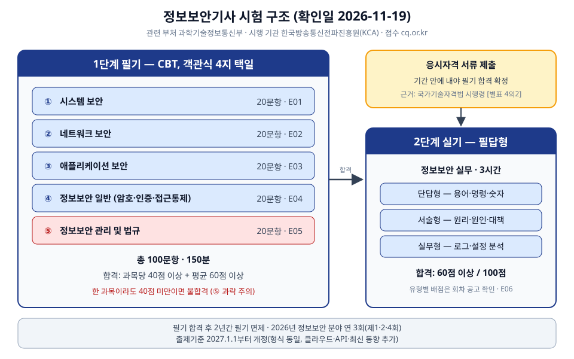
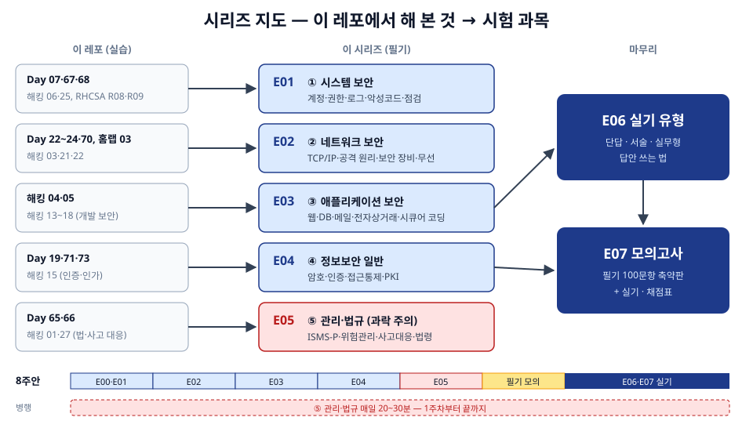

> **자격증 준비 · 정보보안기사** | 난이도 ★★☆☆☆ | 예상 소요 1 ~ 2시간 (계획 세우기 포함)

> ⚠️ **이 시리즈의 모든 문항은 공개된 출제기준을 바탕으로 직접 만든 창작 문항입니다.** 기출문제나 시험 후기·덤프에 떠도는 문항을 옮기거나 바꿔 쓴 것이 아닙니다. 실제 시험 문항을 외우는 공부는 출제기준이 바뀌면 바로 쓸모가 없어지므로, 이 시리즈는 "왜 그 답인지"를 설명할 수 있게 만드는 데 집중합니다.

## 🎯 오늘의 목표

- 정보보안기사의 시행 기관, 응시 자격, 필기·실기 형식과 합격 기준을 **공식 자료 기준으로** 설명할 수 있다
- 2026년 시험 일정과 2027년부터 적용되는 새 출제기준의 핵심 변화를 안다
- 필기 5과목을 어떤 순서·방법으로 공부할지 정하고, 이 시리즈(E00~E07)와 인프라 본편 Day·해킹 트랙의 대응 관계를 지도로 그린다
- 자신의 상황에 맞는 8 ~ 12주 학습 계획을 세운다

---

## 1. 정보보안기사는 어떤 시험인가?

정보보안기사는 과학기술정보통신부 소관 **국가기술자격(기사 등급)** 입니다. 이 레포에서 서버를 하드닝하고(Day 67), 네트워크를 쪼개고(Day 22~24, 70), 웹 취약점을 고쳐 본(해킹 04·05·13~18) 경험을 **한국 제도와 용어로 다시 묶어 확인하는 시험**이라고 보면 됩니다.

CKA·CKS·RHCSA가 "터미널에서 손으로 해내는가"를 본다면, 정보보안기사는 **넓은 범위를 개념으로 정확히 구분하는가**(필기)와 **로그·설정·상황을 보고 원인과 대책을 글로 쓰는가**(실기)를 봅니다. 그래서 공부 방법도 다릅니다.

| 구분 | CKA·CKS·RHCSA | 정보보안기사 |
|---|---|---|
| 형식 | 실기(실제 시스템 조작) | 필기 객관식 → 실기 필답형(손으로 답을 씀) |
| 범위 | 한 기술 영역을 깊게 | 시스템·네트워크·앱·암호·관리·법규를 넓게 |
| 점수를 가르는 것 | 손 속도, 영구 설정 | **용어 구분, 숫자(포트·이벤트 ID·비트), 서술의 논리** |
| 이 레포와의 관계 | 본편 실습의 연장 | 본편 실습을 **이론·제도 언어로 번역** |

---

## 2. 시험 정보 — 공식 확인 결과 (확인일 2026-11-19)

### 2-1. 시행 기관과 응시 자격

| 항목 | 내용 | 확인 출처 |
|---|---|---|
| 종목 | 정보보안기사 (Engineer Information Security) | Q-Net 종목 상세(jmCd=1325) |
| 관련 부처 | **과학기술정보통신부** | Q-Net 종목 상세 |
| 시행 기관 | **한국방송통신전파진흥원(KCA)** — 원서 접수·시험 안내는 KCA 자격검정 사이트 [cq.or.kr](https://www.cq.or.kr) | Q-Net 종목 상세, 고용노동부 공고 제2025-412호 |
| 응시 자격 | 기사 등급 공통 기준 — 「국가기술자격법 시행령」 [별표 4의2] | 고용노동부 공고 제2025-412호(KCA 시행계획 "검정 형태별 수험대상") |
| 응시 자격 서류 | **필기 합격(예정)자가 정해진 기간에 제출**해야 필기 합격이 확정됨 | 같은 공고의 일정표 "응시자격 서류제출(필기합격자 결정)" |

기사 등급 응시 자격의 대표적인 경우는 다음과 같습니다(별표 4의2 요약, 세부 조건은 Q-Net "응시자격 자가진단"으로 확인).

| 경로 | 요건(요약) |
|---|---|
| 학력 | 관련 학과 4년제 대학 졸업자 또는 졸업 예정자 / 3년제 전문대 졸업 + 실무 1년 / 2년제 전문대 졸업 + 실무 2년 |
| 경력 | 동일·유사 직무 분야 실무 경력 4년 |
| 자격 | 동일 직무 분야 산업기사 + 실무 1년 / 기능사 + 실무 3년 / **다른 종목의 기사 이상 자격 보유** |
| 훈련 | 고용노동부령으로 정하는 기사 수준 기술훈련과정 이수자 등 |

> 💡 정보처리기사 같은 **다른 종목 기사 자격이 이미 있으면** 그 자체로 응시 자격이 됩니다. 반대로 졸업 예정자 자격으로 응시했다면 졸업 증명 제출 시기를 꼭 확인하세요. 서류를 기간 안에 내지 않으면 필기 합격이 무효가 됩니다.

### 2-2. 필기

| 항목 | 내용 |
|---|---|
| 과목 | ① 시스템 보안 ② 네트워크 보안 ③ 애플리케이션 보안 ④ 정보보안 일반 ⑤ 정보보안 관리 및 법규 |
| 문항 | 과목당 20문항, **총 100문항**, 객관식 4지 택일 |
| 시간 | **150분(2시간 30분)** |
| 합격 기준 | 100점 만점 기준 **과목당 40점 이상 + 전 과목 평균 60점 이상** (한 과목이라도 40점 미만이면 불합격) |
| 방식 | 2026년부터 필기 **CBT 전면 시행**, 평일 검정 |
| 필기 면제 | 필기 합격자 발표일부터 2년간 같은 종목 필기 면제(국가기술자격 공통 규정) |

### 2-3. 실기

| 항목 | 내용 |
|---|---|
| 과목 | 정보보안 실무 |
| 형식 | **필답형** — 단답형·서술형·실무형(상황·로그·설정을 보고 분석·대책 작성) |
| 시간 | 3시간 |
| 합격 기준 | **100점 만점에 60점 이상** |
| 배점 구성 | 유형별 문항 수·배점은 회차 공고와 답안지 안내로 확인(이 시리즈 E06에서 유형별로 다룸) |

> ⚠️ **확인 범위를 밝혀 둡니다.** 시행 기관·관련 부처는 Q-Net 종목 페이지에서, 일정·응시 자격 근거·CBT 시행은 고용노동부 「2026년도 국가기술자격 검정시행계획(재공고, 제2025-412호)」 원문에서 직접 확인했습니다. 과목·문항 수·시간·합격 기준은 KCA 출제기준과 기사 등급 공통 합격 기준에 따른 값인데, 2026-11-19에는 KCA 사이트가 접속 대기열 페이지만 보여 줘 원문을 열지 못했고, 여러 2차 자료로 교차 확인했습니다. **원서 접수 전에 cq.or.kr의 해당 회차 공고를 꼭 다시 확인하세요.**

### 2-4. 2026년 시험 일정 (정기검정, 정보보안 분야)

고용노동부 공고 제2025-412호의 KCA 시행계획 일정표 기준입니다. 정보보안 기사·산업기사는 **연 3회**(제1·2·4회) 시행합니다. 제3회는 특성화고 필기 면제자 검정이라 일반 응시자와 관계없습니다.

| 회차 | 필기 원서접수 | 필기 시험(CBT) | 필기 합격(예정) 발표 | 실기 원서접수 | 실기 시험 | 최종 합격 발표 |
|---|---|---|---|---|---|---|
| 제1회 | 1.26 ~ 1.29 | 2.9 ~ 3.6 | 3.13 | 3.16 ~ 3.19 | 4.11 ~ 4.26 | 5.8 |
| 제2회 | 5.11 ~ 5.14 | 5.22 ~ 6.15 | 6.19 | 6.22 ~ 6.25 | 7.25 ~ 8.9 | 8.28 |
| 제4회 | 8.31 ~ 9.3 | 9.14 ~ 10.8 | 10.16 | 10.19 ~ 10.22 | 11.14 ~ 11.29 | 12.18 |

- 응시자격 서류 제출 기간: 제1회 2.9 ~ 3.17, 제2회 5.26 ~ 6.25, 제4회 9.14 ~ 10.19
- 확인일(2026-11-19) 현재 제4회 실기가 진행 중입니다. **2027년 일정은 아직 확인되지 않았습니다.** 해마다 12월 무렵 고용노동부가 다음 해 검정시행계획을 공고하니, 그때 다시 확인하세요.

### 2-5. 출제기준 — 2027년부터 바뀝니다

| 구분 | 현행 | 다음 |
|---|---|---|
| 적용 기간 | 2023.1.1 ~ 2026.12.31 | **2027.1.1 ~ 2029.12.31** (KCA 2026.7.23 공개) |
| 형식 | 필기 5과목 100문항 150분 / 실기 필답형 3시간 | 동일 |

2027 기준에서 눈에 띄는 추가 항목(2차 자료 정리 기준, 원문 대조 필요):

| 과목 | 추가·변경 |
|---|---|
| 시스템 보안 | 클라우드 기반 운영체제, 인스턴스 메타데이터·감사 로그, 클라우드·컨테이너 환경 위협(구성 오류, 과도한 권한) |
| 네트워크 보안 | 차세대 보안 솔루션(SASE, ZTNA, XDR), SDN |
| 애플리케이션 보안 | 서비스별 항목을 "운영"과 "공격 유형·대응"으로 통합 |
| 정보보안 일반 | 블록체인 개요, 최신 동향(양자내성암호, 동형암호, 경량암호, 딥페이크 등) |
| 관리 및 법규 | 클라우드 보안 인증, 주요정보통신기반시설 보호제도, 정보보호산업법·클라우드컴퓨팅법·전자서명법 |
| 실기 | 가상화·클라우드 보안, REST API 보안(OWASP API Security Top 10), EDR·EPP, 개인정보 유출사고 대응, 최신 보안 동향 |

> 💡 이 시리즈는 2027년 이후 응시자를 기준으로 쓰되 현행 범위도 모두 포함합니다. 클라우드·컨테이너·제로 트러스트처럼 새로 들어온 항목은 마침 이 레포 본편(Chapter 2·7·9)이 이미 실습으로 다룬 내용이라 **오히려 유리한 지점**입니다.

---

## 3. 과목별 학습 전략

| 과목 | 성격 | 이 레포 경험자의 유불리 | 전략 |
|---|---|---|---|
| ① 시스템 보안 | 리눅스·윈도우 계정, 권한, 로그, 악성코드, 점검 | **유리** — Day 67, 해킹 06·25 | 파일 경로·명령·이벤트 ID 등 **숫자와 이름**을 표로 암기 |
| ② 네트워크 보안 | OSI·TCP/IP, 공격 원리, 방화벽·IDS·VPN, 무선 | 유리 — Day 22~24, 해킹 21·22 | 공격마다 "어느 계층의 무엇을 악용하나 → 대응"을 한 줄로 |
| ③ 애플리케이션 보안 | 웹·DB·메일·FTP·DNS·전자상거래·시큐어 코딩 | 유리 — 해킹 04·05·13~18 | 웹은 아는 내용 확인, **전자상거래(SET)·메일(PGP·S/MIME)** 같은 교과서 항목을 집중 |
| ④ 정보보안 일반 | 암호, 인증, 접근통제, PKI | 보통 — Day 71·73 일부 | **암호 알고리즘 분류표**와 접근통제 모델(BLP·Biba)을 손으로 그려 보기 |
| ⑤ 관리 및 법규 | ISMS-P, 위험관리, 사고대응, 법령 | **불리** — 실무에서 드물게 접함 | 과락 위험 1순위. 매일 30분씩 꾸준히, 법령은 **최신 개정 기준**으로 |

> ⚠️ 필기는 평균 60점이어도 **한 과목 40점 미만이면 불합격**입니다. 개발자 출신 응시자는 ①~③에서 점수를 벌고 ⑤에서 과락하는 경우가 흔합니다. 계획표에서 ⑤과목을 처음부터 매주 끼워 넣는 이유입니다.

실기는 필기 범위 전체에서 나오되 **"보고 → 판단 → 쓴다"** 형식입니다. 필기 공부 단계부터 각 편의 "실기 대비 문항"을 직접 손으로 써 보세요. 머리로 아는 것과 3~5줄로 정확히 쓰는 것은 다른 능력입니다.

---

## 4. 시리즈 지도

| 편 | 제목 | 필기 과목 | 실기 대비 |
|---|---|---|---|
| E00 | 시험 개요와 학습 전략 (이 글) | — | — |
| [E01](./e01-system-security.md) | 시스템 보안 — 운영체제, 계정·권한, 로그, 악성코드, 서버 점검 | ① | 단답·서술 창작 문항 |
| [E02](./e02-network-security.md) | 네트워크 보안 — TCP/IP, 공격 원리, 방화벽·IDS/IPS·VPN·NAC, 무선 | ② | 단답·서술 창작 문항 |
| [E03](./e03-application-security.md) | 애플리케이션 보안 — 웹(OWASP), DB, 전자상거래·이메일, 시큐어 코딩 | ③ | 단답·서술 창작 문항 |
| [E04](./e04-infosec-general.md) | 정보보안 일반 — 보안 요소, 암호학, 인증, 접근통제 | ④ | — |
| [E05](./e05-management-law.md) | 정보보안 관리·법규 — ISMS-P, 위험 관리, BCP, 침해 대응, 법령 | ⑤ | — |
| [E06](./e06-practical-exam-types.md) | 실기 유형 — 단답형·서술형·실무형 답안 쓰는 법 | 실기 | 유형별 답안 쓰는 법 |
| [E07](./e07-mock-exam.md) | 모의고사 — 필기 100문항 + 실기 축약 세트 | 전체 | 채점표 |

각 과목 편(E01~E05)은 같은 순서로 구성됩니다.

1. **핵심 개념 정리** — 표와 그림
2. **자주 헷갈리는 포인트** — 객관식 오답이 생기는 지점
3. **창작 객관식 12 ~ 15문항** — 4지 택일, `
`를 열면 정답과 해설
4. **실기 대비 단답·서술형 창작 문항** (E01~E03)
5. **핵심 정리**, 다음 편 예고

---

## 5. 인프라 시리즈와의 대응표

이미 실습한 내용은 시험 용어로 이름만 바꿔 정리하면 됩니다. 처음 보는 개념이라면 오른쪽 링크의 실습을 먼저 해 보면 훨씬 오래 기억에 남습니다.

| 시험 영역 | 시험에서 쓰는 말 | 이 레포에서 해 본 것 |
|---|---|---|
| ① 계정·권한·하드닝 | 계정 관리, 패스워드 정책, SUID 점검, 서비스 관리, 주요정보통신기반시설 점검 항목 | [Day 67 호스트 하드닝](../../09-security/day67-host-hardening.md), [해킹 06 권한 상승 점검](../../hacking/hack06-linux-privesc.md), [RHCSA R08](../rhcsa/r08-users-groups.md)·[R09](../rhcsa/r09-security.md) |
| ① 커널 격리 | 프로세스 격리, 최소 권한 | [Day 07 컨테이너 내부 원리](../../01-docker/day07-container-internals.md), [Day 68 컨테이너 런타임 보안](../../09-security/day68-container-runtime-security.md) |
| ① 윈도우 | 계정·SID·이벤트 로그·그룹 정책 | [해킹 25 Windows·AD 보안 기초](../../hacking/hack25-windows-ad-basics.md) |
| ② 네트워크 기초 | OSI, 브리지, VLAN, 터널링 | [Day 22](../../03-virtualization-network/day22-linux-networking.md)·[23](../../03-virtualization-network/day23-vlan-vxlan.md)·[24](../../03-virtualization-network/day24-open-vswitch.md) |
| ② 스캐닝·스니핑·스푸핑 | 포트 스캔 유형, 프러미스큐어스 모드, ARP 스푸핑 | [해킹 03 정보 수집](../../hacking/hack03-recon.md), [해킹 21 Wireshark](../../hacking/hack21-wireshark.md), [해킹 22 ARP·MITM 탐지](../../hacking/hack22-arp-mitm-detection.md) |
| ② 방화벽·제로 트러스트 | 패킷 필터·상태 추적, 망 분리, ZTNA | [Day 67 nftables](../../09-security/day67-host-hardening.md), [Day 70 NetworkPolicy·제로 트러스트](../../09-security/day70-networkpolicy-zero-trust.md), [홈랩 03 안전한 노출](../../00-homelab/homelab03-safe-exposure.md) |
| ③ 웹 취약점 | SQL 삽입, XSS, CSRF, 파일 업로드, SSRF | [해킹 04](../../hacking/hack04-web-sqli-xss.md), [해킹 05](../../hacking/hack05-web-owasp-top10.md), [해킹 17 브라우저 보안](../../hacking/hack17-browser-security.md) |
| ③ 시큐어 코딩 | 소프트웨어 개발보안, 입력 검증, 에러 처리 | [해킹 13](../../hacking/hack13-secure-coding.md)~[18](../../hacking/hack18-deserialization-xxe-ssti.md) |
| ④ PKI·인증 | 인증서, CA, OIDC·SSO, 접근통제 | [Day 71 Vault·cert-manager](../../09-security/day71-vault-cert-manager.md), [Day 73 Keycloak SSO](../../09-security/day73-keycloak-sso-audit.md), [Day 19 RBAC](../../02-kubernetes/day19-rbac-namespace.md), [해킹 15](../../hacking/hack15-authn-authz-mistakes.md) |
| ⑤ 위험 관리 | 자산·위협·취약점, 위험 평가 | [Day 66 위협 모델링](../../09-security/day66-threat-modeling-4c.md) |
| ⑤ 사고 대응 | 침해사고 대응 절차, 포렌식, 증거 보존 | [Day 65 장애 대응](../../08-sre-observability/day65-incident-postmortem.md), [해킹 27 포렌식 기초](../../hacking/hack27-incident-forensics.md) |
| ⑤ 법·윤리 | 정보통신망법, 허가 없는 접근 | [해킹 01 법적 경계](../../hacking/hack01-ethical-hacking-intro.md) |
| 실기 로그 분석 | 로그 수집·분석, 탐지 | [해킹 10 탐지 관점](../../hacking/hack10-detection-view.md), [Day 72 Falco](../../09-security/day72-falco.md), [Day 60 Loki](../../08-sre-observability/day60-loki-alloy.md) |
| 실기 보고 | 취약점 보고, 조치 권고 | [해킹 11 보고서](../../hacking/hack11-pentest-report.md) |

---

## 6. 8 ~ 12주 학습 계획

하루 1 ~ 2시간 기준입니다. 이 레포의 본편과 해킹 트랙을 대부분 마쳤다면 8주, 보안이 처음이라면 12주를 잡으세요. 표의 "⑤ 꾸준히"는 매일 20~30분씩 관리·법규를 읽는 시간입니다.

### 8주 압축안 (본편·해킹 트랙 경험자)

| 주차 | 범위 | 핵심 |
|---|---|---|
| 1 | E00, E01 | 시스템 보안 + ⑤ 꾸준히 시작 |
| 2 | E02 | 네트워크 보안. 포트·플래그·공격 원리 표 완성 |
| 3 | E03 | 애플리케이션 보안. 전자상거래·메일 보안 집중 |
| 4 | E04 | 암호·인증·접근통제. 알고리즘 분류표 손으로 쓰기 |
| 5 | E05 | 관리·법규 몰아서 한 번 더 |
| 6 | E07 필기 모의고사 → 약한 과목 편 재풀이 | **과목별 40점 선 점검** |
| 7 | (필기 응시) → E06 | 실기 유형 익히기, 각 편 실기 문항을 손으로 다시 쓰기 |
| 8 | E07 실기 모의 + 서술 답안 다듬기 | 3시간 재고 풀기 |

### 12주 기본안 (보안 입문자)

| 주차 | 범위 | 함께 볼 실습 |
|---|---|---|
| 1 | E00, E01 전반(계정·권한·로그) | Day 67, 해킹 06 |
| 2 | E01 후반(악성코드·점검), 윈도우 | 해킹 25 |
| 3 | E02 전반(TCP/IP, 공격 원리) | Day 22, 해킹 21·22 |
| 4 | E02 후반(보안 장비, VPN, 무선) | Day 70, 홈랩 03 |
| 5 | E03 웹·DB | 해킹 04·05 |
| 6 | E03 메일·전자상거래·시큐어 코딩 | 해킹 13·17 |
| 7 | E04 암호 | Day 71 |
| 8 | E04 인증·접근통제 | Day 73, 해킹 15 |
| 9 | E05 관리체계·위험관리·사고대응 | Day 65·66, 해킹 27 |
| 10 | E05 법규, E07 필기 모의고사 | 과목별 오답 노트 |
| 11 | (필기 응시) → E06 실기 유형 | 해킹 10·11 |
| 12 | E07 실기 모의, 서술 답안 첨삭 | — |

> 💡 **필기와 실기 사이 간격을 미리 계산하세요.** 2026년 일정 기준으로 필기 합격 발표에서 실기 시험 시작까지 약 4 ~ 5주입니다. 필기가 끝나고 실기 공부를 시작하면 촉박하니, 필기 기간에도 각 편의 실기 대비 문항을 써 두는 것이 좋습니다.

공부 방법 세 가지:

- **오답 노트는 "왜 틀렸나"로 씁니다.** "SYN 플러딩 답을 몰랐다"가 아니라 "SYN 플러딩과 Land 공격의 차이를 출발지 주소 기준으로 구분하지 못했다"처럼요.
- **숫자 카드**를 따로 만드세요. 포트 번호, 윈도우 이벤트 ID, 권한 비트, 암호 키 길이 같은 것은 이해보다 반복이 필요합니다.
- **법령은 반드시 현행 조문으로.** 개인정보 보호법·정보통신망법은 개정이 잦습니다. 교재가 오래됐다면 국가법령정보센터(law.go.kr)에서 현행 조문을 확인하세요(E05에서 다룹니다).

---

## 7. 시험 당일 팁

| 구분 | 팁 | 이유 |
|---|---|---|
| 필기 | 시간은 넉넉한 편(100문항 150분). **모르는 문항은 표시하고 넘어간 뒤** 돌아오기 | 앞 문항에 묶이면 아는 문제를 놓침 |
| 필기 | "옳지 **않은** 것"을 고르는 문항에 밑줄 | 부정형 문항에서 실수가 가장 많음 |
| 필기 | 끝나기 전 과목별로 자신 있는 문항 수 세기 | 40점(8문항) 선이 위험한 과목이 보이면 그 과목 보류 문항부터 재검토 |
| 실기 | 서술형은 **개념 → 원인 → 대책** 순서로 쓰기 | 채점자가 찾는 키워드를 빠뜨리지 않음 |
| 실기 | 명령·설정은 **정확한 이름과 경로**로 | `/etc/shadow`를 "패스워드 파일"이라고만 쓰면 감점 위험 |
| 실기 | 빈칸으로 두지 않기 | 부분 점수 가능성이 있는 서술형은 아는 만큼이라도 씀 |

---

## 8. 핵심 정리

- 정보보안기사는 **과기정통부 소관, 한국방송통신전파진흥원(KCA) 시행** 국가기술자격(기사). 원서·공고는 cq.or.kr
- 필기: 5과목 × 20문항 = **100문항, 150분, 과목당 40점·평균 60점**. 2026년부터 CBT 전면 시행
- 실기: **필답형 3시간, 60점 이상**. 단답·서술·실무형
- 2026년 정보보안 분야는 연 3회(제1·2·4회). 제4회 최종 발표 12.18. 2027년 일정은 미공고(2026-11-19 기준)
- **2027.1.1부터 새 출제기준**: 클라우드·컨테이너, SASE·ZTNA·XDR, API 보안, 양자내성암호, 클라우드 관련 법령 추가
- 과락 1순위는 ⑤ 관리·법규 — 처음부터 매일 조금씩
- 이 시리즈의 문항은 모두 **출제기준을 바탕으로 직접 만든 창작 문항**이다

---

## ⏭️ 다음 예고 — E01. 시스템 보안

운영체제의 구조와 보안 기능, 리눅스 `/etc/passwd`·`/etc/shadow`와 권한 비트(SUID·SGID·스티키), `wtmp`·`btmp`·`lastlog` 같은 로그 파일과 확인 명령, 윈도우 SID와 보안 이벤트 ID, 악성코드 분류, 그리고 서버 취약점 점검 항목까지 정리합니다. Day 67과 해킹 06·25에서 손으로 해 본 것을 시험 언어로 바꾸고, 창작 객관식 15문항과 실기 대비 문항으로 확인합니다.
