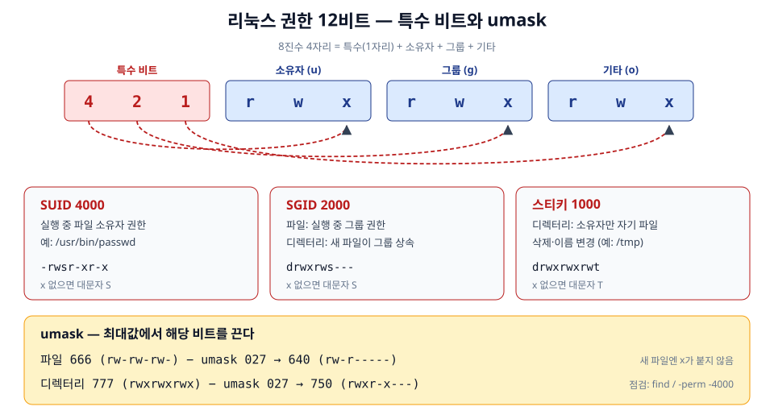
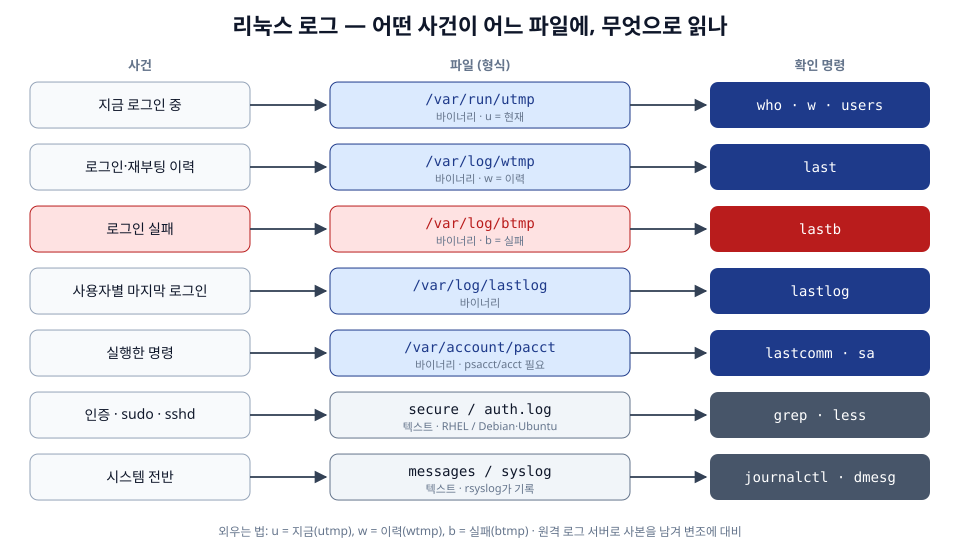
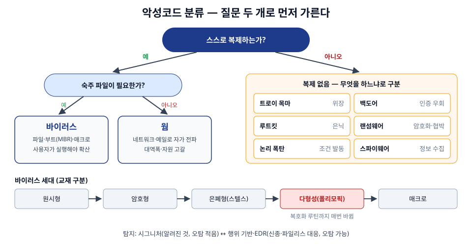

> **자격증 준비 · 정보보안기사** | 난이도 ★★★☆☆ | 예상 소요 5 ~ 7시간 (문항 풀이 포함)

> ⚠️ **이 편의 모든 문항은 공개된 출제기준을 바탕으로 직접 만든 창작 문항입니다.** 기출문제나 후기·덤프의 문항을 옮기거나 변형한 것이 아닙니다. 로그·설정 예시도 모두 실습용으로 꾸민 것이며, IP는 문서용 대역(192.0.2.0/24, 198.51.100.0/24, 203.0.113.0/24)을 씁니다.

## 🎯 오늘의 목표

- 운영체제의 보호 구조(커널·사용자 모드, 메모리 보호)와 시스템 공격 기법의 **원리와 대응**을 짝으로 설명할 수 있다
- 리눅스 `/etc/passwd`·`/etc/shadow`, 권한 비트(SUID·SGID·스티키), umask, PAM을 읽고 계산할 수 있다
- 리눅스 로그 파일과 확인 명령, 윈도우 SID·보안 이벤트 ID를 정확히 짝지을 수 있다
- 악성코드를 동작 방식으로 분류하고, 서버 취약점 점검 항목을 영역별로 말할 수 있다
- 창작 객관식 15문항과 실기 대비 4문항으로 확인한다

---

## 1. 운영체제와 보호 구조

시스템 보안 과목은 "운영체제가 무엇을 지키고, 공격자는 어디를 노리는가"에서 출발합니다. [Day 07](../../01-docker/day07-container-internals.md)에서 본 namespace·cgroup도 결국 커널이 제공하는 **격리 기능**이었지요.

| 개념 | 핵심 | 보안 관점 |
|---|---|---|
| 커널 모드 / 사용자 모드 | CPU 권한 수준을 나눠 일반 프로그램이 하드웨어·커널 메모리에 직접 접근하지 못하게 함 | 사용자 모드 → 커널 진입은 **시스템 콜**로만. 커널 취약점은 곧 전체 권한 |
| 프로세스 격리 | 프로세스마다 독립된 가상 주소 공간 | 다른 프로세스 메모리 침범 방지 |
| 메모리 보호 | 페이지 단위 읽기·쓰기·실행 권한 | 데이터 영역에서 코드 실행을 막는 근거(DEP/NX) |
| 파일 시스템 접근 제어 | 소유자·그룹·기타 권한, ACL | **임의적 접근통제(DAC)**. SELinux·AppArmor는 **강제적 접근통제(MAC)** 를 더함 |
| 감사(Audit) | 보안 관련 사건 기록 | 사후 추적의 근거 — 리눅스 auditd, 윈도우 보안 이벤트 로그 |

> 💡 DAC·MAC·RBAC 같은 **접근통제 모델 자체**는 ④ 정보보안 일반(E04)에서 자세히 다룹니다. 이 과목에서는 "리눅스 권한은 DAC, SELinux는 MAC"처럼 **운영체제에 구현된 모습**만 알면 됩니다. SELinux 실습은 [RHCSA R09](../rhcsa/r09-security.md)를 보세요.

### 1-1. 시스템 공격 기법과 운영체제의 방어

시험은 공격 절차가 아니라 **"무엇을 악용하고, 무엇으로 막는가"** 를 묻습니다.

| 공격 기법 | 악용하는 것 | 대표 대응 |
|---|---|---|
| 버퍼 오버플로(스택·힙) | 경계 검사 없는 복사로 인접 메모리(반환 주소 등) 덮어쓰기 | 경계 검사 함수(`strncpy`·`snprintf`), **스택 카나리**, **NX/DEP**, **ASLR** |
| 포맷 스트링 | `printf(사용자입력)`처럼 서식 문자열을 외부 입력으로 받음 | `printf("%s", 입력)`처럼 서식을 고정 |
| 레이스 컨디션 | 검사 시점과 사용 시점의 차이(TOCTOU), 예: 임시 파일 바꿔치기 | 안전한 임시 파일 생성(`mkstemp`, `O_EXCL`), 원자적 연산 |
| 권한 상승 | 잘못된 SUID, sudo 설정, 쓰기 가능한 cron 스크립트 | 최소 권한, SUID 감사 — [해킹 06](../../hacking/hack06-linux-privesc.md) |
| 패스워드 크래킹 | 약한 패스워드, 솔트 없는 해시 | 복잡도 정책, **솔트 + 느린 해시**(yescrypt·SHA-512 crypt), 잠금 정책 |
| 백도어·루트킷 | 정상 인증을 우회하는 숨은 경로, 탐지 회피 | 무결성 점검(AIDE·Tripwire), 루트킷 점검 도구, 재설치 |

| 메모리 보호 기법 | 막는 것 | 리눅스에서 확인 |
|---|---|---|
| 스택 카나리(Stack Canary) | 반환 주소 앞 임의 값이 바뀌면 프로그램 종료 | 컴파일 옵션 `-fstack-protector-strong` |
| NX / DEP | 스택·힙 같은 데이터 영역의 코드 실행 | CPU NX 비트, 실행 파일의 실행 불가 스택 표시 |
| ASLR | 메모리 배치를 매번 무작위화해 주소 예측을 어렵게 | `/proc/sys/kernel/randomize_va_space` — 0 끔, 1 부분, **2 전체** |

---

## 2. 리눅스 계정과 패스워드

### 2-1. `/etc/passwd`와 `/etc/shadow`

```
# /etc/passwd — 7개 필드, 누구나 읽을 수 있음(644)
devops:x:1001:1001:Dev Ops:/home/devops:/bin/bash
  ①     ② ③    ④    ⑤       ⑥            ⑦
```

| # | 필드 | 보안 포인트 |
|---|---|---|
| ① | 사용자 이름 | — |
| ② | 패스워드 자리 | `x`면 실제 해시는 `/etc/shadow`에 있음(섀도 패스워드) |
| ③ | UID | **0이면 root 권한.** root 외에 UID 0 계정이 있으면 즉시 점검 대상 |
| ④ | GID | 기본 그룹 |
| ⑤ | 설명(GECOS) | — |
| ⑥ | 홈 디렉터리 | — |
| ⑦ | 로그인 셸 | 로그인이 필요 없는 시스템 계정은 `/sbin/nologin`·`/bin/false` |

```
# /etc/shadow — 9개 필드, root만 읽을 수 있음(000 또는 400/640)
devops:$6$Xa9...$Qe1...:20400:1:90:7:14::
  ①     ②               ③    ④ ⑤  ⑥ ⑦  ⑧ ⑨
```

| # | 필드 | 의미 |
|---|---|---|
| ① | 사용자 이름 | |
| ② | 해시 | `$id$salt$hash` 형식. `!`·`*`로 시작하면 잠김/패스워드 없음 |
| ③ | 마지막 변경일 | 1970-01-01부터 지난 **일수** |
| ④ | 최소 사용 기간 | 바꾼 뒤 이 일수 동안 다시 못 바꿈 |
| ⑤ | 최대 사용 기간 | 이 일수가 지나면 변경 강제 |
| ⑥ | 경고 기간 | 만료 며칠 전부터 경고 |
| ⑦ | 비활성 기간 | 만료 후 이 일수가 지나면 계정 사용 불가 |
| ⑧ | 계정 만료일 | 1970-01-01부터 일수 |
| ⑨ | 예약 | |

| 해시 ID | 알고리즘 | 비고 |
|---|---|---|
| `$1$` | MD5-crypt | 구식, 쓰지 않음 |
| `$5$` | SHA-256-crypt | |
| `$6$` | SHA-512-crypt | RHEL 계열 기본 |
| `$y$` | yescrypt | Debian·Ubuntu 최신 기본 |

> 💡 **솔트(salt)의 역할**: 같은 패스워드라도 사용자마다 다른 해시가 나오게 해서, 미리 계산한 해시 표(레인보우 테이블)를 쓸모없게 만듭니다. 솔트는 비밀이 아니라 해시 옆에 그대로 저장됩니다.

### 2-2. 패스워드 정책과 PAM

| 위치 | 하는 일 | 예 |
|---|---|---|
| `/etc/login.defs` | **새로 만드는 계정**의 기본 에이징 값 | `PASS_MAX_DAYS 90`, `PASS_MIN_DAYS 1`, `PASS_WARN_AGE 7` |
| `chage` | 기존 계정의 에이징 변경·확인 | `chage -l devops`, `chage -M 90 devops` |
| `pam_pwquality` | 복잡도(길이, 문자 종류) | `minlen=12`, `dcredit=-1` |
| `pam_faillock` | 연속 실패 시 잠금 | `deny=5 unlock_time=600` (구형 `pam_tally2`의 후속) |
| `TMOUT` | 유휴 셸 자동 종료(초) | `/etc/profile.d/`에 `TMOUT=600`, `readonly TMOUT` |

PAM(Pluggable Authentication Modules)은 `/etc/pam.d/<서비스>` 파일에 **모듈 유형 · 제어 플래그 · 모듈** 순서로 씁니다.

| 모듈 유형 | 역할 | 제어 플래그 | 의미 |
|---|---|---|---|
| `auth` | 신원 확인(패스워드 등) | `required` | 실패해도 끝까지 진행 후 최종 실패 |
| `account` | 계정 사용 가능 여부(만료, 시간) | `requisite` | 실패하면 **즉시** 중단 |
| `password` | 패스워드 변경 규칙 | `sufficient` | 성공하면(앞에 required 실패가 없을 때) 바로 통과 |
| `session` | 세션 시작·종료 처리 | `optional` | 결과가 성패에 영향 거의 없음 |

> ⚠️ root 원격 로그인 제한은 예전 교재의 `/etc/securetty` 대신 지금은 **sshd의 `PermitRootLogin`** 으로 합니다. 시험에는 두 가지가 모두 개념으로 나올 수 있으니 "터미널 제한(securetty)"과 "SSH 제한(PermitRootLogin)"을 구분해 두세요. 실습은 [Day 67 sshd 강화](../../09-security/day67-host-hardening.md)에서 했습니다.

---

## 3. 리눅스 권한 — 특수 비트와 umask



| 특수 권한 | 8진수 | 파일에 붙으면 | 디렉터리에 붙으면 | `ls -l` 표시 |
|---|---|---|---|---|
| SUID | 4000 | 실행하는 동안 **파일 소유자** 권한으로 동작 (`passwd`) | (의미 없음) | 소유자 x 자리 `s` (x 없으면 `S`) |
| SGID | 2000 | 실행하는 동안 **파일 그룹** 권한 | 안에 만든 파일이 **디렉터리 그룹을 상속** | 그룹 x 자리 `s` |
| 스티키 | 1000 | (현대 리눅스에서 의미 없음) | **소유자만 자기 파일 삭제·이름 변경** (`/tmp`) | 기타 x 자리 `t` (x 없으면 `T`) |

**umask 계산** — 기본 최대값에서 umask 비트를 **뺀다(정확히는 끈다)**.

| umask | 새 파일 (최대 666) | 새 디렉터리 (최대 777) |
|---|---|---|
| 022 | 644 `rw-r--r--` | 755 `rwxr-xr-x` |
| 027 | 640 `rw-r-----` | 750 `rwxr-x---` |
| 077 | 600 `rw-------` | 700 `rwx------` |

```bash
# SUID/SGID 파일 목록 — 기준선과 비교해 새로 생긴 것을 찾는 것이 핵심
find / -xdev -type f \( -perm -4000 -o -perm -2000 \) -exec ls -l {} \; 2>/dev/null

# 누구나 쓸 수 있는 파일 (스티키 없는 world-writable 디렉터리도 같은 방식으로)
find / -xdev -type f -perm -0002 2>/dev/null

# 변경 불가(immutable) 속성 — root도 지우거나 수정할 수 없게
chattr +i /etc/resolv.conf     # 해제: chattr -i
chattr +a /var/log/secure      # 추가(append)만 허용 — 로그 변조 방지
lsattr /etc/resolv.conf
```

> 💡 `-perm -4000`의 `-`는 "이 비트가 **포함**된" 파일입니다. `-perm 4000`(앞에 기호 없음)은 권한이 **정확히** 4000인 파일만 찾으므로 결과가 거의 없습니다. 객관식 함정으로 쓰기 좋은 부분입니다.

---

## 4. 리눅스 로그



| 파일 | 내용 | 형식 | 확인 명령 |
|---|---|---|---|
| `/var/run/utmp` (`/run/utmp`) | **현재** 로그인한 사용자 | 바이너리 | `who`, `w`, `users` |
| `/var/log/wtmp` | 로그인·로그아웃·재부팅 **이력** | 바이너리 | `last` (`last reboot`) |
| `/var/log/btmp` | **로그인 실패** 이력 | 바이너리 | `lastb` |
| `/var/log/lastlog` | 사용자별 **마지막** 로그인 | 바이너리 | `lastlog` |
| `/var/log/secure` (RHEL) / `/var/log/auth.log` (Debian·Ubuntu) | 인증·sudo·sshd 메시지 | 텍스트 | `grep`, `less` |
| `/var/log/messages` (RHEL) / `/var/log/syslog` (Debian·Ubuntu) | 시스템 전반 메시지 | 텍스트 | |
| `/var/account/pacct` | 사용자가 실행한 명령(프로세스 계정) | 바이너리 | `lastcomm`, `sa` (psacct/acct 패키지) |
| `/var/log/xferlog` | FTP 전송 기록 | 텍스트 | |
| 커널 링 버퍼 | 부팅·드라이버 메시지 | 메모리 | `dmesg` |
| systemd journal | 위 대부분을 구조화해 저장 | 바이너리 | `journalctl -u sshd`, `journalctl -p err` |

> ⚠️ 일부 최신 배포판은 2038년 문제 때문에 `wtmp`·`lastlog`를 **wtmpdb·lastlog2**(SQLite 기반)로 옮기는 중입니다. 시험은 전통적인 파일 이름 기준으로 공부하되, 실무에서 파일이 없으면 이 변화를 떠올리세요.

### 4-1. rsyslog 설정 읽기

```
# /etc/rsyslog.conf (또는 /etc/rsyslog.d/*.conf)
# 형식: facility.priority    동작
authpriv.*                   /var/log/secure       # 인증 메시지 전부
*.info;mail.none;authpriv.none  /var/log/messages  # info 이상, 단 mail·authpriv 제외
kern.crit                    /dev/console          # 커널 crit 이상은 콘솔로
*.emerg                      :omusrmsg:*           # 긴급은 모든 로그인 사용자에게
*.*                          @@192.0.2.50:514      # 원격 로그 서버로 (@ = UDP, @@ = TCP)
```

| 우선순위(낮음 → 높음) | debug · info · notice · warning · err · crit · alert · emerg |
|---|---|
| `facility.priority` | 그 우선순위 **이상** 모두 |
| `facility.=priority` | 그 우선순위**만** |
| `facility.none` | 해당 facility 제외 |

원격 로그 서버로 보내는 이유는 **침입자가 로컬 로그를 지워도 사본이 남게** 하기 위해서입니다. [Day 60](../../08-sre-observability/day60-loki-alloy.md)의 Loki 수집도 같은 목적입니다. "누가 root로 무엇을 실행했나"를 남기는 auditd 규칙은 [Day 67 7절](../../09-security/day67-host-hardening.md)에서 만들어 봤습니다.

---

## 5. 윈도우 보안

[해킹 25](../../hacking/hack25-windows-ad-basics.md)에서 AD 관점으로 본 내용을 단일 서버 기준으로 정리합니다.

### 5-1. 계정과 SID

| 항목 | 내용 |
|---|---|
| SAM | 로컬 계정과 패스워드 해시 저장. `%SystemRoot%\System32\config\SAM`, 실행 중에는 잠겨 있음 |
| SID | 계정·그룹 고유 식별자. `S-1-5-21-<도메인/컴퓨터 식별자>-<RID>` |
| RID 500 | 기본 **Administrator** — 이름을 바꿔도 RID는 그대로라 이름 변경만으로는 숨길 수 없음 |
| RID 501 | **Guest** — 비활성화가 기본 권장 |
| 잘 알려진 SID | `S-1-5-18` LocalSystem, `S-1-1-0` Everyone |
| 기본 공유 | `C$`·`ADMIN$`(관리 목적 숨김 공유), `IPC$`(프로세스 간 통신) — `net share`로 확인 |

### 5-2. 이벤트 로그

| 로그 | 내용 |
|---|---|
| 보안(Security) | 로그온·계정·권한 사용 등 **감사 정책**이 켠 항목 |
| 시스템(System) | 서비스·드라이버·OS 구성 요소 |
| 응용 프로그램(Application) | 응용 프로그램이 남기는 이벤트 |

| 이벤트 ID | 의미 | 함께 기억할 것 |
|---|---|---|
| **4624** | 로그온 성공 | 로그온 유형 2 대화형, 3 네트워크, **10 원격 대화형(RDP)** |
| **4625** | 로그온 실패 | 짧은 시간 반복 → 무차별 대입 의심 |
| 4634 / 4647 | 로그오프 / 사용자가 시작한 로그오프 | |
| 4648 | 명시적 자격 증명으로 로그온 시도 | `runas` 등 |
| **4672** | 특수 권한(관리자급)이 할당된 로그온 | |
| **4688** | 새 프로세스 생성 | 명령줄 기록은 별도 정책 필요 |
| **4720** | 사용자 계정 생성 | 4722 활성화, 4724 패스워드 재설정 시도, 4726 삭제 |
| 4732 | 보안 사용 로컬 그룹에 구성원 추가 | Administrators 추가 감시 |
| 4740 | 계정 잠김 | |
| **1102** | 보안 감사 로그 지워짐 | 침입 흔적 지우기 신호 |

### 5-3. 레지스트리와 자동 실행

| 루트 키 | 내용 |
|---|---|
| `HKEY_LOCAL_MACHINE`(HKLM) | 컴퓨터 전체 설정 — SAM, SECURITY, SOFTWARE, SYSTEM 하이브 |
| `HKEY_CURRENT_USER`(HKCU) | 현재 사용자 설정 |
| `HKEY_USERS`(HKU) | 모든 사용자 프로필 |
| `HKEY_CLASSES_ROOT`(HKCR) | 파일 연결, COM 등록 |
| `HKEY_CURRENT_CONFIG`(HKCC) | 현재 하드웨어 프로필 |

악성코드가 재부팅 후에도 살아남으려고 자주 쓰는 **자동 실행 위치**: `...\CurrentVersion\Run`·`RunOnce`(HKLM/HKCU), 서비스 등록, 작업 스케줄러, 시작 프로그램 폴더. 침해 점검은 이 위치들을 기준선과 비교하는 데서 시작합니다.

> 💡 리눅스와 짝을 지어 외우면 쉽습니다. `/etc/shadow` ↔ SAM, UID 0 ↔ RID 500, `lastb` ↔ 4625, `/etc/rc.local`·systemd unit·cron ↔ Run 키·서비스·작업 스케줄러.

---

## 6. 악성코드



| 종류 | 핵심 구분 기준 | 특징 |
|---|---|---|
| 바이러스 | **숙주 파일에 기생**, 사용자가 실행해야 퍼짐 | 파일 감염형, 부트(MBR) 감염형, 매크로 |
| 웜 | **스스로 복제·전파**, 숙주 불필요 | 네트워크 취약점·메일로 확산, 대역폭 소모 |
| 트로이 목마 | **정상 프로그램으로 위장**, 자기 복제 없음 | 설치 후 원격 제어·정보 탈취 |
| 랜섬웨어 | 파일 암호화·유출 후 대가 요구 | 대응 핵심은 **오프라인·불변 백업** |
| 루트킷 | 자신과 다른 악성 활동을 **숨김** | 커널 모드 루트킷은 OS 도구 출력도 속임 |
| 백도어 | 정상 인증을 **우회하는 접근 경로** | |
| 봇 / 봇넷 | 감염 PC가 C&C 명령을 받는 좀비 | DDoS·스팸에 동원 |
| 스파이웨어·키로거 | 정보 수집·입력 가로채기 | |
| 애드웨어 | 원치 않는 광고 | |
| 논리 폭탄 | **특정 조건·시각**에 발동 | 내부자 위협과 연결 |
| 파일리스 | 디스크에 실행 파일을 거의 남기지 않고 메모리·정상 도구(스크립트 엔진) 이용 | 파일 기반 백신 탐지가 어려움 → 행위 기반(EDR) |

교재에서 흔히 쓰는 바이러스의 **세대 구분**도 알아 두세요: 원시형 → 암호형(본체 암호화) → 은폐형(스텔스, 감염 사실 숨김) → **다형성(폴리모픽, 감염될 때마다 암호화 루틴까지 바뀜)** → 매크로. 다형성에서 더 나아가 코드 자체를 재구성하는 것을 **메타모픽**이라고 부릅니다.

| 분석 방식 | 방법 | 장단점 |
|---|---|---|
| 정적 분석 | 실행하지 않고 해시·문자열·헤더·디스어셈블 확인 | 안전, 난독화·패킹에 약함 |
| 동적 분석 | 격리 환경(샌드박스)에서 실행하며 행위 관찰 | 실제 행위 확인, 분석 환경 탐지형 악성코드에 약함 |
| 시그니처 탐지 | 알려진 패턴과 비교 | 오탐 적음, **신종·변종에 약함** |
| 행위 기반 탐지 | 의심 행위(대량 암호화, 자동 실행 등록) 탐지 | 신종 대응, 오탐 가능 — EDR |

---

## 7. 서버 보안 점검

국내에서는 KISA가 공개한 **「주요정보통신기반시설 기술적 취약점 분석·평가 방법 상세가이드」** 가 사실상 서버 점검 항목의 기준입니다. 항목 번호는 판이 바뀌면 달라지므로 **영역과 대표 항목**으로 기억하세요.

| 점검 영역 | 대표 항목(유닉스·리눅스) | 이 레포에서 |
|---|---|---|
| 계정 관리 | root 원격 접속 제한, 패스워드 복잡도·잠금 임계값, UID 0 계정 점검, 불필요 계정 제거, 셸 제한 | Day 67, RHCSA R08 |
| 파일·디렉터리 관리 | `/etc/passwd`·`/etc/shadow` 소유자·권한, SUID/SGID 점검, world-writable 파일, PATH에 `.` 포함 여부 | 해킹 06 |
| 서비스 관리 | 불필요 서비스(telnet, rsh/rlogin, tftp, finger) 중지, 익명 FTP 제한, SNMP 기본 커뮤니티 문자열 변경, 배너 정보 최소화 | Day 67 |
| 패치 관리 | 보안 패치 적용 절차 | 해킹 06 5절 |
| 로그 관리 | 로그 정기 검토, 원격 로그 서버, 로그 파일 권한 | Day 60·67 |

윈도우 서버도 같은 틀로 봅니다: Administrator 이름 변경·Guest 비활성화, 패스워드·잠금 정책, 불필요한 공유 제거, 원격 데스크톱 접근 제한, 감사 정책 설정, 백신·패치.

| 점검 도구 | 용도 |
|---|---|
| Lynis | 리눅스 하드닝 점검 — [Day 67](../../09-security/day67-host-hardening.md)에서 전후 비교 |
| AIDE, Tripwire | 파일 **무결성** 점검(기준 해시 DB와 비교) |
| chkrootkit, rkhunter | 루트킷 흔적 점검 |
| CIS Benchmark / USG | 설정 기준 문서와 자동 적용 도구 |
| Trivy 등 | 컨테이너 이미지·클라우드 구성 점검 — 2027 출제기준에 클라우드·컨테이너 도구 추가 |

> 💡 **2027 출제기준 대비**: 클라우드 인스턴스 메타데이터(SSRF로 자격 증명이 새는 경로, IMDSv2 같은 토큰 방식으로 완화)와 컨테이너의 과도한 권한(privileged, `docker.sock` 마운트)이 시스템 보안 범위에 들어옵니다. [해킹 07](../../hacking/hack07-container-escape-risks.md), [해킹 09](../../hacking/hack09-cloud-iam-mistakes.md), [Day 68](../../09-security/day68-container-runtime-security.md)이 그대로 대비가 됩니다.

---

## 8. 자주 헷갈리는 포인트

| 헷갈리는 쌍 | 구분법 |
|---|---|
| `utmp` / `wtmp` / `btmp` | **u**=지금(현재 사용자), **w**=이력(was), **b**=실패(bad). 명령은 `who` / `last` / `lastb` |
| `lastlog` vs `last` | `lastlog`는 사용자별 **마지막 1건**, `last`는 **전체 이력** |
| SUID vs SGID(디렉터리) | SUID는 실행 시 소유자 권한. 디렉터리 SGID는 **그룹 상속** |
| 스티키 비트 | 실행과 무관. "공유 디렉터리에서 남의 파일 못 지움" |
| `s` vs `S` | 소문자는 실행 권한 있음, 대문자는 실행 권한 **없이** 특수 비트만 |
| `PASS_MAX_DAYS` vs `chage -M` | login.defs는 **새 계정** 기본값, 기존 계정은 chage |
| `required` vs `requisite` | 둘 다 실패면 최종 실패. requisite는 **즉시** 중단 |
| 바이러스 vs 웜 vs 트로이 목마 | 숙주 필요 / 자가 전파 / 위장(복제 없음) |
| 4624 vs 4672 | 4624는 모든 로그온 성공, 4672는 그중 **관리자급 권한**이 붙은 로그온 |
| 1102 vs 104 | 1102는 **보안** 로그 삭제, 104는 시스템 등 다른 로그 삭제 |
| `@` vs `@@` (rsyslog) | UDP / TCP |

---

## 9. 창작 객관식 15문항

> 모든 문항은 이 시리즈를 위해 직접 만든 것입니다. 먼저 풀고 `<details>`를 여세요.

**Q1.** 리눅스 서버의 `/etc/passwd` 점검 중 다음 줄을 발견했다. 가장 먼저 조치해야 할 이유로 옳은 것은?

```
backup2:x:0:0::/home/backup2:/bin/bash
```

1. GECOS 필드가 비어 있어 계정 용도를 알 수 없다
2. UID가 0이라 root와 같은 권한을 가진다
3. 패스워드 필드가 `x`라 패스워드 없이 로그인된다
4. 홈 디렉터리가 `/home` 아래라 다른 사용자가 읽을 수 있다

<details><summary>정답과 해설</summary>

**정답 2.** UID 0은 이름과 상관없이 root 권한입니다. root 외 UID 0 계정은 백도어로 쓰이는 대표 사례라 점검 항목에 들어 있습니다. 3번: `x`는 해시가 `/etc/shadow`에 있다는 뜻이지 패스워드가 없다는 뜻이 아닙니다.
</details>

**Q2.** `/etc/shadow`의 한 줄이 `appuser:$6$k2...$9f...:20300:0:60:7:5::` 일 때 옳지 **않은** 것은?

1. 해시 알고리즘은 SHA-512 기반 crypt이다
2. 패스워드를 바꾼 지 60일이 지나면 변경을 강제한다
3. 만료 7일 전부터 경고한다
4. 만료 후 5일 동안 로그인 실패가 5회를 넘으면 계정이 잠긴다

<details><summary>정답과 해설</summary>

**정답 4.** 일곱 번째 필드 `5`는 **비활성 기간**으로, 패스워드가 만료된 뒤 5일이 지나면 계정을 쓸 수 없게 된다는 뜻입니다. 로그인 실패 횟수와는 관계가 없습니다(실패 잠금은 `pam_faillock`). `$6$`은 SHA-512-crypt, 다섯 번째 필드 60은 최대 사용 기간, 여섯 번째 7은 경고 기간입니다.
</details>

**Q3.** umask가 `027`인 사용자가 새 디렉터리와 새 일반 파일을 만들었을 때 권한으로 옳은 것은?

1. 디렉터리 `750`, 파일 `640`
2. 디렉터리 `750`, 파일 `750`
3. 디렉터리 `027`, 파일 `027`
4. 디렉터리 `755`, 파일 `644`

<details><summary>정답과 해설</summary>

**정답 1.** 디렉터리 최대값 777에서 027 비트를 끄면 750, 파일 최대값 666에서 끄면 640입니다. 일반 파일은 생성 시 실행 권한이 붙지 않습니다.
</details>

**Q4.** 다음 중 `ls -l` 결과에서 **스티키 비트가 설정되어 있으나 기타 사용자 실행 권한은 없는** 디렉터리는?

1. `drwxrwxrwT`
2. `drwxrwxrwt`
3. `drwsrwxrwx`
4. `drwxrwsrwx`

<details><summary>정답과 해설</summary>

**정답 1.** 기타(other) 실행 자리에 `t`면 스티키 + 실행, 대문자 `T`면 스티키만 있고 실행 권한이 없습니다. 3번은 SUID, 4번은 SGID 표시입니다.
</details>

**Q5.** 시스템 관리자가 "지금 이 순간 서버에 로그인해 있는 사용자"를 확인하려 한다. 참조되는 파일과 명령의 짝으로 옳은 것은?

1. `/var/log/wtmp` — `last`
2. `/var/log/btmp` — `lastb`
3. `/var/run/utmp` — `w`
4. `/var/log/lastlog` — `lastlog`

<details><summary>정답과 해설</summary>

**정답 3.** 현재 로그인 정보는 utmp에 있고 `who`·`w`가 읽습니다. wtmp는 이력, btmp는 실패, lastlog는 사용자별 마지막 로그인입니다.
</details>

**Q6.** rsyslog 설정 `mail.=warning  /var/log/mail.warn` 의 의미로 옳은 것은?

1. mail facility의 warning 이상 메시지를 기록한다
2. warning 미만의 mail 메시지를 기록한다
3. 모든 facility의 warning 메시지를 기록한다
4. mail facility의 warning 메시지**만** 기록한다

<details><summary>정답과 해설</summary>

**정답 4.** `=`가 붙으면 해당 우선순위만 고릅니다. `mail.warning`(=없음)이었다면 warning 이상 전부입니다.
</details>

**Q7.** 리눅스 메모리 보호 기법에 대한 설명으로 옳지 **않은** 것은?

1. ASLR은 스택·힙·라이브러리의 메모리 주소를 실행마다 무작위로 배치한다
2. NX(DEP)는 데이터 영역에 있는 코드를 실행하지 못하게 한다
3. 스택 카나리는 함수 반환 전에 미리 넣어 둔 값이 바뀌었는지 검사한다
4. `randomize_va_space` 값이 0이면 ASLR이 가장 강하게 적용된다

<details><summary>정답과 해설</summary>

**정답 4.** 0은 ASLR 끔, 1은 부분, 2가 전체 무작위화입니다.
</details>

**Q8.** 임시 파일을 만들기 전에 파일이 없는지 검사하고, 그 직후 파일을 여는 프로그램이 있다. 공격자가 두 동작 사이에 같은 이름의 심볼릭 링크를 만들어 중요한 파일을 덮어쓰게 하는 공격과 대응으로 옳은 것은?

1. 레이스 컨디션 — `mkstemp()` 같은 원자적 임시 파일 생성
2. 포맷 스트링 — 서식 문자열 고정
3. 버퍼 오버플로 — 스택 카나리 적용
4. 세션 하이재킹 — 세션 ID 재발급

<details><summary>정답과 해설</summary>

**정답 1.** 검사 시점과 사용 시점 사이의 틈(TOCTOU)을 노리는 레이스 컨디션입니다. 존재 확인과 생성을 한 번에(원자적으로) 처리하는 `mkstemp()`나 `O_CREAT|O_EXCL`로 막습니다.
</details>

**Q9.** PAM 설정에서 해당 모듈이 실패하면 **뒤의 모듈을 실행하지 않고 즉시** 인증 실패를 돌려주는 제어 플래그는?

1. `required`
2. `requisite`
3. `sufficient`
4. `optional`

<details><summary>정답과 해설</summary>

**정답 2.** `required`도 결국 실패를 돌려주지만 나머지 모듈을 끝까지 실행합니다(어느 단계에서 실패했는지 숨기는 효과). 즉시 중단은 `requisite`입니다.
</details>

**Q10.** 윈도우 서버 보안 로그에서 이벤트 ID 4625가 같은 원본 IP로 수 분 동안 수백 건 기록된 뒤 4624(로그온 유형 10)가 한 건 기록되었다. 가장 적절한 해석은?

1. 정상 사용자가 패스워드를 잊어 여러 번 시도한 뒤 콘솔에서 로그인했다
2. 감사 로그가 지워진 뒤 새로 기록되기 시작했다
3. 새 사용자 계정이 생성되고 관리자 그룹에 추가되었다
4. 원격 데스크톱으로 무차별 대입 공격이 시도되었고 그중 하나가 성공했을 가능성이 높다

<details><summary>정답과 해설</summary>

**정답 4.** 4625는 로그온 실패, 4624 유형 10은 원격 대화형(RDP) 로그온 성공입니다. 대량 실패 뒤 성공은 무차별 대입 성공 신호로, 해당 계정 잠금·패스워드 변경·접근 IP 제한·추가 행위(4720·4732·4688) 조사가 이어져야 합니다. 1번의 콘솔 로그인은 유형 2입니다.
</details>

**Q11.** 윈도우 기본 Administrator 계정에 대한 설명으로 옳은 것은?

1. 이름을 바꾸면 SID의 RID도 새로 부여되어 추측할 수 없게 된다
2. RID는 501이다
3. 이름을 바꿔도 RID 500은 유지되므로 이름 변경은 보조 대책일 뿐이다
4. 삭제가 기본 권장 사항이다

<details><summary>정답과 해설</summary>

**정답 3.** Administrator의 RID는 500으로 고정이고, 이름 변경은 단순 추측을 어렵게 할 뿐입니다. 501은 Guest입니다. 기본 Administrator는 삭제할 수 없고, 이름 변경·비활성화·강한 패스워드로 관리합니다.
</details>

**Q12.** 다음 설명에 해당하는 악성코드는?

> 정상적인 압축 프로그램처럼 배포되며 스스로 복제하거나 다른 파일을 감염시키지는 않는다. 설치되면 외부 서버의 명령을 받아 파일을 빼돌린다.

1. 웜
2. 파일 감염형 바이러스
3. 트로이 목마
4. 논리 폭탄

<details><summary>정답과 해설</summary>

**정답 3.** 정상 프로그램으로 위장하고 자기 복제가 없는 것이 트로이 목마의 핵심입니다. 웜은 스스로 전파, 바이러스는 숙주 파일 감염, 논리 폭탄은 조건이 맞을 때 발동합니다.
</details>

**Q13.** 감염될 때마다 복호화 루틴까지 바꿔 시그니처 기반 탐지를 어렵게 만드는 바이러스 유형은?

1. 다형성(폴리모픽) 바이러스
2. 은폐형(스텔스) 바이러스
3. 매크로 바이러스
4. 부트 바이러스

<details><summary>정답과 해설</summary>

**정답 1.** 암호형 바이러스는 본체만 암호화해 복호화 루틴이 고정 패턴으로 남는데, 다형성 바이러스는 그 루틴까지 바꿉니다. 은폐형은 감염 사실(파일 크기 변화 등)을 숨기는 데 초점이 있습니다.
</details>

**Q14.** 파일 무결성 점검 도구(AIDE, Tripwire)에 대한 설명으로 옳은 것은?

1. 네트워크 패킷을 분석해 침입을 실시간 차단한다
2. 실행 중인 프로세스의 메모리를 덤프해 악성 코드를 찾는다
3. 기준 시점의 파일 해시·속성 DB를 만들어 두고 이후 상태와 비교한다
4. 기준 DB는 점검 대상 서버의 쓰기 가능한 위치에 두는 것이 안전하다

<details><summary>정답과 해설</summary>

**정답 3.** 기준 DB와 현재 상태를 비교해 변경을 찾습니다. 침입자가 기준 DB까지 바꾸면 의미가 없으므로 DB는 읽기 전용 매체나 별도 서버에 보관하는 것이 원칙입니다(4번이 틀린 이유).
</details>

**Q15.** 서버 취약점 점검 결과 중 "양호"로 판단하기 가장 어려운 것은?

1. telnet 서비스가 비활성화되어 있고 SSH만 열려 있다
2. root 계정의 `PATH` 환경 변수 맨 앞에 `.`(현재 디렉터리)이 있다
3. `/etc/shadow`의 소유자가 root이고 권한이 400이다
4. SNMP 서비스를 쓰지 않아 중지되어 있다

<details><summary>정답과 해설</summary>

**정답 2.** PATH에 `.`이 앞쪽에 있으면 현재 디렉터리에 심어 둔 같은 이름의 악성 프로그램이 시스템 명령보다 먼저 실행될 수 있어 취약으로 봅니다. [해킹 06 4절](../../hacking/hack06-linux-privesc.md)의 cron·PATH 점검과 같은 원리입니다.
</details>

---

## 10. 실기 대비 — 단답·서술형 창작 문항

**실기 1 (단답형).** 다음은 실습용으로 꾸민 `/etc/shadow`의 일부이다. 물음에 답하시오.

```
alice:$y$j9T$Lr...$Ue...:20380:1:90:7:30::
bob:!$6$Qm...$Zp...:20100:0:99999:7:::
svc_backup:*:20000:0:99999:7:::
```

(1) alice 계정 해시의 알고리즘 이름 (2) bob 계정의 현재 상태 (3) svc_backup 계정이 패스워드로 로그인할 수 있는지와 그 이유

<details><summary>모범 답안</summary>

1. `$y$` → **yescrypt**
2. 해시 앞에 `!`가 붙어 있으므로 **패스워드가 잠긴(lock) 상태** (`passwd -l` 또는 `usermod -L` 결과). 패스워드 로그인 불가. 최대 사용 기간 99999는 사실상 만료 없음이므로 함께 지적하면 좋음
3. **로그인할 수 없음.** 해시 자리가 `*`로, 어떤 패스워드도 이 값과 일치할 수 없어 패스워드 인증이 불가능한 서비스 계정임
</details>

**실기 2 (단답형).** 리눅스와 윈도우에서 "로그인 실패 기록"을 확인하려 한다. 빈칸을 채우시오.

| 구분 | 확인 대상 |
|---|---|
| 리눅스 바이너리 로그 파일 | ( ① ) |
| ①을 읽는 명령 | ( ② ) |
| 윈도우 보안 이벤트 ID | ( ③ ) |
| 원격 데스크톱 로그온 성공 시 4624의 로그온 유형 번호 | ( ④ ) |

<details><summary>모범 답안</summary>

① `/var/log/btmp` ② `lastb` ③ `4625` ④ `10`
</details>

**실기 3 (서술형).** SUID가 설정된 실행 파일이 왜 보안 점검 대상인지 설명하고, 점검 방법과 조치 방법을 각각 쓰시오.

<details><summary>모범 답안</summary>

- **이유**: SUID 파일은 실행하는 사용자와 관계없이 **파일 소유자(대개 root) 권한으로 동작**한다. 이런 프로그램에 취약점이 있거나, 셸 실행·임의 파일 쓰기가 가능한 프로그램에 SUID가 붙으면 일반 사용자가 root 권한을 얻는 **권한 상승** 경로가 된다.
- **점검**: `find / -xdev -type f -perm -4000 -ls` (SGID는 `-perm -2000`)로 목록을 만들고, 패키지가 설치한 정상 목록(기준선)과 비교해 **새로 생기거나 용도를 알 수 없는 파일**을 찾는다. 정기적으로 실행해 변화를 기록한다.
- **조치**: 불필요한 SUID는 `chmod u-s <파일>`로 제거하고, 필요한 프로그램은 실행 그룹을 제한(`chgrp`·`chmod 4750`)한다. 출처를 알 수 없는 SUID 파일은 침해 흔적으로 보고 사고 대응 절차를 따른다. 파일 시스템 단위로는 `nosuid` 마운트 옵션(예: `/tmp`, `/home`)을 검토한다.
</details>

**실기 4 (실무형).** 실습용으로 꾸민 다음 `/var/log/secure` 발췌를 보고 물음에 답하시오.

```
Nov 18 02:11:04 web01 sshd[2101]: Failed password for root from 203.0.113.77 port 51022 ssh2
Nov 18 02:11:06 web01 sshd[2101]: Failed password for root from 203.0.113.77 port 51022 ssh2
  ... (같은 IP에서 root, admin, test 계정으로 약 1,200건 반복) ...
Nov 18 02:39:51 web01 sshd[3377]: Failed password for invalid user test from 203.0.113.77 port 53810 ssh2
Nov 18 02:40:02 web01 sshd[3390]: Accepted password for devops from 203.0.113.77 port 53844 ssh2
Nov 18 02:40:30 web01 sudo:   devops : TTY=pts/1 ; PWD=/home/devops ; USER=root ; COMMAND=/usr/bin/useradd -o -u 0 sysbak
```

(1) 이 로그에서 일어난 일을 시간 순서로 분석하시오. (2) 즉시 해야 할 조치 세 가지와 재발 방지 대책 세 가지를 쓰시오.

<details><summary>모범 답안</summary>

**(1) 분석**
1. 02:11부터 약 30분간 203.0.113.77에서 root·admin·test 등 여러 계정으로 SSH **패스워드 무차별 대입(사전 대입)** 시도
2. 02:40:02 같은 IP에서 **devops 계정 패스워드 인증 성공** — 약한 패스워드가 추측된 것으로 판단
3. 02:40:30 devops가 sudo로 `useradd -o -u 0 sysbak` 실행 — **UID 0 중복 계정(백도어)** 생성. devops에 무제한 sudo 권한이 있었음을 의미

**(2) 즉시 조치**
- 203.0.113.77 차단(방화벽), devops 세션 종료와 계정 잠금, 패스워드 변경
- `sysbak` 등 UID 0 계정 확인 후 제거(`awk -F: '$3==0' /etc/passwd`), 이후 행위 조사(`last`, sudo 로그, `/root/.ssh/authorized_keys`, cron·systemd 등록, SUID 신규 파일)
- 증거 보존: 로그 사본을 원격 서버로 확보한 뒤 분석(로그 원본 훼손 방지, [해킹 27](../../hacking/hack27-incident-forensics.md))

**재발 방지**
- SSH **키 인증만 허용**(`PasswordAuthentication no`), `PermitRootLogin no`, 접속 허용 IP 제한
- fail2ban 등으로 반복 실패 IP 자동 차단, 계정 잠금 임계값(`pam_faillock`)
- sudo 최소 권한(명령 단위 허용), 계정 생성·UID 0 변경에 대한 감사 규칙과 알림 — [Day 67](../../09-security/day67-host-hardening.md)의 sshd·sudo·fail2ban·auditd 설정
</details>

---

## 11. 핵심 정리

- 운영체제 보호의 축: 커널/사용자 모드, 프로세스 격리, 메모리 보호(**카나리·NX·ASLR**), 접근 제어(DAC + MAC), 감사
- `/etc/passwd` 7필드(UID 0 점검), `/etc/shadow` 9필드(`$1$` MD5, `$5$` SHA-256, `$6$` SHA-512, `$y$` yescrypt, `!`·`*` 잠김)
- 특수 권한: SUID 4000(소유자 권한 실행) · SGID 2000(디렉터리면 그룹 상속) · 스티키 1000(남의 파일 삭제 금지). umask는 최대값에서 비트를 끈다
- 로그: utmp=`who`/`w`, wtmp=`last`, btmp=`lastb`, lastlog=`lastlog`, pacct=`lastcomm`. 인증 로그는 RHEL `secure` / Debian `auth.log`
- 윈도우: RID 500 Administrator, 501 Guest. 이벤트 4624 성공(유형 10 RDP) · 4625 실패 · 4672 특수 권한 · 4688 프로세스 · 4720 계정 생성 · 1102 감사 로그 삭제
- 악성코드는 **숙주 필요(바이러스) / 자가 전파(웜) / 위장(트로이 목마)** 로 먼저 가르고, 신종은 행위 기반 탐지
- 서버 점검은 계정 · 파일 · 서비스 · 패치 · 로그 영역으로. 2027 기준에 클라우드 메타데이터·컨테이너 권한이 추가

---

## ⏭️ 다음 예고 — E02. 네트워크 보안

OSI 7계층과 TCP/IP, 3-way 핸드셰이크와 TCP 플래그, 꼭 외울 포트 번호를 정리한 뒤 SYN 플러딩·스머프·티어드롭·ARP 스푸핑·스캔 유형 같은 **공격의 원리(개념만)** 를 계층별로 묶습니다. 이어서 방화벽 구조(스크린드 서브넷), IDS/IPS와 Snort 규칙 읽기, IPSec AH/ESP와 터널·전송 모드, 802.1X 기반 NAC, WEP부터 WPA3까지 무선 보안을 다룹니다. Day 22~24와 해킹 03·21·22를 시험 언어로 바꿉니다.
