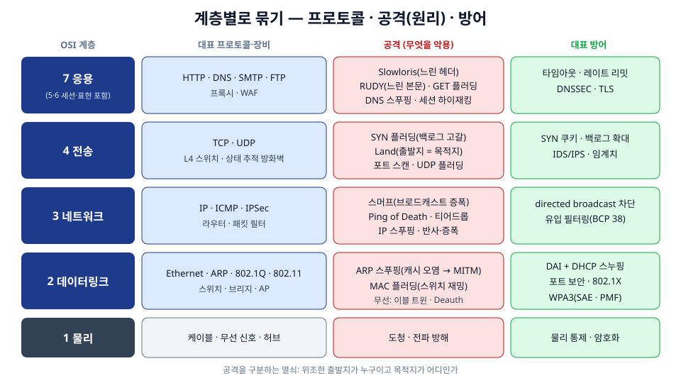
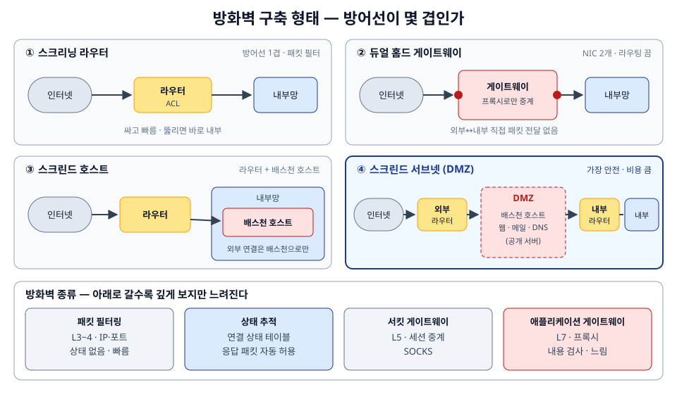
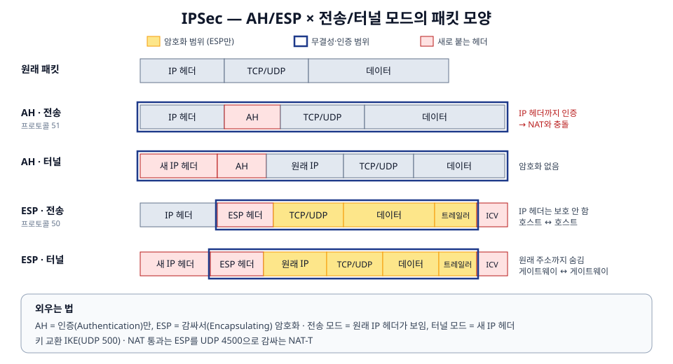

> **자격증 준비 · 정보보안기사** | 난이도 ★★★☆☆ | 예상 소요 6 ~ 8시간 (문항 풀이 포함)

> ⚠️ **이 편의 모든 문항은 공개된 출제기준을 바탕으로 직접 만든 창작 문항입니다.** 기출문제나 후기·덤프의 문항을 옮기거나 변형한 것이 아닙니다. 공격은 시험이 묻는 수준의 **원리(개념)** 만 다루며, 도구 사용 절차는 쓰지 않습니다. 직접 확인하고 싶다면 본인 소유의 격리 실습장(해킹 트랙 `hacklab`)에서만 하세요. 허가 없는 대상의 스캔·공격은 정보통신망법 등으로 처벌될 수 있습니다.

## 🎯 오늘의 목표

- OSI 7계층과 TCP/IP를 계층별 프로토콜·장비·공격과 짝지어 설명하고, 시험에 나오는 포트 번호를 정확히 쓴다
- DoS/DDoS, 스캐닝, 스푸핑, 스니핑, 세션 하이재킹의 **원리와 대응**을 계층 기준으로 구분한다
- 방화벽 종류와 구축 형태, IDS/IPS 탐지 방식과 Snort 규칙, IPSec·SSL VPN, 802.1X 기반 NAC를 설명한다
- WEP → WPA → WPA2 → WPA3의 변화와 무선 위협을 정리한다
- 창작 객관식 15문항과 실기 대비 4문항으로 확인한다

---

## 1. OSI 7계층과 TCP/IP

[Day 22](../../03-virtualization-network/day22-linux-networking.md)에서 bridge·veth로 2계층을, [Day 23](../../03-virtualization-network/day23-vlan-vxlan.md)에서 VLAN 태그와 VXLAN 캡슐화를, [Day 24](../../03-virtualization-network/day24-open-vswitch.md)에서 OVS 플로 규칙을 만졌습니다. 시험은 그 경험을 **"어느 계층에서 무엇이 일어나는가"** 로 묻습니다.



| OSI | TCP/IP | PDU | 대표 프로토콜 | 장비 | 이 계층을 노리는 공격 |
|---|---|---|---|---|---|
| 7 응용 | 응용 | 데이터(메시지) | HTTP, DNS, SMTP, FTP, SNMP | 프록시, WAF | HTTP GET 플러딩, Slowloris, DNS 스푸핑 |
| 6 표현 | 〃 | 〃 | (인코딩·암호화 개념, TLS를 여기로 설명하기도 함) | | |
| 5 세션 | 〃 | 〃 | (세션 관리 개념) | | 세션 하이재킹 |
| 4 전송 | 전송 | 세그먼트(TCP) / 데이터그램(UDP) | TCP, UDP | L4 스위치, 방화벽 | SYN 플러딩, Land, UDP 플러딩, 포트 스캔 |
| 3 네트워크 | 인터넷 | 패킷 | IP, ICMP, IPSec, (라우팅) | 라우터, L3 스위치 | IP 스푸핑, 스머프, Ping of Death, 티어드롭 |
| 2 데이터링크 | 네트워크 접근 | 프레임 | Ethernet, ARP, 802.1Q VLAN, 802.11 | 스위치, 브리지, AP | ARP 스푸핑, MAC 플러딩(스위치 재밍) |
| 1 물리 | 〃 | 비트 | 케이블, 무선 신호 | 허브, 리피터 | 도청, 전파 방해 |

> 💡 ARP는 IP 주소로 MAC 주소를 찾으므로 **2계층과 3계층 사이**에 걸친 프로토콜로 설명합니다. 교재에 따라 2계층 또는 3계층으로 분류하니, 문항이 "IP→MAC 변환"을 묻는다면 ARP, "MAC→IP"면 RARP로 고르면 됩니다.

### 1-1. TCP 연결과 플래그

| 플래그 | 의미 |
|---|---|
| SYN | 연결 시작(순서 번호 동기화) |
| ACK | 확인 응답 번호 유효 |
| FIN | 송신 종료 |
| RST | 연결 강제 재설정 |
| PSH | 버퍼링 없이 즉시 상위 계층으로 |
| URG | 긴급 포인터 유효 |

```
3-way handshake (연결)                 4-way handshake (종료)
Client          Server                 Client           Server
  ── SYN ───────▶  (SYN_RCVD)            ── FIN ────────▶
  ◀── SYN+ACK ──                         ◀── ACK ────────
  ── ACK ───────▶  (ESTABLISHED)         ◀── FIN ────────
                                         ── ACK ────────▶  (TIME_WAIT는 먼저 닫은 쪽)
```

SYN을 받은 서버는 `SYN_RCVD` 상태로 연결 정보를 **백로그 큐**에 넣고 마지막 ACK를 기다립니다. 이 대기 자리를 가득 채우는 것이 SYN 플러딩입니다(2절).

### 1-2. ICMP와 ARP

| ICMP 유형 | 의미 | 보안 관련 |
|---|---|---|
| 0 / 8 | Echo Reply / Echo Request | `ping`. 스머프 공격의 재료 |
| 3 | Destination Unreachable | 코드 3 Port Unreachable → **UDP 스캔에서 닫힌 포트** 신호 |
| 5 | Redirect | 경로 변경 유도 → 트래픽 가로채기에 악용 가능, 수신 비활성 권장 |
| 11 | Time Exceeded | `traceroute`가 TTL을 늘리며 이용 |

ARP는 **인증이 없습니다.** 요청하지 않은 ARP 응답도 받아들여 캐시를 갱신하는 구현이 많아 ARP 스푸핑이 가능합니다. [해킹 22](../../hacking/hack22-arp-mitm-detection.md)에서 원리와 탐지를 실습장 안에서 확인했습니다.

### 1-3. 꼭 외울 포트

| 포트 | 서비스 | 포트 | 서비스 |
|---|---|---|---|
| 20 / 21 | FTP 데이터 / 제어 | 161 / 162 | SNMP / SNMP Trap (UDP) |
| 22 | SSH (SFTP·SCP 포함) | 389 / 636 | LDAP / LDAPS |
| 23 | Telnet | 443 | HTTPS |
| 25 | SMTP | 445 | SMB |
| 53 | DNS (UDP, 큰 응답·영역 전송은 TCP) | 465 / 587 | SMTPS / 메일 제출(Submission) |
| 67 / 68 | DHCP 서버 / 클라이언트 | 500 / 4500 | IKE / IPSec NAT-T (UDP) |
| 69 | TFTP (UDP, 인증 없음) | 514 | Syslog (UDP) |
| 80 | HTTP | 993 / 995 | IMAPS / POP3S |
| 110 | POP3 | 1433 / 1521 / 3306 | MS-SQL / Oracle / MySQL |
| 123 | NTP | 1723 | PPTP |
| 137 ~ 139 | NetBIOS | 3389 | RDP |
| 143 | IMAP | 8080 | HTTP 대체(관례) |

---

## 2. 네트워크 공격의 원리 (개념만)

### 2-1. DoS / DDoS

| 공격 | 원리 | 대응 |
|---|---|---|
| **SYN 플러딩** | 출발지를 위조한 SYN을 대량 전송 → SYN+ACK에 대한 ACK가 오지 않아 백로그 큐 고갈 | **SYN 쿠키**, 백로그 확대, SYN_RCVD 타임아웃 단축, 상위 장비에서 임계치 차단 |
| **Land** | 출발지 IP·포트 = 목적지 IP·포트인 SYN → 자기 자신에게 응답하며 루프 | 출발지 = 목적지 패킷 차단(현대 OS는 대부분 패치) |
| **스머프(Smurf)** | 출발지를 **피해자 IP로 위조**한 ICMP Echo Request를 **브로드캐스트 주소**로 → 그 대역 호스트 전부가 피해자에게 응답 | 라우터에서 **directed broadcast 전달 차단**, 브로드캐스트 ping 응답 끄기 |
| Fraggle | 스머프의 UDP 판(echo·chargen 포트) | 불필요 UDP 서비스 중지, 브로드캐스트 차단 |
| **Ping of Death** | 조각화를 이용해 재조립 시 IP 최대 크기(65,535바이트)를 넘는 패킷 | 비정상 크기·조각 차단, OS 패치 |
| **티어드롭(Teardrop)** | 조각의 **오프셋을 겹치거나 어긋나게** 해 재조립 오류 유발 | 비정상 조각 폐기, OS 패치 |
| UDP·ICMP 플러딩 | 대량 패킷으로 대역폭 소진 | 상위(ISP·클라우드) 차단, 임계치 |
| **반사·증폭**(DRDoS) | 출발지를 피해자로 위조한 **작은 요청**을 공개 서버(DNS, NTP, Memcached 등)에 보내 **큰 응답**이 피해자에게 가게 함 | 열린 재귀 DNS·불필요 UDP 서비스 차단, **출발지 위조 차단(BCP 38 유입 필터링)**, 응답 크기 제한 |
| **Slowloris** | HTTP **헤더**를 끝내지 않고 조금씩 보내 연결을 오래 점유 | 헤더 수신 타임아웃, IP당 연결 수 제한, 앞단 리버스 프록시 |
| RUDY(R-U-Dead-Yet) | 큰 Content-Length를 선언하고 **본문**을 아주 느리게 전송 | 본문 수신 타임아웃·최소 속도 |
| HTTP GET 플러딩 | 정상 형식의 요청을 대량 전송(봇넷) | 레이트 리밋, 캐시, CAPTCHA·행위 분석, CDN·DDoS 방어 서비스 |

> 💡 시험에서 공격을 구분하는 열쇠는 **위조한 출발지가 누구인가, 목적지가 어디인가**입니다. Land는 출발지 = 목적지, 스머프는 출발지 = 피해자 + 목적지 = 브로드캐스트, 반사·증폭은 출발지 = 피해자 + 목적지 = 공개 서버입니다.

### 2-2. 스캐닝

[해킹 03](../../hacking/hack03-recon.md)에서 nmap으로 실습장을 정찰할 때 쓴 스캔 유형들의 **응답 차이**가 시험 단골입니다.

| 스캔 | 보내는 것 | 열린 포트 | 닫힌 포트 | 특징 |
|---|---|---|---|---|
| TCP Connect | 완전한 3-way | 연결 성립 | RST+ACK | 정확하지만 대상 로그에 남음 |
| SYN(반개방) | SYN | **SYN+ACK** (스캐너가 RST로 끊음) | RST+ACK | 연결을 완성하지 않아 스텔스 스캔이라 부름 |
| FIN / NULL / Xmas | FIN / 플래그 없음 / FIN+PSH+URG | **응답 없음** | **RST** | RFC 793을 따르는 시스템에서만 유효. 윈도우는 열림·닫힘 모두 RST |
| ACK | ACK | RST | RST | 열림 여부가 아니라 **방화벽 필터링 여부** 확인용(응답 없으면 필터링) |
| UDP | UDP 데이터그램 | 응답 없음(또는 UDP 응답) | **ICMP Port Unreachable** | 느리고 부정확 |

### 2-3. 스푸핑, 스니핑, 세션 하이재킹

| 공격 | 원리 | 대응 |
|---|---|---|
| **ARP 스푸핑** | 위조 ARP 응답으로 상대의 ARP 캐시에 "게이트웨이 IP = 공격자 MAC"을 기록 → 중간자(MITM) | 정적 ARP(중요 서버), 스위치의 **DAI(Dynamic ARP Inspection)** + DHCP 스누핑, arpwatch 탐지, **전송 구간 암호화** |
| IP 스푸핑 | 출발지 IP 위조. 응답을 못 받으므로 단방향 공격·신뢰 관계 악용 | 경계에서 내부 대역 출발지로 들어오는 패킷 차단(유입 필터링), IP 기반 신뢰(rlogin 등) 폐기 |
| DNS 스푸핑 | 위조 DNS 응답을 진짜보다 먼저 도착시키거나 캐시를 오염 | **DNSSEC**, 소스 포트·트랜잭션 ID 무작위화(E03에서 자세히) |
| **스니핑** | NIC를 **무차별(promiscuous) 모드**로 두고 지나가는 프레임을 모두 수집 | 암호화 프로토콜(SSH, TLS), 스위치 환경 + 포트 보안 |
| **스위치 재밍(MAC 플러딩)** | 위조 MAC으로 스위치 **CAM 테이블을 가득 채워** 허브처럼 모든 포트로 브로드캐스트하게 만듦 | **포트 보안**(포트당 MAC 수 제한) |
| ICMP 리다이렉트 | 위조 Redirect로 피해자 경로를 공격자 쪽으로 | 리다이렉트 수신 비활성(`net.ipv4.conf.all.accept_redirects=0`) |
| 세션 하이재킹 | 인증이 끝난 TCP 세션의 순서 번호를 맞춰 끼어들거나, 웹 세션 토큰 탈취 | 전송 암호화, 세션 ID 재발급·만료(웹은 E03), 비정상 ACK 폭주(ACK Storm) 탐지 |

> 💡 무차별 모드 확인: 리눅스에서 `ip link show eth0` 결과에 `PROMISC` 플래그가 보이면 해당 NIC가 모든 프레임을 받는 중입니다. [해킹 21](../../hacking/hack21-wireshark.md)에서 Wireshark로 캡처할 때 바로 이 모드를 썼습니다.

---

## 3. 네트워크 보안 장비와 기술

### 3-1. 방화벽

| 종류 | 동작 계층 | 판단 근거 | 장단점 |
|---|---|---|---|
| 패킷 필터링 | 3 ~ 4 | IP, 포트, 프로토콜, 플래그(패킷 하나씩) | 빠름 / 내용 못 봄, 상태 없음 |
| **상태 추적(Stateful Inspection)** | 3 ~ 4 (+ 상태 테이블) | 연결 상태 테이블에 기록된 세션에 속하는지 | 응답 패킷 자동 허용, 위조 ACK 차단 / 상태 테이블 고갈 공격 대상 |
| 애플리케이션 게이트웨이(프록시) | 7 | 프로토콜 내용(명령, URL) | 정밀 / 느림, 서비스마다 프록시 필요 |
| 서킷 게이트웨이 | 5 | 세션 중계(SOCKS) | 클라이언트 수정 필요 |

[Day 67](../../09-security/day67-host-hardening.md)의 nftables 규칙 `ct state established,related accept`가 바로 **상태 추적**입니다. 쿠버네티스의 NetworkPolicy([Day 70](../../09-security/day70-networkpolicy-zero-trust.md))도 개념상 Pod 단위 패킷 필터입니다.



| 구축 형태 | 구성 | 특징 |
|---|---|---|
| 스크리닝 라우터 | 라우터의 패킷 필터(ACL)만 | 싸고 빠름, 단일 방어선 |
| 배스천 호스트 | 외부에 노출되는 **강화된 단일 호스트** | 침입 시 내부 노출 |
| 듀얼 홈드 게이트웨이 | NIC 2개, **라우팅 기능 끔**, 프록시로만 중계 | 외부·내부 직접 통신 불가 |
| 스크린드 호스트 | 스크리닝 라우터 + 배스천 호스트 | 2단계 방어 |
| **스크린드 서브넷** | 외부 라우터 + **DMZ(배스천·공개 서버)** + 내부 라우터 | 가장 안전, 비용·관리 부담 큼. 오늘날 DMZ 구성의 원형 |

### 3-2. IDS / IPS

| 구분 | IDS | IPS |
|---|---|---|
| 위치 | 미러 포트·탭으로 **복사본** 감시(대역 외) | 트래픽 경로에 **직렬(인라인)** |
| 동작 | 탐지·경보 | 탐지 + **차단** |
| 장애 영향 | 망에 영향 없음 | 장애 시 통신 단절 위험 → fail-open/close 설계 필요 |

| 탐지 방식 | 원리 | 강점 | 약점 |
|---|---|---|---|
| **오용 탐지**(시그니처, 지식 기반) | 알려진 공격 패턴과 비교 | 오탐 적음, 원인 명확 | **새로운 공격(제로데이) 탐지 불가**, 시그니처 갱신 필요 |
| **이상 탐지**(행위·통계 기반) | 정상 기준(프로파일)에서 벗어남 | 새로운 공격 탐지 가능 | **오탐 많음**, 학습 기간 필요 |

| 판정 용어 | 의미 | 더 위험한 쪽 |
|---|---|---|
| 오탐(False Positive) | 정상을 공격으로 판정 | 운영 피로 |
| 미탐(False Negative) | 공격을 정상으로 놓침 | **보안상 더 위험** |

HIDS(호스트 기반: 시스템 로그·파일 무결성 — [Day 72 Falco](../../09-security/day72-falco.md)가 이 계열)와 NIDS(네트워크 기반: 패킷)를 구분하세요.

### 3-3. Snort 규칙 읽기

```
alert tcp $EXTERNAL_NET any -> $HOME_NET 22 (msg:"SSH 연결 시도 과다"; flags:S; detection_filter:track by_src, count 10, seconds 60; sid:1000101; rev:1;)
└─┬─┘ └┬┘ └────┬─────┘ └┬┘ └┘ └──┬───┘ └┬┘ └──────────────────────────── 옵션 ───────────────────────────────────────────────┘
 동작 프로토콜  출발지  포트 방향 목적지 포트
```

| 부분 | 값 | 설명 |
|---|---|---|
| 동작 | `alert` · `log` · `pass` · `drop` · `reject` | drop·reject는 인라인(IPS) 모드에서 차단 |
| 방향 | `->` 단방향, `<>` 양방향 | |
| `msg` | 경보 메시지 | |
| `content` | 페이로드 문자열 | `nocase`(대소문자 무시), `offset`·`depth`(검사 시작·범위), `distance`·`within`(앞 매치 기준 상대 위치) |
| `flags` | TCP 플래그 | `S` = SYN |
| `detection_filter` / `threshold` | 횟수·시간 조건 | "60초에 같은 출발지에서 10회 넘으면" |
| `sid` / `rev` | 규칙 ID / 개정 번호 | 사용자 정의 규칙은 보통 1,000,000 이상 |

### 3-4. VPN



| 구분 | IPSec VPN | SSL(TLS) VPN |
|---|---|---|
| 계층 | 3 (네트워크) | 4 ~ 7 (전송 위 응용) |
| 용도 | 지점 간(Site-to-Site), 원격 접속 | 원격 접속, 웹 브라우저 기반 |
| 클라이언트 | 전용 클라이언트·장비 | 브라우저만으로도 가능(클라이언트리스) |
| NAT·방화벽 통과 | NAT-T(UDP 4500) 필요 | 443 하나로 쉬움 |

| IPSec 구성 요소 | 내용 |
|---|---|
| **AH**(Authentication Header, IP 프로토콜 51) | 무결성 + 데이터 출처 인증 + 재전송 방지. **암호화 없음**. 바깥 IP 헤더까지 인증하므로 **NAT와 충돌** |
| **ESP**(Encapsulating Security Payload, 프로토콜 50) | **기밀성(암호화)** + 선택적 무결성·인증 + 재전송 방지 |
| **전송 모드** | 원래 IP 헤더 유지, **페이로드만** 보호 — 호스트 간 |
| **터널 모드** | **원래 패킷 전체**를 감싸고 새 IP 헤더 — 게이트웨이 간 VPN |
| IKE (UDP 500) | 키 교환·SA 협상. 현재는 IKEv2 |
| SA, SPI | 보안 연관(단방향), SA를 가리키는 식별자 |

그 밖에 2계층 터널링 프로토콜로 **PPTP**(TCP 1723 + GRE, 오래된 암호화로 사용 금지 권고)와 **L2TP**(UDP 1701, 자체 암호화 없음 → **L2TP/IPSec**으로 사용)를 구분해 두세요. 홈랩에서 외부 접속을 다룬 [홈랩 03](../../00-homelab/homelab03-safe-exposure.md)에서 쓴 Tailscale(WireGuard 기반) 같은 현대 VPN도 같은 목적(암호화된 터널)입니다.

### 3-5. NAC와 그 밖의 보안 솔루션

**NAC(Network Access Control)** 는 "누가, 어떤 상태의 단말로" 네트워크에 붙는지 통제합니다. 표준 기반 구성은 **IEEE 802.1X**입니다.

| 802.1X 구성 요소 | 역할 | 예 |
|---|---|---|
| 신청자(Supplicant) | 접속하려는 단말 | 노트북의 802.1X 클라이언트 |
| 인증자(Authenticator) | 인증 전에는 포트를 막아 두고 중계 | 스위치, 무선 AP |
| 인증 서버(Authentication Server) | 실제 인증 판단 | **RADIUS** 서버 |

인증 정보는 **EAP**로 실어 나릅니다(EAP-TLS는 양쪽 인증서 상호 인증, PEAP은 TLS 터널 안에서 패스워드 인증). NAC는 인증에 더해 **접속 전 단말 무결성 검사**(백신, 패치, 금지 프로그램)와 **미준수 단말 격리**(치료용 VLAN)를 합니다.

| 솔루션 | 한 줄 정의 |
|---|---|
| ESM / SIEM | 여러 장비의 로그·이벤트를 모아 **상관 분석** ([Day 60](../../08-sre-observability/day60-loki-alloy.md)·[62](../../08-sre-observability/day62-alerting.md)의 수집·알림과 같은 흐름) |
| SOAR | 탐지 후 대응 절차를 플레이북으로 **자동화** |
| 허니팟 | 일부러 노출한 미끼 시스템으로 공격 정보 수집 |
| **XDR** | 엔드포인트·네트워크·클라우드 등 여러 영역 탐지를 통합한 확장 탐지·대응 |
| **ZTNA** | "망 안이면 신뢰" 대신 **요청마다 사용자·기기 검증 후 앱 단위 접근** — [Day 70 제로 트러스트](../../09-security/day70-networkpolicy-zero-trust.md) |
| **SASE** | 네트워크 기능(SD-WAN)과 보안 기능(SWG, CASB, ZTNA, FWaaS)을 **클라우드에서 통합 제공** |

> 💡 XDR·ZTNA·SASE는 **2027 출제기준에 새로 들어온 항목**입니다. 이 레포의 Day 70에서 mTLS로 "Pod마다 신원을 확인하는" 구조를 만든 경험이 ZTNA의 원리 그대로입니다.

---

## 4. 무선 보안

| 방식 | 암호화 | 무결성 | 인증 | 평가 |
|---|---|---|---|---|
| WEP | RC4, **24비트 IV** | CRC-32 (ICV) | 공유 키 | IV 재사용·약한 무결성으로 **사용 금지** |
| WPA | **TKIP**(RC4 기반, 패킷별 키) | MIC(Michael) | PSK / 802.1X | WEP 하드웨어용 임시 방편 |
| WPA2 | **CCMP(AES)** — IEEE 802.11i | CCMP | PSK / 802.1X | 장기간 표준. 4-way 핸드셰이크 취약점(KRACK)은 패치로 대응 |
| WPA3 | AES(CCMP/GCMP) | 〃 | **SAE**(Personal) / 802.1X(Enterprise, 192비트 모드) | 오프라인 사전 대입 저항, 순방향 비밀성, **PMF(관리 프레임 보호) 필수**, 개방망용 OWE |

| 위협 | 내용 | 대응 |
|---|---|---|
| 불법 AP(Rogue AP) | 내부망에 허가 없이 연결한 AP | 무선 IPS(WIPS), 유선 포트 802.1X |
| 이블 트윈(Evil Twin) | 정상 AP와 같은 SSID로 위장한 AP | Enterprise 인증(서버 인증서 검증), 사용자 교육 |
| 인증 해제(Deauth) 프레임 위조 | 관리 프레임으로 연결 끊기 | **PMF**(WPA3 필수) |
| 사전 대입(PSK) | 핸드셰이크 캡처 후 오프라인 추측 | 긴 패스프레이즈, **WPA3-SAE** |

> ⚠️ **SSID 숨기기와 MAC 주소 필터링은 보안 대책이 아닙니다.** SSID는 접속 과정에서 드러나고, MAC 주소는 쉽게 바꿀 수 있습니다. 시험에서 "효과적인 무선 보안 대책"을 고르라면 이 둘은 오답 후보입니다. 집 공유기 점검은 [해킹 26](../../hacking/hack26-router-iot.md)에서 다뤘습니다.

---

## 5. 자주 헷갈리는 포인트

| 헷갈리는 쌍 | 구분법 |
|---|---|
| 스머프 vs Land | 스머프: 출발지 = 피해자, 목적지 = **브로드캐스트**. Land: 출발지 = 목적지 |
| Ping of Death vs 티어드롭 | 재조립 후 **크기 초과** vs 조각 **오프셋 겹침** |
| Slowloris vs RUDY | 느린 **헤더** vs 느린 **본문(POST)** |
| SYN 스캔 vs FIN 스캔의 "열린 포트" | SYN 스캔: SYN+ACK 받음. FIN 스캔: **응답 없음** |
| UDP 스캔 닫힌 포트 | ICMP 유형 3, 코드 3 (Port Unreachable) |
| AH vs ESP | AH = 인증만(51), ESP = 암호화(50). "기밀성"이 나오면 ESP |
| 전송 vs 터널 모드 | 원래 IP 헤더가 **보이면** 전송, **감춰지면** 터널 |
| 오탐 vs 미탐 | False **Positive** = 정상인데 "양성(공격)" 판정 |
| 오용 vs 이상 탐지 | 오용 = 아는 것만(오탐↓, 신종×), 이상 = 신종 가능(오탐↑) |
| IDS vs IPS | 복사본 감시 vs 인라인 차단 |
| 802.1X 3요소 | 단말(Supplicant) – 스위치/AP(Authenticator) – RADIUS(Server) |
| TKIP vs CCMP | TKIP = WPA(RC4 기반), CCMP = WPA2(AES) |
| 스크린드 호스트 vs 스크린드 서브넷 | 서브넷 = **DMZ가 있는** 구조 |

---

## 6. 창작 객관식 15문항

> 모든 문항은 이 시리즈를 위해 직접 만든 것입니다. 먼저 풀고 `<details>`를 여세요.

**Q1.** 다음 중 OSI 계층과 장비·프로토콜의 연결이 옳지 **않은** 것은?

1. 2계층 — 스위치, ARP 요청이 담긴 이더넷 프레임
2. 3계층 — 라우터, ICMP
3. 4계층 — L4 스위치, UDP
4. 1계층 — 브리지, 802.1Q 태그

<details><summary>정답과 해설</summary>

**정답 4.** 브리지와 802.1Q VLAN 태그는 2계층(데이터링크)입니다. 1계층 장비는 허브·리피터입니다.
</details>

**Q2.** 공격자가 피해자의 IP를 출발지로 위조한 ICMP Echo Request를 한 서브넷의 브로드캐스트 주소로 보냈다. 이 공격을 막는 데 가장 직접적인 대책은?

1. 서버의 SYN 백로그 큐를 늘린다
2. 경계 라우터에서 directed broadcast 전달을 차단한다
3. 웹 서버의 헤더 수신 타임아웃을 줄인다
4. 스위치 포트당 허용 MAC 수를 제한한다

<details><summary>정답과 해설</summary>

**정답 2.** 스머프 공격입니다. 외부에서 들어온 패킷이 내부 브로드캐스트로 퍼지지 않게 하면 증폭이 일어나지 않습니다. 1은 SYN 플러딩, 3은 Slowloris, 4는 MAC 플러딩 대책입니다.
</details>

**Q3.** SYN 쿠키(SYN Cookie)에 대한 설명으로 옳은 것은?

1. 클라이언트 브라우저에 세션 정보를 저장하는 HTTP 쿠키이다
2. SYN을 받았을 때 백로그에 상태를 저장하지 않고, 연결 정보를 SYN+ACK의 순서 번호에 담아 보낸다
3. SYN 패킷의 출발지 IP를 DNS로 역조회해 위조 여부를 판단한다
4. 일정 시간 SYN을 보낸 IP를 모두 차단하는 방화벽 규칙이다

<details><summary>정답과 해설</summary>

**정답 2.** 정상 클라이언트가 돌려보내는 ACK의 확인 번호로 연결 정보를 복원하므로, 위조 SYN이 아무리 와도 백로그가 차지 않습니다.
</details>

**Q4.** 출발지 IP·포트와 목적지 IP·포트를 모두 피해 서버로 같게 만든 SYN 패킷을 보내는 공격은?

1. Land
2. Teardrop
3. Fraggle
4. Ping of Death

<details><summary>정답과 해설</summary>

**정답 1.** 출발지 = 목적지가 Land의 정의입니다.
</details>

**Q5.** RFC 793을 따르는 리눅스 서버를 대상으로 FIN 스캔을 했을 때, **열린 포트**에서 기대되는 반응은?

1. SYN+ACK
2. RST+ACK
3. 응답 없음
4. ICMP Port Unreachable

<details><summary>정답과 해설</summary>

**정답 3.** FIN·NULL·Xmas 스캔에서 닫힌 포트는 RST를 보내고 열린 포트는 패킷을 조용히 버립니다. 윈도우는 열린 포트에도 RST를 보내 이 방식이 통하지 않습니다.
</details>

**Q6.** 다음 중 HTTP 요청의 **본문**을 매우 느리게 보내 서버 연결을 점유하는 공격은?

1. Slowloris
2. HTTP GET 플러딩
3. DNS 증폭
4. RUDY

<details><summary>정답과 해설</summary>

**정답 4.** RUDY는 큰 Content-Length를 선언한 POST 본문을 조금씩 보냅니다. Slowloris는 헤더를 끝내지 않는 방식입니다.
</details>

**Q7.** 스위치 환경에서 공격자가 무작위 MAC 주소의 프레임을 대량으로 보내 스위치가 모든 포트로 프레임을 내보내게 만드는 공격의 대응으로 가장 적절한 것은?

1. DNSSEC 적용
2. 포트 보안(포트당 MAC 주소 수 제한)
3. ICMP 리다이렉트 수신 차단
4. IKE 재협상 주기 단축

<details><summary>정답과 해설</summary>

**정답 2.** 스위치 재밍(MAC 플러딩)으로 CAM 테이블을 넘치게 하는 공격입니다. 포트 보안으로 한 포트에서 학습할 수 있는 MAC 수를 제한합니다.
</details>

**Q8.** 다음 중 상태 추적(Stateful Inspection) 방화벽의 특징으로 옳은 것은?

1. 패킷마다 독립적으로 판단하므로 연결 상태 테이블이 없다
2. 7계층 프로토콜 명령을 해석해 서비스마다 별도 프록시를 둔다
3. 연결 상태 테이블을 유지해, 허용된 세션의 응답 패킷을 별도 규칙 없이 통과시킨다
4. 2계층 MAC 주소만으로 허용 여부를 결정한다

<details><summary>정답과 해설</summary>

**정답 3.** 1은 패킷 필터링, 2는 애플리케이션 게이트웨이입니다. nftables의 `ct state established,related accept` 규칙이 상태 추적의 예입니다.
</details>

**Q9.** 외부 라우터와 내부 라우터 사이에 공개 서버들을 두는 별도 네트워크를 만드는 방화벽 구축 형태는?

1. 스크리닝 라우터
2. 듀얼 홈드 게이트웨이
3. 스크린드 호스트 게이트웨이
4. 스크린드 서브넷

<details><summary>정답과 해설</summary>

**정답 4.** 두 라우터 사이의 서브넷이 DMZ입니다. 가장 안전하지만 구성과 관리 비용이 큽니다.
</details>

**Q10.** 이상 탐지(Anomaly Detection) 방식 IDS에 대한 설명으로 옳지 **않은** 것은?

1. 정상 행위의 기준(프로파일)을 먼저 정해야 한다
2. 알려지지 않은 새로운 공격을 탐지할 가능성이 있다
3. 오용 탐지보다 오탐(False Positive)이 적어 운영 부담이 작다
4. 통계·임계치·기계 학습 기법을 활용할 수 있다

<details><summary>정답과 해설</summary>

**정답 3.** 이상 탐지는 정상에서 조금만 벗어나도 경보를 낼 수 있어 오탐이 **많은** 편입니다.
</details>

**Q11.** 다음 Snort 규칙의 의미로 옳은 것은?

```
alert udp any any -> $HOME_NET 53 (msg:"DNS ANY 질의"; content:"|00 FF 00 01|"; sid:1000201; rev:1;)
```

1. 내부 DNS 서버로 향하는 UDP 53 패킷 중 지정한 바이트열을 포함한 패킷을 발견하면 경보를 남긴다
2. 내부에서 외부로 나가는 모든 DNS 응답을 차단한다
3. TCP 53 영역 전송 요청을 탐지해 세션을 끊는다
4. 출발지 포트가 53인 패킷만 기록한다

<details><summary>정답과 해설</summary>

**정답 1.** 방향은 `any any -> $HOME_NET 53`(외부 어디서든 내부 53번으로), 동작은 `alert`(경보)입니다. `|00 FF 00 01|`은 16진수 바이트 표기로, 질의 유형 ANY(255)·클래스 IN(1)에 해당합니다. 차단하려면 인라인 모드에서 `drop`을 써야 합니다.
</details>

**Q12.** IPSec에 대한 설명으로 옳지 **않은** 것은?

1. AH는 데이터 무결성과 출처 인증을 제공하지만 기밀성은 제공하지 않는다
2. ESP는 페이로드를 암호화해 기밀성을 제공한다
3. 터널 모드는 원래 IP 헤더를 그대로 두고 페이로드만 보호하므로 호스트 간 통신에 주로 쓴다
4. AH는 IP 헤더의 주소까지 인증 범위에 넣어 NAT 환경과 충돌한다

<details><summary>정답과 해설</summary>

**정답 3.** 설명은 **전송 모드**입니다. 터널 모드는 원래 패킷 전체를 새 IP 헤더로 감싸며 게이트웨이 간 VPN에 주로 씁니다.
</details>

**Q13.** IEEE 802.1X 기반 NAC에서 스위치가 맡는 역할은?

1. 신청자(Supplicant)
2. 인증자(Authenticator)
3. 인증 서버(Authentication Server)
4. 인증 기관(Certificate Authority)

<details><summary>정답과 해설</summary>

**정답 2.** 스위치·무선 AP가 인증자로 단말과 RADIUS 서버 사이를 중계하고, 인증 결과에 따라 포트를 엽니다.
</details>

**Q14.** 무선랜 보안 방식에 대한 설명으로 옳은 것은?

1. WEP은 AES 기반 CCMP를 사용한다
2. WPA2는 RC4 기반 TKIP만 사용하도록 규정되어 있다
3. WPA3-Personal은 SAE를 사용해 핸드셰이크를 캡처한 뒤의 오프라인 사전 대입에 강하다
4. SSID 브로드캐스트를 끄면 WPA3 수준의 보호를 얻는다

<details><summary>정답과 해설</summary>

**정답 3.** WEP은 RC4, WPA2의 핵심은 AES 기반 CCMP(호환용 TKIP 혼용은 권장되지 않음)입니다. SSID 숨기기는 보안 대책이 아닙니다.
</details>

**Q15.** 2027년 출제기준에 추가된 차세대 보안 개념 중 "네트워크 위치와 관계없이 요청마다 사용자와 기기를 검증하고 애플리케이션 단위로만 접근을 허용"하는 것은?

1. ZTNA
2. NAT
3. VLAN
4. DMZ

<details><summary>정답과 해설</summary>

**정답 1.** 제로 트러스트 네트워크 접근(ZTNA)입니다. VLAN·DMZ는 "구역" 기반 신뢰, NAT는 주소 변환입니다.
</details>

---

## 7. 실기 대비 — 단답·서술형 창작 문항

**실기 1 (단답형).** 실습장에서 캡처했다고 가정한 다음 tcpdump 요약을 보고, 물음에 답하시오. (10.10.10.5는 점검자, 10.10.10.30은 본인 소유 실습 서버)

```
10.10.10.5.40001 > 10.10.10.30.22: Flags [S]
10.10.10.30.22 > 10.10.10.5.40001: Flags [S.]
10.10.10.5.40001 > 10.10.10.30.22: Flags [R]
10.10.10.5.40001 > 10.10.10.30.23: Flags [S]
10.10.10.30.23 > 10.10.10.5.40001: Flags [R.]
```

(1) 이 스캔 방식의 이름 (2) 22번과 23번 포트의 상태 (3) TCP Connect 스캔과 비교한 이 방식의 특징 한 가지

<details><summary>모범 답안</summary>

1. **TCP SYN 스캔(반개방, Half-open 스캔)** — SYN을 보내고 SYN+ACK를 받으면 ACK 대신 RST로 끊음
2. 22번 **열림**(SYN+ACK 응답), 23번 **닫힘**(RST+ACK 응답)
3. 3-way 핸드셰이크를 완성하지 않으므로 **응용 프로그램 수준 접속 로그에 남지 않는 경우가 많고** 더 빠름(스텔스 스캔). 단 IDS·방화벽 로그에는 탐지될 수 있음
</details>

**실기 2 (단답형).** 다음 조건의 Snort 규칙을 한 줄로 작성하시오.

- 외부(`$EXTERNAL_NET`)에서 내부(`$HOME_NET`) 웹 서버 TCP 80번 포트로 들어오는 패킷
- 페이로드에 대소문자 구분 없이 `/admin/backup.zip` 문자열 포함
- 경보 메시지 "백업 파일 접근 시도", sid 1000301, rev 1

<details><summary>모범 답안</summary>

```
alert tcp $EXTERNAL_NET any -> $HOME_NET 80 (msg:"백업 파일 접근 시도"; content:"/admin/backup.zip"; nocase; sid:1000301; rev:1;)
```

채점 포인트: 동작 `alert`, 프로토콜 `tcp`, 방향 `->`, 목적지 포트 80, `content` + `nocase`, `sid`·`rev`. HTTP 정규화 버퍼를 쓰는 `http_uri`(Snort 2) / `http_uri;` 스티키 버퍼(Snort 3) 같은 옵션을 추가하면 더 정확함.
</details>

**실기 3 (서술형).** IPSec의 AH와 ESP를 제공하는 보안 서비스 관점에서 비교하고, NAT 장비를 거치는 환경에서 AH를 쓰기 어려운 이유를 설명하시오.

<details><summary>모범 답안</summary>

- **AH**(IP 프로토콜 51): 무결성, 데이터 출처 인증, 재전송 방지를 제공하고 **기밀성(암호화)은 제공하지 않는다.**
- **ESP**(IP 프로토콜 50): **기밀성**을 제공하며, 선택적으로 무결성·출처 인증·재전송 방지도 제공한다. 실무 VPN은 대부분 ESP를 쓴다.
- **NAT 문제**: AH는 전송 중 바뀌지 않는 IP 헤더 필드(출발지·목적지 주소 포함)까지 무결성 계산에 넣는다. NAT가 주소를 바꾸면 수신 측 무결성 검증이 실패한다. ESP는 바깥 IP 헤더를 인증 범위에 넣지 않으므로, ESP를 UDP 4500으로 감싸는 **NAT-T**로 NAT를 통과할 수 있다.
</details>

**실기 4 (실무형).** 웹 서비스 운영 중 다음 상황이 관측되었다. 원인을 추정하고 단계별 대응 방안을 쓰시오.

- `ss -s` 결과 `SYN-RECV` 상태 연결이 평소 수십 개에서 수만 개로 증가
- 해당 SYN의 출발지 IP가 매우 다양하고, 대부분은 서버의 SYN+ACK에 응답하지 않음
- 대역폭 사용률은 회선 용량의 30% 수준

<details><summary>모범 답안</summary>

**원인 추정**: 출발지를 위조한 **SYN 플러딩**. 대역폭보다 서버의 **백로그 큐(반개방 연결 자리)** 를 고갈시키는 자원 고갈형 DoS로 판단된다(대역폭이 여유 있다는 점이 근거).

**대응**
1. **서버**: SYN 쿠키 활성(`net.ipv4.tcp_syncookies=1`), 백로그 확대(`net.ipv4.tcp_max_syn_backlog`), SYN+ACK 재전송 횟수 축소(`net.ipv4.tcp_synack_retries`)
2. **경계 장비**: 방화벽·IPS에서 출발지별·전체 SYN 임계치 설정, 비정상 패킷 차단, 앞단 리버스 프록시·로드밸런서의 SYN 프록시 기능 활용
3. **상위 협력**: 공격이 커지면 ISP·클라우드 DDoS 방어 서비스로 우회(스크러빙)
4. **사후**: 공격 시간대 패킷 샘플과 로그 보존, 임계치·알림 규칙 보완 — 알림 설계는 [Day 62](../../08-sre-observability/day62-alerting.md) 참고
</details>

---

## 8. 핵심 정리

- 계층별로 외운다: 2계층 ARP 스푸핑·MAC 플러딩 / 3계층 스머프·Ping of Death·티어드롭·IP 스푸핑 / 4계층 SYN 플러딩·Land·스캔 / 7계층 Slowloris·RUDY·GET 플러딩
- DoS 구분 열쇠는 **위조한 출발지와 목적지**. 반사·증폭은 작은 요청 → 큰 응답, 대응은 출발지 위조 차단과 열린 UDP 서비스 정리
- 스캔 응답: SYN 스캔 열림 = SYN+ACK, FIN·NULL·Xmas 열림 = 무응답, UDP 닫힘 = ICMP 3/3
- 방화벽: 패킷 필터 → 상태 추적 → 애플리케이션 게이트웨이. 구축은 **스크린드 서브넷(DMZ)** 이 가장 안전
- IDS: 오용 = 시그니처(오탐↓, 신종×), 이상 = 행위(신종○, 오탐↑). 미탐이 더 위험. IPS는 인라인 차단
- IPSec: AH(51) 인증만·NAT 충돌, ESP(50) 암호화. 전송 = 페이로드만, 터널 = 패킷 전체. IKE UDP 500, NAT-T 4500
- NAC = 802.1X(단말–스위치/AP–RADIUS) + 단말 무결성 검사·격리
- 무선: WEP(RC4·24비트 IV) → WPA(TKIP) → WPA2(CCMP·AES) → WPA3(SAE·PMF). SSID 숨기기·MAC 필터는 대책 아님
- 2027 추가: SASE, ZTNA, XDR

---

## ⏭️ 다음 예고 — E03. 애플리케이션 보안

OWASP Top 10:2025를 시험 용어(SQL 삽입, XSS, CSRF, 파일 업로드, 디렉터리 탐색)로 다시 묶고, DB 보안(접근 통제, 추론·집성, 암호화 방식), FTP·DNS·메일 보안(SPF·DKIM·DMARC, PGP·S/MIME), 전자상거래의 SET 이중 서명, 그리고 소프트웨어 개발보안 가이드의 7개 영역과 시큐어 코딩을 다룹니다. 해킹 04·05·13~18을 시험 언어로 바꾸는 편입니다.
