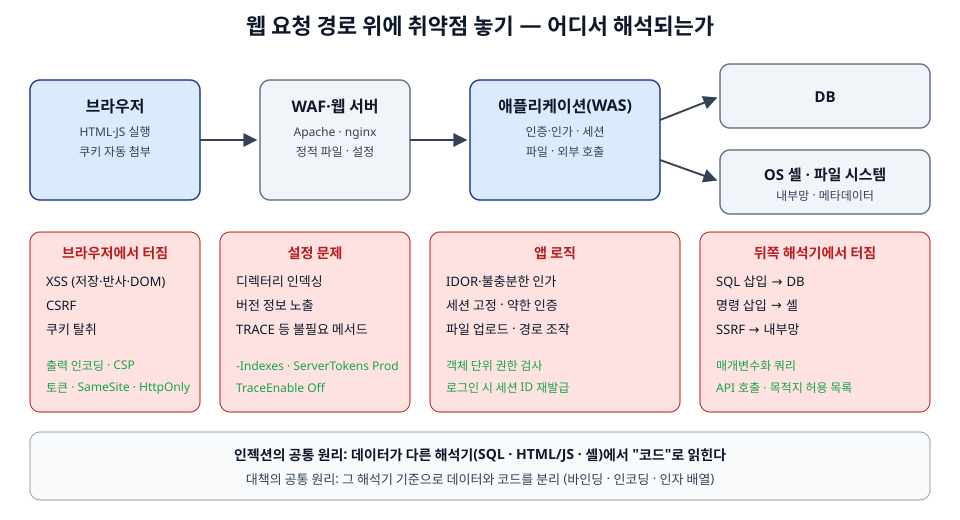
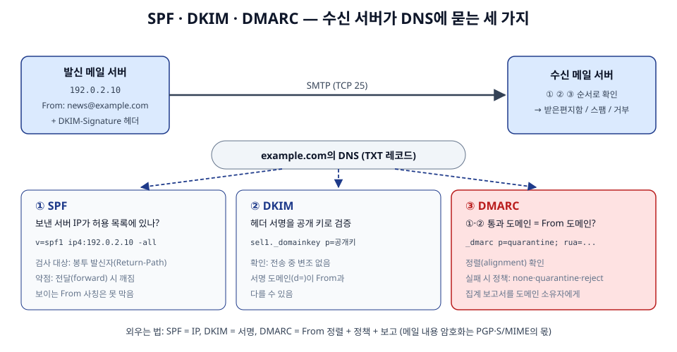
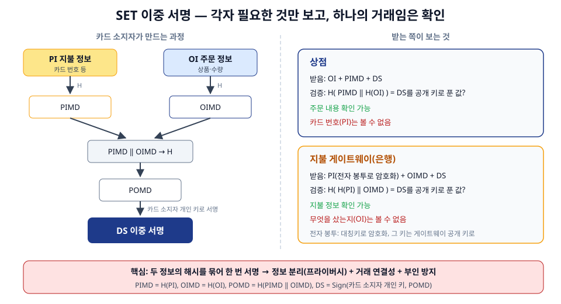

> **자격증 준비 · 정보보안기사** | 난이도 ★★★☆☆ | 예상 소요 6 ~ 8시간 (문항 풀이 포함)

> ⚠️ **이 편의 모든 문항은 공개된 출제기준을 바탕으로 직접 만든 창작 문항입니다.** 기출문제나 후기·덤프의 문항을 옮기거나 변형한 것이 아닙니다. 취약점은 시험이 묻는 수준의 원리와 대응만 다루고, 로그·코드 예시는 실습용으로 꾸민 것입니다. 직접 확인은 본인 소유의 격리 실습장(DVWA, Juice Shop)과 본인 앱에서만 하세요.

## 🎯 오늘의 목표

- OWASP Top 10:2025를 시험 용어(SQL 삽입, XSS, CSRF, 파일 업로드·다운로드, 명령 삽입, SSRF 등)와 짝지어 원리와 대응을 설명한다
- 웹 서버 보안 설정과 쿠키 속성, 세션 관리 대책을 정리한다
- DB 보안(권한 부여·회수, 추론·집성, 암호화 방식, 접근 통제 구축 방식)을 구분한다
- FTP·DNS·이메일 보안(SPF·DKIM·DMARC, PGP·S/MIME)과 전자상거래 보안(TLS, SET 이중 서명)을 설명한다
- 소프트웨어 개발보안 가이드의 7개 영역으로 시큐어 코딩 항목을 분류한다
- 창작 객관식 15문항과 실기 대비 4문항으로 확인한다

---

## 1. 웹 취약점 — OWASP Top 10:2025와 시험 용어

해킹 트랙에서 [해킹 04](../../hacking/hack04-web-sqli-xss.md)(SQL 삽입·XSS)와 [해킹 05](../../hacking/hack05-web-owasp-top10.md)(인증·IDOR·SSRF·파일 업로드·명령 삽입)로 원리 → 확인 → 탐지 → 수정을 해 봤습니다. 시험은 같은 내용을 **국내 가이드의 용어**로 묻습니다.



| OWASP Top 10:2025 | 시험에서 자주 쓰는 이름 | 해킹 트랙 |
|---|---|---|
| A01 Broken Access Control | 불충분한 인가, **IDOR**, 경로 조작(디렉터리 탐색), **SSRF**(2025판에서 여기로 통합) | 해킹 05, 15 |
| A02 Security Misconfiguration | 디렉터리 인덱싱, 불필요한 HTTP 메서드, 기본 계정·샘플 페이지, 상세 오류 노출 | Day 67~69 |
| A03 Software Supply Chain Failures | 취약한 라이브러리·빌드 파이프라인 | 해킹 19, 23 |
| A04 Cryptographic Failures | 평문 전송, 약한 알고리즘, 하드코드된 키 | Day 71 |
| A05 Injection | **SQL 삽입**, **XSS**, OS 명령 삽입, LDAP·XPath 삽입 | 해킹 04, 05 |
| A06 Insecure Design | 설계 단계 통제 누락(예: 횟수 제한 없는 인증) | Day 66 |
| A07 Authentication Failures | 약한 패스워드 정책, **세션 고정**, 자동화 공격 허용 | 해킹 05, 15 |
| A08 Software or Data Integrity Failures | **안전하지 않은 역직렬화**, 서명 없는 업데이트 | 해킹 18 |
| A09 Security Logging and Alerting Failures | 로그·경보 부재 | 해킹 10 |
| A10 Mishandling of Exceptional Conditions | 오류 처리 부재, 예외 시 fail-open | 해킹 13 |

> 💡 국내 시험 대비 자료는 2021판 Top 10이나 KISA 「주요정보통신기반시설 기술적 취약점 분석·평가 가이드」의 웹 점검 항목 이름을 그대로 쓰는 경우가 많습니다. 순위 번호보다 **"이 취약점이 어떤 범주인가, 어떻게 막는가"** 를 기준으로 공부하세요. 2025판 변화는 해킹 05 1절에 정리되어 있습니다.

### 1-1. 주요 취약점의 원리와 대응

| 취약점 | 원리 | 핵심 대응 |
|---|---|---|
| **SQL 삽입** | 입력값이 SQL **문법의 일부**로 해석됨. 유형: 오류 기반, UNION 기반, **블라인드**(참/거짓 응답 차이, 시간 지연) | **매개변수화 쿼리(PreparedStatement)**, DB 계정 최소 권한, 상세 DB 오류 숨김, 입력 허용 목록 |
| **XSS** | 입력이 HTML·JS로 **브라우저에서 실행**. 저장형(게시판에 저장), 반사형(요청 값이 응답에 바로 반영), DOM 기반(클라이언트 JS가 처리) | **출력 위치에 맞는 인코딩**, CSP, 쿠키 HttpOnly, HTML 허용 시 검증된 정화 라이브러리 |
| **CSRF** | 로그인한 사용자의 브라우저가 **의도하지 않은 요청을 자동 전송**(쿠키 자동 첨부 악용) | **CSRF 토큰**, 쿠키 SameSite, 중요 기능 재인증, Origin 검증 — [해킹 17](../../hacking/hack17-browser-security.md) |
| 파일 업로드 | 서버 측 스크립트(웹셸)를 올려 **서버에서 실행** | 확장자 **허용 목록**, 웹 루트 밖 저장, 저장 이름 무작위화, 업로드 디렉터리 실행 권한 제거, 크기 제한 |
| 파일 다운로드·경로 조작 | `../`로 의도 밖 파일(`/etc/passwd`, 설정 파일) 접근 | 파일명 대신 **ID로 매핑**, 경로 정규화 후 기준 디렉터리 검사 |
| OS 명령 삽입 | 입력이 셸 명령의 일부로 실행 | 셸 호출 대신 라이브러리 API, 인자 배열 방식 실행, 허용 목록 |
| SSRF | 서버가 **입력받은 URL로 대신 요청** → 내부망·클라우드 메타데이터 접근 | 목적지 허용 목록, 내부 대역 차단, 리다이렉트 재검증, IMDSv2 |
| XXE | XML 파서가 **외부 엔티티**를 처리해 로컬 파일·내부 URL 노출 | 파서의 DTD·외부 엔티티 비활성 — [해킹 18](../../hacking/hack18-deserialization-xxe-ssti.md) |
| 안전하지 않은 역직렬화 | 신뢰할 수 없는 데이터를 객체로 복원하며 코드 실행 | 신뢰 경계 밖 데이터 역직렬화 금지, 허용 클래스 목록, JSON 같은 데이터 전용 형식 |
| **세션 고정** | 공격자가 미리 정한 세션 ID를 피해자가 그대로 쓰게 함 | **로그인 성공 시 세션 ID 재발급** |
| 불충분한 인가(IDOR) | 다른 사용자의 객체 번호로 바꿔도 접근됨 | 객체 단위 **서버 측 권한 검사** |
| 정보 노출 | 상세 오류, 주석, 백업 파일, 디렉터리 인덱싱 | 공통 오류 페이지, 배포 전 불필요 파일 제거 |

### 1-2. 쿠키 속성과 웹 서버 설정

| 쿠키 속성 | 효과 | 막는 것 |
|---|---|---|
| `Secure` | HTTPS로만 전송 | 평문 구간 스니핑 |
| `HttpOnly` | JavaScript(`document.cookie`)에서 읽기 불가 | XSS로 인한 **쿠키 탈취** (XSS 자체는 못 막음) |
| `SameSite=Lax/Strict` | 다른 사이트에서 시작된 요청에 쿠키 첨부 제한 | **CSRF** |

```apache
# Apache httpd — 정보 노출과 불필요 기능 줄이기
ServerTokens Prod            # 응답 헤더에 버전·OS 정보 최소화
ServerSignature Off          # 오류 페이지 하단 서버 정보 제거
TraceEnable Off              # TRACE 메서드 비활성
<Directory "/var/www/html">
    Options -Indexes -FollowSymLinks   # 디렉터리 목록·심볼릭 링크 따라가기 금지
    AllowOverride None
    Require all granted
</Directory>
```

```nginx
# nginx — 같은 목적
server_tokens off;
autoindex off;
```

| WAF 정책 모델 | 의미 |
|---|---|
| 네거티브(블랙리스트) | 알려진 공격 패턴을 차단 — 오탐 적음, 신종에 약함 |
| 포지티브(화이트리스트) | 허용한 형식·경로만 통과 — 강력하지만 학습·관리 부담 |

ModSecurity + OWASP CRS(Core Rule Set)가 대표적인 오픈소스 WAF 조합입니다. CI 단계에서 ZAP으로 자동 점검하는 방법은 [해킹 20](../../hacking/hack20-zap-in-ci.md)에서 다뤘습니다.

> 💡 **2027 출제기준 대비 — REST API 보안**: 실기 수행준거에 OWASP API Security Top 10(2023)이 추가됩니다. 객체 단위 인가 실패(BOLA), 과도한 데이터 노출, 자원 소비 제한 부재(레이트 리밋) 같은 항목은 [해킹 16](../../hacking/hack16-api-security.md)이 그대로 대비가 됩니다.

---

## 2. DB 보안

### 2-1. 권한 부여와 회수

```sql
-- 조회만 가능한 보고용 계정
GRANT SELECT ON shop.orders TO report_user;

-- 다른 사람에게 다시 줄 수 있는 권한까지
GRANT SELECT ON shop.orders TO team_lead WITH GRANT OPTION;

-- team_lead의 권한을 회수하면서, team_lead가 남에게 준 권한도 연쇄 회수
REVOKE SELECT ON shop.orders FROM team_lead CASCADE;
```

| 개념 | 설명 |
|---|---|
| `WITH GRANT OPTION` | 받은 권한을 **다른 사용자에게 다시 부여**할 수 있음 — 권한 확산 위험 |
| `CASCADE` / `RESTRICT` | 회수 시 연쇄 회수 / 다른 곳에 전파됐다면 회수 거부(표준 SQL 기준, DBMS마다 지원 차이) |
| 뷰(View) | 테이블의 일부 열·행만 보여 주어 **접근 범위를 좁힘** |
| 역할(Role) | 권한 묶음을 역할에 주고 사용자에게 역할 부여 — 관리 단순화 |

### 2-2. 추론과 집성

| 위협 | 의미 | 대응 |
|---|---|---|
| **추론(Inference)** | 접근이 허용된 데이터나 통계 질의 결과를 조합해 **접근이 금지된 값을 알아냄** (예: 부서 평균 연봉 질의를 반복해 한 사람의 연봉 계산) | 질의 결과 집합 크기 제한, 데이터 교란(잡음 추가), 셀 은닉, **다중 인스턴스화(Polyinstantiation)** |
| **집성(Aggregation)** | 낮은 등급 정보 **여러 개를 모으면** 높은 등급 정보가 됨 (예: 개별 부대 위치 → 전체 배치도) | 집합 자체에 높은 등급 부여, 대량 조회 제한·감시 |

### 2-3. DB 암호화와 접근 통제 구축 방식

| DB 암호화 방식 | 위치 | 장점 | 단점 |
|---|---|---|---|
| **API 방식** | 애플리케이션이 암호화 함수 호출 | DB 서버 부하 적음 | **애플리케이션 수정 필요** |
| **플러그인 방식** | DB 서버에 암호화 모듈 설치(함수·프로시저) | 애플리케이션 수정 적음 | DB 서버 부하 |
| **TDE**(Transparent Data Encryption) | DBMS 커널이 저장 시 자동 암호화 | **애플리케이션 수정 없음**, 성능 우수 | DBMS 의존, 접근 권한 있는 사용자에겐 평문 |
| 파일(OS) 암호화 | 운영체제·파일 시스템 수준 | 비정형 파일까지 | 세밀한(열 단위) 통제 불가 |
| 하이브리드 | 위 방식 조합 | 상황별 최적화 | 복잡 |

| DB 접근 통제 구축 방식 | 동작 | 특징 |
|---|---|---|
| 게이트웨이(프록시) | 사용자와 DB 사이에서 쿼리를 중계하며 통제 | 우회 경로 차단이 중요, 장애 시 영향 |
| 스니핑 | 네트워크 트래픽을 복사해 감시 | 성능 영향 없음, **차단 능력 제한** |
| 에이전트 | DB 서버에 에이전트 설치 | 로컬 접속까지 통제, 서버 부하 |
| 하이브리드 | 조합 | |

> 💡 개인정보의 **고유식별정보·비밀번호·바이오정보** 등 암호화 대상과 방법은 개인정보 보호법 하위 고시에서 정합니다. 법령·고시 조문은 ⑤ 관리·법규 편([E05](./e05-management-law.md))에서 현행 기준으로 다룹니다. 비밀번호는 복호화가 필요 없으므로 **일방향 해시(솔트 포함)** 로 저장한다는 원칙만 여기서 기억하세요.

---

## 3. 인터넷 응용 보안 — FTP, DNS, 이메일

### 3-1. FTP

| 모드 | 데이터 연결을 여는 쪽 | 포트 |
|---|---|---|
| 액티브 | **서버**가 클라이언트로 접속 | 서버 20 → 클라이언트가 `PORT`로 알려 준 포트 |
| 패시브 | **클라이언트**가 서버로 접속 | 클라이언트 → 서버가 `PASV`로 알려 준 높은 포트 |

| 위협 | 대응 |
|---|---|
| 평문 인증·전송 | SFTP(SSH 기반) 또는 FTPS(FTP over TLS) |
| 익명(anonymous) FTP 악용 | 익명 접속 비활성, 필요 시 쓰기 금지·chroot |
| FTP 바운스 | `PORT` 명령으로 서버가 제3자에게 접속하게 만듦 → 클라이언트 주소와 다른 `PORT` 거부 |
| TFTP(UDP 69) | 인증 없음 → 꼭 필요한 망(장비 부팅 등)에서만, 외부 차단 |

### 3-2. DNS

| 위협 | 원리 | 대응 |
|---|---|---|
| 캐시 포이즈닝 | 재귀 DNS 서버 캐시에 위조 응답을 넣음 | **DNSSEC** 검증, 소스 포트·트랜잭션 ID 무작위화 |
| 영역 전송 노출 | 아무에게나 AXFR(TCP 53) 허용 → 내부 호스트 목록 유출 | 영역 전송은 **보조 DNS 서버로만 허용** |
| 열린 재귀 서버 | 외부 누구의 재귀 질의든 처리 → 증폭 공격 도구 | 재귀 질의는 내부 대역만 허용 |
| DNS 증폭 DDoS | E02의 반사·증폭 | 위 대책 + 응답 레이트 제한 |

DNSSEC은 응답의 **무결성과 출처 인증**을 제공하며 **기밀성은 제공하지 않습니다**(질의 내용 숨기기는 DoT·DoH). 레코드: `DNSKEY`(공개 키), `RRSIG`(서명), `DS`(상위 영역에 등록하는 자식 키 해시, 신뢰 사슬), `NSEC`/`NSEC3`(존재하지 않음 증명).

### 3-3. 이메일

| 프로토콜 | 포트 | 역할 |
|---|---|---|
| SMTP | 25 (서버 간), 587 (제출), 465 (SMTPS) | 보내기 |
| POP3 / POP3S | 110 / 995 | 받기(내려받아 보관) |
| IMAP / IMAPS | 143 / 993 | 받기(서버에 두고 동기화) |

**발신 도메인 인증 3종** — 스팸·피싱 대응의 기본입니다.



| 기술 | 무엇을 확인 | DNS 레코드 예 (`example.com`) |
|---|---|---|
| **SPF** | 이 메일을 보낸 **서버 IP**가 그 도메인이 허용한 발신 서버인가 | `v=spf1 ip4:192.0.2.10 include:_spf.example.net -all` |
| **DKIM** | 메일 헤더의 **전자 서명**을 도메인 공개 키로 검증 → 전송 중 변조 없음 | `sel1._domainkey.example.com` TXT `v=DKIM1; k=rsa; p=<공개키>` |
| **DMARC** | SPF·DKIM 결과가 **보낸 사람(From) 도메인과 일치**하는지 보고, 실패 시 처리 정책·보고 | `_dmarc.example.com` TXT `v=DMARC1; p=quarantine; rua=mailto:dmarc@example.com` |

| 메일 암호화 | 신뢰 모델 | 특징 |
|---|---|---|
| **PGP** | **신뢰의 웹(Web of Trust)** — 사용자끼리 서로 키 서명 | 개인 간 사용에 적합, 중앙 CA 불필요 |
| **S/MIME** | **X.509 인증서·CA(PKI)** | 기업·기관에서 표준 메일 클라이언트와 연동 |
| PEM | 중앙 집중식 PKI (IETF 표준) | 구현이 복잡해 널리 쓰이지 않음 |

그 밖에 **오픈 릴레이**(아무 발신자 메일이나 중계) 금지, 스팸 차단 목록(RBL) 활용, 첨부 파일 샌드박스 검사가 메일 서버 보안의 기본입니다.

---

## 4. 전자상거래 보안

### 4-1. TLS

현재 쓰는 판은 TLS 1.2와 1.3이며, SSL 2.0·3.0과 TLS 1.0·1.1은 폐기되었습니다. TLS는 **기밀성(대칭키 암호), 무결성(MAC·AEAD), 서버 인증(인증서)** 을 제공하고, 키 교환을 (EC)DHE로 하면 **순방향 비밀성(PFS)** 을 얻습니다. 인증서 발급·자동 갱신은 [Day 71 cert-manager](../../09-security/day71-vault-cert-manager.md)에서 해 봤습니다. 암호 알고리즘 자체는 [E04](./e04-infosec-general.md)에서 다룹니다.

### 4-2. SET과 이중 서명

SET(Secure Electronic Transaction)은 카드 결제용으로 설계된 프로토콜입니다. 실제로 널리 쓰이지는 못했지만 **이중 서명** 개념 때문에 시험 단골입니다.

| 참여자 | 역할 |
|---|---|
| 카드 소지자 | 구매자 |
| 상점 | 판매자 |
| **지불 게이트웨이** | 상점과 카드사 결제망 사이 중계 |
| 인증 기관(CA) | 참여자 인증서 발급 |
| 발급사 / 매입사 | 카드 발급 은행 / 상점 거래 은행 |



**이중 서명**의 목적: 상점은 **주문 정보(OI)** 만, 은행(지불 게이트웨이)은 **지불 정보(PI)** 만 보게 하면서도, 두 정보가 **같은 거래에 묶여 있음**을 양쪽이 검증하게 합니다.

1. PIMD = H(PI), OIMD = H(OI)
2. POMD = H(PIMD ‖ OIMD)
3. 이중 서명 DS = 카드 소지자 개인 키로 POMD 서명
4. 상점에는 OI + PIMD + DS, 게이트웨이에는 (전자 봉투로 암호화한) PI + OIMD + DS

| 결제 관련 용어 | 의미 |
|---|---|
| 전자 봉투 | 메시지는 대칭키로 암호화하고, 그 대칭키를 수신자 **공개 키로 암호화**해 함께 보냄 |
| 3-D Secure | 카드 결제 시 **발급사가 직접 카드 소지자를 인증**하는 방식(국내 안심클릭 등) |
| 전자화폐 요구 사항 | 위조 방지, **이중 사용 방지**, 익명성(사용자 추적 불가), 양도성 |

### 4-3. 무선·모바일 환경

출제기준의 "무선 환경 보안"은 모바일 결제·앱을 염두에 둔 항목입니다. 앱 위변조 방지(무결성 검사, 난독화), 기기 루팅·탈옥 탐지, 일회용 비밀번호(OTP), 전송 구간 암호화와 인증서 고정(pinning) 같은 대책을 묶어 기억하세요.

---

## 5. 시큐어 코딩과 개발 보안

### 5-1. 소프트웨어 개발보안 가이드의 7개 영역

국내 공공 분야 개발보안 가이드(행정안전부·KISA)는 보안 약점을 7개 영역으로 나눕니다. **영역 이름과 대표 항목의 짝**이 객관식에 자주 나옵니다.

| 영역 | 대표 보안 약점 | 해킹 트랙 |
|---|---|---|
| **입력데이터 검증 및 표현** | SQL 삽입, XSS, 경로 조작, 운영체제 명령어 삽입, 위험한 형식 파일 업로드, SSRF | 해킹 04·05·13 |
| **보안기능** | 적절한 인증 없는 중요 기능 허용, 부적절한 인가, **하드코드된 비밀번호·키**, 취약한 암호 알고리즘, 솔트 없는 해시 | 해킹 15·19 |
| **시간 및 상태** | 검사 시점과 사용 시점(TOCTOU) 경쟁 조건, 종료되지 않는 반복문·재귀 | E01 레이스 컨디션 |
| **에러처리** | 오류 메시지를 통한 정보 노출, 오류 상황 대응 부재, 부적절한 예외 처리 | 해킹 13 |
| **코드오류** | Null 포인터 역참조, 부적절한 자원 해제, 신뢰할 수 없는 데이터의 역직렬화 | 해킹 18 |
| **캡슐화** | 잘못된 세션에 의한 정보 노출, **제거되지 않은 디버그 코드**, private 배열을 public 메서드가 그대로 반환 | |
| **API 오용** | DNS 조회 결과에 의존한 보안 결정, 취약한 API 사용 | |

> ⚠️ 가이드는 개정될 때 항목 이름과 개수가 조금씩 바뀝니다. 응시 직전 최신판 목차를 한 번 훑어 보세요. 영역 7개의 큰 틀은 오랫동안 유지되어 왔습니다.

### 5-2. 취약 코드와 안전한 코드 (Java)

[해킹 13](../../hacking/hack13-secure-coding.md)에서 본 패턴을 시험 답안 형식으로 정리합니다.

```java
// 취약: 입력이 SQL 문법의 일부가 됨
String sql = "SELECT * FROM member WHERE id = '" + id + "' AND pw = '" + pw + "'";
Statement st = conn.createStatement();
ResultSet rs = st.executeQuery(sql);

// 안전: 매개변수화 쿼리 — 입력은 항상 '값'으로만 바인딩
String sql = "SELECT * FROM member WHERE id = ? AND pw_hash = ?";
PreparedStatement ps = conn.prepareStatement(sql);
ps.setString(1, id);
ps.setString(2, hash(pw));   // 비밀번호는 솔트+느린 해시로 비교 (실제로는 해시 검증 라이브러리 사용)
ResultSet rs = ps.executeQuery();
```

```java
// 취약: 오류 상세를 그대로 응답
} catch (SQLException e) {
    response.getWriter().println(e.toString());
}
// 안전: 사용자에겐 일반 메시지, 상세는 서버 로그에만
} catch (SQLException e) {
    log.error("member lookup failed", e);
    response.sendError(500, "요청을 처리할 수 없습니다.");
}
```

### 5-3. Secure SDLC와 점검 도구

| 구분 | 내용 |
|---|---|
| Secure SDLC | 요구사항(보안 요구 정의) → 설계(위협 모델링 — [Day 66](../../09-security/day66-threat-modeling-4c.md)) → 구현(시큐어 코딩) → 테스트(정적·동적 분석) → 배포·운영(패치, 모니터링) |
| 대표 방법론 | MS SDL, McGraw의 Seven Touchpoints, OWASP CLASP(현재는 SAMM 등으로 계승) |
| **SAST**(정적 분석) | 실행하지 않고 **소스 코드** 분석 — 초기 발견, 오탐 가능 — [해킹 14](../../hacking/hack14-sast.md) Semgrep·CodeQL |
| **DAST**(동적 분석) | **실행 중인 앱**에 요청을 보내 점검 — 설정 문제까지, 코드 위치 특정은 어려움 — [해킹 20](../../hacking/hack20-zap-in-ci.md) ZAP |
| IAST | 실행 중 앱 내부에 에이전트를 넣어 두 방식을 결합 |
| SCA | 의존 라이브러리의 알려진 취약점 점검 — [해킹 19](../../hacking/hack19-dependencies-secrets.md) |

---

## 6. 자주 헷갈리는 포인트

| 헷갈리는 쌍 | 구분법 |
|---|---|
| XSS vs CSRF | XSS = 공격 스크립트가 **피해자 브라우저에서 실행**. CSRF = 피해자 브라우저가 **요청을 대신 보냄**(스크립트 실행 불필요) |
| 저장형 vs 반사형 XSS | 서버에 저장돼 여러 사람에게 / 요청 값이 응답에 바로 반사돼 링크 클릭한 사람에게 |
| HttpOnly vs SameSite | HttpOnly = 스크립트의 쿠키 읽기 차단(XSS 피해 축소), SameSite = 교차 사이트 요청에 쿠키 첨부 제한(CSRF) |
| 세션 고정 대책 | 로그아웃이 아니라 **로그인 성공 시** 세션 ID 재발급 |
| 추론 vs 집성 | 추론 = 허용된 것으로 **금지된 값 계산**, 집성 = 낮은 등급 **여러 개 모으기** |
| API vs 플러그인 vs TDE | 앱 수정 필요 / DB 서버에 모듈 / DBMS 커널, 앱 수정 없음 |
| SPF vs DKIM vs DMARC | 발신 **IP** / 메일 **서명** / From 도메인 **정렬 + 정책·보고** |
| PGP vs S/MIME | 신뢰의 웹 / X.509 CA |
| DNSSEC이 주는 것 | 무결성·출처 인증. **기밀성 아님** |
| FTP 액티브 vs 패시브 | 데이터 연결을 서버가 엶 / 클라이언트가 엶 |
| SET 이중 서명 | 상점은 OI만, 게이트웨이는 PI만, 둘 다 **연결성** 검증 |
| SAST vs DAST | 소스 코드 / 실행 중인 앱 |

---

## 7. 창작 객관식 15문항

> 모든 문항은 이 시리즈를 위해 직접 만든 것입니다. 먼저 풀고 `<details>`를 여세요.

**Q1.** SQL 삽입 대응책 중 **근본적인 대책**으로 가장 적절한 것은?

1. 입력값에서 작은따옴표를 찾아 두 개로 바꾼다
2. 매개변수화 쿼리(PreparedStatement)로 입력을 값으로만 바인딩한다
3. DB 오류 메시지를 사용자 화면에 그대로 보여 주어 원인을 빨리 파악한다
4. 웹 애플리케이션이 DB 관리자(DBA) 계정으로 접속하게 해 권한 오류를 없앤다

<details><summary>정답과 해설</summary>

**정답 2.** 쿼리 구조와 데이터를 분리하는 것이 근본 대책입니다. 1은 우회 가능성이 있는 보조 수단, 3과 4는 오히려 위험을 키웁니다(오류 정보 노출, 과도한 권한).
</details>

**Q2.** 게시판 글에 저장된 스크립트가 그 글을 연 모든 사용자의 브라우저에서 실행되었다. 이 취약점의 유형과 대책의 짝으로 옳은 것은?

1. 반사형 XSS — CSRF 토큰 적용
2. DOM 기반 XSS — DB 암호화
3. 저장형 XSS — 출력 시 HTML 엔티티 인코딩
4. CSRF — 세션 ID 재발급

<details><summary>정답과 해설</summary>

**정답 3.** 서버에 저장되어 여러 사용자에게 전달되므로 저장형 XSS입니다. 출력 위치(HTML 본문, 속성, JS 등)에 맞는 인코딩이 핵심 대책입니다.
</details>

**Q3.** 다음 중 CSRF 공격의 대응으로 가장 거리가 **먼** 것은?

1. 상태를 바꾸는 요청에 예측 불가능한 토큰을 넣고 서버에서 검증한다
2. 세션 쿠키에 `SameSite=Lax` 이상을 지정한다
3. 비밀번호 변경 같은 중요 기능에서 현재 비밀번호를 다시 확인한다
4. 세션 쿠키에 `HttpOnly`만 지정한다

<details><summary>정답과 해설</summary>

**정답 4.** HttpOnly는 스크립트가 쿠키를 읽지 못하게 할 뿐, 브라우저가 요청에 쿠키를 **자동 첨부**하는 것은 막지 못합니다. CSRF는 쿠키를 읽을 필요가 없는 공격입니다.
</details>

**Q4.** 로그인 전에 발급된 세션 ID가 로그인 후에도 그대로 유지되는 웹 애플리케이션에서 우려되는 공격과 대책은?

1. 세션 고정 — 인증 성공 시 새 세션 ID 발급
2. SQL 삽입 — 매개변수화 쿼리
3. XXE — 외부 엔티티 비활성
4. 디렉터리 인덱싱 — `Options -Indexes`

<details><summary>정답과 해설</summary>

**정답 1.** 공격자가 미리 알고 있는(또는 심어 둔) 세션 ID가 인증 후에도 유효하게 남는 문제입니다.
</details>

**Q5.** 파일 업로드 기능의 보안 대책으로 옳지 **않은** 것은?

1. 허용할 확장자 목록을 정해 그 외는 거부한다
2. 업로드 파일은 웹 루트 밖에 저장하고 다운로드는 별도 처리기를 거친다
3. 저장 파일 이름을 서버가 무작위로 정한다
4. 요청 헤더의 `Content-Type`이 `image/png`이면 내용 검사 없이 안전한 이미지로 판단한다

<details><summary>정답과 해설</summary>

**정답 4.** `Content-Type`은 클라이언트가 마음대로 정할 수 있는 값입니다. 확장자 허용 목록, 저장 위치, 실행 권한 제거, 필요하면 파일 내용(시그니처) 검사를 함께 적용해야 합니다.
</details>

**Q6.** Apache 웹 서버 설정과 그 목적의 연결이 옳지 **않은** 것은?

1. `ServerTokens Prod` — 응답 헤더의 서버 버전 정보 최소화
2. `Options -Indexes` — 디렉터리 목록 노출 방지
3. `TraceEnable Off` — HTTPS 강제 전환
4. `ServerSignature Off` — 오류 페이지의 서버 정보 표시 제거

<details><summary>정답과 해설</summary>

**정답 3.** `TraceEnable Off`는 TRACE 메서드를 끄는 설정입니다. HTTPS 전환은 리다이렉트나 HSTS 헤더로 합니다.
</details>

**Q7.** 다음 SQL 문을 실행한 뒤의 상태로 옳은 것은?

```sql
GRANT SELECT ON hr.salary TO kim WITH GRANT OPTION;
-- kim이 실행:
GRANT SELECT ON hr.salary TO lee;
-- 관리자가 실행:
REVOKE SELECT ON hr.salary FROM kim CASCADE;
```

1. kim과 lee 모두 SELECT 권한을 잃는다
2. kim만 권한을 잃고 lee는 그대로 유지한다
3. lee만 권한을 잃는다
4. CASCADE 때문에 hr.salary 테이블이 삭제된다

<details><summary>정답과 해설</summary>

**정답 1.** CASCADE는 kim이 다른 사용자에게 전파한 권한까지 연쇄 회수합니다(표준 SQL 기준). 테이블 삭제와는 무관합니다.
</details>

**Q8.** 통계 질의만 허용된 사용자가 "영업팀 평균 연봉"과 "영업팀(신입 1명 제외) 평균 연봉"을 각각 조회해 신입 직원의 연봉을 계산했다. 이 위협과 관련 대책의 짝으로 옳은 것은?

1. 집성 — 집합 데이터에 높은 등급 부여
2. 추론 — 질의 결과 집합 크기 제한, 데이터 교란
3. SQL 삽입 — 입력값 검증
4. 권한 상승 — WITH GRANT OPTION 제거

<details><summary>정답과 해설</summary>

**정답 2.** 허용된 질의 결과를 조합해 금지된 개별 값을 알아낸 **추론** 공격입니다. 질의 대상 집합이 너무 작거나 서로 많이 겹치면 응답을 거부하거나, 결과에 잡음을 넣는 방식으로 대응합니다.
</details>

**Q9.** DB 암호화 방식 중 **애플리케이션 수정 없이** DBMS가 데이터 파일 저장 시 자동으로 암호화·복호화하는 방식은?

1. API 방식
2. 플러그인 방식
3. TDE 방식
4. 응용 계층 토큰화 방식

<details><summary>정답과 해설</summary>

**정답 3.** TDE(Transparent Data Encryption)는 DBMS 커널 수준에서 투명하게 동작합니다. API 방식은 애플리케이션 수정이 필요하고, 플러그인 방식은 DB 서버에 모듈을 설치해 함수 형태로 호출합니다.
</details>

**Q10.** 메일을 받은 서버가 "이 메일을 보낸 서버의 IP가 발신 도메인이 DNS에 공개한 허용 목록에 있는가"를 확인하는 기술은?

1. DKIM
2. SPF
3. DMARC
4. S/MIME

<details><summary>정답과 해설</summary>

**정답 2.** SPF는 발신 서버 IP를 확인합니다. DKIM은 전자 서명 검증, DMARC는 SPF·DKIM 결과와 From 도메인의 일치(정렬)를 보고 정책을 적용합니다.
</details>

**Q11.** PGP와 S/MIME 비교로 옳은 것은?

1. PGP는 X.509 인증서와 CA 계층으로만 공개 키를 신뢰한다
2. S/MIME은 사용자끼리 서로 키에 서명하는 신뢰의 웹을 쓴다
3. PGP는 신뢰의 웹, S/MIME은 X.509 기반 PKI를 쓴다
4. 둘 다 전자 서명은 제공하지만 암호화는 제공하지 않는다

<details><summary>정답과 해설</summary>

**정답 3.** PGP는 분산된 신뢰의 웹, S/MIME은 CA 기반입니다. 둘 다 서명과 암호화를 모두 제공합니다.
</details>

**Q12.** DNSSEC에 대한 설명으로 옳지 **않은** 것은?

1. DNS 응답에 전자 서명을 붙여 위조·변조를 탐지할 수 있게 한다
2. `DS` 레코드는 상위 영역에 등록되어 신뢰 사슬을 만든다
3. `RRSIG` 레코드에는 레코드 집합에 대한 서명이 들어 있다
4. 질의와 응답을 암호화해 제3자가 질의 내용을 볼 수 없게 한다

<details><summary>정답과 해설</summary>

**정답 4.** DNSSEC은 무결성과 출처 인증을 제공하지만 기밀성은 제공하지 않습니다. 질의 내용 보호는 DoT(DNS over TLS)·DoH(DNS over HTTPS)의 역할입니다.
</details>

**Q13.** SET 프로토콜의 이중 서명에 대한 설명으로 옳은 것은?

1. 상점이 주문 정보와 지불 정보를 모두 복호화해 확인할 수 있게 한다
2. 지불 정보와 주문 정보의 해시를 이어 붙여 다시 해시한 값에 카드 소지자가 서명한다
3. 상점과 은행이 같은 개인 키로 각각 서명하는 방식이다
4. 지불 게이트웨이가 카드 소지자 대신 서명해 부인 방지를 제공한다

<details><summary>정답과 해설</summary>

**정답 2.** POMD = H(H(PI) ‖ H(OI))에 카드 소지자 개인 키로 서명합니다. 그래서 상점은 OI만, 은행은 PI만 보면서도 두 정보가 하나의 거래로 묶였음을 검증할 수 있습니다.
</details>

**Q14.** 소프트웨어 개발보안 가이드의 영역과 보안 약점의 연결이 옳지 **않은** 것은?

1. 입력데이터 검증 및 표현 — 경로 조작
2. 보안기능 — 하드코드된 비밀번호
3. 에러처리 — 오류 메시지를 통한 정보 노출
4. API 오용 — 제거되지 않고 남은 디버그 코드

<details><summary>정답과 해설</summary>

**정답 4.** 제거되지 않은 디버그 코드는 **캡슐화** 영역입니다. API 오용의 예는 DNS 조회 결과에 의존한 보안 결정, 취약한 API 사용입니다.
</details>

**Q15.** 소스 코드를 실행하지 않고 분석해 개발 초기에 보안 약점을 찾는 방식은?

1. SAST
2. DAST
3. 침투 테스트
4. WAF 네거티브 정책

<details><summary>정답과 해설</summary>

**정답 1.** 정적 분석(SAST)입니다. DAST와 침투 테스트는 실행 중인 애플리케이션을 대상으로 합니다.
</details>

---

## 8. 실기 대비 — 단답·서술형 창작 문항

**실기 1 (단답형).** 다음은 Apache 웹 서버 보안 설정이다. 빈칸에 들어갈 지시어를 쓰시오.

```apache
( ① ) Prod          # 응답 헤더의 Server 값을 제품명만 표시
( ② ) Off           # 서버가 만든 오류 페이지 하단의 서버 정보 제거
( ③ ) Off           # TRACE 메서드 비활성화
<Directory "/var/www/html">
    Options ( ④ )   # 디렉터리 목록 출력 금지
</Directory>
```

<details><summary>모범 답안</summary>

① `ServerTokens` ② `ServerSignature` ③ `TraceEnable` ④ `-Indexes`
</details>

**실기 2 (서술형).** 다음 Java 코드의 보안 약점 이름, 공격 원리, 수정 방법을 쓰시오.

```java
String name = request.getParameter("name");
String sql = "SELECT id, email FROM member WHERE name = '" + name + "'";
ResultSet rs = conn.createStatement().executeQuery(sql);
```

<details><summary>모범 답안</summary>

- **보안 약점**: SQL 삽입 (소프트웨어 개발보안 가이드: 입력데이터 검증 및 표현 영역)
- **원리**: 외부 입력 `name`이 문자열 연결로 SQL 문에 그대로 들어가므로, 따옴표·SQL 구문이 포함된 입력이 **쿼리 구조를 바꿔** 조건 우회나 다른 테이블 조회가 가능해진다.
- **수정**:

```java
String sql = "SELECT id, email FROM member WHERE name = ?";
PreparedStatement ps = conn.prepareStatement(sql);
ps.setString(1, name);
ResultSet rs = ps.executeQuery();
```

- **보완**: DB 접속 계정은 필요한 테이블 SELECT만 가진 최소 권한 계정 사용, DB 오류 상세는 사용자에게 노출하지 않음, 입력 길이·형식 검증(허용 목록).
</details>

**실기 3 (서술형).** `example.com` 도메인을 사칭한 피싱 메일이 늘었다. SPF, DKIM, DMARC가 각각 무엇을 검증하는지 쓰고, 세 가지를 함께 적용해야 하는 이유를 설명하시오.

<details><summary>모범 답안</summary>

- **SPF**: 수신 서버가 메일을 보낸 **서버 IP**가 `example.com`의 SPF TXT 레코드에 허용된 발신 서버인지 확인한다. 단, 검사 대상은 봉투 발신자(Return-Path) 도메인이라 사용자 눈에 보이는 From 주소와 다를 수 있고, 전달(forwarding) 시 깨지기 쉽다.
- **DKIM**: 발신 서버가 메일 헤더·본문 일부에 **전자 서명**을 넣고, 수신 서버가 DNS에 공개된 공개 키로 검증한다. 전송 중 변조 여부와 서명 도메인을 확인하지만, 서명 도메인이 From 도메인과 같을 필요는 없다.
- **DMARC**: SPF 또는 DKIM이 통과하고 **그 도메인이 From 헤더 도메인과 일치(정렬)** 하는지 확인한다. 실패하면 도메인 소유자가 정한 정책(`none`·`quarantine`·`reject`)을 적용하고, 결과 보고서를 받는다.
- **함께 적용하는 이유**: SPF·DKIM만으로는 "사용자가 보는 From 주소"의 사칭을 막지 못한다. DMARC가 둘의 결과를 From 도메인에 묶고 실패 처리 정책과 보고를 제공해야 사칭 메일을 실제로 차단·관찰할 수 있다. 처음에는 `p=none`으로 보고서를 받아 정상 발신 경로를 정리한 뒤 `quarantine` → `reject`로 단계적으로 강화한다.
</details>

**실기 4 (실무형).** 실습용으로 꾸민 웹 접근 로그이다. 의심 행위를 찾아 설명하고 대응 방안을 쓰시오. (198.51.100.23은 외부 IP)

```
198.51.100.23 - - [18/Nov/2026:10:02:11 +0900] "GET /board/download.do?file=../../../../etc/passwd HTTP/1.1" 200 2154
198.51.100.23 - - [18/Nov/2026:10:02:40 +0900] "GET /board/download.do?file=../../WEB-INF/web.xml HTTP/1.1" 200 3870
198.51.100.23 - - [18/Nov/2026:10:05:02 +0900] "POST /board/upload.do HTTP/1.1" 200 88
198.51.100.23 - - [18/Nov/2026:10:05:15 +0900] "GET /upload/20261118/note.jsp HTTP/1.1" 200 412
```

<details><summary>모범 답안</summary>

**분석**
1. 10:02 `download.do`의 `file` 파라미터에 `../`를 넣어 **경로 조작(디렉터리 탐색)** 시도. 응답 200과 크기로 보아 `/etc/passwd`와 `WEB-INF/web.xml`(설정 파일)이 **실제로 내려간 것**으로 판단된다.
2. 10:05 업로드 직후 업로드 디렉터리의 `.jsp` 파일을 요청해 200 응답 — **웹셸 업로드와 실행이 성공**했을 가능성이 높다.

**즉시 대응**
- 해당 IP 차단, 업로드 디렉터리의 `.jsp` 등 실행 가능 파일 격리·분석, 웹셸이 실행한 명령 흔적(WAS 로그, 프로세스, 새 파일) 조사
- `web.xml`에 노출된 DB 계정·키가 있다면 즉시 변경
- 로그와 파일을 증거로 보존([해킹 27](../../hacking/hack27-incident-forensics.md))

**근본 대책**
- 다운로드: 파일명 대신 **파일 ID로 매핑**, 경로 정규화 후 기준 디렉터리 밖이면 거부
- 업로드: 확장자 **허용 목록**, 웹 루트 밖 저장, 저장 이름 무작위화, 업로드 경로에 **스크립트 실행 권한 제거**
- WAF 규칙과 경보(예: `../` 패턴, 업로드 경로의 스크립트 요청) 추가, CI 단계 DAST 점검([해킹 20](../../hacking/hack20-zap-in-ci.md))
</details>

---

## 9. 핵심 정리

- OWASP Top 10:2025 — A01 접근 제어(SSRF 포함), A05 인젝션(SQL 삽입·XSS·명령 삽입), A07 인증(세션 고정), A08 무결성(역직렬화). 시험은 범주 번호보다 **원리와 대응**
- SQL 삽입 = **매개변수화 쿼리**, XSS = **출력 인코딩** + CSP + HttpOnly, CSRF = **토큰** + SameSite, 세션 고정 = **로그인 시 ID 재발급**
- 파일 업로드·다운로드: 허용 목록, 웹 루트 밖 저장, 실행 권한 제거, ID 매핑
- DB: `WITH GRANT OPTION`·`CASCADE`, 뷰·역할, **추론**(허용된 것으로 금지된 값 계산) vs **집성**(모으면 높은 등급), 암호화 API·플러그인·**TDE**, 접근 통제 게이트웨이·스니핑·에이전트
- DNS: 영역 전송 제한, 재귀 제한, DNSSEC(무결성·출처 인증, 기밀성 아님)
- 메일: **SPF(IP) · DKIM(서명) · DMARC(From 정렬·정책)**, PGP(신뢰의 웹) vs S/MIME(CA)
- SET 이중 서명: POMD = H(H(PI) ‖ H(OI)) 서명 → 상점은 OI만, 게이트웨이는 PI만
- 개발보안 7영역: 입력데이터 검증 및 표현 · 보안기능 · 시간 및 상태 · 에러처리 · 코드오류 · 캡슐화 · API 오용
- 2027 실기에 REST API 보안(OWASP API Security Top 10) 추가

---

## ⏭️ 다음 예고 — E04. 정보보안 일반

대칭키·공개키 암호 알고리즘 분류와 키 길이, 블록 암호 운용 모드, 해시와 MAC, 전자 서명과 PKI(인증서, CRL·OCSP), 키 분배(Diffie-Hellman, KDC), 인증 방식과 접근통제 모델(DAC·MAC·RBAC, Bell-LaPadula·Biba)을 다룹니다. 이번 편의 TLS·S/MIME·SET에서 "암호화한다", "서명한다"고만 말한 부분이 실제로 어떻게 동작하는지 채우는 편입니다.
