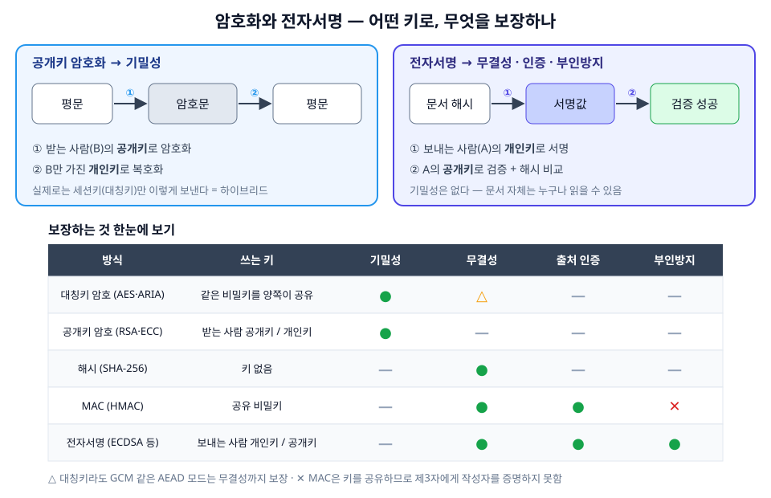
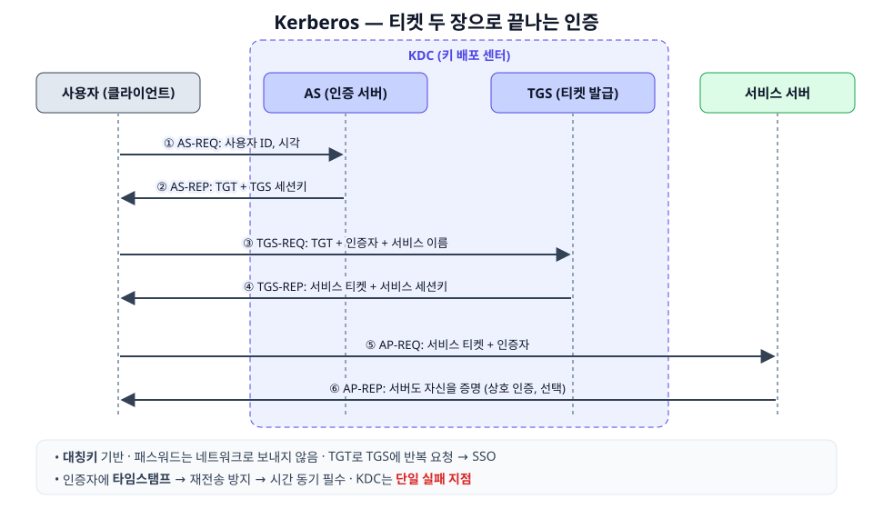
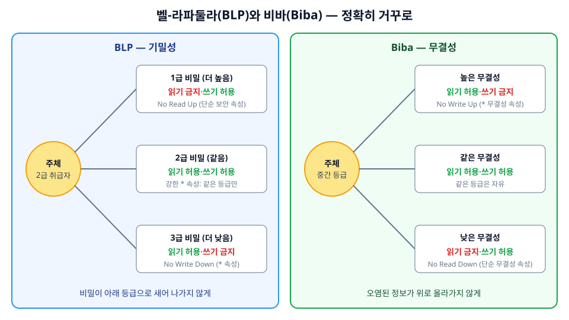

> **자격증 준비 · 정보보안기사** | 난이도 ★★★☆☆ | 예상 소요 3 ~ 4시간 (문제 풀이 포함)

> ⚠️ **이 편의 모든 객관식·실기 문항은 정보보안기사 필기 4과목 "정보보안 일반"의 출제 범위를 바탕으로 이 시리즈가 직접 창작한 연습 문제입니다.** 기출문제나 시중에 도는 덤프를 옮기거나 바꿔 쓴 것이 아닙니다. 수치·이름·상황은 모두 새로 지었습니다. 실제 시험 문항과 표현이 다를 수 있으니, 개념을 이해하는 용도로 쓰세요.

## 🎯 오늘의 목표

- 보안의 3요소(CIA)와 확장 요소(인증성·책임추적성·부인방지)를 공격 사례와 짝지어 설명할 수 있다
- 대칭키·공개키·해시·전자서명·PKI·키 교환이 **각각 무엇을 보장하고 무엇은 보장하지 못하는지** 표로 정리할 수 있다
- 다중 인증, Kerberos, SSO의 흐름을 그림으로 그리고 약점을 말할 수 있다
- DAC·MAC·RBAC과 벨-라파둘라(BLP)·비바(Biba) 모델의 규칙을 헷갈리지 않고 적용할 수 있다
- 창작 객관식 15문항과 실기 대비 4문항으로 4과목 감각을 익힌다

---

## 1. 이 과목의 위치

정보보안기사 필기는 5과목(시스템 보안, 네트워크 보안, 애플리케이션 보안, **정보보안 일반**, 정보보안 관리 및 법규)으로 나뉩니다. 4과목 "정보보안 일반"은 다른 과목의 **공용 어휘**입니다. 1~3과목에서 SSH 키, TLS, JWT, 패스워드 해시를 다룰 때마다 이 편의 개념이 다시 나옵니다.

이 레포에서 이미 손으로 만져 본 것들과 연결하면 훨씬 빨리 외워집니다.

| 이 편의 개념 | 레포에서 직접 해 본 곳 |
|---|---|
| CIA·STRIDE | [Day 66 위협 모델링](../../09-security/day66-threat-modeling-4c.md) — STRIDE 각 글자가 깨뜨리는 속성 |
| PKI·인증서 | [Day 71 Vault·cert-manager](../../09-security/day71-vault-cert-manager.md) — CA, 인증서 발급·갱신 |
| SSO·다중 인증 | [Day 73 Keycloak SSO](../../09-security/day73-keycloak-sso-audit.md), [해킹 15 인증·인가 실수](../../hacking/hack15-authn-authz-mistakes.md) |
| RBAC | [Day 69 K8s 워크로드 보안](../../09-security/day69-k8s-workload-security.md) — Role/RoleBinding |

---

## 2. 핵심 개념 정리

### 2-1. 보안 요소

| 요소 | 뜻 | 깨뜨리는 공격 예 | 대표 대책 |
|---|---|---|---|
| **기밀성** (Confidentiality) | 허가된 사람만 볼 수 있음 | 스니핑, 정보 유출 | 암호화, 접근통제 |
| **무결성** (Integrity) | 허가 없이 바뀌지 않음 | 변조, 중간자 공격 | 해시, MAC, 전자서명 |
| **가용성** (Availability) | 필요할 때 쓸 수 있음 | DoS/DDoS, 랜섬웨어 | 이중화, 백업, 용량 계획 |
| 인증성 (Authenticity) | 주체·출처가 진짜임 | 위장(스푸핑) | 인증, 인증서 |
| 책임추적성 (Accountability) | 누가 했는지 추적 가능 | 로그 삭제, 공용 계정 | 개인 계정, 감사 로그 |
| 부인방지 (Non-repudiation) | 행위를 나중에 부인 못 함 | "내가 안 보냈다" | **전자서명**, 타임스탬프 |

> 💡 Day 66의 STRIDE와 1:1로 대응합니다. Spoofing↔인증성, Tampering↔무결성, Repudiation↔부인방지, Information disclosure↔기밀성, DoS↔가용성, Elevation of privilege↔인가(접근통제). 시험에서 "다음 공격이 침해하는 보안 요소는?"이 나오면 STRIDE로 한 번 거르면 됩니다.

### 2-2. 암호학 지도

| 구분 | 키 | 보장 | 대표 알고리즘 | 약점·주의 |
|---|---|---|---|---|
| **대칭키** | 송·수신자가 같은 키 | 기밀성 | AES, ARIA, SEED, LEA, (3DES), ChaCha20 | 키 분배 문제, 키 개수 n(n−1)/2 |
| **공개키(비대칭키)** | 공개키 + 개인키 쌍 | 기밀성(공개키로 암호화), 키 분배 해결 | RSA(소인수분해), ElGamal·DSA(이산대수), ECC(타원곡선) | 느림 → 보통 세션키만 암호화 |
| **해시** | 키 없음 | 무결성(변조 탐지) | SHA-256/384/512, SHA-3 | MD5·SHA-1은 충돌이 실제로 발견돼 서명용으로 부적합 |
| **MAC/HMAC** | 공유 비밀키 | 무결성 + 메시지 출처 인증 | HMAC-SHA256, CMAC | 키를 공유하므로 **부인방지는 안 됨** |
| **전자서명** | 서명=개인키, 검증=공개키 | 무결성 + 인증 + **부인방지** | RSA-PSS, ECDSA, EdDSA | 기밀성은 제공하지 않음 |

**블록 암호 숫자 정리** — 시험에 숫자가 그대로 나옵니다.

| 알고리즘 | 블록 | 키 | 라운드 | 구조 | 비고 |
|---|---|---|---|---|---|
| DES | 64비트 | 56비트(실효) | 16 | Feistel | 키가 짧아 퇴역 |
| 3DES | 64비트 | 112/168비트 | 48 | Feistel | 퇴역 단계 |
| AES | 128비트 | 128/192/256 | 10/12/14 | SPN | 미국 표준(FIPS 197) |
| SEED | 128비트 | 128비트 | 16 | Feistel | 국산(KISA 개발) |
| ARIA | 128비트 | 128/192/256 | 12/14/16 | SPN(Involution) | 국산 |
| HIGHT | **64비트** | 128비트 | 32 | 일반화 Feistel(ARX) | 국산, 경량 |
| LEA | 128비트 | 128/192/256 | 24/28/32 | ARX | 국산, 경량·고속 |

**블록 암호 운영 모드**

| 모드 | 핵심 | 오류 전파 | 병렬 암호화 | 한 줄 |
|---|---|---|---|---|
| ECB | 블록을 따로따로 | 해당 블록만 | O | 같은 평문 블록 → 같은 암호문. **패턴 노출** |
| CBC | 앞 암호문과 XOR, IV 필요 | 해당 + 다음 블록 | X(복호화는 O) | 가장 흔한 고전 모드 |
| CFB | 블록 암호를 스트림처럼 | 일부 전파 | X | 자기 동기 |
| OFB | 키스트림을 미리 생성 | 해당 비트만 | X | 비트 오류 전파 없음 |
| CTR | 카운터를 암호화해 XOR | 해당 비트만 | O | 병렬·임의 접근 가능 |
| GCM | CTR + 인증 태그 | — | O | **AEAD**(기밀성 + 무결성), TLS 1.3 |

**키 교환과 키 개수**

- **Diffie-Hellman**: 이산대수 문제에 기대어, 도청자가 있는 채널에서도 같은 비밀값을 만들어 냅니다. 단, **상대가 누구인지 확인하지 않으므로 중간자 공격에 약합니다.** 그래서 실제로는 인증서·서명과 함께 씁니다(TLS의 ECDHE + 서버 인증서).
- **키 개수**: n명이 서로 비밀 통신할 때 대칭키는 **n(n−1)/2개**, 공개키 방식은 사람마다 한 쌍이라 **2n개**(공개키 n + 개인키 n).
- **하이브리드 암호**: 데이터는 빠른 대칭키(세션키)로, 세션키는 상대 공개키로 암호화. TLS·PGP가 모두 이 구조입니다.

### 2-3. 해시의 세 가지 성질

| 성질 | 질문 | 깨지면 |
|---|---|---|
| 역상 저항성 (일방향성) | 해시값 h로 원문 m을 찾을 수 있나? | 패스워드 해시 역산 |
| 제2역상 저항성 | 주어진 m1과 같은 해시를 내는 다른 m2를 찾을 수 있나? | 특정 문서 위조 |
| 충돌 저항성 | 같은 해시를 내는 **아무** 두 메시지 쌍을 찾을 수 있나? | 서명된 문서 바꿔치기 |

> 💡 패스워드 저장은 "해시"가 아니라 **느린 키 유도 함수**(bcrypt, scrypt, Argon2, PBKDF2) + 사용자별 **솔트**가 정답입니다. 솔트는 레인보우 테이블을 무력화하고, 반복 횟수(스트레칭)는 대입 속도를 늦춥니다. [해킹 05](../../hacking/hack05-web-owasp-top10.md)의 암호화 실패 항목에서 본 bcrypt가 이 원칙의 대표 구현입니다.

### 2-4. 전자서명과 PKI

전자서명은 **해시 → 송신자 개인키로 서명 → 수신자는 송신자 공개키로 검증 + 자기가 계산한 해시와 비교**입니다. 그런데 "이 공개키가 정말 그 사람 것인가?"는 서명만으로 알 수 없습니다. 이 빈칸을 채우는 것이 **PKI**입니다.

| 구성 요소 | 역할 |
|---|---|
| CA (인증기관) | 공개키와 신원을 묶어 **인증서에 서명** |
| RA (등록기관) | 신원 확인 후 CA에 발급 요청 |
| 인증서 (X.509 v3) | 주체, 공개키, 유효기간, 발급자, 확장(용도·SAN 등), CA 서명 |
| CRL | 폐지된 인증서 **목록**을 주기적으로 배포 |
| OCSP | 특정 인증서 상태를 **실시간 질의** (OCSP Stapling은 서버가 응답을 붙여 줌) |
| 저장소 (Directory) | 인증서·CRL 배포 |

> 💡 Day 71에서 cert-manager가 만든 내부 CA → 서비스 인증서가 바로 이 구조입니다. 체인은 **루트 CA → 중간 CA → 말단(서버) 인증서**, 검증은 말단부터 루트까지 서명을 거슬러 올라갑니다.

### 2-5. 인증 — 무엇으로 증명하나

| 인증 요소 | 예 |
|---|---|
| 지식 기반 (Something you know) | 패스워드, PIN |
| 소유 기반 (Something you have) | OTP 앱, 보안키(FIDO2), 스마트카드 |
| 존재(생체) 기반 (Something you are) | 지문, 얼굴, 홍채 |
| (행위 기반) | 서명 습관, 키 입력 리듬 |

- **다중 인증(MFA)** = **서로 다른 종류**의 요소 2개 이상. 패스워드 + 보안 질문은 둘 다 "지식"이라 MFA가 아닙니다.
- **생체 인증 오류율**: FAR(오수락률, 남을 받아들임 — 보안 문제), FRR(오거부률, 본인을 거부 — 편의 문제). 임계값을 엄격하게 하면 FAR↓·FRR↑. 두 곡선이 만나는 **CER(EER)이 낮을수록** 정확한 시스템.
- **OTP**: 시간 동기(TOTP), 이벤트 동기(HOTP), 질의-응답 방식.

### 2-6. Kerberos

| 단계 | 보냄 → 받음 | 내용 |
|---|---|---|
| ① AS-REQ/REP | 사용자 → **AS** | 로그인 요청 → **TGT** + TGS 세션키 (사용자 키로 암호화된 부분은 사용자만 열 수 있음) |
| ② TGS-REQ/REP | 사용자 → **TGS** | TGT + 인증자 → **서비스 티켓** + 서비스 세션키 |
| ③ AP-REQ/REP | 사용자 → 서비스 서버 | 서비스 티켓 + 인증자 → 접근 허용 (선택적으로 상호 인증) |

- AS + TGS = **KDC**. **대칭키** 기반이고, 패스워드는 네트워크로 흐르지 않습니다.
- 티켓·인증자에 타임스탬프가 들어가 **재전송 공격**을 막으므로 **시간 동기화가 필수**(기본 허용 오차가 보통 5분).
- 약점: KDC가 **단일 실패 지점**이자 최고 가치 표적, 시간 동기 의존. 해킹 25(Windows·AD)에서 본 AD 인증이 Kerberos입니다.

**SSO**는 한 번 인증으로 여러 서비스를 쓰게 하는 개념입니다. 사내망 Kerberos, 웹의 SAML 2.0, OIDC(OAuth 2.0 위의 인증 계층)가 대표 구현이고, Day 73 Keycloak이 OIDC/SAML IdP였습니다. 장점은 편의·중앙 통제, 약점은 **IdP 계정 하나가 뚫리면 전부 뚫린다**는 점이라 SSO에는 MFA를 같이 거는 것이 원칙입니다.

### 2-7. 접근통제 정책과 모델

| 정책 | 누가 권한을 정하나 | 기준 | 장점 / 단점 | 예 |
|---|---|---|---|---|
| **DAC** (임의적) | **객체 소유자** | 신원, ACL | 유연 / 트로이 목마·권한 남용에 약함 | 리눅스 rwx, Windows ACL |
| **MAC** (강제적) | **시스템(관리자)** | 보안 레이블·등급 | 강력 / 경직, 관리 부담 | SELinux, 군 기밀 등급 |
| **RBAC** (역할 기반) | 중앙 관리자 | **역할**(직무) | 인사 이동에 강함, 최소권한·직무분리 지원 | K8s Role/ClusterRole |
| (ABAC) | 정책 엔진 | 속성(부서, 시간, 위치) | 세밀함 / 정책 복잡 | 클라우드 IAM 조건 |

접근통제 **구현 방식**도 자주 나옵니다. **접근제어 행렬**(주체×객체 표)을 열 단위로 자르면 **ACL**(객체마다 "누가 무엇을"), 행 단위로 자르면 **권한 리스트(Capability list)**(주체마다 "무엇에 무엇을")입니다.

| 모델 | 목표 | 읽기 규칙 | 쓰기 규칙 | 외우는 말 |
|---|---|---|---|---|
| **벨-라파둘라 (BLP)** | **기밀성** | 단순 보안 속성: **No Read Up** | *(스타) 속성: **No Write Down** | 비밀이 아래로 새지 않게 |
| **비바 (Biba)** | **무결성** | 단순 무결성 속성: **No Read Down** | *-무결성 속성: **No Write Up** | 오염이 위로 올라가지 않게 |
| 클락-윌슨 | 무결성(상업) | — | 잘 구성된 트랜잭션, 직무분리, 주체-프로그램-객체 3요소 | 비바가 못 다룬 **무결성 3목표** |
| 만리장성 (Brewer-Nash) | 이해 충돌 방지 | 같은 이해충돌 그룹의 다른 회사 데이터 접근 금지 | — | 컨설팅·금융 |

> 💡 BLP는 "강한 스타 속성"(자기 등급에서만 읽고 쓰기)도 있습니다. BLP와 Biba는 **정확히 거꾸로**라고 외우면 됩니다. 단, Biba는 등급이 "무결성 등급"이라는 점이 다릅니다.

---

## 3. 자주 헷갈리는 포인트

| 헷갈리는 쌍 | 구분법 |
|---|---|
| 암호화 vs 서명의 키 | **암호화 = 받는 사람 공개키**로, **서명 = 보내는 사람 개인키**로 |
| MAC vs 전자서명 | MAC은 키를 **공유**하므로 누가 만들었는지 제3자에게 증명 못 함 → 부인방지 X |
| 해시 vs 암호화 | 해시는 복호화 개념이 없음(일방향). "해시로 암호화" 같은 보기는 틀림 |
| 인증 vs 인가 | 인증 = 누구인가(Authentication), 인가 = 무엇을 할 수 있나(Authorization) |
| 식별 → 인증 → 인가 → 책임추적 | 순서 문제. 식별(ID 제시) 다음이 인증 |
| CRL vs OCSP | 목록을 받아 보는 것(CRL) vs 하나씩 물어보는 것(OCSP) |
| FAR vs FRR | **A**ccept를 잘못 = 남이 들어옴 = 보안 사고 → 보안 중요 시스템은 FAR을 낮춤 |
| DAC vs MAC | 소유자가 정하면 DAC, 시스템이 레이블로 정하면 MAC |
| BLP vs Biba | 기밀성은 위로 못 읽고 아래로 못 씀, 무결성은 아래로 못 읽고 위로 못 씀 |
| ECB vs CBC | ECB는 IV 없음·패턴 노출, CBC는 IV 필요·체인 |
| Kerberos 키 | 공개키가 아니라 **대칭키**(확장으로 PKINIT은 있음) |
| DH가 주는 것 | 키 **합의**(기밀성 준비)이지 **인증이 아님** |

---

## 4. 창작 객관식 15문항

> 4지선다, 정답과 해설은 접어 두었습니다. 먼저 풀고 여세요.

**Q1.** 쇼핑몰이 대량의 트래픽 공격으로 6시간 동안 주문을 받지 못했다. 가장 직접적으로 침해된 보안 요소는?
① 기밀성 ② 무결성 ③ 가용성 ④ 부인방지

정답·해설

**③ 가용성.** 서비스를 쓸 수 없게 만든 DoS/DDoS는 가용성 침해입니다. 데이터가 새거나(기밀성) 바뀌지(무결성) 않았습니다. 근거: [Day 66 STRIDE 표](../../09-security/day66-threat-modeling-4c.md)

**Q2.** 전자 계약서에 대해 "나는 그 계약에 동의한 적이 없다"는 주장을 막는 데 가장 알맞은 기술은?
① HMAC ② 송신자 개인키 기반 전자서명 ③ AES-GCM 암호화 ④ 솔트를 더한 해시

정답·해설

**②.** 부인방지는 서명자만 가진 **개인키**로 만든 서명으로 제공됩니다. HMAC은 키를 양쪽이 공유하므로 누가 만들었는지 제3자에게 증명할 수 없습니다. AES-GCM은 기밀성·무결성, 해시는 무결성만 다룹니다.

**Q3.** 사내 사용자 60명이 서로 1:1로 비밀 통신하려 한다. 대칭키 방식에 필요한 키 수와 공개키 방식에 필요한 키 수를 순서대로 바르게 짝지은 것은?
① 60, 120 ② 1770, 120 ③ 3540, 60 ④ 1770, 60

정답·해설

**②.** 대칭키 n(n−1)/2 = 60×59/2 = **1770**, 공개키는 사람마다 공개키·개인키 한 쌍이라 2n = **120**.

**Q4.** AES에 대한 설명으로 **옳지 않은** 것은?
① 블록 크기는 128비트이다 ② 키 길이로 128·192·256비트를 쓴다 ③ Feistel 구조를 사용한다 ④ 키 길이에 따라 라운드 수가 10·12·14로 달라진다

정답·해설

**③.** AES는 **SPN** 구조입니다. Feistel 구조는 DES, SEED 등입니다. 근거: NIST FIPS 197

**Q5.** 국산 블록 암호에 대한 짝으로 **옳지 않은** 것은?
① SEED — 128비트 블록, Feistel 구조 ② ARIA — 128비트 블록, SPN 구조 ③ HIGHT — 64비트 블록, 경량 암호 ④ LEA — 64비트 블록, SPN 구조

정답·해설

**④.** LEA는 **128비트 블록**, 덧셈·회전·XOR만 쓰는 **ARX** 구조의 경량·고속 암호입니다. 64비트 블록은 HIGHT입니다.

**Q6.** 비트맵 이미지를 블록 암호로 암호화했더니 암호문 이미지에서 원본의 윤곽이 그대로 보였다. 사용된 운영 모드로 가장 가능성이 높은 것은?
① ECB ② CBC ③ CTR ④ GCM

정답·해설

**①.** ECB는 같은 평문 블록을 같은 암호문 블록으로 바꾸므로 패턴이 남습니다. 나머지는 IV·카운터·체인으로 같은 평문 블록도 다르게 암호화됩니다.

**Q7.** 인증 절차 없이 Diffie-Hellman 키 교환만 수행할 때 가장 대표적인 위협은?
① 생일 공격 ② 중간자 공격 ③ 레인보우 테이블 공격 ④ 사전 공격

정답·해설

**②.** DH는 상대가 누구인지 확인하지 않으므로 공격자가 양쪽과 각각 키를 합의하는 중간자 공격이 가능합니다. 실제 프로토콜은 인증서·서명으로 상대를 인증합니다.

**Q8.** "해시값이 같은 서로 다른 두 메시지를 **아무거나** 찾는 것이 계산상 어렵다"는 성질은?
① 역상 저항성 ② 제2역상 저항성 ③ 충돌 저항성 ④ 눈사태 효과

정답·해설

**③ 충돌 저항성.** 제2역상 저항성은 "**주어진** 메시지와 같은 해시를 내는 다른 메시지"를 찾기 어려운 성질입니다. 눈사태 효과는 입력 1비트 변화가 출력 절반가량을 바꾸는 특성입니다.

**Q9.** 개발자 A가 배포 파일에 전자서명을 하고, 사용자 B가 이를 검증한다. 서명 생성과 검증에 쓰는 키를 순서대로 바르게 고른 것은?
① A의 공개키, A의 개인키 ② A의 개인키, A의 공개키 ③ B의 공개키, B의 개인키 ④ A의 개인키, B의 공개키

정답·해설

**②.** 서명은 서명자 개인키로, 검증은 서명자 공개키로 합니다. Day 57의 이미지 서명(cosign) 검증도 같은 원리입니다.

**Q10.** 브라우저가 서버 인증서의 폐지 여부를 그때그때 질의해 확인하는 프로토콜은?
① CRL ② OCSP ③ LDAP ④ SCEP

정답·해설

**② OCSP.** CRL은 폐지 목록을 통째로 내려받는 방식입니다. LDAP은 디렉터리 접근, SCEP은 인증서 발급 요청 프로토콜입니다. 근거: RFC 6960

**Q11.** Kerberos에 대한 설명으로 **옳지 않은** 것은?
① KDC는 AS와 TGS로 구성된다 ② 티켓 재사용을 막기 위해 타임스탬프를 사용하므로 시간 동기화가 중요하다 ③ 기본적으로 공개키 암호에 기반해 티켓을 암호화한다 ④ KDC가 단일 실패 지점이 될 수 있다

정답·해설

**③.** Kerberos의 기본은 **대칭키**입니다(초기 인증에 공개키를 쓰는 PKINIT 확장은 별도). 근거: RFC 4120

**Q12.** 출입 통제용 지문 인식기의 판정 임계값을 더 엄격하게 바꾸었을 때 일반적으로 나타나는 변화는?
① FAR 증가, FRR 감소 ② FAR 감소, FRR 증가 ③ FAR·FRR 모두 감소 ④ CER이 항상 0이 된다

정답·해설

**②.** 엄격할수록 남을 받아들이는 오수락(FAR)은 줄고, 본인을 거부하는 오거부(FRR)는 늘어납니다. CER은 장비 고유의 성능 지표라 임계값으로 0이 되지 않습니다.

**Q13.** 벨-라파둘라 모델에서 "2급 비밀 취급자가 3급 비밀 문서에 내용을 기록하지 못하게 하는" 규칙과 그 목적을 바르게 짝지은 것은?
① 단순 보안 속성 — 무결성 ② *(스타) 속성 — 기밀성 ③ 단순 무결성 속성 — 무결성 ④ *-무결성 속성 — 기밀성

정답·해설

**②.** 높은 등급(2급) 주체가 낮은 등급(3급) 객체에 쓰지 못하게 하는 **No Write Down**은 BLP의 *-속성이고, 높은 등급 정보가 아래로 새는 것을 막는 **기밀성** 목적입니다.

**Q14.** 비바(Biba) 모델의 규칙으로 옳은 것은?
① 낮은 무결성 등급의 객체를 읽을 수 없다 ② 높은 무결성 등급의 객체를 읽을 수 없다 ③ 낮은 무결성 등급의 객체에 쓸 수 없다 ④ 같은 등급에서만 읽고 쓸 수 있다

정답·해설

**①.** Biba는 **No Read Down**(오염된 정보를 읽지 않음), **No Write Up**(위를 오염시키지 않음)입니다. ④는 BLP의 강한 스타 속성 설명입니다.

**Q15.** 직원이 부서를 옮길 때마다 수십 개 시스템의 권한을 하나씩 고치는 문제가 있다. 이를 줄이고 최소권한·직무분리 원칙을 적용하기 쉬운 접근통제 방식은?
① DAC ② MAC ③ RBAC ④ 접근제어 행렬 직접 관리

정답·해설

**③ RBAC.** 권한을 역할에 묶고 사람에게 역할만 부여하므로, 부서 이동 시 역할만 바꾸면 됩니다. K8s의 Role/RoleBinding이 대표 예입니다([Day 69](../../09-security/day69-k8s-workload-security.md)).

---

## 5. 실기 대비 창작 문항

> 실기는 필답형입니다. 단답형은 **용어를 정확히**, 서술형은 **정의 → 동작 → 장단점/대책** 순서로 쓰는 연습을 하세요(E06에서 자세히).

**실기 1 (단답형).** 다음 빈칸 (A)~(C)에 들어갈 용어를 쓰시오.
> 공개키 기반 구조에서 (A)는 인증서를 발급·서명하고, (B)는 신청자의 신원을 확인해 발급을 요청한다. 폐지된 인증서는 목록 형태의 (C)로 배포하거나 OCSP로 실시간 확인한다.

모범 답안

(A) CA(인증기관) (B) RA(등록기관) (C) CRL(인증서 폐지 목록)

**실기 2 (서술형).** TLS 같은 프로토콜이 대칭키와 공개키를 함께 쓰는 이유와 그 동작 순서를 서술하시오.

모범 답안

- **이유**: 대칭키는 빠르지만 키를 안전하게 나눠 갖기 어렵고, 공개키는 키 분배 문제를 해결하지만 연산이 느립니다. 두 방식의 장점을 합치기 위해 하이브리드 방식을 씁니다.
- **동작**: ① 서버가 인증서(공개키 + CA 서명)를 보낸다 → ② 클라이언트가 CA 공개키로 인증서를 검증해 서버를 인증한다 → ③ 공개키 암호 또는 (EC)DH 키 교환으로 세션키(대칭키)를 안전하게 합의한다 → ④ 이후 데이터는 세션키로 대칭 암호화(AES-GCM 등)하고 무결성도 함께 보장한다.
- **채점 포인트**: "키 분배 문제", "속도", "세션키", "서버 인증(인증서)" 네 가지가 모두 들어가야 합니다.

**실기 3 (서술형).** 벨-라파둘라 모델과 비바 모델의 목적과 읽기·쓰기 규칙을 비교하여 서술하시오.

모범 답안

| | 벨-라파둘라 | 비바 |
|---|---|---|
| 목적 | 기밀성 | 무결성 |
| 읽기 | No Read Up(단순 보안 속성) | No Read Down(단순 무결성 속성) |
| 쓰기 | No Write Down(*-속성) | No Write Up(*-무결성 속성) |
| 적용 | 군·정부 기밀 분류 | 오염 방지가 중요한 시스템 |

한 문장 결론: "BLP는 상위 정보가 하위로 흐르는 것을 막아 기밀성을, Biba는 하위(신뢰 낮은) 정보가 상위를 오염시키는 것을 막아 무결성을 보장한다."

**실기 4 (실무형).** 아래 조건을 보고 접근제어 행렬을 작성하고, 이를 ACL과 권한 리스트(Capability list)로 각각 한 줄씩 표현하시오.
> 주체: 개발자 dev, 운영자 ops, 감사자 aud / 객체: 소스 저장소 repo, 운영 DB proddb, 감사 로그 audit
> dev는 repo 읽기·쓰기, ops는 repo 읽기와 proddb 읽기·쓰기, aud는 모든 객체 읽기만. 감사 로그는 누구도 수정할 수 없다.

모범 답안

| 주체 \ 객체 | repo | proddb | audit |
|---|---|---|---|
| dev | R, W | — | — |
| ops | R | R, W | — |
| aud | R | R | R |

- **ACL(객체 기준, 열)**: `audit: aud(R)` — 예: `proddb: ops(R,W), aud(R)`
- **Capability(주체 기준, 행)**: `aud: repo(R), proddb(R), audit(R)` — 예: `dev: repo(R,W)`
- 덧붙이면 좋은 내용: dev와 ops의 운영 DB 쓰기 권한을 나눈 것은 **직무분리**, 감사 로그를 읽기 전용으로 둔 것은 **책임추적성**과 무결성 확보입니다.

---

## 6. 핵심 정리

- 보안 요소는 **CIA + 인증성·책임추적성·부인방지**. 공격 → 깨지는 요소는 STRIDE로 매핑한다.
- 대칭키(기밀성, 빠름, 키 분배 문제, n(n−1)/2) / 공개키(키 분배 해결, 느림, 2n) / 해시(무결성) / MAC(무결성+출처, 부인방지 X) / 전자서명(무결성+인증+**부인방지**, 기밀성 X).
- 블록 암호 숫자: AES 128블록·10/12/14라운드·SPN, DES 64블록·56키·16라운드·Feistel, HIGHT만 64비트 블록.
- ECB는 패턴 노출, GCM은 AEAD. DH는 키 합의일 뿐 인증이 아니어서 중간자 공격에 약하다.
- PKI: CA 서명, RA 신원 확인, CRL 목록 vs OCSP 실시간.
- MFA는 **서로 다른 종류**의 요소. FAR↓ ↔ FRR↑, CER이 낮을수록 좋다.
- Kerberos: AS → TGT → TGS → 서비스 티켓, 대칭키, 시간 동기 필수, KDC 단일 실패 지점.
- DAC(소유자)·MAC(레이블)·RBAC(역할). BLP = 기밀성(No Read Up / No Write Down), Biba = 무결성(No Read Down / No Write Up).

---

## ⏭️ 다음 예고 — E05. 정보보안 관리·법규

다음 편은 5과목입니다. ISMS-P 인증 기준 101개가 어떤 영역으로 나뉘는지, 위험 관리(ALE 계산, 위험 대응 4전략), BCP·DRP(RTO·RPO, 복구 사이트), 보안 정책 계층과 침해 대응 절차를 정리합니다. 그리고 개인정보 보호법·정보통신망법·정보통신기반 보호법·전자서명법의 핵심 조문을 국가법령정보센터 현행본으로 확인해 표로 묶습니다. 해킹 27의 사고 대응, Day 65의 포스트모템과 이어집니다.

→ [E05. 정보보안 관리·법규](./e05-management-law.md)
