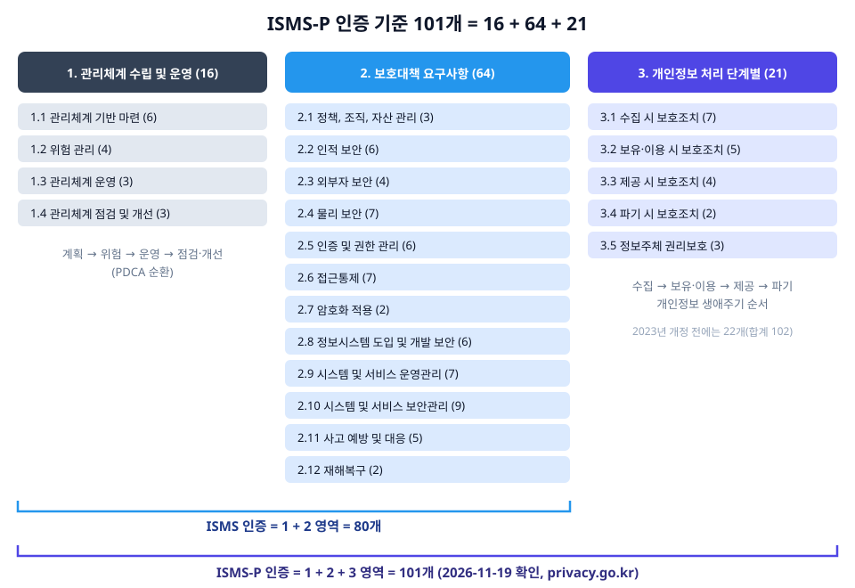
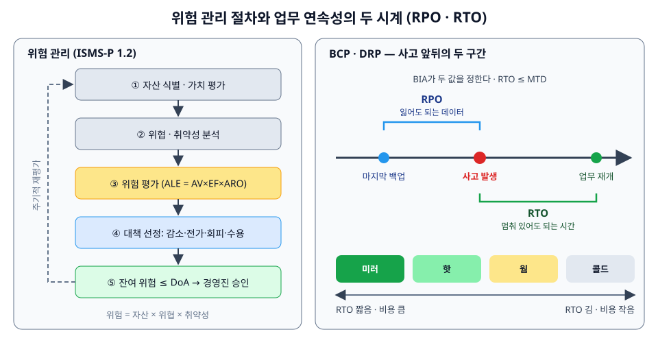
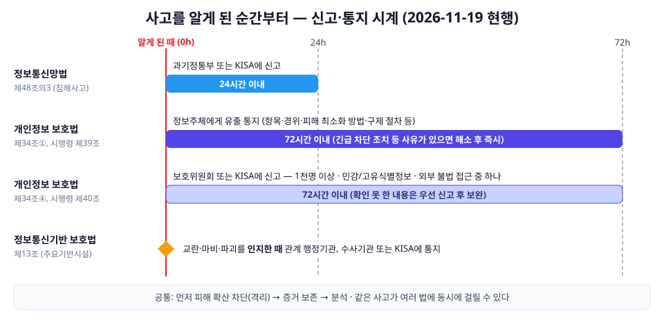

> **자격증 준비 · 정보보안기사** | 난이도 ★★★☆☆ | 예상 소요 4 ~ 5시간 (법령 원문 확인 포함)

> ⚠️ **이 편의 모든 객관식·실기 문항은 정보보안기사 필기 5과목 "정보보안 관리 및 법규"의 출제 범위를 바탕으로 이 시리즈가 직접 창작한 연습 문제입니다.** 기출문제나 덤프를 옮기거나 바꿔 쓴 것이 아닙니다. 회사 이름·금액·상황은 모두 지어낸 것입니다.

> ⚖️ **법령 기준일.** 이 편의 조문은 2026-11-19에 [국가법령정보센터](https://www.law.go.kr)에서 현행본을 직접 열어 확인한 것만 적었습니다. 개인정보 보호법(법률 제21445호, 2026-09-11 시행)과 같은 법 시행령(2026-11-10 시행), 정보통신망법(법률 제21988호, 2026-10-02 시행), 정보통신기반 보호법(법률 제20068호, 2025-01-24 시행)과 같은 법 시행령, 전자서명법(법률 제18479호, 2022-10-20 시행)입니다. 법은 자주 바뀝니다. 시험 직전에는 원문을 다시 확인하세요. 이 글은 학습용 요약이며 법률 자문이 아닙니다.

## 🎯 오늘의 목표

- 보안 정책 문서의 계층과 보안 조직(CISO·CPO)의 근거 조문을 말할 수 있다
- ISMS-P 인증 기준 **101개(16 + 64 + 21)**의 영역 구성과 ISMS(80개)와의 차이를 설명할 수 있다
- 위험 분석 접근법, 정량 분석(ALE) 계산, 위험 대응 4전략을 실제 숫자로 풀 수 있다
- BCP·DRP의 BIA, RTO·RPO, 복구 사이트 종류를 구분할 수 있다
- 침해 대응 절차를 해킹 27·Day 65와 연결하고, 유출·침해 **신고 기한(72시간·24시간)**과 근거 조문을 정확히 말할 수 있다

---

## 1. 이 과목의 두 축

5과목은 **관리**(체계·위험·연속성·정책·사고 대응)와 **법규**(개인정보 보호법 등) 두 축입니다. 기술 과목에서 "어떻게 막나"를 배웠다면, 여기서는 "**누가, 어떤 근거로, 얼마나** 막아야 하나"를 묻습니다.

| 축 | 핵심 질문 | 이 레포에서 연결되는 곳 |
|---|---|---|
| 관리 체계 | 무엇을 지킬지 정하고, 위험을 재고, 대책을 고르고, 점검·개선하나 | [Day 66 위협 모델링](../../09-security/day66-threat-modeling-4c.md) — 위험 식별·우선순위 |
| 업무 연속성 | 멈춰도 얼마 만에, 데이터를 얼마나 잃고 돌아오나 | [Day 58 SLO](../../08-sre-observability/day58-sre-slo.md), Day 64 카오스 실험 |
| 침해 대응 | 사고가 나면 어떤 순서로 움직이고, 누구에게 보고하나 | [해킹 27 침해사고 대응](../../hacking/hack27-incident-forensics.md), [Day 65 장애 대응·포스트모템](../../08-sre-observability/day65-incident-postmortem.md) |
| 법규 | 무엇이 의무이고, 어기면 어떻게 되나 | [해킹 01 법적 경계](../../hacking/hack01-ethical-hacking-intro.md) — 정보통신망법 제48조·제49조 |

---

## 2. 관리 체계

### 2-1. 보안 정책 문서의 계층

| 계층 | 성격 | 예 |
|---|---|---|
| **정책** (Policy) | 경영진의 방향·의지. 짧고 바뀌지 않음 | "회사는 고객 정보를 업무 목적 범위에서만 처리한다" |
| **표준** (Standard) | **의무**인 구체 규칙 | "모든 서버 접속은 MFA를 사용한다" |
| 기준선 (Baseline) | 시스템별 최소 보안 수준 | "Ubuntu 24.04 하드닝 기준"(Day 67) |
| **지침** (Guideline) | **권고**. 상황에 따라 선택 | "패스워드 관리자 사용을 권장한다" |
| **절차** (Procedure) | 단계별 작업 방법 | "퇴사자 계정 회수 절차 1~7단계" |

> 💡 "의무"면 표준, "권고"면 지침, "순서"면 절차. 시험은 이 세 낱말로 갈립니다.

**보안 조직의 법적 근거**

| 역할 | 근거 | 핵심 |
|---|---|---|
| 개인정보 보호책임자 (CPO) | 개인정보 보호법 **제31조** | 처리·보호 업무 총괄. 2026-03-10 개정으로 일정 규모 이상 처리자는 지정·변경 시 이사회 의결과 보호위원회 신고(제31조 제3항) |
| 정보보호 최고책임자 (CISO) | 정보통신망법 **제45조의3** | 임원급 지정·신고, 일정 규모 이상은 겸직 제한. 정보보호 계획, 위험 식별·평가, 이사회 보고 등을 총괄 |

### 2-2. ISMS-P 인증



ISMS-P는 정보보호(ISMS)와 개인정보보호를 하나로 묶은 관리체계 인증입니다. 2026-11-19 기준 인증 기준 구성은 다음과 같습니다(개인정보보호위원회 개인정보 포털 privacy.go.kr의 ISMS-P 안내에서 확인. KISA 인증 사이트는 확인 시점에 접속되지 않아 같은 기관 체계의 공식 포털을 근거로 삼았습니다. 근거 고시는 2023-10-05 개정된 「정보보호 및 개인정보보호 관리체계 인증 등에 관한 고시」).

| 영역 | 기준 수 | 분야(기준 수) |
|---|---|---|
| **1. 관리체계 수립 및 운영** | **16** | 1.1 관리체계 기반 마련(6), 1.2 위험 관리(4), 1.3 관리체계 운영(3), 1.4 관리체계 점검 및 개선(3) |
| **2. 보호대책 요구사항** | **64** | 2.1 정책, 조직, 자산 관리(3), 2.2 인적 보안(6), 2.3 외부자 보안(4), 2.4 물리 보안(7), 2.5 인증 및 권한 관리(6), 2.6 접근통제(7), 2.7 암호화 적용(2), 2.8 정보시스템 도입 및 개발 보안(6), 2.9 시스템 및 서비스 운영관리(7), 2.10 시스템 및 서비스 보안관리(9), 2.11 사고 예방 및 대응(5), 2.12 재해복구(2) |
| **3. 개인정보 처리 단계별 요구사항** | **21** | 3.1 수집 시(7), 3.2 보유·이용 시(5), 3.3 제공 시(4), 3.4 파기 시(2), 3.5 정보주체 권리보호(3) |
| 합계 | **101** | ISMS 인증은 1·2영역 **80개**만 적용 |

| 항목 | 내용 | 근거 |
|---|---|---|
| 인증 의무 대상 | 주요정보통신서비스 제공자, 집적정보통신시설(IDC) 사업자, 매출액·이용자 수 기준 해당자 | 정보통신망법 제47조 제2항 |
| 인증 기준 고시 | 관리적·기술적·물리적 보호대책을 포함한 인증기준을 고시 | 같은 조 제4항 |
| 유효기간 | **3년** | 같은 조 제5항 |
| 개인정보 보호 인증 | 개인정보 보호법상 인증 근거 | 개인정보 보호법 제32조의2 |

> ⚠️ 2023년 개정 전에는 3영역이 22개라 합계 102개였습니다. 오래된 수험서의 "102개"는 옛 기준입니다. 또 2026년 4월 정부가 ISMS-P 개편 방안(강화 인증 신설 등)을 발표했다는 보도가 있으나 확정·시행 여부는 응시 시점에 KISA 공지로 확인하세요.

### 2-3. 위험 관리



**위험 = 자산 가치 × 위협 × 취약성.** 셋 중 하나라도 0이면 위험도 없습니다. ISMS-P 1.2(위험 관리)의 흐름은 **자산 식별 → 위협·취약점 분석 → 위험 평가 → 보호대책 선정 → 수용 가능 위험(DoA) 이하 확인 → 경영진 승인**입니다.

| 위험 분석 접근법 | 방법 | 장점 / 단점 |
|---|---|---|
| 기준선 접근법 (Baseline) | 표준 체크리스트로 일괄 적용 | 빠르고 싸다 / 조직 특성 반영 부족 |
| 비정형 접근법 (Informal) | 전문가 경험으로 판단 | 빠르다 / 사람에 따라 결과가 다름 |
| 상세 위험 분석 (Detailed) | 자산·위협·취약성을 정밀 분석 | 정확 / 시간·비용 큼 |
| **복합 접근법** (Combined) | 중요 시스템은 상세, 나머지는 기준선 | 현실적 절충 (가장 많이 씀) |

| 분석 방식 | 기법 | 특징 |
|---|---|---|
| **정량적** | ALE(수학공식 접근법), 과거자료 분석법, 확률 분포법 | 금액으로 표시 → 비용 대비 효과 비교 쉬움. 자료 수집이 어려움 |
| **정성적** | 델파이법(전문가 합의), 시나리오법, 순위결정법, 퍼지 행렬법 | 빠름, 금액화 어려운 자산에 적합. 주관적 |

**ALE 공식** (시험 단골)

```text
SLE (단일 손실 예상액)   = AV (자산 가치) × EF (노출 계수, 0~1)
ALE (연간 손실 예상액)   = SLE × ARO (연간 발생률)
대책의 연간 가치         = ALE(대책 전) − ALE(대책 후) − 대책의 연간 비용
```

예: 고객 DB 가치 5억 원, 유출 시 노출 계수 40%, 연 0.25회 발생 → SLE 2억, ALE **5천만 원**. 연 1,500만 원짜리 대책이 ARO를 0.05로 낮추면 대책 후 ALE 1천만 원 → 대책 가치 = 5,000 − 1,000 − 1,500 = **2,500만 원(도입 타당)**.

| 위험 대응 전략 | 뜻 | 예 |
|---|---|---|
| 감소 (Mitigation) | 대책으로 위험을 낮춤 | MFA 도입, 패치 |
| 전가 (Transfer) | 제3자에게 넘김 | **사이버 보험**, 아웃소싱 계약 책임 조항 |
| 회피 (Avoidance) | 위험한 활동 자체를 중단 | 주민등록번호 수집 중단, 서비스 철수 |
| 수용 (Acceptance) | 알고 받아들임 (DoA 이하) | 비용이 손실보다 큰 저위험 항목. **경영진 승인 기록 필수** |

### 2-4. 업무 연속성 — BCP와 DRP

| 구분 | BCP (업무 연속성 계획) | DRP (재해 복구 계획) |
|---|---|---|
| 범위 | **업무 전체**(사람·공간·공급망·IT) | 주로 **IT 시스템·데이터** |
| 질문 | 회사가 계속 굴러가나? | 시스템을 어떻게 되살리나? |
| 관계 | DRP를 포함하는 상위 계획 | BCP의 일부 |

BCP 수립 순서: **범위 설정·기획 → 사업 영향 평가(BIA) → 복구 전략 개발 → 계획 수립 → 테스트·교육·유지보수**. BIA는 핵심 업무를 찾고, 멈췄을 때의 영향(금전·법적·평판)을 재서 **RTO·RPO를 정하는** 단계입니다.

| 지표 | 뜻 | 줄이려면 |
|---|---|---|
| **RTO** (목표 복구 시간) | 사고 후 **업무를 재개하기까지** 허용 시간 | 더 빠른 복구 사이트, 자동 페일오버 |
| **RPO** (목표 복구 시점) | **데이터를 얼마나 과거 시점까지** 잃어도 되나 | 더 잦은 백업, 실시간 복제 |
| MTD (최대 허용 중단 시간) | 이 이상 멈추면 회사가 버티지 못함 | RTO는 MTD보다 작아야 함 |

| 복구 사이트 | 준비 상태 | 복구 속도 | 비용 |
|---|---|---|---|
| 미러 사이트 | 주 센터와 **실시간 동일**(액티브-액티브) | 거의 즉시 | 최고 |
| 핫 사이트 | 장비·데이터가 대기 중(액티브-스탠바이) | 수 시간 이내 | 높음 |
| 웜 사이트 | 장비·네트워크 일부, **데이터는 백업에서 복원** | 수일 | 중간 |
| 콜드 사이트 | 공간·전원·통신만 | 수주 | 낮음 |

BCP 테스트는 가벼운 순서로 **체크리스트 검토 → 구조적 워크스루(탁상 훈련) → 시뮬레이션 → 병행 테스트(실제 복구, 주 시스템 계속 운영) → 완전 중단 테스트(주 시스템을 실제로 멈춤)**입니다. Day 64의 카오스 실험은 시뮬레이션과 병행 테스트 사이 어딘가입니다.

> 💡 Day 58의 SLO와 섞지 마세요. SLO는 "평소 얼마나 잘 돌아가야 하나", RTO·RPO는 "재해가 났을 때 얼마 만에, 얼마를 잃고 돌아오나"입니다.

### 2-5. 침해사고 대응

해킹 27에서 실습한 순서가 그대로 시험 범위입니다. 시험에서 보이는 모델은 대략 세 가지입니다.

| 모델 | 단계 | 비고 |
|---|---|---|
| NIST SP 800-61 Rev. 2 | 준비 → 탐지·분석 → 봉쇄·제거·복구 → 사후 활동 | 수험서에 가장 많이 나옴 |
| NIST SP 800-61 **Rev. 3** (2025-04) | CSF 2.0의 Govern·Identify·Protect / Detect·Respond·Recover | 해킹 27 1-1절에서 정리 |
| 국내 수험서의 7단계 모델 | 사고 전 준비 → 사고 탐지 → 초기 대응 → 대응 전략 체계화 → 사고 조사 → 보고서 작성 → 해결 | 단계 이름을 묻는 문제가 나옴 |

꼭 외울 원칙 네 가지:

1. **격리 → 보존 → 제거.** 지우고 다시 띄우면 증거가 사라진다(해킹 27 5-1).
2. **휘발성 순서**(RFC 3227): 레지스터·캐시 → 메모리·프로세스·네트워크 연결 → 임시 파일 → 디스크 → 원격 로그 → 백업 매체.
3. **무결성과 연속성**: 수집 직후 해시를 남기고, chain of custody(증거 관리 연속성)를 기록한다.
4. **사후 활동**: Day 65의 비난 없는 포스트모템과 액션 아이템. 법적 신고 의무(3장)를 같이 챙긴다.

---

## 3. 법규



### 3-1. 개인정보 보호법

| 조문 | 제목(원문) | 시험 포인트 |
|---|---|---|
| 제2조 | 정의 | 개인정보 = **살아 있는** 개인 정보. 쉽게 결합해 알아볼 수 있는 정보, **가명정보**도 포함. 가명처리는 추가 정보 없이는 알아볼 수 없게 처리하는 것 |
| 제3조 | 개인정보 보호 원칙 | 목적 명확화, 최소 수집, 정확성·최신성, 익명→가명 우선 처리 |
| 제15조 | 개인정보의 수집ㆍ이용 | 제1항 각 호 7가지 근거(동의, 법률, 공공기관 업무, 계약, 급박한 생명·신체·재산, 정당한 이익, 공중위생 등 긴급) |
| 제17조 / 제18조 | 개인정보의 제공 / 목적 외 이용ㆍ제공 제한 | 제3자 제공과 목적 외 이용은 별도 근거 필요 |
| 제21조 | 개인정보의 파기 | 불필요해지면 **지체 없이** 파기, **복구·재생되지 않도록**. 다른 법령상 보존하면 분리 보관 |
| 제22조의2 | 아동의 개인정보 보호 | **만 14세 미만**은 법정대리인 동의 |
| 제23조 | 민감정보의 처리 제한 | 사상·신념, 노동조합·정당 가입, 정치적 견해, 건강, 성생활 등 → **별도 동의** 또는 법령 근거 |
| 제24조 / 제24조의2 | 고유식별정보 / 주민등록번호 처리의 제한 | 주민등록번호는 법령 근거 등 예외만 처리 가능, **암호화 보관**, 회원 가입 시 대체 수단 제공 |
| 제25조 / 제25조의2 | 고정형 / 이동형 영상정보처리기기 | 공개된 장소 설치 제한(예외 열거) |
| 제26조 | 업무위탁에 따른 개인정보의 처리 제한 | 위탁자의 관리·감독·교육 의무 |
| 제28조의2 | 가명정보의 처리 등 | **통계작성, 과학적 연구, 공익적 기록보존** 등은 동의 없이 가명정보 처리 가능 |
| 제28조의8 | 개인정보의 국외 이전 | 국외 이전 요건 |
| 제29조 | 안전조치의무 | 구체 내용은 시행령 **제30조**(내부 관리계획, 접근 권한 제한, 접근 통제, 암호화 등) |
| 제30조 / 제31조 | 처리방침 수립·공개 / 보호책임자 지정 | 2-1절 참고 |
| 제33조 | 개인정보 영향평가 | **공공기관의 장**의 의무 |
| 제34조 | 개인정보 유출등의 통지ㆍ신고 | 아래 표 |
| 제35조 ~ 제37조의2 | 열람, 전송 요구, 정정ㆍ삭제, 처리정지, 자동화된 결정에 대한 권리 | 정보주체 권리 |
| 제39조의2 | 법정손해배상의 청구 | 고의·과실 유출 시 **300만원 이하** 범위 |
| 제64조의2 | 과징금의 부과 | **전체 매출액의 100분의 3** 이하 |

**유출 통지·신고 (제34조 + 시행령 제39조·제40조)**

| 무엇 | 언제 | 누구에게 | 근거 |
|---|---|---|---|
| 정보주체 통지 | 알게 된 때부터 **72시간 이내** (긴급 차단 조치 등 사유가 있으면 해소 후 즉시) | 해당 정보주체 | 법 제34조 제1항, 시행령 제39조 |
| 통지 항목 | 유출 항목, 시점·경위, 피해 최소화 방법, 대응조치·구제절차, 신고 접수 부서, 손해배상·분쟁조정 등 법적 권리 | — | 법 제34조 제1항 각 호 |
| 기관 신고 | **72시간 이내** — ① **1천명 이상** ② **민감정보·고유식별정보** ③ **외부 불법 접근**으로 인한 유출 중 하나라도 해당 | 보호위원회 또는 **한국인터넷진흥원** | 법 제34조 제4항, 시행령 제40조 |
| 유출 "가능성" 통지 | 대통령령으로 정하는 유출 가능성을 알게 되면 지체 없이 | 가능성이 있는 모든 정보주체 | 법 제34조 제2항 (2026-03-10 신설) |

> ⚠️ 2026-03-10 개정(2026-09-11 시행)으로 제34조에 "유출 가능성" 통지(제2항)가 생기면서 **기관 신고 조항이 제3항에서 제4항으로 옮겨졌습니다.** 옛 수험서의 "제34조 제3항 신고"는 현행 번호와 다릅니다.

### 3-2. 정보통신망법 (정보통신망 이용촉진 및 정보보호 등에 관한 법률)

2020년 개정으로 정보통신서비스 제공자의 개인정보 조항 대부분이 개인정보 보호법으로 옮겨졌습니다. 지금 정보통신망법에서 시험에 나오는 것은 **정보보호** 쪽입니다.

| 조문 | 제목(원문) | 시험 포인트 |
|---|---|---|
| 제45조 | 정보통신망의 안정성 확보 등 | 보호조치 의무 |
| 제45조의3 | 정보보호 최고책임자의 지정 등 | CISO |
| 제46조 | 집적된 정보통신시설의 보호 | IDC |
| 제47조 | 정보보호 관리체계의 인증 | ISMS 의무 대상(제2항), 유효기간 **3년**(제5항) |
| 제47조의4 | 이용자의 정보보호 | 취약점 점검·기술 지원 |
| 제48조 | 정보통신망 침해행위 등의 금지 | 무단 침입(제1항), 악성프로그램(제2항), 장애 유발(제3항), 보호·인증 우회 프로그램(제4항) |
| 제48조의2 | 침해사고의 대응 등 | 과기정통부의 대응 업무 |
| 제48조의3 | 침해사고의 신고 등 | 정보통신서비스 제공자는 알게 된 때부터 **24시간 이내** 과기정통부 또는 KISA에 신고 |
| 제48조의4 | 침해사고의 원인 분석 등 | 원인 분석, 자료 보전 명령 |
| 제49조 | 비밀 등의 보호 | 타인 정보 훼손, 비밀 침해·도용·누설 금지 |
| 제50조 | 영리목적의 광고성 정보 전송 제한 | 스팸 규제 |

처벌 조항(제70조의2, 제71조)은 [해킹 01 4장](../../hacking/hack01-ethical-hacking-intro.md)에 정리했습니다.

### 3-3. 정보통신기반 보호법

| 조문 | 제목(원문) | 시험 포인트 |
|---|---|---|
| 제5조 / 제6조 | 보호대책 / 보호계획의 수립 등 | 관리기관이 보호대책, 중앙행정기관이 보호계획 |
| 제8조 | 주요정보통신기반시설의 지정 등 | **중앙행정기관의 장**이 지정. 고려 사항 5가지(국가사회적 중요성, 의존도, 상호연계성, 피해 규모, 발생 가능성·복구 용이성) |
| 제9조 | 취약점의 분석ㆍ평가 | 관리기관의 장이 정기적으로 실시. 시행령 **제17조**: 지정 후 **6개월 이내**(부득이하면 승인 받아 9개월) 최초 실시, 이후 **매년** |
| 제12조 | 주요정보통신기반시설 침해행위 등의 금지 | 무단 접근·데이터 조작, 악성 프로그램 투입, 대량 신호 |
| 제13조 | 침해사고의 통지 | 교란·마비·파괴를 **인지한 때** 관계 행정기관, 수사기관 또는 KISA에 통지 |
| 제16조 | 정보공유ㆍ분석센터 | **ISAC** — 금융·통신 등 분야별 |

### 3-4. 전자서명법

2020년 개정(법률 제17354호, 2020-06-09 공포, 2020-12-10 시행)으로 **공인인증서 제도가 폐지**되고 여러 전자서명 수단이 경쟁하는 구조가 됐습니다. 부칙의 "공인인증서에 관한 경과조치"가 그 흔적입니다.

| 조문 | 제목(원문) | 시험 포인트 |
|---|---|---|
| 제2조 | 정의 | 전자서명 = **서명자의 신원**과 **서명자가 해당 전자문서에 서명하였다는 사실**을 나타내는 데 쓰는 전자적 정보. 인증서·전자서명인증 정의 |
| 제3조 | 전자서명의 효력 | 전자적 형태라는 이유만으로 효력이 부인되지 않음. 법령·약정으로 전자서명을 선택하면 서명·기명날인 효력 |
| 제8조 / 제9조 | 운영기준 준수사실의 인정 / 인정기관 | 인정기관은 **KISA** |
| 제18조 | 전자문서의 시점확인 | 타임스탬프 |
| 제19조 | 전자서명생성정보의 보호 등 | 개인키 보호 |

---

## 4. 자주 헷갈리는 포인트

| 헷갈리는 쌍 | 구분법 |
|---|---|
| 표준 vs 지침 | 표준 = 의무, 지침 = 권고 |
| RTO vs RPO | **T**ime = 언제까지 다시 돌아가나, **P**oint = 어느 시점 데이터까지 살리나 |
| 핫 vs 웜 사이트 | 데이터까지 대기 중이면 핫, 데이터는 백업에서 가져오면 웜 |
| 전가 vs 회피 | 보험은 전가, 활동 중단은 회피 |
| ISMS vs ISMS-P | ISMS 80개(1·2영역), ISMS-P 101개(3영역 21개 추가) |
| 72시간 vs 24시간 | 개인정보 **유출** 통지·신고는 72시간(개인정보 보호법 시행령), 정보통신망 **침해사고** 신고는 24시간(정보통신망법 제48조의3) |
| 유출 신고 기준 | 1천명 이상 **또는** 민감·고유식별정보 **또는** 외부 불법 접근 — 셋 중 하나 |
| 민감정보 vs 고유식별정보 | 건강·사상·정치적 견해 등은 민감정보, 주민등록번호·여권번호 등은 고유식별정보 |
| 가명정보 vs 익명정보 | 가명정보는 **여전히 개인정보**(추가 정보로 복원 가능), 익명정보는 개인정보 보호법 적용 제외(제58조의2) |
| CPO vs CISO | CPO는 개인정보 보호법 제31조, CISO는 정보통신망법 제45조의3 |
| 기반시설 지정권자 | 관리기관이 아니라 **중앙행정기관의 장**(제8조) |
| 옛 조문 번호 | 유출 신고는 현행 제34조 **제4항**, ISMS-P 기준은 현행 **101개** |

---

## 5. 창작 객관식 15문항

**Q1.** "모든 운영 서버 원격 접속에는 다중 인증을 사용해야 한다"는 문장은 보안 문서 계층에서 무엇에 가장 가까운가?
① 정책 ② 표준 ③ 지침 ④ 절차

<details><summary>정답·해설</summary>

**② 표준.** 구체적이면서 **의무**인 규칙입니다. 권고면 지침, 단계별 방법이면 절차, 경영진의 방향 선언이면 정책입니다.
</details>

**Q2.** 가치 4억 원인 결제 시스템이 랜섬웨어에 감염되면 가치의 30%를 잃고, 이런 사고는 2년에 한 번 꼴로 일어난다고 한다. ALE는?
① 6천만 원 ② 1억 2천만 원 ③ 2억 원 ④ 2억 4천만 원

<details><summary>정답·해설</summary>

**①.** SLE = 4억 × 0.3 = 1억 2천만 원, ARO = 0.5 → ALE = **6천만 원**.
</details>

**Q3.** 회사가 개인정보 유출에 대비해 사이버 배상책임보험에 가입했다. 이 위험 대응 전략은?
① 위험 감소 ② 위험 회피 ③ 위험 전가 ④ 위험 수용

<details><summary>정답·해설</summary>

**③ 위험 전가.** 손실의 금전적 부담을 보험사에 넘겼습니다. 단, 법적 책임과 평판 손실까지 넘어가지는 않으므로 다른 대책과 함께 씁니다.
</details>

**Q4.** "주문 DB는 최대 15분 분량의 데이터 손실까지만 허용한다"는 요구사항이 정하는 지표는?
① RTO ② RPO ③ MTD ④ MTBF

<details><summary>정답·해설</summary>

**② RPO.** 몇 분 분량의 데이터를 잃어도 되는지(복구 시점)입니다. 업무 재개까지의 시간은 RTO입니다.
</details>

**Q5.** 서버·네트워크 장비 일부는 갖춰 두었지만 최신 데이터는 없어 백업에서 복원해야 하고, 가동까지 수일이 걸리는 복구 사이트는?
① 미러 사이트 ② 핫 사이트 ③ 웜 사이트 ④ 콜드 사이트

<details><summary>정답·해설</summary>

**③ 웜 사이트.** 공간·전원만 있으면 콜드, 데이터까지 대기 중이면 핫, 실시간 동일이면 미러입니다.
</details>

**Q6.** BCP 수립에서 사업 영향 평가(BIA)의 주된 산출물로 가장 알맞은 것은?
① 방화벽 정책 목록 ② 핵심 업무와 중단 시 영향, 그에 따른 RTO·RPO ③ 보안 교육 이수 현황 ④ 취약점 스캔 결과

<details><summary>정답·해설</summary>

**②.** BIA는 어떤 업무가 얼마나 중요하고, 멈추면 어떤 손실이 나는지 재서 복구 목표를 정하는 단계입니다.
</details>

**Q7.** 현행 ISMS-P 인증 기준의 영역별 개수로 옳은 것은?
① 16 / 64 / 22 (합계 102) ② 16 / 64 / 21 (합계 101) ③ 12 / 92 / 0 (합계 104) ④ 20 / 60 / 21 (합계 101)

<details><summary>정답·해설</summary>

**②.** 관리체계 수립 및 운영 16, 보호대책 요구사항 64, 개인정보 처리 단계별 요구사항 21. ①은 2023년 개정 전 기준입니다. 근거: [개인정보 포털 ISMS-P 안내](https://www.privacy.go.kr/front/contents/cntntsView.do?contsNo=59)
</details>

**Q8.** 정보통신망법상 정보보호 관리체계 인증의 유효기간은?
① 1년 ② 2년 ③ 3년 ④ 5년

<details><summary>정답·해설</summary>

**③ 3년.** 정보통신망법 제47조 제5항. 근거: [국가법령정보센터](https://www.law.go.kr/법령/정보통신망이용촉진및정보보호등에관한법률)
</details>

**Q9.** 개인정보 보호법 시행령상 개인정보처리자가 보호위원회 또는 한국인터넷진흥원에 유출 신고를 해야 하는 경우가 **아닌** 것은?
① 1천명 이상의 정보주체 개인정보가 유출된 경우 ② 민감정보가 유출된 경우 ③ 외부의 불법적인 접근으로 개인정보가 유출된 경우 ④ 내부 직원 실수로 50명의 이메일 주소만 유출되고 위 세 경우에 해당하지 않는 경우

<details><summary>정답·해설</summary>

**④.** 시행령 제40조 제1항의 세 경우(1천명 이상, 민감·고유식별정보, 외부 불법 접근)에 해당하지 않으면 기관 신고 의무는 없습니다. 다만 **정보주체 통지(법 제34조 제1항)는 인원과 관계없이** 해야 합니다.
</details>

**Q10.** 정보통신서비스 제공자가 침해사고를 알게 된 때부터 과학기술정보통신부장관이나 한국인터넷진흥원에 신고해야 하는 기한은?
① 즉시 ② 24시간 이내 ③ 72시간 이내 ④ 7일 이내

<details><summary>정답·해설</summary>

**② 24시간 이내.** 정보통신망법 제48조의3 제1항. 개인정보 유출 신고(72시간)와 구분하세요.
</details>

**Q11.** 개인정보 보호법 제23조의 민감정보에 해당하지 **않는** 것은?
① 노동조합 가입 정보 ② 건강에 관한 정보 ③ 정치적 견해 ④ 여권번호

<details><summary>정답·해설</summary>

**④.** 여권번호는 고유식별정보(제24조, 구체 범위는 시행령)입니다.
</details>

**Q12.** 개인정보 보호법 제28조의2에 따라 정보주체의 동의 없이 가명정보를 처리할 수 있는 목적으로 법에 예시된 것이 **아닌** 것은?
① 통계작성 ② 과학적 연구 ③ 공익적 기록보존 ④ 맞춤형 광고 발송

<details><summary>정답·해설</summary>

**④.** 법문은 "통계작성, 과학적 연구, 공익적 기록보존 등"입니다. 가명정보는 여전히 개인정보이므로 특정 개인을 알아보려는 처리는 금지됩니다(제28조의5).
</details>

**Q13.** 주요정보통신기반시설로 지정된 시설의 관리기관이 최초 취약점 분석·평가를 해야 하는 원칙적 기한은? (정보통신기반 보호법 시행령 기준)
① 지정 후 1개월 이내 ② 지정 후 3개월 이내 ③ 지정 후 6개월 이내 ④ 지정 후 1년 이내

<details><summary>정답·해설</summary>

**③.** 시행령 제17조 제1항: 지정 후 6개월 이내(특별한 사유가 있으면 승인 받아 9개월 이내). 이후에는 매년 실시합니다(같은 조 제2항).
</details>

**Q14.** 현행 전자서명법에 대한 설명으로 옳은 것은?
① 공인인증서만 법적 효력을 가진다 ② 전자서명은 전자적 형태라는 이유만으로 서명으로서의 효력이 부인되지 않는다 ③ 전자서명은 전자문서의 기밀성을 보장하기 위한 정보로 정의된다 ④ 운영기준 준수사실의 인정기관은 한국방송통신전파진흥원이다

<details><summary>정답·해설</summary>

**②.** 제3조 제1항. 공인인증서 제도는 2020년 개정(2020-12-10 시행)으로 폐지됐고(①), 정의는 서명자의 신원과 서명 사실을 나타내는 정보이며(③), 인정기관은 한국인터넷진흥원입니다(④, 제9조).
</details>

**Q15.** 침해사고가 의심되는 리눅스 서버에서 증거를 수집할 때 **가장 먼저** 확보해야 하는 것은?
① 전체 디스크 이미지 ② 지난달 백업 테이프 ③ 실행 중인 프로세스와 네트워크 연결 정보 ④ 원격 로그 서버의 보관 로그

<details><summary>정답·해설</summary>

**③.** RFC 3227의 휘발성 순서상 메모리·프로세스·네트워크 연결이 디스크·원격 로그·백업보다 먼저입니다. 근거: [해킹 27 2-1절](../../hacking/hack27-incident-forensics.md)
</details>

---

## 6. 실기 대비 창작 문항

**실기 1 (단답형).** 빈칸 (A)~(C)를 채우시오.
> 업무 연속성 계획에서 (A)는 핵심 업무의 중단 영향을 분석해 복구 우선순위를 정하는 단계이고, 그 결과로 업무 재개까지 허용되는 시간인 (B)와 데이터 손실 허용 시점인 (C)를 정한다.

<details><summary>모범 답안</summary>

(A) BIA(사업 영향 평가) (B) RTO(목표 복구 시간) (C) RPO(목표 복구 시점)
</details>

**실기 2 (서술형·계산).** 쇼핑몰의 회원 DB(자산 가치 8억 원)에 대해 SQL 인젝션으로 인한 유출 시 노출 계수 25%, 연간 발생률 0.5로 평가됐다. 연 비용 4천만 원인 웹 방화벽 + 시큐어 코딩 점검을 도입하면 연간 발생률이 0.1로 줄어든다. 도입 전후 ALE와 대책의 연간 가치를 구하고 도입 여부를 판단하시오.

<details><summary>모범 답안</summary>

- SLE = 8억 × 0.25 = **2억 원**
- 도입 전 ALE = 2억 × 0.5 = **1억 원**, 도입 후 ALE = 2억 × 0.1 = **2천만 원**
- 대책 가치 = 1억 − 2천만 − 4천만 = **4천만 원 > 0 → 도입 타당**
- 덧붙일 내용: 금액화되지 않은 평판·법적 위험(과징금 최대 전체 매출액 3%, 법정손해배상)을 고려하면 근거가 더 강해진다. 남은 위험(ALE 2천만 원)은 DoA와 비교해 수용 여부를 경영진이 승인한다.
</details>

**실기 3 (서술형).** 회원 3,000명의 이메일·전화번호가 외부 공격으로 유출된 사실을 알게 됐다. 개인정보처리자가 법령에 따라 해야 할 조치를 시간 순서와 근거 조문을 들어 서술하시오.

<details><summary>모범 답안</summary>

1. **즉시 피해 확산 방지**: 접속 경로 차단, 취약점 보완, 유출 정보 회수·삭제 등 피해 최소화 대책(법 제34조 제3항). 해킹 27의 "격리 → 보존" 순서대로 증거도 보존.
2. **정보주체 통지 — 72시간 이내**(법 제34조 제1항, 시행령 제39조): 유출 항목, 시점·경위, 피해 최소화 방법, 대응조치·구제절차, 신고 접수 부서·연락처, 손해배상·분쟁조정 등 권리.
3. **기관 신고 — 72시간 이내**(법 제34조 제4항, 시행령 제40조): 1천명 이상이고 외부 불법 접근이므로 신고 대상. 보호위원회 또는 한국인터넷진흥원에. 구체 내용을 다 확인하지 못했으면 확인된 내용부터 우선 신고하고 추가 확인 시 즉시 보완(시행령 제40조 제2항).
4. 정보통신서비스 제공자라면 **침해사고 신고 24시간 이내**(정보통신망법 제48조의3)도 별도로 검토 — 다른 법률에 따라 이미 신고했으면 신고한 것으로 본다는 단서 확인.
5. 사후: 원인 분석, 재발 방지 대책, 포스트모템(Day 65).
</details>

**실기 4 (실무형·정책 작성).** 직원 40명 규모 스타트업의 "침해사고 대응 절차서" 목차를 작성하고, 각 항목에 들어갈 핵심 내용을 한 줄씩 쓰시오.

<details><summary>모범 답안 (예시)</summary>

| 항목 | 핵심 내용 |
|---|---|
| 1. 목적·적용 범위 | 대상 시스템(운영 클라우드·사내망·SaaS), 대상 사고 정의 |
| 2. 조직과 역할 | 사고 책임자(IC), 기술 대응, 커뮤니케이션, 법무·개인정보 담당(CPO) — Day 65의 IC/Comms/Ops |
| 3. 심각도 기준 | SEV1~3 기준(개인정보 유출 여부, 서비스 영향) |
| 4. 탐지·접수 | 알림 경로(Falco·로그 알림, 외부 제보), 접수 양식 |
| 5. 초기 대응 | 사실 확인, 사고 선언, 격리(삭제 금지) |
| 6. 증거 보존 | 휘발성 순서, 해시, chain of custody 기록(해킹 27) |
| 7. 분석·제거·복구 | 타임라인, 침입 경로, 자격 증명 교체, 깨끗한 이미지 재배포 |
| 8. 법적 보고·통지 | 개인정보 유출 72시간 통지·신고, 침해사고 24시간 신고 판단표와 연락처 |
| 9. 사후 활동 | 포스트모템, 액션 아이템 추적, 절차서 개정 |
| 10. 훈련·개정 주기 | 연 1회 이상 탁상 훈련, 개정 이력 |
</details>

---

## 7. 핵심 정리

- 정책(방향) → 표준(의무) → 기준선(최소 수준) → 지침(권고) → 절차(방법).
- ISMS-P = **16 + 64 + 21 = 101**, ISMS는 80. 의무 대상·유효기간 **3년**은 정보통신망법 제47조.
- 위험 = 자산 × 위협 × 취약성. ALE = AV × EF × ARO. 대응은 감소·전가·회피·수용(수용은 경영진 승인).
- BCP ⊃ DRP. BIA로 RTO(시간)·RPO(데이터 시점) 결정. 미러 > 핫 > 웜 > 콜드.
- 침해 대응: 격리 → 보존 → 제거, 휘발성 순서, 해시·chain of custody, 포스트모템.
- 유출: 정보주체 통지 72시간, 기관 신고 72시간(1천명 이상·민감/고유식별·외부 불법 접근) — 개인정보 보호법 제34조, 시행령 제39조·제40조. 침해사고: 24시간 — 정보통신망법 제48조의3.
- 기반시설: 중앙행정기관이 지정(제8조), 취약점 분석·평가는 지정 후 6개월 이내·이후 매년(시행령 제17조), ISAC(제16조).
- 전자서명법: 공인인증서 폐지, 전자적 형태라는 이유만으로 효력 부인 X(제3조).

---

## ⏭️ 다음 예고 — E06. 실기 유형 — 단답·서술·실무

필기를 넘으면 실기입니다. 다음 편은 실기 시험의 형식(단답형·서술형·실무형 문항 수와 배점, 시간)을 확인하고, 유형별 답안 작성 요령, 로그 분석·설정 점검·정책 작성형 창작 문제와 모범 답안을 다룹니다.

→ [E06. 실기 유형](./e06-practical-exam-types.md)
