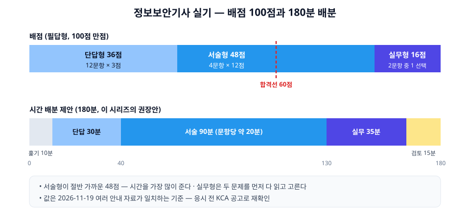
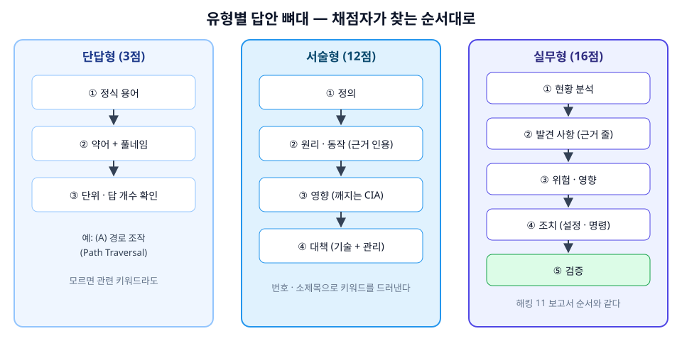

> **자격증 준비 · 정보보안기사** | 난이도 ★★★★☆ | 예상 소요 4 ~ 5시간 (답안 직접 써 보기 포함)

> ⚠️ **이 편의 모든 문제는 정보보안기사 실기(정보보안 실무)의 출제 유형을 바탕으로 이 시리즈가 직접 창작한 연습 문제입니다.** 기출문제나 덤프를 재현하지 않았습니다. 로그와 설정은 모두 새로 만든 것이고, IP 주소는 문서용 예약 대역(RFC 5737의 `192.0.2.0/24`, `198.51.100.0/24`, `203.0.113.0/24`)과 사설 대역만 씁니다. 로그 속 공격 문자열은 **탐지·분석 연습용 교과서 수준**이며, 실제 시스템에 시도하면 정보통신망법 제48조 위반입니다([해킹 01](../../hacking/hack01-ethical-hacking-intro.md)).

## 🎯 오늘의 목표

- 실기 시험의 형식(필답형, 단답형·서술형·실무형 문항 수와 배점, 시간)과 합격 기준을 확인한다
- 유형별로 **채점자가 찾는 낱말**이 들어가는 답안 뼈대를 익힌다
- 로그 분석·설정 점검·정책 작성형 창작 문제 10개를 직접 써 보고 모범 답안과 비교한다
- 180분 시간 배분 전략을 세운다

---

## 1. 실기 시험 형식



2026-11-19에 확인한 내용입니다. 시행 기관인 한국방송통신전파진흥원(KCA)의 국가자격 사이트(cq.or.kr)는 확인 시점에 접속 대기열 화면만 열려 원문 공고를 읽지 못했고, Q-Net 종목 페이지도 본문을 가져오지 못했습니다. 그래서 아래 값은 **여러 수험 안내 자료가 서로 일치하는 값**입니다. 원서 접수 전 KCA 공고에서 반드시 다시 확인하세요.

| 항목 | 내용 | 확인 수준 |
|---|---|---|
| 과목명 | 정보보안 실무 | 다수 자료 일치 |
| 방식 | **필답형**(서술식 답안 작성). 서버를 직접 조작하는 작업형이 아님 | 다수 자료 일치 |
| 시간 | **180분** | 다수 자료 일치 (일부 자료 150분 표기 — 공고 확인 필요) |
| 구성 | 단답형 **12문항 × 3점 = 36점**, 서술형 **4문항 × 12점 = 48점**, 실무형 **2문항 중 1문항 선택 × 16점 = 16점** — 총 100점 | 2023년부터 적용된 구성으로 소개됨 |
| 합격 | **100점 만점에 60점 이상** | 다수 자료 일치 |
| 이전 구성 (참고) | 단답형 10 × 3, 서술형 3 × 14, 실무형 3문항 중 2문항 × 14 | 2023년 이전 |

> 💡 숫자로 보면 전략이 보입니다. **서술형 4문항이 48점**으로 절반 가까이입니다. 단답형은 아는 것만 빨리 쓰고, 서술형에 시간을 몰아주세요. 실무형은 두 문제를 **먼저 둘 다 읽고** 자신 있는 쪽 하나를 고릅니다.

---

## 2. 유형별 답안 작성 요령



### 2-1. 단답형 (3점 × 12)

| 요령 | 예 |
|---|---|
| **정식 용어**로. 약어만 쓰지 말고 풀네임 병기 | "XSS" → "XSS(Cross-Site Scripting, 크로스 사이트 스크립팅)" |
| 빈칸 개수와 **답 개수를 맞춤** | (A)(B)(C)면 세 개 모두, 순서대로 |
| 명령·옵션은 **정확한 철자** | `chmod 4755`, `-perm -4000` |
| 숫자에는 **단위** | "72시간", "128비트" |
| 모르면 **관련 키워드라도** | 부분 점수가 있을 수 있으니 비우지 않기 |

### 2-2. 서술형 (12점 × 4)

서술형 채점은 "핵심 키워드가 들어갔는가"와 "논리 순서가 맞는가"를 봅니다. 아래 4단 뼈대를 손에 익히세요.

1. **정의** — 한두 문장으로 무엇인지
2. **원리·동작** — 왜, 어떻게 일어나는지 (가능하면 문제의 로그·설정 줄을 **인용**)
3. **문제점·영향** — 어떤 보안 요소(CIA)가 깨지나
4. **대책** — 기술적 대책 + 관리적 대책, 가능하면 **설정 예시**

> 💡 번호와 소제목을 붙이세요. 채점자는 수백 장을 봅니다. 키워드가 문단 속에 묻히면 놓칩니다.

### 2-3. 실무형 (16점, 2문항 중 택1)

로그·설정·상황 설명이 길게 주어지고, 여러 하위 질문이 붙습니다. 뼈대는 **현황 분석 → 발견 사항(근거 줄 번호) → 위험 → 조치(설정·명령) → 검증**입니다. 해킹 11의 점검 보고서 양식(발견 사항 → 위험도 → 재현 근거 → 권고)과 같은 순서입니다.

### 2-4. 시간 배분 (이 시리즈의 제안)

| 구간 | 시간 | 할 일 |
|---|---|---|
| 0~10분 | 10분 | 전체 훑기. 실무형 2문항 읽고 선택 |
| 10~40분 | 30분 | 단답형 12문항 (문항당 2~3분, 막히면 표시하고 넘김) |
| 40~130분 | 90분 | 서술형 4문항 (문항당 20분 + 여유) |
| 130~165분 | 35분 | 실무형 1문항 |
| 165~180분 | 15분 | 표시한 단답형 재도전, 빈칸 채우기 |

---

## 3. 창작 실전 문제 10선

> 유형 표시: [단답] 3점, [서술] 12점, [실무] 16점 기준으로 생각하고 풀어 보세요. 모범 답안은 **채점 키워드를 굵게** 표시했습니다.

### 문제 1 [단답] — 웹 접근 로그

다음은 사내 웹 서버(Apache, combined 형식)의 접근 로그 일부이다.

```text
203.0.113.77 - - [18/Nov/2026:02:14:05 +0900] "GET /download.php?file=../../../../etc/passwd HTTP/1.1" 200 2381 "-" "Mozilla/5.0"
203.0.113.77 - - [18/Nov/2026:02:14:07 +0900] "GET /download.php?file=..%2f..%2f..%2f..%2fetc%2fshadow HTTP/1.1" 403 199 "-" "Mozilla/5.0"
```

(A) 이 요청들이 노린 취약점의 이름, (B) 첫 번째 요청의 응답 코드가 의미하는 바, (C) 두 번째 요청에서 `%2f`가 나타내는 문자를 쓰시오.

<details><summary>모범 답안</summary>

- (A) **경로 조작(디렉터리 트래버설, Path Traversal)** — 파일 다운로드 기능의 입력값 검증 미흡
- (B) **200 OK, 응답 크기 2381바이트** → `/etc/passwd` 내용이 실제로 반환됐을 가능성이 높음(공격 성공 의심)
- (C) **`/`(슬래시)의 URL 인코딩**
- 덧붙이면 좋은 것: 대책은 파일명 화이트리스트, 경로 정규화 후 기준 디렉터리 확인, 웹 서버 계정 최소 권한.
</details>

### 문제 2 [단답] — IDS 규칙 해석

다음 Snort 규칙의 의미를 묻는다.

```text
alert tcp any any -> $HOME_NET 22 (msg:"SSH 연결 시도 과다"; flags:S; detection_filter:track by_src, count 5, seconds 60; sid:1000101; rev:1;)
```

(A) `flags:S`가 검사하는 것, (B) `detection_filter` 부분의 동작, (C) `sid`의 역할과 사용자 정의 규칙에 1000000 이상을 쓰는 이유를 쓰시오.

<details><summary>모범 답안</summary>

- (A) TCP 플래그 중 **SYN만 설정된 패킷**(연결 시작 요청)
- (B) **같은 출발지 IP 기준으로 60초 동안 5회를 넘는** 매칭이 있을 때부터 경보를 발생 — 무차별 대입 시도 탐지
- (C) **규칙 고유 식별 번호.** 1,000,000 미만은 공식 배포 규칙용으로 예약돼 있어 **로컬(사용자) 규칙은 1,000,000 이상**을 쓴다
</details>

### 문제 3 [서술] — 인증 로그 분석

Ubuntu 서버의 `/var/log/auth.log` 일부이다(시각은 KST).

```text
Nov 18 03:10:01 web01 sshd[2211]: Invalid user admin from 198.51.100.23 port 40122
Nov 18 03:10:01 web01 sshd[2211]: Failed password for invalid user admin from 198.51.100.23 port 40122 ssh2
Nov 18 03:10:03 web01 sshd[2213]: Failed password for invalid user test from 198.51.100.23 port 40130 ssh2
Nov 18 03:10:05 web01 sshd[2215]: Failed password for deploy from 198.51.100.23 port 40138 ssh2
   ... (같은 IP에서 2분 동안 412건) ...
Nov 18 03:12:11 web01 sshd[2901]: Accepted password for deploy from 198.51.100.23 port 41870 ssh2
Nov 18 03:12:40 web01 sudo:   deploy : TTY=pts/0 ; PWD=/home/deploy ; USER=root ; COMMAND=/usr/bin/crontab -e
```

(1) 어떤 공격이 일어났고 결과가 어떤지, (2) 03:12:40 줄이 왜 중요한지, (3) 즉시 조치와 재발 방지 대책을 서술하시오.

<details><summary>모범 답안</summary>

1. **공격**: 한 IP(198.51.100.23)에서 짧은 시간에 여러 계정(admin, test, deploy)으로 패스워드를 대입한 **무차별 대입(사전) 공격**. 03:12:11 `Accepted password for deploy`로 **deploy 계정 로그인에 성공** → 계정 탈취.
2. **03:12:40**: 탈취한 계정이 **sudo로 root 권한의 crontab 편집** → **권한 상승과 지속성(persistence) 확보** 시도. 예약 작업으로 백도어를 심었을 가능성.
3. **즉시 조치**: 해당 IP 차단, deploy 계정 잠금·패스워드 교체, 세션 종료, `crontab -l -u root`와 `/etc/cron*` 점검, **증거 보존 후** 분석(해킹 27의 격리 → 보존 → 제거), 침해사고 신고 대상 여부 판단(정보통신망법 제48조의3, 24시간).
4. **재발 방지**: `PasswordAuthentication no`(키 인증), `PermitRootLogin no`, `MaxAuthTries` 축소, fail2ban 같은 반복 실패 차단, deploy 계정의 sudo 권한을 필요한 명령으로 제한(최소권한), SSH 접근을 관리망·VPN으로 제한, 로그인 성공 알림.
</details>

### 문제 4 [실무] — SSH 서버 설정 점검

다음 `/etc/ssh/sshd_config` 발췌에서 보안상 문제를 모두 찾고, 수정한 설정과 적용·검증 명령을 쓰시오.

```text
Port 22
PermitRootLogin yes
PasswordAuthentication yes
PermitEmptyPasswords yes
MaxAuthTries 10
LoginGraceTime 2m
X11Forwarding yes
```

<details><summary>모범 답안</summary>

| 설정 | 문제 | 권고 |
|---|---|---|
| `PermitRootLogin yes` | root 직접 로그인 → 책임추적성 상실, 대입 공격 표적 | `PermitRootLogin no` |
| `PasswordAuthentication yes` | 패스워드 대입 공격 가능 | `PasswordAuthentication no` (키 인증) |
| `PermitEmptyPasswords yes` | 빈 패스워드 계정 로그인 허용 | `PermitEmptyPasswords no` |
| `MaxAuthTries 10` | 연결당 시도 횟수 과다 | `MaxAuthTries 3` |
| `LoginGraceTime 2m` | 인증 대기 연결이 오래 유지 | `LoginGraceTime 30` |
| `X11Forwarding yes` | 불필요한 기능 노출 | `X11Forwarding no` |
| (추가) | 접속 계정 제한 없음 | `AllowGroups sshusers` 등 |

```bash
sudo sshd -t                       # 문법 검사 (출력 없으면 정상)
sudo systemctl reload ssh          # Ubuntu 24.04의 유닛 이름은 ssh
sudo sshd -T | grep -Ei 'permitrootlogin|passwordauthentication|permitemptypasswords|maxauthtries'
```

채점 포인트: **문제 → 위험 → 수정값 → 적용 → 검증**이 모두 있어야 만점. 설정을 바꾸기 전에 **키 로그인이 되는 세션을 하나 열어 둔 채** 적용해야 잠기지 않는다는 운영상 주의도 가점 요소입니다([Day 67 호스트 하드닝](../../09-security/day67-host-hardening.md)).
</details>

### 문제 5 [실무] — 웹 서버 설정 점검

Apache 2.4 설정 일부이다. 정보 노출과 악성 파일 실행 관점에서 문제를 찾고 수정하시오.

```apache
ServerTokens Full
ServerSignature On
TraceEnable On
<Directory "/var/www/html">
    Options Indexes FollowSymLinks
    AllowOverride None
    Require all granted
</Directory>
# 게시판 첨부파일 저장 위치
<Directory "/var/www/html/uploads">
    Require all granted
</Directory>
```

<details><summary>모범 답안</summary>

| 항목 | 문제 | 수정 |
|---|---|---|
| `ServerTokens Full` | 응답 헤더에 버전·모듈 정보 노출 → 취약 버전 표적화 | `ServerTokens Prod` |
| `ServerSignature On` | 오류 페이지 하단에 버전 노출 | `ServerSignature Off` |
| `TraceEnable On` | TRACE 메서드 허용(XST 등에 악용 가능) | `TraceEnable Off` |
| `Options Indexes` | 디렉터리 목록 노출 | `Options -Indexes` (필요 없으면 `FollowSymLinks`도 제거) |
| uploads 디렉터리 | 업로드한 스크립트 파일이 **실행 가능** → 웹 셸 | 아래처럼 스크립트 실행 차단, 가능하면 웹 루트 밖에 저장 |

```apache
<Directory "/var/www/html/uploads">
    Options -Indexes -ExecCGI
    <FilesMatch "\.(php|phtml|phar|jsp|cgi|pl|py)$">
        Require all denied
    </FilesMatch>
</Directory>
```

검증: `apachectl configtest` → `Syntax OK`, `curl -sI http://<서버>/ | grep -i server`로 버전 미노출 확인. 서버 측 확장자 차단과 함께 **업로드 파일명 재생성·확장자 화이트리스트** 같은 애플리케이션 대책도 쓰면 좋습니다.
</details>

### 문제 6 [단답] — 계정·권한 점검

리눅스 서버 점검 중 다음을 확인하려 한다. 빈칸에 알맞은 명령 또는 값을 쓰시오.
(A) UID가 0인 계정을 모두 출력하는 awk 명령 (B) SetUID가 설정된 일반 파일을 모두 찾는 find 명령 (C) `/etc/shadow`의 권고 소유자와 권한

<details><summary>모범 답안</summary>

- (A) `awk -F: '$3 == 0 {print $1}' /etc/passwd` — root 외 계정이 나오면 백도어 계정 의심
- (B) `find / -type f -perm -4000 2>/dev/null`
- (C) **소유자 root**, 권한은 **400 이하**(점검 가이드 기준). 참고로 배포판 기본값은 Ubuntu `640`(root:shadow), RHEL 계열 `000`
</details>

### 문제 7 [서술] — 방화벽 규칙 순서

다음 iptables 규칙이 의도("관리망 10.20.0.0/24에서만 SSH 허용, 나머지 SSH는 차단, 웹은 모두 허용")대로 동작하지 않는다. 이유와 올바른 규칙을 서술하시오.

```text
-A INPUT -p tcp --dport 22 -j ACCEPT
-A INPUT -s 10.20.0.0/24 -p tcp --dport 22 -j ACCEPT
-A INPUT -p tcp --dport 22 -j DROP
-A INPUT -p tcp --dport 80 -j ACCEPT
```

<details><summary>모범 답안</summary>

1. **원인**: iptables는 체인 규칙을 **위에서부터 순서대로** 비교해 **처음 일치한 규칙**의 타깃을 적용한다. 첫 줄이 출발지 제한 없이 22번을 ACCEPT하므로 모든 SSH가 허용되고, 아래 DROP에는 도달하지 않는다.
2. **수정**: 첫 줄을 삭제하거나, 허용 규칙을 구체적인 것부터 배치.

```text
-A INPUT -m conntrack --ctstate ESTABLISHED,RELATED -j ACCEPT
-A INPUT -s 10.20.0.0/24 -p tcp --dport 22 -j ACCEPT
-A INPUT -p tcp --dport 22 -j DROP
-A INPUT -p tcp --dport 80 -j ACCEPT
```

3. **더 나은 설계**: 기본 정책을 `-P INPUT DROP`으로 두고 필요한 것만 허용(**화이트리스트, 기본 거부**). 루프백·응답 패킷 허용 규칙을 먼저 넣어야 한다.
4. **검증**: `iptables -L INPUT -n -v --line-numbers`로 순서와 카운터 확인.
</details>

### 문제 8 [실무·정책 작성] — 계정·패스워드 관리 정책

직원 150명의 핀테크 스타트업이다. 클라우드 콘솔, 사내 SaaS, 운영 서버(SSH)를 쓴다. 최근 공용 관리자 계정을 여러 명이 같이 쓰다가 퇴사자가 접속한 사실이 발견됐다. 이 조직의 **계정·인증 관리 정책**을 항목별로 작성하시오.

<details><summary>모범 답안 (예시)</summary>

| 항목 | 정책 내용 |
|---|---|
| 1. 목적·범위 | 모든 정보시스템 계정(직원·외주·서비스 계정) |
| 2. 계정 원칙 | **1인 1계정, 공용 계정 금지.** 불가피한 공용 계정은 책임자 지정·사용 기록 |
| 3. 생성·변경·회수 | 인사 시스템과 연동한 신청·승인. **퇴사·전보 당일 회수**, 분기별 계정 전수 검토(장기 미사용 90일 잠금) |
| 4. 인증 | 클라우드 콘솔·관리 기능·원격 접속은 **MFA 필수**, SaaS는 SSO 통합(Day 73) |
| 5. 패스워드 | 길이 중심 규칙(예: 최소 12자 이상), 유출 목록 대조, 주기적 강제 변경보다 **침해 징후 시 즉시 변경**, 재사용 금지 |
| 6. 특권 계정 | 최소 인원, 개인별 특권 계정 분리, 필요 시에만 권한 상승(JIT), **모든 사용 기록 보관** |
| 7. 서비스 계정·키 | 사람 로그인 금지, 시크릿 관리 도구로 보관(Day 71 Vault), 정기 교체 |
| 8. 로그·감사 | 인증 성공·실패, 권한 변경 로그를 중앙 수집, 월 1회 이상 검토 |
| 9. 위반 시 조치 | 인사 규정과 연계 |

채점 포인트: 사건의 **근본 원인(공용 계정 + 회수 지연)**을 직접 겨냥한 항목(2·3)이 반드시 들어가야 하고, 관리적 대책과 기술적 대책이 섞여 있어야 합니다. ISMS-P 2.5(인증 및 권한 관리)와 연결해 쓰면 좋습니다.
</details>

### 문제 9 [서술] — 업로드 후 수상한 요청

```text
192.0.2.140 - - [18/Nov/2026:13:02:11 +0900] "POST /board/write.php HTTP/1.1" 302 0 "-" "Mozilla/5.0"
192.0.2.140 - - [18/Nov/2026:13:02:40 +0900] "GET /uploads/2026/11/thumb_88.php?c=id HTTP/1.1" 200 54 "-" "Mozilla/5.0"
192.0.2.140 - - [18/Nov/2026:13:02:52 +0900] "GET /uploads/2026/11/thumb_88.php?c=uname+-a HTTP/1.1" 200 118 "-" "Mozilla/5.0"
```

(1) 무슨 일이 일어났는지, (2) 이 로그만으로 판단할 때의 한계, (3) 대응 절차를 서술하시오.

<details><summary>모범 답안</summary>

1. **분석**: 게시판 글쓰기(POST)로 **이미지로 위장한 스크립트 파일(.php)을 업로드**한 뒤, 업로드 경로의 파일을 직접 호출하며 `c` 파라미터로 **시스템 명령(id, uname)을 실행**하고 응답(200, 수십 바이트)을 받았다 → **웹 셸 업로드 및 원격 명령 실행 성공** 정황.
2. **한계**: 접근 로그에는 **POST 본문이 남지 않아** 무엇이 업로드됐는지 직접 확인할 수 없다. 파일 자체, 웹 서버 에러 로그, 프로세스 실행 기록(auditd·Falco), 파일 생성 시각과 대조해야 한다.
3. **대응**: 해당 파일과 관련 로그를 **해시와 함께 보존** → 서버 격리(서비스 영향 고려) → 같은 시각 전후 생성·수정된 파일 전수 검색 → 다른 웹 셸·계정·예약 작업 확인 → 업로드 취약점 수정(확장자 화이트리스트, 웹 루트 밖 저장, 실행 권한 제거 — 문제 5) → 깨끗한 이미지로 재배포 → 개인정보 접근 여부에 따라 유출 통지·신고 판단(E05) → 포스트모템.
</details>

### 문제 10 [실무·정책 작성] — 로그 관리 기준

문제 3·9 같은 분석이 가능하려면 평소 로그를 어떻게 관리해야 하는지, 조직의 **로그 관리 기준**을 5개 이상 항목으로 작성하시오.

<details><summary>모범 답안 (예시)</summary>

| 항목 | 기준 |
|---|---|
| 수집 대상 | 인증(성공·실패), 권한 변경, 관리자 행위, 웹 접근·에러, 방화벽·IDS, DB 접근, 클라우드 감사 로그 |
| **시각 동기화** | 모든 서버 NTP(chrony) 동기화, 저장은 UTC 또는 타임존 명시 — 타임라인 작성의 전제(해킹 27 3-4) |
| **중앙 수집** | 원본 서버가 장악돼도 남도록 별도 로그 서버로 실시간 전송(Day 60 Loki·Alloy) |
| **무결성** | 수집 서버 접근 최소화, 쓰기 후 변경 불가 저장소(WORM) 또는 해시 체인, 관리자도 삭제 불가 |
| 보관 기간 | 법령·내부 기준에 따른 최소 보관 기간 정의(개인정보처리시스템 접속기록은 관련 고시 기준 확인) |
| 모니터링 | 경보 규칙(반복 실패, 업무 외 시간 관리자 로그인, 웹 루트 내 스크립트 생성)과 담당자 |
| 검토 | 정기 검토 주기와 기록, 이상 발견 시 침해 대응 절차(E05 실기 4)로 연결 |
| 개인정보 | 로그에 비밀번호·주민등록번호 등 기록 금지, 필요 시 마스킹 |
</details>

---

## 4. 자주 깎이는 감점 포인트

| 감점 | 바르게 |
|---|---|
| "보안을 강화한다", "모니터링한다"로 끝냄 | **무엇을, 어떤 설정으로** — `PermitRootLogin no`처럼 구체적으로 |
| 로그 분석에서 근거 줄을 안 씀 | "03:12:11 `Accepted password` 줄에서 로그인 성공 확인" |
| 공격 이름만 쓰고 결과 판단 없음 | 응답 코드·크기로 **성공 여부**를 판단해 적기 |
| 대책이 기술적 대책뿐 | 관리적 대책(정책·교육·점검 주기)도 한 줄 |
| 법령 숫자 틀림 | 72시간(개인정보 유출), 24시간(침해사고), 3년(ISMS 유효기간) |
| 증거 보존 없이 "삭제·재설치" | 격리 → 보존 → 제거 순서 |

---

## 5. 핵심 정리

- 실기는 **필답형 180분, 단답 12(36점) + 서술 4(48점) + 실무 2 중 1(16점), 60점 이상 합격**(다수 자료 일치값, 응시 전 KCA 공고 확인).
- 단답형은 정식 용어·풀네임·단위·답 개수. 서술형은 **정의 → 원리 → 영향 → 대책**. 실무형은 **현황 → 발견(근거 줄) → 위험 → 조치(설정) → 검증**.
- 로그 분석의 핵심은 **같은 출발지·짧은 시간·실패 후 성공·성공 후 권한 상승** 같은 **연결 고리**를 찾는 것.
- 설정 점검은 기본값·노출·불필요 기능·최소권한 네 방향으로 훑는다.
- 정책 작성형은 사건의 **근본 원인을 겨냥한 항목**과 관리적·기술적 대책을 함께 쓴다.

---

## ⏭️ 다음 예고 — E07. 모의고사 (필기 100문항 + 실기 축약 세트)

마지막 편은 실전 모의고사입니다. 필기 5과목 각 20문항, 총 100문항 창작 세트와 정답표·해설, 실기 축약 세트(단답 5, 서술 2, 실무 1), 그리고 과락까지 고려한 합격 판정 방법을 담습니다.

→ [E07. 모의고사](./e07-mock-exam.md)
