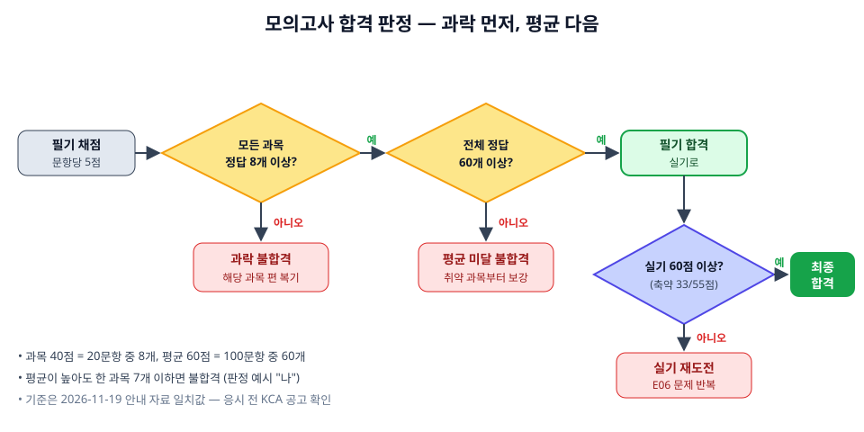

> **자격증 준비 · 정보보안기사** | 난이도 ★★★★☆ | 예상 소요 필기 150분 + 실기 축약 70분 + 채점·복기 1.5시간

> ⚠️ **이 모의고사의 모든 문항은 정보보안기사 필기 5과목과 실기(정보보안 실무)의 출제 범위를 바탕으로 이 시리즈가 직접 창작한 것입니다.** 기출문제나 덤프를 옮기거나 바꿔 쓴 문항은 없습니다. "실제 출제 문제"라고 주장하는 자료는 믿지도, 퍼뜨리지도 마세요. 법령 문항은 2026-11-19 국가법령정보센터 현행본 기준입니다(E05 참고).

## 🎯 오늘의 목표

- 필기 **5과목 × 20문항 = 100문항**을 실제 시간(과목당 30분, 총 150분)에 맞춰 푼다
- 과락(과목별 40점)과 평균(60점) 기준으로 **스스로 합격 판정**을 내린다
- 실기 축약 세트(단답 5, 서술 2, 실무 1)로 답안 뼈대를 시간 안에 써 본다
- 틀린 문항을 E01~E06의 해당 편으로 되돌려 복기한다

---

## 0. 응시 방법

| 구분 | 시간 | 규칙 |
|---|---|---|
| 필기 | **150분** (과목당 30분 기준) | 4지선다, 문항당 5점. 답안표에 번호만 기록 |
| 실기 축약 | **70분** | 단답 5(각 3점), 서술 2(각 12점), 실무 1(16점) — 55점 만점 |
| 채점 | — | 4장 정답표와 5장 모범 답안으로 채점, 6장 판정표에 기록 |

> 💡 필기는 CBT로 시행된다고 안내됩니다. 화면에서 보는 것처럼 **문제지에 메모하지 말고** 머릿속으로 풀어 보세요. 확신이 없는 문항은 번호 옆에 `?`만 표시해 두었다가 복기할 때 우선 봅니다.

---

## 1과목. 시스템 보안 (20문항)

**1.** 권한 4755가 설정된 실행 파일의 `ls -l` 표기는?
① -rwxr-sr-x ② -rwsr-xr-x ③ -rwxr-xr-t ④ -rwSr-xr-x

**2.** 여러 사용자가 쓰기 가능하지만 남의 파일은 지우지 못하게 하는 스티키 비트가 기본으로 설정되는 대표 디렉터리는?
① /tmp ② /etc ③ /bin ④ /boot

**3.** umask가 027일 때 새로 만든 디렉터리의 권한은?
① 750 ② 640 ③ 755 ④ 027

**4.** `/etc/shadow`의 패스워드 필드가 `$6$`로 시작한다. 사용된 해시 방식은?
① MD5 ② Blowfish ③ SHA-256 ④ SHA-512

**5.** 로그인 **실패** 기록을 담고 `lastb` 명령으로 보는 파일은?
① /var/log/wtmp ② /var/log/btmp ③ /var/run/utmp ④ /var/log/lastlog

**6.** `who` 명령이 현재 로그인한 사용자를 보여 줄 때 참조하는 파일은?
① wtmp ② btmp ③ utmp ④ secure

**7.** Windows 보안 이벤트 로그에서 "계정 로그온 실패"를 나타내는 이벤트 ID는?
① 4624 ② 4625 ③ 4720 ④ 1102

**8.** Windows SAM에 대한 설명으로 **옳지 않은** 것은?
① 로컬 계정 정보를 저장한다 ② 패스워드는 해시 형태로 저장된다 ③ 운영 중에는 시스템이 잠그고 있어 직접 복사가 어렵다 ④ 패스워드를 평문으로 저장한다

**9.** 버퍼 오버플로 공격의 대응 기법이 **아닌** 것은?
① 스택 카나리(스택 가드) ② ASLR ③ NX/DEP ④ 실행 파일에 SetUID 부여

**10.** 검사 시점과 사용 시점 사이의 틈(TOCTOU)을 노리는 공격은?
① 레이스 컨디션 ② 포맷 스트링 ③ SQL 인젝션 ④ 스니핑

**11.** 포맷 스트링 취약점에서 메모리에 값을 **쓰는** 데 악용되는 서식 문자는?
① %d ② %s ③ %n ④ %x

**12.** 루트킷의 주된 목적은?
① 네트워크로 스스로 복제·전파 ② 정상 프로그램으로 위장해 설치 유도 ③ 침입 흔적을 숨기고 관리자 권한을 유지 ④ 파일을 암호화하고 금전 요구

**13.** 랜섬웨어 피해를 줄이는 데 가장 효과적인 대책은?
① 네트워크와 분리된 백업과 정기 복구 훈련 ② 백업을 같은 서버의 다른 디렉터리에 저장 ③ 관리자 계정 공유 ④ 백신 실시간 감시 해제

**14.** 최신 리눅스에서 로그인 실패 횟수에 따른 계정 잠금을 담당하는 PAM 모듈은?
① pam_limits ② pam_env ③ pam_faillock ④ pam_motd

**15.** `/etc/cron.allow` 파일이 존재할 때의 동작으로 옳은 것은?
① 이 파일에 적힌 사용자만 crontab을 쓸 수 있다 ② cron.deny가 항상 우선한다 ③ 모든 사용자가 쓸 수 있다 ④ 파일 내용과 관계없이 아무도 쓸 수 없다

**16.** 파일 무결성 점검 도구로 알맞은 것은?
① nmap ② tcpdump ③ John the Ripper ④ AIDE

**17.** SELinux에서 정책 위반을 **기록만 하고 차단하지 않는** 모드는?
① enforcing ② permissive ③ disabled ④ targeted

**18.** 특정 프로세스가 열고 있는 파일과 네트워크 포트를 확인하는 명령은?
① chattr ② lsof ③ umask ④ chown

**19.** `chattr +i file`의 효과는?
① 내용 추가만 허용 ② 압축 저장 ③ root를 포함해 수정·삭제·이름 변경 불가 ④ 실행 금지

**20.** Windows의 기본 관리 목적 공유가 **아닌** 것은?
① C$ ② ADMIN$ ③ IPC$ ④ USERS$

---

## 2과목. 네트워크 보안 (20문항)

**21.** OSI 3계층(네트워크 계층)에서 동작하는 대표 장비는?
① 허브 ② 스위치 ③ 라우터 ④ 리피터

**22.** TCP 3-way handshake의 순서로 옳은 것은?
① SYN → ACK → SYN/ACK ② SYN → SYN/ACK → ACK ③ SYN/ACK → SYN → ACK ④ ACK → SYN → FIN

**23.** ARP 스푸핑에 대한 대응으로 가장 알맞은 것은?
① ICMP 전면 차단 ② 중요 호스트의 정적 ARP 항목, 스위치의 동적 ARP 검사 ③ DNS 캐시 비우기 ④ MTU 축소

**24.** SYN 플러딩에 대한 대응으로 가장 알맞은 것은?
① SYN 쿠키 ② 포트 미러링 ③ 정적 라우팅 ④ ARP 캐시 고정

**25.** Smurf 공격의 특징은?
① HTTP 헤더를 천천히 보냄 ② IP 단편의 오프셋을 겹치게 함 ③ 출발지와 목적지 IP를 같게 함 ④ 출발지를 피해자로 위조한 ICMP Echo Request를 브로드캐스트 주소로 보냄

**26.** 출발지 IP·포트를 목적지와 같게 만든 패킷을 보내는 공격은?
① Land ② Teardrop ③ Ping of Death ④ Smurf

**27.** 재조합 시 IP 단편의 오프셋이 겹치도록 조작하는 공격은?
① Land ② Teardrop ③ Slowloris ④ DNS 증폭

**28.** HTTP 요청 헤더를 끝내지 않고 아주 천천히 보내 웹 서버의 연결을 점유하는 공격은?
① Smurf ② Land ③ Slowloris ④ Teardrop

**29.** 반사·증폭형 DDoS에 흔히 악용되는 서비스가 **아닌** 것은?
① DNS(UDP 53) ② NTP(UDP 123) ③ Memcached(UDP 11211) ④ SSH(TCP 22)

**30.** IPsec에 대한 설명으로 옳은 것은?
① AH가 페이로드를 암호화한다 ② ESP는 무결성을 제공하지 않는다 ③ ESP는 암호화로 기밀성을 제공하고, AH는 무결성·인증만 제공한다 ④ IPsec은 전송 계층 프로토콜이다

**31.** IPsec 터널 모드에 대한 설명으로 옳은 것은?
① 원래 IP 헤더까지 통째로 보호하고 새 IP 헤더를 붙여 게이트웨이 간 VPN에 주로 쓴다 ② 원래 IP 헤더를 그대로 두고 페이로드만 보호한다 ③ 반드시 AH만 사용한다 ④ 종단 호스트 간에서만 쓸 수 있다

**32.** TLS 1.3에 대한 설명으로 **옳지 않은** 것은?
① 핸드셰이크 왕복이 줄었다 ② (EC)DHE 기반 키 교환으로 전방 비밀성을 제공한다 ③ AEAD 암호 모음을 사용한다 ④ 정적 RSA 키 전송 방식을 지원한다

**33.** 서비스와 잘 알려진 포트의 짝으로 **옳지 않은** 것은?
① SSH — 22 ② DNS — 53 ③ SNMP — 161 ④ LDAPS — 389

**34.** 세션(연결) 상태를 기록해 응답 패킷을 자동으로 판단하는 방화벽 방식은?
① 패킷 필터링(무상태) ② 상태 기반 검사(Stateful Inspection) ③ 서킷 게이트웨이 ④ 정적 NAT

**35.** IDS의 오용(시그니처) 탐지에 대한 설명으로 옳은 것은?
① 알려진 공격 패턴과 비교하므로 오탐이 비교적 적지만 새로운 공격 탐지는 어렵다 ② 정상 행위 프로파일과의 차이로 판단한다 ③ 제로데이 공격 탐지에 가장 유리하다 ④ 학습 기간이 반드시 필요하다

**36.** IDS의 False Negative는?
① 정상을 공격으로 판단 ② 정상을 정상으로 판단 ③ 공격을 탐지하지 못함 ④ 공격을 공격으로 판단

**37.** NAC(네트워크 접근 제어)의 핵심 기능은?
① 웹 콘텐츠 캐싱 ② 이메일 스팸 필터 ③ DNS 질의 응답 ④ 단말의 보안 상태(패치·백신 등)를 점검한 뒤 네트워크 접속 허용 여부 결정

**38.** 다음 무선랜 보안 방식 중 가장 강한 것은?
① WEP ② WPA-TKIP ③ WPA3-SAE ④ 개방형(Open) + MAC 필터

**39.** 3-way handshake를 끝까지 완료하지 않고 SYN에 대한 응답만으로 포트 상태를 판단하는 nmap 스캔 옵션은?
① -sT ② -sS ③ -sU ④ -sn

**40.** VLAN에 대한 설명으로 옳은 것은?
① 하나의 물리 스위치에서 브로드캐스트 도메인을 논리적으로 나눈다 ② 데이터를 암호화한다 ③ 라우터 없이도 VLAN 간 통신이 항상 된다 ④ 3계층 주소를 바꾼다

---

## 3과목. 애플리케이션 보안 (20문항)

**41.** SQL 인젝션의 근본적인 대책은?
① 오류 메시지 숨기기만 적용 ② 파라미터 바인딩(PreparedStatement 등) ③ 입력 길이만 제한 ④ HTTPS 적용

**42.** 저장형(Stored) XSS의 설명으로 옳은 것은?
① 악성 스크립트가 게시물 등에 저장되어 열람하는 사용자의 브라우저에서 실행된다 ② URL 파라미터에만 존재하고 저장되지 않는다 ③ 서버 OS 명령을 실행한다 ④ DB 테이블을 삭제한다

**43.** CSRF 대응으로 가장 알맞은 조합은?
① 입력 길이 제한 + 캡처 이미지 ② HTTPS + HSTS ③ 요청마다 예측 불가능한 토큰 검증 + SameSite 쿠키 ④ 쿠키 만료 시간 연장

**44.** 쿠키에 자바스크립트가 접근하지 못하게 하는 속성은?
① Secure ② HttpOnly ③ SameSite ④ Domain

**45.** 쿠키에 `SameSite=Strict`를 설정했을 때의 효과는?
① HTTPS에서만 전송 ② 자바스크립트 접근 차단 ③ 쿠키 암호화 ④ 다른 사이트에서 시작된 요청에는 쿠키를 보내지 않음

**46.** 파일 업로드 취약점 대응으로 **옳지 않은** 것은?
① 업로드 폴더를 웹 루트 안에 두고 실행 권한 부여 ② 확장자 화이트리스트 ③ 저장 파일명 재생성 ④ 파일 크기 제한

**47.** SSRF에 대한 설명으로 옳은 것은?
① 브라우저가 다른 사이트에 요청을 위조당함 ② DB 질의를 조작함 ③ 서버가 공격자가 지정한 주소(내부망·메타데이터 등)로 요청을 보내게 됨 ④ 세션 ID를 고정함

**48.** XXE 취약점의 대응으로 가장 알맞은 것은?
① XML 크기 제한만 적용 ② XML 파서에서 외부 엔티티와 DTD 처리를 비활성화 ③ JSON을 XML로 변환 ④ 응답 압축

**49.** OWASP Top 10 2021의 A01 항목은?
① Broken Access Control ② Injection ③ Cryptographic Failures ④ SSRF

**50.** 세션 고정(Session Fixation) 공격의 대응으로 가장 알맞은 것은?
① 세션 만료 시간을 늘림 ② 세션 ID를 URL에 포함 ③ 로그인 전 세션 ID 유지 ④ 로그인 성공 직후 새 세션 ID 발급

**51.** Apache에서 디렉터리 목록 노출을 막는 설정은?
① ServerTokens Prod ② TraceEnable Off ③ Options -Indexes ④ KeepAlive Off

**52.** 클릭재킹 방지에 쓰는 응답 헤더는?
① Strict-Transport-Security ② X-Frame-Options(또는 CSP frame-ancestors) ③ Set-Cookie ④ Cache-Control

**53.** HSTS의 역할은?
① 브라우저가 해당 도메인에 HTTPS로만 접속하도록 강제 ② 스크립트 출처 제한 ③ 프레임 삽입 금지 ④ 쿠키 암호화

**54.** DNSSEC에 대한 설명으로 **옳지 않은** 것은?
① 서명으로 응답의 무결성을 확인한다 ② 응답의 출처를 인증한다 ③ 캐시 포이즈닝 대응에 도움이 된다 ④ 질의·응답을 암호화해 기밀성을 제공한다

**55.** 도메인 소유자가 허용한 메일 발송 서버를 DNS TXT 레코드로 공개하는 방식은?
① SPF ② S/MIME ③ PGP ④ POP3S

**56.** 구매 정보와 결제 정보를 필요한 상대에게만 보이게 하는 이중 서명을 쓰는 전자상거래 프로토콜은?
① SSL ② S/MIME ③ SET ④ PGP

**57.** 데이터베이스에서 사용자에게 특정 열만 보이게 해 접근을 제한하는 데 쓰는 객체는?
① 트리거 ② 뷰(View) ③ 인덱스 ④ 시퀀스

**58.** 예외 발생 시 스택 트레이스가 사용자 화면에 노출된다. 가장 알맞은 대책은?
① 디버그 모드 유지 ② 로그 기록 중단 ③ 에러 페이지 제거 ④ 사용자에게는 일반 메시지, 상세 정보는 서버 로그에만 기록

**59.** 웹 방화벽(WAF)에 대한 설명으로 **옳지 않은** 것은?
① HTTP 요청·응답 내용을 검사한다 ② SQL 인젝션·XSS 같은 패턴을 차단할 수 있다 ③ 시큐어 코딩을 대체하지는 못한다 ④ 3계층 IP 헤더만 검사하므로 웹 공격은 막지 못한다

**60.** 사용자 패스워드 저장 방식으로 가장 알맞은 것은?
① MD5 해시 ② 솔트 없는 SHA-256 한 번 ③ 사용자별 솔트 + bcrypt·Argon2 같은 느린 함수 ④ AES로 암호화해 키를 같은 DB에 저장

---

## 4과목. 정보보안 일반 (20문항)

**61.** 부인방지를 제공하는 기술은?
① 대칭키 암호 ② HMAC ③ 전자서명 ④ 해시

**62.** 50명이 서로 대칭키로 1:1 비밀 통신할 때 필요한 키 수는?
① 100 ② 1225 ③ 2450 ④ 2500

**63.** AES-256의 라운드 수는?
① 10 ② 12 ③ 16 ④ 14

**64.** DES의 실효 키 길이는?
① 56비트 ② 64비트 ③ 112비트 ④ 128비트

**65.** RSA의 안전성이 기대는 수학 문제는?
① 이산대수 ② 소인수분해 ③ 타원곡선 이산대수 ④ 배낭 문제

**66.** ECC가 RSA에 비해 갖는 대표 장점은?
① 키 분배가 필요 없음 ② 서명이 불가능 ③ 더 짧은 키로 비슷한 안전성 ④ 해시가 필요 없음

**67.** SHA-256의 출력 길이는?
① 128비트 ② 160비트 ③ 224비트 ④ 256비트

**68.** HMAC이 제공하지 **않는** 것은?
① 부인방지 ② 무결성 ③ 메시지 출처 인증(키 공유자 간) ④ 변조 탐지

**69.** 블록 암호 운영 모드에 대한 설명으로 옳은 것은?
① ECB는 IV를 사용한다 ② CBC는 첫 블록 암호화에 IV를 사용한다 ③ CTR은 병렬 처리가 불가능하다 ④ GCM은 무결성을 제공하지 않는다

**70.** 인증서 폐지 여부를 실시간으로 질의하는 프로토콜은?
① CRL ② LDAP ③ OCSP ④ SCEP

**71.** X.509 v3 인증서에 포함되지 **않는** 것은?
① 주체 이름 ② 유효기간 ③ 발급자 서명 ④ 주체의 개인키

**72.** Kerberos에서 서비스 티켓을 발급하는 구성 요소는?
① TGS ② AS ③ 서비스 서버 ④ 클라이언트

**73.** 생체 인증의 FAR은?
① 본인을 거부하는 비율 ② 타인을 본인으로 잘못 받아들이는 비율 ③ 두 오류율이 같아지는 지점 ④ 등록 실패율

**74.** 다중 인증(MFA)에 해당하는 것은?
① 패스워드 + 보안 질문 ② PIN + 패스워드 ③ 패스워드 + OTP 앱 ④ 지문 + 지문(다른 손가락)

**75.** 벨-라파둘라 모델에서 "아래 등급 객체에 쓰지 못한다"는 규칙은?
① 단순 보안 속성 ② 단순 무결성 속성 ③ *-무결성 속성 ④ *(스타) 속성

**76.** 비바(Biba) 모델의 목적은?
① 무결성 ② 기밀성 ③ 가용성 ④ 이해 충돌 방지

**77.** 잘 구성된 트랜잭션과 직무 분리로 상업 환경의 무결성을 다루는 모델은?
① 벨-라파둘라 ② 클락-윌슨 ③ 만리장성 ④ 격자 모델

**78.** RBAC의 특징으로 옳은 것은?
① 객체 소유자가 권한을 마음대로 준다 ② 보안 레이블로만 결정한다 ③ 역할에 권한을 묶고 사용자에게 역할을 부여한다 ④ 최소권한 원칙을 적용할 수 없다

**79.** DAC의 예로 가장 알맞은 것은?
① 군 기밀 등급 분류 ② SELinux 타입 강제 ③ K8s ClusterRole ④ 리눅스 파일 소유자의 rwx 권한 설정

**80.** 같은 이해충돌 그룹에 속한 경쟁사 정보에 동시에 접근하지 못하게 하는 모델은?
① 만리장성(Brewer-Nash) ② 비바 ③ 벨-라파둘라 ④ 클락-윌슨

---

## 5과목. 정보보안 관리 및 법규 (20문항)

**81.** "모든 노트북은 디스크 전체 암호화를 적용해야 한다"는 의무 규칙은 문서 계층에서 무엇인가?
① 정책 ② 표준 ③ 지침 ④ 절차

**82.** 자산 가치 10억 원, 노출 계수 0.2, 연간 발생률 0.3일 때 ALE는?
① 2억 원 ② 3억 원 ③ 6천만 원 ④ 2천만 원

**83.** 위험이 큰 신규 서비스 출시 자체를 취소했다. 이 대응 전략은?
① 위험 회피 ② 위험 전가 ③ 위험 감소 ④ 위험 수용

**84.** 정성적 위험 분석 기법이 **아닌** 것은?
① 델파이법 ② 시나리오법 ③ 순위결정법 ④ 과거자료 분석법

**85.** RTO에 대한 설명으로 옳은 것은?
① 데이터 손실 허용 시점 ② 사고 후 업무 재개까지 허용되는 시간 ③ 평균 고장 간격 ④ 백업 보관 기간

**86.** 장비와 최신 데이터가 대기 중이어서 수 시간 안에 전환할 수 있는 복구 사이트는?
① 콜드 사이트 ② 웜 사이트 ③ 핫 사이트 ④ 모바일 사이트

**87.** BCP 테스트 중 주 시스템을 실제로 멈추고 복구 사이트로 전환하는 방식은?
① 체크리스트 검토 ② 구조적 워크스루 ③ 병행 테스트 ④ 완전 중단 테스트

**88.** 현행 ISMS-P 인증 기준의 총 개수는?
① 101개 ② 102개 ③ 80개 ④ 104개

**89.** ISMS-P "3. 개인정보 처리 단계별 요구사항"의 분야가 **아닌** 것은?
① 수집 시 보호조치 ② 국외 이전 시 보호조치(별도 분야) ③ 파기 시 보호조치 ④ 정보주체 권리보호

**90.** 정보통신망법상 정보보호 관리체계 인증의 유효기간은?
① 1년 ② 2년 ③ 3년 ④ 5년

**91.** 개인정보 보호법상 개인정보의 정의에 해당하는 것은?
① 살아 있는 개인에 관한 정보 ② 사망자를 포함한 모든 사람의 정보 ③ 법인의 영업 정보 ④ 익명처리된 통계

**92.** 개인정보 보호법상 법정대리인의 동의가 필요한 아동의 나이 기준은?
① 만 12세 미만 ② 만 13세 미만 ③ 만 15세 미만 ④ 만 14세 미만

**93.** 개인정보 유출을 알게 된 개인정보처리자가 정보주체에게 통지해야 하는 원칙적 기한(시행령)은?
① 24시간 이내 ② 72시간 이내 ③ 5일 이내 ④ 30일 이내

**94.** 정보통신서비스 제공자가 침해사고를 알게 된 때부터 신고해야 하는 기한은?
① 즉시 ② 12시간 이내 ③ 24시간 이내 ④ 72시간 이내

**95.** 개인정보 보호법상 보호위원회가 부과할 수 있는 과징금의 상한은?
① 전체 매출액의 100분의 3 ② 관련 매출액의 100분의 1 ③ 10억 원 ④ 5억 원

**96.** 개인정보 보호법상 법정손해배상의 청구 한도는?
① 100만원 이하 ② 500만원 이하 ③ 1천만원 이하 ④ 300만원 이하

**97.** 주요정보통신기반시설을 지정하는 주체는?
① 관리기관의 장 ② 중앙행정기관의 장 ③ 한국인터넷진흥원장 ④ 개인정보보호위원회

**98.** 금융·통신 등 분야별로 취약점·침해 정보를 공유하고 실시간 경보·분석체계를 운영하는 조직(정보통신기반 보호법 제16조)은?
① CERT ② CISO ③ ISAC(정보공유·분석센터) ④ SOC

**99.** 전자서명법상 전자서명이 나타내는 사항으로 옳은 것은?
① 서명자의 신원과 서명자가 해당 전자문서에 서명하였다는 사실 ② 전자문서의 기밀성 ③ 공인인증기관의 지정 사실 ④ 서명자의 개인키 값

**100.** NIST SP 800-61 Rev. 2의 사고 대응 생명주기에서 가장 먼저 오는 단계는?
① 탐지·분석 ② 봉쇄·제거·복구 ③ 사후 활동 ④ 준비

---

## 4. 필기 정답표와 해설

### 1과목 — 시스템 보안

| 번호 | 정답 | 해설 |
|---|---|---|
| 1 | ② | 4 = SetUID → 소유자 실행 자리에 `s`. 대문자 `S`는 실행 권한 없이 SetUID만 있을 때 |
| 2 | ① | `/tmp`는 `drwxrwxrwt`(1777) |
| 3 | ① | 디렉터리 기본 777 − 027 = 750 (파일이면 666 기준 640) |
| 4 | ④ | `$1$` MD5, `$5$` SHA-256, `$6$` SHA-512. 최근 Ubuntu 기본은 `$y$`(yescrypt) |
| 5 | ② | btmp 실패, wtmp 로그인·로그아웃 이력(`last`) |
| 6 | ③ | utmp는 현재 로그인 상태 |
| 7 | ② | 4624 성공, 4720 계정 생성, 1102 감사 로그 삭제 |
| 8 | ④ | 해시(NT 해시)로 저장 |
| 9 | ④ | SetUID는 오히려 공격 가치를 높임 |
| 10 | ① | 검사 후 사용 전 파일을 바꿔치기(심볼릭 링크 등) |
| 11 | ③ | `%n`은 출력한 문자 수를 메모리에 씀 |
| 12 | ③ | ① 웜 ② 트로이 목마 ④ 랜섬웨어 |
| 13 | ① | 같은 서버 백업은 함께 암호화됨 |
| 14 | ③ | pam_faillock(구 pam_tally2 대체) |
| 15 | ① | allow가 있으면 allow 목록만 |
| 16 | ④ | AIDE·Tripwire = 해시 기준 무결성 비교 |
| 17 | ② | targeted는 모드가 아니라 정책 종류 |
| 18 | ② | `lsof -p <PID>`, `lsof -i :443` |
| 19 | ③ | `+a`는 추가만 허용 |
| 20 | ④ | C$·ADMIN$·IPC$가 기본 관리 공유 |

### 2과목 — 네트워크 보안

| 번호 | 정답 | 해설 |
|---|---|---|
| 21 | ③ | 스위치는 2계층, 허브·리피터는 1계층 |
| 22 | ② | SYN → SYN/ACK → ACK |
| 23 | ② | DAI(Dynamic ARP Inspection), 정적 ARP, 탐지 도구(해킹 22) |
| 24 | ① | SYN 쿠키로 백로그 소모 없이 응답 |
| 25 | ④ | 대응: 라우터의 directed broadcast 차단 |
| 26 | ① | Land |
| 27 | ② | Teardrop |
| 28 | ③ | Slowloris — 타임아웃·동시 연결 제한, 리버스 프록시 |
| 29 | ④ | TCP는 핸드셰이크 때문에 출발지 위조 반사가 어렵고 증폭률도 낮음 |
| 30 | ③ | AH는 기밀성 없음, ESP는 기밀성 + (선택) 무결성 |
| 31 | ① | ②는 전송 모드 |
| 32 | ④ | TLS 1.3은 정적 RSA 키 전송을 제거 |
| 33 | ④ | LDAP 389, LDAPS 636 |
| 34 | ② | 상태 테이블로 응답 패킷 판단 |
| 35 | ① | ②·③·④는 이상(행위) 탐지 설명 |
| 36 | ③ | 미탐. ①은 False Positive(오탐) |
| 37 | ④ | 접속 전 단말 상태 점검·격리 |
| 38 | ③ | SAE로 오프라인 사전 공격 저항. WEP는 사용 금지 수준 |
| 39 | ② | -sS(half-open). -sT는 연결 완료, -sU UDP, -sn 호스트 탐색 |
| 40 | ① | VLAN 간 통신은 3계층 장비 필요 |

### 3과목 — 애플리케이션 보안

| 번호 | 정답 | 해설 |
|---|---|---|
| 41 | ② | 질의 구조와 데이터를 분리 |
| 42 | ① | ②는 반사형 |
| 43 | ③ | CSRF 토큰 + SameSite(해킹 17) |
| 44 | ② | Secure는 HTTPS 전송만 |
| 45 | ④ | Lax는 최상위 GET 이동만 허용 |
| 46 | ① | 웹 루트 밖 저장, 실행 권한 제거가 원칙(E06 문제 5) |
| 47 | ③ | 클라우드 메타데이터 주소가 대표 표적(해킹 09) |
| 48 | ② | 해킹 18 |
| 49 | ① | 2021판 A01 = Broken Access Control |
| 50 | ④ | 인증 전후 세션 ID 교체 |
| 51 | ③ | ①은 버전 노출 축소, ②는 TRACE 차단 |
| 52 | ② | CSP `frame-ancestors`가 최신 권고 |
| 53 | ① | 첫 접속 이후 HTTP 다운그레이드 방지 |
| 54 | ④ | DNSSEC는 기밀성 없음(DoH·DoT가 담당) |
| 55 | ① | DKIM은 서명, DMARC는 정책·보고 |
| 56 | ③ | 상점은 결제 정보, 은행은 구매 정보를 못 봄 |
| 57 | ② | 뷰 + 권한 부여로 열·행 제한 |
| 58 | ④ | 정보 노출 방지(해킹 13) |
| 59 | ④ | WAF는 7계층 HTTP 검사 |
| 60 | ③ | 해킹 05 |

### 4과목 — 정보보안 일반

| 번호 | 정답 | 해설 |
|---|---|---|
| 61 | ③ | 서명자 개인키 |
| 62 | ② | 50 × 49 / 2 = 1225 |
| 63 | ④ | 128/192/256 → 10/12/14 |
| 64 | ① | 64비트 중 8비트가 패리티 |
| 65 | ② | ElGamal·DSA는 이산대수 |
| 66 | ③ | 예: 256비트 ECC ≈ 3072비트 RSA 수준 |
| 67 | ④ | SHA-1은 160비트 |
| 68 | ① | 키 공유 → 작성자 증명 불가 |
| 69 | ② | ECB는 IV 없음, CTR은 병렬 가능, GCM은 AEAD |
| 70 | ③ | CRL은 목록 배포 |
| 71 | ④ | 인증서에는 공개키만 |
| 72 | ① | AS는 TGT 발급 |
| 73 | ② | ①은 FRR, ③은 CER(EER) |
| 74 | ③ | 지식 + 소유. ①②는 둘 다 지식, ④는 둘 다 생체 |
| 75 | ④ | No Write Down |
| 76 | ① | No Read Down / No Write Up |
| 77 | ② | 비바가 다루지 못한 무결성 목표까지 |
| 78 | ③ | 최소권한·직무분리 적용이 쉬움 |
| 79 | ④ | ①② MAC, ③ RBAC |
| 80 | ① | 컨설팅·금융의 이해 충돌 |

### 5과목 — 정보보안 관리 및 법규

| 번호 | 정답 | 해설 |
|---|---|---|
| 81 | ② | 의무 + 구체 = 표준 |
| 82 | ③ | SLE 2억 × 0.3 = 6천만 원 |
| 83 | ① | 활동 자체를 하지 않음 |
| 84 | ④ | 과거자료 분석법은 정량적 |
| 85 | ② | ①은 RPO |
| 86 | ③ | 웜은 데이터를 백업에서 복원 |
| 87 | ④ | 병행 테스트는 주 시스템 운영 유지 |
| 88 | ① | 16 + 64 + 21. 102는 2023년 개정 전 |
| 89 | ② | 3.1 수집 · 3.2 보유·이용 · 3.3 제공 · 3.4 파기 · 3.5 권리보호 |
| 90 | ③ | 정보통신망법 제47조 제5항 |
| 91 | ① | 개인정보 보호법 제2조 제1호 |
| 92 | ④ | 제22조의2 |
| 93 | ② | 시행령 제39조 |
| 94 | ③ | 정보통신망법 제48조의3 제1항 |
| 95 | ① | 제64조의2 제1항 |
| 96 | ④ | 제39조의2 제1항 |
| 97 | ② | 정보통신기반 보호법 제8조 |
| 98 | ③ | 제16조 |
| 99 | ① | 전자서명법 제2조 제2호 |
| 100 | ④ | 준비 → 탐지·분석 → 봉쇄·제거·복구 → 사후 활동 |

---

## 5. 실기 축약 세트 (70분, 55점)

### 단답형 (각 3점)

**S1.** 여러 사용자가 파일을 올리는 공유 디렉터리 `/srv/share`를 누구나 쓸 수 있되 남의 파일은 지우지 못하게 하려 한다. 8진수 권한으로 한 줄 명령을 쓰시오.

**S2.** 같은 출발지에서 몇 분 동안 여러 계정 이름으로 `Failed password`가 수백 건 기록된 뒤 `Accepted password`가 한 건 나왔다. 이 공격의 이름을 쓰시오.

**S3.** 다른 사이트가 우리 페이지를 `iframe`으로 넣지 못하게 하는 응답 헤더 두 가지(헤더 이름과 값)를 쓰시오.

**S4.** "최대 1시간 분량의 데이터 손실까지 허용한다"에서 1시간이 나타내는 지표의 약어와 우리말 이름을 쓰시오.

**S5.** 개인정보 보호법상 유출 신고를 받는 기관 두 곳을 쓰시오.

<details><summary>단답형 모범 답안</summary>

- S1. `chmod 1777 /srv/share` (스티키 비트 1 + rwxrwxrwx)
- S2. **무차별 대입 공격(Brute Force)** 또는 사전 공격(Dictionary Attack) — 성공 로그로 **계정 탈취**까지 언급하면 좋음
- S3. `X-Frame-Options: DENY`(또는 `SAMEORIGIN`), `Content-Security-Policy: frame-ancestors 'none'`(또는 `'self'`)
- S4. **RPO(Recovery Point Objective, 목표 복구 시점)**
- S5. **개인정보보호위원회, 한국인터넷진흥원(KISA)** — 개인정보 보호법 제34조 제4항, 시행령 제40조
</details>

### 서술형 (각 12점)

**D1.** 다음 Java 코드의 취약점 원리를 설명하고, 안전한 코드로 고쳐 쓰시오.

```java
String sql = "SELECT id, name FROM member WHERE email = '" + email + "'";
ResultSet rs = conn.createStatement().executeQuery(sql);
```

**D2.** 반사·증폭형 DDoS의 원리를 설명하고, ① 증폭에 이용되는 서버 운영자 ② 피해 기관 각각의 대응을 서술하시오.

<details><summary>서술형 모범 답안</summary>

**D1.**
1. **정의**: 사용자 입력이 SQL 문자열에 그대로 이어 붙어 질의 구조가 바뀌는 **SQL 인젝션**.
2. **원리**: `email` 값에 따옴표와 SQL 구문이 들어오면 WHERE 조건이 항상 참이 되거나 다른 질의가 실행돼 인증 우회·정보 유출이 일어난다.
3. **영향**: 기밀성(회원 정보 유출), 무결성(데이터 변조).
4. **대책**: 파라미터 바인딩으로 질의 구조와 데이터를 분리.

```java
String sql = "SELECT id, name FROM member WHERE email = ?";
try (PreparedStatement ps = conn.prepareStatement(sql)) {
    ps.setString(1, email);
    try (ResultSet rs = ps.executeQuery()) { /* ... */ }
}
```

추가: 입력값 형식 검증(이메일 패턴), DB 계정 최소 권한, 상세 오류 메시지 숨김(해킹 13·14).

**D2.**
1. **원리**: 공격자가 **출발지 IP를 피해자로 위조**한 작은 UDP 요청을 공개 서버(DNS 오픈 리졸버, NTP, Memcached 등)에 보낸다 → 서버는 **요청보다 훨씬 큰 응답**을 피해자에게 보낸다(반사 + 증폭).
2. **증폭 서버 운영자**: 오픈 리졸버 금지(허용된 클라이언트만 재귀 질의), 불필요한 UDP 서비스 외부 노출 차단(Memcached는 UDP 비활성화), 응답률 제한(RRL), 모니터링.
3. **피해 기관**: 상위 ISP·DDoS 방어 서비스(스크러빙)와 협력, 공격 출발 포트(예: UDP 53·123·11211) 기반 상위 단 필터링, 대역폭 여유·CDN, 사전 대응 절차.
4. **네트워크 공통**: 출발지 위조 방지를 위한 ingress 필터링(BCP 38).
</details>

### 실무형 (16점)

**P1.** 쇼핑몰 A사(회원 2만 명, 정보통신서비스 제공자)의 관리자 페이지가 외부에 공개돼 있었고, 관리자 계정은 `admin` 하나를 개발자 5명이 같은 패스워드로 공유했다. 11월 18일 02:00경 해외 IP에서 관리자 로그인 성공 후 회원 목록 다운로드 기록이 발견됐다(이름·이메일·전화번호, 약 2만 건). 담당자는 11월 18일 09:00에 이 사실을 알게 됐다.

(1) 즉시 조치 5가지, (2) 법적 통지·신고 판단과 기한(근거 조문 포함), (3) 근본 원인과 재발 방지 대책(기술적·관리적 각 2개 이상)을 작성하시오.

<details><summary>실무형 모범 답안</summary>

**(1) 즉시 조치**
1. 관리자 페이지 외부 접근 차단(IP 허용 목록·VPN), 해당 해외 IP 차단
2. `admin` 패스워드 즉시 변경·세션 무효화, 다른 계정·키도 교체
3. 웹·DB·관리자 로그와 다운로드 파일 흔적을 **해시와 함께 보존**(삭제·재설치 금지)
4. 다른 침입 흔적(웹 셸, 추가 계정, 예약 작업) 점검
5. 사고 대응 책임자 지정, 대응 기록 시작(Day 65 IC 체계)

**(2) 법적 판단** (기준 시각: 알게 된 11-18 09:00)
- 개인정보 **유출** → 정보주체 2만 명에게 **72시간 이내(11-21 09:00까지)** 통지(개인정보 보호법 제34조 제1항, 시행령 제39조)
- **1천명 이상**이고 **외부 불법 접근** → 보호위원회 또는 KISA에 **72시간 이내** 신고(같은 법 제34조 제4항, 시행령 제40조). 세부를 다 확인하지 못했으면 확인된 내용부터 우선 신고
- 정보통신서비스 제공자의 **침해사고** → 과기정통부 또는 KISA에 **24시간 이내(11-19 09:00까지)** 신고 검토(정보통신망법 제48조의3). 다른 법률에 따라 이미 신고했으면 신고한 것으로 본다는 단서 확인
- 피해 최소화 대책 마련·조치(개인정보 보호법 제34조 제3항)

**(3) 원인과 대책**
- 근본 원인: **관리 기능의 외부 노출**, **공용 계정 + 단일 요소 인증**, 대량 다운로드 탐지 부재
- 기술적: 관리자 페이지 내부망·VPN 한정, **개인별 계정 + MFA**, 대량 조회·다운로드 경보와 제한, 개인정보 필드 마스킹·다운로드 사유 기록
- 관리적: 1인 1계정 정책과 분기별 계정 검토(E06 문제 8), 접근 권한 최소화 승인 절차, 개인정보취급자 교육, 침해 대응 절차서와 연 1회 훈련, 포스트모템 액션 아이템 추적
</details>

---

## 6. 합격 판정 방법



### 6-1. 필기

필기는 **과목별 40점 이상**이면서 **5과목 평균 60점 이상**이어야 합격입니다(여러 안내 자료가 일치하는 기준, 응시 전 KCA 공고 확인). 문항당 5점이므로 다음처럼 바꿔 생각하면 쉽습니다.

| 기준 | 점수 | 정답 수로 바꾸면 |
|---|---|---|
| 과락 | 과목당 40점 미만 | 과목당 **7개 이하** 정답 → 불합격 |
| 과목 통과 | 과목당 40점 이상 | 과목당 **8개 이상** |
| 평균 | 5과목 평균 60점 이상 | 100문항 중 **60개 이상** (= 총점 300점 이상) |

**자가 채점표** (빈칸에 정답 수를 적으세요)

| 과목 | 정답 수 (/20) | 점수 (×5) | 과락 여부 (8개 미만?) | 틀린 문항 복기 편 |
|---|---|---|---|---|
| 1. 시스템 보안 | | | | [E01](./e01-system-security.md) |
| 2. 네트워크 보안 | | | | [E02](./e02-network-security.md) |
| 3. 애플리케이션 보안 | | | | [E03](./e03-application-security.md) |
| 4. 정보보안 일반 | | | | [E04](./e04-infosec-general.md) |
| 5. 정보보안 관리 및 법규 | | | | [E05](./e05-management-law.md) |
| **합계 / 평균** | /100 | /500, 평균 | | |

**판정 예시**

| 수험생 | 과목별 정답 수 | 합계 | 판정 |
|---|---|---|---|
| 가 | 14 / 12 / 13 / 11 / 12 | 62 | **합격** — 전 과목 8개 이상, 62개 ≥ 60 |
| 나 | 18 / 17 / 16 / 15 / **7** | 73 | **불합격** — 평균은 넘었지만 5과목 과락 |
| 다 | 12 / 11 / 12 / 11 / 12 | 58 | **불합격** — 과락은 없지만 평균 58점 |

> 💡 "나"가 가장 흔한 함정입니다. 기술 과목이 강한 개발자는 **5과목(법규)**에서 과락이 나기 쉽습니다. 법규는 E05의 표만 반복해도 8개는 넘깁니다.

### 6-2. 실기

실기는 100점 만점에 **60점 이상**이 합격입니다. 이 축약 세트는 55점 만점이므로 **33점 이상(60%)**이면 실제 시험에서도 합격권으로 봅니다. 서술·실무형은 모범 답안의 **굵은 키워드**가 몇 개 들어갔는지로 부분 점수를 매기세요.

| 유형 | 배점 | 채점 기준 (자가) |
|---|---|---|
| 단답형 S1~S5 | 3점 × 5 | 정확하면 3, 핵심 낱말만 맞으면 1~2 |
| 서술형 D1~D2 | 12점 × 2 | 정의·원리·영향·대책 각 3점 |
| 실무형 P1 | 16점 | (1) 5점, (2) 6점(기한·조문 각각), (3) 5점 |

### 6-3. 결과별 다음 행동

| 결과 | 다음 행동 |
|---|---|
| 필기 평균 70 이상, 과락 없음 | 실기 준비로 넘어가기. E06 문제 10개를 시간 재고 다시 쓰기 |
| 평균 60 근처 | 틀린 문항의 편을 다시 보고, 각 편 창작 객관식을 한 번 더 |
| 특정 과목 과락 | 그 과목 편의 "자주 헷갈리는 포인트" 표를 백지에 다시 써 보기 |
| 실기 33점 미만 | 서술형 뼈대(정의 → 원리 → 영향 → 대책)를 문제 없이도 쓸 수 있을 때까지 반복 |

---

## 7. 핵심 정리

- 필기: 100문항, 과목당 **8개 이상**(과락 방지) + 전체 **60개 이상**(평균 60점).
- 실기: 필답형 100점 중 **60점 이상**. 서술형 48점이 승부처.
- 법규는 숫자로 출제된다: **101개(ISMS-P), 3년(ISMS 유효기간), 72시간(유출 통지·신고), 24시간(침해사고 신고), 1천명(신고 기준), 만 14세, 300만원, 100분의 3, 지정 후 6개월·매년**.
- 틀린 문항은 해당 편으로 되돌아가 **왜 다른 보기가 틀렸는지**까지 설명할 수 있어야 복기가 끝난다.

---

## ⏭️ 다음 단계

정보보안기사 시리즈는 여기까지입니다. 시험까지 남은 시간에 따라 이렇게 이어 가세요.

1. **일정·공고 확인** — KCA 국가자격 사이트에서 회차별 접수 기간, 시험 시간, 배점 구성을 다시 확인합니다. 이 시리즈의 형식 정보는 2026-11-19 기준입니다.
2. **법령 최신화** — 시험 전 국가법령정보센터에서 개인정보 보호법·정보통신망법의 시행일을 다시 봅니다. 특히 2026년에 바뀐 개인정보 보호법 제34조(유출 가능성 통지 신설, 신고 조항 이동)처럼 **조문 번호가 바뀌는 개정**에 주의하세요.
3. **실습으로 굳히기** — 필기에서 외운 것을 손으로 확인하면 실기 서술형이 쉬워집니다. 로그 분석은 [해킹 27](../../hacking/hack27-incident-forensics.md), 호스트 하드닝은 [Day 67](../../09-security/day67-host-hardening.md), 웹 취약점과 대책은 [해킹 13](../../hacking/hack13-secure-coding.md)~[해킹 18](../../hacking/hack18-deserialization-xxe-ssti.md), 보고서는 [해킹 11](../../hacking/hack11-pentest-report.md)을 다시 해 보세요.
4. **오답 노트** — E04·E05와 이 모의고사에서 틀린 문항을 "헷갈리는 쌍" 표 형식으로 모아 두면 시험 전날 30분 복습 자료가 됩니다.
5. **다른 자격증 탭** — 클라우드 네이티브 보안으로 넓히려면 같은 자격증 준비 탭의 CKS 시리즈([S00](../cks/s00-exam-overview-lab.md))가 이 시리즈의 접근통제·위협 모델링 개념을 Kubernetes 위에서 다시 씁니다.

필기를 통과했다면, 실기 날까지 매일 서술형 한 문항을 시간 재고 써 보는 것이 가장 효과가 큽니다. 합격을 응원합니다.
