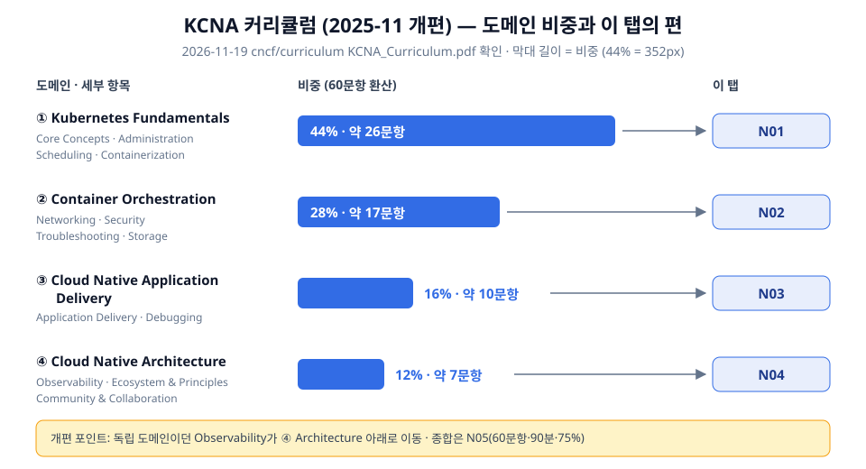
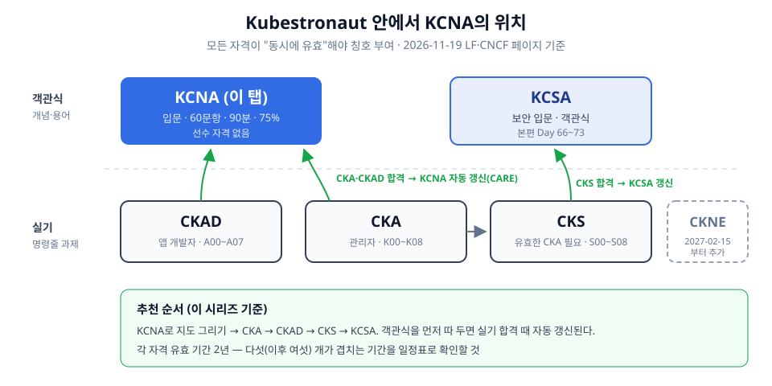

> **자격증 준비 · KCNA** | 난이도 ★☆☆☆☆ | 예상 소요 1 ~ 1.5시간

> ⚠️ **이 탭의 모든 문항은 CNCF가 공개한 KCNA 공식 커리큘럼을 바탕으로 직접 창작한 연습 문제입니다.** 실제 출제 문제나 유출 문제(덤프)가 아니며, 그런 자료를 재현하지도 않습니다. Linux Foundation 시험은 응시자가 시험 내용 비공개에 동의하고 치르므로, 실제 문항을 공유하거나 구하는 행위는 정책 위반이고 자격 취소 사유가 됩니다. 덤프 암기는 실력도 남기지 않습니다.

## 🎯 오늘의 목표

- KCNA 시험의 형식(문항 수, 시간, 합격 점수, 응시료, 유효 기간)을 **공식 자료 기준으로** 말할 수 있다
- 2025년 11월에 바뀐 **4개 도메인과 비중**을 알고, 이 탭의 어느 편이 어느 도메인을 맡는지 지도를 그린다
- Kubestronaut 프로그램 안에서 KCNA가 어디에 있는지, 실기 3종(CKA·CKAD·CKS)과 어떻게 엮이는지 이해한다
- 본편 Chapter 2·6~8을 기반으로 하는 **2~3주 학습 계획**을 세운다
- 객관식 90분을 어떻게 쓸지 시간 전략을 정한다

---

## 1. KCNA는 어떤 시험인가?

KCNA(Kubernetes and Cloud Native Associate)는 CNCF와 Linux Foundation이 운영하는 **입문용 객관식** 자격증입니다. CKA·CKAD·CKS가 "명령줄로 정확하게 해내는가"를 묻는다면, KCNA는 "쿠버네티스와 클라우드 네이티브 생태계를 **정확한 용어로 이해**하고 있는가"를 묻습니다. 터미널은 열리지 않습니다. 대신 범위가 넓습니다. Pod와 Service 같은 쿠버네티스 기초부터 GitOps, 관측성, CNCF 프로젝트 성숙도, 커뮤니티 운영 방식까지 다룹니다.

2026-11-19에 아래 공식 자료를 확인했습니다.

- Linux Foundation [KCNA 시험 페이지](https://training.linuxfoundation.org/certification/kubernetes-cloud-native-associate/)
- [Multiple Choice Exams: Important Instructions](https://docs.linuxfoundation.org/tc-docs/certification/important-instructions-mc) · [Multiple Choice Exams: FAQ](https://docs.linuxfoundation.org/tc-docs/certification/faq-mc) · [시험 언어](https://docs.linuxfoundation.org/tc-docs/certification/lf-handbook2/language) · [객관식 ExamUI](https://docs.linuxfoundation.org/tc-docs/certification/lf-handbook2/exam-user-interface/examui-multiple-choice-exams)
- [KCNA Program Changes](https://training.linuxfoundation.org/kcna-program-changes/) (2025년 11월 커리큘럼 개편 공지)
- [cncf/curriculum](https://github.com/cncf/curriculum) 저장소의 `KCNA_Curriculum.pdf` (마지막 수정 2026-03-22, 오타 수정 커밋)

| 항목 | 내용 (확인일 2026-11-19) |
|---|---|
| 형식 | **온라인 감독(proctored) 객관식**. PSI Bridge 플랫폼의 PSI Secure Browser에서 응시 |
| 문항 수 | **60문항** (객관식 공통 안내 기준. CNPA만 85문항) |
| 시험 시간 | **90분** (CNPA만 120분) |
| 합격 점수 | **75% 이상** |
| 결과 통보 | 시험 종료 후 **24시간 안에** 이메일 |
| 응시 자격 | **없음**(선수 자격 불필요), 난이도 Beginner |
| 응시료 | 시험 단독 **$250**. 번들: LFS250 강의+시험 $299, 시험+THRIVE-ONE 연간 구독 $495 (가격은 바뀔 수 있음) |
| 재응시 | **재응시 1회 포함**. 구매 후 **12개월 안에** 예약·응시 |
| 자격 유효 기간 | **2년**. 만료 전에 다시 합격하면 합격일부터 2년 갱신 |
| 자동 갱신(CARE) | **CKA 또는 CKAD에 합격하면 KCNA가 자동 갱신**됨 |
| 언어 | 영어. 일본어판·중국어(간체)판은 **별도 상품으로 등록**해야 함 |
| 시험 UI | 이전/다음 이동, **Flag(나중에 다시 보기)**, 마지막에 Review 화면 → Finish Exam. **Pause를 눌러도 타이머는 멈추지 않음** |

> 💡 **"60문항 · 90분 · 75%"** 를 한 줄로 외워 두세요. 60문항의 75%는 **45문항**입니다. 즉 **15문항까지는 틀려도 됩니다**. 문항별 배점이 같은지는 공식 문서에 명시돼 있지 않으니, "대략 45개 이상 맞히기"를 목표로 잡으면 됩니다.

> ⚠️ 응시료, 번들 구성, 문항 수는 몇 달 사이에도 바뀝니다. 실제로 2025년 11월에 도메인 구성이 바뀌었고, 2026년 중반까지도 옛 비중(46/22/…)을 쓰는 서드파티 자료가 많습니다. **응시 직전에 위 공식 링크를 한 번 더 확인**하세요.

---

## 2. 커리큘럼 4개 도메인 — 2025년 11월 개편 이후

KCNA Program Changes 공지에 따르면 새 커리큘럼은 **2025-11-24 이후** 시험부터 적용됐습니다. 구매 시점이나 재응시 여부와 관계없이, 개편 이후 치르는 시험은 새 도메인으로 출제됩니다. 가장 큰 변화는 독립 도메인이던 **관측성(Observability)이 Cloud Native Architecture 아래로 들어간 것**입니다.

| 순서 | 비중 | 도메인 (공식 명칭) | 세부 항목 | 이 탭 |
|---|---|---|---|---|
| 1 | **44%** | Kubernetes Fundamentals | Kubernetes Core Concepts · Administration · Scheduling · Containerization | [N01](./n01-kubernetes-fundamentals.md) |
| 2 | **28%** | Container Orchestration | Networking · Security · Troubleshooting · Storage | [N02](./n02-container-orchestration.md) |
| 3 | **16%** | Cloud Native Application Delivery | Application Delivery · Debugging | [N03](./n03-application-delivery.md) |
| 4 | **12%** | Cloud Native Architecture | Observability · Cloud Native Ecosystem and Principles · Cloud Native Community and Collaboration | [N04](./n04-cloud-native-architecture.md) |
| — | — | 종합 | 60문항 창작 모의고사 | [N05](./n05-mock-exam.md) |

> 💡 **이 탭의 편 순서는 공식 도메인 순서를 따릅니다.** 그래서 GitOps·CI/CD는 Application Delivery(N03)에, 관측성·프로메테우스·비용 관리·CNCF 생태계·서버리스·오토스케일링·표준 인터페이스(OCI·CRI·CNI·CSI)는 Cloud Native Architecture(N04)에 넣었습니다.

비중을 60문항으로 환산하면 대략 이렇습니다. 실제 시험의 도메인별 문항 수는 공개되지 않으니 **감을 잡는 용도**로만 보세요.

| 도메인 | 비중 | 60문항 환산 | 공부 시간 배분(권장) |
|---|---|---|---|
| Kubernetes Fundamentals | 44% | 약 26문항 | 40% |
| Container Orchestration | 28% | 약 17문항 | 30% |
| Cloud Native Application Delivery | 16% | 약 10문항 | 15% |
| Cloud Native Architecture | 12% | 약 7문항 | 15% (용어가 넓어서 비중보다 조금 더) |

### 2-1. 커리큘럼 항목 ↔ 탭 편 ↔ 본편 Day

이론은 본편에 있습니다. 이 탭은 **객관식으로 묻는 방식**과 **헷갈리는 지점**에 집중하고, 깊은 설명은 아래 Day로 넘깁니다.

| 도메인 | 커리큘럼 항목 | 탭 편 | 본편 Day |
|---|---|---|---|
| Kubernetes Fundamentals | Kubernetes Core Concepts | N01 | [Day 08](../../02-kubernetes/day08-k8s-architecture.md), [Day 10](../../02-kubernetes/day10-pod.md), [Day 11](../../02-kubernetes/day11-deployment.md) |
| | Administration | N01 | [Day 09](../../02-kubernetes/day09-local-cluster-kubectl.md), [Day 19](../../02-kubernetes/day19-rbac-namespace.md), [Day 20](../../02-kubernetes/day20-kubeadm-multinode.md) |
| | Scheduling | N01 | [Day 18](../../02-kubernetes/day18-autoscaling.md), [Day 44](../../06-ai-infra/day44-k8s-gpu.md) |
| | Containerization | N01 | [Day 01](../../01-docker/day01-container-basics.md), [Day 02](../../01-docker/day02-image-layers.md), [Day 07](../../01-docker/day07-container-internals.md) |
| Container Orchestration | Networking | N02 | [Day 12](../../02-kubernetes/day12-service.md), [Day 15](../../02-kubernetes/day15-ingress.md) |
| | Security | N02 | [Day 13](../../02-kubernetes/day13-configmap-secret.md), Day 19, [Day 66](../../09-security/day66-threat-modeling-4c.md) |
| | Troubleshooting | N02 | Day 10, Day 12 |
| | Storage | N02 | [Day 14](../../02-kubernetes/day14-storage.md) |
| Cloud Native Application Delivery | Application Delivery | N03 | [Day 16](../../02-kubernetes/day16-helm.md), [Day 50](../../07-gitops/day50-cicd-vs-gitops.md)~[Day 56](../../07-gitops/day56-argo-rollouts.md) |
| | Debugging | N03 | Day 10, Day 11, Day 12 |
| Cloud Native Architecture | Observability | N04 | [Day 17](../../02-kubernetes/day17-monitoring.md), [Day 47](../../06-ai-infra/day47-llm-observability.md), [Day 58](../../08-sre-observability/day58-sre-slo.md)~[Day 61](../../08-sre-observability/day61-tempo.md) |
| | Cloud Native Ecosystem and Principles | N04 | Day 18, [Day 46](../../06-ai-infra/day46-llm-autoscaling.md), [Day 45](../../06-ai-infra/day45-llm-on-k8s.md) |
| | Cloud Native Community and Collaboration | N04 | (본편에 없음 — N04에서 정리) |

각 편(N01~N04)은 같은 순서로 구성됩니다.

1. **핵심 개념** — 표와 그림으로 한 번에 훑기
2. **헷갈리는 포인트** — 객관식 오답 선택지가 노리는 지점
3. **창작 객관식 12~15문항** — `
`를 열면 정답, 해설, 근거 문서(kubernetes.io·CNCF·프로젝트 공식 문서) 링크
4. **핵심 정리**, 다음 편 예고

---

## 3. Kubestronaut 안에서 KCNA의 위치

CNCF의 Kubestronaut는 CNCF의 쿠버네티스 자격증을 **모두 유효한(만료되지 않은) 상태로** 가진 사람에게 주는 칭호입니다. 2026-11-19 기준 [Linux Foundation Kubestronaut 페이지](https://training.linuxfoundation.org/resources/kubestronaut-program/)와 [CNCF Kubestronaut FAQ](https://www.cncf.io/training/kubestronaut/kubestronaut-faq/)의 내용을 정리하면 다음과 같습니다.

| 자격 | 형식 | 성격 | 이 시리즈 |
|---|---|---|---|
| **KCNA** | 객관식 | 쿠버네티스·클라우드 네이티브 **입문** | 이 탭 N00~N05 |
| KCSA | 객관식 | 쿠버네티스 **보안 입문** | [KCSA 탭](../kcsa/c00-exam-overview.md), 본편 Day 66~73 |
| CKAD | 실기 | 애플리케이션 개발자 | [CKAD 탭](../ckad/a00-exam-overview-lab.md) |
| CKA | 실기 | 클러스터 관리자 | [CKA 탭](../cka/k00-exam-overview-lab.md) |
| CKS | 실기, **유효한 CKA 필요** | 보안 전문가 | [CKS 탭](../cks/s00-exam-overview-lab.md) |
| CKNE | 실기 | 쿠버네티스 네트워크 엔지니어 | **2027-02-15부터** Kubestronaut 요건에 추가 예정 (LF 페이지 공지) |

- 혜택(LF 페이지 기준): Kubestronaut 재킷, 매년 자격증 50% 할인 쿠폰 5장, CNCF 행사(KubeCon 등) 20% 할인 연 3회, Credly 배지, 전용 Slack 채널.
- **KCNA는 가장 가벼운 출발점**입니다. 선수 자격이 없고, 실기 시험에서 다루는 개념의 "지도"를 먼저 머리에 넣어 줍니다.
- **CARE 프로그램 덕분에 순서가 유리합니다.** KCNA를 먼저 따고 나중에 CKA나 CKAD에 합격하면 KCNA가 자동 갱신됩니다. 다섯 개가 "동시에 유효한" 기간을 만들기 쉬워집니다.

> 💡 이 시리즈를 처음부터 따라왔다면 KCNA 범위의 대부분은 이미 본편 Chapter 2(Day 08~20)와 Chapter 6~8에서 손으로 해 봤습니다. KCNA 준비는 새로 배우기보다 **"아는 것을 공식 용어로 다시 말하기"** 에 가깝습니다.

> ⚠️ Kubestronaut 요건과 혜택, CKNE 추가 일정은 바뀔 수 있습니다. 칭호를 노린다면 CNCF·LF 공식 페이지를 직접 확인하세요.

---

## 4. 2~3주 학습 계획

하루 1시간 기준입니다. 본편 Chapter 2를 끝냈다면 **2주 코스**, 쿠버네티스가 처음이라면 Chapter 2(Day 08~20)를 먼저 보면서 **3주 코스**로 가세요.

### 4-1. 2주 코스 (본편 Chapter 2 완료자)

| 일차 | 범위 | 할 일 |
|---|---|---|
| 1 | N00 | 공식 페이지 확인, 도메인 지도 이해, 응시 예약(목표일 고정) |
| 2~4 | N01 (44%) | 핵심 개념 표 정독 → 15문항 → 틀린 문항의 본편 Day 재독 |
| 5~6 | N02 (28%) | 네트워킹·스토리지 그림 이해 → 15문항 → 오답 정리 |
| 7 | 복습 | N01·N02 오답만 다시 풀기, kind 클러스터에서 헷갈린 개념 직접 확인 |
| 8~9 | N03 (16%) | GitOps 원칙 4가지, 배포 전략, 디버깅 명령 → 13문항 |
| 10~11 | N04 (12%) | CNCF 성숙도, 표준 인터페이스, 관측성 용어 → 15문항 |
| 12 | N05 1회차 | **90분 타이머**로 60문항 → 채점 → 도메인별 정답률 표 작성 |
| 13 | 약점 보강 | 정답률 낮은 도메인의 편 다시 읽기, 근거 문서 링크 열어 보기 |
| 14 | N05 2회차 | 문항 순서를 섞어서 다시. **50문항 이상(83%)** 이면 응시 |

### 4-2. 3주 코스 (쿠버네티스 처음)

| 주차 | 범위 | 할 일 |
|---|---|---|
| 1주 | 본편 Day 08~14 + N01 | kind로 Pod·Deployment·Service·PVC를 직접 만들어 보고 N01 풀기 |
| 2주 | 본편 Day 15~19 + N02·N03 | Ingress·Helm·모니터링·HPA·RBAC 실습 후 N02·N03 |
| 3주 | Day 50·53·58 훑기 + N04·N05 | GitOps·관측성 개념만 읽고 N04 → N05 두 번 |

💡 공부 방법 세 가지:

- **선택지를 "왜 틀렸는지"까지 설명해 보세요.** 객관식은 정답 하나보다 오답 셋이 더 많이 가르쳐 줍니다. 해설에 오답 이유를 적어 둔 이유입니다.
- **영어 용어로 기억하세요.** 시험은 영어(또는 일본어·중국어판)입니다. "ReplicaSet", "taint", "reconciliation" 같은 용어를 한국어로 번역해서 외우면 시험장에서 한 번 더 번역해야 합니다. 이 탭은 핵심 용어를 영어 그대로 씁니다.
- **실습 한 번이 암기 열 번보다 낫습니다.** 헷갈리면 `kind create cluster`(Day 09)로 10초 만에 확인할 수 있습니다. `kubectl explain`도 훌륭한 교과서입니다.

---

## 5. 90분 객관식 시간 전략

| 단계 | 시간 | 할 일 |
|---|---|---|
| 1회독 | 약 55분 (문항당 55초) | 확실한 것은 바로 답하고, 30초 이상 고민되면 **찍고 Flag** 후 넘어가기 |
| 2회독 | 약 25분 | Review 화면에서 Flag 문항만 다시. 선택지 소거법 |
| 마무리 | 약 10분 | **빈 문항이 없는지** 확인 후 Finish Exam |

- 오답 감점에 대한 공식 언급은 없습니다. 그러니 **모르는 문제도 비워 두지 말고** 가장 그럴듯한 답을 고르세요.
- Pause를 눌러도 타이머는 계속 갑니다. 화장실은 시험 전에.
- "NOT", "EXCEPT", "가장 적절한(BEST)" 같은 단어에 주의하세요. 객관식 실수의 절반은 문제를 거꾸로 읽어서 생깁니다.
- 처음 보는 CNCF 프로젝트 이름이 나와도 당황하지 마세요. **카테고리(런타임, 오케스트레이션, 관측성, 서비스 메시 등)** 만 알아도 소거가 됩니다(N04).

---

## 핵심 정리

- KCNA: **온라인 감독 객관식 60문항, 90분, 75%(약 45문항) 합격**, 결과는 24시간 안에 이메일
- 응시료 시험 단독 **$250**, 재응시 1회 포함, 구매 후 12개월 안에 응시, 자격 유효 **2년**, 선수 자격 없음
- 2025-11 개편 이후 도메인: **Fundamentals 44% · Orchestration 28% · Application Delivery 16% · Architecture 12%**. 관측성은 Architecture 아래로 이동
- Kubestronaut = CKA·CKAD·CKS·KCNA·KCSA 모두 유효(2027-02-15부터 CKNE 추가 예정). CKA·CKAD 합격 시 KCNA 자동 갱신(CARE)
- 학습은 **N01(44%)에 가장 많이**, 마지막에는 N05를 90분 타이머로 두 번

---

## ⏭️ 다음 예고 — N01. Kubernetes 기초

가장 비중이 큰 44% 도메인입니다. 컨트롤 플레인과 노드 컴포넌트가 각자 무엇을 하는지, Pod·ReplicaSet·Deployment·StatefulSet·DaemonSet·Job이 언제 쓰이는지, 네임스페이스·레이블·kubeconfig·RBAC 같은 관리 기초, 스케줄러가 노드를 고르는 과정(필터링·점수 매기기, taint·toleration, affinity), 그리고 컨테이너 이미지와 런타임까지 정리하고 15문항으로 확인합니다.
