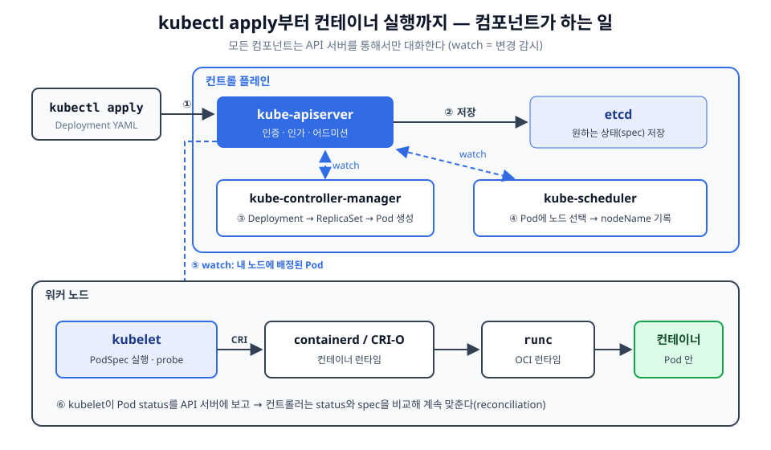
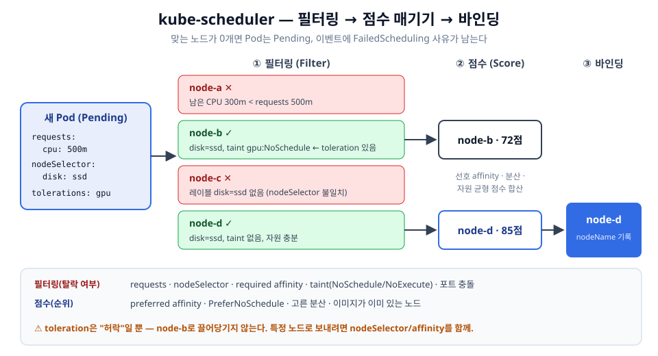

> **자격증 준비 · KCNA** | 난이도 ★★☆☆☆ | 예상 소요 3 ~ 4시간 | 도메인 ① Kubernetes Fundamentals (44%)

> ⚠️ 이 편의 모든 문항은 공식 KCNA 커리큘럼을 바탕으로 **직접 창작한 연습 문제**입니다. 실제 출제 문제나 덤프를 재현하지 않습니다.

## 🎯 오늘의 목표

- 컨트롤 플레인과 노드 컴포넌트의 역할을 **한 문장씩** 말할 수 있다
- `kubectl apply`부터 컨테이너가 뜨기까지의 흐름에서 각 컴포넌트가 하는 일을 순서대로 설명한다
- Deployment·StatefulSet·DaemonSet·Job·CronJob 중 상황에 맞는 워크로드를 고른다
- kubeconfig, 네임스페이스, RBAC, 쿼터 같은 **관리 기초 용어**를 구분한다
- 스케줄러가 노드를 고르는 기준(requests, nodeSelector, affinity, taint·toleration)과 이미지·런타임 기초를 정리한다

> 💡 이론은 본편에 있습니다. 아키텍처는 [Day 08](../../02-kubernetes/day08-k8s-architecture.md), kubectl은 [Day 09](../../02-kubernetes/day09-local-cluster-kubectl.md), Pod는 [Day 10](../../02-kubernetes/day10-pod.md), Deployment는 [Day 11](../../02-kubernetes/day11-deployment.md), 리소스·스케줄링은 [Day 18](../../02-kubernetes/day18-autoscaling.md), RBAC·네임스페이스는 [Day 19](../../02-kubernetes/day19-rbac-namespace.md), 컨테이너 원리는 [Day 01](../../01-docker/day01-container-basics.md)·[Day 02](../../01-docker/day02-image-layers.md)·[Day 07](../../01-docker/day07-container-internals.md)을 참고하세요. 이 편은 **객관식으로 묻는 지점**만 짚습니다.

---

## 1. 핵심 개념 ① — 클러스터 컴포넌트 (Kubernetes Core Concepts)

| 위치 | 컴포넌트 | 한 문장 역할 | 시험에서 자주 쓰는 키워드 |
|---|---|---|---|
| 컨트롤 플레인 | **kube-apiserver** | 모든 요청의 단일 입구. 인증·인가·어드미션 후 etcd에 기록 | "front end of the control plane", REST |
| | **etcd** | 클러스터 상태를 저장하는 분산 키-값 저장소 | "consistent and highly-available key value store", 백업 대상 |
| | **kube-scheduler** | `nodeName`이 빈 Pod에 **노드를 정해 줌**(실행은 안 함) | filtering, scoring, binding |
| | **kube-controller-manager** | 여러 컨트롤러(Deployment, ReplicaSet, Node, Job 등)를 한 프로세스로 실행 | reconciliation loop |
| | cloud-controller-manager | 클라우드 API와 연동(로드밸런서, 노드 수명 등) | 클라우드에서만 |
| 모든 노드 | **kubelet** | 자기 노드에 배정된 Pod의 컨테이너를 런타임에 요청하고 상태 보고 | PodSpec, probe 실행 |
| | **kube-proxy** (선택) | Service의 가상 IP → Pod로 가는 규칙(iptables/IPVS/nftables) 관리 | 일부 CNI(예: Cilium)는 대체 가능 |
| | **컨테이너 런타임** | 실제로 컨테이너를 실행 (containerd, CRI-O 등) | CRI |

### 1-1. 선언형과 조정 루프

쿠버네티스의 거의 모든 동작은 하나의 패턴으로 설명됩니다. **사용자는 원하는 상태(spec)를 선언하고, 컨트롤러는 현재 상태(status)를 계속 원하는 상태로 맞춥니다.** 이것을 reconciliation(조정) 루프 또는 control loop라고 부릅니다. Pod 하나를 지우면 ReplicaSet 컨트롤러가 다시 만드는 이유입니다.

| 오브젝트 필드 | 누가 쓰나 | 의미 |
|---|---|---|
| `metadata` | 사용자(+시스템) | name, namespace, **labels**, **annotations**, uid |
| `spec` | 사용자 | 원하는 상태 |
| `status` | 컨트롤러·kubelet | 현재 관측된 상태 |

### 1-2. 워크로드 리소스 고르기

| 상황 | 리소스 | 핵심 특징 |
|---|---|---|
| 상태 없는 웹 서버, 롤링 업데이트 | **Deployment** | ReplicaSet을 만들어 관리, 롤백 가능 |
| DB처럼 **고정 이름·고정 볼륨**이 필요 | **StatefulSet** | `web-0`, `web-1` 순서 있는 이름, Pod마다 PVC(volumeClaimTemplates), 헤드리스 Service와 함께 |
| 노드마다 하나(로그 수집, 모니터링 에이전트, CNI) | **DaemonSet** | 노드가 추가되면 자동으로 Pod 추가 |
| 한 번 실행하고 끝나는 배치 | **Job** | completions, parallelism, backoffLimit |
| 주기적 배치 | **CronJob** | 크론 형식 스케줄로 Job 생성 |
| 직접 쓸 일은 거의 없음 | ReplicaSet | 레플리카 수 유지. 보통 Deployment가 대신 관리 |

> 💡 **Pod는 일회용입니다.** Pod IP는 재생성되면 바뀌고, 컨트롤러 없이 만든 "벌거벗은 Pod"는 노드가 죽으면 다시 생기지 않습니다. 그래서 실무와 시험 모두 "Pod를 직접 만들지 말고 컨트롤러로"가 정답 방향입니다.

---

## 2. 핵심 개념 ② — 관리 기초 (Administration)

| 주제 | 알아야 할 것 |
|---|---|
| **kubeconfig** | `clusters`(API 서버 주소·CA), `users`(인증 정보), `contexts`(cluster + user + 기본 namespace의 묶음). 기본 경로 `~/.kube/config`, `kubectl config use-context`로 전환 |
| **네임스페이스** | 이름의 범위를 나누는 논리 경계. 처음부터 있는 것: `default`, `kube-system`, `kube-public`, `kube-node-lease`. Node·PV·StorageClass·ClusterRole 같은 **클러스터 범위 리소스는 네임스페이스에 속하지 않음** |
| **레이블 vs 어노테이션** | 레이블은 **셀렉터로 고르는** 식별 정보(Service, Deployment가 사용). 어노테이션은 도구용 메타데이터(셀렉터로 못 고름) |
| **RBAC** | Role(네임스페이스 범위) / ClusterRole(클러스터 범위) + RoleBinding / ClusterRoleBinding. **허용만 있고 거부 규칙은 없음**(기본 거부) |
| **ResourceQuota · LimitRange** | 쿼터는 네임스페이스 **전체 합계** 상한, LimitRange는 **컨테이너 하나**의 기본값·최소·최대 |
| **노드 유지보수** | `kubectl cordon`(새 스케줄 막기), `kubectl drain`(Pod 내보내기 + cordon), `kubectl uncordon` |
| **설치·업그레이드** | kubeadm이 표준 부트스트랩 도구. 마이너 버전은 **하나씩** 올림([Day 20](../../02-kubernetes/day20-kubeadm-multinode.md), [CKA K01](../cka/k01-cluster-install-upgrade-etcd.md)) |
| **명령 방식** | 명령형(`kubectl create/run`) vs 선언형(`kubectl apply -f`). GitOps·운영은 선언형 |

---

## 3. 핵심 개념 ③ — 스케줄링 (Scheduling)

스케줄러는 **필터링(조건에 안 맞는 노드 제외) → 점수 매기기(남은 노드 순위) → 바인딩(Pod의 `nodeName` 기록)** 순서로 일합니다. 맞는 노드가 하나도 없으면 Pod는 **Pending**으로 남고, 이벤트에 `FailedScheduling`과 이유가 찍힙니다.

| 설정 | 누구에게 거는가 | 의미 |
|---|---|---|
| `resources.requests` | Pod | 스케줄러가 **노드 여유 용량과 비교하는 값**. 노드 할당 가능량을 넘으면 그 노드는 탈락 |
| `resources.limits` | Pod | 실행 중 상한. CPU는 스로틀링, 메모리는 초과 시 OOMKilled. **스케줄링 판단에는 안 씀** |
| `nodeSelector` | Pod | 레이블이 정확히 일치하는 노드에만 |
| node affinity | Pod | nodeSelector의 확장. `required...`(필수) / `preferred...`(선호, 점수에 반영) |
| pod affinity / anti-affinity | Pod | 다른 Pod와 **같이** 또는 **떨어져** 배치 |
| **taint** | **Node** | "이 노드에는 오지 마". 효과: `NoSchedule`, `PreferNoSchedule`, `NoExecute` |
| **toleration** | **Pod** | 특정 taint를 "견딜 수 있다". **끌어당기지는 않음**(그 노드로 가라는 뜻 아님) |
| topology spread constraints | Pod | 존·노드에 고르게 분산 |
| PriorityClass | Pod | 자원이 부족하면 낮은 우선순위 Pod를 **선점(preemption)** |

> 💡 컨트롤 플레인 노드에는 kubeadm이 `node-role.kubernetes.io/control-plane:NoSchedule` taint를 겁니다. 일반 Pod가 컨트롤 플레인에 안 뜨는 이유입니다. GPU 노드에 taint를 걸고 GPU 워크로드에만 toleration을 주는 패턴은 [Day 44](../../06-ai-infra/day44-k8s-gpu.md)에서 봤습니다.

---

## 4. 핵심 개념 ④ — 컨테이너화 (Containerization)

| 용어 | 정의 |
|---|---|
| 이미지 | 읽기 전용 **레이어**의 묶음 + 설정(엔트리포인트, 환경 변수). 레지스트리에 저장 |
| 컨테이너 | 이미지 위에 쓰기 가능한 레이어를 얹어 실행한 **프로세스**. 커널을 호스트와 공유 |
| 격리 | **namespace**(보이는 범위: PID, 네트워크, 마운트 등) + **cgroup**(쓸 수 있는 양: CPU, 메모리) |
| 태그 vs 다이제스트 | `nginx:1.27`은 옮겨 붙일 수 있는 이름표, `nginx@sha256:...`은 **내용 해시라 불변** |
| OCI | 이미지·런타임·배포(레지스트리) 형식의 **개방형 표준**. Docker로 만든 이미지도 OCI 이미지 |
| CRI | kubelet ↔ 컨테이너 런타임 사이의 gRPC 인터페이스. containerd, CRI-O가 구현 |
| dockershim 제거 | **v1.24**에서 kubelet 내장 Docker 연동(dockershim) 제거. **Docker로 빌드한 이미지는 계속 실행됨** |
| `imagePullPolicy` 기본값 | 태그가 `:latest`이거나 없으면 **Always**, 그 외 태그는 **IfNotPresent** |
| 멀티 스테이지 빌드 | 빌드 도구는 앞 단계에, 실행 단계에는 결과물만 → 작은 이미지 ([Day 03](../../01-docker/day03-dockerfile.md)) |

표준 인터페이스(OCI·CRI·CNI·CSI)를 한 장으로 비교하는 그림은 [N04](./n04-cloud-native-architecture.md)에 있습니다.

---

## 5. 헷갈리는 포인트

| 오답 선택지가 노리는 착각 | 바로잡기 |
|---|---|
| "스케줄러가 컨테이너를 실행한다" | 스케줄러는 **노드만 정함**. 실행은 kubelet → 런타임 |
| "kubelet은 컨트롤 플레인 컴포넌트다" | kubelet은 **모든 노드**에서 돈다(컨트롤 플레인 노드 포함). 분류상 노드 컴포넌트 |
| "etcd에는 컨테이너 로그도 저장된다" | etcd는 **API 오브젝트 상태만**. 로그는 노드의 파일, 메트릭은 별도 시스템 |
| "Deployment가 Pod를 직접 관리한다" | Deployment → **ReplicaSet** → Pod. 롤아웃마다 새 ReplicaSet |
| "toleration을 주면 그 노드로 간다" | toleration은 **허락**일 뿐. 특정 노드로 보내려면 nodeSelector/affinity를 같이 |
| "limits로 스케줄링한다" | 스케줄링은 **requests** 기준 |
| "네임스페이스로 네트워크가 격리된다" | 네임스페이스는 이름 범위. 트래픽 격리는 **NetworkPolicy**(N02) |
| "어노테이션으로도 Service가 Pod를 고른다" | 셀렉터는 **레이블만** |
| "v1.24 이후 Docker 이미지는 못 쓴다" | 제거된 건 dockershim. 이미지 형식(OCI)은 그대로 |
| "ClusterRole은 RoleBinding으로 묶을 수 없다" | 묶을 수 있다. 그러면 **그 네임스페이스 안에서만** 권한이 생김 |

---

## 6. 창작 객관식 15문항

> 문항을 먼저 풀고 `
`를 여세요. 정답만 보지 말고 **오답이 왜 틀렸는지**도 확인합니다.

**Q1.** 클러스터의 모든 API 오브젝트 상태(Deployment 정의, Secret, 노드 정보 등)가 영구 저장되는 곳은?

- A. kube-apiserver의 메모리 캐시
- B. etcd
- C. 각 노드의 kubelet 로컬 디렉터리
- D. 컨테이너 레지스트리

정답·해설

**정답: B**

etcd는 클러스터의 모든 데이터를 담는 일관성 있고 고가용성인 키-값 저장소입니다. API 서버는 etcd 앞의 입구일 뿐 상태를 영구 보관하지 않습니다(A). kubelet은 자기 노드의 Pod만 다룹니다(C). 레지스트리는 이미지 저장소입니다(D). 그래서 etcd는 백업 1순위입니다.

📖 근거: [Kubernetes Components — etcd](https://kubernetes.io/docs/concepts/overview/components/)

**Q2.** 방금 만든 Pod의 `spec.nodeName`이 비어 있고 상태는 Pending이다. 이 필드를 채우는 책임이 있는 컴포넌트는?

- A. kubelet
- B. kube-controller-manager
- C. kube-scheduler
- D. kube-proxy

정답·해설

**정답: C**

kube-scheduler는 노드가 배정되지 않은 Pod를 감시하다가 적합한 노드를 골라 바인딩합니다. kubelet(A)은 이미 자기 노드로 배정된 Pod를 실행합니다. controller-manager(B)는 ReplicaSet 등이 Pod 오브젝트를 **만들게** 하지만 노드는 정하지 않습니다. kube-proxy(D)는 Service 트래픽 규칙 담당입니다.

📖 근거: [Kubernetes Scheduler](https://kubernetes.io/docs/concepts/scheduling-eviction/kube-scheduler/)

**Q3.** `replicas: 3`인 Deployment를 만들었다. Pod 3개의 개수를 **직접** 유지하는 오브젝트는?

- A. ReplicaSet
- B. Deployment
- C. StatefulSet
- D. Service

정답·해설

**정답: A**

Deployment는 ReplicaSet을 만들고, ReplicaSet이 Pod 수를 유지합니다. Pod의 `ownerReferences`를 보면 ReplicaSet이 나옵니다. Deployment(B)는 ReplicaSet을 바꿔 가며 롤아웃·롤백을 관리하는 상위 계층입니다. Service(D)는 Pod를 만들지 않습니다.

📖 근거: [Deployments](https://kubernetes.io/docs/concepts/workloads/controllers/deployment/)

**Q4.** 모든 워커 노드에서 로그 수집 에이전트를 정확히 하나씩 실행하고, 노드가 추가되면 자동으로 에이전트도 붙게 하고 싶다. 가장 적절한 리소스는?

- A. Deployment에 `replicas`를 노드 수만큼 지정
- B. Job
- C. StatefulSet
- D. DaemonSet

정답·해설

**정답: D**

DaemonSet은 (조건에 맞는) 모든 노드에 Pod 사본 하나를 보장하고, 노드가 추가·제거되면 따라서 늘고 줄어듭니다. Deployment(A)는 노드당 하나를 보장하지 않고 노드가 늘어도 자동으로 따라가지 않습니다.

📖 근거: [DaemonSet](https://kubernetes.io/docs/concepts/workloads/controllers/daemonset/)

**Q5.** 3개 복제본으로 구성된 데이터베이스가 각 복제본마다 **고정된 이름(`db-0`, `db-1`, `db-2`)과 자기만의 영구 볼륨**을 필요로 한다. 알맞은 리소스는?

- A. Deployment + 공유 PVC 하나
- B. StatefulSet + volumeClaimTemplates
- C. DaemonSet + hostPath
- D. ReplicaSet + emptyDir

정답·해설

**정답: B**

StatefulSet은 순서 있는 안정적인 이름과 네트워크 ID를 주고, `volumeClaimTemplates`로 Pod마다 별도의 PVC를 만듭니다. Pod가 재생성돼도 같은 이름과 같은 PVC를 다시 붙입니다. emptyDir(D)는 Pod와 함께 사라지고, hostPath(C)는 노드에 묶입니다.

📖 근거: [StatefulSets](https://kubernetes.io/docs/concepts/workloads/controllers/statefulset/)

**Q6.** Service가 트래픽을 보낼 Pod를 고를 때 사용하는 것은?

- A. Pod의 레이블(labels)
- B. Pod의 어노테이션(annotations)
- C. Pod의 이름 접두사
- D. Pod의 IP 대역

정답·해설

**정답: A**

Service의 `spec.selector`는 레이블 셀렉터입니다. 어노테이션(B)은 도구나 사람이 참고하는 비식별 메타데이터로, 셀렉터로 고를 수 없습니다.

📖 근거: [Labels and Selectors](https://kubernetes.io/docs/concepts/overview/working-with-objects/labels/), [Annotations](https://kubernetes.io/docs/concepts/overview/working-with-objects/annotations/)

**Q7.** 새로 만든 쿠버네티스 클러스터에 **기본으로 존재하지 않는** 네임스페이스는?

- A. `default`
- B. `kube-system`
- C. `kube-node-lease`
- D. `kube-admin`

정답·해설

**정답: D**

초기 네임스페이스는 `default`, `kube-node-lease`(노드 하트비트용 Lease), `kube-public`(모두 읽기 가능), `kube-system`(시스템 컴포넌트) 네 개입니다. `kube-admin`은 없습니다.

📖 근거: [Namespaces — Initial namespaces](https://kubernetes.io/docs/concepts/overview/working-with-objects/namespaces/)

**Q8.** kubeconfig 파일에서 **context** 하나가 묶는 정보로 옳은 것은?

- A. 노드 이름과 kubelet 포트
- B. 컨테이너 런타임과 CNI 플러그인
- C. 클러스터, 사용자(인증 정보), 그리고 선택적으로 기본 네임스페이스
- D. 이미지 레지스트리 주소와 pull secret

정답·해설

**정답: C**

context는 "어느 클러스터에, 누구로, 어떤 네임스페이스를 기본으로" 접속할지를 묶은 이름입니다. `kubectl config use-context`로 전환합니다. CKA 탭에서 `cka-main`/`cka-aux`를 오가던 것이 이것입니다.

📖 근거: [Organizing Cluster Access Using kubeconfig Files](https://kubernetes.io/docs/concepts/configuration/organize-cluster-access-kubeconfig/)

**Q9.** 사용자 `dev1`에게 `team-a` 네임스페이스의 Pod 조회 권한**만** 주려 한다. 가장 적절한 조합은?

- A. ClusterRole + ClusterRoleBinding
- B. Role(`team-a`) + RoleBinding(`team-a`)
- C. ServiceAccount + ResourceQuota
- D. NetworkPolicy + Role

정답·해설

**정답: B**

네임스페이스 하나로 범위를 제한하려면 Role과 RoleBinding을 그 네임스페이스에 만듭니다. ClusterRoleBinding(A)은 클러스터 전체에 권한을 줍니다. ResourceQuota(C)는 자원 총량 제한이지 권한이 아닙니다. NetworkPolicy(D)는 네트워크 트래픽 규칙입니다.

📖 근거: [Using RBAC Authorization](https://kubernetes.io/docs/reference/access-authn-authz/rbac/)

**Q10.** 스케줄러가 노드에 Pod를 넣을 수 있는지 판단할 때 노드의 할당 가능 자원과 비교하는 값은?

- A. 컨테이너의 `resources.requests`
- B. 컨테이너의 `resources.limits`
- C. 노드의 현재 실제 CPU 사용률
- D. 이미지 크기

정답·해설

**정답: A**

스케줄러는 노드에 이미 배치된 Pod들의 **requests 합**과 새 Pod의 requests를 노드 allocatable과 비교합니다. 실제 사용률(C)이 낮아도 requests 합이 차 있으면 탈락합니다. limits(B)는 실행 중 상한입니다.

📖 근거: [Resource Management for Pods and Containers](https://kubernetes.io/docs/concepts/configuration/manage-resources-containers/)

**Q11.** 노드에 `maintenance=true:NoExecute` taint를 걸었다. 이 taint를 견디는 toleration이 **없는**, 이미 실행 중인 Pod는 어떻게 되는가?

- A. 그대로 실행되고, 새 Pod만 스케줄되지 않는다
- B. 우선순위가 낮아질 뿐 계속 실행된다
- C. 노드에서 축출(evict)된다
- D. 노드가 자동으로 재부팅된다

정답·해설

**정답: C**

`NoExecute`는 새 스케줄을 막을 뿐 아니라, toleration이 없는 **실행 중인** Pod도 축출합니다. A는 `NoSchedule`의 동작입니다. toleration에 `tolerationSeconds`를 주면 그 시간만큼 머물다 축출됩니다.

📖 근거: [Taints and Tolerations](https://kubernetes.io/docs/concepts/scheduling-eviction/taint-and-toleration/)

**Q12.** node affinity의 `requiredDuringSchedulingIgnoredDuringExecution`에서 "IgnoredDuringExecution"이 뜻하는 것은?

- A. 실행 중에는 affinity 규칙 위반 시 즉시 Pod를 삭제한다
- B. 조건을 만족하는 노드가 없으면 아무 노드에나 배치한다
- C. 실행 중인 Pod의 리소스 limits를 무시한다
- D. Pod가 배치된 뒤 노드 레이블이 바뀌어 조건이 깨져도 Pod는 계속 실행된다

정답·해설

**정답: D**

`required...`는 스케줄링 시점에 반드시 지켜야 하는 조건이고(만족하는 노드가 없으면 Pending, B는 틀림), `IgnoredDuringExecution`은 이미 실행 중인 Pod에는 나중의 레이블 변경을 적용하지 않는다는 뜻입니다.

📖 근거: [Assigning Pods to Nodes — Node affinity](https://kubernetes.io/docs/concepts/scheduling-eviction/assign-pod-node/)

**Q13.** Kubernetes v1.24에서 dockershim이 제거된 것에 대한 설명으로 옳은 것은?

- A. Docker로 빌드한 이미지는 더 이상 쿠버네티스에서 실행할 수 없다
- B. kubelet은 CRI를 구현한 런타임(containerd, CRI-O 등)과 통신하며, Docker로 빌드한 OCI 이미지는 계속 실행된다
- C. 쿠버네티스는 자체 컨테이너 런타임을 내장하게 되었다
- D. 모든 노드에 Docker Engine 설치가 필수가 되었다

정답·해설

**정답: B**

제거된 것은 kubelet 안의 Docker 전용 어댑터(dockershim)입니다. 이미지 형식은 OCI 표준이라 어떤 도구로 빌드했든 CRI 런타임이 실행할 수 있습니다. 쿠버네티스는 런타임을 내장하지 않습니다(C).

📖 근거: [Container Runtimes](https://kubernetes.io/docs/setup/production-environment/container-runtimes/), [Dockershim Removal FAQ](https://kubernetes.io/blog/2022/02/17/dockershim-faq/)

**Q14.** 컨테이너 이미지를 `nginx:latest`로 지정하고 `imagePullPolicy`를 생략했다. 적용되는 기본값은?

- A. `Always`
- B. `IfNotPresent`
- C. `Never`
- D. `OnFailure`

정답·해설

**정답: A**

태그가 `:latest`이거나 태그를 생략하면 기본값은 `Always`, 그 밖의 태그(예: `nginx:1.27`)는 `IfNotPresent`입니다. `OnFailure`(D)는 imagePullPolicy 값이 아니라 Pod `restartPolicy` 값입니다.

📖 근거: [Images — Image pull policy](https://kubernetes.io/docs/concepts/containers/images/#image-pull-policy)

**Q15.** 프로덕션에서 이미지를 `myapp@sha256:3f1c...`처럼 다이제스트로 지정할 때의 가장 큰 장점은?

- A. 이미지 다운로드 속도가 빨라진다
- B. 레지스트리 인증이 필요 없어진다
- C. 같은 참조가 항상 정확히 같은 이미지 내용을 가리킨다(불변)
- D. 이미지 레이어 수가 줄어든다

정답·해설

**정답: C**

다이제스트는 이미지 내용의 해시이므로 바뀌지 않습니다. 태그는 누군가 같은 태그로 다시 푸시하면 다른 이미지를 가리킬 수 있습니다. 재현 가능한 배포와 공급망 보안([Day 57](../../07-gitops/day57-supply-chain-security.md))의 기본입니다.

📖 근거: [Images — Image names](https://kubernetes.io/docs/concepts/containers/images/#image-names)

### 채점

| 맞힌 수 | 판단 |
|---|---|
| 13~15 | 충분. N02로 |
| 11~12 | 합격선(75%) 근처. 틀린 문항의 근거 문서와 본편 Day를 다시 읽기 |
| 10 이하 | 본편 Day 08·10·11·18·19를 다시 보고 kind로 직접 확인한 뒤 재도전 |

---

## 핵심 정리

- 컨트롤 플레인: **apiserver(입구) · etcd(저장) · scheduler(노드 선택) · controller-manager(조정 루프)** / 노드: **kubelet(실행·보고) · kube-proxy(Service 규칙, 선택) · 런타임(CRI)**
- 쿠버네티스는 **선언형**: spec(원하는 상태) ↔ status(현재 상태)를 컨트롤러가 계속 맞춤
- 워크로드: 무상태 **Deployment**(→ReplicaSet→Pod), 고정 ID·볼륨 **StatefulSet**, 노드마다 **DaemonSet**, 배치 **Job/CronJob**
- 관리: context = cluster + user (+ namespace), 초기 네임스페이스 4개, RBAC는 허용만(Role/ClusterRole + Binding), 쿼터는 합계·LimitRange는 컨테이너 단위
- 스케줄링: **requests 기준**, 필터링→점수→바인딩, taint는 노드에(밀어냄), toleration은 Pod에(허락), NoExecute는 실행 중 Pod도 축출
- 이미지: 다이제스트는 불변, `:latest`의 기본 pull 정책은 Always, v1.24 dockershim 제거 후에도 OCI 이미지는 그대로 실행

---

## ⏭️ 다음 예고 — N02. 컨테이너 오케스트레이션

28% 도메인입니다. Pod마다 IP를 갖는 네트워크 모델과 CNI, Service 4종과 DNS 이름 규칙, Ingress와 Gateway API, NetworkPolicy, 그리고 보안(4C, ServiceAccount, Secret, Pod Security Standards), 트러블슈팅의 첫 명령들, 스토리지(PV·PVC·StorageClass·접근 모드·반환 정책·CSI)를 정리합니다.
