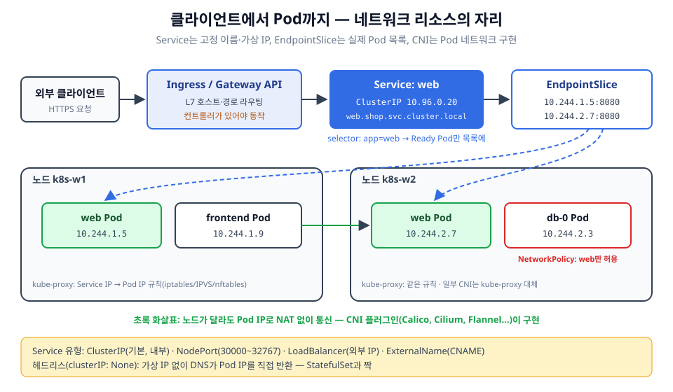
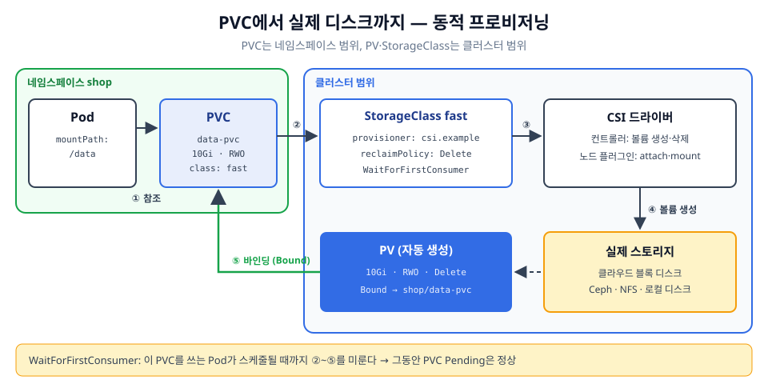

> **자격증 준비 · KCNA** | 난이도 ★★☆☆☆ | 예상 소요 3 ~ 4시간 | 도메인 ② Container Orchestration (28%)

> ⚠️ 이 편의 모든 문항은 공식 KCNA 커리큘럼을 바탕으로 **직접 창작한 연습 문제**입니다. 실제 출제 문제나 덤프를 재현하지 않습니다.

## 🎯 오늘의 목표

- 쿠버네티스 네트워크 모델과 CNI의 역할을 설명하고, Service 유형과 DNS 이름 규칙을 구분한다
- Ingress·Gateway API·NetworkPolicy·서비스 메시가 각각 **어느 계층의 무엇**을 해결하는지 말한다
- 4C, API 요청 처리 순서(인증→인가→어드미션), Secret의 실체, Pod Security Standards를 정리한다
- Pending·ImagePullBackOff·엔드포인트 없음 같은 증상에서 **처음 볼 곳**을 고른다
- PV·PVC·StorageClass·접근 모드·반환 정책·CSI의 관계를 그림으로 설명한다

> 💡 본편 연결: Service는 [Day 12](../../02-kubernetes/day12-service.md), ConfigMap·Secret은 [Day 13](../../02-kubernetes/day13-configmap-secret.md), 스토리지는 [Day 14](../../02-kubernetes/day14-storage.md), Ingress·Gateway API는 [Day 15](../../02-kubernetes/day15-ingress.md), RBAC은 [Day 19](../../02-kubernetes/day19-rbac-namespace.md), 4C는 [Day 66](../../09-security/day66-threat-modeling-4c.md), PSA는 [Day 69](../../09-security/day69-k8s-workload-security.md), NetworkPolicy·mTLS는 [Day 70](../../09-security/day70-networkpolicy-zero-trust.md). 실기 관점은 [CKA K04](../cka/k04-services-networking.md)·[K05](../cka/k05-storage.md)에 있습니다.

---

## 1. 핵심 개념 ① — 네트워킹 (Networking)

### 1-1. 쿠버네티스 네트워크 모델

쿠버네티스는 네트워크를 **직접 구현하지 않고 규칙만 정합니다.** 구현은 CNI 플러그인(Calico, Cilium, Flannel 등)의 몫입니다.

- 모든 Pod는 클러스터 안에서 **고유한 IP**를 가진다
- 모든 Pod는 노드가 달라도 **NAT 없이** 서로 통신할 수 있다
- 노드의 에이전트(kubelet 등)는 그 노드의 모든 Pod와 통신할 수 있다
- Pod 안의 컨테이너들은 **네트워크 네임스페이스를 공유**하므로 `localhost`로 서로 닿는다

### 1-2. Service 유형

Pod IP는 바뀌므로, 고정된 이름과 가상 IP를 주는 것이 Service입니다. Service의 셀렉터에 맞는 Pod 목록은 **EndpointSlice**에 기록되고, kube-proxy(또는 대체 CNI)가 그 목록으로 트래픽을 나눕니다.

| 유형 | 접근 범위 | 기억할 점 |
|---|---|---|
| **ClusterIP** (기본값) | 클러스터 내부 | `type`을 생략하면 이것 |
| **NodePort** | 모든 노드의 IP:포트 | 기본 포트 범위 **30000~32767**. ClusterIP도 함께 생김 |
| **LoadBalancer** | 외부 로드밸런서 | 클라우드(또는 MetalLB 같은 구현)가 외부 IP 할당. NodePort·ClusterIP 위에 쌓임 |
| **ExternalName** | DNS CNAME | 셀렉터·프록시 없이 외부 DNS 이름으로 별칭 |
| 헤드리스 (`clusterIP: None`) | 내부 | 가상 IP 없음. DNS가 **Pod IP들을 직접** 돌려줌. StatefulSet과 짝 |

DNS(클러스터 기본은 **CoreDNS**) 이름 규칙: `<service>.<namespace>.svc.cluster.local`. 같은 네임스페이스에서는 `<service>`만으로도 됩니다.

### 1-3. 외부 트래픽과 트래픽 제어

| 리소스·개념 | 계층 | 핵심 |
|---|---|---|
| **Ingress** | L7(HTTP/HTTPS) | 호스트·경로 기반 라우팅. **Ingress 컨트롤러가 있어야 동작**. API는 동결(frozen) 상태 |
| **Gateway API** | L4/L7 | Ingress의 후속 표준. **역할 분리**: GatewayClass(인프라 제공자) / Gateway(클러스터 운영자) / HTTPRoute 등(앱 개발자) |
| **NetworkPolicy** | L3/L4 | Pod 단위 방화벽. 기본은 모두 허용, 정책에 선택된 Pod는 **허용한 것만** 통과. **CNI가 지원해야 동작** |
| **서비스 메시** | L7 | 사이드카(또는 앰비언트) 프록시로 **mTLS, 재시도, 트래픽 분할, 관측성**. Istio, Linkerd 등 |

---

## 2. 핵심 개념 ② — 보안 (Security)

| 주제 | 알아야 할 것 |
|---|---|
| **4C** | 바깥부터 **Cloud → Cluster → Container → Code**. 안쪽 계층은 바깥 계층의 보안에 기대므로, 바깥이 뚫리면 안쪽 대책만으로는 막을 수 없음 |
| **API 요청 처리 순서** | **인증(Authentication, 누구인가) → 인가(Authorization, 해도 되는가. 대표가 RBAC) → 어드미션 제어(Admission, 내용을 바꾸거나 거부)** → etcd 저장 |
| **ServiceAccount** | **Pod(프로세스)의 신원**. 사람 사용자는 쿠버네티스 오브젝트가 아님(외부 IdP·인증서로 인증). 네임스페이스마다 `default` SA가 자동 생성 |
| **Secret** | 값은 **base64 인코딩**일 뿐 기본적으로 **암호화가 아님**. etcd 저장 시 암호화(encryption at rest)는 별도 설정, 접근은 RBAC로 최소화 |
| **Pod Security Standards** | 정책 수준 3단계: **Privileged**(제한 없음) / **Baseline**(알려진 권한 상승 차단) / **Restricted**(가장 엄격, 모범 사례 강제) |
| **Pod Security Admission** | 내장 어드미션 컨트롤러. 네임스페이스 레이블로 모드 지정: `enforce`(거부) / `audit`(감사 로그) / `warn`(경고) |
| **securityContext** | `runAsNonRoot`, `readOnlyRootFilesystem`, `allowPrivilegeEscalation: false`, `capabilities.drop: ["ALL"]` |
| **최소 권한** | RBAC는 필요한 동사·리소스만, SA 토큰 자동 마운트는 필요 없으면 끄기(`automountServiceAccountToken: false`) |

> 💡 Pod Security**Policy**(PSP)는 **v1.25에서 제거**됐고 그 자리를 Pod Security **Admission**이 대신합니다. 선택지에 PSP가 "현재 권장 방식"으로 나오면 오답입니다.

---

## 3. 핵심 개념 ③ — 트러블슈팅 (Troubleshooting)

클러스터·네트워크 수준의 첫 확인 순서입니다. 애플리케이션 디버깅(로그, exec, 임시 컨테이너)은 [N03](./n03-application-delivery.md)에서 더 다룹니다.

| 증상 | 가장 먼저 볼 곳 | 흔한 원인 |
|---|---|---|
| Pod **Pending** | `kubectl describe pod` 의 Events | 자원(requests) 부족, taint, nodeSelector 불일치, **PVC 미바인딩** |
| **ImagePullBackOff** / ErrImagePull | describe의 Events | 이미지 이름·태그 오타, 비공개 레지스트리 인증(`imagePullSecrets`) |
| **CrashLoopBackOff** | `kubectl logs --previous` | 앱이 시작 직후 종료, 설정 누락, liveness probe 과민 |
| **OOMKilled** (종료 코드 137) | describe의 Last State | 메모리 limits 초과 |
| Service로 접속 안 됨 | `kubectl get endpointslices -l kubernetes.io/service-name=<svc>` | **셀렉터와 Pod 레이블 불일치**, Pod가 Ready 아님, targetPort 오류 |
| 이름 해석 실패 | CoreDNS Pod 상태, Pod의 `/etc/resolv.conf` | CoreDNS 장애, NetworkPolicy가 DNS(53) 이그레스 차단 |
| 노드 **NotReady** | `kubectl describe node`, 노드의 `systemctl status kubelet` | kubelet 중지, 런타임 장애, CNI 미설치, 디스크·메모리 압박 |
| 클러스터 전체 이상 | `kubectl get --raw='/readyz?verbose'`, `kube-system`의 Pod | 컨트롤 플레인 컴포넌트 장애 |

---

## 4. 핵심 개념 ④ — 스토리지 (Storage)

| 리소스·개념 | 범위 | 핵심 |
|---|---|---|
| **Volume** | Pod | Pod 수명에 묶임. `emptyDir`(Pod와 함께 삭제), `configMap`/`secret`(설정 주입), `hostPath`(노드 경로, 보안상 주의) |
| **PersistentVolume (PV)** | **클러스터** | 실제 저장소 한 조각. 관리자가 만들거나(정적) StorageClass가 만듦(동적) |
| **PersistentVolumeClaim (PVC)** | **네임스페이스** | "이만큼, 이런 모드로 주세요"라는 요청. Pod는 PVC를 참조 |
| **StorageClass** | 클러스터 | 동적 프로비저닝 설정: `provisioner`(CSI 드라이버), `reclaimPolicy`, `volumeBindingMode` |
| **CSI** | 표준 | 스토리지 벤더가 쿠버네티스 코드 밖에서 드라이버를 만드는 인터페이스(N04) |

| 접근 모드 | 약어 | 뜻 |
|---|---|---|
| ReadWriteOnce | RWO | **한 노드**에서 읽기·쓰기(같은 노드의 여러 Pod는 가능) |
| ReadOnlyMany | ROX | 여러 노드에서 읽기 전용 |
| ReadWriteMany | RWX | 여러 노드에서 읽기·쓰기(NFS, CephFS 등 지원 필요) |
| ReadWriteOncePod | RWOP | **Pod 하나**만 읽기·쓰기 |

| 반환 정책 | PVC 삭제 시 |
|---|---|
| **Delete** | PV와 실제 디스크도 삭제. **동적 프로비저닝의 기본값** |
| **Retain** | PV가 `Released`로 남고 데이터 보존. 관리자가 수동 정리 |
| Recycle | 폐기(deprecated). 쓰지 않음 |

> 💡 StorageClass의 `volumeBindingMode: WaitForFirstConsumer`이면 PVC는 **그 PVC를 쓰는 Pod가 스케줄될 때까지 Pending**입니다. 고장이 아니라 정상입니다. Pod가 뜰 노드(존)를 보고 디스크를 만들기 위한 설정입니다.

---

## 5. 헷갈리는 포인트

| 오답 선택지가 노리는 착각 | 바로잡기 |
|---|---|
| "쿠버네티스가 Pod 네트워크를 직접 구현한다" | 모델만 정의, 구현은 **CNI 플러그인** |
| "Service를 만들면 외부에서 접속된다" | 기본값 ClusterIP는 **내부 전용** |
| "Ingress 리소스만 만들면 동작한다" | **Ingress 컨트롤러**가 있어야 함 |
| "NetworkPolicy는 어떤 CNI에서든 동작한다" | 지원하지 않는 CNI(예: 기본 Flannel)에서는 **조용히 무시**됨 |
| "NetworkPolicy에 거부(deny) 규칙을 쓴다" | 허용 규칙만 있음. 선택되면 나머지가 막히는 방식이고, 여러 정책은 **합집합** |
| "Secret은 암호화되어 저장된다" | 기본은 **base64**. 암호화는 별도 설정 |
| "ServiceAccount는 사람 사용자 계정이다" | SA는 **워크로드의 신원** |
| "RWO는 Pod 하나만 쓸 수 있다" | RWO는 **노드** 단위. Pod 하나는 **RWOP** |
| "PV는 네임스페이스 리소스다" | PV는 **클러스터 범위**, PVC가 네임스페이스 범위 |
| "PVC가 Pending이면 무조건 고장" | `WaitForFirstConsumer`면 Pod가 생길 때까지 정상 Pending |

---

## 6. 창작 객관식 15문항

**Q1.** 쿠버네티스 네트워크 모델이 요구하는 조건으로 옳은 것은?

- A. 모든 Pod는 고유한 IP를 가지며, 다른 노드의 Pod와도 NAT 없이 통신할 수 있어야 한다
- B. 같은 네임스페이스의 Pod끼리만 통신할 수 있어야 한다
- C. Pod 간 통신은 반드시 Service를 거쳐야 한다
- D. 모든 Pod는 노드의 IP를 공유해야 한다

정답·해설

**정답: A**

쿠버네티스는 "Pod마다 클러스터 고유 IP, 노드를 넘어 NAT 없이 통신"을 요구하고 구현은 CNI에 맡깁니다. 네임스페이스는 네트워크 경계가 아니고(B), Pod IP로 직접 통신할 수 있습니다(C). 노드 IP 공유(D)는 `hostNetwork: true`인 특수한 경우입니다.

📖 근거: [Cluster Networking — The Kubernetes network model](https://kubernetes.io/docs/concepts/services-networking/)

**Q2.** Service 매니페스트에서 `spec.type`을 생략했다. 만들어지는 Service 유형은?

- A. NodePort
- B. LoadBalancer
- C. ClusterIP
- D. ExternalName

정답·해설

**정답: C**

기본 유형은 ClusterIP로, 클러스터 내부에서만 접근할 수 있는 가상 IP를 줍니다. 외부 노출이 필요하면 NodePort·LoadBalancer를 쓰거나 Ingress/Gateway를 앞에 둡니다.

📖 근거: [Service — Service type](https://kubernetes.io/docs/concepts/services-networking/service/#publishing-services-service-types)

**Q3.** `shop` 네임스페이스의 Service `api`를 **다른** 네임스페이스의 Pod에서 부를 때 쓸 수 있는 완전한 DNS 이름은? (클러스터 도메인은 기본값)

- A. `api.cluster.local`
- B. `api.shop.svc.cluster.local`
- C. `shop.api.svc.cluster.local`
- D. `api.svc.shop.local`

정답·해설

**정답: B**

형식은 `<서비스>.<네임스페이스>.svc.<클러스터 도메인>`입니다. 짧게 `api.shop`도 Pod의 DNS 검색 경로 덕분에 해석됩니다.

📖 근거: [DNS for Services and Pods](https://kubernetes.io/docs/concepts/services-networking/dns-pod-service/)

**Q4.** `clusterIP: None`으로 만든 헤드리스 Service의 특징으로 옳은 것은?

- A. 외부 로드밸런서를 자동으로 할당받는다
- B. 셀렉터를 쓸 수 없다
- C. 노드 포트를 연다
- D. 가상 IP 없이, DNS 조회 시 셀렉터에 맞는 Pod들의 IP를 직접 돌려준다

정답·해설

**정답: D**

헤드리스 Service는 kube-proxy의 부하 분산을 거치지 않고 DNS가 Pod IP 목록(A 레코드)을 반환합니다. StatefulSet이 `db-0.db.<ns>.svc.cluster.local` 같은 Pod별 안정적 DNS를 갖는 것도 헤드리스 Service 덕분입니다. 셀렉터는 쓸 수 있습니다(B).

📖 근거: [Service — Headless Services](https://kubernetes.io/docs/concepts/services-networking/service/#headless-services)

**Q5.** 새 클러스터에 Ingress 리소스를 올바르게 작성해 적용했지만 아무 라우팅도 일어나지 않고 주소도 할당되지 않는다. 가장 가능성이 높은 원인은?

- A. Service 유형이 ClusterIP라서
- B. 클러스터에 Ingress 컨트롤러가 설치되어 있지 않아서
- C. Ingress는 HTTPS만 지원해서
- D. Ingress는 kube-system 네임스페이스에만 만들 수 있어서

정답·해설

**정답: B**

Ingress 리소스는 규칙일 뿐이고, 그 규칙을 읽어 실제 프록시를 구성하는 것은 Ingress 컨트롤러(Traefik, HAProxy 등)입니다. kube-controller-manager에 포함되어 있지 않아 따로 설치해야 합니다. 백엔드 Service는 보통 ClusterIP면 충분합니다(A).

📖 근거: [Ingress Controllers](https://kubernetes.io/docs/concepts/services-networking/ingress-controllers/)

**Q6.** Gateway API의 역할 분리 모델에서 **애플리케이션 개발자**가 주로 작성하는 리소스는?

- A. HTTPRoute
- B. GatewayClass
- C. Gateway
- D. IngressClass

정답·해설

**정답: A**

GatewayClass는 인프라 제공자가, Gateway(리스너·포트·TLS)는 클러스터 운영자가, HTTPRoute 같은 Route는 앱 개발자가 관리하는 구조입니다. IngressClass(D)는 Ingress API의 리소스입니다.

📖 근거: [Gateway API](https://kubernetes.io/docs/concepts/services-networking/gateway/), [gateway-api.sigs.k8s.io — API overview](https://gateway-api.sigs.k8s.io/docs/concepts/api-overview/)

**Q7.** `backend` Pod로 가는 인그레스를 `frontend`에서만 허용하는 NetworkPolicy를 적용했지만, 다른 Pod에서도 여전히 접속된다. 정책 YAML에는 문제가 없다. 가장 가능성 높은 원인은?

- A. NetworkPolicy는 Service 단위로만 동작한다
- B. NetworkPolicy는 default 네임스페이스에서만 동작한다
- C. 클러스터의 CNI 플러그인이 NetworkPolicy를 지원(시행)하지 않는다
- D. kube-proxy가 정책을 덮어썼다

정답·해설

**정답: C**

NetworkPolicy 시행은 네트워크 플러그인의 몫입니다. 지원하지 않는 플러그인에서는 리소스가 만들어져도 아무 효과가 없습니다. Calico, Cilium 등은 지원합니다. 정책은 Pod 셀렉터 단위로 걸립니다(A).

📖 근거: [Network Policies — Prerequisites](https://kubernetes.io/docs/concepts/services-networking/network-policies/#prerequisites)

**Q8.** 클라우드 네이티브 보안의 4C를 **가장 바깥 계층부터** 올바르게 나열한 것은?

- A. Code → Container → Cluster → Cloud
- B. Cluster → Cloud → Container → Code
- C. Container → Code → Cloud → Cluster
- D. Cloud → Cluster → Container → Code

정답·해설

**정답: D**

Cloud(또는 데이터센터)가 가장 바깥, Code가 가장 안쪽입니다. 각 계층은 바깥 계층 위에 서 있으므로 바깥 계층의 보안이 약하면 안쪽만 지켜서는 부족합니다.

📖 근거: [Cloud Native Security and Kubernetes](https://kubernetes.io/docs/concepts/security/cloud-native-security/), [Day 66](../../09-security/day66-threat-modeling-4c.md)

**Q9.** kube-apiserver가 요청을 처리하는 순서로 옳은 것은?

- A. 인증(Authentication) → 인가(Authorization) → 어드미션 제어(Admission control)
- B. 인가 → 인증 → 어드미션 제어
- C. 어드미션 제어 → 인증 → 인가
- D. 인증 → 어드미션 제어 → 인가

정답·해설

**정답: A**

먼저 누구인지 확인하고(인증), 그 주체가 이 동작을 해도 되는지 판단(인가, 예: RBAC)한 뒤, 어드미션 컨트롤러가 요청 내용을 변경(mutating)하거나 검증(validating)합니다. 모두 통과해야 etcd에 저장됩니다.

📖 근거: [Controlling Access to the Kubernetes API](https://kubernetes.io/docs/concepts/security/controlling-access/)

**Q10.** 별도 설정이 없는 클러스터에서 Secret의 `data` 값에 대한 설명으로 옳은 것은?

- A. AES로 암호화되어 etcd에 저장된다
- B. 해시되어 원래 값을 복구할 수 없다
- C. base64로 인코딩되어 있을 뿐이며, etcd 저장 시 암호화는 별도로 구성해야 한다
- D. 노드의 TPM에 저장된다

정답·해설

**정답: C**

base64는 인코딩이지 암호화가 아닙니다. 누구든 `base64 -d`로 풀 수 있습니다. 저장 시 암호화(EncryptionConfiguration), RBAC 최소 권한, 외부 시크릿 관리 도구([Day 55](../../07-gitops/day55-secrets.md), [Day 71](../../09-security/day71-vault-cert-manager.md))를 함께 써야 합니다.

📖 근거: [Secrets](https://kubernetes.io/docs/concepts/configuration/secret/), [Good practices for Kubernetes Secrets](https://kubernetes.io/docs/concepts/security/secrets-good-practices/)

**Q11.** Pod Security Standards의 세 정책 수준 중 **가장 엄격한** 것은?

- A. Baseline
- B. Restricted
- C. Privileged
- D. Hardened

정답·해설

**정답: B**

Privileged(제한 없음) < Baseline(알려진 권한 상승 차단) < Restricted(현재 모범 사례 강제). Hardened(D)는 PSS 수준 이름이 아닙니다. 이 수준을 네임스페이스 레이블로 적용하는 것이 Pod Security Admission입니다.

📖 근거: [Pod Security Standards](https://kubernetes.io/docs/concepts/security/pod-security-standards/)

**Q12.** Service `web`을 만들었는데 접속이 되지 않고, 해당 Service의 EndpointSlice에 주소가 하나도 없다. Pod는 Running이고 Ready다. 가장 먼저 의심할 것은?

- A. CoreDNS가 중지되었다
- B. 노드에 디스크 압박이 있다
- C. 이미지 pull 정책이 Always다
- D. Service의 셀렉터가 Pod의 레이블과 일치하지 않는다

정답·해설

**정답: D**

엔드포인트가 비어 있다는 것은 셀렉터에 맞는(그리고 Ready인) Pod가 없다는 뜻입니다. `kubectl get pod --show-labels`와 Service의 `selector`를 비교하세요. DNS 문제(A)라면 이름 해석이 실패할 뿐 엔드포인트는 채워져 있습니다.

📖 근거: [Debug Services](https://kubernetes.io/docs/tasks/debug/debug-application/debug-service/)

**Q13.** PVC를 만들었더니 `Pending` 상태다. StorageClass의 `volumeBindingMode`는 `WaitForFirstConsumer`이고, 아직 이 PVC를 사용하는 Pod는 없다. 올바른 해석은?

- A. 정상이다. 이 PVC를 쓰는 Pod가 스케줄되면 그때 볼륨이 프로비저닝·바인딩된다
- B. CSI 드라이버가 고장 났다
- C. 반환 정책을 Retain으로 바꿔야 한다
- D. PVC는 kube-system 네임스페이스에 있어야 한다

정답·해설

**정답: A**

`WaitForFirstConsumer`는 Pod가 배치될 노드(존)를 먼저 보고 거기에 맞는 볼륨을 만들기 위해 바인딩을 미룹니다. 반환 정책(C)은 삭제 시 동작이라 관계없습니다.

📖 근거: [Storage Classes — Volume binding mode](https://kubernetes.io/docs/concepts/storage/storage-classes/#volume-binding-mode)

**Q14.** 클러스터 전체에서 **단 하나의 Pod만** 볼륨을 읽기·쓰기로 마운트하도록 보장하는 접근 모드는?

- A. ReadWriteOnce
- B. ReadWriteMany
- C. ReadOnlyMany
- D. ReadWriteOncePod

정답·해설

**정답: D**

ReadWriteOnce는 **노드 하나** 기준이라 같은 노드의 여러 Pod가 동시에 쓸 수 있습니다. Pod 하나로 제한하려면 ReadWriteOncePod(CSI 볼륨 대상)를 씁니다.

📖 근거: [Persistent Volumes — Access Modes](https://kubernetes.io/docs/concepts/storage/persistent-volumes/#access-modes)

**Q15.** 동적 프로비저닝된 볼륨에서, PVC를 삭제해도 **데이터와 PV를 남겨 두고** 싶다. StorageClass의 `reclaimPolicy`로 알맞은 것은?

- A. Delete
- B. Retain
- C. Recycle
- D. Preserve

정답·해설

**정답: B**

Retain이면 PVC 삭제 후 PV가 `Released` 상태로 남고 데이터도 유지됩니다. 동적 프로비저닝의 기본값은 Delete(A)입니다. Recycle(C)은 폐기된 방식이고, Preserve(D)는 없는 값입니다.

📖 근거: [Persistent Volumes — Reclaiming](https://kubernetes.io/docs/concepts/storage/persistent-volumes/#reclaiming)

### 채점

| 맞힌 수 | 판단 |
|---|---|
| 13~15 | 충분. N03으로 |
| 11~12 | 합격선 근처. Service·스토리지 표를 다시 보고 틀린 문항의 근거 문서 읽기 |
| 10 이하 | 본편 Day 12·14·15를 kind에서 다시 실습 |

---

## 핵심 정리

- 네트워크 모델: **Pod마다 고유 IP, NAT 없는 통신**. 구현은 CNI. Pod 안 컨테이너는 `localhost` 공유
- Service: 기본 **ClusterIP**, NodePort(30000~32767), LoadBalancer, ExternalName, 헤드리스(`clusterIP: None`). DNS `<svc>.<ns>.svc.cluster.local`
- Ingress는 **컨트롤러 필요**, Gateway API는 **역할 분리**(GatewayClass/Gateway/Route), NetworkPolicy는 **CNI가 지원해야** 동작하고 허용 규칙만 있음
- 보안: 4C(Cloud→Cluster→Container→Code), **인증→인가→어드미션**, Secret은 base64, PSS 3단계(Privileged/Baseline/**Restricted**), PSP는 v1.25에서 제거
- 트러블슈팅: Pending은 describe Events, 엔드포인트 없음은 **셀렉터·레이블**, NotReady는 kubelet
- 스토리지: PV(클러스터) ↔ PVC(네임스페이스) ↔ StorageClass(동적, CSI). RWO는 노드 단위·RWOP는 Pod 단위, 동적 기본 반환 정책은 **Delete**

---

## ⏭️ 다음 예고 — N03. 클라우드 네이티브 애플리케이션 딜리버리

16% 도메인입니다. CI와 CD의 경계, OpenGitOps의 네 원칙과 Push/Pull 배포의 차이, Argo CD·Flux, Helm 차트와 Kustomize 오버레이, 롤링·블루그린·카나리 배포 전략, 그리고 `kubectl logs`·`exec`·`debug`로 애플리케이션을 디버깅하는 순서를 정리합니다.
