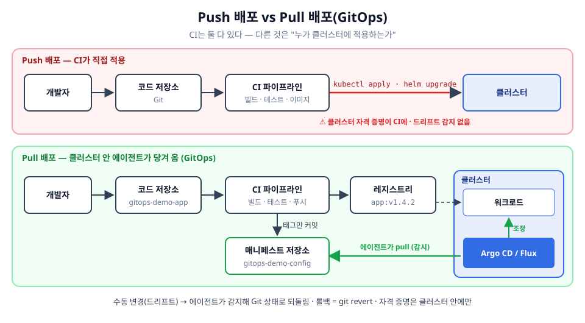
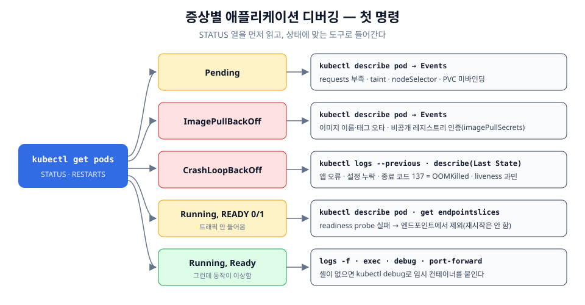

> **자격증 준비 · KCNA** | 난이도 ★★☆☆☆ | 예상 소요 2 ~ 3시간 | 도메인 ③ Cloud Native Application Delivery (16%)

> ⚠️ 이 편의 모든 문항은 공식 KCNA 커리큘럼을 바탕으로 **직접 창작한 연습 문제**입니다. 실제 출제 문제나 덤프를 재현하지 않습니다.

## 🎯 오늘의 목표

- Continuous Integration / Delivery / Deployment의 경계를 정확한 용어로 구분한다
- OpenGitOps의 **네 가지 원칙**과 Push·Pull 배포의 차이를 설명한다
- Helm과 Kustomize가 각각 어떤 방식으로 매니페스트를 다루는지 비교한다
- Recreate·RollingUpdate·블루그린·카나리 배포 전략의 장단점을 고른다
- 애플리케이션 증상별로 `logs`·`describe`·`exec`·`debug` 중 무엇을 먼저 쓸지 안다

> 💡 공식 커리큘럼의 이 도메인 항목은 **Application Delivery**와 **Debugging** 두 개입니다. 본편 Chapter 7 GitOps 탭([Day 50](../../07-gitops/day50-cicd-vs-gitops.md) CI/CD와 GitOps, [Day 51](../../07-gitops/day51-github-actions.md) GitHub Actions, [Day 52](../../07-gitops/day52-kustomize.md) Kustomize, [Day 53](../../07-gitops/day53-argocd.md) Argo CD, [Day 54](../../07-gitops/day54-image-updater-promotion.md) 환경 승격, [Day 56](../../07-gitops/day56-argo-rollouts.md) Argo Rollouts)과 [Day 16](../../02-kubernetes/day16-helm.md) Helm, [Day 11](../../02-kubernetes/day11-deployment.md) 롤링 업데이트가 이론 배경입니다. 실기 관점은 [CKAD A02](../ckad/a02-deployment.md)·[A03](../ckad/a03-observability-maintenance.md)을 보세요.

---

## 1. 핵심 개념 ① — CI/CD

| 용어 | 무엇을 자동화하나 | 끝나는 지점 |
|---|---|---|
| **Continuous Integration (CI)** | 자주 병합하고, 병합할 때마다 **빌드·테스트** | 검증된 산출물(컨테이너 이미지)이 레지스트리에 |
| **Continuous Delivery** | 산출물을 **언제든 배포 가능한 상태**로 유지, 스테이징까지 자동 | 프로덕션 반영은 **사람의 승인** 한 번 |
| **Continuous Deployment** | 테스트를 통과하면 **프로덕션까지 자동** | 사람의 개입 없음 |

전형적인 파이프라인: 코드 푸시 → 빌드 → 단위 테스트 → 이미지 빌드·스캔·서명 → 레지스트리 푸시 → (CD) 매니페스트 갱신 → 배포 → 검증. 클라우드 네이티브에서 "산출물"은 거의 항상 **불변 컨테이너 이미지**이고, 환경별로 바뀌는 것은 이미지가 아니라 **설정**입니다.

---

## 2. 핵심 개념 ② — GitOps



CNCF의 OpenGitOps 작업 그룹이 정리한 **GitOps 4원칙**입니다. 시험에서 이름 그대로 나올 수 있으니 영어로 기억하세요.

| 원칙 | 뜻 |
|---|---|
| **Declarative** | 시스템의 원하는 상태를 **선언형**으로 표현한다 |
| **Versioned and Immutable** | 원하는 상태는 **버전 관리되고 불변**으로 저장되며, 전체 이력이 남는다 |
| **Pulled Automatically** | 소프트웨어 에이전트가 저장소에서 원하는 상태를 **자동으로 당겨 온다** |
| **Continuously Reconciled** | 에이전트가 실제 상태를 **계속 관찰하고 원하는 상태로 맞춘다** |

| 비교 | Push 배포 (CI가 직접 배포) | Pull 배포 (GitOps) |
|---|---|---|
| 클러스터에 변경을 적용하는 주체 | CI 러너(`kubectl apply`, `helm upgrade`) | **클러스터 안의 에이전트**(Argo CD, Flux) |
| 클러스터 자격 증명 위치 | CI 시스템 밖에 보관 → 유출 위험 | 클러스터 안에만 |
| 드리프트(누군가 수동 변경) | 다음 배포 전까지 모름 | **감지하고 되돌림**(self-heal) |
| 롤백 | 파이프라인 재실행 | **Git revert** |
| 대표 도구 | Jenkins, GitHub Actions, GitLab CI | **Argo CD, Flux** (둘 다 CNCF Graduated) |

> 💡 GitOps에서도 CI는 필요합니다. CI가 이미지를 만들고, **매니페스트 저장소의 태그만 바꿉니다.** 그 이후는 에이전트가 당겨 갑니다. Chapter 7의 `gitops-demo-app`(코드) / `gitops-demo-config`(매니페스트) 두 저장소 분리가 바로 이 구조였습니다.

---

## 3. 핵심 개념 ③ — 패키징과 설정 관리

| 비교 | Helm | Kustomize |
|---|---|---|
| 방식 | **템플릿**(Go 템플릿) + values | **템플릿 없음** — base에 overlay로 패치 |
| 단위 | **Chart**(패키지), 설치된 인스턴스는 **Release**, 저장소는 Repository(또는 OCI 레지스트리) | `kustomization.yaml`이 있는 디렉터리 |
| 환경별 차이 | `values-prod.yaml` 같은 값 파일 | `overlays/dev`, `overlays/prod` |
| 이력·롤백 | `helm history`, `helm rollback` (릴리스 리비전) | 없음(Git 이력으로) |
| 실행 | `helm install/upgrade` | **kubectl에 내장**: `kubectl apply -k`, `kubectl kustomize` |
| 프로젝트 | CNCF Graduated | Kubernetes SIG CLI 하위 프로젝트 |

> 💡 둘은 경쟁이 아니라 조합도 됩니다. Argo CD는 Helm 차트와 Kustomize 디렉터리를 모두 소스로 받습니다. 복잡한 앱의 수명 주기(백업, 업그레이드 절차)까지 자동화하고 싶으면 **오퍼레이터(CRD + 컨트롤러)** 를 씁니다.

---

## 4. 핵심 개념 ④ — 배포 전략

| 전략 | 동작 | 장점 | 단점 |
|---|---|---|---|
| **Recreate** | 옛 버전 전부 종료 → 새 버전 시작 | 단순, 두 버전 공존 없음 | **다운타임** |
| **RollingUpdate** (Deployment 기본값) | 조금씩 교체. `maxSurge`·`maxUnavailable` 기본 **25%** | 다운타임 없음, 추가 자원 적음 | 잠시 두 버전 공존, 롤백도 점진적 |
| **블루그린** | 새 버전(green)을 옆에 완전히 띄우고 **트래픽을 한 번에 전환** | 전환·롤백이 **즉시** | 자원 **두 배** 필요 |
| **카나리** | 새 버전에 **일부 트래픽(예: 5%)** 만 보내며 지표 확인 후 점진 확대 | 위험을 작은 사용자 집단으로 제한 | 트래픽 분할·지표 분석 도구 필요 |
| A/B 테스트 | 사용자 속성(헤더, 쿠키)으로 버전 분기 | 기능 비교 실험 | 비즈니스 지표 분석 필요 |

기본 Deployment만으로는 롤링 업데이트와 Recreate만 됩니다. 블루그린·카나리를 자동화(지표 기반 승격·중단)하는 것을 **Progressive Delivery**라고 하고, Argo Rollouts([Day 56](../../07-gitops/day56-argo-rollouts.md), [Day 63](../../08-sre-observability/day63-slo-canary.md))나 Flagger, 서비스 메시·Gateway API의 가중치 라우팅으로 구현합니다.

```bash
kubectl rollout status deployment/web      # 진행 상황
kubectl rollout history deployment/web     # 리비전 목록
kubectl rollout undo deployment/web        # 직전 리비전으로
kubectl rollout undo deployment/web --to-revision=2
```

---

## 5. 핵심 개념 ⑤ — 디버깅 (Debugging)



| 명령 | 언제 |
|---|---|
| `kubectl get pods -o wide` | 상태(STATUS), 재시작 횟수(RESTARTS), 노드 확인 |
| `kubectl describe pod <p>` | **Events**(스케줄 실패, 이미지 pull 실패, probe 실패), Last State·종료 코드 |
| `kubectl logs <p> [-c <컨테이너>]` | 현재 컨테이너의 stdout/stderr |
| `kubectl logs <p> --previous` | **직전에 죽은** 컨테이너의 로그 — CrashLoopBackOff의 핵심 |
| `kubectl exec -it <p> -- sh` | 실행 중인 컨테이너 안에서 확인(셸이 있어야 함) |
| `kubectl debug -it <p> --image=busybox --target=<컨테이너>` | **임시 컨테이너(ephemeral container)** 를 붙여 디버깅. 셸 없는 distroless 이미지에 유용 |
| `kubectl debug node/<노드> -it --image=busybox` | 노드 디버깅용 Pod(호스트 파일시스템은 `/host`) |
| `kubectl port-forward svc/<s> 8080:80` | 외부 노출 없이 로컬에서 접속 테스트 |
| `kubectl get events --sort-by=.lastTimestamp` | 네임스페이스 최근 이벤트 |

| probe | 실패하면 |
|---|---|
| **liveness** | kubelet이 컨테이너를 **재시작** |
| **readiness** | 재시작하지 않고 **Service 엔드포인트에서 제외**(트래픽 차단) |
| **startup** | 성공할 때까지 liveness·readiness를 미룸. 실패 한도를 넘으면 재시작 |

---

## 6. 헷갈리는 포인트

| 오답 선택지가 노리는 착각 | 바로잡기 |
|---|---|
| "Continuous Delivery = 프로덕션 자동 배포" | 그건 **Deployment**. Delivery는 배포 **가능** 상태 + 승인 |
| "GitOps면 CI가 필요 없다" | CI는 이미지 빌드·테스트를 계속 맡음. 바뀌는 건 **배포 방식** |
| "GitOps는 CI가 클러스터에 push하는 것" | GitOps는 **에이전트가 pull** |
| "Helm은 kubectl에 내장되어 있다" | 내장된 것은 **Kustomize**(`-k`) |
| "Chart = Release" | Chart는 패키지, Release는 **설치된 인스턴스** |
| "블루그린은 자원을 아낀다" | 두 환경을 동시에 띄우므로 **두 배** |
| "readiness 실패 시 재시작된다" | 재시작은 **liveness**. readiness는 트래픽에서 제외 |
| "CrashLoopBackOff 원인은 `kubectl logs`로 바로 보인다" | 이미 재시작됐다면 **`--previous`** 로 이전 컨테이너 로그를 봐야 함 |
| "셸 없는 이미지는 디버깅할 수 없다" | **`kubectl debug`** 로 임시 컨테이너 추가 |

---

## 7. 창작 객관식 13문항

**Q1.** 다음 중 **Continuous Deployment**를 가장 정확하게 설명한 것은?

- A. 개발자가 하루에도 여러 번 코드를 메인 브랜치에 병합하고, 병합마다 테스트가 자동 실행된다
- B. 모든 테스트를 통과한 변경이 사람의 승인 없이 자동으로 프로덕션에 배포된다
- C. 변경이 언제든 배포 가능한 상태로 유지되며, 프로덕션 배포는 수동 승인으로 진행된다
- D. 운영자가 매주 정해진 시간에 수동으로 배포 스크립트를 실행한다

<details><summary>정답·해설</summary>

**정답: B**

A는 Continuous Integration, C는 Continuous Delivery입니다. 둘의 차이는 프로덕션 반영에 사람의 승인 단계가 있느냐입니다. D는 자동화가 아닙니다.

📖 근거: [Day 50](../../07-gitops/day50-cicd-vs-gitops.md), [CNCF Glossary — Continuous Delivery](https://glossary.cncf.io/continuous-delivery/)
</details>

**Q2.** OpenGitOps가 정의한 GitOps 원칙에 **해당하지 않는** 것은?

- A. Declarative
- B. Versioned and Immutable
- C. Continuously Reconciled
- D. Pushed by the CI pipeline

<details><summary>정답·해설</summary>

**정답: D**

네 원칙은 Declarative, Versioned and Immutable, **Pulled Automatically**, Continuously Reconciled입니다. CI 파이프라인이 클러스터로 밀어 넣는 방식은 GitOps의 반대편(Push 배포)입니다.

📖 근거: [OpenGitOps Principles](https://opengitops.dev/)
</details>

**Q3.** Pull 기반 GitOps에서 Git 저장소의 변경을 실제 클러스터에 적용하는 주체는?

- A. 클러스터 안에서 실행되며 저장소를 감시하는 에이전트(예: Argo CD, Flux)
- B. 개발자의 노트북에서 실행하는 `kubectl apply`
- C. CI 러너가 클러스터 관리자 kubeconfig로 실행하는 배포 스크립트
- D. 컨테이너 레지스트리의 웹훅

<details><summary>정답·해설</summary>

**정답: A**

GitOps 에이전트가 원하는 상태를 당겨 와서 적용하고 계속 맞춥니다. 덕분에 CI에 클러스터 관리자 자격 증명을 줄 필요가 없습니다(C의 위험). 레지스트리 웹훅(D)은 갱신을 알리는 보조 수단일 뿐입니다.

📖 근거: [Argo CD — Overview](https://argo-cd.readthedocs.io/en/stable/), [Flux — Core Concepts](https://fluxcd.io/flux/concepts/)
</details>

**Q4.** 자동 동기화와 self-heal이 켜진 Argo CD가 관리하는 Deployment를 누군가 `kubectl edit`로 `replicas: 10`으로 바꿨다. Git에는 `replicas: 3`이 있다. 이후 일어날 일로 가장 적절한 것은?

- A. Argo CD가 Git의 값을 10으로 자동 커밋한다
- B. 수동 변경이 우선이므로 10이 계속 유지된다
- C. Argo CD가 드리프트를 감지하고 Git에 선언된 3으로 되돌린다
- D. Deployment가 삭제된다

<details><summary>정답·해설</summary>

**정답: C**

"Continuously Reconciled" 원칙입니다. 원천(source of truth)은 Git이며, 에이전트는 실제 상태를 Git 상태로 맞춥니다. 변경하고 싶다면 Git에 커밋해야 합니다. (단, HPA가 replicas를 관리하는 경우는 replicas를 무시 설정하는 것이 일반적입니다.)

📖 근거: [Argo CD — Automated Sync Policy](https://argo-cd.readthedocs.io/en/stable/user-guide/auto_sync/), [Day 53](../../07-gitops/day53-argocd.md)
</details>

**Q5.** Helm 용어에 대한 설명으로 옳은 것은?

- A. Chart는 패키지이고, Release는 그 차트를 클러스터에 설치한 하나의 인스턴스다
- B. Release는 차트를 압축한 `.tgz` 파일이다
- C. Values는 차트가 설치된 네임스페이스 목록이다
- D. 하나의 차트는 클러스터에 한 번만 설치할 수 있다

<details><summary>정답·해설</summary>

**정답: A**

같은 차트를 다른 릴리스 이름으로 여러 번 설치할 수 있습니다(D는 틀림). Values는 템플릿에 주입하는 설정 값입니다. 릴리스는 업그레이드할 때마다 리비전이 쌓이고 `helm rollback`으로 되돌립니다.

📖 근거: [Helm — Using Helm (Three Big Concepts)](https://helm.sh/docs/intro/using_helm/)
</details>

**Q6.** Kustomize에 대한 설명으로 옳은 것은?

- A. Go 템플릿 문법으로 YAML을 생성한다
- B. 별도 서버 컴포넌트를 클러스터에 설치해야 한다
- C. 릴리스 리비전 이력을 클러스터에 저장해 롤백을 지원한다
- D. 템플릿 없이 base 매니페스트에 overlay 패치를 적용하며, `kubectl apply -k`로 쓸 수 있다

<details><summary>정답·해설</summary>

**정답: D**

Kustomize는 template-free 방식으로 원본 YAML을 그대로 두고 패치·이름 접두사·레이블 등을 덧씌웁니다. kubectl에 내장되어 있습니다. A와 C는 Helm의 특징입니다.

📖 근거: [Declarative Management of Kubernetes Objects Using Kustomize](https://kubernetes.io/docs/tasks/manage-kubernetes-objects/kustomization/)
</details>

**Q7.** `strategy`를 지정하지 않은 Deployment의 이미지를 바꿨다. 적용되는 업데이트 방식과 기본 파라미터는?

- A. Recreate, 다운타임 허용
- B. RollingUpdate, `maxSurge` 25% · `maxUnavailable` 25%
- C. RollingUpdate, `maxSurge` 1 · `maxUnavailable` 0
- D. 블루그린, 트래픽 일괄 전환

<details><summary>정답·해설</summary>

**정답: B**

Deployment의 기본 전략은 RollingUpdate이고, `maxSurge`와 `maxUnavailable`의 기본값은 각각 25%입니다. 블루그린(D)은 Deployment의 내장 전략이 아닙니다.

📖 근거: [Deployments — Strategy](https://kubernetes.io/docs/concepts/workloads/controllers/deployment/#strategy)
</details>

**Q8.** "새 버전을 소수의 사용자(예: 트래픽 5%)에게만 먼저 노출하고, 오류율·지연 지표가 정상이면 비율을 점진적으로 늘리는" 배포 전략은?

- A. Recreate
- B. 블루그린
- C. 카나리
- D. 섀도(shadow) 트래픽만 사용

<details><summary>정답·해설</summary>

**정답: C**

카나리 배포입니다. 지표 분석을 자동화해 승격·중단을 결정하는 것을 Progressive Delivery라고 하며, Argo Rollouts나 Flagger가 대표 도구입니다. 블루그린(B)은 트래픽을 **한 번에** 전환합니다.

📖 근거: [Argo Rollouts — Canary](https://argoproj.github.io/argo-rollouts/features/canary/), [Day 56](../../07-gitops/day56-argo-rollouts.md)
</details>

**Q9.** 블루그린 배포의 특징으로 가장 적절한 것은?

- A. 트래픽 전환 한 번으로 즉시 롤백할 수 있지만, 전환 전후로 두 환경 분량의 자원이 필요하다
- B. 자원을 가장 적게 쓰는 배포 전략이다
- C. 옛 버전을 모두 종료한 뒤 새 버전을 시작하므로 다운타임이 생긴다
- D. 사용자 헤더에 따라 버전을 나누는 실험 기법이다

<details><summary>정답·해설</summary>

**정답: A**

green이 완전히 준비된 뒤 라우팅(Service 셀렉터, 로드밸런서, Gateway)을 바꾸고, 문제가 생기면 blue로 되돌립니다. C는 Recreate, D는 A/B 테스트입니다.

📖 근거: [Argo Rollouts — BlueGreen](https://argoproj.github.io/argo-rollouts/features/bluegreen/)
</details>

**Q10.** 방금 배포한 Deployment `web`의 새 버전에서 오류가 나서 **직전 리비전으로** 되돌리려 한다. 알맞은 명령은?

- A. `kubectl delete deployment web`
- B. `kubectl rollout restart deployment/web`
- C. `kubectl scale deployment/web --replicas=0`
- D. `kubectl rollout undo deployment/web`

<details><summary>정답·해설</summary>

**정답: D**

`rollout undo`는 이전 ReplicaSet 템플릿으로 되돌립니다. `rollout restart`(B)는 같은 템플릿으로 Pod만 다시 만듭니다. GitOps 환경이라면 Git revert가 정석이라는 점도 기억하세요(그렇지 않으면 에이전트가 다시 새 버전으로 맞춥니다).

📖 근거: [Deployments — Rolling Back a Deployment](https://kubernetes.io/docs/concepts/workloads/controllers/deployment/#rolling-back-a-deployment)
</details>

**Q11.** Pod가 `CrashLoopBackOff` 상태이고 RESTARTS가 계속 늘어난다. **크래시 직전의 애플리케이션 오류 메시지**를 보기에 가장 알맞은 명령은?

- A. `kubectl get nodes`
- B. `kubectl logs <pod> --previous`
- C. `kubectl top pod <pod>`
- D. `kubectl get svc`

<details><summary>정답·해설</summary>

**정답: B**

컨테이너가 재시작되면 현재 로그는 새 인스턴스의 것이라 원인이 안 보일 수 있습니다. `--previous`(`-p`)는 직전에 종료된 컨테이너의 로그를 보여 줍니다. 종료 코드와 이유는 `kubectl describe pod`의 Last State에서 함께 확인합니다.

📖 근거: [Debug Running Pods](https://kubernetes.io/docs/tasks/debug/debug-application/debug-running-pod/)
</details>

**Q12.** 셸과 디버깅 도구가 전혀 없는 distroless 이미지로 실행 중인 Pod를 재시작하지 않고 들여다보고 싶다. 가장 적절한 방법은?

- A. `kubectl exec -it <pod> -- bash`
- B. 이미지를 디버깅 도구가 포함된 것으로 바꿔 재배포한다
- C. `kubectl debug -it <pod> --image=busybox --target=<컨테이너>`로 임시 컨테이너를 붙인다
- D. 노드를 재부팅한다

<details><summary>정답·해설</summary>

**정답: C**

임시 컨테이너(ephemeral container)는 실행 중인 Pod에 디버깅용 컨테이너를 추가하며, `--target`을 주면 대상 컨테이너의 프로세스 네임스페이스를 공유해 프로세스를 볼 수 있습니다. 셸이 없으니 A는 실패하고, B는 Pod가 새로 만들어져 현재 상태를 잃습니다.

📖 근거: [Ephemeral Containers](https://kubernetes.io/docs/concepts/workloads/pods/ephemeral-containers/), [Debug Running Pods — ephemeral debug container](https://kubernetes.io/docs/tasks/debug/debug-application/debug-running-pod/#ephemeral-container)
</details>

**Q13.** 컨테이너의 **readiness probe**가 계속 실패하면 어떻게 되는가?

- A. 컨테이너는 재시작되지 않고, 해당 Pod가 Service 엔드포인트에서 제외되어 트래픽을 받지 않는다
- B. kubelet이 컨테이너를 즉시 재시작한다
- C. Pod가 다른 노드로 이동한다
- D. Deployment가 자동으로 이전 리비전으로 롤백된다

<details><summary>정답·해설</summary>

**정답: A**

재시작은 liveness probe 실패의 결과입니다(B). 쿠버네티스는 probe 실패만으로 Pod를 다른 노드로 옮기거나(C) 자동 롤백하지(D) 않습니다. 다만 롤링 업데이트 중 새 Pod가 Ready가 되지 않으면 롤아웃이 진행되지 않고 멈춥니다.

📖 근거: [Liveness, Readiness, and Startup Probes](https://kubernetes.io/docs/concepts/configuration/liveness-readiness-startup-probes/)
</details>

### 채점

| 맞힌 수 | 판단 |
|---|---|
| 11~13 | 충분. N04로 |
| 10 | 합격선(약 77%) 근처. 배포 전략·probe 표 다시 보기 |
| 9 이하 | Day 50·53·56을 훑고, kind에서 `rollout undo`·`kubectl debug`를 직접 해 보기 |

---

## 핵심 정리

- CI = 빌드·테스트 자동화, **Continuous Delivery = 배포 가능 상태 + 승인**, **Continuous Deployment = 프로덕션까지 자동**
- GitOps 4원칙: **Declarative · Versioned and Immutable · Pulled Automatically · Continuously Reconciled**. 적용 주체는 클러스터 안 에이전트(Argo CD, Flux), 롤백은 Git revert
- Helm = 템플릿 + values, Chart/Release/Repository, `helm rollback` / Kustomize = 템플릿 없는 base+overlay, **kubectl 내장(`-k`)**
- 배포 전략: Recreate(다운타임) · **RollingUpdate(기본, 25%/25%)** · 블루그린(즉시 전환, 자원 2배) · 카나리(일부 트래픽 → 지표 → 확대)
- 디버깅: describe의 **Events**, `logs --previous`, `exec`, 셸 없으면 **`kubectl debug`**. liveness 실패 = 재시작, readiness 실패 = 엔드포인트 제외

---

## ⏭️ 다음 예고 — N04. 클라우드 네이티브 아키텍처

마지막 도메인(12%)이지만 용어 범위가 가장 넓습니다. 클라우드 네이티브의 정의와 원칙, CNCF 프로젝트 성숙도(Sandbox·Incubating·Graduated)와 대표 프로젝트, 서버리스(Knative·KEDA·CloudEvents), 오토스케일링(HPA·VPA·Cluster Autoscaler), 표준 인터페이스(OCI·CRI·CNI·CSI), 그리고 관측성(텔레메트리 신호, 프로메테우스, OpenTelemetry)과 비용 관리, 커뮤니티 운영 방식(SIG, KEP, 릴리스 주기)까지 정리합니다.
