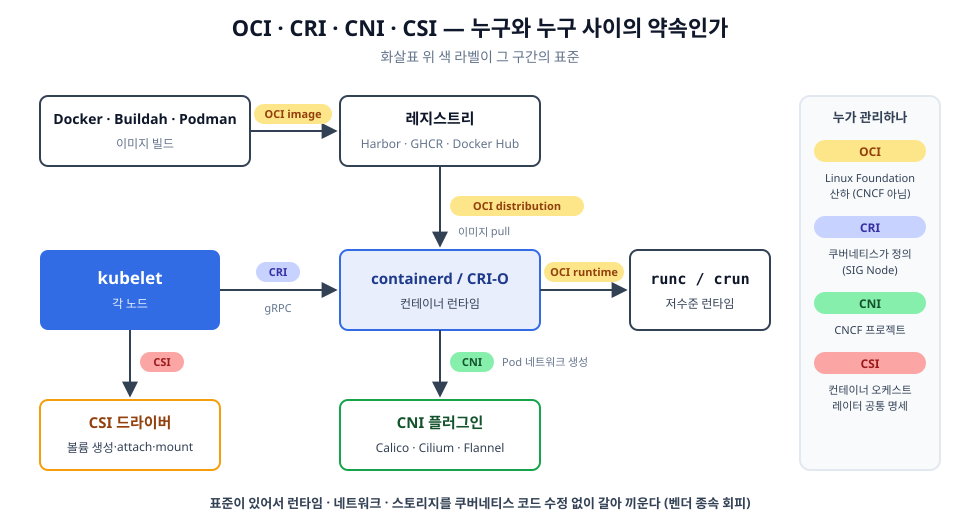
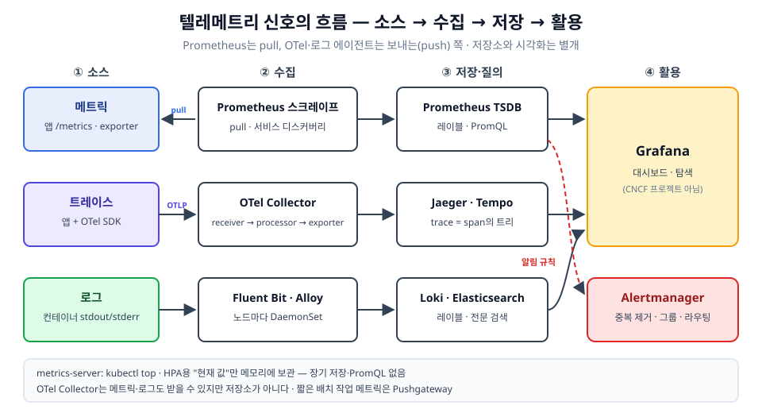

> **자격증 준비 · KCNA** | 난이도 ★★☆☆☆ | 예상 소요 3 ~ 4시간 | 도메인 ④ Cloud Native Architecture (12%)

> ⚠️ 이 편의 모든 문항은 공식 KCNA 커리큘럼을 바탕으로 **직접 창작한 연습 문제**입니다. 실제 출제 문제나 덤프를 재현하지 않습니다.

## 🎯 오늘의 목표

- 클라우드 네이티브의 정의와 원칙(마이크로서비스, 불변 인프라, 선언형 API)을 설명한다
- CNCF의 구조(TOC, 프로젝트 성숙도)와 카테고리별 대표 프로젝트를 안다
- 서버리스(Knative·KEDA·CloudEvents)와 오토스케일링 3종(HPA·VPA·Cluster Autoscaler)을 구분한다
- 표준 인터페이스 OCI·CRI·CNI·CSI가 **누구와 누구 사이**의 약속인지 그림으로 설명한다
- 텔레메트리 신호, 프로메테우스의 동작 방식, OpenTelemetry의 역할, 비용 관리 기본, 쿠버네티스 커뮤니티 운영 방식을 정리한다

> 💡 2025년 11월 개편으로 이 도메인에는 **Observability · Cloud Native Ecosystem and Principles · Cloud Native Community and Collaboration** 세 항목이 들어 있습니다(관측성은 원래 독립 도메인이었음). 본편 연결: 모니터링 [Day 17](../../02-kubernetes/day17-monitoring.md), HPA [Day 18](../../02-kubernetes/day18-autoscaling.md), KServe [Day 45](../../06-ai-infra/day45-llm-on-k8s.md), KEDA·scale-to-zero [Day 46](../../06-ai-infra/day46-llm-autoscaling.md), LLM 관측성 [Day 47](../../06-ai-infra/day47-llm-observability.md), SRE·SLO [Day 58](../../08-sre-observability/day58-sre-slo.md), OpenTelemetry [Day 59](../../08-sre-observability/day59-opentelemetry.md), Loki [Day 60](../../08-sre-observability/day60-loki-alloy.md), Tempo [Day 61](../../08-sre-observability/day61-tempo.md), 알림 [Day 62](../../08-sre-observability/day62-alerting.md).

---

## 1. 핵심 개념 ① — 클라우드 네이티브의 정의와 원칙

CNCF TOC의 [Cloud Native Definition](https://github.com/cncf/toc/blob/main/DEFINITION.md)을 요약하면 이렇습니다. 클라우드 네이티브 기술은 퍼블릭·프라이빗·하이브리드 클라우드 같은 **동적인 환경에서 확장 가능한 애플리케이션을 만들고 운영**하게 해 주며, **컨테이너, 서비스 메시, 마이크로서비스, 불변 인프라, 선언형 API**가 대표적인 예입니다. 이런 기법은 **느슨하게 결합되고, 복원력 있고, 관리 가능하고, 관측 가능한** 시스템을 만들고, 견고한 자동화와 결합해 잦고 예측 가능한 변경을 적은 수고로 하게 해 줍니다.

| 원칙 | 의미 | 반대 개념 |
|---|---|---|
| 마이크로서비스 | 독립적으로 배포·확장되는 작은 서비스 | 모놀리스 |
| **불변 인프라** | 고치지 않고 **새로 만들어 교체**(이미지 재빌드, Pod 재생성) | 서버에 접속해 손으로 패치 |
| 선언형 API | 원하는 상태를 선언, 시스템이 맞춤 | 절차형 스크립트 |
| 가축 vs 애완동물 | 서버·Pod를 이름 붙여 돌보지 않고 **교체 가능한 단위**로 | "pets" |
| 자동화 | CI/CD, GitOps, 오토스케일링, 자가 치유 | 수동 운영 |
| 관측성 | 내부 상태를 외부 신호로 추론할 수 있게 설계 | 장애 후 로그 뒤지기 |

---

## 2. 핵심 개념 ② — CNCF와 프로젝트 생태계

| 주제 | 알아야 할 것 |
|---|---|
| **CNCF** | **Linux Foundation 산하** 재단. 클라우드 네이티브 오픈소스 프로젝트의 **벤더 중립** 보금자리. 2015년 Kubernetes를 첫 프로젝트로 출범 |
| **TOC** (Technical Oversight Committee) | 기술 방향을 정하고 **프로젝트 수용·성숙도 승격을 결정**하는 기술 운영 위원회 |
| **TAG** (Technical Advisory Group) | 특정 분야(보안, 관측성, 런타임 등)를 다루며 TOC를 돕는 그룹 |
| **성숙도** | **Sandbox**(초기 실험) → **Incubating**(프로덕션 사용 증가) → **Graduated**(성숙, 거버넌스·보안 감사·채택 사례 요건 충족) |
| **CNCF Landscape** | 클라우드 네이티브 프로젝트·제품을 카테고리별로 모은 지도 ([landscape.cncf.io](https://landscape.cncf.io/)) |

카테고리별 대표 CNCF **Graduated** 프로젝트 (2026-11-19 [cncf.io/projects](https://www.cncf.io/projects/) 기준으로 오래전에 졸업한 것만 골랐습니다. 성숙도는 바뀌므로 응시 전 확인하세요.)

| 카테고리 | 프로젝트 | 한 줄 |
|---|---|---|
| 오케스트레이션 | **Kubernetes** | CNCF 첫 졸업 프로젝트 |
| 컨테이너 런타임 | **containerd**, **CRI-O** | CRI 구현체 |
| 키-값 저장소 | **etcd** | 쿠버네티스의 상태 저장소 |
| 서비스 디스커버리 | **CoreDNS** | 클러스터 DNS |
| 프록시 | **Envoy** | 서비스 메시·게이트웨이의 데이터 플레인 |
| 서비스 메시 | **Istio**, **Linkerd** | mTLS, 트래픽 제어 |
| 네트워킹 | **Cilium** | eBPF 기반 CNI |
| 모니터링 | **Prometheus** | 메트릭 수집·저장·알림 |
| 트레이싱 | **Jaeger** | 분산 트레이싱 백엔드 |
| 로깅 | **Fluentd** (Fluent Bit 포함) | 로그 수집·전달 |
| 패키징 | **Helm** | 쿠버네티스 패키지 관리자 |
| GitOps | **Argo**, **Flux** | 지속적 배포·조정 |
| 레지스트리 | **Harbor** | 이미지 레지스트리, 스캔·서명 |
| 정책 | **Open Policy Agent (OPA)** | 범용 정책 엔진(Rego) |
| 런타임 보안 | **Falco** | 시스템 호출 기반 위협 탐지 |
| 이벤트 기반 확장 | **KEDA** | 이벤트 소스 기반 오토스케일링 |
| 이벤트 표준 | **CloudEvents** | 이벤트 데이터 형식 명세 |
| 스토리지 오케스트레이션 | **Rook** | Ceph를 쿠버네티스에서 운영 |

> 💡 OpenTelemetry, Knative, Cluster API, Crossplane 등도 CNCF 프로젝트입니다. 이름만 보고 카테고리를 떠올릴 수 있으면 대부분의 생태계 문항은 소거법으로 풀립니다. **Grafana는 CNCF 프로젝트가 아니고**(Grafana Labs의 오픈소스), **OCI는 CNCF가 아니라 Linux Foundation 산하의 별도 프로젝트**라는 점이 자주 쓰이는 함정입니다.

---

## 3. 핵심 개념 ③ — 서버리스와 오토스케일링

### 3-1. 서버리스

| 개념·도구 | 핵심 |
|---|---|
| 서버리스 / FaaS | 서버 관리 없이 코드를 이벤트에 반응해 실행, **사용한 만큼 과금**, 요청이 없으면 **0으로 축소(scale-to-zero)** |
| 트레이드오프 | **콜드 스타트**(0에서 첫 요청 시 지연), 실행 시간·상태 제약, 벤더 종속 가능성 |
| **Knative** | 쿠버네티스 위 서버리스 플랫폼. **Serving**(요청 기반 오토스케일링, scale-to-zero, 리비전·트래픽 분할) + **Eventing**(이벤트 라우팅) |
| **KEDA** | **이벤트 기반 오토스케일러**. 큐 길이, Kafka 지연, 크론 등 외부 지표로 Deployment·Job을 확장하고 **0까지** 줄임. 내부적으로 HPA를 활용 |
| **CloudEvents** | 이벤트를 기술하는 **공통 데이터 형식 명세**. 플랫폼 간 이벤트 상호운용 |

### 3-2. 오토스케일링 3종 (+ 노드 프로비저너)

| 도구 | 무엇을 늘리나 | 트리거 | 비고 |
|---|---|---|---|
| **HPA** | Pod **개수** (수평) | CPU·메모리 사용률(metrics-server), 커스텀·외부 메트릭 | 쿠버네티스 내장 API |
| **VPA** | Pod의 **requests/limits** (수직) | 실제 사용량 이력 | kubernetes/autoscaler의 별도 컴포넌트. 같은 지표로 HPA와 같이 쓰면 충돌 |
| **Cluster Autoscaler** | **노드 개수** | 자원 부족으로 **Pending인 Pod** / 노드 저활용 | 클라우드 노드 그룹과 연동 |
| Karpenter | **노드**(인스턴스 유형까지 선택) | Pending Pod를 보고 알맞은 노드를 직접 생성 | Kubernetes SIG Autoscaling 하위 프로젝트 |
| KEDA | Pod 개수 (0 포함) | 외부 이벤트 | 위 3-1 참고 |

---

## 4. 핵심 개념 ④ — 표준 인터페이스 (OCI · CRI · CNI · CSI)

| 표준 | 누구 ↔ 누구 | 무엇을 정하나 | 구현 예 |
|---|---|---|---|
| **OCI** (Open Container Initiative) | 빌드 도구 ↔ 레지스트리 ↔ 런타임 | **이미지 형식(image-spec), 런타임(runtime-spec), 배포(distribution-spec)** | runc(참조 구현), crun, Docker·Buildah·Podman이 만드는 이미지 |
| **CRI** (Container Runtime Interface) | **kubelet ↔ 컨테이너 런타임** | 컨테이너·이미지 관리 gRPC API | containerd, CRI-O |
| **CNI** (Container Network Interface) | **런타임 ↔ 네트워크 플러그인** | Pod 네트워크 인터페이스 생성·삭제, IP 할당 | Calico, Cilium, Flannel |
| **CSI** (Container Storage Interface) | **오케스트레이터 ↔ 스토리지 드라이버** | 볼륨 생성·attach·mount | 클라우드 디스크 드라이버, Ceph CSI, NFS CSI |

> 💡 표준이 있어서 **갈아 끼울 수 있습니다(pluggable).** 쿠버네티스 본체 코드를 바꾸지 않고도 런타임·네트워크·스토리지를 고를 수 있고, 특정 벤더에 묶이지 않습니다. 옛 "in-tree" 볼륨 플러그인이 CSI로 옮겨 간 것(CSI migration)도 같은 이유입니다.

---

## 5. 핵심 개념 ⑤ — 관측성 (Observability)

| 신호 | 질문 | 대표 도구 |
|---|---|---|
| **메트릭** | "얼마나? 추세는?" — 시간에 따른 숫자 | Prometheus |
| **로그** | "무슨 일이 있었나?" — 이벤트 기록 | Fluentd/Fluent Bit, Loki |
| **트레이스** | "요청이 어디서 느렸나?" — 서비스 간 요청 경로(span의 트리) | Jaeger, Tempo |
| (프로파일) | "어느 코드가 CPU·메모리를 쓰나?" | 연속 프로파일링 도구 |

모니터링은 **미리 정한 질문**(CPU 90% 넘었나?)에 답하고, 관측성은 **처음 보는 질문**에도 신호를 조합해 답할 수 있게 하는 성질입니다([Day 58](../../08-sre-observability/day58-sre-slo.md)).

### 5-1. Prometheus

| 항목 | 내용 |
|---|---|
| 수집 방식 | **Pull** — 대상의 HTTP `/metrics` 엔드포인트를 주기적으로 **스크레이프** |
| 대상 찾기 | 서비스 디스커버리(쿠버네티스 API에서 Pod·Service·노드 자동 발견) |
| 저장 | 내장 **시계열 DB(TSDB)**. 메트릭 이름 + **레이블**로 시계열 식별 |
| 질의 | **PromQL** (예: `rate(http_requests_total[5m])`) |
| 메트릭 유형 | **Counter**(증가만, 재시작 시 0) · **Gauge**(오르내림) · **Histogram**(버킷별 분포, 서버에서 분위수 계산) · **Summary**(클라이언트에서 분위수 계산) |
| Exporter | 자체 메트릭이 없는 대상을 변환(예: node_exporter = 노드 메트릭) |
| **Pushgateway** | 스크레이프 전에 끝나 버리는 **짧은 배치 작업**이 메트릭을 밀어 넣는 중간 저장소 |
| **Alertmanager** | Prometheus가 보낸 알림을 **중복 제거·그룹화·라우팅·침묵** 처리해 Slack·이메일 등으로 |
| 시각화 | 보통 Grafana |

> ⚠️ **metrics-server ≠ Prometheus.** metrics-server는 `kubectl top`과 HPA를 위한 **현재 시점 자원 사용량**만 메모리에 들고 있는 경량 컴포넌트이고, 장기 저장·질의는 하지 않습니다.

### 5-2. OpenTelemetry와 로그

- **OpenTelemetry(OTel)**: 트레이스·메트릭·로그를 만들고 보내기 위한 **벤더 중립 API·SDK·Collector·프로토콜(OTLP)** 의 표준 모음입니다. **저장소나 대시보드는 아닙니다.** Collector는 receivers → processors → exporters 파이프라인으로 데이터를 받아 가공해 원하는 백엔드(Prometheus, Jaeger, Tempo, 상용 SaaS)로 보냅니다.
- 쿠버네티스 로그의 기본: 컨테이너는 **stdout/stderr**로 쓰고, kubelet·런타임이 노드의 파일로 남깁니다. 클러스터 차원 수집은 보통 노드마다 에이전트를 두는 **DaemonSet**(Fluent Bit, Alloy 등)으로 합니다. Pod가 지워지면 노드의 로그도 사라지므로 중앙 수집이 필요합니다.
- 트레이싱 용어: **trace**(요청 하나의 전체 여정), **span**(그 안의 작업 단위), **context propagation**(서비스 간 trace ID 전달, 표준은 W3C Trace Context).

---

## 6. 핵심 개념 ⑥ — 비용 관리 (Cost Management)

| 방법 | 내용 |
|---|---|
| **rightsizing** | requests가 실제 사용량보다 크면 노드가 놀아도 "꽉 찬" 것으로 보임 → 사용량 기반으로 requests 조정(VPA 추천값 활용) |
| 오토스케일링 | HPA·KEDA로 한가할 때 줄이고, Cluster Autoscaler로 빈 노드 반납. scale-to-zero |
| 스팟·선점형 인스턴스 | 중단돼도 괜찮은(무상태, 재시도 가능) 워크로드에 큰 할인 |
| 가시성 | 네임스페이스·레이블(team, app, env)별로 비용 배분 → **showback**(보여 주기) / **chargeback**(청구) |
| 가드레일 | ResourceQuota·LimitRange로 팀별 상한 |
| 도구·문화 | **OpenCost**(CNCF 프로젝트, 쿠버네티스 비용 배분), **FinOps**(엔지니어링·재무가 함께 클라우드 비용을 관리하는 실천 방식) |

---

## 7. 핵심 개념 ⑦ — 커뮤니티와 협업 (Community and Collaboration)

| 주제 | 알아야 할 것 |
|---|---|
| 거버넌스 | 쿠버네티스는 **Steering Committee**가 프로젝트 전체 거버넌스를, 각 기술 영역은 **SIG**(Special Interest Group, 예: SIG Network, SIG Storage, SIG Node)가 맡음. 기한 있는 교차 주제는 **WG**(Working Group) |
| **KEP** | Kubernetes Enhancement Proposal. 큰 기능 변경을 제안·설계·추적하는 문서 절차 |
| 기능 단계 | **Alpha**(기본 꺼짐, 바뀔 수 있음) → **Beta** → **GA/Stable** |
| 폐기 정책 | API 폐기 시 정해진 유예 기간과 버전 수를 지킴(Deprecation Policy) |
| 릴리스 주기 | 마이너 버전 **연 3회**. 최근 **3개 마이너** 브랜치를 유지하고, 각 마이너는 **약 1년** 패치 지원 |
| 기여 경로 | member → reviewer → approver(OWNERS 파일). 코드 외에 문서·번역·릴리스 팀도 기여 |
| CNCF 행사·행동 강령 | **KubeCon + CloudNativeCon**, CNCF **Code of Conduct** |
| 오픈 거버넌스 | 단일 기업이 아닌 **벤더 중립** 운영 — CNCF에 프로젝트를 기증하는 이유 |

---

## 8. 헷갈리는 포인트

| 오답 선택지가 노리는 착각 | 바로잡기 |
|---|---|
| "OCI는 CNCF 프로젝트다" | OCI는 **Linux Foundation** 산하 별도 프로젝트 |
| "프로젝트 승격은 CNCF 이사회(Governing Board)가 정한다" | 기술적 결정은 **TOC** |
| "성숙도 순서: Incubating → Sandbox → Graduated" | **Sandbox → Incubating → Graduated** |
| "HPA는 Pod의 CPU requests를 늘린다" | 그건 **VPA**. HPA는 **개수** |
| "Pending Pod가 있으면 HPA가 노드를 늘린다" | 노드는 **Cluster Autoscaler**(또는 Karpenter) |
| "CNI는 kubelet과 런타임 사이 인터페이스다" | kubelet ↔ 런타임은 **CRI** |
| "Prometheus는 에이전트가 push하는 구조가 기본이다" | 기본은 **pull(스크레이프)**. push는 Pushgateway·원격 쓰기 등 예외 |
| "Counter는 내려갈 수 있다" | Counter는 증가만(재시작 시 리셋). 오르내리면 **Gauge** |
| "OpenTelemetry는 트레이스 저장소다" | OTel은 **수집·전송 표준**. 저장은 Jaeger·Tempo 등 |
| "서버리스는 서버가 없다" | 서버가 없는 게 아니라 **사용자가 관리하지 않는 것** |

---

## 9. 창작 객관식 15문항

**Q1.** CNCF의 클라우드 네이티브 정의가 대표적인 예로 드는 기법이 **아닌** 것은?

- A. 선언형 API
- B. 불변 인프라
- C. 운영자가 서버에 접속해 수동으로 패치하는 장수 서버
- D. 서비스 메시

정답·해설

**정답: C**

정의는 컨테이너, 서비스 메시, 마이크로서비스, 불변 인프라, 선언형 API를 예로 듭니다. 손으로 고쳐 가며 오래 쓰는 서버는 불변 인프라의 반대 개념입니다.

📖 근거: [CNCF Cloud Native Definition](https://github.com/cncf/toc/blob/main/DEFINITION.md)

**Q2.** CNCF 프로젝트 성숙도 단계를 낮은 단계부터 올바르게 나열한 것은?

- A. Sandbox → Incubating → Graduated
- B. Incubating → Sandbox → Graduated
- C. Alpha → Beta → Stable
- D. Sandbox → Graduated → Incubating

정답·해설

**정답: A**

Alpha → Beta → Stable(C)은 **쿠버네티스 기능**의 단계로, 프로젝트 성숙도와 섞어 내는 전형적인 함정입니다.

📖 근거: [CNCF Projects](https://www.cncf.io/projects/), [CNCF TOC — Project maturity levels](https://github.com/cncf/toc/tree/main/process)

**Q3.** 새 프로젝트를 CNCF에 받아들이고 성숙도 승격을 결정하는 기술 기구는?

- A. Kubernetes Steering Committee
- B. Open Container Initiative
- C. Kubernetes SIG Architecture
- D. CNCF Technical Oversight Committee (TOC)

정답·해설

**정답: D**

TOC가 CNCF의 기술 비전과 프로젝트 수용·승격을 담당합니다. Steering Committee(A)와 SIG(C)는 **쿠버네티스 프로젝트 내부** 거버넌스 기구입니다. OCI(B)는 컨테이너 표준 프로젝트입니다.

📖 근거: [CNCF TOC](https://github.com/cncf/toc)

**Q4.** 쿠버네티스 위에서 HTTP 요청이 없을 때 Pod를 0개로 줄이고, 요청이 오면 다시 띄우며, 리비전별 트래픽 분할을 지원하는 서버리스 플랫폼은?

- A. Helm
- B. Knative Serving
- C. CoreDNS
- D. Harbor

정답·해설

**정답: B**

Knative Serving은 요청 기반 오토스케일링(scale-to-zero 포함), 불변 리비전, 리비전 간 트래픽 분할을 제공합니다. 본편 [Day 45](../../06-ai-infra/day45-llm-on-k8s.md)의 KServe도 Knative 위에서 동작할 수 있습니다.

📖 근거: [Knative Serving](https://knative.dev/docs/serving/)

**Q5.** KEDA에 대한 설명으로 가장 적절한 것은?

- A. 노드를 추가·제거하는 클러스터 오토스케일러다
- B. 컨테이너의 CPU requests를 자동으로 조정한다
- C. 메시지 큐 길이 같은 외부 이벤트 소스를 기반으로 워크로드를 확장하며, 0개까지 축소할 수 있다
- D. 이벤트 데이터 형식을 정의한 명세다

정답·해설

**정답: C**

KEDA는 다양한 스케일러(큐, 스트림, 크론, 프로메테우스 쿼리 등)로 지표를 받아 HPA와 함께 동작하고, 이벤트가 없으면 0까지 줄입니다. A는 Cluster Autoscaler, B는 VPA, D는 CloudEvents입니다.

📖 근거: [KEDA — Concepts](https://keda.sh/docs/latest/concepts/), [Day 46](../../06-ai-infra/day46-llm-autoscaling.md)

**Q6.** 트래픽 급증으로 HPA가 레플리카를 늘렸지만, 모든 노드의 자원이 부족해 새 Pod들이 `Pending`이다. 이 상황에서 **노드를 추가**하는 컴포넌트는?

- A. Cluster Autoscaler
- B. Horizontal Pod Autoscaler
- C. Vertical Pod Autoscaler
- D. kube-scheduler

정답·해설

**정답: A**

Cluster Autoscaler는 자원 부족으로 스케줄되지 못한 Pod를 보고 노드 그룹을 늘리고, 저활용 노드는 줄입니다. 스케줄러(D)는 노드를 고를 뿐 만들지 않습니다.

📖 근거: [Node Autoscaling](https://kubernetes.io/docs/concepts/cluster-administration/node-autoscaling/), [Autoscaling Workloads](https://kubernetes.io/docs/concepts/workloads/autoscaling/)

**Q7.** Vertical Pod Autoscaler(VPA)가 조정하는 대상은?

- A. Deployment의 `replicas`
- B. 노드 풀의 인스턴스 수
- C. Service의 포트 수
- D. 컨테이너의 CPU·메모리 requests(와 비율에 맞춘 limits)

정답·해설

**정답: D**

VPA는 실제 사용량 이력을 바탕으로 requests를 추천하거나 적용합니다. 같은 CPU·메모리 지표로 HPA와 동시에 쓰면 서로 충돌하므로 주의합니다.

📖 근거: [Autoscaling Workloads — Vertical scaling](https://kubernetes.io/docs/concepts/workloads/autoscaling/), [kubernetes/autoscaler — VPA](https://github.com/kubernetes/autoscaler/tree/master/vertical-pod-autoscaler)

**Q8.** kubelet이 containerd나 CRI-O 같은 컨테이너 런타임과 통신할 때 쓰는 표준 인터페이스는?

- A. CNI
- B. CRI
- C. CSI
- D. OCI distribution-spec

정답·해설

**정답: B**

CRI는 kubelet과 런타임 사이의 gRPC API입니다. CNI(A)는 네트워크 플러그인, CSI(C)는 스토리지 드라이버, OCI distribution-spec(D)은 레지스트리 API 표준입니다.

📖 근거: [Container Runtime Interface (CRI)](https://kubernetes.io/docs/concepts/architecture/cri/)

**Q9.** Open Container Initiative(OCI)가 정의하는 것으로 옳은 것은?

- A. 쿠버네티스 Pod 네트워크 구성 방식
- B. 쿠버네티스 볼륨 attach·mount 절차
- C. 컨테이너 이미지 형식, 런타임 동작, 이미지 배포(레지스트리) 방식
- D. 서비스 메시의 mTLS 인증서 형식

정답·해설

**정답: C**

OCI는 image-spec, runtime-spec, distribution-spec 세 명세를 관리하며 runc가 런타임 참조 구현입니다. 덕분에 Docker로 만든 이미지를 containerd·CRI-O가 실행하고, 어떤 OCI 레지스트리에도 올릴 수 있습니다. A는 CNI, B는 CSI 영역입니다.

📖 근거: [Open Container Initiative](https://opencontainers.org/)

**Q10.** Prometheus가 메트릭을 수집하는 **기본** 방식은?

- A. 대상의 HTTP 엔드포인트(보통 `/metrics`)를 주기적으로 스크레이프(pull)한다
- B. 각 애플리케이션이 Prometheus로 메트릭을 push한다
- C. etcd에서 메트릭을 읽어 온다
- D. 노드의 syslog를 파싱한다

정답·해설

**정답: A**

Prometheus는 pull 모델입니다. 쿠버네티스 서비스 디스커버리로 대상을 찾아 스크레이프합니다. push(B)는 Pushgateway 같은 예외적 경로입니다.

📖 근거: [Prometheus — Overview](https://prometheus.io/docs/introduction/overview/)

**Q11.** 처리한 HTTP 요청의 **누적 개수**처럼, 프로세스가 재시작될 때만 0으로 돌아가고 그 외에는 증가만 하는 값에 알맞은 Prometheus 메트릭 유형은?

- A. Gauge
- B. Histogram
- C. Summary
- D. Counter

정답·해설

**정답: D**

Counter는 단조 증가 값이며 보통 `rate()`로 초당 증가율을 구해 씁니다. 현재 메모리 사용량처럼 오르내리는 값은 Gauge(A)입니다.

📖 근거: [Prometheus — Metric types](https://prometheus.io/docs/concepts/metric_types/)

**Q12.** 몇 초 만에 끝나는 배치 작업의 결과 메트릭을 Prometheus로 수집하려 한다. 작업이 스크레이프 주기 전에 종료되어 버린다. 공식 문서가 이런 경우에 쓰라고 안내하는 구성 요소는?

- A. Alertmanager
- B. Pushgateway
- C. node_exporter
- D. metrics-server

정답·해설

**정답: B**

Pushgateway는 서비스 수준의 짧은 배치 작업이 메트릭을 밀어 넣어 두면 Prometheus가 그것을 스크레이프하는 중간 저장소입니다. 공식 문서는 그 밖의 용도로 남용하지 말라고 권고합니다. Alertmanager(A)는 알림 처리기입니다.

📖 근거: [Prometheus — When to use the Pushgateway](https://prometheus.io/docs/practices/pushing/)

**Q13.** OpenTelemetry에 대한 설명으로 가장 적절한 것은?

- A. 트레이스·메트릭·로그를 생성·수집·전송하기 위한 벤더 중립 API, SDK, Collector, 프로토콜(OTLP)의 모음이다
- B. 트레이스를 장기 저장하고 검색하는 데이터베이스다
- C. 쿠버네티스 노드의 CPU 사용량만 수집하는 에이전트다
- D. 대시보드 시각화 도구다

정답·해설

**정답: A**

OTel은 계측과 전송의 표준을 제공하고, 저장·시각화는 Jaeger, Tempo, Prometheus, Grafana 같은 백엔드가 맡습니다. 한 번 계측하면 백엔드를 바꿔도 앱 코드를 다시 고칠 필요가 없다는 것이 핵심 가치입니다.

📖 근거: [OpenTelemetry — What is OpenTelemetry?](https://opentelemetry.io/docs/what-is-opentelemetry/), [Day 59](../../08-sre-observability/day59-opentelemetry.md)

**Q14.** 노드들의 실제 CPU 사용률은 20% 수준인데, 새 Pod가 자원 부족으로 Pending이 되어 노드를 계속 추가하고 있다. 비용을 줄이기 위한 **첫 조치**로 가장 적절한 것은?

- A. 모든 Pod에서 requests를 제거한다
- B. 노드를 더 큰 인스턴스로 바꾼다
- C. 실제 사용량을 근거로 과도하게 잡힌 requests를 줄인다(rightsizing)
- D. 메트릭 수집을 중단한다

정답·해설

**정답: C**

스케줄러는 실제 사용량이 아니라 **requests 합**으로 노드가 찼는지 판단합니다. requests가 부풀려 있으면 노드가 놀아도 새 노드가 필요해집니다. requests를 없애면(A) 스케줄링과 QoS가 망가지고, 노드를 키우는 것(B)은 낭비를 키웁니다. VPA 추천값과 OpenCost 같은 비용 도구가 근거 자료가 됩니다.

📖 근거: [Resource Management for Pods and Containers](https://kubernetes.io/docs/concepts/configuration/manage-resources-containers/), [OpenCost](https://www.opencost.io/docs/)

**Q15.** 쿠버네티스에 큰 기능을 추가하려는 기여자가 따라야 하는, 설계를 제안·검토·추적하는 공식 절차는?

- A. CNCF Sandbox 신청서
- B. OCI 명세 변경 요청
- C. CloudEvents 확장
- D. KEP(Kubernetes Enhancement Proposal)를 작성해 담당 SIG의 검토를 받는다

정답·해설

**정답: D**

KEP는 동기, 설계, 단계별(Alpha/Beta/GA) 졸업 조건, 테스트 계획을 담는 문서이며 해당 영역을 맡은 SIG가 검토·승인합니다. CNCF Sandbox(A)는 **새 프로젝트**를 CNCF에 넣는 절차입니다.

📖 근거: [kubernetes/enhancements — KEPs](https://github.com/kubernetes/enhancements/tree/master/keps), [Kubernetes SIG list](https://github.com/kubernetes/community/blob/master/sig-list.md)

### 채점

| 맞힌 수 | 판단 |
|---|---|
| 13~15 | 충분. N05 모의고사로 |
| 11~12 | 합격선 근처. 표준 인터페이스 그림과 Prometheus 표 다시 보기 |
| 10 이하 | 2장 프로젝트 표를 카테고리별로 소리 내어 읽고, Day 17·46·59를 훑은 뒤 재도전 |

---

## 핵심 정리

- 클라우드 네이티브 = 컨테이너 · 서비스 메시 · 마이크로서비스 · **불변 인프라** · **선언형 API**, 느슨한 결합·복원력·관측성·자동화
- CNCF는 **LF 산하**, 기술 결정은 **TOC**, 성숙도 **Sandbox → Incubating → Graduated**. OCI는 CNCF가 아닌 LF 프로젝트, Grafana는 CNCF 아님
- 서버리스: Knative(Serving·Eventing, scale-to-zero), KEDA(이벤트 기반 확장, 0까지), CloudEvents(이벤트 형식). 콜드 스타트가 대가
- 오토스케일링: **HPA = Pod 개수 · VPA = requests · Cluster Autoscaler = 노드 개수**
- 표준: **OCI**(이미지·런타임·배포) · **CRI**(kubelet↔런타임) · **CNI**(네트워크) · **CSI**(스토리지) → 갈아 끼우기 가능
- 관측성: 메트릭·로그·트레이스. Prometheus는 **pull**, Counter/Gauge/Histogram/Summary, 짧은 배치는 **Pushgateway**, 알림은 **Alertmanager**. OTel은 수집·전송 표준
- 비용: requests **rightsizing**, 오토스케일링, 스팟, 레이블별 showback/chargeback, OpenCost·FinOps
- 커뮤니티: **SIG**·WG·Steering Committee, **KEP**, Alpha→Beta→GA, 마이너 **연 3회**·최근 3개 유지

---

## ⏭️ 다음 예고 — N05. 모의고사

이제 실전 규모로 확인할 차례입니다. 공식 비중(44/28/16/12)에 맞춘 **창작 60문항**을 90분 안에 풀고, 정답표와 도메인별 채점표로 약점을 찾습니다. 합격선은 75%(45문항)이지만, 실제 응시 전 목표는 **50문항 이상**으로 잡으세요.
