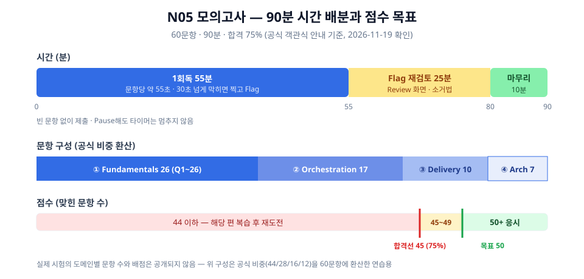

> **자격증 준비 · KCNA** | 난이도 ★★★☆☆ | 예상 소요 90분 풀이 + 1시간 채점·복습

> ⚠️ **이 모의고사의 60문항은 모두 공식 KCNA 커리큘럼(2025-11 개편, 4개 도메인)을 바탕으로 직접 창작한 문항입니다.** 실제 출제 문제나 유출 문제(덤프)가 아니며, 그런 자료를 재현하지 않습니다. 실제 시험의 문항 배분과 난이도는 공개되지 않으므로, 이 세트는 **공식 비중에 맞춘 연습용**입니다. 또한 N01~N04 본문 문항과 겹치지 않는 새 문항으로 구성했습니다.

## 🎯 오늘의 목표

- 실제 시험과 같은 **60문항 · 90분** 규모로 시간 감각을 익힌다
- 도메인별 정답률을 계산해 **약점 편**을 찾는다
- 75%(45문항) 합격선이 아니라 **50문항 이상**을 안정적으로 맞히는지 확인한다

---

## 1. 응시 규칙



| 항목 | 이 모의고사 | 실제 시험 (2026-11-19 공식 확인) |
|---|---|---|
| 문항 | 60문항, 4지선다 단일 정답 | 60문항 객관식 |
| 시간 | **90분 타이머** | 90분, Pause해도 타이머는 계속 |
| 자료 | 아무것도 보지 않기 | 감독관이 지켜보는 온라인 시험 |
| 합격 | 45문항(75%) / **목표 50문항** | 75% 이상 |
| 다시 보기 | 종이에 문항 번호 표시 | ExamUI의 **Flag** → Review 화면 |

- 문항은 도메인 순서로 배치했습니다(Q1~26 Fundamentals, Q27~43 Orchestration, Q44~53 Application Delivery, Q54~60 Architecture). 실제 시험은 섞여서 나오니, 2회차에는 **번호를 무작위로 골라** 풀어 보세요.
- 답은 종이나 메모장에 `1-C, 2-B …` 식으로 적고, 다 푼 뒤에 [정답표](#3-정답표)로 채점합니다.

---

## 2. 문항

### 도메인 ① Kubernetes Fundamentals (Q1~Q26)

**Q1.** etcd와 **직접** 통신하는 쿠버네티스 컴포넌트는?

- A. kube-scheduler
- B. kubelet
- C. kube-apiserver
- D. kube-proxy

**Q2.** 다음 중 **클러스터 범위(cluster-scoped)** 리소스는?

- A. ConfigMap
- B. Node
- C. Deployment
- D. Secret

**Q3.** `kubectl apply -f ./manifests/`로 디렉터리의 YAML을 적용하고, 이후에도 파일을 고쳐 다시 apply하는 방식을 무엇이라 하는가?

- A. 선언형 오브젝트 설정(declarative object configuration)
- B. 명령형 커맨드(imperative commands)
- C. 명령형 오브젝트 설정(imperative object configuration)
- D. 직접 etcd 편집

**Q4.** 쿠버네티스 오브젝트에서 사용자가 **원하는 상태**를 기술하는 필드는?

- A. `status`
- B. `metadata`
- C. `kind`
- D. `spec`

**Q5.** 한 Pod 안의 두 컨테이너에 대한 설명으로 옳은 것은?

- A. 각자 다른 IP를 가지므로 서로 Service를 통해서만 통신한다
- B. 같은 네트워크 네임스페이스를 공유해 `localhost`로 통신할 수 있고, 볼륨을 함께 마운트할 수 있다
- C. 항상 서로 다른 노드에 배치된다
- D. 하나가 종료되면 다른 하나는 자동으로 삭제된다

**Q6.** init container의 특징으로 옳은 것은?

- A. 앱 컨테이너보다 먼저, 정의된 순서대로 하나씩 실행되어 성공적으로 끝나야 다음 단계로 넘어간다
- B. 앱 컨테이너와 동시에 시작되어 Pod가 끝날 때까지 계속 실행된다
- C. 실패하면 무시하고 앱 컨테이너를 시작한다
- D. 노드마다 하나씩 실행된다

**Q7.** 총 5번의 성공적인 실행이 필요하고, 동시에 최대 2개만 실행되어야 하는 배치 작업이다. Job에 지정할 값은?

- A. `replicas: 5`, `maxSurge: 2`
- B. `completions: 2`, `parallelism: 5`
- C. `completions: 5`, `parallelism: 2`
- D. `backoffLimit: 5`, `activeDeadlineSeconds: 2`

**Q8.** CronJob의 `schedule: "0 3 * * *"`가 뜻하는 것은? (`timeZone`은 지정하지 않음)

- A. 3분마다
- B. 매시 3분
- C. 매월 3일 0시
- D. 매일 03:00

**Q9.** 쿠버네티스의 **네이티브 사이드카 컨테이너**를 정의하는 방법은?

- A. `spec.containers`에 컨테이너를 하나 더 추가한다
- B. `initContainers`에 컨테이너를 정의하고 `restartPolicy: Always`를 지정한다
- C. DaemonSet으로 같은 노드에 배치한다
- D. Pod 어노테이션에 `sidecar: "true"`를 단다

**Q10.** 클러스터가 제공하는 리소스 종류와 각 리소스가 네임스페이스 범위인지 한 번에 확인하는 명령은?

- A. `kubectl api-resources`
- B. `kubectl get all`
- C. `kubectl cluster-info`
- D. `kubectl version`

**Q11.** `kubectl explain deployment.spec.strategy`의 용도는?

- A. 현재 Deployment의 롤아웃 상태를 보여 준다
- B. Deployment를 dry-run으로 생성한다
- C. 해당 필드의 구조와 설명(API 문서)을 터미널에서 보여 준다
- D. 전략을 RollingUpdate로 바꾼다

**Q12.** 네임스페이스 `team-x`를 삭제하면 어떻게 되는가?

- A. 네임스페이스만 지워지고 안의 리소스는 `default`로 옮겨진다
- B. 안에 리소스가 있으면 삭제가 거부된다
- C. 클러스터 범위 리소스까지 모두 삭제된다
- D. 그 네임스페이스에 속한 모든 리소스(Pod, Service, Secret 등)가 함께 삭제된다

**Q13.** requests를 지정하지 않은 컨테이너에 **기본 requests·limits를 자동으로 채워 넣는** 네임스페이스 정책 리소스는?

- A. ResourceQuota
- B. LimitRange
- C. PriorityClass
- D. RuntimeClass

**Q14.** Pod의 모든 컨테이너가 CPU·메모리 모두 `requests`와 `limits`를 같은 값으로 지정했다. 이 Pod의 QoS 클래스는?

- A. Guaranteed
- B. Burstable
- C. BestEffort
- D. Critical

**Q15.** 노드에 메모리 압박이 생겨 kubelet이 Pod를 축출해야 할 때, 일반적으로 **가장 먼저** 축출 대상이 되는 QoS 클래스는?

- A. Guaranteed
- B. Burstable
- C. BestEffort
- D. QoS 클래스와 무관하게 이름순

**Q16.** `kubectl drain k8s-w1 --ignore-daemonsets`가 하는 일은?

- A. 노드를 클러스터에서 삭제한다
- B. 노드의 kubelet을 재시작한다
- C. 노드의 디스크를 정리한다
- D. 노드를 스케줄 불가로 표시(cordon)하고, DaemonSet Pod를 제외한 Pod를 축출한다

**Q17.** kubeadm으로 만든 클러스터에서 일반 Pod가 컨트롤 플레인 노드에 스케줄되지 않는 이유는?

- A. 컨트롤 플레인 노드에는 kubelet이 없기 때문이다
- B. 컨트롤 플레인 노드에 `node-role.kubernetes.io/control-plane:NoSchedule` taint가 걸려 있기 때문이다
- C. 컨트롤 플레인 노드에는 CNI가 설치되지 않기 때문이다
- D. 스케줄러가 컨트롤 플레인 노드를 인식하지 못하기 때문이다

**Q18.** 웹 서버 Deployment의 레플리카들이 **같은 노드에 몰리지 않게** 하고 싶다. 알맞은 설정은?

- A. 같은 레이블의 Pod를 대상으로 하는 pod anti-affinity
- B. 노드에 NoExecute taint
- C. ResourceQuota
- D. `hostNetwork: true`

**Q19.** 높은 PriorityClass를 가진 Pod가 자원 부족으로 Pending일 때 스케줄러가 할 수 있는 동작은?

- A. 노드를 새로 만든다
- B. 그 Pod의 requests를 자동으로 줄인다
- C. 낮은 우선순위 Pod를 선점(preemption)해 축출하고 자리를 만든다
- D. 아무것도 하지 않는다. 우선순위는 표시용이다

**Q20.** Pod 매니페스트에 `spec.nodeName: k8s-w2`를 직접 적었다. 결과는?

- A. 스케줄러가 nodeName을 무시하고 다시 고른다
- B. API 서버가 생성을 거부한다
- C. 해당 노드에 taint가 있으면 다른 노드로 이동한다
- D. 스케줄러를 거치지 않고 k8s-w2의 kubelet이 바로 그 Pod를 실행하려 한다

**Q21.** 컨테이너 이미지가 **레이어** 구조인 덕분에 얻는 이점은?

- A. 컨테이너가 커널을 따로 갖게 된다
- B. 공통 레이어를 여러 이미지가 공유·캐시해 저장 공간과 전송량을 줄인다
- C. 이미지가 실행 중에 자동으로 업데이트된다
- D. 이미지를 레지스트리 없이 배포할 수 있다

**Q22.** 리눅스에서 컨테이너가 쓸 수 있는 **CPU·메모리 양을 제한**하는 커널 기능은?

- A. cgroups
- B. namespaces
- C. SELinux
- D. chroot

**Q23.** CRI를 구현한 **고수준** 컨테이너 런타임은?

- A. runc
- B. containerd
- C. CoreDNS
- D. etcd

**Q24.** Dockerfile의 멀티 스테이지 빌드를 쓰는 주된 이유는?

- A. 여러 아키텍처용 이미지를 한 번에 만들기 위해
- B. 컨테이너를 여러 노드에 동시에 배포하기 위해
- C. 빌드 도구는 앞 단계에만 두고 최종 이미지에는 실행 결과물만 담아 이미지를 작고 안전하게 만들기 위해
- D. 레지스트리 인증을 생략하기 위해

**Q25.** 쿠버네티스 버전 차이(version skew) 정책에 대한 설명으로 옳은 것은?

- A. kubelet은 kube-apiserver보다 최대 두 마이너 버전 **높을** 수 있다
- B. 모든 컴포넌트는 패치 버전까지 반드시 같아야 한다
- C. kubectl은 API 서버와 정확히 같은 마이너 버전이어야 한다
- D. kubelet은 kube-apiserver보다 **높은** 버전일 수 없다

**Q26.** `kube-node-lease` 네임스페이스의 Lease 오브젝트는 무엇에 쓰이는가?

- A. 노드의 하트비트(살아 있음 신호)를 가볍게 전달하는 데
- B. 클라우드 인스턴스 임대 기간 관리에
- C. Pod IP 할당 기록에
- D. 인증서 만료 관리에

### 도메인 ② Container Orchestration (Q27~Q43)

**Q27.** NodePort Service의 기본 포트 범위는?

- A. 1~1023
- B. 8000~8999
- C. 30000~32767
- D. 49152~65535

**Q28.** `type: LoadBalancer` Service를 만들면 (기본 설정에서) 함께 할당되는 것은?

- A. Ingress 리소스
- B. ClusterIP와 NodePort
- C. 새 노드
- D. PersistentVolume

**Q29.** kube-proxy의 프록시 모드가 **아닌** 것은?

- A. iptables
- B. ipvs
- C. nftables
- D. bgp

**Q30.** kubeadm으로 만든 클러스터에서 CoreDNS가 일반적으로 실행되는 형태는?

- A. `kube-system` 네임스페이스의 Deployment (Service 이름은 `kube-dns`)
- B. 모든 노드의 static Pod
- C. `default` 네임스페이스의 DaemonSet
- D. kubelet 바이너리에 내장

**Q31.** 다음 NetworkPolicy를 `app` 네임스페이스에 적용했을 때의 효과는?

```yaml
apiVersion: networking.k8s.io/v1
kind: NetworkPolicy
metadata:
  name: lockdown
  namespace: app
spec:
  podSelector: {}
  policyTypes: ["Ingress"]
```

- A. 아무 효과가 없다
- B. 네임스페이스의 모든 Pod에서 나가는 트래픽을 막는다
- C. 네임스페이스의 모든 Pod로 들어오는 트래픽을 막는다(지원하는 CNI에서)
- D. 다른 네임스페이스의 Pod만 차단한다

**Q32.** 네임스페이스에 "모든 이그레스 거부" 정책을 적용한 뒤, 같은 네임스페이스의 Service 이름(`api`)으로 접속하면 이름 해석부터 실패한다. 추가로 허용해야 할 것은?

- A. 노드의 SSH 포트
- B. kube-system의 CoreDNS(kube-dns)로 가는 UDP/TCP 53번 이그레스
- C. etcd의 2379 포트
- D. 인터넷 전체로의 이그레스

**Q33.** 서비스 메시를 도입하는 대표적인 이유로 가장 적절한 것은?

- A. 노드의 디스크 용량을 늘리기 위해
- B. 컨테이너 이미지 크기를 줄이기 위해
- C. 쿠버네티스 API 서버를 대체하기 위해
- D. 애플리케이션 코드 변경 없이 서비스 간 mTLS, 재시도·타임아웃, 트래픽 분할, 관측성을 얻기 위해

**Q34.** Gateway API가 Ingress에 비해 갖는 특징으로 옳은 것은?

- A. 인프라 제공자·클러스터 운영자·앱 개발자의 역할을 리소스로 나누고, 표현력과 확장성이 더 높다
- B. HTTP만 지원한다
- C. 컨트롤러 없이 동작한다
- D. 쿠버네티스에서 폐기(deprecated)된 API다

**Q35.** Pod가 쿠버네티스 API를 호출할 때 신원으로 쓰는 것은?

- A. 노드의 root 계정
- B. kubeconfig의 관리자 인증서
- C. Pod에 연결된 ServiceAccount의 토큰
- D. 이미지 레지스트리 계정

**Q36.** 사용자 `dev1`이 `team-a`에서 Deployment를 삭제할 수 있는지 확인하는 명령은?

- A. `kubectl get rolebindings -A`
- B. `kubectl auth can-i delete deployments -n team-a --as dev1`
- C. `kubectl describe user dev1`
- D. `kubectl top user dev1`

**Q37.** Pod Security Standards를 네임스페이스 레이블에 따라 강제하는 **내장 어드미션 컨트롤러**는?

- A. NodeRestriction
- B. ResourceQuota
- C. LimitRanger
- D. PodSecurity

**Q38.** 컨테이너가 root(UID 0)로 실행되면 시작을 거부하도록 하는 securityContext 설정은?

- A. `runAsNonRoot: true`
- B. `privileged: true`
- C. `hostPID: true`
- D. `allowPrivilegeEscalation: true`

**Q39.** Secret을 다루는 모범 사례로 가장 적절한 조합은?

- A. Secret 값을 ConfigMap에 옮겨 관리한다
- B. Secret 매니페스트를 평문 그대로 공개 Git 저장소에 올린다
- C. etcd 저장 시 암호화를 켜고, RBAC로 Secret 읽기 권한을 최소화한다
- D. 모든 ServiceAccount에 Secret `list` 권한을 준다

**Q40.** `kubectl get nodes`에서 노드 하나가 `NotReady`다. 노드에 접속해 가장 먼저 확인할 것은?

- A. Deployment의 롤아웃 이력
- B. kubelet 서비스 상태와 로그(`systemctl status kubelet`, `journalctl -u kubelet`)
- C. Ingress 리소스
- D. Helm 릴리스 목록

**Q41.** Pod 이벤트에 `0/3 nodes are available: 3 Insufficient memory.`가 찍혀 Pending이다. 올바른 대응은?

- A. 이미지 pull 정책을 Never로 바꾼다
- B. Service를 다시 만든다
- C. readiness probe를 제거한다
- D. Pod의 메모리 requests를 실제 필요량에 맞게 줄이거나, 노드 자원을 늘린다

**Q42.** `emptyDir` 볼륨의 수명으로 옳은 것은?

- A. Pod가 노드에서 제거되면 함께 삭제되며, 컨테이너가 재시작되는 동안에는 유지된다
- B. 클러스터가 삭제될 때까지 유지된다
- C. 컨테이너가 재시작될 때마다 비워진다
- D. 다른 노드로 자동 복제된다

**Q43.** StatefulSet을 `replicas: 3`에서 `1`로 줄였다. `volumeClaimTemplates`로 만들어진 `data-web-1`, `data-web-2` PVC는 (기본 설정에서) 어떻게 되는가?

- A. 즉시 삭제된다
- B. `web-0`에 병합된다
- C. 삭제되지 않고 남아, 다시 늘리면 같은 PVC가 재사용된다
- D. 읽기 전용으로 바뀐다

### 도메인 ③ Cloud Native Application Delivery (Q44~Q53)

**Q44.** GitOps에서 "단일 진실 공급원(single source of truth)"은?

- A. 클러스터의 etcd
- B. 원하는 상태를 선언한 Git 저장소
- C. CI 서버의 빌드 로그
- D. 운영자의 로컬 kubeconfig

**Q45.** 클러스터 안에서 동작하며 Git 저장소를 감시해 클러스터를 조정하는 **CNCF Graduated GitOps 도구** 조합은?

- A. Jenkins, Spinnaker
- B. Helm, Kustomize
- C. Prometheus, Grafana
- D. Argo CD, Flux

**Q46.** `helm upgrade`로 릴리스 `shop`을 리비전 4로 올렸는데 문제가 생겼다. 리비전 3으로 되돌리는 명령은?

- A. `helm uninstall shop`
- B. `helm install shop --revision 3`
- C. `helm rollback shop 3`
- D. `kubectl rollout undo helm/shop`

**Q47.** Helm 설치 시 값 지정 방법 중 **가장 우선순위가 높은** 것은?

- A. `--set image.tag=1.5`
- B. `-f values-prod.yaml`
- C. 차트 안의 기본 `values.yaml`
- D. 모두 같은 우선순위이며 알파벳 순으로 적용된다

**Q48.** 같은 애플리케이션 매니페스트를 dev와 prod에서 레플리카 수·이미지 태그만 다르게 쓰고 싶다. Kustomize의 일반적인 구조는?

- A. 환경마다 매니페스트 전체를 복사해 따로 관리한다
- B. 공통 `base`와 환경별 `overlays/dev`, `overlays/prod`에서 차이만 패치한다
- C. Helm 차트 안에 kustomization.yaml을 넣는다
- D. ConfigMap 하나로 모든 환경을 표현한다

**Q49.** Deployment 전략으로 **Recreate**가 적합한 경우는?

- A. 다운타임이 절대 허용되지 않을 때
- B. 트래픽의 5%만 새 버전에 보내고 싶을 때
- C. 두 환경을 동시에 띄워 즉시 전환하고 싶을 때
- D. 구버전과 신버전이 동시에 실행되면 안 되고, 짧은 중단은 허용될 때

**Q50.** RollingUpdate에서 `maxUnavailable: 0`, `maxSurge: 1`로 설정했다. 동작으로 옳은 것은?

- A. 새 Pod 1개를 먼저 추가로 띄워 Ready가 된 뒤 옛 Pod 1개를 줄이는 식으로, 가용 Pod 수가 원하는 수 아래로 떨어지지 않는다
- B. 옛 Pod를 모두 먼저 종료한다
- C. 업데이트가 진행되지 않는다
- D. 원하는 수의 두 배를 한 번에 띄운다

**Q51.** `kubectl describe pod`에서 Last State가 `Terminated`, Reason `OOMKilled`, Exit Code `137`이다. 알맞은 해석과 조치는?

- A. 이미지가 없으므로 태그를 고친다
- B. 스케줄러 장애이므로 컨트롤 플레인을 재시작한다
- C. 컨테이너가 메모리 limits를 넘어 강제 종료됐다. 메모리 사용(누수)을 점검하고 limits를 적정하게 조정한다
- D. readiness probe 실패이므로 probe를 제거한다

**Q52.** 외부에 노출되지 않은 Service `api`(포트 80)를 로컬 노트북에서 잠깐 테스트하려 한다. 알맞은 명령은?

- A. `kubectl expose svc api --type=LoadBalancer`
- B. `kubectl port-forward svc/api 8080:80`
- C. `kubectl exec svc/api -- curl localhost`
- D. `kubectl proxy --port=80 --service=api`

**Q53.** 컨테이너 이미지 취약점 스캔을 CI/CD 흐름에 넣는 위치로 가장 효과적인 것은?

- A. 프로덕션 장애가 난 뒤에만 수동으로
- B. 노드 OS 업그레이드 때
- C. 이미지 스캔은 레지스트리가 알아서 하므로 필요 없다
- D. CI에서 이미지를 빌드한 직후, 레지스트리 푸시·배포 전에(shift-left) — 필요하면 배포 시점에도 정책으로 재확인

### 도메인 ④ Cloud Native Architecture (Q54~Q60)

**Q54.** 여러 서비스 메시와 API 게이트웨이의 **데이터 플레인 프록시**로 널리 쓰이는 CNCF Graduated 프로젝트는?

- A. Envoy
- B. Jaeger
- C. Harbor
- D. Rook

**Q55.** Prometheus의 Histogram과 Summary를 비교한 설명으로 옳은 것은?

- A. 둘 다 오르내리는 현재 값을 나타낸다
- B. Summary는 여러 인스턴스의 분위수를 정확히 합산할 수 있다
- C. Histogram은 버킷 카운트를 내보내 서버(PromQL)에서 분위수를 계산하므로 여러 인스턴스를 합쳐 집계할 수 있다
- D. Histogram은 Counter의 다른 이름이다

**Q56.** Alertmanager의 기능이 **아닌** 것은?

- A. 같은 알림의 중복 제거
- B. 메트릭 스크레이프와 시계열 저장
- C. 관련 알림 그룹화와 수신자별 라우팅
- D. 점검 시간 동안 알림 침묵(silence)

**Q57.** 분산 트레이싱에서 "하나의 요청 안에서 수행된 개별 작업 단위(시작·종료 시간, 속성을 가짐)"를 가리키는 용어는?

- A. Metric
- B. Exemplar
- C. Log line
- D. Span

**Q58.** 클라우드 비용 관리에서 **showback**과 **chargeback**의 차이로 옳은 것은?

- A. showback은 팀별 사용 비용을 보여 주기만 하고, chargeback은 그 비용을 실제로 각 팀 예산에 청구한다
- B. showback은 스팟 인스턴스, chargeback은 온디맨드 인스턴스를 말한다
- C. 둘은 같은 뜻이다
- D. chargeback은 비용을 숨기는 기법이다

**Q59.** 쿠버네티스의 마이너 버전 릴리스 주기로 옳은 것은?

- A. 매달 1회
- B. 2년에 1회
- C. 대략 1년에 3회
- D. 정해진 주기 없이 기능이 완성될 때마다

**Q60.** 클라우드 네이티브 애플리케이션이 **수평 확장**을 쉽게 하기 위해 따르는 설계로 가장 적절한 것은?

- A. 세션·상태를 각 인스턴스의 로컬 디스크에 저장한다
- B. 인스턴스를 무상태(stateless)로 만들고 상태는 외부 저장소(DB, 캐시)에 둔다
- C. 인스턴스마다 고유한 설정 파일을 손으로 관리한다
- D. 하나의 큰 인스턴스에 모든 기능을 넣는다

---

## 3. 정답표

| 문항 | 정답 | 문항 | 정답 | 문항 | 정답 | 문항 | 정답 | 문항 | 정답 | 문항 | 정답 |
|---|---|---|---|---|---|---|---|---|---|---|---|
| 1 | C | 11 | C | 21 | B | 31 | C | 41 | D | 51 | C |
| 2 | B | 12 | D | 22 | A | 32 | B | 42 | A | 52 | B |
| 3 | A | 13 | B | 23 | B | 33 | D | 43 | C | 53 | D |
| 4 | D | 14 | A | 24 | C | 34 | A | 44 | B | 54 | A |
| 5 | B | 15 | C | 25 | D | 35 | C | 45 | D | 55 | C |
| 6 | A | 16 | D | 26 | A | 36 | B | 46 | C | 56 | B |
| 7 | C | 17 | B | 27 | C | 37 | D | 47 | A | 57 | D |
| 8 | D | 18 | A | 28 | B | 38 | A | 48 | B | 58 | A |
| 9 | B | 19 | C | 29 | D | 39 | C | 49 | D | 59 | C |
| 10 | A | 20 | D | 30 | A | 40 | B | 50 | A | 60 | B |

### 3-1. 도메인별 채점표

| 도메인 | 문항 | 문항 수 | 내 점수 | 75% 기준 | 복습할 편 |
|---|---|---|---|---|---|
| ① Kubernetes Fundamentals (44%) | Q1~Q26 | 26 | ___ / 26 | 20 | [N01](./n01-kubernetes-fundamentals.md) |
| ② Container Orchestration (28%) | Q27~Q43 | 17 | ___ / 17 | 13 | [N02](./n02-container-orchestration.md) |
| ③ Cloud Native Application Delivery (16%) | Q44~Q53 | 10 | ___ / 10 | 8 | [N03](./n03-application-delivery.md) |
| ④ Cloud Native Architecture (12%) | Q54~Q60 | 7 | ___ / 7 | 6 | [N04](./n04-cloud-native-architecture.md) |
| **합계** | | **60** | **___ / 60** | **45** | |

| 총점 | 판단 |
|---|---|
| 54~60 (90%+) | 응시 예약. 직전에 공식 페이지 재확인 |
| 50~53 | 응시 가능. 틀린 문항의 근거 문서만 읽고 응시 |
| 45~49 | 합격선이지만 여유 없음. 75% 기준 미달 도메인의 편을 다시 풀고 2회차 |
| 44 이하 | 해당 편 본문과 본편 Day를 다시 보고 1주 뒤 재도전 |

---

## 4. 해설

<details><summary>도메인 ① Kubernetes Fundamentals — Q1~Q26 해설</summary>

**Q1 — C.** etcd에 읽고 쓰는 것은 kube-apiserver뿐입니다. 스케줄러·컨트롤러·kubelet은 모두 API 서버를 거칩니다. 📖 [Kubernetes Components](https://kubernetes.io/docs/concepts/overview/components/)

**Q2 — B.** Node, PersistentVolume, StorageClass, ClusterRole, Namespace 자체 등은 클러스터 범위입니다. ConfigMap·Deployment·Secret은 네임스페이스 범위입니다. `kubectl api-resources --namespaced=false`로 확인할 수 있습니다. 📖 [Namespaces — Not all objects are in a namespace](https://kubernetes.io/docs/concepts/overview/working-with-objects/namespaces/#not-all-objects-are-in-a-namespace)

**Q3 — A.** `kubectl apply`로 파일(디렉터리)을 계속 적용하는 것이 선언형 오브젝트 설정입니다. `kubectl create -f`는 명령형 오브젝트 설정(C), `kubectl run`·`kubectl create deployment`는 명령형 커맨드(B)입니다. 📖 [Kubernetes Object Management](https://kubernetes.io/docs/concepts/overview/working-with-objects/object-management/)

**Q4 — D.** `spec`이 원하는 상태, `status`가 관측된 현재 상태입니다. 📖 [Objects In Kubernetes](https://kubernetes.io/docs/concepts/overview/working-with-objects/)

**Q5 — B.** Pod의 컨테이너는 네트워크 네임스페이스(같은 IP)를 공유하고, Pod 수준 볼륨을 함께 마운트할 수 있습니다. 같은 Pod는 항상 같은 노드에 있습니다(C는 틀림). 📖 [Pods](https://kubernetes.io/docs/concepts/workloads/pods/)

**Q6 — A.** init container는 순서대로 하나씩 완료되어야 하며, 실패하면 Pod의 `restartPolicy`에 따라 재시도됩니다. B는 사이드카의 동작입니다. 📖 [Init Containers](https://kubernetes.io/docs/concepts/workloads/pods/init-containers/)

**Q7 — C.** `completions`는 필요한 성공 횟수, `parallelism`은 동시에 실행할 Pod 수입니다. `maxSurge`(A)는 Deployment 필드입니다. 📖 [Jobs](https://kubernetes.io/docs/concepts/workloads/controllers/job/)

**Q8 — D.** 크론 형식은 `분 시 일 월 요일`이므로 `0 3 * * *`는 매일 3시 0분입니다. `timeZone`을 지정하지 않으면 kube-controller-manager의 시간대를 따릅니다. 📖 [CronJob — Schedule syntax](https://kubernetes.io/docs/concepts/workloads/controllers/cron-jobs/#schedule-syntax)

**Q9 — B.** 네이티브 사이드카는 `restartPolicy: Always`를 가진 init container로 정의합니다. 앱 컨테이너보다 먼저 시작해 Pod가 끝날 때까지 실행되며, Job이 사이드카 때문에 끝나지 않는 문제를 해결합니다. 📖 [Sidecar Containers](https://kubernetes.io/docs/concepts/workloads/pods/sidecar-containers/)

**Q10 — A.** `kubectl api-resources`는 리소스 이름, 약어, API 그룹, NAMESPACED 여부, Kind를 보여 줍니다. 📖 [kubectl api-resources](https://kubernetes.io/docs/reference/kubectl/generated/kubectl_api-resources/)

**Q11 — C.** `kubectl explain`은 API 스키마 기반 필드 문서를 보여 줍니다. `--recursive`로 하위 필드 전체를 볼 수 있습니다. 📖 [kubectl explain](https://kubernetes.io/docs/reference/kubectl/generated/kubectl_explain/)

**Q12 — D.** 네임스페이스를 지우면 그 안의 모든 리소스가 함께 지워집니다. 운영 네임스페이스 삭제는 매우 위험한 동작입니다. 📖 [Namespaces](https://kubernetes.io/docs/concepts/overview/working-with-objects/namespaces/)

**Q13 — B.** LimitRange는 컨테이너·Pod 단위의 기본값·최소·최대를 정합니다. ResourceQuota(A)는 네임스페이스 합계 상한이며, 쿼터가 CPU·메모리를 제한하면 requests가 없는 Pod는 거부되므로 LimitRange 기본값과 함께 쓰는 경우가 많습니다. 📖 [Limit Ranges](https://kubernetes.io/docs/concepts/policy/limit-range/)

**Q14 — A.** 모든 컨테이너가 CPU·메모리 requests = limits이면 Guaranteed, 일부만 지정하면 Burstable, 아무것도 없으면 BestEffort입니다. Critical(D)은 QoS 클래스가 아닙니다. 📖 [Pod Quality of Service Classes](https://kubernetes.io/docs/concepts/workloads/pods/pod-qos/)

**Q15 — C.** 공식 문서는 노드 자원이 부족하면 BestEffort, 그다음 Burstable, 마지막으로 Guaranteed Pod를 축출한다고 설명합니다. 📖 [Pod QoS Classes](https://kubernetes.io/docs/concepts/workloads/pods/pod-qos/), [Node-pressure Eviction](https://kubernetes.io/docs/concepts/scheduling-eviction/node-pressure-eviction/)

**Q16 — D.** drain = cordon + 축출. DaemonSet Pod는 어차피 다시 생기므로 `--ignore-daemonsets`로 건너뜁니다. 노드 삭제(A)는 `kubectl delete node`입니다. 📖 [Safely Drain a Node](https://kubernetes.io/docs/tasks/administer-cluster/safely-drain-node/)

**Q17 — B.** kubeadm은 컨트롤 플레인 노드에 NoSchedule taint를 겁니다. 컨트롤 플레인 노드에도 kubelet은 있습니다(A는 틀림 — static Pod를 실행하는 것이 kubelet). 📖 [Taints and Tolerations](https://kubernetes.io/docs/concepts/scheduling-eviction/taint-and-toleration/)

**Q18 — A.** `topologyKey: kubernetes.io/hostname`인 pod anti-affinity를 쓰면 같은 레이블의 Pod와 같은 노드를 피합니다. 더 유연한 대안으로 topology spread constraints가 있습니다. 📖 [Assigning Pods to Nodes — Inter-pod affinity and anti-affinity](https://kubernetes.io/docs/concepts/scheduling-eviction/assign-pod-node/#inter-pod-affinity-and-anti-affinity)

**Q19 — C.** 높은 우선순위 Pod를 스케줄할 수 없으면 스케줄러는 낮은 우선순위 Pod를 선점해 자리를 만들 수 있습니다. 노드 추가(A)는 Cluster Autoscaler의 일입니다. 📖 [Pod Priority and Preemption](https://kubernetes.io/docs/concepts/scheduling-eviction/pod-priority-preemption/)

**Q20 — D.** `nodeName`이 채워진 Pod는 스케줄러가 건너뛰고, 그 노드의 kubelet이 실행을 시도합니다. 자원이 부족하면 kubelet이 거부할 수 있으므로 일반적으로는 권장하지 않습니다. 📖 [Assigning Pods to Nodes — nodeName](https://kubernetes.io/docs/concepts/scheduling-eviction/assign-pod-node/#nodename)

**Q21 — B.** 읽기 전용 레이어는 내용 해시로 식별되어 여러 이미지가 공유하고, 이미 있는 레이어는 다시 받지 않습니다. 컨테이너는 호스트 커널을 공유합니다(A는 틀림). 📖 [Images](https://kubernetes.io/docs/concepts/containers/images/), [Day 02](../../01-docker/day02-image-layers.md)

**Q22 — A.** cgroups는 자원 사용량을 제한·계측하고, namespaces(B)는 보이는 범위를 격리합니다. 📖 [Day 07](../../01-docker/day07-container-internals.md), [About cgroup v2](https://kubernetes.io/docs/concepts/architecture/cgroups/)

**Q23 — B.** containerd와 CRI-O가 CRI를 구현한 고수준 런타임이고, runc(A)는 그 아래에서 실제로 컨테이너를 만드는 저수준 OCI 런타임입니다. 📖 [Container Runtimes](https://kubernetes.io/docs/setup/production-environment/container-runtimes/)

**Q24 — C.** 빌드 단계의 컴파일러·패키지 관리자를 최종 이미지에서 빼면 크기와 공격 표면이 줄어듭니다. 여러 아키텍처 빌드(A)는 buildx 등의 기능입니다. 📖 [Day 03](../../01-docker/day03-dockerfile.md), [Docker Docs — Multi-stage builds](https://docs.docker.com/build/building/multi-stage/)

**Q25 — D.** kubelet은 kube-apiserver보다 새 버전일 수 없고, 최대 세 마이너 버전까지 오래될 수 있습니다. kubectl은 API 서버의 ±1 마이너 범위에서 지원됩니다(C는 틀림). 📖 [Version Skew Policy](https://kubernetes.io/releases/version-skew-policy/)

**Q26 — A.** kubelet은 Node의 status를 자주 갱신하는 대신 가벼운 Lease 오브젝트를 갱신해 하트비트를 보냅니다. 큰 클러스터에서 API 서버·etcd 부하를 줄입니다. 📖 [Nodes — Heartbeats](https://kubernetes.io/docs/concepts/architecture/nodes/#node-heartbeats), [Leases](https://kubernetes.io/docs/concepts/architecture/leases/)

</details>

<details><summary>도메인 ② Container Orchestration — Q27~Q43 해설</summary>

**Q27 — C.** NodePort의 기본 범위는 30000~32767이며 API 서버 플래그로 바꿀 수 있습니다. 📖 [Service — NodePort](https://kubernetes.io/docs/concepts/services-networking/service/#type-nodeport)

**Q28 — B.** LoadBalancer는 NodePort·ClusterIP 위에 쌓입니다(`allocateLoadBalancerNodePorts: false`로 NodePort 할당을 끌 수 있는 구현도 있음). 📖 [Service — LoadBalancer](https://kubernetes.io/docs/concepts/services-networking/service/#loadbalancer)

**Q29 — D.** kube-proxy 모드는 리눅스에서 iptables·ipvs·nftables, 윈도우에서 kernelspace입니다. BGP는 일부 CNI(Calico 등)가 라우팅에 쓰는 프로토콜이지 kube-proxy 모드가 아닙니다. 📖 [Virtual IPs and Service Proxies](https://kubernetes.io/docs/reference/networking/virtual-ips/)

**Q30 — A.** kubeadm은 CoreDNS를 kube-system의 Deployment로 배포하고 호환성을 위해 Service 이름을 `kube-dns`로 둡니다. 📖 [Customizing DNS Service](https://kubernetes.io/docs/tasks/administer-cluster/dns-custom-nameservers/)

**Q31 — C.** 빈 `podSelector`는 네임스페이스의 모든 Pod를 선택하고, Ingress 규칙이 하나도 없으니 들어오는 트래픽이 모두 막힙니다(기본 거부 패턴). 이그레스는 policyTypes에 없으므로 영향이 없습니다. 📖 [Network Policies — Default policies](https://kubernetes.io/docs/concepts/services-networking/network-policies/#default-policies)

**Q32 — B.** 이그레스를 모두 막으면 Pod가 CoreDNS에 질의하는 53번 포트도 막힙니다. kube-system의 kube-dns Pod로의 UDP·TCP 53 이그레스를 허용하는 정책을 추가합니다. 📖 [Network Policies](https://kubernetes.io/docs/concepts/services-networking/network-policies/), [Day 70](../../09-security/day70-networkpolicy-zero-trust.md)

**Q33 — D.** 서비스 메시는 프록시(사이드카 또는 앰비언트 방식)로 서비스 간 통신에 mTLS·트래픽 제어·텔레메트리를 투명하게 더합니다. 📖 [Istio — What is Istio?](https://istio.io/latest/docs/overview/what-is-istio/), [Linkerd — Overview](https://linkerd.io/2/overview/)

**Q34 — A.** Gateway API는 GatewayClass·Gateway·Route로 역할을 나누고, HTTP 외 프로토콜(gRPC, TCP 등)과 가중치 라우팅 등을 표준으로 다룹니다. 컨트롤러는 여전히 필요합니다(C). 폐기된 것은 아니며 Ingress가 동결 상태입니다(D). 📖 [Gateway API](https://kubernetes.io/docs/concepts/services-networking/gateway/)

**Q35 — C.** Pod는 ServiceAccount의 (기본적으로 짧은 수명의 projected) 토큰으로 API 서버에 인증합니다. 📖 [Service Accounts](https://kubernetes.io/docs/concepts/security/service-accounts/)

**Q36 — B.** `kubectl auth can-i`는 현재 사용자 또는 `--as`로 가장한 사용자의 권한을 확인합니다(가장하려면 impersonate 권한 필요). 쿠버네티스에는 User 오브젝트가 없으므로 C는 불가능합니다. 📖 [Authorization — Checking API access](https://kubernetes.io/docs/reference/access-authn-authz/authorization/#checking-api-access)

**Q37 — D.** PodSecurity 어드미션 컨트롤러가 `pod-security.kubernetes.io/enforce` 같은 네임스페이스 레이블을 보고 PSS를 적용합니다. 📖 [Pod Security Admission](https://kubernetes.io/docs/concepts/security/pod-security-admission/)

**Q38 — A.** `runAsNonRoot: true`이면 kubelet이 컨테이너가 UID 0으로 실행될 경우 시작을 거부합니다. B·C·D는 오히려 권한을 넓히는 설정입니다. 📖 [Configure a Security Context](https://kubernetes.io/docs/tasks/configure-pod-container/security-context/)

**Q39 — C.** 저장 시 암호화와 최소 권한 RBAC가 기본입니다. Secret에 대한 `list`/`watch` 권한은 사실상 모든 Secret을 읽는 권한이므로 주의합니다(D). 📖 [Good practices for Kubernetes Secrets](https://kubernetes.io/docs/concepts/security/secrets-good-practices/), [Encrypting Confidential Data at Rest](https://kubernetes.io/docs/tasks/administer-cluster/encrypt-data/)

**Q40 — B.** 노드 상태는 kubelet이 보고합니다. kubelet이 멈추거나 런타임·CNI에 문제가 있으면 NotReady가 됩니다. 📖 [Troubleshooting Clusters](https://kubernetes.io/docs/tasks/debug/debug-cluster/), [CKA K06](../cka/k06-troubleshooting.md)

**Q41 — D.** 스케줄러가 requests를 만족하는 노드를 찾지 못한 것입니다. requests를 실제에 맞게 줄이거나, 다른 Pod를 정리하거나, 노드를 추가(Cluster Autoscaler)합니다. 📖 [Debug Pods — Pod is pending](https://kubernetes.io/docs/tasks/debug/debug-application/debug-pods/#my-pod-stays-pending)

**Q42 — A.** emptyDir은 Pod가 노드에 할당될 때 생성되고, Pod가 제거되면 영구 삭제됩니다. 컨테이너 크래시·재시작으로는 지워지지 않습니다. 📖 [Volumes — emptyDir](https://kubernetes.io/docs/concepts/storage/volumes/#emptydir)

**Q43 — C.** 기본 PVC 보존 정책은 축소·삭제 시 모두 Retain입니다. 데이터 보호를 위한 기본값이며, `persistentVolumeClaimRetentionPolicy`로 바꿀 수 있습니다. 📖 [StatefulSets — PersistentVolumeClaim retention](https://kubernetes.io/docs/concepts/workloads/controllers/statefulset/#persistentvolumeclaim-retention)

</details>

<details><summary>도메인 ③ Cloud Native Application Delivery — Q44~Q53 해설</summary>

**Q44 — B.** GitOps에서 원하는 상태는 버전 관리되는 저장소(보통 Git)에 있고, 클러스터는 그것을 따라갑니다. etcd(A)는 클러스터의 **현재** API 상태 저장소입니다. 📖 [OpenGitOps Principles](https://opengitops.dev/)

**Q45 — D.** Argo CD(Argo 프로젝트)와 Flux 모두 CNCF Graduated GitOps 도구입니다. Helm·Kustomize(B)는 매니페스트 생성 도구로, GitOps 에이전트의 입력 형식이 됩니다. 📖 [CNCF Projects](https://www.cncf.io/projects/), [Day 53](../../07-gitops/day53-argocd.md)

**Q46 — C.** `helm rollback <릴리스> <리비전>`. 롤백 자체도 새 리비전(5)으로 기록됩니다. 📖 [Helm — helm rollback](https://helm.sh/docs/helm/helm_rollback/)

**Q47 — A.** 우선순위는 차트의 `values.yaml` < `-f`로 준 파일(뒤에 준 파일이 앞을 덮음) < `--set`입니다. 📖 [Helm — Values Files](https://helm.sh/docs/chart_template_guide/values_files/)

**Q48 — B.** base + overlays 구조가 Kustomize의 기본 패턴입니다. 복사본 관리(A)는 환경 간 불일치의 원인이 됩니다. 📖 [Kustomize — Bases and Overlays](https://kubernetes.io/docs/tasks/manage-kubernetes-objects/kustomization/#bases-and-overlays), [Day 52](../../07-gitops/day52-kustomize.md)

**Q49 — D.** Recreate는 옛 Pod를 모두 종료한 뒤 새 Pod를 만듭니다. 두 버전 공존이 문제가 되는 경우(예: 호환되지 않는 스키마 변경, 단일 쓰기 잠금)에 씁니다. 📖 [Deployments — Recreate](https://kubernetes.io/docs/concepts/workloads/controllers/deployment/#recreate-deployment)

**Q50 — A.** `maxUnavailable: 0`은 가용 Pod가 원하는 수 아래로 내려가지 않게 하고, `maxSurge: 1`은 1개까지 초과 생성을 허용합니다. 가장 보수적인 무중단 설정입니다. 📖 [Deployments — Max Unavailable / Max Surge](https://kubernetes.io/docs/concepts/workloads/controllers/deployment/#max-unavailable)

**Q51 — C.** 137 = 128 + 9(SIGKILL). Reason이 OOMKilled면 메모리 limits 초과입니다. 메모리 누수를 점검하고 requests·limits를 실제 사용량에 맞춥니다. 📖 [Assign Memory Resources — Exceed a Container's memory limit](https://kubernetes.io/docs/tasks/configure-pod-container/assign-memory-resource/#exceed-a-container-s-memory-limit)

**Q52 — B.** `port-forward`는 로컬 포트를 Pod(또는 Service가 고른 Pod)의 포트로 터널링합니다. 외부 노출(A)은 테스트 목적에 과합니다. 📖 [Use Port Forwarding to Access Applications in a Cluster](https://kubernetes.io/docs/tasks/access-application-cluster/port-forward-access-application-cluster/)

**Q53 — D.** 빌드 직후 스캔해 문제 이미지가 레지스트리·클러스터로 가지 않게 하는 것이 shift-left입니다. 새 취약점은 나중에 발견되므로 레지스트리 주기 스캔과 어드미션 정책(서명·스캔 결과 확인)을 덧붙입니다. 📖 [Day 57](../../07-gitops/day57-supply-chain-security.md), [Kubernetes Security Checklist — Images](https://kubernetes.io/docs/concepts/security/security-checklist/#images)

</details>

<details><summary>도메인 ④ Cloud Native Architecture — Q54~Q60 해설</summary>

**Q54 — A.** Envoy는 Istio 등 서비스 메시와 많은 게이트웨이의 데이터 플레인입니다. Jaeger는 트레이싱, Harbor는 레지스트리, Rook은 스토리지 오케스트레이터입니다. 📖 [Envoy — What is Envoy](https://www.envoyproxy.io/docs/envoy/latest/intro/what_is_envoy), [CNCF Projects](https://www.cncf.io/projects/)

**Q55 — C.** Histogram은 버킷별 누적 카운트를 내보내고 `histogram_quantile()`로 서버에서 분위수를 계산하므로 인스턴스 간 합산이 됩니다. Summary는 클라이언트가 계산한 분위수라 합산할 수 없습니다(B는 틀림). 📖 [Prometheus — Histograms and summaries](https://prometheus.io/docs/practices/histograms/)

**Q56 — B.** 스크레이프와 저장은 Prometheus 서버의 일입니다. Alertmanager는 중복 제거, 그룹화, 라우팅, 침묵, 억제(inhibition)를 맡습니다. 📖 [Prometheus — Alertmanager](https://prometheus.io/docs/alerting/latest/alertmanager/)

**Q57 — D.** trace는 span들의 트리이고, span 하나가 작업 단위입니다. Exemplar(B)는 메트릭 샘플에 trace ID를 붙여 연결하는 기능입니다. 📖 [OpenTelemetry — Traces](https://opentelemetry.io/docs/concepts/signals/traces/)

**Q58 — A.** showback은 비용 가시화, chargeback은 실제 내부 청구입니다. 둘 다 네임스페이스·레이블 기반 비용 배분이 전제입니다. 📖 [FinOps Foundation — Invoicing & Chargeback](https://www.finops.org/framework/capabilities/invoicing-chargeback/), [OpenCost](https://www.opencost.io/docs/)

**Q59 — C.** 쿠버네티스는 대략 1년에 세 번 마이너 버전을 내고, 최근 세 개 마이너 버전의 릴리스 브랜치를 유지합니다. 📖 [Kubernetes Releases](https://kubernetes.io/releases/), [Release Cycle](https://kubernetes.io/releases/release/)

**Q60 — B.** 무상태 인스턴스는 언제든 늘리고 줄이고 교체할 수 있습니다. 상태는 DB·캐시·오브젝트 스토리지로 외부화합니다. HPA가 잘 동작하는 전제이기도 합니다. 📖 [CNCF Cloud Native Definition](https://github.com/cncf/toc/blob/main/DEFINITION.md), [The Twelve-Factor App — Processes](https://12factor.net/processes)

</details>

---

## 5. 오답 복습법

1. 틀린 문항을 도메인별로 모아 **"내가 고른 오답이 왜 그럴듯해 보였는지"** 한 줄씩 적습니다. 대부분 각 편의 "헷갈리는 포인트" 표에 같은 패턴이 있습니다.
2. 해설의 근거 링크를 **실제로 열어** 해당 문단을 읽습니다. 공식 문서의 영어 표현이 곧 시험의 표현입니다.
3. 개념이 손에 안 잡히면 kind 클러스터에서 직접 확인합니다(예: Q31의 NetworkPolicy는 Cilium·Calico가 설치된 클러스터에서, Q43의 PVC 보존은 StatefulSet을 늘렸다 줄여 보며).
4. 3일 뒤 문항 순서를 섞어 2회차를 풉니다. **50문항 이상이 두 번 연속** 나오면 응시하세요.

---

## 핵심 정리

- 실전 규모: **60문항 · 90분 · 75%(45문항)**. 목표는 50문항 이상, 1회독 55분 + Flag 재검토 25분 + 마무리 10분
- 도메인별 75% 기준선: Fundamentals 20/26, Orchestration 13/17, Application Delivery 8/10, Architecture 6/7
- 오답은 "왜 그럴듯했나"를 적고, 근거 문서를 열어 영어 표현으로 다시 익힌다
- 응시 직전에 [Linux Foundation KCNA 페이지](https://training.linuxfoundation.org/certification/kubernetes-cloud-native-associate/)와 [cncf/curriculum](https://github.com/cncf/curriculum)에서 형식·도메인을 다시 확인한다

---

## ⏭️ 다음 단계

KCNA 모의고사를 50문항 이상으로 두 번 통과했다면 시험을 예약하세요. 그다음 길은 목표에 따라 갈립니다.

| 다음 목표 | 이 시리즈에서 | 이유 |
|---|---|---|
| **CKA** (실기, 관리자) | [CKA 탭](../cka/k00-exam-overview-lab.md) K00~K08 | KCNA의 Fundamentals·Orchestration을 손으로 하는 시험. **합격하면 KCNA도 자동 갱신**(CARE) |
| **CKAD** (실기, 개발자) | [CKAD 탭](../ckad/a00-exam-overview-lab.md) A00~A07 | N03의 배포 전략·디버깅·probe를 실기로. 역시 KCNA 자동 갱신 |
| **KCSA** (객관식, 보안 입문) | 본편 [Day 66](../../09-security/day66-threat-modeling-4c.md)~[Day 73](../../09-security/day73-keycloak-sso-audit.md), [KCSA 탭](../kcsa/c00-exam-overview.md) | N02의 4C·RBAC·PSS를 보안 관점으로 넓힘. 같은 객관식 형식이라 감이 살아 있을 때 |
| **CKS** (실기, 보안) | [CKS 탭](../cks/s00-exam-overview-lab.md) S00~S08 | 유효한 CKA 필요 |

Kubestronaut를 노린다면 CKA·CKAD·CKS·KCNA·KCSA 다섯 개가 **동시에 유효한** 기간을 만들어야 하고, Linux Foundation 공지에 따르면 **2027-02-15부터 CKNE가 요건에 추가**됩니다. 요건과 일정은 바뀔 수 있으니 [Kubestronaut 페이지](https://training.linuxfoundation.org/resources/kubestronaut-program/)에서 직접 확인하세요. 그리고 다시 한 번 — 유출 문제가 아니라 공식 커리큘럼과 공식 문서로 공부한 것만 실력으로 남습니다.
