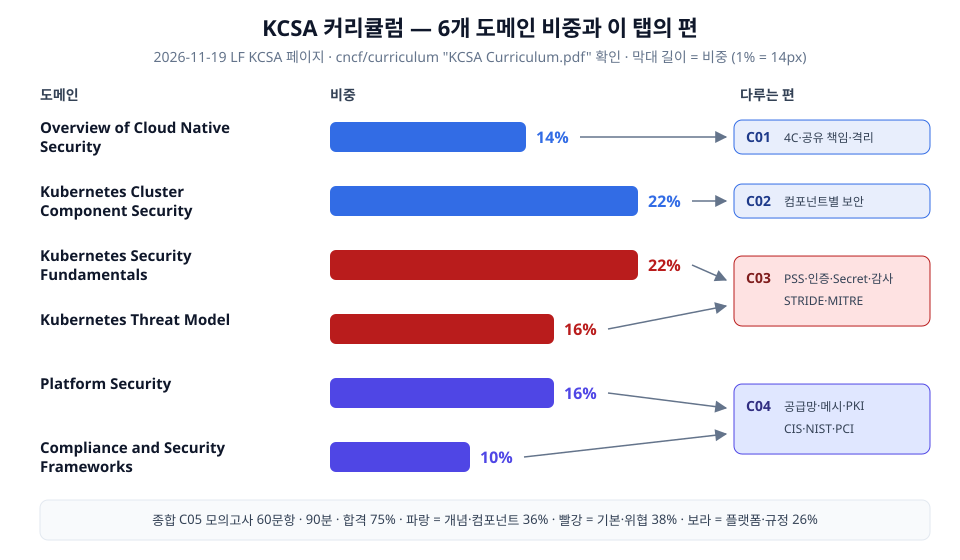
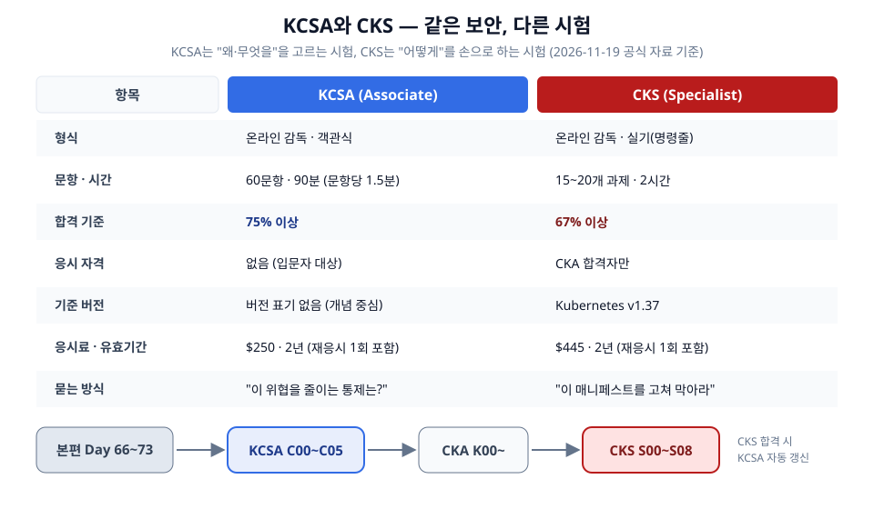

> **자격증 준비 · KCSA** | 난이도 ★★☆☆☆ | 예상 소요 1 ~ 1.5시간 (읽기·계획 세우기)

> ⚠️ **이 탭(C00~C05)의 모든 문항은 CNCF가 공개한 KCSA 공식 커리큘럼을 바탕으로 이 시리즈가 직접 창작한 연습 문항입니다.** 실제 시험 문제나 유출 문제(덤프)가 아니며, 그런 자료를 재현하지도 않습니다. Linux Foundation 시험은 응시자가 시험 내용 비공개에 동의하고 치르므로, "실제 기출"이라고 돌아다니는 자료를 구하거나 공유하는 것은 정책 위반이고 자격 취소 사유입니다.

## 🎯 오늘의 목표

- KCSA가 **무엇을, 어떤 조건으로** 평가하는지 공식 자료 기준으로 설명할 수 있다
- 커리큘럼 6개 도메인과 세부 항목이 이 탭의 C01~C04, 본편 보안 탭(Day 66~73), CKS 탭과 어떻게 이어지는지 지도를 그린다
- 같은 보안 주제를 다루는 **CKS와 KCSA의 차이**(형식·합격선·응시 자격·묻는 방식)를 정리한다
- 2~3주 학습 계획과 객관식 시험 요령을 세운다

---

## 1. KCSA는 어떤 시험인가?

KCSA(Kubernetes and Cloud Native Security Associate)는 Linux Foundation·CNCF의 **보안 입문 객관식** 시험입니다. 컨테이너 기반 애플리케이션과 클라우드 네이티브 환경을 지키는 **기본 원리**를 이해하는지 봅니다. 명령을 치는 시험이 아니라, "이 위협을 줄이려면 어떤 통제가 맞나", "이 컴포넌트에서 무엇을 꺼야 하나"를 **고르는** 시험입니다.

2026-11-19에 다음 공식 자료를 확인한 결과입니다.

- Linux Foundation [KCSA 페이지](https://training.linuxfoundation.org/certification/kubernetes-and-cloud-native-security-associate-kcsa/)
- LF 문서 [Multiple Choice Exams: Important Instructions](https://docs.linuxfoundation.org/tc-docs/certification/important-instructions-mc)
- LF 문서 [Multiple Choice Exams: Frequently Asked Questions](https://docs.linuxfoundation.org/tc-docs/certification/faq-mc)
- [cncf/curriculum](https://github.com/cncf/curriculum) 저장소의 `KCSA Curriculum.pdf`

| 항목 | 내용 (확인일 **2026-11-19**) | 출처 |
|---|---|---|
| 형식 | **온라인 감독(proctored), 객관식(multiple choice)**. PSI Bridge 보안 브라우저로 응시 | KCSA 페이지, Important Instructions |
| 문항 수 | **60문항** (LF 객관식 시험 공통. 예외는 CNPA 85문항뿐) | Important Instructions |
| 시험 시간 | **90분** | KCSA 페이지, Important Instructions |
| 합격 점수 | **75% 이상** ("A score of 75% or above must be earned to pass") | Multiple Choice FAQ |
| 응시 자격 | **없음**. 입문(Beginner) 수준 | KCSA 페이지 |
| 결과 통보 | 시험 종료 후 **24시간 안에** 이메일 | Important Instructions, FAQ |
| 재응시 | 등록 1건에 **재응시 1회 포함**(페이지에 "One retake"와 "Two exam attempts"가 함께 표기 — 같은 뜻으로 총 2회 응시). 등록 후 **12개월** 안에 응시 | KCSA 페이지 |
| 응시료 | 시험 단독 **$250** (번들 상품 별도) | KCSA 페이지 |
| 자격 유효기간 | **2년** | KCSA 페이지, FAQ |
| 갱신 | 재응시 합격 또는 **CKS 합격 시 KCSA 자동 갱신**(CARE 프로그램) | Multiple Choice FAQ |
| 시험 언어 | 영어 (LF 언어 표에서 KCSA는 EN만 표시) | LF Language 표 |
| 기준 Kubernetes 버전 | **표기 없음**. 커리큘럼 파일 이름에도 버전이 없음(CKA·CKAD·CKS는 `v1.37`) | cncf/curriculum |
| 시뮬레이터 | KCSA 페이지에 **언급 없음**(CKS의 killer.sh 같은 것이 포함된다는 문구 없음) | KCSA 페이지 |

> 💡 **75%가 생각보다 높습니다.** 60문항 중 **45문항 이상**을 맞혀야 합니다. 객관식이라 쉬워 보이지만, 틀려도 되는 문항이 15개뿐입니다. CKS(67%)보다 합격선이 높다는 점을 기억하세요.

> ⚠️ **커리큘럼 출처끼리 표가 다릅니다.** 2026-11-19 현재 LF KCSA 페이지와 `KCSA Curriculum.pdf`(2024-06 갱신)는 아래 2장의 6개 도메인·비중으로 **일치**합니다. 그런데 같은 저장소의 `kcsa/README.md`(2025-11 기여자 명단 추가 커밋)에는 "Cloud Native Fundamentals 16% / Kubernetes Security Fundamentals 20% / Container Security Fundamentals 20% / Secure Software Supply Chain 16% / Monitoring, Logging and Runtime Security 12% / General Security Knowledge 16%"라는 **다른 표**가 있습니다. 이 탭은 **응시 등록 페이지(LF)와 PDF가 일치하는 쪽**을 따릅니다. 시험이 개편될 수 있으니 등록 직전에 LF 페이지의 도메인 표를 다시 확인하세요. 주제 자체(4C, PSS, 공급망, 런타임 탐지, 위협 모델)는 두 표가 거의 같아서, 이 탭으로 공부한 내용은 어느 쪽이든 그대로 쓸 수 있습니다.

---

## 2. 커리큘럼 6개 도메인과 이 탭의 지도

| 비중 | 도메인 (LF 페이지 · PDF) | 다루는 편 | 60문항 환산 |
|---|---|---|---|
| **14%** | Overview of Cloud Native Security | [C01](./c01-cloud-native-security-overview.md) | 약 8문항 |
| **22%** | Kubernetes Cluster Component Security | [C02](./c02-cluster-component-security.md) | 약 13문항 |
| **22%** | Kubernetes Security Fundamentals | [C03](./c03-security-fundamentals-threat-model.md) | 약 13문항 |
| **16%** | Kubernetes Threat Model | [C03](./c03-security-fundamentals-threat-model.md) | 약 10문항 |
| **16%** | Platform Security | [C04](./c04-platform-security-compliance.md) | 약 10문항 |
| **10%** | Compliance and Security Frameworks | [C04](./c04-platform-security-compliance.md) | 약 6문항 |
| — | 종합 | [C05](./c05-mock-exam.md) 모의고사 60문항 | |

### 2-1. 커리큘럼 항목 ↔ 탭 편 ↔ 본편 Day · CKS 편

이론은 본편 보안 탭과 CKS 탭에서 이미 손으로 해 봤습니다. KCSA 탭은 그것을 **"개념을 구분해 고르는" 객관식 형식**으로 다시 묶습니다. 처음 보는 개념이면 오른쪽 링크부터 읽으세요.

| 도메인 | 커리큘럼 항목 (PDF 원문) | 탭 편 | 본편 Day · CKS 편 |
|---|---|---|---|
| Overview | The 4Cs of Cloud Native Security | C01 | [Day 66](../../09-security/day66-threat-modeling-4c.md) 2장 |
| | Cloud Provider and Infrastructure Security | C01 | [Day 67](../../09-security/day67-host-hardening.md) |
| | Controls and Frameworks | C01 · C04 | Day 66, [CKS S01](../cks/s01-cluster-setup.md)(CIS) |
| | Isolation Techniques | C01 | [Day 68](../../09-security/day68-container-runtime-security.md), [CKS S04](../cks/s04-microservice-vulnerabilities.md)(RuntimeClass) |
| | Artifact Repository and Image Security | C01 · C04 | [Day 57](../../07-gitops/day57-supply-chain-security.md), [CKS S05](../cks/s05-supply-chain.md) |
| | Workload and Application Code Security | C01 | [Day 69](../../09-security/day69-k8s-workload-security.md) |
| Cluster Component | API Server · Controller Manager · Scheduler · Kubelet · Container Runtime · KubeProxy · Pod · Etcd · Container Networking · Client Security · Storage | C02 | [CKS S01](../cks/s01-cluster-setup.md), [CKS S02](../cks/s02-cluster-hardening.md), Day 69 9장(kube-bench), [Day 70](../../09-security/day70-networkpolicy-zero-trust.md) |
| Security Fundamentals | Pod Security Standards · Pod Security Admissions | C03 | Day 69, CKS S04 |
| | Authentication | C03 | [Day 73](../../09-security/day73-keycloak-sso-audit.md), CKS S02 |
| | Secrets | C03 | [Day 71](../../09-security/day71-vault-cert-manager.md), CKS S04 |
| | Isolation and Segmentation · Network Policy | C03 | Day 70, CKS S01 |
| | Audit Logging | C03 | Day 73, [CKS S06](../cks/s06-monitoring-runtime.md) |
| Threat Model | Trust Boundaries and Data Flow · Persistence · Denial of Service · Malicious Code Execution · Attacker on the Network · Access to Sensitive Data · Privilege Escalation | C03 | Day 66 3~5장, [Day 72](../../09-security/day72-falco.md) |
| Platform Security | Supply Chain Security · Image Repository | C04 | Day 57, CKS S05 |
| | Observability | C04 | Day 72, Day 73, CKS S06 |
| | Service Mesh · Connectivity | C04 | Day 70 6장 |
| | PKI | C04 | Day 71 |
| | Admission Control | C04 | Day 69, CKS S02·S05 |
| Compliance | Compliance Frameworks · Threat Modeling Frameworks · Supply Chain Compliance · Automation and Tooling | C04 | Day 66, Day 67 8장(CIS), CKS S01 |

목표 편(C01~C04)은 모두 같은 순서로 구성됩니다.

1. **핵심 개념** — 표와 그림으로 한눈에
2. **헷갈리는 포인트** — 객관식 오답 선지가 노리는 곳
3. **창작 객관식 12~15문항** — `
`를 열면 정답·해설·근거 링크
4. **핵심 정리**, 다음 편 예고

---

## 3. CKS와 무엇이 다른가?

| 구분 | KCSA | CKS |
|---|---|---|
| 형식 | 객관식 60문항 / 90분 | 실기 15~20과제 / 2시간 ([CKS S00](../cks/s00-exam-overview-lab.md)) |
| 합격선 | **75%** | 67% |
| 응시 자격 | 없음 | CKA 합격자 |
| 무엇을 묻나 | 개념 구분: "이 위협에 맞는 통제는?", "이 설정은 어느 계층?" | 실행: "이 매니페스트를 고쳐 막아라" |
| 도구 | 이름과 **용도**만 알면 됨(Falco = 런타임 탐지, kube-bench = CIS 점검) | 옵션·파일 위치까지 손에 익혀야 함 |
| 범위 | 쿠버네티스 밖도 넓게: 클라우드 공유 책임, 컴플라이언스 프레임워크(PCI DSS, NIST 등), 위협 모델링 | 클러스터 안 기술 통제에 집중 |
| 시험 환경 | 브라우저 객관식 UI, 문항 표시(flag) 후 재검토 가능 | 원격 데스크톱 + 터미널, `ssh` 로 호스트 이동 |

> 💡 **CKS를 먼저 했다면** KCSA는 "언어만 바꾼 복습"에 가깝습니다. 다만 CKS에서 다루지 않는 **컴플라이언스 프레임워크, 공유 책임 모델, 위협 모델링 용어(STRIDE, MITRE ATT&CK)** 가 KCSA 비중의 4분의 1 가까이 됩니다. 이 부분은 C01·C03·C04에서 따로 챙깁니다.
>
> **CKS 전에 KCSA를 본다면** 이 탭을 개념 지도로 쓰고, 나중에 CKS 탭에서 같은 개념을 명령으로 옮기면 됩니다. C05 마지막 절이 그 연결을 정리합니다.

---

## 4. 학습 계획 — 2~3주

하루 1시간 기준입니다. 본편 보안 탭(Day 66~73)을 읽었다는 전제입니다. 읽지 않았다면 각 편의 근거 링크를 따라가며 1주를 더 잡으세요.

| 주차 | 범위 | 핵심 | 주말 점검 |
|---|---|---|---|
| 1주 | C00, C01, C02 | 4C·공유 책임·격리 스펙트럼, 컴포넌트별 포트와 하드닝 설정, API 요청의 세 관문 | C01·C02 문항을 **문항당 1분**으로 풀고 80% 이상 |
| 2주 | C03, C04 | PSS 세 레벨·PSA 세 모드, 인증 방식, 감사 로그 레벨, STRIDE, ATT&CK 전술, 공급망 용어, 프레임워크 구분 | C03·C04 문항 80% 이상, 틀린 문항은 근거 링크 다시 읽기 |
| 3주 | C05 | 60문항 90분 실전 → 채점 → 도메인별 약점 복습 → 1주 뒤 재풀이 | **51점(85%) 이상**이면 응시 |

2주로 줄이려면 1주차에 C01~C03, 2주차에 C04·C05를 하세요. 객관식은 **"아는 것 같다"와 "구분할 수 있다"의 차이**가 점수를 가릅니다. 표를 손으로 한 번씩 다시 그려 보는 것이 가장 효과적입니다.

💡 공부 방법 세 가지:

- **짝으로 외우세요.** PSS 레벨(privileged·baseline·restricted) ↔ PSA 모드(enforce·audit·warn), 감사 레벨 4개 ↔ 단계 4개, SBOM ↔ provenance ↔ 서명. 오답 선지는 대부분 **짝을 바꿔 놓은 것**입니다.
- **포트 번호는 "누가 듣는가"로.** 6443(API 서버), 2379/2380(etcd), 10250(kubelet), 10257(controller-manager), 10259(scheduler). 숫자만 외우지 말고 "그 포트에 누가 접근해야 하나"까지.
- **영어 원문 용어에 익숙해지세요.** 시험은 영어입니다. 이 탭의 문항은 한국어지만 핵심 용어는 영어를 괄호로 함께 적었습니다.

---

## 5. 시험장 요령 — 객관식 편

| 습관 | 이유 |
|---|---|
| **1회독 60분** — 문항당 1분, 모르면 표시(flag)하고 넘김 | 90분에 60문항이면 1.5분/문항. 앞에서 막히면 뒤의 쉬운 문항을 놓침 |
| **소거법** — 확실히 틀린 선지부터 지우기 | 4지선다에서 2개만 지워도 정답률이 50%로 오름 |
| **"가장(MOST)", "아닌 것(NOT)"에 밑줄** | 영어 지문의 *NOT*, *BEST*, *FIRST* 를 놓치는 실수가 가장 흔함 |
| **빈칸 없이 제출** | 오답 감점에 대한 공식 안내가 없으므로 모르는 문항도 하나는 고르기 |
| 시스템 점검을 **전날에** | PSI Online Proctoring System Check, 신분증, 정리된 책상(필기구·종이 금지) |

> ⚠️ 응시 환경 규칙(모니터 1대, 혼자 있는 조용한 공간, 책상 위 물건 금지, 웹캠으로 주변 확인)은 [LF Multiple Choice FAQ](https://docs.linuxfoundation.org/tc-docs/certification/faq-mc)에 있습니다. CKS와 달리 터미널은 없지만 감독 규칙은 같습니다.

---

## 6. 핵심 정리

- KCSA는 **60문항 · 90분 · 75% 이상 합격**의 온라인 감독 객관식 시험. 응시 자격 없음, 재응시 1회 포함, $250, 자격 2년, **CKS 합격 시 자동 갱신**
- 도메인(LF 페이지·PDF 기준): Overview 14 / Cluster Component 22 / Security Fundamentals 22 / Threat Model 16 / Platform 16 / Compliance 10. `kcsa/README.md`의 다른 표와 헷갈리지 말고 **등록 직전 LF 페이지 재확인**
- CKS와의 차이: **고르는 시험 vs 고치는 시험**, 합격선은 KCSA가 더 높고, 범위는 KCSA가 더 넓다(공유 책임·프레임워크·위협 모델)
- 학습은 C01~C04 문항 → C05 실전 → 약점 복습. 51점 이상이면 응시
- 이 탭의 모든 문항은 **공식 커리큘럼 기반 창작**이다

---

## ⏭️ 다음 예고 — C01. 클라우드 네이티브 보안 개요

첫 도메인 **Overview of Cloud Native Security(14%)** 입니다. 4C(Cloud·Cluster·Container·Code) 계층이 왜 "바깥이 뚫리면 안쪽은 소용없다"는 뜻인지, 자체 구축·관리형 K8s·서버리스에서 **공유 책임 경계**가 어떻게 움직이는지, 네임스페이스부터 별도 클러스터까지 **격리 기법의 강도 순서**를 정리하고 창작 객관식으로 확인합니다.
