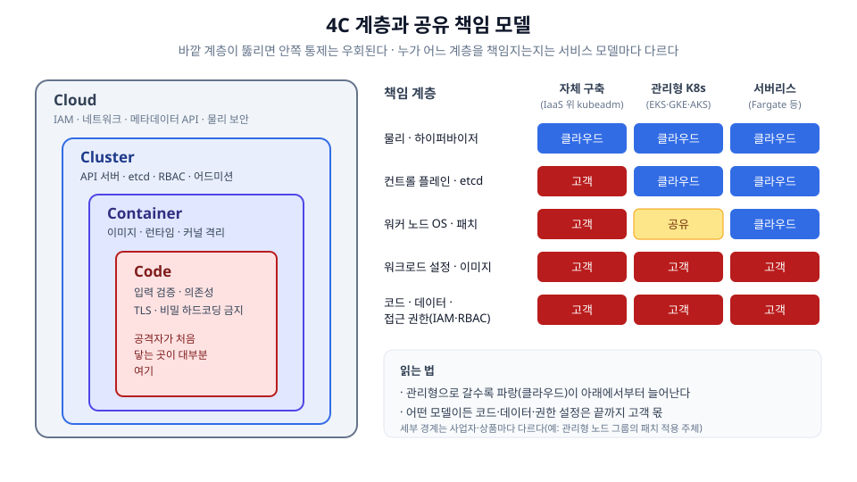
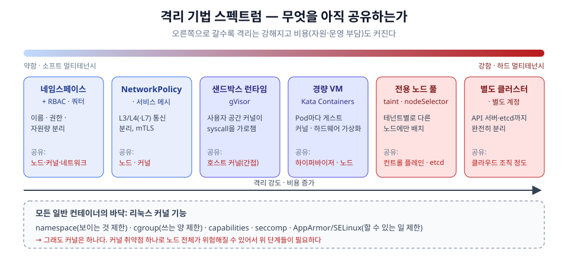

> **자격증 준비 · KCSA** | 난이도 ★★☆☆☆ | 예상 소요 1.5 ~ 2시간

> ⚠️ 이 편의 모든 문항은 CNCF가 공개한 **KCSA 공식 커리큘럼(`KCSA Curriculum.pdf`)의 "Overview of Cloud Native Security" 항목을 바탕으로 직접 창작한** 연습 문항입니다. 실제 시험 문제(기출·덤프)가 아니며, 그런 자료를 재현하지 않습니다.

## 🎯 오늘의 목표

- 4C(Cloud·Cluster·Container·Code) 계층별로 **무엇을 지키고 어떤 통제가 있는지** 표 하나로 말할 수 있다
- 자체 구축·관리형 K8s·서버리스 컨테이너에서 **공유 책임 경계**가 어떻게 달라지는지 구분한다
- 예방·탐지·교정 통제, 심층 방어, 최소 권한, 제로 트러스트를 예시로 분류한다
- 네임스페이스부터 별도 클러스터까지 **격리 기법을 강도 순으로** 놓고 "무엇을 아직 공유하는지" 설명한다
- 이미지·레지스트리와 애플리케이션 코드 계층의 기본 통제(다이제스트, 최소 이미지, SAST·SCA)를 고른다

---

## 1. 도메인 한눈에 — Overview of Cloud Native Security (14%)

| 커리큘럼 항목 | 이 편의 섹션 | 깊게 보려면 |
|---|---|---|
| The 4Cs of Cloud Native Security | 2 | [Day 66](../../09-security/day66-threat-modeling-4c.md) 2장 |
| Cloud Provider and Infrastructure Security | 3 | [Day 67](../../09-security/day67-host-hardening.md) |
| Controls and Frameworks | 4 | Day 66, [C04](./c04-platform-security-compliance.md) 프레임워크 |
| Isolation Techniques | 5 | [Day 68](../../09-security/day68-container-runtime-security.md), [CKS S04](../cks/s04-microservice-vulnerabilities.md)(RuntimeClass·gVisor) |
| Artifact Repository and Image Security | 6 | [Day 57](../../07-gitops/day57-supply-chain-security.md), [CKS S05](../cks/s05-supply-chain.md) |
| Workload and Application Code Security | 7 | [Day 69](../../09-security/day69-k8s-workload-security.md) |

---

## 2. 4C — 계층으로 보는 클라우드 네이티브 보안

4C는 보안을 **양파처럼 네 겹**으로 봅니다. 핵심 문장은 하나입니다. **"안쪽 계층은 바깥 계층이 뚫리면 지켜 주지 못한다."**

| 계층 | 무엇을 지키나 | 대표 위협 | 대표 통제 |
|---|---|---|---|
| **Cloud** (인프라) | 데이터센터, 클라우드 계정, 네트워크, 노드 OS | 클라우드 계정 탈취, 메타데이터 API 악용, 열린 보안 그룹 | IAM 최소 권한·MFA, 네트워크 분리, 노드 하드닝·패치 |
| **Cluster** | API 서버, etcd, 컨트롤러, 그 위의 리소스 | API 서버 인터넷 노출, 과도한 RBAC, 평문 etcd | 인증·인가(RBAC), 어드미션, 감사 로그, etcd 암호화, NetworkPolicy |
| **Container** | 이미지와 컨테이너 런타임 | 취약한 베이스 이미지, privileged 컨테이너, 컨테이너 탈출 | 이미지 스캔·서명, non-root, seccomp·AppArmor, 샌드박스 런타임 |
| **Code** | 애플리케이션 자체 | 인젝션, 취약한 의존성, 하드코딩된 비밀 | 입력 검증, SAST·SCA, TLS, 비밀을 외부에서 주입 |

> 💡 **같은 사실, 다른 축.** 최신 Kubernetes 문서([Cloud Native Security and Kubernetes](https://kubernetes.io/docs/concepts/security/cloud-native-security/))는 CNCF 보안 백서의 **Develop → Distribute → Deploy → Runtime** 수명 주기로 설명합니다. 4C는 **어디(계층)**, 수명 주기는 **언제(단계)** 를 묻습니다. KCSA 커리큘럼은 4C를 명시하므로 둘 다 알아 두세요. 예: "이미지 서명"은 4C로는 Container, 수명 주기로는 Distribute입니다.

---

## 3. 클라우드 제공자와 인프라 보안 — 공유 책임

클라우드에서는 보안 책임이 **제공자(CSP)와 고객 사이에 나뉩니다**. 흔히 "클라우드의 보안(security **of** the cloud)은 제공자, 클라우드 안의 보안(security **in** the cloud)은 고객"이라고 정리합니다.

| 모델 | 제공자가 맡는 것 | 고객이 맡는 것 |
|---|---|---|
| IaaS 위 자체 구축(kubeadm) | 물리·하이퍼바이저 | 컨트롤 플레인, etcd, 노드 OS, 워크로드, IAM·RBAC 전부 |
| 관리형 K8s(EKS·GKE·AKS 등) | + 컨트롤 플레인·etcd 운영·패치 | 노드(관리형 노드 그룹은 일부 공유), 워크로드, RBAC, 네트워크 정책, IAM |
| 서버리스 컨테이너(Fargate 등) | + 노드 OS·런타임 | 워크로드 설정, 이미지, 코드, 데이터, 접근 권한 |

어떤 모델이든 **데이터, 코드, 접근 권한 설정은 끝까지 고객 몫**입니다. 세부 경계는 사업자·상품마다 다르니 실제 운영에서는 해당 사업자의 공유 책임 문서를 확인합니다.

인프라 계층에서 KCSA가 자주 묻는 통제:

| 주제 | 핵심 | 왜 |
|---|---|---|
| 클라우드 IAM | 노드·워크로드에 **필요한 권한만**, 사람 계정에 MFA | 노드 역할에 과한 권한이 붙어 있으면 Pod 하나 탈취 = 클라우드 계정 탈취 |
| **인스턴스 메타데이터 API** (`169.254.169.254`) | Pod에서의 접근을 egress 정책으로 차단, 세션 기반 메타데이터(AWS IMDSv2 등)와 홉 제한 | 노드의 임시 자격 증명이 여기서 나온다 |
| 네트워크 | API 서버를 인터넷에 직접 열지 않기, 보안 그룹·방화벽으로 노드 포트 최소화 | 공격 표면 축소 |
| 노드 OS | 최소 설치, 패치, SSH 하드닝, CIS 벤치마크 | 커널은 모든 컨테이너가 공유 |
| 물리·데이터센터 | 클라우드면 제공자 책임, 온프레미스·홈랩이면 내 책임 | Day 66의 "홈랩의 Cloud = 내 공유기와 서버" |

---

## 4. 통제와 원칙 — Controls and Frameworks

### 4-1. 통제의 종류

| 종류 | 언제 작동하나 | 쿠버네티스 예 |
|---|---|---|
| **예방(Preventive)** | 사고가 일어나기 **전에** 막음 | RBAC, PSA `enforce`, NetworkPolicy, 어드미션 정책, 이미지 서명 검증 |
| **탐지(Detective)** | 일어나는 **중·후에** 알아챔 | 감사 로그, Falco, 이미지 재스캔, PSA `audit`·`warn` |
| **교정(Corrective)** | 일어난 **후에** 되돌림 | 백업 복구, 침해 Pod 격리·재배포, 키 교체(rotation) |

> 💡 같은 도구라도 설정에 따라 종류가 바뀝니다. PSA는 `enforce`면 예방, `audit`·`warn`이면 탐지입니다. 시험은 이런 **분류 감각**을 묻습니다.

### 4-2. 원칙 네 가지

| 원칙 | 한 줄 정의 | 예 |
|---|---|---|
| **심층 방어(Defense in Depth)** | 한 통제가 뚫려도 다음 통제가 막도록 **여러 겹** | 이미지 스캔 + PSS + NetworkPolicy + Falco |
| **최소 권한(Least Privilege)** | 일에 필요한 권한만, 필요한 동안만 | 네임스페이스 단위 Role, SA 토큰 자동 마운트 끄기 |
| **제로 트러스트(Zero Trust)** | 네트워크 위치(“내부망”)를 신뢰 근거로 쓰지 않고 **매 요청을 인증·인가** | 기본 거부 NetworkPolicy + mTLS 워크로드 아이덴티티 ([Day 70](../../09-security/day70-networkpolicy-zero-trust.md)) |
| **공격 표면 최소화** | 쓰지 않는 기능·포트·패키지를 없앰 | distroless 이미지, kubelet 읽기 전용 포트 끄기 |

프레임워크(CIS Benchmark, NIST, PCI DSS 등)의 구분은 [C04](./c04-platform-security-compliance.md)에서 따로 다룹니다.

---

## 5. 격리 기법 — 무엇을 아직 공유하는가

| 기법 | 격리하는 것 | 아직 공유하는 것 | 언제 |
|---|---|---|---|
| 네임스페이스 + RBAC + ResourceQuota | 이름, API 권한, 자원량 | 노드, 커널, 네트워크(정책이 없으면 Pod끼리 다 통함) | 같은 회사 팀 간(소프트 멀티테넌시) |
| NetworkPolicy · 서비스 메시 | Pod 간 통신(L3/L4, 메시는 L7·mTLS) | 노드, 커널 | 마이크로서비스 분리 |
| 리눅스 커널 기능(namespace, cgroup, capabilities, seccomp, AppArmor/SELinux) | 보이는 것, 쓰는 양, 할 수 있는 syscall | **호스트 커널** | 모든 컨테이너의 기본 |
| 샌드박스 런타임 (gVisor) | syscall을 사용자 공간 커널이 처리 | 호스트 커널(간접적으로) | 신뢰하지 않는 코드 실행 |
| 경량 VM (Kata Containers) | Pod마다 게스트 커널 | 하이퍼바이저, 노드 | 더 강한 커널 격리 |
| 전용 노드 풀 (taint/toleration, nodeSelector) | 노드 | 컨트롤 플레인, etcd | 민감 워크로드 분리 |
| 별도 클러스터 · 별도 클라우드 계정 | 컨트롤 플레인까지 | 거의 없음 | 서로 신뢰하지 않는 고객(하드 멀티테넌시) |

샌드박스 런타임은 쿠버네티스에서 **RuntimeClass**로 고릅니다. Pod의 `runtimeClassName`이 노드의 런타임 핸들러(예: `runsc`)를 가리킵니다([CKS S00](../cks/s00-exam-overview-lab.md)에서 실제로 설정했습니다). 공식 문서: [Multi-tenancy](https://kubernetes.io/docs/concepts/security/multi-tenancy/), [Runtime Class](https://kubernetes.io/docs/concepts/containers/runtime-class/).

---

## 6. 아티팩트 저장소와 이미지 보안

| 통제 | 핵심 |
|---|---|
| **다이제스트 고정** | `image: repo/app@sha256:...` — 태그(`:1.2`, `:latest`)는 옮겨 붙일 수 있지만 다이제스트는 내용의 해시라 바뀌지 않음 |
| **최소 이미지** | distroless·scratch·slim 베이스 → 셸·패키지 관리자·불필요 라이브러리가 없어 취약점과 공격 도구가 줄어듦 |
| **취약점 스캔** | 빌드 시 + 레지스트리 보관 중 **주기적 재스캔**(새 CVE는 나중에 공개됨) |
| **서명·검증** | cosign 등으로 서명하고 배포 시 어드미션에서 검증 |
| **비공개 레지스트리 · 접근 제어** | 푸시 권한 최소화, `imagePullSecrets`, 허용 레지스트리만 쓰도록 정책 |

자세한 공급망 통제(SBOM, provenance, SLSA)는 [C04](./c04-platform-security-compliance.md) 2장에서 이어집니다.

---

## 7. 워크로드와 애플리케이션 코드 보안

| 영역 | 통제 | 비고 |
|---|---|---|
| 워크로드 설정 | `runAsNonRoot`, `allowPrivilegeEscalation: false`, `capabilities.drop: ["ALL"]`, `readOnlyRootFilesystem`, `seccompProfile: RuntimeDefault` | PSS restricted가 요구하는 것과 거의 같음 ([Day 69](../../09-security/day69-k8s-workload-security.md) 4장) |
| 자원 | requests·limits | 이웃 Pod의 DoS 방지 |
| 비밀 | 코드·이미지에 넣지 말고 Secret·외부 금고에서 **런타임 주입** | 이미지 레이어는 지워도 이전 레이어에 남음 |
| 코드 분석 | **SAST**(소스 정적 분석), **SCA**(오픈소스 의존성 취약점), **DAST**(실행 중인 앱을 밖에서 공격 시험) | 세 가지를 헷갈리게 내는 문항이 흔함 |
| 통신 | 서비스 간 TLS/mTLS | 메시가 대신해 줄 수 있음(C04) |

공식 체크리스트: [Application Security Checklist](https://kubernetes.io/docs/concepts/security/application-security-checklist/).

---

## 8. 헷갈리는 포인트

| 헷갈리는 것 | 정확히는 |
|---|---|
| "네임스페이스는 보안 경계다" | 네임스페이스는 **이름·권한·쿼터의 경계**일 뿐. 네트워크 격리는 NetworkPolicy가 있어야 하고, 커널은 여전히 공유 |
| 4C 순서 | 바깥에서 안으로 **Cloud → Cluster → Container → Code**. "Code가 가장 바깥"은 오답 |
| 관리형 K8s면 보안은 클라우드가 다 해 준다 | 컨트롤 플레인 운영은 제공자, **RBAC·워크로드·네트워크 정책·IAM 연결은 고객** |
| gVisor와 Kata | gVisor = 사용자 공간 커널(syscall 가로채기), Kata = **경량 VM**(게스트 커널). 둘 다 RuntimeClass로 선택 |
| 탐지 vs 예방 | 감사 로그·Falco는 **막지 않는다**(탐지). 막는 것은 RBAC·어드미션·NetworkPolicy |
| 태그 vs 다이제스트 | `:v1.0` 태그도 덮어쓸 수 있음. 불변 보장은 **`@sha256:` 다이제스트** |
| SAST vs DAST vs SCA | 소스를 읽음 = SAST, 돌아가는 앱을 두드림 = DAST, 라이브러리 목록을 CVE와 대조 = SCA |
| 제로 트러스트 = 방화벽 강화 | 아니다. 핵심은 **"내부망이라 믿지 않고 매 요청을 인증·인가"** |

---

## 9. 창작 객관식 15문항

> 모든 문항은 이 시리즈의 창작입니다. 먼저 답을 정하고 `
`를 여세요. 문항당 1분이 목표입니다.

**Q1.** 클라우드 네이티브 보안 4C를 **바깥 계층부터 안쪽 계층** 순서로 옳게 나열한 것은?

- A. Code → Container → Cluster → Cloud
- B. Cloud → Cluster → Container → Code
- C. Cluster → Cloud → Container → Code
- D. Cloud → Container → Cluster → Code

정답·해설

**정답: B**

4C는 Cloud(인프라)가 가장 바깥, Code가 가장 안쪽입니다. A는 순서를 뒤집었고, C·D는 계층을 섞었습니다.

근거: 이 편 2장, [Day 66](../../09-security/day66-threat-modeling-4c.md) 2장

**Q2.** 4C 모델이 강조하는 핵심 원리로 가장 알맞은 것은?

- A. 안쪽 계층(Code)을 완벽하게 지키면 바깥 계층의 취약점은 무시해도 된다
- B. 각 계층은 독립적이므로 한 계층만 골라 집중하면 된다
- C. 바깥 계층이 뚫리면 안쪽 계층의 통제가 우회될 수 있으므로 모든 계층을 함께 지켜야 한다
- D. 클라우드 계층은 언제나 클라우드 제공자의 책임이다

정답·해설

**정답: C**

예를 들어 클라우드 계정을 탈취당하면 공격자는 노드 디스크 스냅샷에서 etcd 데이터를 꺼낼 수 있어, 클러스터 안의 RBAC가 아무 의미가 없어집니다. D는 공유 책임 모델을 오해한 것입니다(클라우드 계정의 IAM 설정은 고객 책임).

근거: 이 편 2·3장

**Q3.** 한 팀이 관리형 쿠버네티스 서비스(컨트롤 플레인을 제공자가 운영)를 쓰고 있다. 공유 책임 모델에서 **고객 책임**에 해당하는 것은?

- A. etcd 서버의 OS 패치
- B. API 서버 프로세스의 고가용성 구성
- C. 데이터센터 출입 통제
- D. 네임스페이스별 RBAC 바인딩과 워크로드의 securityContext 설정

정답·해설

**정답: D**

관리형 서비스에서 컨트롤 플레인(API 서버, etcd)의 운영·패치와 물리 보안은 제공자 몫입니다. 그러나 **누가 무엇을 할 수 있는지(RBAC)** 와 **워크로드를 어떻게 띄우는지(securityContext)** 는 끝까지 고객 책임입니다.

근거: 이 편 3장 표

**Q4.** 클라우드 VM 위의 노드에서 실행되는 Pod가 `169.254.169.254`로 접근하는 것을 막으라는 권고가 있다. 이 권고가 주로 방지하려는 위험은?

- A. 노드에 부여된 클라우드 IAM 역할의 임시 자격 증명 탈취
- B. CoreDNS 캐시 오염
- C. kubelet 읽기 전용 포트 노출
- D. etcd 피어 통신 도청

정답·해설

**정답: A**

`169.254.169.254`는 주요 클라우드의 **인스턴스 메타데이터 API** 주소입니다. 여기서 노드 역할의 임시 자격 증명을 받을 수 있어, Pod 하나가 뚫리면 클라우드 계정까지 번질 수 있습니다. egress NetworkPolicy로 막고, 세션 기반 메타데이터(IMDSv2 등)와 홉 제한을 함께 씁니다.

근거: 이 편 3장, [CKS S01](../cks/s01-cluster-setup.md)(메타데이터 엔드포인트 보호 과제)

**Q5.** 다음 중 **탐지(Detective) 통제**로 분류하기에 가장 알맞은 것은?

- A. 기본 거부 NetworkPolicy
- B. 컨테이너 안에서 셸이 실행되면 경보를 내는 Falco 규칙
- C. `pod-security.kubernetes.io/enforce: restricted` 레이블
- D. 특정 레지스트리 이미지만 허용하는 어드미션 정책

정답·해설

**정답: B**

Falco는 런타임 행위를 관찰해 **알려 줄 뿐** 막지 않습니다(탐지). A·C·D는 요청이나 트래픽이 일어나기 전에 차단하는 예방 통제입니다.

근거: 이 편 4-1, [Day 72](../../09-security/day72-falco.md)

**Q6.** "이미지 스캔, Pod Security Standards, NetworkPolicy, 런타임 탐지를 함께 적용해 하나가 실패해도 다른 것이 공격을 막거나 드러내게 한다." 이 설명에 해당하는 원칙은?

- A. 최소 권한
- B. 직무 분리
- C. 심층 방어
- D. 보안 by 은닉(security through obscurity)

정답·해설

**정답: C**

여러 겹의 통제를 쌓는 것이 심층 방어(Defense in Depth)입니다. 최소 권한은 권한의 양, 직무 분리는 한 사람에게 권한이 몰리지 않게 하는 원칙입니다. D는 원칙이 아니라 피해야 할 안티패턴입니다.

근거: 이 편 4-2

**Q7.** 제로 트러스트(Zero Trust) 원칙을 쿠버네티스에 적용한 예로 가장 알맞은 것은?

- A. 클러스터 내부 트래픽은 신뢰하고 외부에서 들어오는 Ingress 트래픽만 검사한다
- B. 모든 Pod 간 통신을 기본 거부하고, 워크로드 아이덴티티 기반 mTLS와 정책으로 필요한 통신만 허용한다
- C. 노드를 사설 서브넷에 두었으므로 kubelet 인증을 끈다
- D. 관리자 kubeconfig를 팀 전체가 공유해 운영 편의를 높인다

정답·해설

**정답: B**

제로 트러스트는 "내부망이니까 괜찮다"를 버리고 매 요청을 인증·인가하는 것입니다. A와 C는 바로 그 "위치 기반 신뢰"이고, D는 최소 권한과 부인 방지를 모두 깨뜨립니다.

근거: 이 편 4-2, [Day 70](../../09-security/day70-networkpolicy-zero-trust.md) 1장

**Q8.** 같은 클러스터의 두 네임스페이스 `team-a`와 `team-b`에 대한 설명으로 옳은 것은? (NetworkPolicy는 하나도 없다)

- A. 네임스페이스가 다르면 Pod 간 네트워크 통신이 기본적으로 차단된다
- B. 네임스페이스가 다르면 서로 다른 커널에서 실행된다
- C. RBAC로 API 권한은 나눌 수 있지만, 정책이 없으므로 Pod끼리는 네트워크로 통신할 수 있다
- D. 네임스페이스를 나누면 노드도 자동으로 분리된다

정답·해설

**정답: C**

쿠버네티스 네트워크 모델은 기본적으로 모든 Pod가 서로 통신할 수 있습니다. 네임스페이스는 이름·권한·쿼터의 경계이고, 네트워크 격리는 NetworkPolicy가 있어야 합니다. 커널과 노드도 공유합니다.

근거: 이 편 5장, [NetworkPolicy 문서](https://kubernetes.io/docs/concepts/services-networking/network-policies/)

**Q9.** 신뢰할 수 없는 사용자가 올린 코드를 컨테이너로 실행해야 한다. 일반 컨테이너보다 **커널 격리를 강화**하려고 할 때 쿠버네티스에서 쓰는 방법은?

- A. Pod에 `runtimeClassName`을 지정해 gVisor나 Kata Containers 같은 샌드박스 런타임으로 실행
- B. Pod를 별도 네임스페이스에 배치
- C. Service 유형을 ClusterIP로 변경
- D. 이미지 태그를 `latest` 대신 버전 태그로 변경

정답·해설

**정답: A**

RuntimeClass로 노드의 다른 런타임 핸들러를 고르면 gVisor(사용자 공간 커널)나 Kata(경량 VM)로 호스트 커널과의 거리를 늘릴 수 있습니다. B는 커널을 그대로 공유하고, C·D는 격리와 무관합니다.

근거: 이 편 5장, [Runtime Class 문서](https://kubernetes.io/docs/concepts/containers/runtime-class/), [CKS S04](../cks/s04-microservice-vulnerabilities.md)

**Q10.** 서로 경쟁 관계인 외부 고객사들에게 같은 플랫폼을 제공한다. 고객 간 격리를 **가장 강하게** 보장하는 선택은?

- A. 고객마다 네임스페이스와 ResourceQuota를 준다
- B. 고객마다 전용 노드 풀을 준다
- C. 고객마다 NetworkPolicy를 적용한다
- D. 고객마다 별도 클러스터(가능하면 별도 클라우드 계정)를 준다

정답·해설

**정답: D**

A·C는 컨트롤 플레인과 노드를, B는 컨트롤 플레인과 etcd를 여전히 공유합니다. 서로 신뢰하지 않는 테넌트(하드 멀티테넌시)에 가장 강한 것은 컨트롤 플레인까지 나누는 별도 클러스터입니다. 대신 비용·운영 부담이 가장 큽니다.

근거: 이 편 5장 그림, [Multi-tenancy 문서](https://kubernetes.io/docs/concepts/security/multi-tenancy/)

**Q11.** 배포 매니페스트가 항상 **똑같은 이미지 내용**을 가리키도록 보장하는 이미지 참조 방식은?

- A. `registry.example.com/shop/api:latest`
- B. `registry.example.com/shop/api:2.4.1`
- C. `registry.example.com/shop/api@sha256:<64자리 해시>`
- D. `shop/api` (레지스트리·태그 생략)

정답·해설

**정답: C**

태그는 레지스트리에서 다른 이미지로 다시 붙일 수 있습니다(버전 태그 B도 마찬가지). 다이제스트는 이미지 매니페스트 내용의 해시라 내용이 바뀌면 값도 바뀝니다. D는 기본 레지스트리와 `latest` 태그를 암묵적으로 쓰게 되어 가장 나쁩니다.

근거: 이 편 6장, [CKS S05](../cks/s05-supply-chain.md)

**Q12.** distroless 같은 최소 베이스 이미지를 쓰는 **보안상** 주된 이점은?

- A. 이미지 서명이 자동으로 붙는다
- B. 셸·패키지 관리자·불필요한 라이브러리가 빠져 취약점 수와 공격자가 쓸 도구가 줄어든다
- C. 컨테이너가 자동으로 non-root로 실행되므로 securityContext가 필요 없다
- D. 컨테이너가 호스트 커널을 공유하지 않게 된다

정답·해설

**정답: B**

최소 이미지는 공격 표면을 줄입니다. 서명은 별도 단계이고(A), 일부 distroless 이미지가 nonroot 태그를 제공하더라도 securityContext로 명시하는 것이 원칙입니다(C). 커널 공유는 이미지와 무관합니다(D).

근거: 이 편 6장, [Day 57](../../07-gitops/day57-supply-chain-security.md)

**Q13.** 개발자가 Dockerfile에서 `COPY api-key.txt /app/`로 키를 넣은 뒤, 다음 줄에서 `RUN rm /app/api-key.txt`로 지웠다. 이 이미지에 대한 설명으로 옳은 것은?

- A. 최종 파일 시스템에서 지웠으므로 키는 완전히 사라졌다
- B. 레지스트리가 푸시 시점에 키를 제거한다
- C. 이미지 스캐너가 자동으로 키를 암호화한다
- D. 키는 이전 이미지 레이어에 남아 있어 이미지를 받은 누구나 꺼낼 수 있다

정답·해설

**정답: D**

이미지 레이어는 누적되므로 앞 레이어에 들어간 파일은 뒤에서 지워도 남습니다. 비밀은 이미지에 넣지 말고 Secret이나 외부 비밀 저장소에서 **실행 시점에 주입**해야 하며, 이미 노출된 키는 폐기·교체해야 합니다.

근거: 이 편 7장, [Day 71](../../09-security/day71-vault-cert-manager.md)

**Q14.** CI 파이프라인에서 애플리케이션이 쓰는 **오픈소스 라이브러리**의 알려진 취약점(CVE)을 찾는 활동을 가리키는 말은?

- A. SCA(Software Composition Analysis)
- B. DAST(Dynamic Application Security Testing)
- C. 퍼징(Fuzzing)
- D. 침투 테스트 중 사회공학

정답·해설

**정답: A**

SCA는 의존성 목록을 취약점 데이터베이스와 대조합니다. SAST는 내가 쓴 소스 코드를, DAST는 실행 중인 앱을 밖에서 시험하고, 퍼징은 비정상 입력을 대량으로 넣어 충돌을 찾습니다.

근거: 이 편 7장

**Q15.** 모든 일반 컨테이너(runc 등)에 공통으로 해당하는 설명은?

- A. 컨테이너마다 독립된 게스트 커널을 가진다
- B. 리눅스 namespace·cgroup으로 격리되지만 같은 노드의 **호스트 커널을 공유**한다
- C. 하이퍼바이저가 메모리를 하드웨어 수준에서 분리한다
- D. seccomp가 기본적으로 모든 syscall을 차단한다

정답·해설

**정답: B**

일반 컨테이너는 프로세스 격리이므로 커널은 하나입니다. 그래서 커널 취약점은 노드 전체의 위험이 되고, seccomp·AppArmor·샌드박스 런타임이 필요해집니다. A·C는 경량 VM(Kata)의 특징이고, D는 사실과 다릅니다(`RuntimeDefault`는 위험한 일부 syscall만 막음).

근거: 이 편 5장, [Day 68](../../09-security/day68-container-runtime-security.md) 2장

---

## 10. 핵심 정리

- **4C**: Cloud → Cluster → Container → Code(바깥→안). 바깥이 뚫리면 안쪽 통제는 우회된다. 최신 K8s 문서의 수명 주기(Develop·Distribute·Deploy·Runtime)는 같은 내용을 "언제"의 축으로 본 것
- **공유 책임**: 관리형으로 갈수록 제공자 몫이 아래에서부터 늘지만, **코드·데이터·IAM·RBAC·워크로드 설정은 끝까지 고객**
- **통제 분류**: 예방(RBAC, 어드미션, NetworkPolicy) / 탐지(감사 로그, Falco) / 교정(복구, 키 교체). 원칙: 심층 방어, 최소 권한, 제로 트러스트, 공격 표면 최소화
- **격리 강도**: 네임스페이스 < NetworkPolicy < 샌드박스(gVisor) < 경량 VM(Kata) < 전용 노드 < 별도 클러스터. "아직 무엇을 공유하나"로 판단
- **이미지**: 다이제스트 고정, 최소 이미지, 주기적 재스캔, 서명 검증, 비밀은 이미지에 넣지 않기
- **코드**: SAST(소스) · SCA(의존성) · DAST(실행 중)

---

## ⏭️ 다음 예고 — C02. 쿠버네티스 클러스터 컴포넌트 보안

비중이 가장 큰 도메인 중 하나인 **Kubernetes Cluster Component Security(22%)** 입니다. API 서버·컨트롤러 매니저·스케줄러·kubelet·컨테이너 런타임·kube-proxy·etcd를 하나씩 놓고 **"누가 그 포트에 접근해야 하나, 무엇을 꺼야 하나"** 를 정리합니다. API 요청이 인증 → 인가 → 어드미션을 거쳐 etcd에 닿는 흐름도 그림으로 확인합니다.
