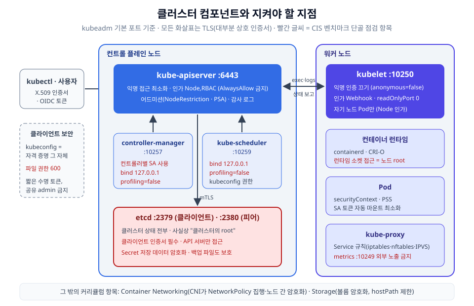
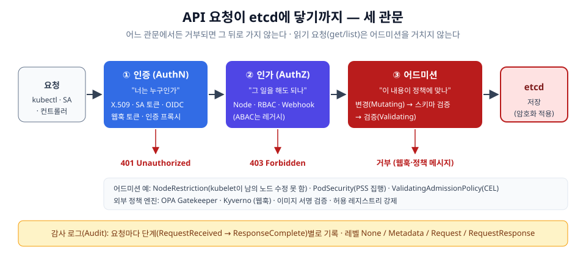

> **자격증 준비 · KCSA** | 난이도 ★★★☆☆ | 예상 소요 2 ~ 2.5시간

> ⚠️ 이 편의 모든 문항은 CNCF가 공개한 **KCSA 공식 커리큘럼(`KCSA Curriculum.pdf`)의 "Kubernetes Cluster Component Security" 항목을 바탕으로 직접 창작한** 연습 문항입니다. 실제 시험 문제(기출·덤프)가 아니며, 그런 자료를 재현하지 않습니다.

## 🎯 오늘의 목표

- 컨트롤 플레인·워커 컴포넌트마다 **기본 포트, 누가 접근해야 하는지, 대표 하드닝 설정**을 표로 말할 수 있다
- API 요청이 **인증 → 인가 → 어드미션**을 거쳐 etcd에 저장되는 흐름과, 각 관문의 거부 응답(401·403)을 구분한다
- API 서버를 **우회하는 경로**(kubelet API, etcd 직접 접근, 런타임 소켓, 정적 Pod)가 왜 위험한지 설명한다
- 컨테이너 네트워킹(CNI), 클라이언트(kubeconfig), 스토리지 계층의 기본 통제를 고른다

---

## 1. 도메인 한눈에 — Kubernetes Cluster Component Security (22%)

커리큘럼 항목은 컴포넌트 이름 11개가 전부입니다: **API Server, Controller Manager, Scheduler, Kubelet, Container Runtime, KubeProxy, Pod, Etcd, Container Networking, Client Security, Storage.** 시험은 "이 컴포넌트에서 무엇이 위험하고 무엇을 켜고 꺼야 하나"를 묻습니다.

| 이 편 섹션 | 손으로 해 본 곳 |
|---|---|
| 2 컴포넌트 지도 | [CKS S01](../cks/s01-cluster-setup.md)(kube-bench로 매니페스트·kubelet 수정), [Day 69](../../09-security/day69-k8s-workload-security.md) 9장 |
| 3 API 요청 흐름 | [CKS S02](../cks/s02-cluster-hardening.md)(익명 접근 제한, NodeRestriction), [Day 73](../../09-security/day73-keycloak-sso-audit.md) |
| 4 우회 경로 | [CKS S01](../cks/s01-cluster-setup.md), [CKS S03](../cks/s03-system-hardening.md) |
| 5 etcd·스토리지 | [CKS S04](../cks/s04-microservice-vulnerabilities.md)(저장 데이터 암호화) |
| 6 네트워킹·클라이언트 | [Day 70](../../09-security/day70-networkpolicy-zero-trust.md), Day 73(OIDC kubeconfig) |

---

## 2. 컴포넌트 지도 — 포트와 지킬 지점

기본 포트는 [Ports and Protocols](https://kubernetes.io/docs/reference/networking/ports-and-protocols/) 문서 기준입니다(모두 바꿀 수 있음).

| 컴포넌트 | 기본 포트 | 누가 접근해야 하나 | 대표 하드닝 (CIS 벤치마크 단골) |
|---|---|---|---|
| **kube-apiserver** | TCP 6443 | 모든 클라이언트(유일한 정문) | 익명 접근 최소화(헬스 체크 경로만), `--authorization-mode`에 **Node,RBAC**(AlwaysAllow 금지), 어드미션 **NodeRestriction**, 감사 로그, `--encryption-provider-config`, `--profiling=false`, kubelet 서빙 인증서 검증 |
| **etcd** | TCP 2379(클라이언트), 2380(피어) | **kube-apiserver와 etcd 피어뿐** | 클라이언트·피어 **인증서 인증**, 전송 TLS, 별도 네트워크, 백업 파일 보호 |
| **kube-controller-manager** | TCP 10257 | 자기 자신(로컬) | `--use-service-account-credentials=true`(컨트롤러마다 별도 SA), `--bind-address=127.0.0.1`, `--profiling=false`, SA 서명 키 보호 |
| **kube-scheduler** | TCP 10259 | 자기 자신(로컬) | `--bind-address=127.0.0.1`, `--profiling=false`, kubeconfig 파일 권한 |
| **kubelet** | TCP 10250 | 자기 자신, 컨트롤 플레인 | `authentication.anonymous.enabled: false`, `authentication.webhook.enabled: true`, `authorization.mode: Webhook`, **`readOnlyPort: 0`**(옛 10255 끄기), 인증서 자동 교체 |
| **컨테이너 런타임** (containerd, CRI-O) | 유닉스 소켓 | kubelet뿐 | 소켓 파일 접근 통제(소켓에 접근 = 노드 root), 런타임·runc 최신 패치 |
| **kube-proxy** | TCP 10256(헬스 체크), 메트릭 10249(기본 로컬) | 자기 자신, 로드밸런서(헬스 체크) | kubeconfig 권한, 메트릭을 외부에 열지 않기 |
| **Pod** | — | — | securityContext, PSS, SA 토큰 최소화 ([C03](./c03-security-fundamentals-threat-model.md)) |
| NodePort Service | TCP/UDP 30000-32767 | 외부 | 꼭 필요한 Service만 NodePort, 노드 방화벽 |

> 💡 **"로컬만"의 의미.** 컨트롤러 매니저와 스케줄러는 API 서버에 **클라이언트로 접속**해서 일합니다. 자기 포트(10257·10259)는 헬스 체크·메트릭용이라 밖에서 들어올 이유가 없어서 `127.0.0.1`에 묶습니다.

> 💡 **kubelet 기본값 함정.** kubelet 바이너리 자체의 기본값은 익명 인증 허용·인가 `AlwaysAllow`인 쪽이 있습니다. kubeadm은 설정 파일(`/var/lib/kubelet/config.yaml`)에서 이것을 안전하게(익명 끔, Webhook) 바꿔 둡니다. "kubelet은 기본적으로 안전하다"는 설치 도구에 따라 틀린 말이 됩니다. 공식 문서: [Kubelet authentication/authorization](https://kubernetes.io/docs/reference/access-authn-authz/kubelet-authn-authz/).

---

## 3. API 요청의 세 관문

| 관문 | 질문 | 방식 | 실패 시 |
|---|---|---|---|
| **① 인증(Authentication)** | 너는 누구인가 | X.509 클라이언트 인증서, 베어러 토큰(ServiceAccount 토큰, OIDC ID 토큰), 웹훅 토큰 인증, 인증 프록시 | **401 Unauthorized** |
| **② 인가(Authorization)** | 그 동작을 해도 되나 | **Node**(kubelet 전용), **RBAC**, Webhook, ABAC(레거시). 여러 개면 순서대로 묻고 하나라도 허용하면 통과 | **403 Forbidden** |
| **③ 어드미션(Admission)** | 요청 **내용**이 정책에 맞나 | 변경(Mutating) → 스키마 검증 → 검증(Validating). 내장 플러그인, 웹훅, ValidatingAdmissionPolicy(CEL) | 거부 메시지 |

- 쿠버네티스에는 **"사용자" 오브젝트가 없습니다.** 사람 사용자는 인증서의 CN·O나 OIDC 클레임에서 온 이름일 뿐이고, ServiceAccount만 API 오브젝트입니다.
- 어드미션은 **생성·수정·삭제(·connect)** 요청에만 걸립니다. get/list/watch 같은 읽기는 어드미션을 거치지 않으므로 읽기 제한은 **RBAC**로 해야 합니다.
- **NodeRestriction** 어드미션 + **Node** 인가: kubelet이 **자기 노드와 자기 노드의 Pod에 관련된 것만** 읽고 고치게 합니다. 노드 하나가 뚫려도 다른 노드 오브젝트나 무관한 Secret을 건드리지 못하게 하는 장치입니다([Node Authorization](https://kubernetes.io/docs/reference/access-authn-authz/node/)).
- 예전의 비보안 포트(HTTP 8080, `--insecure-port`)는 **이미 제거**되었습니다. 문항에 나오면 "지금은 존재하지 않는 옛 위험"으로 읽으세요.

공식 문서: [Controlling Access to the Kubernetes API](https://kubernetes.io/docs/concepts/security/controlling-access/), [Admission Controllers](https://kubernetes.io/docs/reference/access-authn-authz/admission-controllers/).

---

## 4. API 서버를 우회하는 경로

API 서버의 인증·인가·어드미션·감사가 아무리 좋아도, **API 서버를 거치지 않는 길**이 열려 있으면 소용없습니다. 공식 문서 [Kubernetes API Server Bypass Risks](https://kubernetes.io/docs/concepts/security/api-server-bypass-risks/)가 네 가지를 꼽습니다.

| 우회 경로 | 위험 | 완화 |
|---|---|---|
| **정적 Pod** 매니페스트 폴더(`/etc/kubernetes/manifests` 등) | 쓰기 권한이 있으면 kubelet이 그대로 Pod를 띄움(어드미션 없이) | 폴더·kubelet 설정 파일 권한 최소화, 파일 무결성 감시 |
| **kubelet API** (10250) | 노드의 Pod에 exec·로그 조회. **직접 호출은 어드미션을 거치지 않고 API 서버 감사 로그에도 남지 않음** | 익명 끄기, Webhook 인가, `nodes/proxy` 권한을 RBAC로 엄격히, 읽기 전용 포트 끄기 |
| **etcd API** (2379) | 클러스터 상태 전체(Secret 포함)를 읽고 씀 | 인증서 인증, 네트워크로 API 서버만 접근, 저장 데이터 암호화 |
| **컨테이너 런타임 소켓** | 소켓에 접근하면 노드의 모든 컨테이너 제어 = 노드 root | 소켓을 Pod에 마운트하지 않기(hostPath 제한, PSS) |

---

## 5. etcd와 스토리지

**etcd**는 사실상 "클러스터의 root"입니다.

- Secret은 기본적으로 etcd에 **base64(암호화 아님)** 로 저장됩니다. **저장 데이터 암호화(encryption at rest)** 는 API 서버의 `EncryptionConfiguration`으로 켜며, `providers` 목록의 **첫 번째**가 새로 쓰는 데이터를 암호화합니다(`identity`가 첫 번째면 암호화 안 됨). 외부 KMS(v2)를 쓰면 키를 클러스터 밖에 둘 수 있습니다([Encrypting Confidential Data at Rest](https://kubernetes.io/docs/tasks/administer-cluster/encrypt-data/)).
- 암호화를 켠 뒤에도 **기존 Secret은 다시 써야** 암호화됩니다.
- `etcdctl snapshot save`로 만든 **백업 파일에도 모든 데이터가 들어 있습니다**. 백업도 암호화·접근 통제 대상입니다.

**스토리지(Storage)**:

| 위험 | 통제 |
|---|---|
| `hostPath` 볼륨으로 노드 파일 시스템 접근 | PSS baseline 이상에서 금지, 필요하면 읽기 전용·좁은 경로 |
| 볼륨 데이터 평문 저장 | 스토리지 제공자·CSI 드라이버의 디스크 암호화 |
| 다른 테넌트가 PV를 재사용 | reclaim 정책(Delete), 접근 모드·StorageClass 분리 |
| Secret 볼륨 | 노드에서 tmpfs(메모리)에 마운트되어 디스크에 쓰이지 않음 — 그래도 노드 root는 읽을 수 있음 |

---

## 6. 컨테이너 네트워킹과 클라이언트 보안

**Container Networking**:

- 기본 쿠버네티스 네트워크 모델은 **모든 Pod가 서로 통신 가능**합니다.
- NetworkPolicy는 API 오브젝트일 뿐이고, 실제로 집행하는 것은 **CNI 플러그인**입니다. 정책을 지원하지 않는 CNI에서는 만들어도 아무 효과가 없습니다.
- 노드 간 Pod 트래픽 암호화는 일부 CNI(예: Cilium·Calico의 WireGuard/IPsec 기능)나 서비스 메시(mTLS)로 합니다([Day 70](../../09-security/day70-networkpolicy-zero-trust.md)).

**Client Security** (kubectl과 kubeconfig):

| 위험 | 통제 |
|---|---|
| kubeconfig 파일 = **자격 증명 그 자체**(인증서 키·토큰) | 파일 권한 600, 저장소에 커밋 금지, 공유 금지 |
| `admin.conf`(cluster-admin)를 팀이 공유 | 개인별 신원(OIDC 등) + RBAC, 부인 방지를 위해 공유 계정 금지 |
| 오래 사는 정적 토큰 | exec 자격 증명 플러그인·OIDC로 **짧은 수명 토큰** |
| `insecure-skip-tls-verify: true` | API 서버 인증서 검증을 끄므로 중간자 공격에 노출 — 쓰지 않기 |

---

## 7. 헷갈리는 포인트

| 헷갈리는 것 | 정확히는 |
|---|---|
| 401 vs 403 | **401 = 인증 실패**(누군지 모름), **403 = 인가 실패**(누군지는 알지만 권한 없음) |
| 인가 vs 어드미션 | 인가는 "**누가 무엇을** 할 수 있나"(동사·리소스), 어드미션은 "**요청 내용**이 괜찮나"(예: privileged 컨테이너 금지). privileged Pod 차단은 RBAC로 못 하고 어드미션(PSA 등)이 함 |
| Node 인가 vs NodeRestriction | **Node 인가 모드**는 kubelet 요청을 인가, **NodeRestriction 어드미션**은 kubelet이 고칠 수 있는 오브젝트·필드를 제한. 둘을 함께 씀 |
| 10250 vs 10255 | 10250 = 인증되는 kubelet API, 10255 = 인증 없는 **읽기 전용** 포트(옛것, `readOnlyPort: 0`으로 끔) |
| etcd 암호화는 etcd가 한다 | 쿠버네티스의 저장 데이터 암호화는 **API 서버가** 암호화해서 etcd에 넣는 것(`EncryptionConfiguration`). etcd의 TLS는 **전송** 암호화 |
| Secret = 암호화 | 기본은 base64 **인코딩**. 누구나 디코딩 가능 |
| `--use-service-account-credentials` | 컨트롤러 매니저가 하나의 강한 자격 증명 대신 **컨트롤러마다 별도 SA**로 API를 호출 → 최소 권한 |
| NetworkPolicy가 있으면 막힌다 | **CNI가 지원해야** 막힌다 |

---

## 8. 창작 객관식 15문항

> 모든 문항은 이 시리즈의 창작입니다. 먼저 답을 정하고 `
`를 여세요.

**Q1.** etcd의 클라이언트 API(기본 TCP 2379)에 **직접 접근해야 하는** 컴포넌트로 가장 알맞은 것은?

- A. 모든 워커 노드의 kubelet
- B. kube-apiserver (그리고 etcd 클러스터 멤버끼리는 피어 포트)
- C. kube-proxy
- D. 클러스터 사용자의 kubectl

정답·해설

**정답: B**

etcd에 직접 말하는 쿠버네티스 컴포넌트는 API 서버뿐입니다. 다른 컴포넌트와 사용자는 모두 API 서버를 거칩니다. 그래서 etcd는 네트워크와 인증서로 **API 서버만** 접근하도록 제한합니다.

근거: 이 편 2장, [Ports and Protocols](https://kubernetes.io/docs/reference/networking/ports-and-protocols/)

**Q2.** 사용자가 `kubectl get secrets -n payments`를 실행했더니 **403 Forbidden**이 돌아왔다. 어느 단계에서 거부된 것인가?

- A. 인증
- B. 어드미션(Validating)
- C. 인가
- D. etcd 저장

정답·해설

**정답: C**

403은 신원은 확인됐지만 그 동작 권한이 없다는 뜻(인가 실패)입니다. 인증 실패는 401입니다. 또 get은 읽기 요청이라 어드미션을 거치지 않으므로 B도 아닙니다.

근거: 이 편 3장

**Q3.** 보안팀이 "모든 네임스페이스에서 `privileged: true` 컨테이너 생성을 막아라"라고 요청했다. 이 요구를 집행하는 데 알맞은 메커니즘은?

- A. RBAC Role에서 `pods` 리소스의 `create` 동사를 제거
- B. API 서버 인증 방식을 OIDC로 변경
- C. kube-proxy 모드를 IPVS로 변경
- D. Pod Security Admission을 `enforce: baseline` 이상으로 설정하는 등 어드미션 단계의 정책

정답·해설

**정답: D**

"privileged인지"는 요청 **내용**의 문제라 어드미션이 판단합니다. A는 Pod 생성 자체를 막아 버려 요구와 다르고, RBAC는 스펙 필드를 보지 못합니다. B·C는 무관합니다.

근거: 이 편 3장·7장, [CKS S04](../cks/s04-microservice-vulnerabilities.md)

**Q4.** API 서버의 인가 모드 설정 중 **CIS 벤치마크가 피하라고 권고하는** 것은?

- A. `Node,RBAC`
- B. `Node,RBAC,Webhook`
- C. `AlwaysAllow`
- D. `RBAC` 단독 대신 `Node`를 함께 쓰는 것

정답·해설

**정답: C**

`AlwaysAllow`는 인증된 모든 요청을 허용합니다(사실상 인가 없음). kubeadm 기본은 `Node,RBAC`이고, Webhook을 덧붙이는 것도 정상 구성입니다.

근거: 이 편 2장 표, [Authorization 문서](https://kubernetes.io/docs/reference/access-authn-authz/authorization/)

**Q5.** NodeRestriction 어드미션 플러그인을 켜는 주된 목적은?

- A. kubelet이 자기 노드 오브젝트와 자기 노드에 바인딩된 Pod 관련 오브젝트만 수정할 수 있게 제한한다
- B. 노드에 스케줄되는 Pod 수를 제한한다
- C. 노드 간 Pod 트래픽을 암호화한다
- D. 노드 OS 패키지 설치를 막는다

정답·해설

**정답: A**

NodeRestriction은 Node 인가 모드와 함께 kubelet 자격 증명이 탈취됐을 때 피해 범위를 그 노드로 묶습니다. 예를 들어 다른 노드의 레이블을 바꾸거나 무관한 Pod를 수정하지 못합니다.

근거: 이 편 3장, [Node Authorization](https://kubernetes.io/docs/reference/access-authn-authz/node/)

**Q6.** kubelet 설정 중 보안상 바람직한 조합은?

- A. `authentication.anonymous.enabled: true`, `authorization.mode: AlwaysAllow`
- B. `authorization.mode: Webhook`, `readOnlyPort: 10255`
- C. `authentication.webhook.enabled: false`, `readOnlyPort: 10255`
- D. `authentication.anonymous.enabled: false`, `authorization.mode: Webhook`, `readOnlyPort: 0`

정답·해설

**정답: D**

익명 요청을 거부하고, 인가는 API 서버에 위임(Webhook, SubjectAccessReview)하며, 인증 없는 읽기 전용 포트(10255)는 끕니다. B는 인가를 켰지만 인증 없는 포트를 열어 둬서 Pod 목록 등이 새어 나갑니다.

근거: 이 편 2장, [Kubelet authn/authz](https://kubernetes.io/docs/reference/access-authn-authz/kubelet-authn-authz/)

**Q7.** 공격자가 노드 네트워크에서 kubelet API(10250)에 직접 요청을 보내 Pod에서 명령을 실행했다. 이 경로에 대한 설명으로 옳은 것은?

- A. API 서버 어드미션 정책이 이 요청을 검사하므로 PSA가 막는다
- B. API 서버 감사 로그에 요청이 자세히 남는다
- C. kubelet API를 직접 호출하면 API 서버의 어드미션과 감사 로그를 거치지 않으므로, kubelet 인증·인가와 네트워크 제한이 중요하다
- D. kubelet API는 항상 인증 없이 열려 있어 막을 방법이 없다

정답·해설

**정답: C**

공식 문서 "API Server Bypass Risks"는 kubelet API 직접 접근이 어드미션 대상이 아니고 API 서버 감사 로그에도 남지 않는다고 설명합니다. 그래서 익명 인증 끄기, Webhook 인가, `nodes/proxy` 권한 최소화가 필요합니다.

근거: 이 편 4장, [API Server Bypass Risks](https://kubernetes.io/docs/concepts/security/api-server-bypass-risks/)

**Q8.** 한 Pod 매니페스트가 `hostPath: /run/containerd/containerd.sock`을 마운트한다. 가장 큰 위험은?

- A. 그 Pod가 노드의 컨테이너 런타임을 제어해 다른 컨테이너를 조작하거나 특권 컨테이너를 띄울 수 있다(사실상 노드 root)
- B. 컨테이너 로그가 사라진다
- C. Pod의 DNS 조회가 느려진다
- D. 이미지 풀이 실패한다

정답·해설

**정답: A**

런타임 소켓은 노드의 모든 컨테이너를 관리하는 통로입니다. Pod에 마운트하면 API 서버의 RBAC·어드미션을 우회해 노드를 장악할 수 있습니다. PSS baseline 이상은 hostPath 자체를 금지합니다.

근거: 이 편 4장, [Day 68](../../09-security/day68-container-runtime-security.md) 2장

**Q9.** 컨트롤 플레인 노드에서 `/etc/kubernetes/manifests` 폴더에 쓰기 권한을 얻은 공격자가 할 수 있는 일로 가장 알맞은 것은?

- A. 아무것도 없다. 이 폴더는 API 서버만 읽는다
- B. etcd 피어 인증서만 교체할 수 있다
- C. kube-proxy 규칙만 바꿀 수 있다
- D. 정적 Pod 매니페스트를 추가해 kubelet이 어드미션을 거치지 않고 Pod를 실행하게 만들 수 있다

정답·해설

**정답: D**

kubelet은 이 폴더의 매니페스트를 직접 읽어 정적 Pod로 띄웁니다. 컨트롤 플레인 컴포넌트(API 서버, etcd 등)가 바로 이 방식으로 뜨므로, 쓰기 권한은 컨트롤 플레인 장악과 같습니다.

근거: 이 편 4장

**Q10.** 쿠버네티스 Secret의 **저장 데이터 암호화(encryption at rest)** 에 대한 설명으로 옳은 것은?

- A. etcd가 TLS를 쓰면 저장 데이터도 자동으로 암호화된다
- B. Secret은 base64로 인코딩되므로 이미 암호화되어 있다
- C. API 서버의 `EncryptionConfiguration`에서 providers 목록의 첫 번째 provider로 새 데이터를 암호화하며, 첫 번째가 `identity`면 암호화되지 않는다
- D. 암호화를 켜면 기존 Secret도 즉시 모두 암호화된다

정답·해설

**정답: C**

TLS는 전송 구간 암호화일 뿐입니다(A). base64는 인코딩입니다(B). 기존 Secret은 다시 써야(예: 일괄 replace) 새 provider로 암호화됩니다(D).

근거: 이 편 5장, [Encrypting Confidential Data at Rest](https://kubernetes.io/docs/tasks/administer-cluster/encrypt-data/), [CKS S04](../cks/s04-microservice-vulnerabilities.md)

**Q11.** kube-controller-manager에 `--use-service-account-credentials=true`를 설정하는 이유는?

- A. 각 컨트롤러가 자기 전용 ServiceAccount 자격 증명으로 API를 호출하게 해 컨트롤러별 최소 권한을 적용하려고
- B. 컨트롤러 매니저가 API 서버 없이 etcd에 직접 쓰게 하려고
- C. 모든 Pod에 ServiceAccount 토큰을 자동 마운트하려고
- D. 스케줄러와 자격 증명을 공유하려고

정답·해설

**정답: A**

이 옵션이 없으면 모든 컨트롤러가 컨트롤러 매니저의 단일 자격 증명을 함께 씁니다. 켜면 `system:controller:<이름>` 같은 컨트롤러별 RBAC 역할이 적용되어 하나가 악용돼도 피해가 좁아집니다.

근거: 이 편 2장·7장

**Q12.** kube-scheduler와 kube-controller-manager의 `--bind-address`를 `127.0.0.1`로 두라는 권고의 이유는?

- A. 두 컴포넌트는 API 서버에 클라이언트로 접속해 일하므로, 자기 헬스 체크·메트릭 포트를 외부에 열 필요가 없다
- B. 두 컴포넌트는 etcd와 같은 포트를 쓰기 때문이다
- C. 워커 노드의 kubelet이 이 포트로 스케줄 결과를 받아 가기 때문이다
- D. 이 설정이 없으면 Pod가 스케줄되지 않는다

정답·해설

**정답: A**

스케줄러(10259)와 컨트롤러 매니저(10257)의 포트는 자기 자신(로컬)만 쓰면 됩니다. 밖으로 열면 프로파일링·메트릭 정보 노출과 공격 표면만 늘어납니다. kubelet은 스케줄 결과를 API 서버에서 watch로 받습니다(C 오답).

근거: 이 편 2장, [Ports and Protocols](https://kubernetes.io/docs/reference/networking/ports-and-protocols/)

**Q13.** 클러스터에 NetworkPolicy를 만들었는데 아무 트래픽도 차단되지 않는다. 가장 먼저 의심할 원인은?

- A. kube-scheduler가 정책을 읽지 못했다
- B. 사용 중인 CNI 플러그인이 NetworkPolicy 집행을 지원하지 않는다
- C. etcd 암호화가 꺼져 있다
- D. 감사 로그 레벨이 Metadata이다

정답·해설

**정답: B**

NetworkPolicy는 API에 저장되는 "원하는 상태"일 뿐이고, 실제 패킷 필터링은 CNI(Cilium, Calico 등)가 합니다. 집행을 지원하지 않는 CNI에서는 오류 없이 저장만 됩니다.

근거: 이 편 6장, [NetworkPolicy 문서](https://kubernetes.io/docs/concepts/services-networking/network-policies/)

**Q14.** 클라이언트 보안 측면에서 kubeconfig 관리로 가장 바람직한 것은?

- A. `admin.conf`를 팀 공용 저장소에 올려 누구나 쓰게 한다
- B. 사람마다 개별 신원(예: OIDC)으로 짧은 수명 토큰을 받고, 파일 권한을 본인만 읽게 제한한다
- C. `insecure-skip-tls-verify: true`로 인증서 오류를 없앤다
- D. 만료 없는 정적 토큰을 kubeconfig에 넣어 재로그인을 없앤다

정답·해설

**정답: B**

kubeconfig는 자격 증명입니다. 공유(A)는 최소 권한과 부인 방지를 깨고, C는 중간자 공격에 노출되며, D는 탈취 시 피해 기간이 무한합니다.

근거: 이 편 6장, [Day 73](../../09-security/day73-keycloak-sso-audit.md)(OIDC kubectl)

**Q15.** 쿠버네티스 인증에 대한 설명으로 옳은 것은?

- A. 사람 사용자는 `User`라는 API 오브젝트로 만들어 관리한다
- B. 인증 방식은 클러스터 전체에서 하나만 켤 수 있다
- C. 인증에 실패한 요청도 RBAC 규칙에 따라 허용될 수 있다
- D. ServiceAccount는 API 오브젝트이지만, 사람 사용자는 인증서나 외부 신원 제공자(OIDC 등)가 전달하는 이름으로만 존재한다

정답·해설

**정답: D**

쿠버네티스에는 사람 사용자 오브젝트가 없습니다. 여러 인증 방식을 동시에 켤 수 있고 하나라도 성공하면 인증됩니다(B 오답). C는 익명 사용자(`system:anonymous`)에 권한을 준 경우를 떠올리게 하지만, 그것은 "익명으로 인증된" 것이지 실패한 요청이 아니며 바로 그래서 익명 접근을 최소화합니다.

근거: 이 편 3장, [Authenticating](https://kubernetes.io/docs/reference/access-authn-authz/authentication/)

---

## 9. 핵심 정리

- 포트: **6443** API 서버 · **2379/2380** etcd · **10250** kubelet · **10257** controller-manager · **10259** scheduler · **10256** kube-proxy 헬스 체크 · 30000-32767 NodePort. 각 포트에 **누가 접근해야 하는지**로 기억
- API 요청: **인증(401) → 인가(403) → 어드미션(변경 → 검증)** → etcd. 읽기는 어드미션을 건너뜀. 내용 검사(privileged 금지 등)는 어드미션 몫
- 인가는 **Node,RBAC**(AlwaysAllow 금지), kubelet 피해 범위는 **Node 인가 + NodeRestriction**
- kubelet: 익명 끄기, Webhook 인가, `readOnlyPort: 0`. 컨트롤러 매니저: 컨트롤러별 SA. 스케줄러·컨트롤러 매니저: 127.0.0.1, profiling 끄기
- **우회 경로 4개**: 정적 Pod 폴더, kubelet API, etcd API, 런타임 소켓 — API 서버의 통제가 닿지 않는 곳
- etcd: API 서버만 접근, 인증서, Secret은 **API 서버의 EncryptionConfiguration**으로 암호화(첫 provider), 백업도 비밀
- 네트워킹: NetworkPolicy는 **CNI가 집행**. 클라이언트: kubeconfig = 자격 증명, 짧은 수명·개인 신원

---

## ⏭️ 다음 예고 — C03. 보안 기본과 위협 모델

비중 22% + 16%로 가장 큰 덩어리입니다. **Pod Security Standards의 세 레벨과 Pod Security Admission의 세 모드**, 인증 방식, Secret 관리, NetworkPolicy, **감사 로그의 레벨과 단계**를 정리한 뒤, 커리큘럼의 위협 모델 항목(신뢰 경계, 지속, 서비스 거부, 악성 코드 실행, 네트워크 공격자, 민감 데이터 접근, 권한 상승)을 **STRIDE와 MITRE ATT&CK**로 묶습니다.
