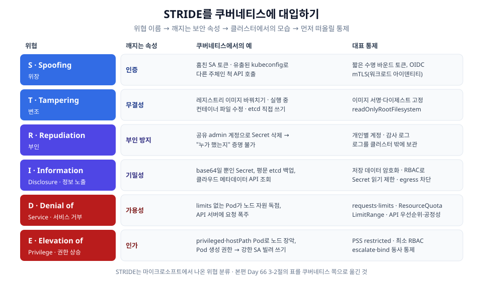
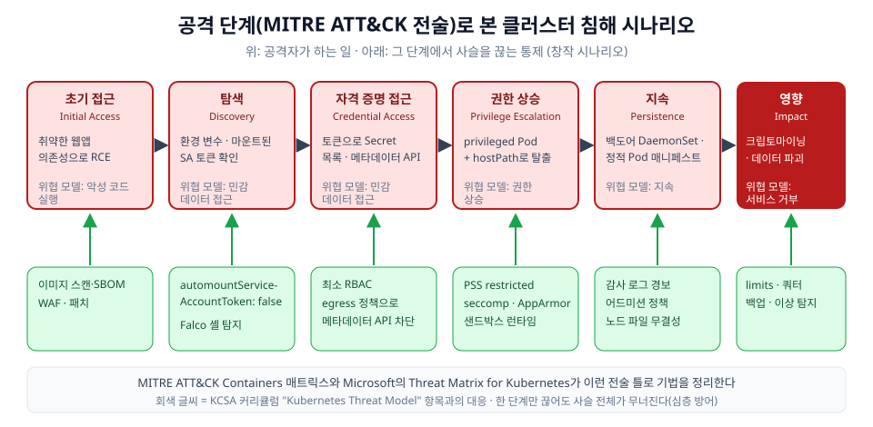

> **자격증 준비 · KCSA** | 난이도 ★★★☆☆ | 예상 소요 2.5 ~ 3시간

> ⚠️ 이 편의 모든 문항은 CNCF가 공개한 **KCSA 공식 커리큘럼(`KCSA Curriculum.pdf`)의 "Kubernetes Security Fundamentals"와 "Kubernetes Threat Model" 항목을 바탕으로 직접 창작한** 연습 문항입니다. 실제 시험 문제(기출·덤프)가 아니며, 그런 자료를 재현하지 않습니다.

## 🎯 오늘의 목표

- Pod Security Standards의 **세 레벨**과 Pod Security Admission의 **세 모드**를 짝지어 설명한다
- 인증 방식, ServiceAccount 토큰, Secret 관리의 안전한 기본값을 고른다
- 감사 로그의 **레벨 4개와 단계 4개**, 정책의 "첫 일치" 규칙을 구분한다
- NetworkPolicy의 **기본 허용·합집합·거부 규칙 없음** 성질을 문항에서 알아본다
- 커리큘럼의 위협 모델 항목 7개를 **STRIDE와 MITRE ATT&CK 전술**에 대응시키고 알맞은 통제를 고른다

---

## 1. 도메인 한눈에

| 도메인 (비중) | 커리큘럼 항목 | 이 편 섹션 | 깊게 보려면 |
|---|---|---|---|
| **Kubernetes Security Fundamentals (22%)** | Pod Security Standards · Pod Security Admissions | 2 | [Day 69](../../09-security/day69-k8s-workload-security.md) 2~4장, [CKS S04](../cks/s04-microservice-vulnerabilities.md) |
| | Authentication | 3 | [Day 73](../../09-security/day73-keycloak-sso-audit.md), [CKS S02](../cks/s02-cluster-hardening.md) |
| | Secrets | 4 | [Day 71](../../09-security/day71-vault-cert-manager.md), CKS S04 |
| | Isolation and Segmentation · Network Policy | 5 | [Day 70](../../09-security/day70-networkpolicy-zero-trust.md), [CKS S01](../cks/s01-cluster-setup.md) |
| | Audit Logging | 6 | Day 73, [CKS S06](../cks/s06-monitoring-runtime.md) |
| **Kubernetes Threat Model (16%)** | Trust Boundaries and Data Flow | 7 | [Day 66](../../09-security/day66-threat-modeling-4c.md) 3·4장 |
| | Persistence · Denial of Service · Malicious Code Execution and Compromised Applications in Containers · Attacker on the Network · Access to Sensitive Data · Privilege Escalation | 8·9 | Day 66 5장, [Day 72](../../09-security/day72-falco.md) |

---

## 2. Pod Security Standards와 Pod Security Admission

**PSS는 "기준(무엇이 안전한가)"**, **PSA는 "그 기준을 네임스페이스에 거는 내장 어드미션 컨트롤러"** 입니다. 예전의 PodSecurityPolicy(PSP)는 v1.25에서 **제거**되었고 PSA가 그 자리를 이었습니다.

| PSS 레벨 | 성격 | 막는 것(예) |
|---|---|---|
| **privileged** | 제한 없음 | 없음 — 시스템·인프라 워크로드용 |
| **baseline** | 알려진 권한 상승을 막는 최소선 | privileged 컨테이너, hostNetwork·hostPID·hostIPC, **hostPath 볼륨**, hostPort, 위험한 capabilities 추가, `/proc` 마운트 변경 등 |
| **restricted** | 현재 모범 사례(하드닝) | baseline 전부 + **`runAsNonRoot: true`**, **`allowPrivilegeEscalation: false`**, **`capabilities.drop: ["ALL"]`**(`NET_BIND_SERVICE`만 추가 허용), **seccomp `RuntimeDefault` 또는 `Localhost`**, 볼륨 유형 제한 |

| PSA 모드 | 위반 시 동작 | 평가 대상 |
|---|---|---|
| **enforce** | Pod **생성 거부** | Pod만 |
| **audit** | 허용하되 **감사 로그에 주석(annotation)** 기록 | Pod + 워크로드 리소스(Deployment 등) |
| **warn** | 허용하되 **사용자에게 경고** 표시 | Pod + 워크로드 리소스 |

```yaml
# 네임스페이스 레이블로 설정 — 모드마다 레벨과 버전을 따로 지정할 수 있다
metadata:
  labels:
    pod-security.kubernetes.io/enforce: baseline
    pod-security.kubernetes.io/enforce-version: v1.37
    pod-security.kubernetes.io/warn: restricted
    pod-security.kubernetes.io/audit: restricted
```

> ⚠️ **함정: enforce는 Pod만 본다.** `enforce: restricted`인 네임스페이스에 위반 Deployment를 만들면 Deployment는 **생성됩니다**. ReplicaSet이 Pod를 만들 때 거부되어 Pod가 0개인 채로 남습니다. 그래서 `warn`·`audit`을 함께 켜서 워크로드 단계에서 미리 알아챕니다([Day 69](../../09-security/day69-k8s-workload-security.md) 3장).

> 💡 PSA는 "켜고 끄는" 정도의 정책만 합니다. 필드 단위의 조직 정책(예: 특정 레지스트리만, 특정 레이블 필수)은 **ValidatingAdmissionPolicy**나 **OPA Gatekeeper·Kyverno**가 맡습니다([C04](./c04-platform-security-compliance.md)).

공식 문서: [Pod Security Standards](https://kubernetes.io/docs/concepts/security/pod-security-standards/), [Pod Security Admission](https://kubernetes.io/docs/concepts/security/pod-security-admission/).

---

## 3. 인증과 ServiceAccount 토큰

| 방식 | 주로 누가 | 메모 |
|---|---|---|
| X.509 클라이언트 인증서 | 컴포넌트, 관리자 | CN = 사용자 이름, O = 그룹. **개별 인증서 폐기(revocation)가 어려움** → 사람 사용자에게는 비권장 |
| **OIDC** (ID 토큰) | 사람 사용자 | 회사 IdP(Keycloak 등)와 연동, 짧은 수명, MFA 활용 ([Day 73](../../09-security/day73-keycloak-sso-audit.md)) |
| **ServiceAccount 토큰** | Pod 안의 프로세스 | 아래 참고 |
| 웹훅 토큰 인증 · 인증 프록시 | 외부 시스템 연동 | |
| 정적 토큰 파일 | — | 만료·교체가 어렵고 파일에 평문 → 권고되지 않음 |

**ServiceAccount 토큰의 현재 모습**:

- Pod에 마운트되는 토큰은 TokenRequest API로 발급된 **바운드(bound) 토큰**입니다. **만료 시간**이 있고, 특정 Pod에 **묶여** 있어 Pod가 사라지면 무효가 됩니다. kubelet이 만료 전에 자동으로 갱신합니다.
- v1.24부터 ServiceAccount를 만들어도 **만료 없는 Secret 기반 토큰이 자동 생성되지 않습니다**.
- API를 쓰지 않는 Pod는 `automountServiceAccountToken: false`(SA 또는 Pod 스펙)로 토큰을 아예 넣지 않는 것이 최소 권한입니다.
- `default` SA에 권한을 붙이지 말고, 워크로드마다 전용 SA + 최소 Role을 씁니다.

공식 문서: [Service Accounts](https://kubernetes.io/docs/concepts/security/service-accounts/), [Hardening Guide - Authentication Mechanisms](https://kubernetes.io/docs/concepts/security/hardening-guide/authentication-mechanisms/).

---

## 4. Secret 관리

| 사실 · 권고 | 이유 |
|---|---|
| Secret은 기본적으로 **base64 인코딩**, 암호화 아님 | 누구나 디코딩 가능 |
| **저장 데이터 암호화**(EncryptionConfiguration, 가능하면 KMS) | etcd·백업 유출 대비 ([C02](./c02-cluster-component-security.md) 5장) |
| RBAC에서 Secret의 `get`뿐 아니라 **`list`·`watch`도** 내용을 보여 준다 | `list` 권한만 줘도 모든 Secret 값이 응답에 들어 있음 |
| 네임스페이스에서 **Pod를 만들 수 있으면** 그 네임스페이스의 Secret을 마운트해 읽을 수 있다 | Pod 생성 권한 = 간접 Secret 읽기 권한 |
| 환경 변수보다 **볼륨 마운트** 선호 | 환경 변수는 로그·크래시 덤프·`/proc`·자식 프로세스로 새기 쉽고, 갱신되지 않음 |
| 외부 비밀 저장소(Vault/OpenBao, 클라우드 KMS·Secrets Manager) + External Secrets Operator 또는 Secrets Store CSI Driver | 비밀의 원본을 클러스터 밖에서 관리·감사·교체 ([Day 71](../../09-security/day71-vault-cert-manager.md)) |
| `immutable: true` | 실수·악의적 변경 방지, API 서버 부하 감소 |
| Git에 평문 Secret 커밋 금지 | SOPS·Sealed Secrets 같은 암호화 도구 사용 |

공식 문서: [Good practices for Kubernetes Secrets](https://kubernetes.io/docs/concepts/security/secrets-good-practices/).

---

## 5. 격리·분리와 NetworkPolicy

NetworkPolicy의 성질 다섯 가지만 정확히 알면 대부분의 문항이 풀립니다.

| 성질 | 의미 |
|---|---|
| **기본 허용** | 어떤 정책도 Pod를 선택하지 않으면 그 Pod는 모든 트래픽 허용 |
| **선택되면 격리** | 어떤 정책이든 Pod를 선택하는 순간, 그 방향(Ingress/Egress)은 **허용 규칙에 맞는 것만** 통과 |
| **합집합(additive)** | 정책 여러 개가 같은 Pod를 선택하면 허용 규칙의 **합집합**. 순서·우선순위 없음 |
| **거부 규칙 없음** | 표준 NetworkPolicy에는 "이것만 막아라(deny)" 규칙이 없다. 기본 거부 후 필요한 것만 연다 |
| **양쪽 모두** | A→B 통신은 A의 Egress와 B의 Ingress가 **둘 다** 허용해야 성공 |

```yaml
# 네임스페이스 기본 거부(Ingress·Egress) — podSelector {} = 이 네임스페이스의 모든 Pod
apiVersion: networking.k8s.io/v1
kind: NetworkPolicy
metadata:
  name: default-deny-all
spec:
  podSelector: {}
  policyTypes: ["Ingress", "Egress"]
```

> ⚠️ Egress까지 기본 거부하면 **DNS(UDP/TCP 53)** 도 막힙니다. 이름 해석이 필요한 Pod는 kube-system의 DNS로 가는 Egress를 따로 열어야 합니다([Day 70](../../09-security/day70-networkpolicy-zero-trust.md) 2-2).

그 밖의 분리 수단(네임스페이스·RBAC·쿼터, 전용 노드, 샌드박스 런타임)은 [C01](./c01-cloud-native-security-overview.md) 5장의 격리 스펙트럼을 보세요.

---

## 6. 감사 로그(Audit Logging)

API 서버는 요청마다 **누가, 언제, 무엇을, 어떤 결과로** 했는지 기록할 수 있습니다. `--audit-policy-file`과 백엔드(`--audit-log-path` 파일 또는 웹훅)를 지정해야 켜집니다.

| 레벨 | 기록하는 것 |
|---|---|
| **None** | 기록하지 않음 |
| **Metadata** | 요청 메타데이터(사용자, 시각, 리소스, 동사 등). 본문 없음 |
| **Request** | 메타데이터 + **요청 본문** |
| **RequestResponse** | 메타데이터 + 요청 본문 + **응답 본문** |

| 단계(stage) | 시점 |
|---|---|
| RequestReceived | 감사 핸들러가 요청을 받자마자 |
| ResponseStarted | 응답 헤더를 보낸 뒤, 본문 전(watch 같은 긴 요청) |
| ResponseComplete | 응답 본문까지 완료 |
| Panic | 처리 중 패닉 |

- 정책 규칙은 **위에서부터 첫 번째로 일치하는 규칙**이 적용됩니다. 그래서 구체적인 규칙을 위에 둡니다.
- **Secret·ConfigMap·TokenReview는 `Metadata` 레벨**로 두는 것이 일반적입니다. `Request`·`RequestResponse`로 두면 비밀 값이 로그에 그대로 남습니다.
- 감사 로그는 부인 방지(STRIDE의 R)와 사고 조사의 근거입니다. 공격자가 지우지 못하게 **클러스터 밖(SIEM 등)으로 보내** 보관합니다.

공식 문서: [Auditing](https://kubernetes.io/docs/tasks/debug/debug-cluster/audit/).

---

## 7. 위협 모델 — 신뢰 경계와 데이터 흐름

위협 모델링은 네 가지 질문으로 진행합니다(Day 66): **무엇을 만드나 → 무엇이 잘못될 수 있나 → 어떻게 할 건가 → 잘했나.** 첫 질문의 결과물이 **데이터 흐름도(DFD)** 이고, 그 위에 **신뢰 경계(trust boundary)** 를 긋습니다. 신뢰 수준이 바뀌는 선이 곧 공격이 일어나는 곳입니다.

| 쿠버네티스의 대표 신뢰 경계 | 넘나드는 것 | 그 경계의 통제 |
|---|---|---|
| 인터넷 ↔ 클러스터 진입점(Ingress·Gateway·LoadBalancer) | 외부 사용자 요청 | TLS, WAF, 인증, 레이트 리밋 |
| 컨테이너 ↔ 노드(호스트) | syscall, 마운트, 장치 | PSS, seccomp·AppArmor, 샌드박스 런타임, non-root |
| 워크로드 ↔ 컨트롤 플레인(API 서버) | SA 토큰을 쓴 API 호출 | RBAC 최소 권한, 토큰 자동 마운트 끄기 |
| 네임스페이스(테넌트) ↔ 네임스페이스 | Pod 간 트래픽, 공유 자원 | NetworkPolicy, 쿼터, RBAC |
| 노드 ↔ 클라우드 | 메타데이터 API, 클라우드 IAM | egress 차단, 노드 역할 최소화 |
| 컨트롤 플레인 ↔ etcd | 클러스터 상태 전체 | mTLS, 네트워크 격리, 저장 데이터 암호화 |

---

## 8. 커리큘럼의 위협 항목과 통제



| 커리큘럼 위협 | 클러스터에서의 예 | STRIDE | 대표 통제 |
|---|---|---|---|
| **Persistence** (지속) | 백도어 DaemonSet·CronJob, 정적 Pod 매니페스트, 오염된 내부 이미지, 변경 웹훅 심기 | T, E | 감사 로그 경보, 어드미션 정책, RBAC로 워크로드·웹훅 생성 권한 제한, 노드 파일 무결성 |
| **Denial of Service** (서비스 거부) | limits 없는 Pod의 자원 독점, API 서버 요청 폭주, 디스크·PID 고갈 | D | requests·limits, **ResourceQuota·LimitRange**, API 우선순위와 공정성(APF), PID 제한 |
| **Malicious Code Execution and Compromised Applications in Containers** | 취약한 앱 RCE, 악성 이미지, 컨테이너 안 셸 | T, E | 이미지 스캔·서명, 최소 이미지, readOnlyRootFilesystem, Falco 런타임 탐지 |
| **Attacker on the Network** (네트워크 공격자) | Pod 간 평문 통신 도청, 옆 Pod로 이동(lateral movement), ARP·DNS 스푸핑 | S, I, T | **기본 거부 NetworkPolicy**, mTLS(서비스 메시), `NET_RAW` capability 제거 |
| **Access to Sensitive Data** (민감 데이터 접근) | Secret 읽기, etcd·백업 유출, 메타데이터 API 자격 증명 | I | Secret RBAC 최소화, 저장 데이터 암호화, egress 제한, 감사 로그 |
| **Privilege Escalation** (권한 상승) | privileged·hostPath Pod로 노드 탈출, 강한 SA를 쓰는 Pod 생성, RBAC `escalate`·`bind` 악용 | E | PSS restricted, 최소 RBAC, seccomp·AppArmor, 샌드박스 런타임 |

### 8-1. STRIDE와 MITRE ATT&CK는 어떻게 다른가

| | STRIDE | MITRE ATT&CK |
|---|---|---|
| 무엇인가 | 위협 **분류 체계**(Microsoft) | 실제 관찰된 공격 **전술(Tactic)·기법(Technique) 지식 베이스** |
| 언제 쓰나 | **설계 단계** — "이 구성요소에서 무엇이 깨질 수 있나" | **탐지·대응** — "공격자가 실제로 하는 행동을 우리가 볼 수 있나" |
| 단위 | 깨지는 보안 속성 6개 | 전술(목표) → 기법(방법) → 하위 기법 |
| 쿠버네티스 | DFD 요소마다 적용(STRIDE-per-element) | Containers 매트릭스, Microsoft **Threat Matrix for Kubernetes** |



> 💡 ATT&CK 전술 이름은 버전마다 조정됩니다(예: 최근 버전의 Containers 매트릭스에서 예전 Defense Evasion 전술이 둘로 나뉨 — [Day 66](../../09-security/day66-threat-modeling-4c.md) 5장). 시험에 나와도 **Initial Access, Execution, Persistence, Privilege Escalation, Credential Access, Discovery, Lateral Movement, Impact** 같은 큰 전술의 뜻을 알면 충분합니다.

---

## 9. 헷갈리는 포인트

| 헷갈리는 것 | 정확히는 |
|---|---|
| PSS vs PSA vs PSP | PSS = 기준(레벨 3개), PSA = 그 기준을 집행하는 내장 어드미션(모드 3개), PSP = **v1.25에서 제거된** 옛 방식 |
| 레벨과 모드 섞기 | 레벨: privileged · baseline · restricted / 모드: enforce · audit · warn. "restricted 모드", "warn 레벨"은 틀린 표현 |
| baseline이면 root 금지? | **아니다.** root 실행 금지(`runAsNonRoot`)는 **restricted**의 요구. baseline은 privileged·host 네임스페이스·hostPath 등을 막음 |
| Secret `list`는 이름만? | **값까지** 나온다. Secret에 list·watch를 주는 것은 get을 주는 것과 같다 |
| 감사 레벨 Request vs RequestResponse | Request = 요청 본문까지, RequestResponse = **응답 본문까지**. Metadata는 본문 없음 |
| 감사 정책 규칙 순서 | **첫 일치**. 아래에 둔 구체적 규칙은 위의 넓은 규칙에 가려 무시될 수 있음 |
| NetworkPolicy deny 규칙 | 없다. "기본 거부 + 허용 규칙"으로만 표현 |
| STRIDE의 R | Repudiation(부인) → 통제는 **감사 로그·개인별 신원**. 암호화가 아님 |
| STRIDE vs ATT&CK | 설계 단계의 분류(STRIDE) vs 실제 공격 행동 사전(ATT&CK) |

---

## 10. 창작 객관식 15문항

> 모든 문항은 이 시리즈의 창작입니다. 먼저 답을 정하고 `<details>`를 여세요.

**Q1.** 다음 중 Pod Security Standards **restricted** 레벨은 요구하지만 **baseline** 레벨은 요구하지 않는 것은?

- A. privileged 컨테이너 금지
- B. hostNetwork 사용 금지
- C. 컨테이너를 root가 아닌 사용자로 실행(`runAsNonRoot: true`)
- D. hostPath 볼륨 금지

<details><summary>정답·해설</summary>

**정답: C**

A·B·D는 baseline이 이미 막는 항목입니다. non-root 실행, `allowPrivilegeEscalation: false`, capabilities `ALL` 제거, seccomp 프로파일 지정은 restricted에서 추가됩니다.

근거: 이 편 2장, [Pod Security Standards](https://kubernetes.io/docs/concepts/security/pod-security-standards/)
</details>

**Q2.** 네임스페이스에 `pod-security.kubernetes.io/warn: restricted`만 설정되어 있다. restricted를 위반하는 Pod를 만들면?

- A. Pod 생성이 거부된다
- B. Pod는 생성되고, 요청한 사용자에게 경고 메시지가 표시된다
- C. Pod는 생성되지만 자동으로 restricted에 맞게 수정된다
- D. 감사 로그에만 기록되고 사용자는 아무것도 보지 못한다

<details><summary>정답·해설</summary>

**정답: B**

warn 모드는 허용하면서 경고를 돌려줍니다. 거부는 enforce(A), 감사 주석은 audit(D)입니다. PSA는 Pod를 **변경하지 않습니다**(C).

근거: 이 편 2장, [Pod Security Admission](https://kubernetes.io/docs/concepts/security/pod-security-admission/)
</details>

**Q3.** `enforce: restricted`인 네임스페이스에 restricted를 위반하는 Pod 템플릿을 가진 Deployment를 적용했다. 결과로 옳은 것은?

- A. Deployment 생성 자체가 거부된다
- B. Deployment와 Pod가 모두 정상 생성된다
- C. Deployment는 생성되지만, ReplicaSet이 만들려는 Pod가 거부되어 실행 중인 Pod가 없다
- D. 네임스페이스의 레이블이 자동으로 baseline으로 바뀐다

<details><summary>정답·해설</summary>

**정답: C**

enforce는 **Pod**만 평가합니다. 워크로드 리소스 단계에서 미리 알려면 같은 레벨로 warn·audit도 켭니다.

근거: 이 편 2장 ⚠️, [Day 69](../../09-security/day69-k8s-workload-security.md) 3장
</details>

**Q4.** 쿠버네티스 v1.25에서 제거되어 Pod Security Admission으로 대체된 기능은?

- A. PodSecurityPolicy
- B. NetworkPolicy
- C. RuntimeClass
- D. ResourceQuota

<details><summary>정답·해설</summary>

**정답: A**

PodSecurityPolicy(PSP)는 v1.21에서 폐기 예고(deprecated) 후 v1.25에서 제거되었습니다. 나머지는 모두 현재 쓰이는 API입니다.

근거: 이 편 2장
</details>

**Q5.** 외부 API를 호출하지만 쿠버네티스 API는 전혀 쓰지 않는 웹 애플리케이션 Pod가 있다. ServiceAccount 관점에서 가장 알맞은 설정은?

- A. `default` ServiceAccount에 `cluster-admin`을 바인딩한다
- B. 만료 없는 토큰 Secret을 만들어 Pod에 마운트한다
- C. 전용 ServiceAccount를 만들어 `edit` ClusterRole을 준다
- D. `automountServiceAccountToken: false`로 토큰을 마운트하지 않는다

<details><summary>정답·해설</summary>

**정답: D**

API를 쓰지 않는다면 토큰 자체가 필요 없습니다. 토큰이 없으면 컨테이너가 탈취돼도 API로 번질 수단이 줄어듭니다(최소 권한).

근거: 이 편 3장, [Day 69](../../09-security/day69-k8s-workload-security.md) 8장
</details>

**Q6.** 현재 쿠버네티스에서 Pod에 자동으로 마운트되는 ServiceAccount 토큰의 특징은?

- A. 만료가 없고 ServiceAccount를 지울 때까지 유효하다
- B. TokenRequest API로 발급된 바운드 토큰으로, 만료 시간이 있고 Pod에 묶여 있으며 kubelet이 갱신한다
- C. 모든 Pod가 같은 토큰을 공유한다
- D. 사람 사용자의 OIDC 토큰과 같은 발급자가 만든다

<details><summary>정답·해설</summary>

**정답: B**

A는 v1.24 이전의 Secret 기반 토큰 이야기입니다. 바운드 토큰은 대상(audience)·만료·바인딩된 오브젝트가 있어, Pod가 사라지면 쓸 수 없게 됩니다.

근거: 이 편 3장, [Service Accounts](https://kubernetes.io/docs/concepts/security/service-accounts/)
</details>

**Q7.** 모니터링 도구용 Role에 `secrets` 리소스의 `list` 동사만 주었다(`get`은 주지 않음). 이 설정에 대한 평가로 옳은 것은?

- A. 안전하다. list는 Secret 이름만 보여 준다
- B. list 동사는 Secret 리소스에 적용되지 않는다
- C. 안전하다. Secret은 etcd에서 항상 암호화되어 있다
- D. 위험하다. list 응답에는 Secret의 데이터 값까지 포함된다

<details><summary>정답·해설</summary>

**정답: D**

list(그리고 watch)는 오브젝트 전체를 돌려주므로 값도 보입니다. Secret 읽기 권한은 필요한 이름(`resourceNames`)과 동사로 좁혀야 합니다.

근거: 이 편 4장, [Good practices for Kubernetes Secrets](https://kubernetes.io/docs/concepts/security/secrets-good-practices/), [RBAC good practices](https://kubernetes.io/docs/concepts/security/rbac-good-practices/)
</details>

**Q8.** 애플리케이션에 데이터베이스 비밀번호를 전달할 때, 일반적으로 환경 변수보다 볼륨 마운트가 권장되는 이유로 가장 알맞은 것은?

- A. 볼륨으로 마운트하면 Secret이 자동으로 암호화된다
- B. 환경 변수는 로그·크래시 덤프·자식 프로세스 등으로 새기 쉽고, Secret이 바뀌어도 갱신되지 않는다
- C. 환경 변수로는 Secret을 참조할 수 없다
- D. 볼륨 마운트를 쓰면 RBAC가 필요 없다

<details><summary>정답·해설</summary>

**정답: B**

환경 변수 방식도 가능하지만(C 오답) 노출 경로가 많습니다. 볼륨은 노드의 tmpfs에 파일로 마운트되고 Secret 변경이 (subPath가 아니면) 반영됩니다. 암호화(A)나 RBAC(D)와는 별개입니다.

근거: 이 편 4장
</details>

**Q9.** `team-a` 네임스페이스에 다음 정책 두 개가 있다. ① `podSelector: {}`, `policyTypes: [Ingress]`, 규칙 없음 ② `app: web` Pod에 대해 `app: lb` Pod로부터의 TCP 8080 Ingress 허용. `app: web` Pod로 들어오는 트래픽에 대한 설명으로 옳은 것은?

- A. 정책은 합집합으로 적용되므로 `app: lb` Pod의 TCP 8080만 허용되고 나머지 Ingress는 막힌다
- B. ①이 기본 거부이므로 ②와 관계없이 모든 Ingress가 막힌다
- C. 나중에 만든 정책이 우선하므로 ②만 적용되어 다른 트래픽도 허용된다
- D. 정책이 두 개이므로 충돌 오류가 나서 둘 다 무시된다

<details><summary>정답·해설</summary>

**정답: A**

NetworkPolicy에는 순서·우선순위가 없고 허용 규칙의 합집합이 적용됩니다. ①로 모든 Pod가 Ingress 격리되고, ②가 허용한 것만 통과합니다. 이것이 "기본 거부 + 필요한 것만 허용" 패턴입니다.

근거: 이 편 5장, [NetworkPolicy 문서](https://kubernetes.io/docs/concepts/services-networking/network-policies/)
</details>

**Q10.** 감사 정책에서 **Secret** 리소스에 가장 알맞은 레벨은?

- A. RequestResponse — 모든 내용을 남겨야 조사에 유리하다
- B. Request — 생성 시 값을 남겨야 한다
- C. Metadata — 누가 언제 어떤 Secret에 무엇을 했는지만 남기고 값은 남기지 않는다
- D. None — Secret 접근은 기록하지 않는다

<details><summary>정답·해설</summary>

**정답: C**

Request·RequestResponse는 요청·응답 본문에 Secret 값이 그대로 들어가 감사 로그가 새로운 유출 지점이 됩니다. None은 Secret 접근 추적이 사라져 부인 방지를 잃습니다.

근거: 이 편 6장, [Auditing](https://kubernetes.io/docs/tasks/debug/debug-cluster/audit/)
</details>

**Q11.** 감사 정책 파일의 규칙 평가 방식으로 옳은 것은?

- A. 모든 규칙을 평가해 가장 높은 레벨을 적용한다
- B. 아래에서부터 평가해 마지막 규칙이 이긴다
- C. 위에서부터 평가해 처음 일치한 규칙의 레벨을 적용한다
- D. 규칙 순서는 무작위이므로 레벨이 겹치면 안 된다

<details><summary>정답·해설</summary>

**정답: C**

첫 일치 규칙이 이깁니다. 그래서 "Secret은 Metadata" 같은 구체적인 규칙을 넓은 규칙(예: 전체 RequestResponse)보다 **위에** 둬야 합니다.

근거: 이 편 6장, [CKS S06](../cks/s06-monitoring-runtime.md)
</details>

**Q12.** 운영자들이 하나의 공용 관리자 계정으로 클러스터를 다룬다. 사고가 났을 때 "누가 Secret을 지웠는지" 증명할 수 없었다. STRIDE에서 이 위협 범주와 알맞은 통제의 짝은?

- A. Repudiation(부인) — 개인별 신원과 감사 로그
- B. Tampering(변조) — 이미지 서명
- C. Denial of Service — ResourceQuota
- D. Spoofing(위장) — etcd 암호화

<details><summary>정답·해설</summary>

**정답: A**

행위자가 "내가 안 했다"고 부인할 수 있는 상황이 Repudiation입니다. 공용 계정을 없애고 개인별 신원으로 인증하며, 감사 로그를 클러스터 밖에 보관하는 것이 통제입니다.

근거: 이 편 8장 그림, [Day 66](../../09-security/day66-threat-modeling-4c.md) 3-2
</details>

**Q13.** 한 Pod가 메모리 limits 없이 실행되다가 노드 메모리를 모두 써서 같은 노드의 다른 Pod들이 축출(eviction)되었다. 커리큘럼 위협 항목과 우선 적용할 통제의 짝으로 가장 알맞은 것은?

- A. Access to Sensitive Data — Secret 암호화
- B. Attacker on the Network — mTLS
- C. Persistence — 감사 로그
- D. Denial of Service — 컨테이너 requests·limits와 네임스페이스 ResourceQuota·LimitRange

<details><summary>정답·해설</summary>

**정답: D**

자원 고갈로 가용성이 깨진 것이므로 서비스 거부입니다. limits로 컨테이너 상한을, LimitRange로 기본값을, ResourceQuota로 네임스페이스 총량을 제한합니다.

근거: 이 편 8장 표
</details>

**Q14.** 공격자가 컨테이너를 탈취한 뒤 같은 클러스터의 다른 네임스페이스에 있는 데이터베이스 Pod에 직접 접속을 시도한다. 이 **측면 이동(lateral movement)** 을 줄이는 데 가장 직접적인 통제는?

- A. 이미지 태그를 다이제스트로 고정
- B. 기본 거부 NetworkPolicy와 필요한 통신만 허용하는 정책(가능하면 mTLS 기반 인가와 함께)
- C. 감사 로그 레벨을 RequestResponse로 상향
- D. 컨트롤러 매니저의 profiling 비활성화

<details><summary>정답·해설</summary>

**정답: B**

"Attacker on the Network" 위협의 대표 통제입니다. Pod 간 통신 경로 자체를 막고, 메시가 있으면 워크로드 아이덴티티로 누가 누구에게 접속할 수 있는지까지 제한합니다. A는 공급망, C는 API 요청 기록, D는 컨트롤 플레인 하드닝입니다.

근거: 이 편 5·8장, [Day 70](../../09-security/day70-networkpolicy-zero-trust.md)
</details>

**Q15.** STRIDE와 MITRE ATT&CK에 대한 설명으로 옳은 것은?

- A. 둘 다 컴플라이언스 인증 제도이다
- B. STRIDE는 실제 침해 사례에서 수집한 기법 ID 목록이고, ATT&CK는 설계 단계의 6가지 위협 분류다
- C. STRIDE는 설계 단계에서 위협을 분류하는 틀이고, ATT&CK는 실제 관찰된 공격 전술·기법의 지식 베이스라 탐지 커버리지 점검에 자주 쓰인다
- D. ATT&CK는 쿠버네티스 전용이라 다른 플랫폼에는 쓰지 않는다

<details><summary>정답·해설</summary>

**정답: C**

B는 둘을 정확히 뒤바꾼 오답입니다. ATT&CK는 Enterprise·Mobile·ICS 등 여러 매트릭스가 있고 Containers는 그중 한 플랫폼 보기입니다(D 오답). 둘 다 인증 제도가 아닙니다(A).

근거: 이 편 8-1, [Day 66](../../09-security/day66-threat-modeling-4c.md) 5장
</details>

---

## 11. 핵심 정리

- **PSS 레벨** privileged · baseline · restricted / **PSA 모드** enforce(거부, Pod만) · audit(감사 주석) · warn(경고). 네임스페이스 레이블로 모드별 레벨·버전 지정. PSP는 v1.25 제거
- restricted의 추가 요구: **non-root, allowPrivilegeEscalation false, capabilities drop ALL, seccomp RuntimeDefault/Localhost**
- 인증: 사람은 OIDC, Pod는 **바운드 SA 토큰**(만료·Pod 바인딩). API를 안 쓰면 `automountServiceAccountToken: false`
- Secret: base64일 뿐 → 저장 데이터 암호화, **list·watch도 값 노출**, Pod 생성 권한 = 간접 Secret 접근, 볼륨 > 환경 변수, 외부 비밀 저장소
- NetworkPolicy: 기본 허용 → 선택되면 격리, **합집합**, deny 규칙 없음, 양방향 모두 허용 필요, Egress 기본 거부 시 DNS 열기
- 감사 로그: 레벨 None·Metadata·Request·RequestResponse, 단계 RequestReceived·ResponseStarted·ResponseComplete·Panic, **첫 일치**, Secret은 Metadata, 밖으로 전송
- 위협 모델: DFD + 신뢰 경계 → STRIDE(설계) · ATT&CK(행동·탐지). 커리큘럼 위협 7개를 통제와 짝지어 기억

---

## ⏭️ 다음 예고 — C04. 플랫폼 보안·공급망·컴플라이언스

마지막 개념 편입니다. **Platform Security(16%)** 의 공급망(SBOM·provenance·서명·SLSA), 이미지 저장소, 관측성, 서비스 메시와 mTLS, PKI(kubeadm 인증서 수명), 어드미션 컨트롤과, **Compliance and Security Frameworks(10%)** 의 CIS Benchmark, NIST(SP 800-190, CSF 2.0), PCI DSS 같은 프레임워크를 **"어느 서랍에 들어가나"** 로 정리합니다.
