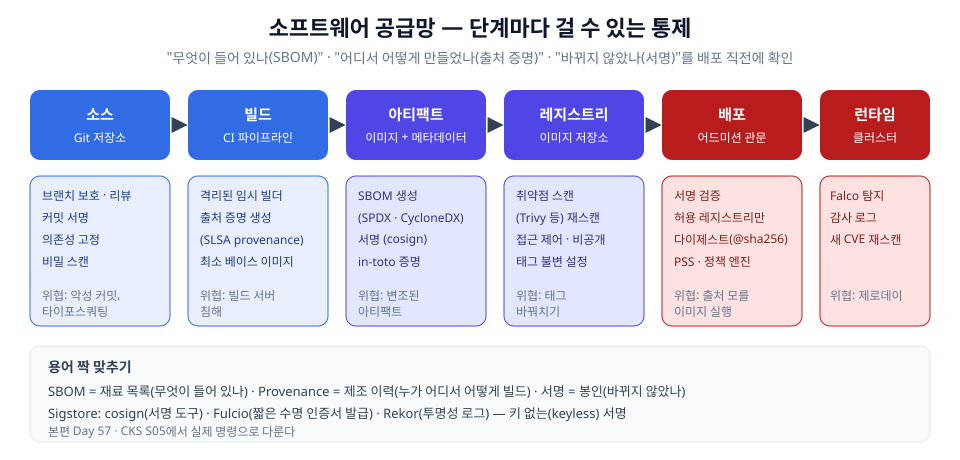
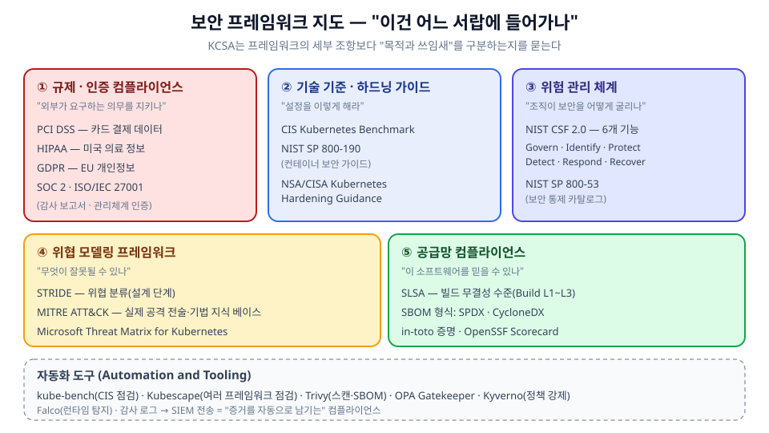

> **자격증 준비 · KCSA** | 난이도 ★★★☆☆ | 예상 소요 2 ~ 2.5시간

> ⚠️ 이 편의 모든 문항은 CNCF가 공개한 **KCSA 공식 커리큘럼(`KCSA Curriculum.pdf`)의 "Platform Security"와 "Compliance and Security Frameworks" 항목을 바탕으로 직접 창작한** 연습 문항입니다. 실제 시험 문제(기출·덤프)가 아니며, 그런 자료를 재현하지 않습니다.

## 🎯 오늘의 목표

- 공급망 단계(소스 → 빌드 → 아티팩트 → 레지스트리 → 배포 → 런타임)마다 걸 수 있는 통제를 고르고, **SBOM · provenance · 서명**을 구분한다
- 관측성, 서비스 메시(mTLS), PKI(인증서 수명과 교체), 연결성, 어드미션 컨트롤이 플랫폼 보안에서 맡는 역할을 설명한다
- CIS Benchmark, NIST SP 800-190, NIST CSF 2.0, PCI DSS 같은 프레임워크를 **목적별 서랍**으로 분류한다
- 컴플라이언스를 **도구로 자동화**하는 방법(kube-bench, Kubescape, 정책 엔진)을 고른다

---

## 1. 도메인 한눈에

| 도메인 (비중) | 커리큘럼 항목 | 이 편 섹션 | 깊게 보려면 |
|---|---|---|---|
| **Platform Security (16%)** | Supply Chain Security | 2 | [Day 57](../../07-gitops/day57-supply-chain-security.md), [CKS S05](../cks/s05-supply-chain.md) |
| | Image Repository | 3 | Day 57, CKS S05 |
| | Observability | 4 | [Day 72](../../09-security/day72-falco.md), [Day 73](../../09-security/day73-keycloak-sso-audit.md), [CKS S06](../cks/s06-monitoring-runtime.md) |
| | Service Mesh · Connectivity | 5 | [Day 70](../../09-security/day70-networkpolicy-zero-trust.md) 6장 |
| | PKI | 6 | [Day 71](../../09-security/day71-vault-cert-manager.md) |
| | Admission Control | 7 | [Day 69](../../09-security/day69-k8s-workload-security.md), [CKS S02](../cks/s02-cluster-hardening.md)·S05 |
| **Compliance and Security Frameworks (10%)** | Compliance Frameworks · Threat Modeling Frameworks · Supply Chain Compliance · Automation and Tooling | 8 | [Day 66](../../09-security/day66-threat-modeling-4c.md), [Day 67](../../09-security/day67-host-hardening.md) 8장(CIS), [CKS S01](../cks/s01-cluster-setup.md)(kube-bench) |

---

## 2. 공급망 보안(Supply Chain Security)

공급망 공격은 **내가 쓴 코드가 아니라 내가 가져다 쓴 것**(의존성, 베이스 이미지, 빌드 도구, CI)을 노립니다. 통제는 세 질문으로 정리됩니다.

| 질문 | 답하는 산출물 | 예 |
|---|---|---|
| 무엇이 들어 있나 | **SBOM**(Software Bill of Materials) | SPDX, CycloneDX 형식. Trivy·Syft·bom으로 생성 |
| 어디서 어떻게 만들었나 | **Provenance**(출처 증명) · attestation | SLSA provenance, in-toto 증명 |
| 바뀌지 않았나 · 누가 만들었나 | **서명** | Sigstore cosign. 키 기반 또는 keyless(OIDC 신원 + Fulcio 인증서 + Rekor 투명성 로그) |

| 용어 | 한 줄 정의 |
|---|---|
| **SLSA** ("살사") | 빌드 무결성 수준 프레임워크. v1.0의 Build 트랙은 **L1(출처 증명 존재) → L2(호스팅된 빌드 플랫폼이 서명한 출처 증명) → L3(변조에 강한 격리된 빌드)** |
| **in-toto** | 공급망 각 단계가 "누가 무엇을 했는지"를 서명된 메타데이터로 남기고 검증하는 프레임워크(CNCF 프로젝트) |
| **Sigstore** | cosign(서명 도구) · Fulcio(짧은 수명 코드 서명 인증서 발급 CA) · Rekor(서명 기록 투명성 로그) |
| **재현 가능한 빌드** | 같은 소스에서 비트 단위로 같은 결과물 → 빌드 변조 검출 |
| **의존성 고정** | 버전·해시 고정(lock 파일), 타이포스쿼팅·의존성 혼동(dependency confusion) 대비 |

> 💡 **SBOM은 취약점을 고쳐 주지 않습니다.** "무엇이 들어 있나"의 목록이라, 새 CVE가 공개됐을 때 **어느 이미지가 영향을 받는지 빠르게 찾는** 데 쓰입니다. 실제 판정은 스캐너가 SBOM·이미지를 취약점 DB와 대조해서 합니다.

---

## 3. 이미지 저장소(Image Repository)

| 통제 | 내용 |
|---|---|
| 비공개 레지스트리와 접근 제어 | 푸시는 CI만, 풀은 필요한 클러스터만. `imagePullSecrets` 또는 노드·워크로드 아이덴티티 |
| **허용 레지스트리** 강제 | 어드미션 정책(ValidatingAdmissionPolicy, Gatekeeper, Kyverno)으로 `registry.example.com/` 외 이미지 거부 |
| **태그 불변(immutable tags)** 설정 | 같은 태그로 다른 이미지를 덮어쓰지 못하게(레지스트리 기능). 배포는 다이제스트로 |
| 지속적 스캔 | 저장 중인 이미지도 새 CVE로 **재스캔** |
| 서명 검증 | 배포 시 어드미션에서 cosign 서명·증명 확인 |
| 미러·풀스루 캐시 | 외부 공개 레지스트리 의존을 줄이고, 검증된 이미지만 내부로 |
| **AlwaysPullImages** 어드미션 | 멀티테넌트 노드에서 다른 테넌트가 노드에 캐시된 비공개 이미지를 자격 증명 없이 쓰는 것을 방지(매번 풀 → 레지스트리 인증) |

---

## 4. 관측성(Observability)

보안 관점의 관측성은 **"무슨 일이 있었는지 나중에 증명할 수 있는가"** 입니다.

| 신호 | 보안에서의 쓰임 | 도구 예 |
|---|---|---|
| **감사 로그** | API에서 누가 무엇을 했나(부인 방지, 사고 조사) | API 서버 audit → SIEM ([C03](./c03-security-fundamentals-threat-model.md) 6장) |
| **런타임 이벤트** | 컨테이너 안에서 무엇이 실행됐나(셸, 민감 파일 읽기, 예상 밖 네트워크 연결) | Falco(syscall 기반), Tetragon 등 eBPF 도구 |
| 애플리케이션·노드 로그 | 인증 실패, 오류 급증 | Fluent Bit → 중앙 저장소 |
| 메트릭 | 자원 급증(크립토마이닝), 오류율 | Prometheus 경보 |
| 트레이스 | 서비스 간 호출 경로 이상 | OpenTelemetry |

- 로그는 **클러스터 밖, 변경 불가능한 저장소**로. 침해된 노드·클러스터 안에만 있으면 공격자가 지울 수 있습니다.
- 시간 동기화(NTP)가 맞아야 여러 소스의 로그를 이어 붙일 수 있습니다.
- 관측성은 **탐지 통제**입니다. 막아 주지는 않습니다([C01](./c01-cloud-native-security-overview.md) 4-1).

---

## 5. 서비스 메시와 연결성(Service Mesh · Connectivity)

| 메시가 주는 보안 기능 | 설명 |
|---|---|
| **mTLS** | 서비스 간 통신을 양방향 인증서로 암호화 + 상대 신원 확인. 애플리케이션 코드 수정 없이 |
| **워크로드 아이덴티티** | 인증서에 IP가 아니라 **서비스 신원**을 담음. Istio는 SPIFFE 형식 `spiffe://<트러스트 도메인>/ns/<네임스페이스>/sa/<서비스어카운트>` |
| **인가 정책** | "frontend SA만 payments에 POST 가능" 같은 L4·L7 신원 기반 인가 |
| 인증서 자동 발급·교체 | 메시의 CA가 짧은 수명 인증서를 자동 교체 |

- 메시의 `PERMISSIVE` 모드는 평문과 mTLS를 **둘 다** 받습니다(전환기용). 강제하려면 `STRICT`([Day 70](../../09-security/day70-networkpolicy-zero-trust.md) 6-4).
- 메시 인가와 NetworkPolicy는 **보완 관계**입니다. NetworkPolicy(L3/L4, CNI가 집행)는 메시를 우회하는 트래픽까지 막고, 메시는 신원·L7 단위로 세밀하게 제어합니다.
- 구현 방식: 사이드카 프록시(Pod마다 Envoy) 또는 **ambient**(노드 단위 ztunnel + 필요할 때 waypoint) 등.

**Connectivity(연결성)** 는 클러스터 안팎을 잇는 경로 전체입니다.

| 경로 | 통제 |
|---|---|
| 외부 → 클러스터 | Ingress·Gateway에서 **TLS 종료**, 인증서 관리(cert-manager), WAF |
| 관리자 → API 서버 | 프라이빗 엔드포인트, VPN·배스천, 허용 IP 대역 |
| 클러스터 → 외부(egress) | Egress NetworkPolicy, 이그레스 게이트웨이·프록시로 목적지 제한 |
| 노드 ↔ 노드 | CNI 암호화(WireGuard·IPsec) 또는 메시 mTLS |

---

## 6. PKI — 클러스터는 인증서로 굴러간다

쿠버네티스 컴포넌트 사이 통신은 거의 모두 **TLS 인증서**로 서로를 확인합니다. kubeadm 클러스터 기준([Certificate Management with kubeadm](https://kubernetes.io/docs/tasks/administer-cluster/kubeadm/kubeadm-certs/)):

| 항목 | 내용 |
|---|---|
| 위치 | `/etc/kubernetes/pki/` |
| CA 종류 | **클러스터 CA**(`ca.crt`), **etcd CA**(`etcd/ca.crt`), **front-proxy CA**(API 확장 집계용). 용도별로 분리 |
| ServiceAccount 서명 키 | `sa.key`/`sa.pub` — 인증서가 아니라 SA 토큰 서명용 **키 쌍** |
| 기본 수명 | 컴포넌트(leaf) 인증서 **1년**, CA **10년** |
| 확인 · 갱신 | `kubeadm certs check-expiration`, `kubeadm certs renew`. 컨트롤 플레인 업그레이드 시 자동 갱신 |
| kubelet | 클라이언트 인증서 **자동 교체**(rotation), 서빙 인증서는 CSR 승인 방식 선택 가능 |

- **CA 개인 키 = 클러스터 신원 발급권.** `ca.key`를 가진 사람은 `system:masters` 그룹 인증서도 만들 수 있습니다. 오프라인 보관·접근 통제가 핵심입니다.
- X.509 클라이언트 인증서는 **개별 폐기(CRL·OCSP)를 쿠버네티스가 지원하지 않습니다.** 사람 사용자에게 오래 사는 인증서를 주면 유출 시 만료까지 막을 방법이 마땅치 않습니다 → OIDC 권장([C03](./c03-security-fundamentals-threat-model.md) 3장).
- 워크로드용 인증서는 cert-manager로 발급·갱신을 자동화합니다([Day 71](../../09-security/day71-vault-cert-manager.md)).

---

## 7. 어드미션 컨트롤(Admission Control)

| 종류 | 예 | 특징 |
|---|---|---|
| 내장 어드미션 플러그인 | NodeRestriction, PodSecurity, LimitRanger, ResourceQuota, AlwaysPullImages | API 서버 플래그로 켬 |
| **ValidatingAdmissionPolicy** | CEL 식으로 검증 규칙 | API 서버 **안에서** 실행 → 웹훅 서버가 필요 없음 |
| 어드미션 **웹훅** | OPA Gatekeeper(Rego), Kyverno(YAML 정책), 이미지 서명 검증 | 외부 서버. 변경(Mutating)·검증(Validating) |
| ImagePolicyWebhook | 이미지 허용 여부를 외부 백엔드에 질의 | [CKS S05](../cks/s05-supply-chain.md)에서 배선 실습 |

- 순서: **변경(Mutating) → 스키마 검증 → 검증(Validating)**. 변경 웹훅이 바꾼 결과를 검증 단계가 다시 봅니다.
- 웹훅 `failurePolicy`: **`Fail`(웹훅이 죽으면 요청 거부, fail-closed)** vs **`Ignore`(웹훅이 죽으면 그냥 통과, fail-open)**. 보안 정책을 `Ignore`로 두면 웹훅 장애 = 정책 무력화입니다. 대신 `Fail`은 가용성 위험이 있으니 웹훅을 고가용성으로 운영하고 kube-system 같은 곳은 제외합니다.
- 정책을 Git으로 관리하고 CI에서 시험하는 것을 **Policy as Code**라고 합니다.

---

## 8. 컴플라이언스와 보안 프레임워크

### 8-1. 프레임워크 서랍

| 서랍 | 프레임워크 | 무엇인가 | 누가 |
|---|---|---|---|
| ① 규제·인증 | **PCI DSS** | 카드 결제 데이터를 저장·처리·전송하는 조직의 보안 요구사항 | PCI SSC(카드 브랜드 협의체). 현행 v4.0.1 |
| | **HIPAA** | 미국 의료 정보(PHI) 보호 법 | 미국 연방법 |
| | **GDPR** | EU 거주자 개인정보 보호 규정 | EU 규정 |
| | **SOC 2** | 서비스 조직의 통제에 대한 **감사 보고서**(보안·가용성 등 신뢰 서비스 기준) | AICPA 기준, 외부 감사인 |
| | **ISO/IEC 27001** | 정보보호 관리체계(ISMS) **인증** 표준 | ISO/IEC |
| ② 기술 기준·하드닝 | **CIS Kubernetes Benchmark** | 컴포넌트 설정 점검 항목(합의 기반 권고). 자동/수동 항목, 프로파일 수준 구분 | Center for Internet Security |
| | **NIST SP 800-190** | 애플리케이션 **컨테이너 보안 가이드**(이미지·레지스트리·오케스트레이터·컨테이너·호스트 위험과 대응) | 미국 NIST |
| | **NSA/CISA Kubernetes Hardening Guidance** | 쿠버네티스 하드닝 권고 문서 | 미국 NSA·CISA |
| ③ 위험 관리 체계 | **NIST CSF 2.0** | 조직의 사이버보안 위험 관리 틀. 기능 6개 **Govern · Identify · Protect · Detect · Respond · Recover** | 미국 NIST (2024) |
| | **NIST SP 800-53** | 보안·프라이버시 **통제 카탈로그** | 미국 NIST |
| ④ 위협 모델링 | **STRIDE** · **MITRE ATT&CK** · Microsoft Threat Matrix for Kubernetes | 설계 단계 분류 / 공격 행동 지식 베이스 ([C03](./c03-security-fundamentals-threat-model.md) 8-1) | Microsoft / MITRE |
| ⑤ 공급망 | **SLSA** · **in-toto** · SBOM 형식(**SPDX**, **CycloneDX**) · OpenSSF Scorecard | 빌드 무결성, 단계 증명, 구성요소 목록, 오픈소스 프로젝트 보안 점수 | OpenSSF / CNCF / Linux Foundation / OWASP |

> 💡 **시험이 노리는 구분.** "카드 데이터를 다루는 회사가 따라야 하는 것" = PCI DSS, "쿠버네티스 컴포넌트 설정 점검 기준" = CIS Benchmark, "컨테이너 보안 가이드라인을 낸 미국 표준 기관 문서" = NIST SP 800-190, "Govern 기능이 추가된 위험 관리 틀" = NIST CSF 2.0. 조항 번호까지 외울 필요는 없고 **목적과 대상**을 구분하면 됩니다.

> ⚠️ **컴플라이언스 ≠ 보안.** 감사를 통과했다는 것은 "요구사항을 충족했다"는 뜻이지 침해되지 않는다는 보장이 아닙니다. 반대로 기술 통제만 잘하고 증거(로그·정책 기록)를 못 남기면 감사에 떨어집니다. 그래서 **자동화**가 중요합니다.

### 8-2. 공급망 컴플라이언스(Supply Chain Compliance)

- 고객·규제가 **SBOM 제출**이나 **빌드 출처 증명**을 요구하는 흐름이 커졌습니다(예: 2021년 미국 행정명령 14028 이후 연방 조달에서 SBOM 요구 확산).
- 실무: CI에서 SBOM·provenance를 생성해 이미지와 함께 서명·저장 → 배포 시 어드미션에서 검증 → SBOM으로 새 CVE 영향 범위를 조회.

### 8-3. 자동화와 도구(Automation and Tooling)

| 도구 | 무엇을 자동화하나 |
|---|---|
| **kube-bench** | CIS Kubernetes Benchmark 항목을 노드·컨트롤 플레인에서 점검 ([CKS S01](../cks/s01-cluster-setup.md)) |
| **Kubescape** | 여러 프레임워크(NSA/CISA, MITRE 등) 기준으로 클러스터·매니페스트 점검 |
| **Trivy** | 이미지·파일 시스템·IaC 취약점과 설정 스캔, SBOM 생성, 클러스터 점검 |
| **OPA Gatekeeper · Kyverno** | 정책을 어드미션에서 **강제**하고 기존 리소스의 위반을 **감사(audit) 보고** |
| **Falco** | 런타임 규칙 위반 탐지 → 경보·증거 |
| 감사 로그 → SIEM | 접근 기록을 중앙에서 보존·검색 → 감사 증거 |

**지속적 컴플라이언스**: 1년에 한 번 점검하는 대신, CI 파이프라인·어드미션·주기 스캔으로 위반을 **매일 자동으로** 찾고 막고 기록합니다.

---

## 9. 헷갈리는 포인트

| 헷갈리는 것 | 정확히는 |
|---|---|
| SBOM vs provenance vs 서명 | 재료 목록 / 제조 이력 / 봉인. SBOM만으로는 변조 여부를 알 수 없음 |
| Fulcio vs Rekor | Fulcio = **인증서 발급**(CA), Rekor = **투명성 로그**(기록). cosign은 도구 |
| SLSA는 취약점 스캐너? | 아니다. **빌드 무결성 수준** 프레임워크 |
| SPDX vs CycloneDX | 둘 다 SBOM **형식**. SPDX는 Linux Foundation(ISO/IEC 5962), CycloneDX는 OWASP |
| PERMISSIVE vs STRICT | PERMISSIVE는 평문도 받음. mTLS 강제는 STRICT |
| kubeadm 인증서 수명 | leaf **1년**, CA **10년**. 갱신하지 않으면 1년 뒤 컨트롤 플레인 통신 장애 |
| `failurePolicy: Ignore` | 웹훅 장애 시 **정책 없이 통과**(fail-open) |
| CIS Benchmark vs NIST CSF | CIS = 구체적 **설정 점검 항목**, CSF = 조직 수준 **위험 관리 틀** |
| SOC 2 vs ISO 27001 | SOC 2 = 감사인의 **보고서**(attestation), ISO 27001 = 관리체계 **인증서**(certification) |
| PCI DSS는 법? | 법이 아니라 카드 업계의 **계약상 표준**. HIPAA·GDPR은 법·규정 |

---

## 10. 창작 객관식 15문항

> 모든 문항은 이 시리즈의 창작입니다. 먼저 답을 정하고 `
`를 여세요.

**Q1.** 새로운 OpenSSL 취약점이 공개되었다. 사내 레지스트리의 수백 개 이미지 중 **해당 라이브러리가 들어 있는 이미지를 빠르게 찾는 데** 가장 직접적으로 도움이 되는 것은?

- A. 각 이미지의 SBOM
- B. 각 이미지의 cosign 서명
- C. 네임스페이스별 ResourceQuota
- D. 감사 로그 레벨 상향

정답·해설

**정답: A**

SBOM은 이미지 구성요소 목록이라 "무엇이 들어 있나"를 조회할 수 있습니다. 서명(B)은 무결성과 출처를 증명할 뿐 내용 목록이 아닙니다.

근거: 이 편 2장, [Day 57](../../07-gitops/day57-supply-chain-security.md)

**Q2.** Sigstore 구성요소와 역할의 짝으로 옳은 것은?

- A. Rekor — 짧은 수명 코드 서명 인증서를 발급하는 CA
- B. Fulcio — 서명 기록을 저장하는 투명성 로그
- C. cosign — 컨테이너 이미지 등 아티팩트에 서명하고 검증하는 도구
- D. Fulcio — SBOM을 생성하는 스캐너

정답·해설

**정답: C**

A와 B는 Fulcio(인증서 발급)와 Rekor(투명성 로그)의 역할을 서로 바꾼 오답입니다. Sigstore에는 SBOM 생성 기능이 핵심 구성요소로 있지 않습니다(D).

근거: 이 편 2장 표, [CKS S05](../cks/s05-supply-chain.md)

**Q3.** SLSA(Supply-chain Levels for Software Artifacts)에 대한 설명으로 가장 알맞은 것은?

- A. 컨테이너 런타임 이상 행위를 탐지하는 규칙 언어
- B. 소프트웨어 빌드의 무결성을 단계별 수준으로 정의한 프레임워크로, 출처 증명(provenance)을 핵심으로 한다
- C. 카드 결제 데이터 보호를 위한 규제 표준
- D. SBOM 파일 형식의 이름

정답·해설

**정답: B**

SLSA v1.0 Build 트랙은 출처 증명이 있는 L1부터 격리된 빌드의 L3까지 수준을 둡니다. A는 Falco, C는 PCI DSS, D는 SPDX·CycloneDX입니다.

근거: 이 편 2장

**Q4.** 여러 테넌트가 노드를 공유하는 클러스터에서, 한 테넌트가 다른 테넌트의 비공개 이미지(노드에 이미 캐시됨)를 레지스트리 자격 증명 없이 실행하는 것을 막으려 한다. 알맞은 어드미션 플러그인은?

- A. AlwaysPullImages
- B. LimitRanger
- C. NamespaceLifecycle
- D. DefaultStorageClass

정답·해설

**정답: A**

AlwaysPullImages는 모든 Pod의 `imagePullPolicy`를 `Always`로 바꿔, 실행할 때마다 레지스트리 인증을 거치게 합니다. 그 대가로 레지스트리 의존성과 시작 시간이 늘어납니다.

근거: 이 편 3장, [Admission Controllers](https://kubernetes.io/docs/reference/access-authn-authz/admission-controllers/)

**Q5.** Istio 메시의 PeerAuthentication이 `PERMISSIVE` 모드다. 이 상태에 대한 설명으로 옳은 것은?

- A. 모든 평문 트래픽이 거부된다
- B. 메시 안 워크로드 간 통신이 평문으로만 이뤄진다
- C. mTLS와 평문 트래픽을 모두 받아들이므로, mTLS를 강제하려면 `STRICT`로 바꿔야 한다
- D. NetworkPolicy가 자동으로 기본 거부로 바뀐다

정답·해설

**정답: C**

PERMISSIVE는 메시 도입 전환기를 위한 모드입니다. 메시 밖 클라이언트의 평문 요청도 받기 때문에, 암호화와 상대 인증을 강제하려면 STRICT가 필요합니다.

근거: 이 편 5장, [Day 70](../../09-security/day70-networkpolicy-zero-trust.md) 6-4

**Q6.** 서비스 메시가 IP 주소 대신 **워크로드 아이덴티티**를 인증서에 담는 것의 보안상 이점은?

- A. Pod IP가 바뀌어도 "어떤 서비스(SA)인지"를 기준으로 인증·인가할 수 있다
- B. 인증서가 필요 없어진다
- C. NetworkPolicy가 더는 필요 없다
- D. etcd 암호화가 자동으로 켜진다

정답·해설

**정답: A**

Pod IP는 수시로 바뀌므로 신원으로 쓰기 어렵습니다. SPIFFE 형식 신원(네임스페이스·SA 기반)으로 "frontend만 payments에 접근" 같은 정책이 가능합니다. 메시와 NetworkPolicy는 보완 관계입니다(C 오답).

근거: 이 편 5장

**Q7.** kubeadm으로 만든 클러스터를 1년 넘게 업그레이드나 인증서 갱신 없이 운영했더니 컨트롤 플레인 컴포넌트 간 통신이 실패하기 시작했다. 가장 가능성 높은 원인과 확인 명령은?

- A. CA 인증서가 1년 만에 만료됨 — `kubectl get csr`
- B. 컴포넌트 인증서(기본 수명 1년)가 만료됨 — `kubeadm certs check-expiration`
- C. ServiceAccount 서명 키가 만료됨 — `kubectl get sa`
- D. etcd 데이터가 암호화되지 않음 — `etcdctl member list`

정답·해설

**정답: B**

kubeadm 기본값은 leaf 인증서 1년, CA 10년입니다. 컨트롤 플레인 업그레이드 시 자동 갱신되지만, 그대로 두면 1년 뒤 만료됩니다. `sa.key`는 인증서가 아니라 키 쌍이라 만료 개념이 다릅니다(C).

근거: 이 편 6장, [Certificate Management with kubeadm](https://kubernetes.io/docs/tasks/administer-cluster/kubeadm/kubeadm-certs/)

**Q8.** 클러스터 CA의 개인 키(`/etc/kubernetes/pki/ca.key`)가 유출되었다. 가장 심각한 결과는?

- A. 노드의 디스크 공간이 부족해진다
- B. 이미지 서명 검증이 비활성화된다
- C. Pod의 DNS 조회가 실패한다
- D. 공격자가 `system:masters` 그룹 같은 임의의 신원으로 유효한 클라이언트 인증서를 만들어 API 서버에 인증할 수 있다

정답·해설

**정답: D**

클러스터 CA가 서명한 인증서는 API 서버가 신뢰합니다. CA 키를 가진 사람은 어떤 사용자·그룹의 인증서든 발급할 수 있어 사실상 클러스터 전체 권한을 얻습니다. 인증서 개별 폐기도 안 되므로 CA 교체가 필요한 큰 사고입니다.

근거: 이 편 6장

**Q9.** 이미지 서명을 검증하는 검증(Validating) 어드미션 웹훅을 `failurePolicy: Ignore`로 배포했다. 이 설정의 보안상 위험은?

- A. 웹훅이 정상일 때도 모든 요청이 거부된다
- B. 웹훅 서버가 다운되거나 응답하지 않으면 서명 검증 없이 요청이 허용된다(fail-open)
- C. 변경(Mutating) 웹훅보다 먼저 실행된다
- D. 웹훅이 etcd에 직접 쓰게 된다

정답·해설

**정답: B**

`Ignore`는 웹훅 호출 실패를 무시하고 통과시킵니다. 공격자가 웹훅을 장애 상태로 만들면 정책이 무력화됩니다. 보안 정책은 `Fail`로 두고 웹훅을 고가용성으로 운영합니다. 검증 웹훅은 변경 단계 **뒤**에 실행됩니다(C 오답).

근거: 이 편 7장

**Q10.** 외부 웹훅 서버 없이 API 서버 안에서 CEL 식으로 "모든 Deployment는 `team` 레이블을 가져야 한다" 같은 검증 규칙을 집행하는 쿠버네티스 기능은?

- A. ValidatingAdmissionPolicy
- B. PodSecurityPolicy
- C. NetworkPolicy
- D. RuntimeClass

정답·해설

**정답: A**

ValidatingAdmissionPolicy는 CEL 규칙을 API 서버 프로세스 안에서 평가합니다. PSP는 제거된 기능이고(B), C·D는 어드미션 정책이 아닙니다.

근거: 이 편 7장, [Validating Admission Policy](https://kubernetes.io/docs/reference/access-authn-authz/validating-admission-policy/)

**Q11.** 온라인 결제 서비스를 운영하는 회사가 **신용카드 데이터**를 저장·처리한다. 이 회사가 준수해야 하는 업계 표준으로 가장 알맞은 것은?

- A. HIPAA
- B. PCI DSS
- C. NIST SP 800-190
- D. SLSA

정답·해설

**정답: B**

PCI DSS는 카드 데이터 환경(CDE)의 보안 요구사항입니다. HIPAA는 미국 의료 정보, NIST SP 800-190은 컨테이너 보안 가이드, SLSA는 빌드 무결성 프레임워크입니다.

근거: 이 편 8-1

**Q12.** 쿠버네티스 API 서버·kubelet·etcd 등의 **설정이 권고값을 따르는지** 점검하는 합의 기반 기준과, 그것을 자동 점검하는 도구의 짝은?

- A. NIST CSF 2.0 — Falco
- B. MITRE ATT&CK — cosign
- C. CIS Kubernetes Benchmark — kube-bench
- D. ISO/IEC 27001 — Trivy SBOM

정답·해설

**정답: C**

kube-bench는 CIS Kubernetes Benchmark 항목을 노드에서 실행해 PASS/FAIL과 조치 방법을 보여 줍니다. NIST CSF는 조직 수준 위험 관리 틀이라 컴포넌트 설정 점검표가 아닙니다.

근거: 이 편 8장, [CKS S01](../cks/s01-cluster-setup.md), [Day 69](../../09-security/day69-k8s-workload-security.md) 9장

**Q13.** 미국 NIST가 발간한 문서 중 **애플리케이션 컨테이너 보안**(이미지, 레지스트리, 오케스트레이터, 컨테이너, 호스트 OS의 위험과 대응)을 다루는 것은?

- A. NIST SP 800-53
- B. NIST CSF 2.0
- C. NIST SP 800-63
- D. NIST SP 800-190

정답·해설

**정답: D**

SP 800-190은 Application Container Security Guide입니다. SP 800-53은 보안·프라이버시 통제 카탈로그, CSF 2.0은 위험 관리 틀입니다. SP 800-63은 디지털 신원(인증) 가이드라인으로, 이 편 표에는 없지만 헷갈리기 쉬운 이름이라 오답 선지로 넣었습니다.

근거: 이 편 8-1

**Q14.** NIST Cybersecurity Framework(CSF) 2.0의 핵심 기능(Function) 구성으로 옳은 것은?

- A. Identify · Protect · Detect · Respond · Recover (5개)
- B. Plan · Build · Run · Monitor (4개)
- C. Govern · Identify · Protect · Detect · Respond · Recover (6개)
- D. Spoofing · Tampering · Repudiation · Information Disclosure · Denial of Service · Elevation of Privilege (6개)

정답·해설

**정답: C**

CSF 2.0(2024)은 1.1의 다섯 기능에 **Govern**을 더해 6개가 되었습니다. A는 이전 버전(1.1)의 구성이고, D는 STRIDE입니다.

근거: 이 편 8-1, 그림 ③

**Q15.** 컴플라이언스 관점에서 OPA Gatekeeper나 Kyverno를 도입하는 가장 큰 이유는?

- A. 컨테이너 이미지를 더 작게 만들기 위해
- B. 노드 커널을 패치하기 위해
- C. etcd 백업을 자동화하기 위해
- D. 조직 정책을 코드로 관리해 어드미션에서 **강제**하고, 이미 존재하는 리소스의 위반을 **감사 보고**해 지속적으로 증거를 남기기 위해

정답·해설

**정답: D**

정책 엔진은 Policy as Code로 규칙을 버전 관리하고, 새 요청은 막고(예방), 기존 리소스의 위반은 보고합니다(탐지). 이것이 "지속적 컴플라이언스"의 핵심 도구입니다.

근거: 이 편 7장·8-3

---

## 11. 핵심 정리

- 공급망 세 질문: **무엇이 들었나(SBOM: SPDX·CycloneDX) · 어떻게 만들었나(provenance, SLSA, in-toto) · 바뀌지 않았나(서명: cosign + Fulcio + Rekor)**
- 이미지 저장소: 비공개·접근 제어, 허용 레지스트리 정책, 태그 불변 + 다이제스트, 재스캔, 서명 검증, AlwaysPullImages(멀티테넌트)
- 관측성: 감사 로그 + 런타임 탐지 + 로그를 **클러스터 밖**에. 관측은 탐지 통제
- 메시: mTLS + 워크로드 아이덴티티(SPIFFE) + 인가 정책, PERMISSIVE → **STRICT**, NetworkPolicy와 보완
- PKI: `/etc/kubernetes/pki`, CA 분리(클러스터·etcd·front-proxy), leaf **1년** / CA **10년**, `kubeadm certs check-expiration`, CA 키 = 클러스터 신원 발급권
- 어드미션: 변경 → 검증, VAP(CEL) · Gatekeeper · Kyverno, **`failurePolicy: Ignore` = fail-open**
- 프레임워크 서랍: 규제·인증(PCI DSS, HIPAA, GDPR, SOC 2, ISO 27001) / 기술 기준(CIS, NIST SP 800-190, NSA/CISA) / 위험 관리(NIST CSF 2.0 — Govern 포함 6기능, SP 800-53) / 위협 모델링(STRIDE, ATT&CK) / 공급망(SLSA, in-toto, SBOM)
- 자동화: kube-bench, Kubescape, Trivy, Gatekeeper·Kyverno, Falco, SIEM → **지속적 컴플라이언스**

---

## ⏭️ 다음 예고 — C05. 모의고사

C01~C04의 6개 도메인을 실제 시험 규모인 **60문항 · 90분**으로 묶은 창작 모의고사입니다. 도메인별 문항 수를 공식 비중에 맞췄고, 끝에 **정답표·도메인별 채점표·문항별 해설**이 있습니다. 45점(75%)이 합격선, 51점 이상이면 응시 준비 완료로 봅니다.
