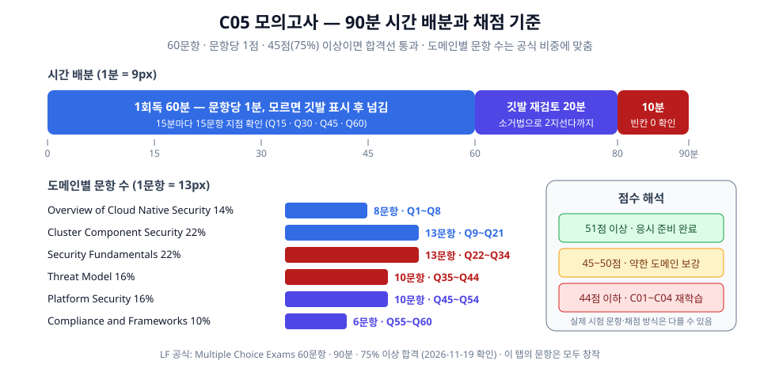

> **자격증 준비 · KCSA** | 난이도 ★★★☆☆ | 예상 소요 시험 90분 + 채점·복기 1시간

> ⚠️ **이 모의고사의 60문항은 모두 CNCF가 공개한 KCSA 커리큘럼(github.com/cncf/curriculum의 `KCSA Curriculum.pdf`, 2026-11-19 확인)의 6개 도메인 항목을 바탕으로 이 시리즈가 직접 창작한 연습 문항입니다.** 실제 시험 문제나 유출 문제(덤프)가 아니고, 그런 것을 재현하지도 않습니다. Linux Foundation 시험은 응시 정책으로 보호되므로 "실제 기출"이라고 주장하는 자료는 믿지도, 퍼뜨리지도 마세요. 문항 속 회사·네임스페이스·이름은 모두 지어낸 것입니다.

## 🎯 오늘의 목표

- C01~C04에서 정리한 6개 도메인을 실제 시험 규모(**60문항 · 90분**)로 한 번에 풀어 본다
- **1회독 60분 → 깃발 재검토 20분 → 최종 점검 10분** 리듬을 몸에 붙인다
- 정답표와 도메인별 채점표로 약한 도메인을 찾고, 해설의 근거 링크로 **다시 볼 편**을 정한다

---

## 1. 시험 안내

| 항목 | 이 모의고사 | 실제 시험 (공식 자료, 2026-11-19 확인) |
|---|---|---|
| 문항 수 | **60문항**, 4지선다 단일 정답 | 60문항 객관식 ([Important Instructions](https://docs.linuxfoundation.org/tc-docs/certification/important-instructions-mc)) |
| 시간 | **90분** | 90분 |
| 합격 참고선 | **45점(75%)** | 75% 이상 ([Multiple Choice FAQ](https://docs.linuxfoundation.org/tc-docs/certification/faq-mc)) |
| 배점 | 문항당 1점, 감점 없음 | 채점 방식 세부는 비공개 |
| 언어 | 한국어(핵심 용어 영어 병기) | 영어 |

도메인별 문항 수(공식 비중을 60문항에 맞춤):

| 문항 | 도메인 | 비중 | 문항 수 | 복습 편 |
|---|---|---|---|---|
| Q1~Q8 | Overview of Cloud Native Security | 14% | 8 | [C01](./c01-cloud-native-security-overview.md) |
| Q9~Q21 | Kubernetes Cluster Component Security | 22% | 13 | [C02](./c02-cluster-component-security.md) |
| Q22~Q34 | Kubernetes Security Fundamentals | 22% | 13 | [C03](./c03-security-fundamentals-threat-model.md) 2~6장 |
| Q35~Q44 | Kubernetes Threat Model | 16% | 10 | [C03](./c03-security-fundamentals-threat-model.md) 7~8장 |
| Q45~Q54 | Platform Security | 16% | 10 | [C04](./c04-platform-security-compliance.md) 2~7장 |
| Q55~Q60 | Compliance and Security Frameworks | 10% | 6 | [C04](./c04-platform-security-compliance.md) 8장 |

> 💡 실제 시험은 도메인 순서대로 나오지 않을 수 있습니다. 이 모의고사는 채점과 복습을 쉽게 하려고 도메인별로 묶었습니다. 두 번째로 풀 때는 문항 번호를 섞어서(예: 홀수 먼저) 풀어 보세요.

**규칙**: 타이머 90분, 자료·검색 금지, 답안은 종이나 메모장에 `1-C, 2-B …` 형식으로 적고, 끝난 뒤 5장 정답표로 채점합니다.

---

## 2. 문항 — 도메인 1. Overview of Cloud Native Security (Q1~Q8)

**Q1.** 4C 모델에서 "이미지 취약점 스캔, 컨테이너를 non-root로 실행, seccomp 프로파일 적용"이 주로 속하는 계층은?

- A. Cloud
- B. Cluster
- C. Container
- D. Code

**Q2.** Kubernetes 문서가 CNCF 보안 백서를 따라 쓰는 수명 주기 단계 중, "이미지 서명, 비공개 레지스트리로 접근 제한, 레지스트리 이미지 스캔"이 해당하는 단계는?

- A. Develop
- B. Distribute
- C. Deploy
- D. Runtime

**Q3.** 노드 관리가 필요 없는 서버리스 컨테이너 서비스(예: 노드 OS를 제공자가 관리)를 쓸 때도 **고객에게 남는 책임**으로 가장 알맞은 것은?

- A. 컨테이너 이미지의 취약점 관리와 워크로드에 부여한 클라우드 IAM 권한
- B. 하이퍼바이저 패치
- C. 노드 커널 업데이트
- D. 데이터센터 전력·냉각 설비

**Q4.** 클라우드의 워커 노드 역할(인스턴스 역할)에 객체 스토리지 전체 관리 권한이 붙어 있다. 이 구성의 위험을 줄이는 방법으로 가장 알맞은 것은?

- A. 노드 수를 늘린다
- B. 노드 역할 권한은 그대로 두고 Pod에 `privileged: false`를 지정한다
- C. 클러스터의 모든 Secret을 삭제한다
- D. 노드 역할은 최소화하고, 스토리지가 필요한 워크로드에만 워크로드 단위 아이덴티티로 필요한 권한을 준다

**Q5.** gVisor를 가장 잘 설명한 것은?

- A. Pod마다 경량 가상 머신을 띄우는 하이퍼바이저
- B. 컨테이너의 syscall을 사용자 공간에서 가로채 처리하는 애플리케이션 커널(샌드박스 런타임)
- C. 이미지 서명 도구
- D. 네트워크 정책 엔진

**Q6.** 랜섬웨어로 암호화된 네임스페이스의 데이터를 **백업에서 복구**하는 활동은 어떤 통제 유형인가?

- A. 예방(Preventive)
- B. 탐지(Detective)
- C. 교정(Corrective)
- D. 억제(Deterrent)

**Q7.** 스테이징 환경에 배포된 웹 애플리케이션에 조작된 HTTP 요청을 보내 SQL 인젝션 같은 취약점을 찾는 활동은?

- A. DAST
- B. SAST
- C. SCA
- D. SBOM 생성

**Q8.** 운영 매니페스트에서 `image: shop/api:latest`를 쓰는 것이 보안·운영상 나쁜 이유로 가장 알맞은 것은?

- A. latest 태그는 레지스트리에서 다운로드할 수 없다
- B. latest 태그는 자동으로 non-root로 실행된다
- C. latest 태그는 이미지 크기를 키운다
- D. 실제로 어떤 이미지 내용이 배포되는지 보장되지 않아 검증·감사·롤백이 어렵다

---

## 3. 문항 — 도메인 2. Kubernetes Cluster Component Security (Q9~Q21)

**Q9.** 클러스터의 모든 클라이언트(사용자, 컨트롤러, kubelet)가 접속하는 **유일한 API 진입점**의 기본 포트는?

- A. TCP 6443
- B. TCP 2379
- C. TCP 10250
- D. TCP 10259

**Q10.** 노드에서 kubelet의 TCP 10255 포트가 열려 있는 것이 발견되었다. 알맞은 평가와 조치는?

- A. 정상이다. kubelet의 인증된 API 포트다
- B. 정상이다. kube-proxy 헬스 체크 포트다
- C. etcd 피어 포트이므로 방화벽에서 2380으로 바꾼다
- D. 인증 없이 Pod 정보 등을 노출하는 읽기 전용 포트이므로 `readOnlyPort: 0`으로 끈다

**Q11.** 공격자가 **직접 접근**에 성공하면 Secret을 포함한 클러스터 상태 전체를 읽고 쓸 수 있는 컴포넌트는?

- A. kube-scheduler
- B. CoreDNS
- C. etcd
- D. kube-proxy

**Q12.** kube-proxy에 대한 설명으로 옳은 것은?

- A. NetworkPolicy를 집행하는 컴포넌트다
- B. 노드에서 Service 가상 IP로 가는 트래픽 규칙(iptables·nftables·IPVS 등)을 관리하며, NetworkPolicy 집행은 CNI의 몫이다
- C. 컨테이너 이미지를 풀하는 컴포넌트다
- D. API 서버의 인증서를 발급한다

**Q13.** 컨트롤 플레인의 ServiceAccount 토큰 서명용 개인 키(kubeadm의 `sa.key`)가 유출되었다. 가장 직접적인 위험은?

- A. 공격자가 임의의 ServiceAccount로 보이는 토큰을 위조해 API 서버에 인증할 수 있다
- B. 노드의 디스크가 가득 찬다
- C. 모든 Pod의 DNS가 실패한다
- D. 컨테이너 이미지가 삭제된다

**Q14.** CIS 벤치마크가 kube-scheduler와 kube-controller-manager에 `--profiling=false`를 권고하는 이유로 가장 알맞은 것은?

- A. 프로파일링이 켜져 있으면 Pod가 스케줄되지 않는다
- B. 프로파일링이 etcd 암호화를 끈다
- C. 필요 없는 디버그·성능 정보 엔드포인트를 노출하지 않아 공격 표면을 줄인다
- D. 프로파일링이 켜져 있으면 감사 로그가 꺼진다

**Q15.** 컨테이너 런타임의 저수준 구성요소(runc 등)에 컨테이너 탈출 취약점이 공개되었다. 가장 직접적인 대응은?

- A. 네임스페이스를 새로 만든다
- B. 노드의 컨테이너 런타임 구성요소를 패치된 버전으로 업데이트한다
- C. Service를 ClusterIP로 바꾼다
- D. 감사 로그 레벨을 Metadata로 낮춘다

**Q16.** Pod 스펙의 `hostPID: true`가 위험한 이유는?

- A. Pod의 IP가 노드 IP와 같아진다
- B. Pod가 노드의 디스크 전체를 마운트한다
- C. Pod의 이미지가 노드에 캐시되지 않는다
- D. 컨테이너가 노드의 모든 프로세스를 보고, 권한에 따라 신호를 보내거나 메모리 정보에 접근할 수 있다

**Q17.** API 서버에서 익명 요청이 허용될 때, 자격 증명 없이 들어온 요청은 어떤 신원으로 처리되는가?

- A. 사용자 `system:anonymous`, 그룹 `system:unauthenticated`
- B. 사용자 `admin`, 그룹 `system:masters`
- C. 해당 네임스페이스의 `default` ServiceAccount
- D. 요청을 보낸 노드의 kubelet

**Q18.** API 서버가 `--authorization-mode=Node,RBAC`로 설정되어 있다. 인가 동작으로 옳은 것은?

- A. 두 모드가 모두 허용해야 요청이 허용된다
- B. 설정된 순서대로 각 모드에 묻고, 어느 하나라도 허용하면 요청이 허용된다
- C. RBAC만 사용되고 Node는 무시된다
- D. Node 모드는 사람 사용자 요청만 처리한다

**Q19.** Pod Security Standards baseline 레벨에서 **금지되는** 볼륨 유형은?

- A. emptyDir
- B. configMap
- C. hostPath
- D. projected

**Q20.** kubeconfig의 **exec 자격 증명 플러그인**(client-go credential plugin)을 쓰는 주된 보안상 이점은?

- A. API 서버 인증서 검증을 생략할 수 있다
- B. 모든 사용자가 같은 인증서를 공유할 수 있다
- C. 만료 없는 토큰을 파일에 저장할 수 있다
- D. 외부 신원 공급자나 클라우드 CLI에서 짧은 수명 자격 증명을 필요할 때 받아 쓸 수 있다

**Q21.** 노드 간에 오가는 Pod 트래픽을 애플리케이션 수정 없이 암호화하려 한다. 알맞은 방법은?

- A. etcd 저장 데이터 암호화를 켠다
- B. CNI의 투명 암호화 기능(WireGuard·IPsec 등)이나 서비스 메시 mTLS를 쓴다
- C. NodePort 범위를 바꾼다
- D. kube-proxy를 재시작한다

---

## 4. 문항 — 도메인 3. Kubernetes Security Fundamentals (Q22~Q34)

**Q22.** 다음 중 PSS **baseline** 레벨이 막는 설정은?

- A. `hostNetwork: true`
- B. `runAsUser: 0`(root로 실행)
- C. `seccompProfile`을 지정하지 않음
- D. `capabilities.drop`을 지정하지 않음

**Q23.** PSA의 **audit** 모드로 restricted를 설정한 네임스페이스에서 위반 Pod를 만들면?

- A. 생성이 거부된다
- B. 사용자에게 경고만 표시된다
- C. 생성은 허용되고, API 서버 감사 로그의 해당 이벤트에 위반 주석이 추가된다
- D. Pod가 자동으로 restricted에 맞게 수정된다

**Q24.** 네임스페이스에 `pod-security.kubernetes.io/enforce-version: v1.37` 같은 버전 레이블을 붙이는 이유는?

- A. 그 버전보다 오래된 kubelet에서만 Pod가 실행되게 하려고
- B. 이미지 태그를 그 버전으로 강제하려고
- C. 네임스페이스 이름을 버전으로 바꾸려고
- D. 클러스터를 업그레이드해도 그 버전의 PSS 정의로 평가해 정책이 예고 없이 바뀌지 않게 하려고

**Q25.** 기존 워크로드가 많은 네임스페이스에 PSA를 **단계적으로** 도입하는 구성으로 가장 알맞은 것은?

- A. `enforce: baseline`, `warn: restricted`, `audit: restricted`
- B. `enforce: restricted`만 즉시 적용
- C. `enforce: privileged`, `warn: privileged`
- D. PSA 레이블을 모두 지우고 PodSecurityPolicy를 만든다

**Q26.** X.509 클라이언트 인증서로 인증할 때 쿠버네티스가 사용자 이름과 그룹으로 쓰는 필드의 짝은?

- A. 사용자 = O(Organization), 그룹 = CN
- B. 사용자 = CN(Common Name), 그룹 = O(Organization)
- C. 사용자 = 일련번호, 그룹 = 발급자
- D. 사용자 = SAN의 IP, 그룹 = 유효기간

**Q27.** 사람 사용자 인증에 장기 X.509 클라이언트 인증서보다 OIDC가 권장되는 이유로 가장 알맞은 것은?

- A. OIDC를 쓰면 RBAC가 필요 없다
- B. X.509 인증서는 쿠버네티스가 읽을 수 없다
- C. OIDC 토큰은 만료가 없다
- D. 쿠버네티스는 클라이언트 인증서의 개별 폐기를 지원하지 않아, 유출되면 만료 전까지 막기 어렵다

**Q28.** 개발자에게 Secret 읽기 권한은 없지만 같은 네임스페이스에 Pod를 만들 권한은 있다. 보안상 문제가 되는 이유는?

- A. Secret을 마운트하거나 환경 변수로 참조하는 Pod를 만들어 내용을 읽을 수 있다
- B. Pod를 만들면 RBAC가 자동으로 꺼진다
- C. Pod 생성 권한은 노드 SSH 권한을 포함한다
- D. 문제없다. Secret은 Pod에서 읽을 수 없다

**Q29.** External Secrets Operator의 역할로 옳은 것은?

- A. etcd를 외부 데이터베이스로 교체한다
- B. Secret을 base64 대신 hex로 인코딩한다
- C. 외부 비밀 저장소(Vault/OpenBao, 클라우드 비밀 관리 서비스 등)의 값을 읽어 쿠버네티스 Secret으로 동기화한다
- D. Secret 생성을 금지한다

**Q30.** 어떤 Pod를 선택하는 NetworkPolicy가 하나 있고, 이 정책의 `policyTypes`는 `["Egress"]`뿐이다. 이 Pod로 **들어오는** 트래픽은?

- A. 모두 차단된다
- B. 같은 네임스페이스에서 오는 것만 허용된다
- C. 이 정책의 영향을 받지 않으므로(다른 정책이 없다면) 모두 허용된다
- D. DNS 트래픽만 허용된다

**Q31.** NetworkPolicy의 `ingress.from`에 다음이 **한 항목 안에** 함께 있다: `namespaceSelector: {matchLabels: {team: pay}}`와 `podSelector: {matchLabels: {role: api}}`. 의미는?

- A. team=pay 네임스페이스의 모든 Pod **또는** 모든 네임스페이스의 role=api Pod
- B. 클러스터의 모든 Pod
- C. 정책 자체의 네임스페이스에 있는 role=api Pod만
- D. team=pay 레이블이 있는 네임스페이스 **안의** role=api Pod만

**Q32.** 감사 로그에 요청 메타데이터와 **요청 본문**은 남기되 응답 본문은 남기지 않는 레벨은?

- A. Request
- B. Metadata
- C. RequestResponse
- D. None

**Q33.** `watch`처럼 오래 이어지는 요청에서 응답 헤더를 보낸 직후, 본문이 끝나기 전에 기록되는 감사 단계는?

- A. RequestReceived
- B. ResponseStarted
- C. ResponseComplete
- D. Panic

**Q34.** 감사 로그를 웹훅이나 로그 수집기로 **클러스터 밖에** 보내 보관하는 가장 중요한 이유는?

- A. API 서버 성능이 두 배가 된다
- B. 감사 정책 파일이 필요 없어진다
- C. 클러스터나 노드가 침해되어도 공격자가 기록을 지우거나 고치기 어렵게 하려고
- D. 감사 레벨을 None으로 둘 수 있게 하려고

---

## 5. 문항 — 도메인 4. Kubernetes Threat Model (Q35~Q44)

**Q35.** 위협 모델링에서 **신뢰 경계(trust boundary)** 의 뜻으로 가장 알맞은 것은?

- A. 방화벽 장비의 물리적 위치
- B. 신뢰 수준이 서로 다른 영역이 만나는 선으로, 데이터나 요청이 넘을 때 검증·통제가 필요한 곳
- C. 네임스페이스의 ResourceQuota 한도
- D. 인증서의 유효기간

**Q36.** 클러스터의 데이터 흐름도(DFD)를 그릴 때 etcd는 어떤 요소로 표시하는 것이 가장 알맞은가?

- A. 데이터 저장소(data store)
- B. 외부 엔터티(external entity)
- C. 신뢰 경계
- D. 데이터 흐름

**Q37.** 다음 중 커리큘럼의 위협 항목 **Persistence(지속)** 에 해당하는 예는?

- A. Pod가 limits 없이 CPU를 독점한다
- B. 평문 트래픽을 도청한다
- C. 이미지에 오래된 라이브러리가 있다
- D. 침해된 계정으로 몇 분마다 리버스 셸 Pod를 다시 만드는 CronJob을 심어 둔다

**Q38.** API 서버의 **API Priority and Fairness(APF)** 가 완화하는 위협은?

- A. 이미지 변조
- B. Secret 유출
- C. 일부 클라이언트의 요청 폭주로 API 서버가 다른 요청을 처리하지 못하는 서비스 거부
- D. 노드 탈출

**Q39.** 웹 애플리케이션 컨테이너 안에서 **예상하지 못한 셸이 실행된 것**을 실시간으로 알아채는 데 알맞은 도구는?

- A. kube-bench
- B. cosign
- C. SPDX
- D. Falco

**Q40.** PSS restricted가 컨테이너 capabilities를 `ALL` 제거하도록 요구하는 이유 중, 특히 `NET_RAW` 제거가 줄이는 **네트워크 공격자** 위협은?

- A. raw 소켓을 이용한 같은 네트워크 안의 패킷 위조·스푸핑(예: ARP·DNS 스푸핑)
- B. 이미지 레이어에 남은 비밀
- C. 인증서 만료
- D. 감사 로그 삭제

**Q41.** 워커 노드 하나를 장악한 공격자가 그 노드의 kubelet 자격 증명으로 **읽을 수 있는 Secret 범위**를 그 노드의 Pod가 쓰는 것으로 좁혀 주는 구성은?

- A. ResourceQuota
- B. Node 인가 모드와 NodeRestriction 어드미션
- C. PSA warn 모드
- D. kube-proxy IPVS 모드

**Q42.** RBAC에서 권한 상승에 악용될 수 있어 특히 엄격히 다뤄야 하는 동사 묶음은?

- A. get, list, watch
- B. escalate, bind, impersonate
- C. create, update, patch (ConfigMap 한정)
- D. proxy, redirect (Service 한정)

**Q43.** 공격자가 실행 중인 컨테이너 안의 애플리케이션 바이너리를 악성 파일로 바꿔치기했다. STRIDE 범주와 이를 어렵게 만드는 설정의 짝은?

- A. Spoofing — OIDC 인증
- B. Repudiation — 감사 로그
- C. Denial of Service — ResourceQuota
- D. Tampering — `readOnlyRootFilesystem: true`

**Q44.** 침투한 공격자가 `kubectl auth can-i --list`, `kubectl get pods -A`로 자기 권한과 클러스터 구성을 파악한다. MITRE ATT&CK 전술로 가장 알맞은 것은?

- A. Discovery(탐색)
- B. Impact(영향)
- C. Exfiltration(유출)
- D. Initial Access(초기 접근)

---

## 6. 문항 — 도메인 5. Platform Security (Q45~Q54)

**Q45.** 널리 쓰이는 SBOM **형식** 두 가지로 옳은 것은?

- A. SLSA와 in-toto
- B. YAML과 JSON Schema
- C. SPDX와 CycloneDX
- D. Rekor와 Fulcio

**Q46.** Sigstore의 **keyless 서명**에 대한 설명으로 옳은 것은?

- A. 서명 없이 이미지를 배포하는 방식이다
- B. 서명 키를 이미지 안에 함께 넣는 방식이다
- C. 서명자의 OIDC 신원을 바탕으로 Fulcio가 짧은 수명 인증서를 발급하고, 서명 기록은 Rekor 투명성 로그에 남는다
- D. 레지스트리 관리자의 비밀번호로 서명한다

**Q47.** 아티팩트의 **provenance(출처 증명)** 가 답하는 질문은?

- A. 이 이미지에 어떤 CVE가 있는가
- B. 이 이미지는 몇 번 다운로드되었는가
- C. 이 이미지를 몇 개의 노드가 캐시하고 있는가
- D. 이 아티팩트를 어떤 소스에서, 어떤 빌더와 절차로 만들었는가

**Q48.** "사내 레지스트리 `registry.corp.example` 이미지만 실행 허용"을 클러스터 전체에 강제하는 방법으로 가장 알맞은 것은?

- A. ValidatingAdmissionPolicy나 Gatekeeper·Kyverno 같은 어드미션 정책으로 다른 레지스트리 이미지를 거부한다
- B. 모든 노드의 `/etc/hosts`를 수정한다
- C. ResourceQuota로 이미지 수를 제한한다
- D. NetworkPolicy로 레지스트리 접근을 연다

**Q49.** Falco가 탐지에 쓰는 **주된 이벤트 소스**는?

- A. 컨테이너 이미지의 SBOM
- B. 커널 수준의 syscall 이벤트(추가로 플러그인을 통해 쿠버네티스 감사 이벤트 등)
- C. Git 커밋 서명
- D. 레지스트리의 태그 목록

**Q50.** 서비스 메시의 mTLS가 제공하는 것으로 옳은 것은?

- A. 통신하는 양쪽의 신원을 서로 인증하고 전송 구간을 암호화한다
- B. etcd의 저장 데이터를 암호화한다
- C. 컨테이너의 syscall을 제한한다
- D. Pod의 CPU 사용량을 제한한다

**Q51.** kubeadm이 클러스터 CA와 별도로 **etcd 전용 CA**를 두는 보안상 이유로 가장 알맞은 것은?

- A. etcd 인증서는 만료가 없기 때문에
- B. etcd는 TLS를 지원하지 않기 때문에
- C. 클러스터 CA는 10년, etcd CA는 1년이라 갱신 주기를 맞추려고
- D. 클러스터 CA로 발급한 일반 클라이언트 인증서로는 etcd에 접근할 수 없게 신뢰 범위를 나누려고

**Q52.** Ingress나 Gateway에서 TLS를 종료할 때 인증서와 개인 키를 보관하는 쿠버네티스 리소스는?

- A. `kubernetes.io/tls` 유형의 Secret
- B. ConfigMap
- C. ServiceAccount
- D. PersistentVolumeClaim

**Q53.** 어드미션 단계의 처리 순서로 옳은 것은?

- A. 검증(Validating) → 변경(Mutating) → 인증
- B. 변경(Mutating) → 스키마 검증 → 검증(Validating)
- C. 검증(Validating)만 실행되고 변경은 kubelet이 한다
- D. 인가 → 변경 → 인증 → 검증

**Q54.** 결제 처리 Pod가 외부의 특정 결제 대행사 API에만 나가야 하고 그 밖의 인터넷 접속은 막아야 한다. 알맞은 연결성(Connectivity) 통제는?

- A. Ingress TLS 인증서를 교체한다
- B. 감사 로그 레벨을 올린다
- C. Egress NetworkPolicy(또는 이그레스 게이트웨이·프록시)로 허용 목적지만 열고 나머지는 거부한다
- D. 노드 수를 줄인다

---

## 7. 문항 — 도메인 6. Compliance and Security Frameworks (Q55~Q60)

**Q55.** 미국의 의료 정보(PHI) 보호를 규정한 법은?

- A. PCI DSS
- B. GDPR
- C. SOC 2
- D. HIPAA

**Q56.** SOC 2에 대한 설명으로 가장 알맞은 것은?

- A. 쿠버네티스 컴포넌트 설정 점검표다
- B. 유럽연합의 개인정보 보호 규정이다
- C. 외부 감사인이 서비스 조직의 통제(보안·가용성 등)를 평가해 발행하는 감사 보고서다
- D. 컨테이너 이미지 서명 표준이다

**Q57.** EU 거주자의 개인정보 처리에 적용되는 **규정**은?

- A. HIPAA
- B. GDPR
- C. NIST SP 800-53
- D. CIS Benchmark

**Q58.** Kubescape 같은 도구를 쓰는 목적으로 가장 알맞은 것은?

- A. NSA/CISA 하드닝 가이드, MITRE 등 여러 프레임워크 기준으로 클러스터와 매니페스트의 보안 상태를 자동 점검한다
- B. 컨테이너 이미지를 서명한다
- C. etcd를 백업한다
- D. 노드 OS를 설치한다

**Q59.** 컴플라이언스와 보안의 관계에 대한 설명으로 옳은 것은?

- A. 감사를 통과하면 침해가 불가능하다는 뜻이다
- B. 컴플라이언스 요구사항은 기술 통제와 무관하다
- C. 프레임워크를 하나 고르면 다른 보안 활동은 필요 없다
- D. 감사 통과는 요구사항 충족을 뜻할 뿐 침해되지 않는다는 보장이 아니며, 증거를 남기려면 자동화된 점검·기록이 중요하다

**Q60.** OpenSSF Scorecard의 용도로 옳은 것은?

- A. 쿠버네티스 노드의 CIS 점수를 매긴다
- B. 오픈소스 프로젝트의 보안 관행(브랜치 보호, 의존성 관리, 서명된 릴리스 등)을 자동으로 점검해 점수를 매긴다
- C. 신용카드 데이터 환경을 인증한다
- D. 서비스 메시의 mTLS 비율을 측정한다

---

## 8. 정답표

| 문항 | 정답 | 문항 | 정답 | 문항 | 정답 | 문항 | 정답 | 문항 | 정답 | 문항 | 정답 |
|---|---|---|---|---|---|---|---|---|---|---|---|
| 1 | C | 11 | C | 21 | B | 31 | D | 41 | B | 51 | D |
| 2 | B | 12 | B | 22 | A | 32 | A | 42 | B | 52 | A |
| 3 | A | 13 | A | 23 | C | 33 | B | 43 | D | 53 | B |
| 4 | D | 14 | C | 24 | D | 34 | C | 44 | A | 54 | C |
| 5 | B | 15 | B | 25 | A | 35 | B | 45 | C | 55 | D |
| 6 | C | 16 | D | 26 | B | 36 | A | 46 | C | 56 | C |
| 7 | A | 17 | A | 27 | D | 37 | D | 47 | D | 57 | B |
| 8 | D | 18 | B | 28 | A | 38 | C | 48 | A | 58 | A |
| 9 | A | 19 | C | 29 | C | 39 | D | 49 | B | 59 | D |
| 10 | D | 20 | D | 30 | C | 40 | A | 50 | A | 60 | B |

---

## 9. 채점표

| 도메인 | 문항 | 만점 | 내 점수 | 정답률 | 70% 미만이면 다시 볼 곳 |
|---|---|---|---|---|---|
| Overview of Cloud Native Security | Q1~Q8 | 8 | | | [C01](./c01-cloud-native-security-overview.md) |
| Cluster Component Security | Q9~Q21 | 13 | | | [C02](./c02-cluster-component-security.md), [CKS S01](../cks/s01-cluster-setup.md)·[S02](../cks/s02-cluster-hardening.md) |
| Security Fundamentals | Q22~Q34 | 13 | | | [C03](./c03-security-fundamentals-threat-model.md) 2~6장, [Day 69](../../09-security/day69-k8s-workload-security.md)·[Day 70](../../09-security/day70-networkpolicy-zero-trust.md) |
| Threat Model | Q35~Q44 | 10 | | | [C03](./c03-security-fundamentals-threat-model.md) 7~8장, [Day 66](../../09-security/day66-threat-modeling-4c.md) |
| Platform Security | Q45~Q54 | 10 | | | [C04](./c04-platform-security-compliance.md) 2~7장, [Day 57](../../07-gitops/day57-supply-chain-security.md)·[Day 71](../../09-security/day71-vault-cert-manager.md) |
| Compliance and Frameworks | Q55~Q60 | 6 | | | [C04](./c04-platform-security-compliance.md) 8장 |
| **합계** | | **60** | | | **45점(75%) 이상 합격선** |

| 총점 | 해석 | 다음 행동 |
|---|---|---|
| **51점 이상**(85%) | 응시 준비 완료 | 1주 안에 응시. 직전에 LF 페이지에서 도메인 표 재확인 |
| **45~50점** | 합격선이지만 여유 없음 | 정답률 70% 미만 도메인의 C편 "헷갈리는 포인트"와 문항 다시 → 1주 뒤 재응시(문항 순서 섞어서) |
| **44점 이하** | 개념 구분이 아직 흔들림 | C01~C04를 표 중심으로 다시 읽고, 각 편 문항을 80% 이상 맞힌 뒤 C05 재도전 |

> 💡 **찍어서 맞힌 문항도 틀린 것으로 셉니다.** 채점할 때 확신 없이 고른 문항에 별표를 해 두고, 맞혔더라도 해설을 읽으세요. 실제 시험에서는 그 운이 반복되지 않습니다.

---

## 10. 해설

도메인 1 해설 (Q1~Q8)

**Q1 — C.** 이미지·런타임 설정은 Container 계층입니다. Cluster는 API 서버·RBAC 같은 클러스터 수준 통제, Code는 애플리케이션 자체입니다. → [C01](./c01-cloud-native-security-overview.md) 2장

**Q2 — B.** 아티팩트를 만들어 **배포 가능한 상태로 보관·전달**하는 단계가 Distribute입니다. Deploy는 "무엇을 어디에 배포할지 제한"(어드미션), Runtime은 실행 중 보호입니다. → C01 2장 💡, [Cloud Native Security and Kubernetes](https://kubernetes.io/docs/concepts/security/cloud-native-security/)

**Q3 — A.** 서버리스여도 이미지 내용과 권한 설정은 고객 몫입니다. B·C·D는 제공자 책임입니다. → C01 3장

**Q4 — D.** 노드 역할에 큰 권한이 있으면 그 노드의 어떤 Pod든 메타데이터 API로 자격 증명을 얻을 수 있습니다. 노드 역할은 최소화하고 워크로드 단위 아이덴티티(클라우드별 Pod 아이덴티티 기능)로 필요한 Pod에만 권한을 줍니다. B는 문제의 원인(노드 역할)을 그대로 둡니다. → C01 3장

**Q5 — B.** gVisor는 사용자 공간 커널, Kata Containers가 경량 VM(A)입니다. → C01 5장

**Q6 — C.** 사고 후 원래 상태로 되돌리는 것은 교정 통제입니다. → C01 4-1

**Q7 — A.** 실행 중인 앱을 밖에서 시험하는 것이 DAST입니다. SAST는 소스 분석, SCA는 의존성 분석입니다. → C01 7장

**Q8 — D.** 태그는 움직이므로 같은 매니페스트가 다른 이미지를 배포할 수 있습니다. 다이제스트로 고정합니다. → C01 6장

도메인 2 해설 (Q9~Q21)

**Q9 — A.** 6443은 API 서버. 2379는 etcd 클라이언트, 10250은 kubelet, 10259는 스케줄러입니다. → [C02](./c02-cluster-component-security.md) 2장

**Q10 — D.** 10255는 인증 없는 kubelet 읽기 전용 포트입니다. 인증되는 kubelet API는 10250(A), kube-proxy 헬스 체크는 10256(B)입니다. → C02 2장·7장

**Q11 — C.** etcd에 직접 접근하면 API 서버의 인증·인가·어드미션·감사를 모두 우회합니다. → C02 4·5장

**Q12 — B.** kube-proxy는 Service 규칙만 관리합니다. NetworkPolicy는 CNI가 집행합니다(A 오답). → C02 2장·6장

**Q13 — A.** SA 토큰은 이 키로 서명되고 API 서버는 공개 키로 검증합니다. 개인 키가 있으면 유효해 보이는 토큰을 위조할 수 있으므로 키를 교체해야 합니다. → [C04](./c04-platform-security-compliance.md) 6장

**Q14 — C.** 프로파일링 엔드포인트는 운영에 필요 없는 내부 정보를 노출합니다. 공격 표면 최소화입니다. → C02 2장

**Q15 — B.** 런타임 계층 취약점은 런타임을 고쳐야 합니다. non-root 실행, 샌드박스 런타임은 피해를 줄이는 보조 통제입니다. → C02 2장, [Day 68](../../09-security/day68-container-runtime-security.md) 2장

**Q16 — D.** 호스트 PID 네임스페이스를 공유하면 노드 프로세스가 보입니다. A는 `hostNetwork`, B는 hostPath 마운트 이야기입니다. PSS baseline이 금지합니다. → [C03](./c03-security-fundamentals-threat-model.md) 2장

**Q17 — A.** 익명 요청은 `system:anonymous` / `system:unauthenticated`로 처리됩니다. 그래서 이 그룹에 권한을 바인딩하는 것은 매우 위험합니다. → C02 3장, [Authenticating](https://kubernetes.io/docs/reference/access-authn-authz/authentication/)

**Q18 — B.** 인가 모드는 순서대로 평가되며 하나라도 허용하면 허용됩니다. Node 모드는 kubelet 요청을 다루고, 의견이 없으면 다음 모드(RBAC)로 넘어갑니다. → C02 3장

**Q19 — C.** hostPath는 노드 파일 시스템에 접근하므로 baseline에서 금지됩니다. 나머지는 restricted에서도 허용되는 볼륨 유형입니다. → C02 5장, C03 2장

**Q20 — D.** exec 플러그인은 필요할 때 외부(IdP, 클라우드 CLI)에서 짧은 수명 토큰을 받아 옵니다. A·B·C는 모두 안티패턴입니다. → C02 6장

**Q21 — B.** 전송 중 암호화는 CNI 암호화나 메시 mTLS입니다. etcd 저장 데이터 암호화(A)는 저장된 데이터 이야기입니다. → C02 6장, [Day 70](../../09-security/day70-networkpolicy-zero-trust.md)

도메인 3 해설 (Q22~Q34)

**Q22 — A.** baseline은 host 네임스페이스(hostNetwork·hostPID·hostIPC)를 막습니다. root 실행 금지(B)와 capabilities 전체 제거(D)는 restricted의 요구이고, baseline은 seccomp를 명시적으로 `Unconfined`로 두는 것만 막아 미지정(C)은 허용됩니다. → C03 2장, [Pod Security Standards](https://kubernetes.io/docs/concepts/security/pod-security-standards/)

**Q23 — C.** audit은 허용 + 감사 이벤트 주석, warn은 허용 + 경고(B), enforce는 거부(A)입니다. PSA는 Pod를 수정하지 않습니다(D). → C03 2장

**Q24 — D.** 버전을 고정하지 않으면(`latest`) 클러스터 업그레이드와 함께 PSS 정의가 바뀌어 갑자기 Pod가 거부될 수 있습니다. → C03 2장, [Day 69](../../09-security/day69-k8s-workload-security.md) 3장

**Q25 — A.** 지금 깨지지 않는 수준(baseline)은 강제하고, 목표 수준(restricted)은 warn·audit으로 관찰하며 고쳐 나갑니다. B는 기존 워크로드를 갑자기 깨뜨리고, D의 PSP는 제거된 기능입니다. → C03 2장

**Q26 — B.** CN이 사용자 이름, O가 그룹입니다. `O=system:masters` 인증서는 cluster-admin과 같은 힘을 가지므로 발급에 주의합니다. → C03 3장

**Q27 — D.** 클라이언트 인증서는 폐기 목록을 쿠버네티스가 확인하지 않습니다. OIDC는 짧은 수명 토큰과 IdP의 계정 비활성화로 대응할 수 있습니다. RBAC는 여전히 필요합니다(A 오답). → C03 3장, [C04](./c04-platform-security-compliance.md) 6장

**Q28 — A.** 같은 네임스페이스에서 Pod를 만들 수 있으면 그 Pod에 Secret을 넣어 읽을 수 있습니다. 그래서 Pod 생성 권한도 Secret 접근 권한처럼 다룹니다. → C03 4장, [Good practices for Kubernetes Secrets](https://kubernetes.io/docs/concepts/security/secrets-good-practices/)

**Q29 — C.** ESO는 외부 저장소를 원본으로 두고 Secret을 동기화합니다. → C03 4장, [Day 71](../../09-security/day71-vault-cert-manager.md) 7장

**Q30 — C.** 정책은 `policyTypes`에 적힌 방향에만 격리를 겁니다. Egress만 있으면 Ingress는 (다른 정책이 없다면) 기본 허용 그대로입니다. → C03 5장

**Q31 — D.** 같은 항목 안의 두 셀렉터는 **AND**입니다. 하이픈으로 항목을 나누면 OR(A)이 됩니다. → [Day 70](../../09-security/day70-networkpolicy-zero-trust.md) 2-3, [NetworkPolicy 문서](https://kubernetes.io/docs/concepts/services-networking/network-policies/)

**Q32 — A.** Request = 메타데이터 + 요청 본문. RequestResponse는 응답 본문까지(C)입니다. → C03 6장

**Q33 — B.** ResponseStarted는 응답 헤더 전송 후 본문 완료 전, 긴 요청에서만 생깁니다. → C03 6장, [Auditing](https://kubernetes.io/docs/tasks/debug/debug-cluster/audit/)

**Q34 — C.** 감사 로그는 사고 조사의 증거입니다. 침해된 시스템 안에만 있으면 증거가 사라질 수 있습니다. → C03 6장, [C04](./c04-platform-security-compliance.md) 4장

도메인 4 해설 (Q35~Q44)

**Q35 — B.** 신뢰 수준이 바뀌는 지점이 공격이 일어나는 곳이고, 그래서 검증과 통제를 둡니다. → C03 7장, [Day 66](../../09-security/day66-threat-modeling-4c.md) 3장

**Q36 — A.** etcd는 데이터를 저장하는 곳이므로 DFD의 데이터 저장소입니다. STRIDE-per-element로 보면 변조(T)·정보 노출(I)·서비스 거부(D)가 해당됩니다. → Day 66 3-1·3-2

**Q37 — D.** 재부팅·Pod 삭제 후에도 공격자가 다시 들어올 발판을 남기는 것이 지속입니다. A는 서비스 거부, B는 네트워크 공격자, C는 악성 코드 실행의 원인이 될 취약점입니다. → C03 8장

**Q38 — C.** APF는 요청을 우선순위 수준과 흐름으로 나눠 한 클라이언트가 API 서버를 독점하지 못하게 합니다. → C03 8장, [API Priority and Fairness](https://kubernetes.io/docs/concepts/cluster-administration/flow-control/)

**Q39 — D.** Falco는 syscall 기반 런타임 탐지 도구로, 기본 규칙에 컨테이너 안 셸 실행 탐지가 있습니다. kube-bench는 설정 점검, cosign은 서명, SPDX는 SBOM 형식입니다. → [Day 72](../../09-security/day72-falco.md) 5장

**Q40 — A.** `NET_RAW`가 있으면 raw 소켓으로 패킷을 만들 수 있어 같은 L2 네트워크에서 스푸핑 공격이 가능해집니다. → C03 8장

**Q41 — B.** Node 인가는 kubelet이 자기 노드에 스케줄된 Pod가 참조하는 Secret·ConfigMap 등만 읽게 하고, NodeRestriction은 쓰기 범위를 자기 노드로 묶습니다. → C02 3장, [Node Authorization](https://kubernetes.io/docs/reference/access-authn-authz/node/)

**Q42 — B.** `escalate`(자기보다 큰 권한의 Role 만들기), `bind`(가진 적 없는 권한을 바인딩), `impersonate`(다른 사용자로 행세)는 RBAC 자체의 안전장치를 우회할 수 있는 동사입니다. → C03 8장, [RBAC good practices](https://kubernetes.io/docs/concepts/security/rbac-good-practices/)

**Q43 — D.** 무단 수정은 Tampering(무결성)입니다. 루트 파일 시스템을 읽기 전용으로 두면 바이너리 교체가 어려워집니다(쓰기 필요한 경로만 emptyDir). → C03 8장 그림

**Q44 — A.** 환경과 권한을 파악하는 행동은 Discovery입니다. → C03 8-1, Day 66 5장

도메인 5 해설 (Q45~Q54)

**Q45 — C.** SPDX와 CycloneDX가 SBOM 형식입니다. SLSA·in-toto(A)는 빌드 무결성·증명 프레임워크, Rekor·Fulcio(D)는 Sigstore 구성요소입니다. → C04 2장

**Q46 — C.** keyless는 오래 사는 서명 키를 관리하지 않고 OIDC 신원 + 짧은 수명 인증서 + 투명성 로그로 서명을 검증 가능하게 만드는 방식입니다. → C04 2장

**Q47 — D.** provenance는 "어디서 어떻게 만들었나", SBOM은 "무엇이 들었나", 스캔 결과는 "어떤 CVE가 있나"(A)입니다. → C04 2장

**Q48 — A.** 이미지 출처 제한은 요청 내용 검사이므로 어드미션 정책입니다. → C04 3장·7장

**Q49 — B.** Falco는 커널의 syscall 이벤트를 주 소스로 쓰고, 플러그인으로 쿠버네티스 감사 로그 등 다른 소스를 더할 수 있습니다. → C04 4장, [Day 72](../../09-security/day72-falco.md) 2장

**Q50 — A.** mTLS = 상호 인증 + 전송 암호화. 어떤 서비스가 무엇을 할 수 있는지는 별도의 인가 정책으로 정합니다. → C04 5장

**Q51 — D.** etcd CA를 분리하면 클러스터 CA로 서명된 일반 클라이언트 인증서로는 etcd가 신뢰하지 않습니다. 기본 수명은 두 CA 모두 10년입니다(C 오답). → C04 6장

**Q52 — A.** TLS 인증서·키는 `kubernetes.io/tls` Secret(`tls.crt`, `tls.key`)에 담고 Ingress·Gateway가 참조합니다. cert-manager가 이 Secret을 자동으로 만들고 갱신합니다. → C04 5·6장, [Day 71](../../09-security/day71-vault-cert-manager.md)

**Q53 — B.** 인증 → 인가 → 어드미션(변경 → 스키마 검증 → 검증) 순서입니다. → C02 3장, C04 7장

**Q54 — C.** 나가는 트래픽 제한은 Egress 정책이나 이그레스 게이트웨이·프록시입니다(FQDN 기반 제한은 일부 CNI·메시의 확장 기능). → C04 5장

도메인 6 해설 (Q55~Q60)

**Q55 — D.** HIPAA는 미국 의료 정보 보호법입니다. PCI DSS는 카드 데이터, GDPR은 EU 개인정보, SOC 2는 감사 보고서입니다. → C04 8-1

**Q56 — C.** SOC 2는 AICPA 기준에 따른 감사인의 보고서(attestation)이고, ISO/IEC 27001은 관리체계 인증(certification)입니다. → C04 8-1·9장

**Q57 — B.** GDPR은 EU 규정입니다. NIST SP 800-53은 통제 카탈로그, CIS Benchmark는 설정 점검 기준입니다. → C04 8-1

**Q58 — A.** Kubescape는 여러 프레임워크 기준의 보안 상태(posture) 점검 도구입니다. → C04 8-3

**Q59 — D.** 컴플라이언스는 최소 요구사항의 충족 증명이고, 보안은 계속되는 활동입니다. 둘을 잇는 것이 자동화된 점검·기록(지속적 컴플라이언스)입니다. → C04 8장 ⚠️

**Q60 — B.** OpenSSF Scorecard는 오픈소스 저장소의 보안 관행을 자동 점검합니다. 의존성을 고를 때 공급망 위험 지표로 씁니다. → C04 8-1

---

## 11. 핵심 정리

- KCSA 실전 형식: **60문항 · 90분 · 75%(45점) 합격**. 1회독 60분(문항당 1분) → 깃발 재검토 20분 → 빈칸 점검 10분
- 점수가 가장 많이 갈리는 곳은 **짝 구분**: PSS 레벨 ↔ PSA 모드, 감사 레벨 ↔ 단계, 401 ↔ 403, SBOM ↔ provenance ↔ 서명, Fulcio ↔ Rekor, SOC 2 ↔ ISO 27001, CIS ↔ NIST CSF
- 비중이 큰 **Cluster Component(13문항)** 와 **Security Fundamentals(13문항)** 에서 80% 이상을 확보하면 합격이 안정적이다
- 도메인 정답률 70% 미만이면 채점표의 링크로 돌아가고, 1주 뒤 문항 순서를 섞어 다시 푼다
- 이 탭의 모든 문항은 공식 커리큘럼 기반 **창작**이다. 응시 직전에는 LF KCSA 페이지의 도메인 표를 다시 확인한다

---

## ⏭️ 다음 단계

KCSA는 "무엇을 왜 지켜야 하는지"를 고르는 시험이었습니다. 같은 지식을 **손으로 증명하는** 단계가 CKS입니다. 이 탭의 개념이 CKS에서 어떤 과제로 바뀌는지 연결해 두면 다음 공부가 훨씬 빨라집니다.

| KCSA에서 고른 것 | CKS에서 직접 하는 것 | CKS 편 |
|---|---|---|
| kubelet 익명 인증 끄기, 컨트롤 플레인 `--profiling=false`, CIS 벤치마크 | kube-bench 결과를 보고 정적 Pod 매니페스트·kubelet 설정 파일을 고쳐 PASS로 만들기 | [S01](../cks/s01-cluster-setup.md) |
| 기본 거부 NetworkPolicy, 메타데이터 API 차단 | 네임스페이스에 정책을 작성하고 통신 매트릭스로 검증 | [S01](../cks/s01-cluster-setup.md) |
| 최소 RBAC, SA 토큰 자동 마운트 끄기, NodeRestriction | 과도한 바인딩을 찾아 줄이고 `auth can-i`로 검증, API 서버 플래그 복구 | [S02](../cks/s02-cluster-hardening.md) |
| seccomp·AppArmor, 공격 표면 최소화 | 프로파일을 노드에 적재하고 Pod에 연결 | [S03](../cks/s03-system-hardening.md) |
| PSS·PSA, Secret 저장 데이터 암호화, RuntimeClass, mTLS | 네임스페이스 레이블 적용, `EncryptionConfiguration` 작성·기존 Secret 재암호화, gVisor RuntimeClass | [S04](../cks/s04-microservice-vulnerabilities.md) |
| SBOM·서명·허용 레지스트리·정적 분석 | Trivy 스캔, SBOM 생성, ImagePolicyWebhook 배선, kubesec | [S05](../cks/s05-supply-chain.md) |
| 감사 로그 레벨·단계, Falco, 불변 컨테이너 | 감사 정책 작성과 API 서버 연결, Falco 규칙 수정, `readOnlyRootFilesystem` | [S06](../cks/s06-monitoring-runtime.md) |

- **순서**: CKS는 **CKA 합격자만** 응시할 수 있습니다. 아직 CKA가 없다면 [CKA 탭](../cka/k00-exam-overview-lab.md) → [CKS S00](../cks/s00-exam-overview-lab.md) 순서로 갑니다. 실습 환경(`cka-main` 클러스터, 스냅샷 `cks-clean`)도 그 순서로 쌓입니다.
- **갱신 보너스**: LF의 CARE 프로그램에 따라 **CKS에 합격하면 KCSA가 자동 갱신**됩니다(2026-11-19 Multiple Choice FAQ 기준). KCSA를 먼저 따고 유효기간(2년) 안에 CKS로 넘어가면 두 자격을 함께 유지하기 쉽습니다.
- **Kubestronaut**: KCNA·KCSA·CKA·CKAD·CKS 다섯 자격을 모두 유효한 상태로 보유하면 CNCF의 Kubestronaut 칭호를 받을 수 있습니다. 조건과 혜택은 바뀔 수 있으니 CNCF 공식 페이지에서 확인하세요.
- **이론을 다시 보고 싶다면**: 본편 보안 탭 [Day 66](../../09-security/day66-threat-modeling-4c.md) ~ [Day 73](../../09-security/day73-keycloak-sso-audit.md)이 KCSA 개념과 CKS 실습의 공통 기반입니다.
