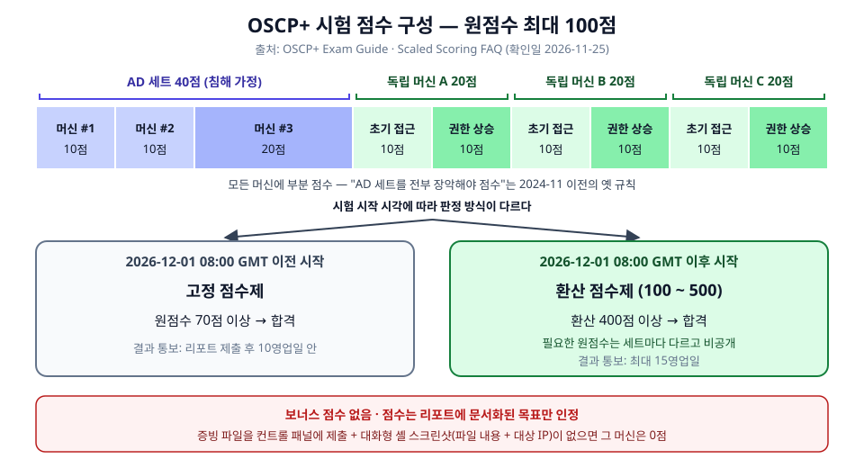
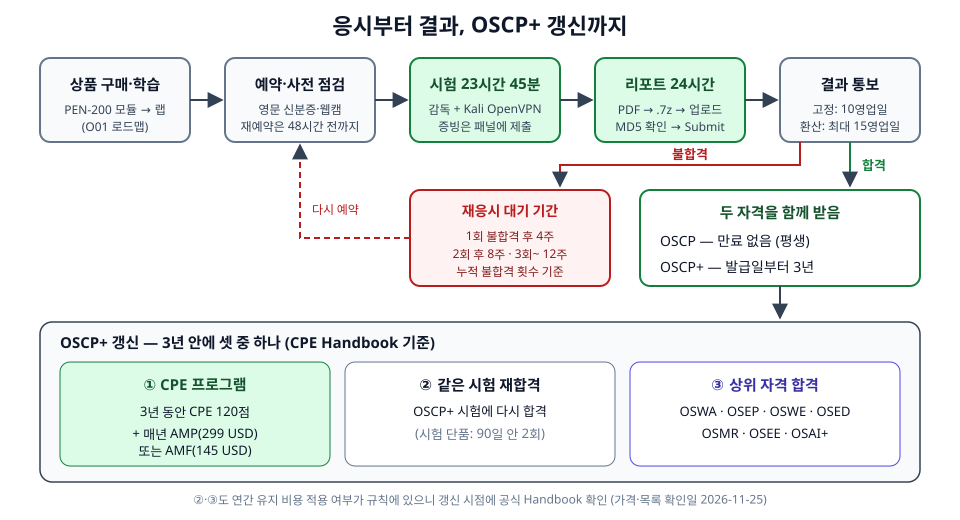

> **자격증 준비 · OSCP** | 난이도 ★★☆☆☆ (읽기·계획) | 예상 소요 1.5 ~ 2시간 (공식 시험 가이드 정독 포함)

> ⚠️ **실습 범위 경고** — 이 탭은 OSCP **학습 가이드**이지 공격 도구 튜토리얼이 아닙니다. 실습은 **본인 소유의 격리된 실습장**(해킹 02의 `hacklab` 네트워크)과 **허가가 문서로 확인된 학습 플랫폼**(OffSec PEN-200 랩·Proving Grounds, TryHackMe, Hack The Box 등이 나에게 배정한 머신)에서만 합니다. 허가 없이 타인의 시스템을 스캔하거나 공격하면 **정보통신망법** 등에 따라 처벌될 수 있고, "자격증 공부 중이었다"는 이유가 되지 않습니다.

> 📌 **시험 내용 비공개** — OffSec 시험은 학업 정책(Academic Policy)상 시험 정보를 다른 사람과 나누거나 힌트를 구하는 것이 금지되어 있습니다. 이 탭은 **실제 시험 문제, 후기 속 머신 내용, "이번 세트에 나온 것"을 다루지 않습니다.** 그런 자료를 찾거나 공유하는 것은 자격 취소 사유가 될 수 있습니다.

## 🎯 오늘의 목표

- OSCP가 어떤 시험이고 업계에서 왜 "실기 모의해킹 자격의 기준점"으로 쓰이는지 설명할 수 있다
- **OSCP와 OSCP+** 의 차이(유효기간, 갱신 방법)를 공식 문서 기준으로 구분한다
- 시험 구조(23시간 45분 + 리포트 24시간, 독립 머신 3대 + AD 세트 1개)와 **배점·증빙·리포트 규칙**을 표로 정리한다
- **2026-12-01부터 바뀌는 환산 점수(Equated Scaled Scoring)** 가 내 준비 전략에 무엇을 바꾸는지 안다
- 상품(Learn One, Course + Cert Bundle, 시험 단품)을 비교해 내 상황에 맞는 것을 고른다

---

## 1. OSCP는 어떤 자격인가?

**OSCP(OffSec Certified Professional)** 는 OffSec(옛 Offensive Security)이 운영하는 **실기형 모의해킹 자격**입니다. 객관식이 하나도 없습니다. 감독관이 지켜보는 가운데 약 하루 동안 사설 VPN 안의 머신들을 직접 점검해 권한을 얻고, 끝난 뒤 **전문 모의해킹 보고서**를 제출해 그 보고서로 채점받습니다.

| 관점 | 내용 |
|---|---|
| 무엇을 증명하나 | 정보 수집 → 취약점 식별 → 초기 접근 → 권한 상승 → AD 환경에서 횡적 이동 → **보고서 작성**까지 한 사람이 끝까지 해낼 수 있는가 |
| 연계 과정 | **PEN-200: Penetration Testing with Kali Linux** (레벨 200, 공식 페이지 기준 콘텐츠 321시간, 20개 이상 모듈, 챌린지 랩 9개) |
| 응시 자격 | 공식 시험 가이드: **선행 조건 없음**. 다만 PEN-200 페이지는 TCP/IP, Windows·Linux 관리, Bash·Python 기초를 "강하게 권장" |
| 업계에서의 위치 | 국내외 모의해킹·레드팀 채용 공고에 자주 등장하는 실기 자격. 객관식 자격(CEH, 정보보안기사 필기 등)과 달리 **"손으로 해 봤다"** 는 증거로 읽힌다 |
| 난이도 | 공식 합격률은 **공개하지 않음**(FAQ). 레벨 200 = OffSec 안에서 "입문 다음 단계". 리눅스·윈도우·네트워크 기초가 없으면 PEN-200 자체가 매우 버겁다 |

### 1-1. 왜 따는가 — 그리고 왜 이 블로그 독자에게 의미가 있나

해킹 01에서 "공격을 이해해서 방어를 증명한다"고 했습니다. OSCP는 그 "공격을 이해한다"를 **제3자가 검증해 주는** 가장 널리 알려진 방법입니다.

| 목적 | OSCP가 주는 것 | 이 블로그에서 이어지는 곳 |
|---|---|---|
| 모의해킹 컨설턴트로 취업·전직 | 실기 검증 + 보고서 작성 능력 | [해킹 11 보고서](../../hacking/hack11-pentest-report.md) |
| 인프라·DevOps 엔지니어의 보안 감각 | 내가 만든 서버·AD·웹이 **어떻게 무너지는지** 체감 | [Day 67 호스트 하드닝](../../09-security/day67-host-hardening.md), [해킹 25 AD 보안](../../hacking/hack25-windows-ad-basics.md) |
| 블루팀·탐지 엔지니어 | 공격 흐름을 알아야 탐지 룰이 보인다 | [해킹 10 탐지 관점](../../hacking/hack10-detection-view.md), [해킹 30 Wazuh](../../hacking/hack30-blue-team-wazuh.md) |
| 상위 과정의 출발점 | OSEP·OSWE·OSED 등 300 레벨로 가는 기본기 | O02의 "다음 단계" |

> 💡 OSCP는 **"취약점 한 개를 깊이 파는"** 시험이 아니라 **"여러 대를 넓게 열거하고, 막히면 판단해서 옮겨 가는"** 시험입니다. 공식 시험 영역 비중에서 **보고서 작성(Documenting Findings)이 33%로 가장 큽니다**(4장). 기술만큼 기록 습관이 합격을 가릅니다.

---

## 2. OSCP와 OSCP+ — 무엇이 다른가

2024년 11월 1일 이후 시험에 합격하면 **OSCP와 OSCP+ 두 개를 함께** 받습니다. 둘의 차이는 **유효기간 하나**입니다.

| 구분 | OSCP | OSCP+ |
|---|---|---|
| 받는 시점 | 시험 합격 시 (2024-11-01 이전 합격자도 보유) | 2024-11-01 **이후** 시험 합격 시 함께 발급 |
| 유효기간 | **만료 없음** (평생) | 발급일로부터 **3년** |
| 갱신 | 필요 없음 | 아래 3가지 중 하나 |
| 시험 내용 | 같은 시험 | 같은 시험 |

### 2-1. OSCP+ 갱신 방법 (CPE Handbook 기준)

| 방법 | 조건 |
|---|---|
| ① CPE 프로그램 | 3년 주기 동안 **CPE 120점** + **매년 연간 유지 비용**(AMP 또는 AMF) |
| ② 같은 시험 재합격 | OSCP+ 시험에 다시 합격 + 프로그램 규칙상 해당하는 연간 유지 비용 |
| ③ 상위 자격 합격 | OSWA, OSEP, OSWE, OSED, OSMR, OSEE, OSAI+ 중 하나 합격 + 해당하는 연간 유지 비용 |

| 연간 유지 수단 | 가격 (확인일 기준) | 내용 |
|---|---|---|
| **AMP**(Annual Membership Program) | 연 299 USD, 자동 갱신 | 유지 비용 포함 + **Proving Grounds Practice**, 분기별 교체되는 CPE 대상 랩, 이전에 산 코스 자료 접근 |
| **AMF**(Annual Maintenance Fee) | 연 145 USD, 비갱신 | 유지 비용만 |

> ⚠️ **공식 페이지끼리 표현이 조금 다릅니다.** PEN-200 페이지 FAQ는 "만료 6개월 안에 재인증 시험", 상위 자격 목록을 OSEP·OSWA·OSED·OSEE로 적고 있고, 더 자세한 [CPE Program and Annual Maintenance Handbook](https://help.offsec.com/hc/en-us/articles/35366391096596-OffSec-CPE-Program-and-Annual-Maintenance-Handbook)은 위 표처럼 적습니다. 또 OSCP+ 단품 페이지의 "Changes to the OSCP" 도움말 링크는 2026-11-25 확인 시 **404**였습니다. 갱신 시점이 다가오면 Handbook을 기준으로 다시 확인하세요.

> 💡 OSCP+를 갱신하지 않아도 **OSCP는 남습니다.** 채용 공고가 "OSCP"를 요구하면 만료 걱정은 없고, 조직이 "유효한 자격"을 요구하는 경우(조달·컴플라이언스)에만 OSCP+가 의미를 가집니다.

---

## 3. 시험 구조와 채점

아래 표는 2026-11-25에 [OSCP+ Exam Guide](https://help.offsec.com/hc/en-us/articles/360040165632-OSCP-Exam-Guide), [OSCP+ Exam FAQ](https://help.offsec.com/hc/en-us/articles/4412170923924-OSCP-Exam-FAQ), [OSCP+ Equated Scaled Scoring FAQ](https://help.offsec.com/hc/en-us/articles/54589877508884-OSCP-Equated-Scaled-Scoring-FAQ)를 직접 읽고 정리한 것입니다.

### 3-1. 시험 한눈에 보기

| 항목 | 내용 (확인일 **2026-11-25**) | 출처 |
|---|---|---|
| 시험 시간 | **23시간 45분** (예: 09:00 GMT 시작 → 다음 날 08:45 GMT 종료) | Exam Guide |
| 리포트 제출 | 시험 종료 후 **24시간 안에** 업로드 | Exam Guide |
| 감독 | **모든 시험이 감독(proctored)** 형태. 웹캠·화면 공유, 감독관과는 채팅으로만 소통 | Exam Guide, Proctored Exam Requirements FAQ |
| 접속 | Kali Linux에서 OpenVPN으로 접속(다른 환경은 VPN 지원 대상 아님). 접속 정보는 시작 시각에 메일로 | Exam Guide |
| 머신 구성 | **독립 머신 3대(60점)** + **AD 세트 1개, 머신 3대(40점)** = 원점수 최대 **100점** | Exam Guide |
| 독립 머신 배점 | 대당 20점 = **초기 접근 10점 + 권한 상승 10점** (부분 점수 있음) | Exam Guide |
| AD 세트 배점 | 머신 #1 **10점**, #2 **10점**, #3 **20점**. 시작 시 **사용자 계정 정보를 주는 "침해 가정(assumed breach)" 시나리오** | Exam Guide |
| 보너스 점수 | **없음.** "더 이상 제공하지 않으며 최종 점수는 시험 자체로만 결정" | Exam FAQ |
| 머신 되돌리기(revert) | **24회**, 시험 중 한 번 초기화 가능 | Exam Guide |
| 결과 통보 | 고정 점수제: 리포트 제출 후 **10영업일 안**. 환산 점수제: **최대 15영업일** | Exam Guide, Scaled Scoring FAQ |
| 피드백 | 리포트를 냈지만 점수가 부족한 응시자에게만 제공 | Exam FAQ |

### 3-2. 합격 기준 — 2026-12-01 08:00 GMT를 경계로 바뀐다

| 시험 **시작** 시각 | 판정 방식 | 합격 기준 |
|---|---|---|
| 2026-12-01 08:00 GMT **이전** | 고정 점수제 | 원점수 **70점** 이상 |
| 2026-12-01 08:00 GMT **이후** | **환산 점수(Equated Scaled Scoring)** | 100~500 척도에서 **400점** 이상. 400에 필요한 원점수는 **세트마다 다르고 공개하지 않음**(70보다 많을 수도 적을 수도 있음) |

공식 FAQ가 직접 강조하는 내용을 정리하면 이렇습니다.

- 채점 방식(배점, 증빙 요건, 문서화 기준)은 **그대로**이고, 채점이 끝난 원점수를 세트 난이도에 맞춰 환산하는 단계만 추가됩니다.
- 400/500은 **80%가 아닙니다.** 표시용 척도일 뿐입니다.
- "70점 채웠으니 멈춘다"는 전략이 통하지 않습니다. 공식 FAQ도 **"점수 목표를 쫓지 말고 가능한 많은 목표를 완수하고 문서화하라"**, **"점수가 낮아 보여도 리포트는 반드시 제출하라"** 고 안내합니다. 리포트를 내지 않으면 합격할 수 없습니다.
- 상대평가(커브)가 아닙니다. 다른 응시자와 비교하지 않고 고정된 기준과 비교합니다.
- 결과는 **환산 점수로만** 알려 주며 원점수는 알려 주지 않습니다. 기존 OSCP+ 보유자에게는 영향이 없습니다.

> 💡 이 글을 쓰는 2026-11-25 기준으로, **지금부터 준비하는 사람은 거의 확실히 환산 점수제로 응시**합니다. 인터넷 후기의 "AD 40 + local 3개면 70점" 같은 계산은 이제 합격 판정 근거가 되지 않습니다. 공식 FAQ의 합격 시나리오 예시(70점 조합)도 2026-12-01 이후에는 "원점수만으로 합격을 판단할 수 없다"는 주석이 붙어 있습니다.

### 3-3. 예전 규칙과 무엇이 달라졌나

후기와 블로그 글은 대부분 옛 규칙을 전제로 쓰여 있어 혼동하기 쉽습니다.

| 시기 | AD 세트 | 보너스 | 합격 |
|---|---|---|---|
| 2022 개편 ~ 2024-10 | 40점, **세트 전체를 장악해야만 점수**(하나라도 못 하면 0점) — OffSec 블로그 "What to Expect From the New OSCP Exam"(2022-01) | 랩 리포트 등으로 **최대 10점** | 70점 |
| 2024-11-01 ~ 2026-11-30 | 40점을 **머신별 10/10/20 부분 점수**, 침해 가정으로 시작 | **없음** | 원점수 70점 |
| 2026-12-01 ~ | 위와 같음 | 없음 | **환산 점수 400/500** |

> ⚠️ "AD 세트는 다 따야 점수가 나온다", "보너스 10점 챙기면 60점이면 된다"는 **현재 규칙이 아닙니다.** 오래된 후기를 읽을 때는 작성 날짜부터 보세요.

### 3-4. 공식 시험 영역 비중

[OSCP+ Exam with AD Preparation](https://help.offsec.com/hc/en-us/articles/4547917816468-OffSec-OSCP-Exam-with-AD-Preparation) 문서의 영역별 비중입니다(세부 지식 목록은 [OSCP+ Body of Knowledge](https://help.offsec.com/hc/en-us/articles/38543335188756-OSCP-Body-of-knowledge)).

| 영역 | 비중 | 이 탭에서 |
|---|---|---|
| Identifying Vulnerabilities (취약점 식별) | 12% | O01 선행 지식·학습 순서 |
| Exploiting Systems (시스템 공략) | 11% | O01 (원리 이해는 해킹 04~06) |
| Escalating Privileges (권한 상승) | 18% | O01 (점검·하드닝 관점은 해킹 06) |
| Active Directory | 26% | O01 (방어 관점은 해킹 25) |
| **Documenting Findings (발견 사항 문서화)** | **33%** | **O02 노트·리포트** |

---

## 4. 리포트와 증빙 규칙 — 점수는 리포트에서 나온다

공식 시험 가이드는 문서화 요건을 **"매우 엄격하다"** 고 적고, 부족하면 감점 또는 0점이라고 명시합니다. 그리고 **제출 후에는 빠진 스크린샷을 추가로 보낼 수 없습니다.**

| 규칙 | 내용 | 놓치면 |
|---|---|---|
| 재현 가능성 | 기술적으로 유능한 독자가 **단계별로 그대로 따라 할 수 있을 만큼** 모든 단계·명령·출력 기록 | 감점 또는 0점 |
| 증빙 파일 | 각 머신의 `local.txt` / `proof.txt` 내용을 **시험 중 컨트롤 패널에 제출** + 리포트에 스크린샷 | 해당 머신 0점 |
| 증빙 스크린샷 | 대상 머신의 **대화형 셸**에서 원래 위치의 파일을 `type`/`cat`으로 출력 + 같은 화면에 **대상 IP**(`ipconfig`, `ifconfig`, `ip addr`) | 해당 머신 0점. **웹 기반 셸 출력은 인정 안 됨** |
| 권한 수준 | Windows: SYSTEM·Administrator·관리자 권한 사용자 셸 / Linux: root 셸이어야 만점 | 부분 점수 |
| 공개 익스플로잇 | 수정하지 않았으면 **URL만**. 수정했으면 수정 코드, 원본 URL, 바꾼 부분 강조, 바꾼 이유 | 감점 |
| 리포트 순서 | **리포트에 적은 순서대로** 채점 | — |
| 파일 형식 | **PDF** 하나를 비밀번호 없는 **.7z**로 압축, 200MB 이하. 이름은 `OSCP-OS-XXXXX-Exam-Report.pdf` / `.7z` (대소문자 구분) | 업로드 거부 또는 채점 안 됨 |
| 업로드 | `upload.offsec.com`에 업로드 → 표시된 MD5와 로컬 파일 MD5 비교 → **Submit File** 클릭 → 확인 메일 | 채점 안 됨 |
| 추가 설명 요청 | OffSec가 메일로 요청하면 **24시간 안에** 회신 | — |

공식 리포트 템플릿은 [OSCP+ Reporting Requirements](https://help.offsec.com/hc/en-us/articles/360046787731-OSCP-Reporting-Requirements)와 시험 가이드에 링크된 [Word(.docx)](https://www.offsec.com/pwk-online/OSCP-Exam-Report.docx) / [LibreOffice(.odt)](https://www.offsec.com/pwk-online/OSCP-Exam-Report.odt) 파일입니다. 자기 양식을 써도 되지만 "구조적이고 전문적인 형식"이어야 합니다. 템플릿을 미리 채워 보는 연습은 O02에서 합니다.

---

## 5. 시험 규정 — 무엇이 금지되는가

규정은 **시험 가이드에 적힌 것만** 공식 답입니다. OffSec는 "가이드에 없는 도구 허용 여부에는 답하지 않는다"고 명시합니다. 이 블로그도 규정의 **회색지대를 찾는 팁은 다루지 않습니다.** 애매하면 쓰지 않는 것이 원칙입니다.

| 구분 | 공식 규정 요약 (Exam Guide · Exam FAQ · AI Usage Policy) |
|---|---|
| 금지 | 스푸핑(IP·ARP·DNS·NBNS 등), **상용 도구·서비스**(Metasploit Pro, Burp Pro 등), **자동 익스플로잇 도구**(예: SQLmap 등), **대량 취약점 스캐너**(Nessus, OpenVAS 등), 그리고 이런 금지 기능을 내부적으로 쓰는 다른 도구의 기능 |
| AI | **AI 챗봇·LLM 사용 금지**(OffSec KAI, ChatGPT, Gemini, DeepSeek, Copilot 등). 시험 중과 **리포트 작성 단계 모두** 금지. 제3자 도움·시험 정보 유출로 간주. 프롬프트로 대화하지 않는 내장 AI 기능(노트 앱 정리 기능, 검색 요약 등)은 끄지 않아도 됨 |
| Metasploit | 모듈(Auxiliary·Exploit·Post)과 Meterpreter는 **본인이 고른 머신 1대에만**. 여러 대에 시험 삼아 쓰는 것(`check` 포함)도 안 되고, 실패해도 다른 대상으로 옮길 수 없음. 피벗팅에도 사용 불가 |
| 사람 도움 | Discord 등에서 정보 **검색**은 가능하지만, 누구에게든 **도움을 구하거나 받는 것은 금지**. 시험 내용 논의 금지 |
| 오픈북 | 개인 노트, 온라인 자료, OffSec 학습 플랫폼은 사용 가능(AI 챗봇 제외). 단 모든 작업은 **감독 앱이 실행 중인 호스트**에서 |
| 파일 반출 | 시험 환경에서 로컬로 파일·소스를 내려받는 것은 공략에 꼭 필요한 경우 외 금지, 끝나면 삭제 |
| 감점 사유 | 금지 도구 사용, Metasploit 다중 사용, 증빙 누락(컨트롤 패널 + 대화형 셸 스크린샷 둘 다), 문서화 부족 → **해당 머신 0점** |

> ⚠️ 이 규정은 **시험 공정성**과 **실무 윤리**가 겹치는 지점입니다. 실제 모의해킹에서도 계약서(RoE, [해킹 01](../../hacking/hack01-ethical-hacking-intro.md))가 허용 기법을 정하고, 어기면 결과물 전체의 신뢰가 무너집니다. 규정 안에서 해내는 연습이 곧 실무 연습입니다.

### 5-1. 감독(Proctoring) 요건 요약

[Proctored Exam Requirements FAQ](https://help.offsec.com/hc/en-us/articles/15295546432148-Proctored-Exam-Requirements-FAQ) 기준입니다.

| 항목 | 요건 |
|---|---|
| 신분증 | 유효한 정부 발급 사진 신분증(영문 표기, 생년·발급국·발급일·만료일 포함). 앞뒷면 또는 펼친 여권. **프로필 이름과 일치** |
| 사전 절차 | 시작 15분 전 접속 권장, 방·주변 웹캠 스캔, 모든 화면 공유, 실행 중인 프로그램 표시, OS별 점검 스크립트 실행, 시험 VPN에만 연결됐는지 확인 |
| 장비 | 외장·내장 웹캠(휴대폰·태블릿 웹캠 불가), 화면 최대 4개, 안정적인 인터넷(다운 20/업 10Mbps 이상 권장) |
| Linux 호스트 | 화면 공유가 Wayland에서 잘 안 되므로 X11 권장, **실제 응시 전 테스트 세션** 필수 안내 |
| 자리 비움 | 휴대폰 등은 손 닿지 않는 곳에. 자리를 비울 때는 감독 채팅으로 알리고 휴식 |
| 재예약 | 시작 48시간 전까지 |

> 💡 한국에서 응시할 때 가장 흔한 준비물 문제는 **영문 신분증**입니다. 여권이 가장 무난합니다. 이름 표기가 OffSec 프로필과 같은지 미리 확인하세요.

---

## 6. 응시 절차

| 단계 | 할 일 | 참고 |
|---|---|---|
| 1. 상품 구매 | 7장 비교표에서 선택 | 코스 상품은 PEN-200 + 랩 + 응시권 |
| 2. 학습 | PEN-200 모듈 → 모듈 랩 → 챌린지 랩 | O01 로드맵 |
| 3. 일정 예약 | OffSec 학습 플랫폼(Learning Library)에서 시험 예약 | 응시권 유효기간 안에 |
| 4. 사전 점검 | 신분증·웹캠·화면·VPN 확인, Linux 호스트는 테스트 세션 | 5-1 |
| 5. 시험 23:45 | 감독 접속 → 사전 절차 → VPN 접속 → 컨트롤 패널에서 목표 확인 | O02 시간 배분 |
| 6. 리포트 24h | PDF → .7z → 업로드 → MD5 확인 → Submit | 4장 |
| 7. 결과 | 10영업일(고정) / 최대 15영업일(환산) | 합격 시 OSCP + OSCP+ |
| 불합격 시 | **재응시 대기 기간**: 1회 불합격 후 4주, 2회 후 8주, 3회 이후 12주. 재응시권을 새로 사면 구매일(대기 중이면 대기 종료일)로부터 120일 유효 | [Exam Retake Policy](https://help.offsec.com/hc/en-us/articles/4406830092564-What-is-the-Exam-Retake-Policy) |

> 💡 대기 기간은 **상품이 아니라 그 시험의 누적 불합격 횟수**로 계산됩니다. 취소한 시험은 대기 기간이 없습니다. 2026-12-01 전에 떨어지고 그 뒤에 재응시하면, 재응시는 **환산 점수제**로 채점됩니다(Scaled Scoring FAQ).

---

## 7. 코스 상품 비교

2026-11-25 [OffSec Pricing](https://www.offsec.com/pricing/), [PEN-200](https://www.offsec.com/courses/pen-200/), [OSCP+ Standalone Exam](https://www.offsec.com/products/oscp-plus/), [Proving Grounds](https://www.offsec.com/products/proving-grounds/) 페이지 기준입니다. 확인 시점에 할인 행사가 진행 중이어서 **정가와 할인가를 함께** 적었습니다. **가격은 자주 바뀌므로 결제 전 공식 페이지를 다시 보세요.**

| 상품 | 정가 (확인 시 할인가) | 랩 접근 | 시험 응시 | PG Play | PG Practice | 이런 사람에게 |
|---|---|---|---|---|---|---|
| **Learn One** | 연 2,749 USD (2,199) · 자동 갱신 | **365일** | **2회** | ✅ | ✅ | 처음 준비, 직장 병행, 여유 있게 |
| **Course + Cert Bundle** | 1,749 USD (1,499) · 1회 결제 | **90일** | **1회** | ✅ | ❌ | 기초가 이미 탄탄하고 3개월 집중 가능 |
| **OSCP+ Standalone Exam** | 1,699 USD · 1회 결제 | 코스 자료 **없음** | **90일 안에 2회** | — | — | 이미 준비된 사람, OSCP+ 갱신용 재시험 |
| **Learn Enterprise** (옛 Learn Unlimited 주소가 이리로 연결) | 별도 견적 | 전체 라이브러리 | 인증별 **연 6회/인** | ✅ | ✅ | 팀·회사 교육 예산 |
| Proving Grounds Practice | 월 19 USD / 연 199 USD | PG만 | — | — | ✅ | 코스 외 추가 연습(O01) |

> 💡 **혼자 처음 준비한다면 Learn One이 무난합니다.** 랩 1년 + 응시 2회 + PG Practice가 함께 들어 있어 "3개월 안에 끝내야 한다"는 압박이 없습니다. 반대로 O01의 선행 지식 체크리스트를 대부분 통과하고 주 20시간 이상을 낼 수 있으면 Course + Cert Bundle로 비용을 줄일 수 있습니다. 단 **응시 1회**라 재응시 비용을 따로 생각해야 합니다.

> ⚠️ 예전 이름인 "PWK", "Learn Unlimited", "PEN-200 90일 패키지"는 현재 상품명이 아닙니다. Learn Unlimited 상품 주소는 2026-11-25 확인 시 **Learn Enterprise**로 연결되었습니다. 표의 PG 포함 여부는 Pricing 페이지 비교표의 체크 표시를 읽은 것입니다.

---

## 8. 같은 계열 자격증 사이에서의 위치

| 자격 | 발급처 | 형식 | OSCP와 비교 |
|---|---|---|---|
| **정보보안기사** | 한국방송통신전파진흥원(KCA) | 필기(객관식) + 실기(필답) | 이론 전반. 국내 채용 서류용. 이 블로그 [정보보안기사 탭](../infosec-engineer/e00-exam-overview-strategy.md) |
| **CEH** | EC-Council | 객관식(+ 별도 실기) | 용어·개념의 폭. 실기 깊이는 OSCP가 큼 |
| **BSCP** | PortSwigger | 실기, 웹 전용 | 웹 취약점만 깊게. OSCP 다음 웹 심화로 많이 선택 |
| **OSCP / OSCP+** | OffSec | 실기 23:45 + 리포트 | **네트워크·시스템·AD를 넓게** + 보고서 |
| **OSEP, OSWE, OSED** | OffSec | 실기(레벨 300) | OSCP 다음 단계. O02 마지막 장 |
| **CRTO** | Zero-Point Security | 실기 | 레드팀 운영(C2 기반). OSCP 다음 단계 |

> 💡 이 표의 형식·가격은 각 발급처에서 바뀔 수 있습니다. OSCP 외 자격은 O02 "다음 단계"에서 확인일과 링크를 붙여 다시 정리합니다.

---

## 9. 막히는 지점

| 증상 | 원인 | 해결 |
|---|---|---|
| 후기마다 배점·합격 기준이 다름 | 2022 / 2024-11 / 2026-12 규칙이 섞임 | 3-3 표로 작성 시기를 먼저 판별, 최종 판단은 Exam Guide |
| "몇 점이면 합격?"을 계속 계산하게 됨 | 고정 점수제 습관 | 환산 점수제에서는 원점수 기준이 공개되지 않음. **목표를 최대한 완수하고 문서화**하는 것으로 목표 전환 |
| 어떤 도구가 허용인지 불안 | 가이드에 없는 도구 | 가이드·FAQ에 적힌 범위만 사용. 금지 기능(자동 공략·대량 스캔·AI 대화)이 들어 있으면 쓰지 않기 |
| 상품을 못 고르겠음 | 내 준비 수준을 모름 | O01 선행 지식 체크리스트를 먼저 해 보고 결정 |
| 영문 신분증이 없음 | 주민등록증·운전면허증은 영문 표기 요건을 충족하지 못할 수 있음 | 여권 준비, 이름 표기를 OffSec 프로필과 맞추기 |

---

## 10. 핵심 정리

- OSCP는 **23시간 45분 실기 + 24시간 리포트**의 감독형 시험. 독립 머신 3대(대당 10+10) + AD 세트 1개(10/10/20, 침해 가정), 원점수 최대 100점
- **보너스 점수는 없음.** "AD 세트를 다 따야 점수" 규칙도 **현재는 아님**(머신별 부분 점수)
- 합격 기준: **2026-12-01 08:00 GMT 이전 시작은 원점수 70점**, 이후는 **환산 점수 400/500**. 필요한 원점수는 세트마다 다르고 비공개 → 점수 계산 대신 **최대한 완수 + 문서화 + 반드시 제출**
- 영역 비중 1위는 **문서화 33%**. 증빙 스크린샷(대화형 셸 + IP)과 컨트롤 패널 제출이 빠지면 그 머신은 0점
- 금지: 스푸핑, 상용 도구, 자동 공략 도구, 대량 스캐너, **AI 챗봇·LLM(리포트 단계 포함)**, Metasploit은 1대만
- 합격하면 **OSCP(평생) + OSCP+(3년)**. OSCP+는 CPE 120점 + 연간 AMP/AMF, 재시험, 상위 자격 중 하나로 갱신
- 상품: Learn One(1년·2회·PG 포함), Course + Cert Bundle(90일·1회), 시험 단품(90일 안 2회). 가격은 공식 페이지에서 결제 직전 확인

---

## 11. 셀프 체크

Q1. 2026년 12월 5일에 시험을 시작해 원점수 70점을 얻었다. 합격인가?

알 수 없습니다. 2026-12-01 08:00 GMT 이후 시작한 시험은 환산 점수제로 판정하며, 400점(100~500 척도)에 필요한 원점수는 세트 난이도에 따라 다르고 공개되지 않습니다. 70점보다 적게 필요할 수도, 많이 필요할 수도 있습니다. 그래서 공식 FAQ는 점수 목표 대신 가능한 많은 목표를 완수하고 리포트를 반드시 제출하라고 안내합니다.

Q2. AD 세트에서 머신 #1·#2만 공략하고 #3은 못 했다. AD 점수는?

현재 시험 가이드 기준으로 머신 #1·#2 각 10점, 합계 20점을 받을 수 있습니다(증빙과 문서화 요건을 충족한 경우). "세트 전체를 장악해야만 점수"는 2022~2024년 10월까지의 옛 규칙입니다.

Q3. 리포트를 다듬으려고 시험이 끝난 뒤 ChatGPT에 문장 교정을 맡겼다. 문제가 되나?

됩니다. Exam FAQ는 KAI를 포함한 AI 챗봇 사용을 **시험 중과 리포트 작성 단계 모두** 금지합니다. AI Usage Policy는 이를 제3자 도움과 시험 정보 공유로 보고 학업 정책 위반으로 처리합니다.

Q4. proof.txt를 웹 셸 화면에서 출력해 캡처했다. 인정되나?

인정되지 않습니다. 대상 머신의 **대화형 셸**에서 원래 위치의 파일을 `type`/`cat`으로 출력하고, 같은 스크린샷에 대상 IP(`ipconfig`/`ifconfig`/`ip addr`)가 보여야 합니다. 웹 기반 셸 출력은 그 머신 0점 사유입니다. 내용은 시험 중 컨트롤 패널에도 제출해야 합니다.

Q5. OSCP+가 만료되면 OSCP도 사라지나?

아닙니다. 합격 시 받는 OSCP는 만료가 없습니다. OSCP+만 3년 뒤 만료되며, CPE 120점과 연간 유지 비용(AMP 또는 AMF), 재시험, 상위 자격 합격 중 하나로 갱신합니다.

---

## ⏭️ 다음 예고 — O01. 준비 로드맵과 참고 자료 사용법

시험이 무엇을 요구하는지 알았으니, 이제 **어디서부터 어떤 순서로** 준비할지 정합니다. 리눅스·윈도우·네트워크·웹·스크립팅·AD 선행 지식을 이 블로그의 인프라 탭과 해킹 탭 글로 점검하고, 주당 시간에 따라 3가지 학습 일정안을 세웁니다. 그리고 PEN-200 챌린지 랩, Proving Grounds, TryHackMe, Hack The Box, TJ Null 목록, HackTricks, PayloadsAllTheThings, GTFOBins·LOLBAS, 풀이 블로그까지 **각 자료를 언제, 어떻게 써야 실력이 되는지**(특히 풀이를 언제 볼지에 대한 규칙)를 정리합니다. 언제나 그렇듯 — **허가된 플랫폼과 내 랩에서만.**
