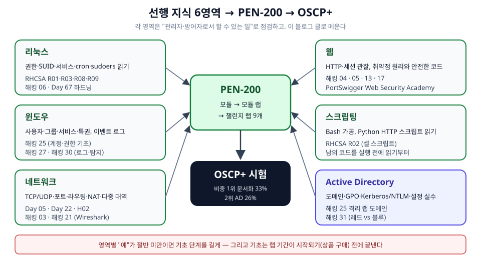
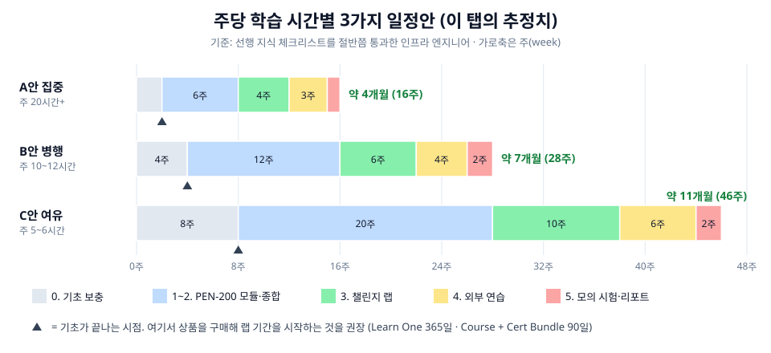

> **자격증 준비 · OSCP** | 난이도 ★★★☆☆ | 예상 소요 2 ~ 3시간 (선행 지식 자가 진단 포함)

> ⚠️ **실습 범위 경고** — 이 글이 소개하는 모든 자료는 **허가가 문서로 확인된 대상**에서만 씁니다. 대상은 ① 본인 소유의 격리 실습장(해킹 02의 `hacklab`), ② 학습 플랫폼이 **나에게 배정한** 머신(PEN-200 랩, Proving Grounds, TryHackMe, Hack The Box)뿐입니다. 플랫폼 VPN에 붙었다고 같은 대역의 다른 IP가 대상이 되는 것은 아닙니다. 치트시트에서 본 기법을 회사 서버, 학교망, 지인의 공유기에 "한번 해 보는" 순간 **정보통신망법** 위반이 될 수 있습니다.

> 📌 이 글은 학습 순서와 자료 사용법을 다룹니다. **익스플로잇 코드, 단계별 공격 절차, 탐지 회피, 시험 문제·후기 속 머신 정보는 다루지 않습니다.** 기법 자체의 원리와 방어는 해킹 탭 각 편에서 "원리 → 탐지 → 조치" 순서로 다룹니다.

## 🎯 오늘의 목표

- PEN-200 전에 갖춰야 할 **선행 지식 6영역**(리눅스·윈도우·네트워크·웹·스크립팅·AD)을 자가 진단하고, 부족한 부분을 이 블로그 글로 메운다
- 준비 단계(기초 → PEN-200 모듈 → 챌린지 랩 → 외부 연습 → 모의 시험·리포트)와 **주당 시간별 3가지 일정안**을 세운다
- PEN-200, Proving Grounds, TryHackMe, Hack The Box, TJ Null 목록, HackTricks, PayloadsAllTheThings, GTFOBins·LOLBAS, 풀이 블로그를 **언제, 어떻게** 쓰는지 안다
- 풀이(write-up)를 볼 때의 **스포일러 규칙**을 정해 "풀이를 읽어서 아는 것"과 "내가 할 수 있는 것"을 구분한다

---

## 1. 준비의 큰 그림 — 중심은 PEN-200, 나머지는 보조

O00에서 본 것처럼 OSCP는 **넓게 열거하고, 판단하고, 문서화하는** 시험입니다. 그래서 준비의 중심은 언제나 시험을 만든 곳의 교재인 **PEN-200**이고, 외부 자료는 ① 선행 지식 보충, ② 머신 수 늘리기, ③ 막혔을 때 체크리스트 역할을 합니다.

| 구분 | 자료 | 역할 |
|---|---|---|
| **중심** | PEN-200 모듈 + 모듈 랩 + 챌린지 랩 | 시험 범위 그 자체. OffSec 공식 FAQ: "최소한 코스 랩과 챌린지 랩을 끝내라" |
| 보충(입문) | TryHackMe, HTB Academy, PortSwigger Academy, 이 블로그 | PEN-200을 따라갈 기초 체력 |
| 확장(연습량) | Proving Grounds Practice, HTB 리타이어 머신, TJ Null 목록 | 처음 보는 머신을 많이 접하기 |
| 참고(사전) | HackTricks, PayloadsAllTheThings, GTFOBins, LOLBAS | 막혔을 때 "놓친 게 없나" 확인 |
| 복기 | 풀이 블로그(0xdf 등), 공식 walkthrough | 끝난 뒤 내 방법론과 비교 |

> 💡 OffSec는 공식 학습 계획도 공개합니다. [PEN-200 Learning Plan — 12 Week](https://help.offsec.com/hc/en-us/articles/15541765522196-OffSec-PEN-200-Learning-Plan-12-Week)와 [24 Week](https://help.offsec.com/hc/en-us/articles/15545672357780-OffSec-PEN-200-Learning-Plan-24-Week)입니다. 이 글의 3가지 일정안(4장)은 이 공식 계획 앞에 **선행 지식 단계**와 뒤에 **외부 연습·리포트 단계**를 붙인 것입니다.

---

## 2. 선행 지식 체크리스트

PEN-200 페이지는 정식 선수 과목은 없지만 **TCP/IP 네트워킹, Windows·Linux 관리 경험, Bash·Python 기초 스크립팅**을 강하게 권장합니다. 아래 체크리스트에서 영역별로 **"예"가 절반 미만이면** 4장의 기초 단계를 길게 잡으세요.

각 항목은 **관리자·방어자 입장에서 할 수 있어야 하는 일**로 적었습니다. 공격 기법은 결국 "관리자가 놓친 설정"을 찾는 일이므로, 관리 지식이 그대로 열거 능력이 됩니다.

### 2-1. 리눅스

| 할 수 있는가? | 참고 글 |
|---|---|
| 파일 권한(rwx, 소유자·그룹), 특수 권한(SUID·SGID·sticky)을 읽고 설명할 수 있다 | [RHCSA R01](../rhcsa/r01-essential-tools.md), [R08](../rhcsa/r08-users-groups.md) |
| 프로세스·서비스(systemd)·cron 작업을 나열하고 무엇이 어떤 사용자 권한으로 도는지 안다 | [RHCSA R03](../rhcsa/r03-operate-running-systems.md), [Day 07](../../01-docker/day07-container-internals.md) |
| sudo 설정(sudoers)을 읽고 "누가 무엇을 root로 실행할 수 있는지" 설명할 수 있다 | [해킹 06](../../hacking/hack06-linux-privesc.md) |
| 로그 위치와 기본 하드닝 항목을 안다 | [Day 67](../../09-security/day67-host-hardening.md), [RHCSA R09](../rhcsa/r09-security.md) |

### 2-2. 윈도우

| 할 수 있는가? | 참고 글 |
|---|---|
| 로컬 사용자·그룹, 서비스, 예약 작업을 PowerShell로 조회할 수 있다 | [해킹 25](../../hacking/hack25-windows-ad-basics.md) |
| 권한(특권) 개념과 UAC, "관리자 그룹"과 SYSTEM의 차이를 안다 | [해킹 25](../../hacking/hack25-windows-ad-basics.md) |
| 이벤트 로그에서 로그온·계정 변경 이벤트를 찾을 수 있다 | [해킹 27](../../hacking/hack27-incident-forensics.md), [해킹 30](../../hacking/hack30-blue-team-wazuh.md) |

### 2-3. 네트워크

| 할 수 있는가? | 참고 글 |
|---|---|
| TCP/UDP, 3-way handshake, 주요 포트와 서비스를 연결할 수 있다 | [해킹 03](../../hacking/hack03-recon.md), [해킹 21](../../hacking/hack21-wireshark.md) |
| 라우팅 테이블, 서브넷, NAT, 기본 게이트웨이를 읽을 수 있다 | [Day 22](../../03-virtualization-network/day22-linux-networking.md), [H02](../../00-homelab/homelab02-router-port-forwarding.md) |
| 여러 네트워크 대역을 가진 호스트가 왜 "경유지"가 되는지 설명할 수 있다(피벗팅 개념) | [Day 05](../../01-docker/day05-network.md), [해킹 02](../../hacking/hack02-isolated-lab.md) |

### 2-4. 웹

| 할 수 있는가? | 참고 글 |
|---|---|
| HTTP 요청·응답, 쿠키·세션, 상태 코드를 프록시(Burp Suite Community)로 관찰할 수 있다 | [해킹 04](../../hacking/hack04-web-sqli-xss.md), [해킹 17](../../hacking/hack17-browser-security.md) |
| SQLi·XSS·파일 업로드·경로 조작·명령 주입의 **원리와 안전한 코드**를 설명할 수 있다 | [해킹 04](../../hacking/hack04-web-sqli-xss.md), [해킹 05](../../hacking/hack05-web-owasp-top10.md), [해킹 13](../../hacking/hack13-secure-coding.md) |
| 웹 서버가 어떤 OS 사용자로 도는지가 왜 중요한지 안다 | [해킹 05](../../hacking/hack05-web-owasp-top10.md) |

### 2-5. 스크립팅

| 할 수 있는가? | 참고 글 |
|---|---|
| Bash로 반복·조건·파이프를 써서 로그나 목록을 가공할 수 있다 | [RHCSA R02](../rhcsa/r02-software-shell-scripts.md) |
| Python으로 HTTP 요청을 보내고 응답을 파싱하는 짧은 스크립트를 읽고 고칠 수 있다 | 외부 자료(Python 공식 튜토리얼) |
| 남이 쓴 공개 코드를 **실행 전에 읽고** 무엇을 하는지 설명할 수 있다 | O00 4장(리포트 규칙: 수정 내역 설명) |

> 💡 시험 가이드는 수정한 공개 익스플로잇에 대해 "무엇을 왜 바꿨는지" 설명을 요구합니다. 즉 **남의 코드를 읽는 능력**이 채점 대상입니다. 직접 짜는 능력보다 먼저 길러야 합니다.

### 2-6. Active Directory

| 할 수 있는가? | 참고 글 |
|---|---|
| 도메인·DC·OU·GPO, 사용자·그룹·컴퓨터 계정을 설명할 수 있다 | [해킹 25](../../hacking/hack25-windows-ad-basics.md) |
| Kerberos와 NTLM 인증 흐름을 그림으로 그릴 수 있다 | [해킹 25](../../hacking/hack25-windows-ad-basics.md) |
| 서비스 계정·위임·과도한 권한 같은 **흔한 설정 실수**와 방어책을 말할 수 있다 | [해킹 25](../../hacking/hack25-windows-ad-basics.md), [해킹 31](../../hacking/hack31-red-vs-blue.md) |

> ⚠️ AD는 시험 비중 **26%** 로 문서화 다음으로 큽니다(O00 3-4). 해킹 25에서 만든 **격리 랩 도메인**을 PEN-200 AD 모듈을 읽는 동안 옆에 띄워 두고, "이 설정이 왜 위험한가 → 어떤 이벤트가 남는가 → 어떻게 막나"를 같이 정리하면 공격 흐름과 방어가 한 번에 남습니다.

---

## 3. 단계별 학습 순서

| 단계 | 할 일 | 끝났다는 기준 |
|---|---|---|
| **0. 기초** | 2장 체크리스트 보충. TryHackMe Jr Penetration Tester 또는 HTB Academy 입문 모듈, PortSwigger Academy 웹 기초 | 체크리스트 영역별 "예" 70% 이상 |
| **1. PEN-200 모듈** | 모듈을 읽고 영상 보기 → 모듈 랩 → **머신별·주제별 노트**(O02) | 모든 모듈 랩 완료, 노트가 주제별로 정리됨 |
| **2. 종합 모듈** | "Assembling the Pieces"(공식 AD 준비 문서가 Module 24로 안내) — 여러 기법을 하나의 흐름으로 잇는 법 | 흐름을 그림 한 장으로 설명 가능 |
| **3. 챌린지 랩** | 챌린지 랩 9개. 특히 시험 형태를 본뜬 **Challenge 4·5·6 (OSCP A·B·C)** | A·B·C를 노트 없이 시간 재고 다시 풀 수 있음 |
| **4. 외부 연습** | PG Practice, HTB 리타이어 머신(TJ Null 목록 참고) | 처음 보는 머신에서 **열거 체크리스트대로** 움직임 |
| **5. 모의 시험·리포트** | 하루 동안 시험 시간표로 3~5대 + **실제 리포트 작성·PDF·.7z까지** | 리포트 1편을 24시간 안에 완성 |

> 💡 단계 3과 4는 순서를 바꾸지 마세요. 공식 AD 준비 문서도 "챌린지 랩을 최대한 많이, 여러 방법으로"를 먼저 권합니다. 외부 머신은 **챌린지 랩에서 만든 방법론을 시험하는 곳**이지 대체물이 아닙니다.

---

## 4. 주당 시간별 일정안 3가지

아래는 2장 체크리스트를 **절반쯤 통과한 인프라 엔지니어**(이 블로그 본편을 따라온 독자) 기준 추정치입니다. 공식 수치가 아니라 이 탭의 계획값이니, 첫 달 진도를 보고 조정하세요.

| 단계 | A안 집중 (주 20시간+) | B안 병행 (주 10~12시간) | C안 여유 (주 5~6시간) |
|---|---|---|---|
| 0. 기초 | 2주 | 4주 | 8주 |
| 1~2. PEN-200 모듈·종합 | 6주 | 12주 | 20주 |
| 3. 챌린지 랩 | 4주 | 6주 | 10주 |
| 4. 외부 연습 | 3주 | 4주 | 6주 |
| 5. 모의 시험·리포트 | 1주 | 2주 | 2주 |
| **합계** | **약 4개월** | **약 7개월** | **약 11개월** |
| 맞는 상품 (O00 7장) | 기초를 끝낸 뒤 시작하면 Course + Cert Bundle(랩 90일)도 가능 | **Learn One**(랩 365일) | Learn One. 기초 단계는 **구매 전에** 끝내서 1년 안에 맞추기 |

> ⚠️ **랩 기간이 시작되기 전에 0단계를 끝내세요.** 랩 접근은 구매일부터 줄어듭니다. 특히 Course + Cert Bundle(90일)을 산 뒤 리눅스 기초부터 시작하면 챌린지 랩까지 가기 전에 기간이 끝납니다.

### 4-1. 한 주의 모양 (B안 예시, 주 11시간)

| 요일 | 시간 | 내용 |
|---|---|---|
| 월·수 | 각 2시간 | 모듈 읽기·영상, 모듈 랩 |
| 화·목 | 각 1시간 | 노트 정리, 그 주 주제의 **방어 쪽 글**(해킹 탭) 한 편 |
| 토 | 4시간 | 랩 머신 1~2대를 **시간 재고** 진행 |
| 일 | 1시간 | 주간 회고: 막힌 지점, "다음엔 무엇을 먼저 볼까" 체크리스트 갱신 |

---

## 5. 참고 자료 사용법 — 언제, 어떻게

| 자료 | 링크 | 용도 | 비용 (확인일 2026-11-25) |
|---|---|---|---|
| PEN-200 + 챌린지 랩 | [offsec.com/courses/pen-200](https://www.offsec.com/courses/pen-200/) | 시험 범위의 중심 | Learn One 등에 포함 (O00 7장) |
| Proving Grounds Play / Practice | [offsec.com/products/proving-grounds](https://www.offsec.com/products/proving-grounds/) | 추가 머신 연습 | Play 무료 / Practice 월 19·연 199 USD (Learn One·AMP에 포함) |
| TryHackMe | [Jr Penetration Tester](https://tryhackme.com/path/outline/jrpenetrationtester), [Offensive Pentesting](https://tryhackme.com/path/outline/pentesting) | 기초 단계 | 무료 + 구독 |
| Hack The Box | [Academy](https://academy.hackthebox.com/), [Labs](https://app.hackthebox.com/machines) | 체계적 모듈 / 리타이어 머신 | 무료 일부 + 구독 |
| TJ Null 목록 | [NetSecFocus Trophy Room](https://docs.google.com/spreadsheets/d/1dwSMIAPIam0PuRBkCiDI88pU3yzrqqHkDtBngUHNCw8/edit) | 외부 머신 고르기 | 무료 (Google 스프레드시트) |
| HackTricks | [book.hacktricks.wiki](https://book.hacktricks.wiki/en/index.html) | 서비스별 점검 체크리스트 | 무료 |
| PayloadsAllTheThings | [GitHub](https://github.com/swisskyrepo/PayloadsAllTheThings) | 취약점 유형별 참고 사전 | 무료 |
| GTFOBins / LOLBAS | [gtfobins.github.io](https://gtfobins.github.io/), [lolbas-project.github.io](https://lolbas-project.github.io/) | 정상 바이너리의 오용 가능성 목록 | 무료 |
| 풀이 블로그 | [0xdf](https://0xdf.gitlab.io/) 등 | 끝난(리타이어) 머신 복기 | 무료 |
| PortSwigger Web Security Academy | [portswigger.net/web-security](https://portswigger.net/web-security) | 웹 원리 | 무료 |

### 5-1. PEN-200 모듈과 챌린지 랩

- **무엇:** 20개 이상 모듈(대부분 영상·모듈 랩 포함), 챌린지 랩 9개. 공식 페이지는 그중 **3개가 시험 환경을 가깝게 재현**한다고 하고, 공식 AD 준비 문서는 그것이 **Challenge 4·5·6(OSCP A·B·C)** 이며 AD 세트를 포함한다고 안내합니다.
- **언제:** 1~3단계 전부.
- **어떻게:**
  - 모듈 랩은 "정답 맞히기"가 아니라 **노트 쌓기**입니다. 주제마다 "무엇을 확인했고, 무엇이 단서였고, 어떻게 막는가"를 남깁니다.
  - OSCP A·B·C는 **아껴 두었다가 모의 시험으로** 씁니다. 한 번 풀었다면 공식 문서 권고대로 **노트 없이 다시** 풀어 봅니다.
  - 힌트·walkthrough는 공식 문서도 "의존하지 말라"고 합니다. 5-9의 스포일러 규칙을 똑같이 적용하세요.

### 5-2. Proving Grounds Play / Practice

- **무엇:** OffSec의 연습 랩. **Play**는 무료, Linux만, 하루 3시간 제한, 커뮤니티(VulnHub) 머신. **Practice**는 유료, Windows 포함, OffSec 제작 머신과 **리타이어된 OSCP+ 시험 랩**, 시간 제한 없음(공식 상품 페이지 기준).
- **언제:** Play는 0단계 말미, Practice는 4단계.
- **어떻게:** PG Practice는 OffSec 스타일과 가장 가까운 외부 연습장입니다. 머신을 고를 때 **이름이나 후기를 먼저 보지 말고** 난이도만 보고 고릅니다. 머신마다 O02의 노트 템플릿을 그대로 쓰고, 2~3대에 한 번은 리포트 형식으로 써 봅니다.

### 5-3. TryHackMe

- **무엇:** 브라우저 기반 학습 플랫폼. 2026-11-25 확인 시 공격형 침투 테스트 경로는 **Jr Penetration Tester**(2026년 개편판 표시, 18개 모듈·약 95시간·중급)와 **Offensive Pentesting**(5개 모듈·약 32시간·중급, "인증 취득에 필요한 기술")입니다. 예전 버전은 `jrpenetrationtester-legacy`라는 별도 경로로 남아 있습니다.
- **언제:** 0단계. PEN-200을 사기 전에 "내가 이 분야를 계속할 수 있나"를 저렴하게 확인하는 용도로도 좋습니다.
- **어떻게:** 룸의 질문에 답하는 데서 멈추지 말고 **"관리자라면 이걸 어떻게 막았을까"** 한 줄을 노트에 붙입니다. 브라우저 안 공격 머신을 쓰더라도, 자기 VPN으로 붙는다면 해킹 02의 Kali VM에서만 연결합니다.

### 5-4. Hack The Box — Academy와 리타이어 머신

- **무엇:** **Academy**는 모듈형 교재(체계적인 이론 + 실습), **Labs**는 실전형 머신. 활성(active) 머신과 은퇴한(retired) 머신이 있습니다.
- **언제:** Academy는 0단계에서 약한 영역(특히 AD·윈도우) 보충, 리타이어 머신은 4단계.
- **어떻게:**
  - 리타이어 머신만 풀이 공개가 허용됩니다. **활성 머신의 풀이를 구하거나 공개하는 것은 플랫폼 규칙 위반**입니다.
  - HTB 머신은 CTF 성격이 섞여 OffSec 머신과 결이 다를 수 있습니다. TJ Null 목록처럼 "OSCP와 비슷하다"고 분류된 것 위주로 고릅니다.
  - 리타이어 머신 접근에 필요한 요금제는 자주 바뀝니다. **공식 확인 필요** — 가입 전에 HTB 요금 페이지에서 확인하세요.

### 5-5. TJ Null 목록 (NetSecFocus Trophy Room)

- **무엇:** 커뮤니티 운영자 TJ Null이 관리하는 "OffSec 시험과 비슷한 연습 머신" 목록. 2026-11-25 확인 시 위치는 **Google 스프레드시트 "NetSecFocus Trophy Room"** 이고, 탭은 `PWK V3 (PEN 200 Latest Version)`, `OSEP (PEN-300)`, `OSWE (WEB-300)`, `OSED EXP-301` 입니다.
- **언제:** 4단계에서 외부 머신을 고를 때.
- **어떻게:** 플랫폼(PG·HTB 등)별로 나뉘어 있으니 **내가 구독 중인 플랫폼 열**만 봅니다. **OffSec 공식 목록이 아니며**, 마지막 갱신 시점은 시트에서 확인하기 어렵습니다(**공식 확인 불가**). 목록을 "전부 깨기" 목표로 삼지 말고, 약한 영역(예: 윈도우 권한 상승) 위주로 10~20대를 고르는 데 씁니다.

### 5-6. HackTricks

- **무엇:** 서비스·플랫폼별 점검 방법론을 모은 공개 위키.
- **언제:** 3~4단계에서 **막혔을 때**, 그리고 노트의 "열거 체크리스트"를 만들 때.
- **어떻게:** 특정 서비스를 만났을 때 "내 체크리스트에서 빠진 확인 항목이 있나"를 보는 **목차**로 씁니다. 페이지 내용을 그대로 복사해 실행하지 말고, 원리를 이해한 항목만 내 노트로 옮깁니다. 같은 페이지의 하드닝·탐지 관련 내용도 함께 적어 두면 해킹 탭의 "조치" 습관과 이어집니다.

### 5-7. PayloadsAllTheThings

- **무엇:** 취약점 유형별로 입력 변형 예시와 참고 링크를 모은 GitHub 저장소.
- **언제:** 원리를 **이미 이해한 뒤**, "같은 취약점이 환경에 따라 어떻게 다르게 나타나는가"를 볼 때.
- **어떻게:** 사전처럼 찾아보는 자료이지 대상에 목록을 통째로 넣어 보는 도구가 아닙니다. 목록을 자동으로 대량 전송하는 방식은 시험 규정(자동 공략 도구 금지)의 취지와도 맞지 않고, 실무에서는 서비스 장애를 일으킬 수 있습니다. 웹 원리는 먼저 PortSwigger Academy와 해킹 04·05에서 익히세요.

### 5-8. GTFOBins / LOLBAS

- **무엇:** GTFOBins는 Unix 계열, LOLBAS는 Windows의 **정상 바이너리·스크립트가 잘못된 권한 설정과 만나면 어떻게 오용될 수 있는지** 정리한 목록입니다.
- **언제:** 권한 상승 단계에서 "이 바이너리에 왜 이런 권한이 있지?"를 판단할 때.
- **어떻게:** 공격자에게는 참고표지만, **관리자에게는 감사 목록**입니다. 해킹 06에서 한 것처럼 내 서버의 SUID 목록과 sudoers 허용 명령을 GTFOBins와 대조해 보면, 무엇을 지워야 하는지가 바로 보입니다. Windows 쪽은 LOLBAS 목록이 애플리케이션 제어(허용 목록) 정책을 짤 때 쓰입니다([Day 67](../../09-security/day67-host-hardening.md), [해킹 25](../../hacking/hack25-windows-ad-basics.md)).

### 5-9. 풀이 블로그 — 스포일러 규칙

[0xdf](https://0xdf.gitlab.io/)처럼 리타이어 머신 풀이를 꾸준히 쓰는 블로그는 **방법론 교재**로 매우 좋습니다. 대신 너무 일찍 열면 "풀이를 읽어서 아는 것"이 "내가 할 수 있는 것"으로 착각됩니다. 다음 규칙을 정해 두고 지키세요.

| 규칙 | 내용 |
|---|---|
| ① 대상 | **리타이어된 머신, 공식적으로 풀이가 허용된 랩만.** 활성 머신, 진행 중인 대회, 시험 관련 내용은 절대 찾지 않는다 |
| ② 열기 전 조건 | 같은 단계에서 **2시간 이상** 진전이 없고, 내 열거 체크리스트를 **끝까지 한 번** 다 돌렸을 때 |
| ③ 읽는 양 | 막힌 단계의 **첫 단락만**(무엇을 봤는지까지) 읽고 닫는다. 나머지는 직접 |
| ④ 기록 | 노트에 `[스포일러]` 표시와 함께 "내 체크리스트의 어느 칸이 비어 있었나"를 적고 체크리스트를 고친다 |
| ⑤ 복기 | 머신을 끝낸 **뒤에는** 풀이 전체를 읽어 다른 경로·더 빠른 판단을 비교한다 |
| ⑥ 비율 | 스포일러를 연 머신이 전체의 1/3을 넘으면 4단계를 멈추고 3단계(챌린지 랩)로 돌아간다 |

> 💡 규칙 ②의 "2시간"은 공식 AD 준비 문서의 시간 관리 조언(독립 머신당 2~3시간, 셸을 얻은 뒤 권한 상승에 2시간 정도를 배정하고 넘으면 옮기기)과 맞춘 값입니다. 연습 때부터 같은 타이머를 쓰면 시험장에서 토끼굴을 빠져나오는 감각이 생깁니다.

---

## 6. 준비가 됐는지 확인하는 지표

공식 FAQ는 "준비됐는지"에 대해 **최소한 코스 랩과 챌린지 랩을 끝내라**고 답하면서, 그것이 합격을 보장하지는 않는다고 덧붙입니다. 이 탭에서는 아래 다섯 가지를 함께 봅니다.

| 지표 | 기준 |
|---|---|
| 챌린지 랩 | OSCP A·B·C를 노트 없이, 시간 재고 다시 풀 수 있다 |
| 외부 머신 | 처음 보는 머신 10대 이상을 **스포일러 없이** 끝냈다 |
| 열거 체크리스트 | 서비스별 체크리스트가 노트에 있고, 막힐 때마다 갱신했다 |
| 리포트 | 모의 시험 결과로 공식 템플릿 기반 리포트를 **24시간 안에** PDF·.7z까지 만들어 봤다 |
| 체력 | 하루 일정(O02 시간 배분표)대로 휴식·식사·수면을 넣어 모의 시험을 해 봤다 |

---

## 7. 막히는 지점

| 증상 | 원인 | 해결 |
|---|---|---|
| PEN-200 모듈 초반부터 진도가 안 나감 | 0단계 건너뜀 | 2장 체크리스트로 돌아가 약한 영역만 보충, 랩 기간이 남아 있을 때 결정 |
| 머신을 많이 풀었는데 새 머신에서 막힘 | 풀이에 기대 "답의 모양"만 기억 | 5-9 스포일러 규칙, 끝난 머신은 체크리스트 갱신으로 마무리 |
| 외부 머신과 챌린지 랩 느낌이 다름 | CTF 성격 머신 위주 선택 | PG Practice와 TJ Null 목록의 PEN-200 탭 위주로 |
| 치트시트를 그대로 붙여 넣다 시간이 감 | 원리 이해 없이 복사 | HackTricks·PayloadsAllTheThings는 체크리스트·사전 용도로만, 원리는 해킹 탭과 PortSwigger에서 |
| 공부가 공격 기법 모으기로만 흐름 | 방어 관점 없음 | 주 1회 "방어 쪽 글" 슬롯(4-1). 해킹 12의 "공격 하나 + 탐지 하나 + 조치 하나" 규칙 |
| 플랫폼 VPN 연결 후 이상한 트래픽 | 같은 VPN 대역에 다른 참가자 | 배정받은 IP만 대상으로. 연결은 Kali VM에서만, 호스트 공유 폴더·서비스 확인 |

---

## 8. 핵심 정리

- 준비의 중심은 **PEN-200 모듈 → 챌린지 랩**. 외부 자료는 기초 보충·연습량·체크리스트·복기 용도
- 선행 지식 6영역(리눅스·윈도우·네트워크·웹·스크립팅·AD)은 **관리자·방어자로서 할 수 있는 일**로 점검한다. 이 블로그의 RHCSA·본편·해킹 탭 글이 대부분을 채운다
- 단계: **기초 → 모듈 → 종합 → 챌린지 랩(OSCP A·B·C) → 외부 연습 → 모의 시험·리포트**
- 일정: 주 20시간+ 약 4개월, 주 10~12시간 약 7개월, 주 5~6시간 약 11개월(이 탭의 추정치). **기초 단계는 랩 기간 시작 전에**
- 자료 사용법: PG Practice는 OffSec과 가장 가까운 외부 연습장, TJ Null 목록은 비공식 머신 고르기용, HackTricks·PayloadsAllTheThings는 체크리스트·사전, GTFOBins·LOLBAS는 **감사 목록**으로도 쓴다
- 풀이는 **리타이어 머신만, 2시간 + 체크리스트 완료 후, 첫 단락만** 읽고 체크리스트를 고친다
- 모든 연습은 **허가된 플랫폼이 배정한 머신과 내 격리 랩**에서만

---

## 9. 셀프 체크

Q1. Course + Cert Bundle(랩 90일)을 사고 리눅스 기초부터 시작하려 한다. 무엇이 문제인가?

랩 접근 기간이 구매일부터 줄어듭니다. 기초 단계에 몇 주를 쓰면 챌린지 랩(OSCP A·B·C)까지 충분히 못 가고 기간이 끝날 수 있습니다. 기초는 구매 전에 TryHackMe·HTB Academy·이 블로그로 끝내거나, 랩 기간이 긴 Learn One을 고릅니다.

Q2. HTB 활성(active) 머신에서 막혀서 다른 사람의 풀이를 찾으려 한다. 괜찮은가?

안 됩니다. 활성 머신의 풀이를 구하거나 공유하는 것은 플랫폼 규칙 위반이고, 학습 효과도 없습니다. 풀이는 리타이어된 머신에만, 스포일러 규칙(2시간 + 체크리스트 완료 후, 첫 단락만)을 지켜 씁니다.

Q3. GTFOBins를 방어자 입장에서 쓰는 방법은?

내 서버의 SUID·SGID 바이너리 목록과 sudoers에 허용된 명령을 GTFOBins 목록과 대조합니다. 목록에 있는 바이너리가 불필요하게 높은 권한으로 실행될 수 있다면 권한을 제거하거나 sudo 허용 범위를 좁힙니다(해킹 06, Day 67).

Q4. TJ Null 목록은 OffSec 공식 자료인가?

아닙니다. 커뮤니티 운영자가 관리하는 비공식 목록(Google 스프레드시트 "NetSecFocus Trophy Room")입니다. 머신 고르기에 참고하되, 시험 범위의 기준은 PEN-200과 OffSec 공식 문서입니다.

Q5. 시험 영역 중 문서화 비중이 33%라는 사실이 학습 계획에 주는 의미는?

머신을 푸는 것과 같은 무게로 기록 습관을 연습해야 한다는 뜻입니다. 모듈 랩부터 머신별 노트·스크린샷 규칙을 적용하고, 모의 시험 때는 리포트를 PDF·.7z까지 실제로 만들어 봅니다(O02).

---

## ⏭️ 다음 예고 — O02. 실습 환경·노트·리포트·시험 당일

계획을 세웠으니 이제 도구와 습관을 갖춥니다. 해킹 02의 격리 실습장과 Kali VM을 OSCP 준비용으로 정리하고, CherryTree·Obsidian 같은 노트 도구와 **머신별 노트 템플릿**, 스크린샷 규칙을 만듭니다. 공식 리포트 템플릿으로 연습 리포트를 써 보고(해킹 11 연결), 시험 당일 23시간 45분의 **시간 배분표**, 흔한 실패 요인, 멘탈·휴식 관리, 그리고 합격 뒤 다음 자격(OSEP·OSWE·OSED·CRTO·BSCP)까지 정리합니다.
