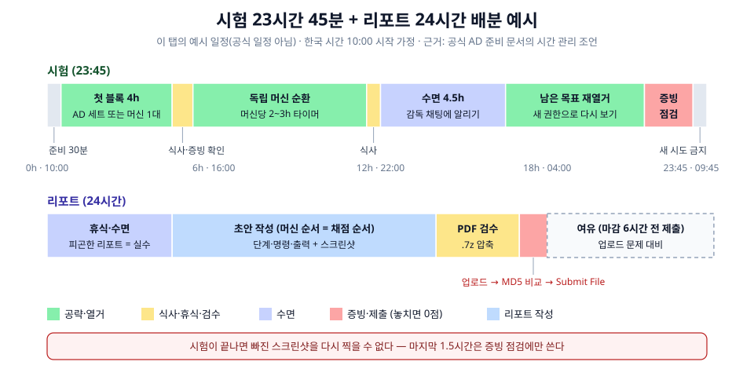
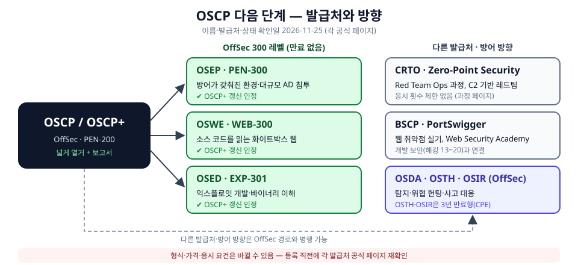

> **자격증 준비 · OSCP** | 난이도 ★★★☆☆ | 예상 소요 3 ~ 4시간 (Kali VM 정리, 노트 템플릿, 연습 리포트 1편 포함)

> ⚠️ **실습 범위 경고** — 이 글의 모든 실습은 **본인 소유의 격리된 실습장**(해킹 02의 `hacklab`, 해킹 25의 격리 랩 도메인)과 **학습 플랫폼이 나에게 배정한 머신**에서만 합니다. 플랫폼 VPN용 Kali와 `hacklab`용 Kali를 섞어 쓰다 실수로 범위 밖 대역을 건드리는 일이 가장 흔한 사고입니다. 허가 없이 타인의 시스템을 스캔하거나 공격하면 **정보통신망법** 등에 따라 처벌될 수 있습니다.

> 📌 이 글은 환경·기록·리포트·시험 운영을 다룹니다. **익스플로잇 코드, 단계별 공격 절차, 탐지 회피, 시험 문제·후기 속 머신 정보, 시험 규정을 우회하는 방법은 다루지 않습니다.**

## 🎯 오늘의 목표

- `hacklab`(원리·방어 확인용)과 **플랫폼 VPN 전용 Kali VM**을 분리해 OSCP 준비 환경을 만든다
- 노트 도구(CherryTree, Obsidian 등)를 고르고 **머신별 노트 템플릿**과 **스크린샷 규칙**을 정한다
- 공식 리포트 템플릿의 위치를 알고, 해킹 11의 보고서 습관을 OSCP 리포트 형식으로 옮겨 **연습 리포트 1편**을 PDF·.7z까지 만든다
- 시험 당일 23시간 45분 + 리포트 24시간의 **시간 배분표**를 세우고, 흔한 실패 요인과 예방책을 안다
- 합격 후 다음 자격(OSEP, OSWE, OSED, CRTO, BSCP)의 발급처와 성격을 구분한다

---

## 1. 실습 환경 — 랩 두 개를 분리한다

해킹 02의 `hacklab`은 **인터넷이 없는 내부망**입니다. 반면 PEN-200 랩·Proving Grounds·HTB는 **인터넷을 거쳐 VPN으로** 붙습니다. 하나의 Kali에 두 가지를 다 붙이면 해킹 02에서 금지한 "실습망과 인터넷에 동시에 연결된 Kali"가 됩니다. 그래서 VM을 나눕니다.

| 구분 | `kali` (해킹 02) | `kali-oscp` (이번에 추가) |
|---|---|---|
| 용도 | 원리 확인, 탐지·조치 실습, 해킹 25 AD 랩 | PEN-200 랩, Proving Grounds, HTB, **시험** |
| 네트워크 | 내부 네트워크 `hacklab` (10.10.10.5), NAT 케이블 분리 | **NAT 하나만**. `hacklab` NIC 없음 |
| 대상 | 10.10.10.0/24의 내 실습 대상 | 플랫폼이 **배정한 IP**만 |
| 스냅샷 | `00-clean` (해킹 02) | `oscp-clean` (설치·업데이트 직후), 시험 전 `oscp-exam` |
| 데이터 | 실습장 결과 | 플랫폼 노트·스크린샷 (시험 결과는 시험 후 공유 금지) |

### 1-1. `kali-oscp` 준비 체크리스트

| 항목 | 내용 | 이유 |
|---|---|---|
| 이미지 | [kali.org/get-kali](https://www.kali.org/get-kali/)의 공식 VM 이미지, 체크섬 확인 (해킹 02 4-1과 같은 방법) | 출처가 불분명한 "OSCP용 Kali"는 쓰지 않는다 |
| 기본 계정 | 첫 부팅 직후 기본 비밀번호 변경 | 플랫폼 VPN 대역은 다른 참가자와 공유될 수 있다 |
| 열린 서비스 | 리스너·공유 폴더를 필요할 때만 켜고 끝나면 끄기 | 해킹 12의 VPN 주의사항과 같음 |
| 클립보드·공유 폴더 | 호스트와 공유 폴더는 **노트·증거 폴더 하나**만 | 호스트 PC 노출 최소화 |
| 화면 | Wayland보다 X11 세션 권장(감독 도구 화면 공유 호환) — **호스트가 Linux일 때** 공식 요건 | Proctored Exam Requirements FAQ |
| 가상화 소프트웨어 | 공식 감독 요건 문서의 목록에는 VMware 제품이 적혀 있다. 시험 때 VirtualBox를 써도 되는지는 **공식 확인 필요**(감독팀 테스트 세션에서 확인) | 연습은 VirtualBox도 무방 |
| 스냅샷 | 업데이트 끝난 뒤 `oscp-clean`, 시험 1주 전 도구·템플릿 정리 후 `oscp-exam` | 시험 당일 VM이 깨지면 바로 복구 |
| 예비 | 예비 VM 사본, 예비 인터넷(휴대폰 테더링 등), 전원 | 공식 가이드: 외부 요인에 대한 **대비책은 응시자 책임** |

> ⚠️ 시험 VPN은 **Kali에서 OpenVPN으로** 접속하도록 안내되어 있고, 다른 환경은 VPN 지원 대상이 아닙니다(Exam Guide). 시험 날 처음 만든 VM으로 들어가지 말고, 몇 달 동안 PEN-200 랩에 붙던 바로 그 `kali-oscp`의 스냅샷을 쓰세요.

### 1-2. 노트·증거 폴더 구조 만들기

`kali-oscp`(또는 호스트와 공유한 폴더)에 머신마다 같은 구조를 만들어 두면, 리포트를 쓸 때 증거를 찾느라 시간을 쓰지 않습니다. 아래 스크립트는 폴더와 노트 파일만 만드는 단순한 도우미입니다.

```bash
# ~/oscp/new-target.sh — 머신 하나의 노트·증거 폴더를 만든다
#!/usr/bin/env bash
set -euo pipefail
platform="$1"   # 예: pen200, pg, htb, hacklab
name="$2"       # 예: challenge4-ms01, pg-box-name
base="$HOME/oscp/$platform/$name"
mkdir -p "$base"/{scans,screens,loot-redacted,report}
[ -f "$base/notes.md" ] || cp "$HOME/oscp/templates/machine-notes.md" "$base/notes.md"
echo "생성: $base"
```

```bash
chmod +x ~/oscp/new-target.sh
~/oscp/new-target.sh pen200 challenge4-ms01
# 생성: /home/kali/oscp/pen200/challenge4-ms01
tree -L 1 ~/oscp/pen200/challenge4-ms01
# ├── loot-redacted
# ├── notes.md
# ├── report
# ├── scans
# └── screens
```

> 💡 폴더 이름의 `loot-redacted`는 "발견한 민감 정보는 **마스킹한 형태로만** 남긴다"는 해킹 11 규칙(10장)을 습관화하기 위한 것입니다. 연습 플랫폼이라도 같은 습관을 들이면 실무에서 실수하지 않습니다.

---

## 2. 노트 도구 고르기

OSCP는 오픈북 시험이라 **내 노트가 시험장에 가져가는 유일한 무기**입니다. 도구보다 중요한 것은 ① 검색이 잘 되고 ② 머신마다 같은 구조이고 ③ 스크린샷을 붙이기 쉬운 것입니다.

| 도구 | 형식 | 장점 | 주의 |
|---|---|---|---|
| [CherryTree](https://www.giuspen.net/cherrytree/) | 계층형 노드, 파일 하나(SQLite/XML) | Kali 사용자들이 오래 써 온 방식, 트리 구조로 머신·서비스 정리, 이미지·코드 블록 | 파일 하나에 모두 있어 **백업 필수**, 협업·버전 관리 불편 |
| [Obsidian](https://obsidian.md/) | 로컬 Markdown 폴더(vault) | 일반 텍스트라 검색·백업·git 관리 쉬움, 링크·태그, 템플릿 기능 | 커뮤니티 플러그인 중 **AI 대화형 기능은 시험 중 사용 금지**(AI Usage Policy) |
| 그냥 Markdown + 에디터 | 폴더 + `.md` | 가장 단순, 어디서나 열림 | 이미지 관리 규칙을 스스로 정해야 함 |
| 공식 안내 예시 | Reporting Requirements 문서는 basket, dradis, leo, keepnote 같은 도구를 예로 든다 | — | 어떤 도구든 "작업하며 기록 → 끝나면 최종 리포트"라는 흐름이 핵심 |

> ⚠️ 노트를 클라우드에 동기화한다면 **비공개 저장소**로만. 특히 시험이 끝난 뒤 시험 머신과 관련된 노트는 어디에도 공유하지 않습니다. OffSec 학업 정책은 시험 정보 공유를 금지합니다.

---

## 3. 머신별 노트 템플릿

아래 템플릿은 공격 방법이 아니라 **사고 과정과 증거를 남기는 틀**입니다. 해킹 01의 "실습 기록 습관"과 해킹 11의 발견 사항 템플릿을 OSCP 머신 단위로 합친 것입니다. `~/oscp/templates/machine-notes.md`로 저장해 1-2의 스크립트가 복사하게 합니다.

```markdown
# <플랫폼> / <머신 이름>

## 0. 메타
- 대상 IP: 
- 허가 근거: <플랫폼 배정 / hacklab RoE>   ← 이 칸이 비면 시작하지 않는다
- 시작: YYYY-MM-DD HH:MM   종료: 
- 타이머 규칙: 같은 단계 2시간 진전 없으면 다른 머신으로

## 1. 열거 요약
| 포트 | 서비스·버전 | 확인한 것 | 남은 확인 |
|---|---|---|---|

## 2. 가설 목록
| # | 가설 (무엇이 약해 보이나) | 근거 | 결과 | 소요 |
|---|---|---|---|---|

## 3. 초기 접근
- 요약 (한 문단, 원리 중심):
- 사용한 공개 자료: <URL> / 수정 여부·이유:
- 증거: screens/<머신>-access-01.png

## 4. 권한 상승
- 요약:
- 증거: screens/<머신>-privesc-01.png

## 5. 증빙 (proof)
- local.txt: screens/<머신>-proof-local.png  (대화형 셸 + 파일 내용 + IP)
- proof.txt: screens/<머신>-proof-root.png
- 컨트롤 패널 제출: [ ] (시험·플랫폼에 제출 칸이 있을 때)

## 6. 막힌 지점과 스포일러
- [스포일러] 사용 여부 / 비어 있던 체크리스트 칸:

## 7. 방어 관점 (해킹 탭 습관)
- 탐지: 어떤 로그·이벤트에 흔적이 남았을까
- 조치: 관리자는 무엇을 바꿨어야 하나

## 8. 리포트 초안 링크
- report/<머신>.md
```

> 💡 **2. 가설 목록**이 토끼굴 방지 장치입니다. 시도할 때마다 한 줄을 쓰고 "소요" 칸이 커지는 가설을 눈으로 보면, 타이머가 울리기 전에 스스로 멈출 수 있습니다. **7. 방어 관점**은 시험 리포트에 꼭 필요하지는 않지만, 해킹 탭과 같은 "공격 하나 + 탐지 하나 + 조치 하나" 습관을 유지하게 해 줍니다.

---

## 4. 스크린샷 규칙

공식 시험 가이드는 증빙 스크린샷 요건을 구체적으로 정해 두었고, **제출 후에는 빠진 스크린샷을 보낼 수 없습니다.** 연습 때부터 시험 규칙대로 찍습니다.

| 규칙 | 내용 |
|---|---|
| 증빙 화면 | `local.txt`·`proof.txt`는 **대화형 셸**에서 원래 위치의 파일을 `type`/`cat`으로 출력 + **같은 화면에 대상 IP**(`ipconfig`/`ifconfig`/`ip addr`). 웹 셸 화면은 불인정 (공식) |
| 권한이 보이게 | 증빙 화면에 현재 사용자(권한)가 드러나도록 프롬프트나 사용자 확인 출력을 같이 담는다 |
| 명령 + 출력 | 리포트의 재현 절차 단계마다 **입력한 명령과 결과**가 함께 보이게. 결과만 있는 캡처는 재현 근거가 약하다 |
| 즉시 찍기 | 셸을 얻은 순간, 권한이 바뀐 순간 바로. "나중에 다시 찍지"는 머신 되돌리기(revert)나 연결 끊김 한 번에 사라진다 |
| 파일 이름 | `<머신>-<단계>-<번호>.png` (예: `ms01-access-01.png`, `ms01-proof-root.png`). 리포트 작성 때 정렬만으로 순서가 맞는다 |
| 원본 보존 | 원본은 그대로 두고, 리포트에 넣을 때 필요한 부분만 잘라 쓴다. 민감 정보는 마스킹 |
| 이중 확인 | 머신 하나를 끝낼 때마다 `screens/`를 열어 **증빙 2장 + 단계별 캡처**가 있는지 체크 |

---

## 5. 리포트 — 공식 템플릿과 연습 리포트 쓰는 법

### 5-1. 공식 템플릿 위치 (확인일 2026-11-25)

| 자료 | 위치 |
|---|---|
| 리포트 요건 문서 | [OSCP+ Reporting Requirements](https://help.offsec.com/hc/en-us/articles/360046787731-OSCP-Reporting-Requirements) (옛 주소 "PEN-200 Reporting Requirements"에서 이동) |
| 템플릿 (Word) | [OSCP-Exam-Report.docx](https://www.offsec.com/pwk-online/OSCP-Exam-Report.docx) |
| 템플릿 (LibreOffice) | [OSCP-Exam-Report.odt](https://www.offsec.com/pwk-online/OSCP-Exam-Report.odt) |
| 제출 규칙 | [OSCP+ Exam Guide](https://help.offsec.com/hc/en-us/articles/360040165632-OSCP-Exam-Guide) 3장 Submission Instructions |

공식 문서는 템플릿 사용을 "강하게 권장"하고, 자기 양식도 허용하되 **구조적이고 전문적인 형식**과 시험 가이드의 모든 요건을 지켜야 한다고 적습니다. 템플릿의 세부 섹션 구성은 버전에 따라 바뀔 수 있으니 **직접 내려받아 열어 보고** 내 리포트 뼈대로 고정하세요.

### 5-2. 해킹 11의 보고서를 OSCP 리포트로 옮기기

[해킹 11](../../hacking/hack11-pentest-report.md)에서 만든 보고서 구조는 대부분 그대로 쓸 수 있습니다. 차이는 **"독자가 채점자"** 라는 점입니다.

| 해킹 11 보고서 | OSCP 리포트에서 | 시험 규칙 연결 |
|---|---|---|
| 경영진 요약 | 짧은 요약(공략한 대상·결과) | 채점 대상은 아님, 짧게 |
| 범위 | 시험 대상 IP 목록 | — |
| 방법론 | 정보 수집 → 공략 → 권한 상승 흐름 | — |
| 발견 사항 상세 | **머신별 섹션**. 적은 순서 = 채점 순서 | Exam Guide: 리포트 순서대로 채점 |
| 재현 절차 | 모든 단계·명령·콘솔 출력. "기술적으로 유능한 독자가 그대로 따라 할 수 있게" | 부족하면 감점 또는 0점 |
| 증거 | 단계별 스크린샷 + 증빙 스크린샷 | 증빙 누락 = 그 머신 0점 |
| 참고(공개 자료) | 수정 안 했으면 **URL만**, 수정했으면 수정 코드·원본 URL·변경 강조·이유 | Exam Guide: Exploit Code |
| 조치 권고 | 머신별 1~2줄 (해킹 11 습관 유지) | 요구사항은 아니지만 전문 보고서로서 권장 |
| 증거 해시·암호화 전달 | **해당 없음** — 시험 제출물은 **비밀번호 없는** .7z | 비밀번호 걸린 압축은 거부됨 |

> ⚠️ 해킹 11은 고객에게 보고서를 보낼 때 **암호화 압축**을 권했습니다. OSCP 제출은 반대입니다. 공식 가이드는 **비밀번호를 걸면 시스템이 받지 않는다**고 명시합니다. 실무 습관이 시험에서 실수가 되는 대표적인 지점입니다.

### 5-3. 연습 리포트 1편 만들기

`hacklab`에서 해킹 11 때 만든 결과(또는 PEN-200 챌린지 랩 머신 하나)로 시험 형식 리포트를 끝까지 만들어 봅니다. 목표는 **형식과 제출 절차에 손이 익는 것**입니다.

1. 공식 템플릿을 열어 이름·OSID 자리를 연습용 값(`OS-00000`)으로 채웁니다.
2. 머신 섹션 하나를 3장의 노트 템플릿에서 옮깁니다. 재현 절차는 번호 목록으로, 단계마다 스크린샷 1장.
3. PDF로 내보낸 뒤 **PDF를 직접 열어** 표·코드 블록·이미지가 깨지지 않았는지 봅니다(공식 체크리스트 항목).
4. 공식 가이드의 형식대로 압축하고 해시를 확인합니다.

```bash
cd ~/oscp/practice-report
ls
# OSCP-OS-00000-Exam-Report.pdf

# 비밀번호 없이 .7z로 (공식 가이드와 같은 형식)
7z a OSCP-OS-00000-Exam-Report.7z OSCP-OS-00000-Exam-Report.pdf
# ...
# Everything is Ok

# 크기(200MB 이하)와 해시 확인 — 업로드 페이지가 보여 주는 MD5와 비교할 값
ls -lh OSCP-OS-00000-Exam-Report.7z
md5sum OSCP-OS-00000-Exam-Report.7z
# 3b1f...e9  OSCP-OS-00000-Exam-Report.7z
```

5. 아래 체크리스트를 리포트 마지막 페이지가 아니라 **모니터 옆에 붙여 둘 종이**로 만듭니다.

| 제출 체크리스트 (Exam Guide 3장) | 확인 |
|---|---|
| PDF 형식, 이름 `OSCP-OS-XXXXX-Exam-Report.pdf` (대소문자 구분) | [ ] |
| 스크립트·PoC는 별도 파일이 아니라 **PDF 안에 텍스트로** | [ ] |
| `.7z` 이름 `OSCP-OS-XXXXX-Exam-Report.7z`, **비밀번호 없음**, 200MB 이하 | [ ] |
| `upload.offsec.com`에 업로드 → MD5 비교 → **Submit File** 클릭 | [ ] |
| 접수 확인 메일 수신(스팸함 포함) | [ ] |
| 시험 종료 후 **24시간 안** | [ ] |

> 💡 공식 가이드는 일부 Windows 11 환경에서 업로드 시 형식 오류가 났던 사례를 들며 **Kali VM에서 업로드**하라고 권합니다. 연습 리포트도 `kali-oscp`에서 만들고 압축하는 흐름으로 맞춰 두세요.

---

## 6. 시험 당일 시간 배분



공식 AD 준비 문서의 시간 관리 조언은 다음과 같습니다: 머신마다 타이머(독립 머신 2~3시간, AD 세트 4시간), 셸을 얻은 뒤 권한 상승에 2시간 정도, 시간이 다 되면 옮기기, **휴식·식사·수면을 일정에 넣기**, "24시간 내내 해야 한다면 준비가 더 필요하다". 환산 점수 FAQ도 **"시험 내내 깨어 있을 필요는 없다"** 고 말합니다.

아래는 이 조언을 하루 일정으로 옮긴 **예시**입니다(공식 일정 아님). 한국 시간(KST = GMT+9) 10:00 시작을 가정했습니다.

| 경과 시간 | 시각 (KST) | 할 일 |
|---|---|---|
| -0:15 | 09:45 | 감독 도구 접속, 신분증·방 스캔·화면 공유·점검 스크립트 (공식: 15분 전 접속 권장) |
| 0:00 ~ 0:30 | 10:00 | VPN 연결, **컨트롤 패널의 목표·배점 정독**, 리포트 뼈대에 머신 섹션 미리 만들기, 가벼운 초기 열거 시작 |
| 0:30 ~ 4:30 | 10:30 | 첫 블록 — AD 세트 또는 독립 머신 1대 (컨트롤 패널을 보고 결정). 2시간마다 10분 휴식 |
| 4:30 ~ 5:15 | 14:30 | **식사** + 지금까지 증빙·스크린샷 점검 |
| 5:15 ~ 11:30 | 15:15 | 독립 머신 2~3대 순환. 머신당 2~3시간 타이머, 넘으면 다음 머신 |
| 11:30 ~ 12:00 | 21:30 | 식사, 노트의 "남은 확인" 칸 정리 |
| 12:00 ~ 16:30 | 22:00 | **수면 4시간 이상** (자리 비움은 감독 채팅으로 알리기) |
| 16:30 ~ 21:30 | 02:30 | 남은 목표 재열거 — 새 권한으로 다시 보기(공식 팁: 열거는 순환) |
| 21:30 ~ 23:15 | 07:30 | **증빙 전수 점검**: 컨트롤 패널 제출, 증빙 스크린샷, 단계별 캡처. 빠진 캡처는 접근이 살아 있을 때 다시 |
| 23:15 ~ 23:45 | 09:15 | 새 시도 금지. 노트 백업, 종료 |
| 리포트 24시간 | ~ 다음 날 09:45 | 4~5시간 수면 → 초안 → PDF 검수 → .7z → 업로드. **마감 6시간 전 업로드** 목표 |

> ⚠️ 마지막 1시간 반을 **증빙 점검 전용**으로 비워 두는 것이 이 표의 핵심입니다. 리포트 단계에서는 시험 VPN이 끊겨 있으므로, 빠진 스크린샷은 다시 찍을 방법이 없습니다.

---

## 7. 흔한 실패 요인과 예방책

| 실패 요인 | 어떻게 나타나나 | 예방책 |
|---|---|---|
| **열거 부족** | 포트 하나·페이지 하나만 보고 공략 시도, 새 권한을 얻은 뒤 다시 보지 않음 | 서비스별 열거 체크리스트(O01 5-6), 권한이 바뀔 때마다 "1. 열거 요약"을 새로 쓰기 |
| **토끼굴** | 한 가설에 3~4시간, 다른 머신은 시작도 못 함 | 노트의 가설 목록 + 머신당 2~3시간 타이머, 넘으면 무조건 옮기기 |
| **리포트 누락·형식 오류** | 파일명 대소문자, 비밀번호 압축, PDF 대신 docx, 업로드 후 Submit 미클릭 | 5-3 연습 리포트로 제출 절차를 **실제로 한 번** 해 보기, 체크리스트 종이 |
| **증빙 스크린샷 누락** | 증빙 파일을 컨트롤 패널에만 내고 캡처는 없음, IP가 안 보이는 캡처, 웹 셸 화면 | 4장 규칙, 머신 종료 시 `screens/` 이중 확인, 마지막 1.5시간 점검 블록 |
| **규정 위반** | Metasploit을 두 번째 머신에 사용, 금지 도구 기능 사용, AI 챗봇에 질문, 커뮤니티에 힌트 요청 | O00 5장 표를 시험 전날 다시 읽기. 애매한 도구는 쓰지 않기. 시험 중 AI 기능이 있는 앱은 닫아 두기 |
| **점수 계산에 매달림** | "몇 점이면 되나" 계산하다 집중력 소모, 낮다고 생각해 리포트 미제출 | 환산 점수제에서는 원점수 기준 비공개. **최대한 완수 + 문서화 + 반드시 제출** |
| **기술 문제** | VPN 끊김, 정전, VM 손상 | 예비 인터넷·VM 스냅샷·전원 준비. 문제는 즉시 감독 채팅으로(공식 연락 절차) |

---

## 8. 멘탈과 휴식 관리

| 시점 | 할 일 |
|---|---|
| 시험 1주 전 | 새 주제 공부 중단. 노트 정리, OSCP A·B·C 중 하나로 마지막 모의 시험, 수면 시간을 시험 시작 시각에 맞추기 |
| 전날 | O00 5장 규정 다시 읽기, 신분증·웹캠·스냅샷·예비 인터넷 확인, 먹을 것·물 준비, 일찍 자기 |
| 시험 중 | 2시간마다 일어나기, 식사 거르지 않기, 막히면 **머신을 바꾸거나 쉬기**(공식 팁: 다른 머신이나 휴식이 새 관점을 준다) |
| 패닉이 올 때 | 노트의 가설 목록을 처음부터 다시 읽기. "아직 안 본 칸"을 찾는 것이 가장 빠른 탈출구 |
| 시험 후 | 리포트 전에 먼저 잠깐이라도 자기. 피곤한 상태의 리포트가 형식 실수의 주범 |
| 불합격 시 | 리포트를 냈다면 **피드백**이 온다(공식 FAQ). 재응시 대기 4주(첫 불합격)를 체크리스트 보강 기간으로 쓰기 |

> 💡 OffSec 공식 PEN-200 페이지에도 "첫 시험에서 떨어지고 두 달 뒤 합격했다"는 수강생 이야기가 실려 있습니다. 여러 번 응시는 이 시험에서 드문 일이 아닙니다. 불합격은 **"어느 체크리스트 칸이 비어 있었나"** 를 알려 주는 데이터로 다루세요.

---

## 9. 막히는 지점

| 증상 | 원인 | 해결 |
|---|---|---|
| 플랫폼 VPN 연결 후 `hacklab` 대상이 안 보이거나, 반대로 `hacklab`에서 인터넷이 됨 | 두 용도를 한 Kali에서 같이 씀 | 1장처럼 `kali`와 `kali-oscp` 분리, 각자 NIC 하나 |
| 리포트 쓰다가 어떤 캡처가 어느 단계인지 모름 | 파일 이름 규칙 없음 | `<머신>-<단계>-<번호>.png` 규칙, 노트에 파일명 기록 |
| PDF로 내보내니 코드 블록이 잘림 | 긴 한 줄 명령, 작은 페이지 여백 | 긴 출력은 필요한 부분만, 줄바꿈 허용 글꼴·서식. **PDF를 직접 열어 검수** |
| 업로드 페이지가 "형식 오류" | Windows 11 업로드 이슈, 파일명 불일치, 비밀번호 압축 | Kali VM에서 업로드, 이름·압축 옵션 재확인 |
| 노트가 머신마다 제각각 | 템플릿 없이 시작 | 3장 템플릿 + 1-2 스크립트로 시작을 자동화 |

---

## 10. 합격 후 다음 단계 — 어떤 자격으로 갈까



2026-11-25 각 발급처 공식 페이지에서 이름과 상태를 확인했습니다. 형식·가격·응시 조건은 바뀔 수 있으니 등록 전에 다시 보세요.

| 자격 | 발급처 · 과정 | 방향 | 상태 (확인일 2026-11-25) |
|---|---|---|---|
| **OSEP** (OffSec Experienced Penetration Tester) | OffSec · [PEN-300](https://www.offsec.com/courses/pen-300/) | 방어가 갖춰진 환경, 대규모 AD에서의 침투 심화 | 현행. 만료 없는 자격. OSCP+ 갱신 인정 시험 |
| **OSWE** (OffSec Web Expert) | OffSec · [WEB-300](https://www.offsec.com/courses/web-300/) | 소스 코드를 읽고 웹 취약점을 찾는 화이트박스 | 현행. 만료 없음. OSCP+ 갱신 인정 시험 |
| **OSED** (OffSec Exploit Developer) | OffSec · [EXP-301](https://www.offsec.com/courses/exp-301/) | 익스플로잇 개발, 바이너리 이해 | 현행. 만료 없음. OSCP+ 갱신 인정 시험 |
| **CRTO** (Red Team Operator) | Zero-Point Security · [Red Team Ops](https://www.zeropointsecurity.co.uk/course/red-team-ops) | C2 기반 레드팀 운영·적대자 모사 | 현행. 과정 페이지 기준 시험 응시 횟수 제한 없음, 강의 평생 접근. 가격은 지역별(PPP) 상이 |
| **BSCP** (Burp Suite Certified Practitioner) | PortSwigger · [Certification](https://portswigger.net/web-security/certification) | 웹 취약점 실기, Web Security Academy와 연계 | 현행. 응시 요건(도구·시스템)은 공식 페이지에서 확인 |
| (방어 쪽) OSDA · OSTH · OSIR | OffSec · SOC-200 등 | 탐지·위협 헌팅·사고 대응 | OSTH·OSIR은 3년 만료형(CPE 대상), OSDA는 만료 없음 |

| 내 목표 | 추천 다음 단계 |
|---|---|
| 모의해킹 컨설턴트로 넓게 | OSEP → (웹 비중이 크면) OSWE 또는 BSCP |
| 웹 서비스 개발·보안 (Java/Spring 개발자) | **BSCP**(웹 실기) → **OSWE**(소스 코드 기반) — 해킹 13~20의 개발 보안 트랙과 바로 이어짐 |
| 레드팀 | OSEP 또는 CRTO |
| 취약점 연구·익스플로잇 개발 | OSED |
| 탐지·대응(블루팀)으로 전환 | 해킹 10·27·30·31 → OffSec 방어 계열 |

> 💡 OSEP·OSWE·OSED 등 상위 OffSec 자격은 **OSCP+ 갱신 방법**(O00 2-1의 ③)으로도 인정됩니다. 3년 안에 다음 자격을 딸 계획이라면 CPE 대신 그 경로로 갱신을 겸할 수 있습니다(연간 유지 비용 규칙은 Handbook 확인).

---

## 11. 핵심 정리

- 랩은 둘로 나눈다: **`kali`(hacklab, 인터넷 없음)** 와 **`kali-oscp`(플랫폼 VPN 전용, NAT만)**. 시험도 몇 달 쓴 `kali-oscp` 스냅샷으로
- 노트 도구는 무엇이든 좋지만 **머신마다 같은 템플릿**: 메타·열거 요약·가설 목록·접근·권한 상승·증빙·스포일러·방어 관점
- 증빙 스크린샷: **대화형 셸 + 파일 내용 + 대상 IP**, 웹 셸 불인정, 컨트롤 패널 제출과 둘 다. 제출 후 추가 불가
- 공식 템플릿은 [OSCP+ Reporting Requirements](https://help.offsec.com/hc/en-us/articles/360046787731-OSCP-Reporting-Requirements)의 .docx/.odt. 해킹 11 구조를 쓰되 **비밀번호 없는 .7z**, 정확한 파일명, MD5 확인, Submit 클릭
- 시험 당일은 머신당 2~3시간(AD 4시간) 타이머, 식사·수면을 일정에 넣고, **마지막 1.5시간은 증빙 점검 전용**
- 흔한 실패: 열거 부족, 토끼굴, 리포트 형식, 증빙 누락, 규정 위반(Metasploit 2대·AI·도움 요청), 점수 계산 집착
- 다음 단계: OSEP(PEN-300)·OSWE(WEB-300)·OSED(EXP-301)는 OffSec, CRTO는 Zero-Point Security, BSCP는 PortSwigger

---

## 12. 셀프 체크

<details>
<summary>Q1. 해킹 02의 Kali 하나에 NAT를 다시 연결해 PEN-200 VPN과 hacklab을 동시에 쓰면 왜 안 되나?</summary>

실습망과 인터넷에 동시에 연결된 Kali는 해킹 02가 금지한 구성입니다. 대역을 잘못 입력하면 범위 밖을 건드릴 수 있고, 취약 대상이 있는 `hacklab`이 밖으로 새는 경로가 됩니다. 플랫폼 VPN용 `kali-oscp`를 따로 두고 각자 NIC 하나만 씁니다.
</details>

<details>
<summary>Q2. 해킹 11 습관대로 리포트 .7z에 비밀번호를 걸어 업로드하려 한다. 결과는?</summary>

공식 가이드는 비밀번호가 걸린 압축은 시스템이 받지 않는다고 명시합니다. OSCP 제출물은 비밀번호 없는 .7z, 정확한 파일명, 200MB 이하, 업로드 후 MD5 비교와 Submit 클릭까지 해야 합니다.
</details>

<details>
<summary>Q3. 시험 마지막 1.5시간을 새 머신 공략 대신 증빙 점검에 쓰는 이유는?</summary>

리포트 단계에서는 시험 환경에 다시 접근할 수 없어 빠진 스크린샷을 보충할 수 없고, 제출 후 추가 제출도 받지 않습니다. 증빙이나 문서화가 빠지면 공략한 머신도 0점이 될 수 있으므로, 이미 얻은 점수를 지키는 시간이 새 시도보다 기대값이 큽니다.
</details>

<details>
<summary>Q4. Obsidian에 AI 채팅 플러그인을 깔아 두었다. 시험 중 켜 둬도 되나?</summary>

안 됩니다. AI Usage Policy는 AI 챗봇·LLM과의 대화형 사용을 OffSec 시험(OSEE·OSAI 제외) 전반에서 금지합니다. 프롬프트로 대화하지 않는 정리·요약 기능은 꺼야 할 의무가 없지만, 대화형 AI 기능은 비활성화하거나 시험용 vault에서 빼 두는 편이 안전합니다.
</details>

<details>
<summary>Q5. Java/Spring 개발자가 OSCP 다음으로 웹 쪽으로 깊이 가려면?</summary>

PortSwigger의 BSCP로 웹 취약점 실기를 다지고, OffSec WEB-300의 OSWE로 소스 코드를 읽어 취약점을 찾는 화이트박스 방식으로 넓힙니다. 해킹 13~20(시큐어 코딩, SAST, 인증·인가, API 보안)과 직접 이어지고, OSWE는 OSCP+ 갱신 인정 시험이기도 합니다.
</details>

---

## ⏭️ 다음 단계

OSCP 탭은 여기까지입니다. 남은 것은 실제로 손을 움직이는 일입니다.

1. **오늘:** `kali-oscp` VM을 만들고 스냅샷 `oscp-clean`을 찍습니다. 노트 템플릿과 폴더 스크립트를 넣어 둡니다.
2. **이번 주:** O01 2장 선행 지식 체크리스트를 채워 0단계 길이를 정하고, 상품 구매 시점을 달력에 적습니다.
3. **매주:** 모듈·랩 머신마다 노트 템플릿을 채우고, 주 1회 방어 쪽 글(해킹 탭)로 "탐지 하나 + 조치 하나"를 붙입니다.
4. **시험 한 달 전:** OSCP A·B·C로 모의 시험 → 연습 리포트를 PDF·.7z·MD5까지. 시험 1주 전 [OSCP+ Exam Guide](https://help.offsec.com/hc/en-us/articles/360040165632-OSCP-Exam-Guide)와 [Scaled Scoring FAQ](https://help.offsec.com/hc/en-us/articles/54589877508884-OSCP-Equated-Scaled-Scoring-FAQ)를 **다시 읽습니다.** 규칙은 이 글을 쓴 뒤에도 바뀔 수 있습니다.

다른 자격 탭으로 넘어가도 원칙은 같습니다. 공식 문서로 확인하고, 유출 자료는 쓰지 않고, **허가된 플랫폼과 내 랩에서만** 연습합니다.
