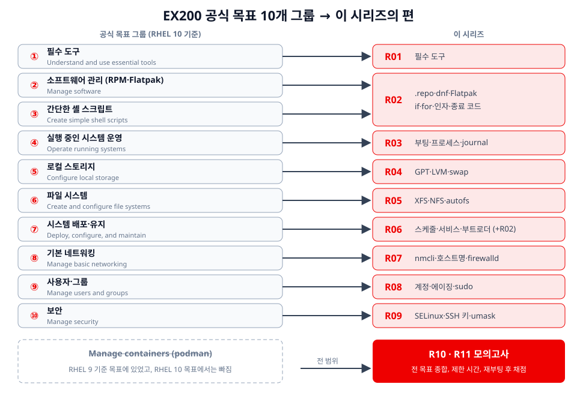
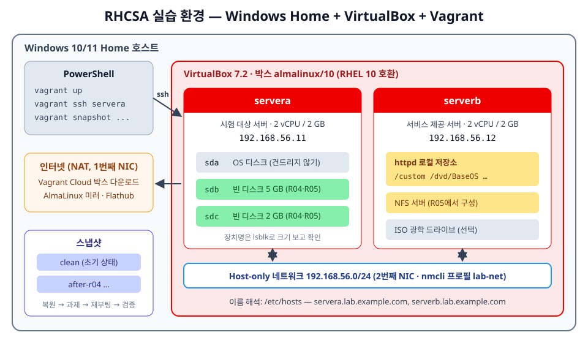

> **번외 · RHCSA(EX200) 대비** | 난이도 ★★☆☆☆ | 예상 소요 2 ~ 3시간 (박스 다운로드 포함)

> ⚠️ **이 시리즈의 모든 연습 문제는 Red Hat이 공개한 공식 시험 목표를 바탕으로 직접 만든 "시험 스타일" 과제입니다.** 실제 출제 문제나 유출 문제(덤프)가 아니며, 그런 자료를 재현하지도 않습니다. Red Hat 시험은 응시자가 비밀 유지 계약(NDA)에 동의하고 치르므로, 실제 문제를 공유하거나 구하는 것은 계약 위반이고 자격 박탈 사유입니다.

## 🎯 오늘의 목표

- EX200(RHCSA) 시험이 **무엇을, 어떤 방식으로** 평가하는지 공식 자료 기준으로 설명할 수 있다
- 공식 목표 10개 그룹이 이 시리즈의 어느 편에서 다뤄지는지 지도를 그린다
- RHEL 9 시절 목표와 무엇이 달라졌는지, RHCE(EX294)와는 어떻게 다른지 안다
- Windows Home + VirtualBox + Vagrant로 **VM 2대(servera, serverb)** 실습 환경을 만들고, 스냅샷으로 언제든 처음 상태로 되돌릴 수 있다

---

## 1. RHCSA는 어떤 시험인가?

RHCSA(Red Hat Certified System Administrator)는 시험 코드 **EX200**으로 치르는 Red Hat의 리눅스 시스템 관리자 입문 자격증입니다. 이 인프라 시리즈에서 Docker, Kubernetes, OpenStack을 다루며 계속 리눅스 서버 위에서 작업했지요. RHCSA는 그 바닥에 깔린 **리눅스 서버 한 대를 혼자 책임지고 다룰 수 있는가**를 묻는 시험입니다.

2026-11-15에 Red Hat 공식 EX200 페이지에서 확인한 내용은 다음과 같습니다.

| 항목 | 내용 |
|---|---|
| 기준 버전 | **Red Hat Enterprise Linux 10** |
| 형식 | **실기(hands-on, performance-based)** — 객관식 없음. 실제 시스템에서 과제를 수행 |
| 채점 기준 | 결과 상태. **모든 설정은 재부팅 후에도 별도 조작 없이 유지되어야 함** |
| 인터넷 | 제공되지 않음 |
| 개인 자료 | 종이·전자 문서 반입 금지 |
| 쓸 수 있는 문서 | 제품과 함께 설치된 문서(`man`, `info`, `/usr/share/doc`, `--help`) — Red Hat은 "대부분의 시험에서 제품 동봉 문서를 쓸 수 있다"고 안내 |
| 시험 시간 | 널리 알려진 값은 약 3시간 — **공식 페이지에 명시 없음, 응시 전 공식 확인 필요** |
| 합격 점수 | 널리 알려진 값은 300점 만점에 210점 — **공식 페이지에 명시 없음, 공식 확인 필요** |
| 선수 과정 | 없음. 권장 과정은 RH124 + RH134 또는 RH199 |

> 💡 "재부팅 후에도 유지" 한 줄이 이 시험의 성격을 다 말해 줍니다. `mount`로 붙이고 끝내면 0점, `/etc/fstab`에 넣어야 점수. `systemctl start`만 하면 0점, `enable`까지 해야 점수. `firewall-cmd`에 `--permanent`를 빼먹으면 0점. 이 시리즈의 모든 과제 풀이에는 **"재부팅 후 확인"** 검증 단계를 넣었습니다.

---

## 2. 공식 목표 10개 그룹과 이 시리즈의 지도



| # | 공식 목표 그룹 | 대표 과제 | 다루는 편 |
|---|---|---|---|
| ① | Understand and use essential tools | 리다이렉션, grep/정규식, SSH, tar, 링크, ugo/rwx 권한, man | [R01](./r01-essential-tools.md) |
| ② | Manage software | RPM 저장소 설정, 패키지 설치·제거, **Flatpak 저장소 설정과 설치·제거** | [R02](./r02-software-shell-scripts.md) |
| ③ | Create simple shell scripts | if/test, for 반복, `$1` 인자, 명령 출력 처리 | [R02](./r02-software-shell-scripts.md) |
| ④ | Operate running systems | 타깃 부팅, 부팅 중단해 root 접근, 프로세스·nice, tuned, journal 영구 보존, 안전한 파일 전송 | [R03](./r03-operate-running-systems.md) |
| ⑤ | Configure local storage | GPT 파티션, PV/VG/LV, UUID·라벨 마운트, swap 추가 | [R04](./r04-local-storage.md) |
| ⑥ | Create and configure file systems | VFAT/ext4/XFS, NFS, autofs, LV 확장, 권한 문제 진단 | [R05](./r05-file-systems.md) |
| ⑦ | Deploy, configure, and maintain systems | at/cron/systemd timer, 서비스 자동 시작, 기본 타깃, 시간 동기화, 여러 소스에서 패키지 설치, 부트로더 수정 | [R06](./r06-deploy-maintain.md) (패키지 소스는 R02와 연결) |
| ⑧ | Manage basic networking | IPv4/IPv6 주소, 호스트명 해석, 부팅 시 네트워크 서비스, firewalld 접근 제한 | [R07](./r07-networking.md) |
| ⑨ | Manage users and groups | 계정·그룹, 비밀번호 에이징, sudo 권한 | [R08](./r08-users-groups.md) |
| ⑩ | Manage security | firewalld, umask, SSH 키 인증, SELinux 모드·컨텍스트·포트·불리언 | [R09](./r09-security.md) |
| — | 종합 | 제한 시간 안에 약 20문항 | [R10](./r10-mock-exam-1.md), [R11](./r11-mock-exam-2.md) |

각 목표 편(R01~R09)은 같은 순서로 구성됩니다.

1. **목표 요약** — 공식 목표 문장을 우리말로
2. **출제 유형** — 과제가 어떤 모양으로 나오고, 무엇이 채점되는지
3. **핵심 개념·명령 표**
4. **자주 하는 실수**
5. **창작 연습 과제 5~10개** — `<details>`를 열면 풀이와 **검증 명령**
6. **핵심 정리**, 다음 편 예고

---

## 3. RHEL 9 기준 시험과 무엇이 달라졌나

RHEL 10 기준으로 목표가 바뀌면서 눈에 띄는 차이는 두 가지입니다.

| 구분 | RHEL 9 기준 목표 | RHEL 10 기준 목표 (현재) |
|---|---|---|
| 컨테이너 | "Manage containers" 그룹 존재 — podman으로 이미지 검색·실행, 컨테이너를 systemd 서비스로 자동 시작, 영구 스토리지 연결 등 | **목표에서 빠짐.** 공식 목표 어디에도 podman·컨테이너 과제가 없음 |
| 소프트웨어 | RPM 저장소 설정, 패키지 설치·제거 | 여기에 **Flatpak 저장소 설정, Flatpak 앱 설치·제거**가 추가 |

> ⚠️ 2026년에 나온 일부 학습 사이트와 강의는 아직 podman을 RHCSA 목표로 소개합니다. 이 시리즈는 **현재 공식 목표**만 따르므로 컨테이너는 다루지 않습니다. 컨테이너가 궁금하다면 이 레포의 Chapter 1(Docker)과 Day 68(rootless 컨테이너 보안)을 보세요. 응시 직전에는 반드시 공식 목표 페이지를 다시 확인하세요. 목표는 예고 없이 갱신될 수 있습니다.

목표 문장은 같아도 **RHEL 10 자체가 바뀐 부분** 때문에 풀이가 달라지는 곳도 있습니다. 해당 편에서 콜아웃으로 다시 짚습니다.

| RHEL 10 변경점 | 영향받는 편 |
|---|---|
| 네트워크 설정은 NetworkManager **keyfile**만 지원 — `/etc/sysconfig/network-scripts/ifcfg-*` 미지원 | R07 |
| AppStream의 **모듈(dnf module) 스트림 폐지** | R02 |
| 프로세서 요구 수준이 **x86-64-v3**로 상향 | R00(실습 환경) |
| root SSH 비밀번호 로그인은 기본 차단(`PermitRootLogin prohibit-password`, RHEL 9부터 이어짐) | R01, R09 |

---

## 4. RHCE(EX294)와의 관계

| 구분 | RHCSA (EX200) | RHCE (EX294) |
|---|---|---|
| 한 줄 요약 | 서버 한 대를 **손으로** 관리 | 여러 서버를 **Ansible로 자동화**해 관리 |
| 도구 | bash, dnf, systemctl, nmcli, lvm, firewall-cmd, semanage … | Ansible 플레이북, 롤, 컬렉션, ansible-navigator |
| 관계 | — | RHCE 자격 취득에는 유효한 RHCSA가 전제 |

RHCSA에서 "손으로 하는 법"을 정확히 알아야 RHCE에서 "그걸 코드로 쓰는 법"이 됩니다. 순서를 바꿀 수 없는 이유입니다.

---

## 5. 4~6주 학습 전략

하루 1~2시간 기준입니다. 리눅스를 이미 업무에서 쓴다면 4주, 처음이라면 6주를 잡으세요.

| 주차 | 범위 | 핵심 |
|---|---|---|
| 1주 | R00, R01, R02 | 실습 환경 완성, 셸·권한·패키지·스크립트 손에 익히기 |
| 2주 | R03, R04 | **root 비밀번호 복구**, 파티션·LVM — 시험 성패를 가르는 구간 |
| 3주 | R05, R06 | NFS·autofs, 스케줄링, 부트로더 |
| 4주 | R07, R08, R09 | 네트워크·사용자·SELinux. SELinux는 이틀 이상 |
| 5주 | R10 | 모의고사 1회 → 틀린 목표 편으로 돌아가 과제 재풀이 |
| 6주 | R11, 약점 복습 | 모의고사 2회, 스냅샷 복원 후 **시간 재며** 전 과제 반복 |

💡 공부 방법 세 가지:

- **매일 스냅샷 복원 → 과제 → 재부팅 → 검증.** 재부팅 검증을 건너뛰는 습관이 시험에서 가장 비싸게 돌아옵니다.
- **문서 찾기도 연습 대상입니다.** 인터넷이 없으니 `man 5 fstab`, `man nmcli-examples`, `man semanage-fcontext`의 EXAMPLES 절을 미리 익혀 두세요(R01에서 다룹니다).
- **같은 과제를 두 번째에는 시간을 재서** 푸세요. 실기 시험은 아는 것보다 **손이 빠른 것**이 점수입니다.

---

## 6. 시험 당일 팁

| 팁 | 이유 |
|---|---|
| 시작하자마자 **과제 전체를 한 번 훑기** | 과제끼리 의존 관계(예: 저장소 설정 → 패키지 설치 → 서비스)가 있음 |
| 시스템에 접근이 안 되면 **root 비밀번호 복구부터** | 접근 자체가 과제인 경우가 있음(R03) |
| `/etc/fstab` 수정 후 **반드시 `mount -a`와 `findmnt --verify`** | 오타 하나로 다음 부팅이 응급 모드에 빠지면 이후 과제 전부 위험 |
| 중간중간 **직접 재부팅해 확인** | 끝나기 직전 재부팅에서 문제를 발견하면 고칠 시간이 없음 |
| `--permanent`, `enable`, `-p`(semanage) 같은 **영구 옵션**을 습관으로 | 채점은 재부팅 후 상태 기준 |
| SELinux를 **끄지 말 것** | 해결이 아니라 감점 요인. 컨텍스트·불리언·포트 라벨로 해결 |
| 네트워크·SSH 설정을 바꿀 때는 **콘솔 접속 수단을 확인한 뒤** | 원격 세션이 끊기면 복구에 시간을 크게 잃음 |
| 막히는 과제는 표시해 두고 **넘어가기** | 부분 점수가 없는 과제에 시간을 묶지 않기 |

---

## 7. 실습 환경 구축 — VM 2대



### 7-1. 구성 한눈에 보기

| 호스트명 | IP (Host-only) | vCPU / 메모리 | 디스크 | 역할 |
|---|---|---|---|---|
| `servera.lab.example.com` | 192.168.56.11 | 2 / 2 GB | OS + **추가 5 GB, 2 GB** | 대부분의 과제를 푸는 "시험 대상" 서버 |
| `serverb.lab.example.com` | 192.168.56.12 | 2 / 2 GB | OS | 로컬 저장소(http), NFS 서버(R05), SSH 접속 대상 |

- **배포판:** RHEL 10과 바이너리 호환인 **AlmaLinux 10** 공식 Vagrant 박스 `almalinux/10`(2026-11-15 기준 최신 10.2.20260914, VirtualBox 프로바이더 제공).
- **도구:** VirtualBox 7.2.x, Vagrant 2.4.x(2026-11-15 기준 최신 2.4.9). Day 20과 같은 조합입니다.
- **필요 자원:** 호스트 메모리 8 GB 이상(VM에 4 GB), 디스크 여유 30 GB 이상(ISO까지 쓰면 + 10 GB).

> 💡 **왜 RHEL이 아니라 AlmaLinux인가?** RHEL 10의 공식 Vagrant 박스가 없고, 무료 개발자 구독으로 받는 RHEL은 직접 설치해야 합니다(7-7 참고). AlmaLinux 10은 RHEL 10 소스로 만든 바이너리 호환 배포판이라 시험 목표 범위의 명령·설정 파일 경로가 같습니다. 다른 점은 **구독 관리(`subscription-manager`), 저장소 ID, GPG 키 파일 이름** 정도이고, 해당 편에서 따로 표시합니다.

> ⚠️ Rocky Linux 10 박스(`rockylinux/10`)도 있지만, 2026년 Rocky 포럼에 VirtualBox Guest Additions 누락·부팅 지연 같은 보고가 올라와 이 시리즈는 AlmaLinux를 기본으로 합니다.

### 7-2. 사전 준비 (Windows Home)

1. [VirtualBox](https://www.virtualbox.org/wiki/Downloads) 7.2.x 설치
2. [Vagrant](https://developer.hashicorp.com/vagrant/install) 2.4.x 설치 후 재부팅
3. PowerShell에서 확인

```powershell
VBoxManage --version   # 7.2.x
vagrant --version      # Vagrant 2.4.x
```

> ⚠️ **x86-64-v3 문제.** RHEL 10 계열은 AVX2 등을 포함한 x86-64-v3 CPU 기능을 요구합니다. 최근 CPU는 대부분 지원하지만, **Docker Desktop(WSL2)을 쓰느라 Windows의 Hyper-V 계층이 켜져 있으면** VirtualBox가 그 위에서 돌면서 일부 CPU 기능이 게스트에 전달되지 않을 수 있습니다. 부팅 중 커널 패닉이나 `Fatal glibc error: CPU does not support x86-64-v3` 같은 메시지가 보이면 Vagrantfile의 박스를 **`almalinux/10-x86_64_v2`** 로 바꾸세요. AlmaLinux가 구형 CPU용으로 따로 빌드한 공식 박스입니다(RHEL과 Rocky에는 이런 변형이 없음).

### 7-3. Vagrantfile 전문

빈 폴더(예: `C:\lab\rhcsa`)에 아래 내용으로 `Vagrantfile` 을 만듭니다. Day 20의 Vagrantfile과 뼈대가 같고, **추가 디스크**와 **네트워크·저장소 준비 스크립트**가 더해졌습니다.

```ruby
# Vagrantfile — RHCSA 실습 환경 (servera, serverb)
# Vagrant 2.4.x + VirtualBox 7.2.x 기준
BOX = "almalinux/10"          # x86-64-v3 미지원 CPU면 "almalinux/10-x86_64_v2"

# 같은 폴더에 AlmaLinux 10 DVD ISO가 있으면 serverb에 꽂아 BaseOS/AppStream 저장소로 제공
ISO = Dir.glob("AlmaLinux-10*-x86_64-dvd.iso").first

NODES = {
  "servera" => { ip: "192.168.56.11", mac: "080027000011" },
  "serverb" => { ip: "192.168.56.12", mac: "080027000012" },
}

# 두 VM 공통: Host-only NIC를 NetworkManager로 고정 IP 설정, 이름 해석, SSH 비밀번호 로그인
$common = <<~'SCRIPT'
  set -euo pipefail
  IP="$1"; MAC="$2"
  IFACE=$(ip -o link | awk -v mac="$MAC" 'index(tolower($0), mac) {sub(/:$/, "", $2); print $2}')
  nmcli connection delete lab-net >/dev/null 2>&1 || true
  nmcli connection add type ethernet ifname "$IFACE" con-name lab-net \
    ipv4.method manual ipv4.addresses "$IP/24" connection.autoconnect yes
  nmcli connection up lab-net

  grep -q 'servera.lab.example.com' /etc/hosts || cat >> /etc/hosts <<EOF
192.168.56.11 servera.lab.example.com servera
192.168.56.12 serverb.lab.example.com serverb
EOF

  echo 'PasswordAuthentication yes' > /etc/ssh/sshd_config.d/01-lab.conf
  systemctl restart sshd
  echo 'vagrant:vagrant' | chpasswd
  echo 'root:redhat' | chpasswd
  id student &>/dev/null || useradd student
  echo 'student:student' | chpasswd

  dnf install -y firewalld
  systemctl enable --now firewalld
SCRIPT

# serverb 전용: httpd로 로컬 저장소 제공
$repo = <<~'SCRIPT'
  set -euo pipefail
  dnf install -y httpd createrepo_c dnf-plugins-core

  # (1) 작은 사용자 정의 저장소: http://serverb.lab.example.com/custom
  mkdir -p /var/www/html/custom
  dnf download --destdir /var/www/html/custom tree lsof
  createrepo_c /var/www/html/custom

  # (2) DVD ISO가 연결돼 있으면: http://serverb.lab.example.com/dvd/{BaseOS,AppStream}
  mkdir -p /var/www/html/dvd
  if blkid /dev/sr0 >/dev/null 2>&1; then
    grep -q '/var/www/html/dvd' /etc/fstab || echo '/dev/sr0 /var/www/html/dvd iso9660 ro,nofail,context="system_u:object_r:httpd_sys_content_t:s0" 0 0' >> /etc/fstab
    systemctl daemon-reload
    mount /var/www/html/dvd || true
  fi

  restorecon -R /var/www/html
  systemctl enable --now httpd
  firewall-cmd --permanent --add-service=http
  firewall-cmd --reload
SCRIPT

Vagrant.configure("2") do |config|
  config.vm.box = BOX
  config.vm.synced_folder ".", "/vagrant", disabled: true

  NODES.each do |name, opt|
    config.vm.define name do |node|
      node.vm.hostname = "#{name}.lab.example.com"
      # auto_config: false → Vagrant의 ifcfg 방식 대신 위 스크립트가 nmcli로 설정
      node.vm.network "private_network", ip: opt[:ip], mac: opt[:mac], auto_config: false

      node.vm.provider "virtualbox" do |vb|
        vb.name   = "rhcsa-#{name}"
        vb.cpus   = 2
        vb.memory = 2048
      end

      if name == "servera"
        # 스토리지 실습용 빈 디스크 2개 (R04·R05)
        node.vm.disk :disk, name: "servera-disk1", size: "5GB"
        node.vm.disk :disk, name: "servera-disk2", size: "2GB"
      end

      if name == "serverb" && ISO
        node.vm.disk :dvd, name: "almalinux-dvd", file: ISO
      end

      mac_colon = opt[:mac].scan(/../).join(":")
      node.vm.provision "shell", inline: $common, args: [opt[:ip], mac_colon]
      node.vm.provision "shell", inline: $repo if name == "serverb"
    end
  end
end
```

설정 포인트를 짚어 봅시다.

| 부분 | 설명 |
|---|---|
| `node.vm.disk :disk, name:, size:` | Vagrant의 디스크 기능. VirtualBox에서 VM의 기존 스토리지 컨트롤러에 빈 VDI를 붙입니다. Vagrant 2.4.x에서는 바로 동작하며, **2.3.x 이하라면 `VAGRANT_EXPERIMENTAL=disks` 환경 변수가 필요**합니다 |
| `node.vm.disk :dvd, file:` | ISO를 광학 드라이브로 연결. ISO가 없으면 이 줄은 건너뜁니다 |
| `auto_config: false` | Vagrant가 예전 방식(ifcfg 파일)으로 IP를 넣으려다 RHEL 10 계열에서 실패하는 문제를 피합니다. 대신 `$common` 스크립트가 **MAC 주소로 NIC를 찾아** `nmcli`로 고정 IP 프로필 `lab-net`을 만듭니다 |
| `mac:` | NIC 이름(eth1, enp0s8 …)이 박스마다 달라도 MAC으로 정확히 찾기 위해 고정 |
| `synced_folder … disabled: true` | 공유 폴더는 쓰지 않습니다. Guest Additions 버전 차이로 인한 부팅 실패를 원천 차단 |
| `01-lab.conf` | VM끼리 비밀번호로 SSH 접속하기 위한 설정. sshd는 `sshd_config.d/` 안의 파일을 이름 순으로 읽고 **먼저 나온 값이 이깁니다** |
| root 비밀번호 `redhat` | VirtualBox 콘솔 로그인용 실습 값. R03에서 이 비밀번호를 "모른다고 치고" 복구합니다 |
| 사용자 `student` / `student` | sudo 권한이 없는 일반 사용자. R03(프로세스·파일 전송)과 R05(권한·마운트) 과제에서 "일반 사용자" 역할로 씁니다. `vagrant`는 Vagrant 관리용(비밀번호 없는 sudo)이라 과제 대상으로 쓰지 않습니다 |

> 💡 시험 ISO 저장소를 흉내 내고 싶다면 [AlmaLinux 다운로드 페이지](https://almalinux.org/get-almalinux/)에서 **DVD ISO**(약 8~10 GB)를 받아 Vagrantfile 옆에 두세요. 없어도 R02까지는 `custom` 저장소와 인터넷 저장소로 충분합니다.

### 7-4. 올리고 확인하기

```powershell
cd C:\lab\rhcsa
vagrant up                 # 첫 실행은 박스 다운로드로 수 분~십수 분
vagrant status
```

```
Current machine states:

servera                   running (virtualbox)
serverb                   running (virtualbox)
```

```powershell
vagrant ssh servera
```

servera 안에서 세 가지를 확인합니다.

```bash
# 1) 추가 디스크 — 장치명은 환경마다 다를 수 있으니 반드시 lsblk로 확인
lsblk
```

```
NAME   MAJ:MIN RM  SIZE RO TYPE MOUNTPOINTS
sda      8:0    0   20G  0 disk
├─sda1   8:1    0    1M  0 part
├─sda2   8:2    0    1G  0 part /boot
└─sda3   8:3    0   19G  0 part /
sdb      8:16   0    5G  0 disk
sdc      8:32   0    2G  0 disk
```

```bash
# 2) 네트워크와 이름 해석
nmcli connection show --active
ping -c 2 serverb

# 3) serverb의 로컬 저장소
curl -s http://serverb.lab.example.com/custom/repodata/repomd.xml | head -3
```

> ⚠️ 위 출력의 OS 디스크 파티션 구성은 예시입니다. 이 시리즈는 추가 디스크를 **`/dev/sdb`(5 GB), `/dev/sdc`(2 GB)** 로 부르지만, 컨트롤러 구성에 따라 이름이 달라질 수 있습니다. **크기로 구별해** 자신의 장치명으로 바꿔 읽으세요. OS 디스크를 실수로 지우면 VM을 다시 만들어야 합니다.

### 7-5. 스냅샷 — "시험 전 상태"로 언제든 초기화

실기 시험 공부의 핵심은 **같은 과제를 깨끗한 상태에서 반복**하는 것입니다. 올리자마자 기준 스냅샷을 찍어 둡니다.

```powershell
vagrant snapshot save clean          # VM 이름을 생략하면 servera, serverb 모두
vagrant snapshot list
```

```
==> servera:
clean
==> serverb:
clean
```

과제를 풀고 나서 되돌릴 때:

```powershell
vagrant snapshot restore servera clean --no-provision   # servera만 초기화
vagrant snapshot restore clean --no-provision           # 둘 다 초기화
```

| 명령 | 용도 |
|---|---|
| `vagrant snapshot save [VM] 이름` | 이름 붙여 저장 |
| `vagrant snapshot restore [VM] 이름` | 해당 시점으로 복원. `--no-provision`으로 준비 스크립트 재실행 방지 |
| `vagrant snapshot list` | 목록 |
| `vagrant snapshot delete [VM] 이름` | 삭제 |
| `vagrant snapshot push` / `pop` | 이름 없이 스택처럼 임시 저장·복원 |

> 💡 추천 루틴: `clean`(초기 상태) 외에 편마다 `after-r04` 같은 스냅샷을 추가로 찍어 두면, R05에서 "R04 과제를 끝낸 상태"부터 바로 시작할 수 있습니다. 추가 디스크도 스냅샷에 함께 포함됩니다.

### 7-6. 콘솔 접속 (R03 대비)

부팅 중단·root 비밀번호 복구처럼 **SSH가 아닌 콘솔**이 필요한 과제가 있습니다. VirtualBox 관리자 창에서 `rhcsa-servera` 를 선택하고 **표시(Show)** 를 누르면 VM 화면이 열립니다. 로그인은 `root` / `redhat`.

### 7-7. 대안: RHEL 10 무료 개발자 구독

진짜 RHEL 10으로 연습하고 싶다면 Red Hat Developer 프로그램의 **개인용 무료 구독**(Red Hat Developer Subscription for Individuals)을 쓸 수 있습니다.

1. [developers.redhat.com](https://developers.redhat.com)에서 계정 생성 후 RHEL 10 DVD ISO 다운로드
2. VirtualBox에서 VM 2대를 직접 생성(servera에는 VDI 5 GB, 2 GB를 추가)하고 설치
3. 설치 후 등록

```bash
sudo subscription-manager register        # Red Hat 계정으로 등록
sudo dnf repolist                         # rhel-10-for-x86_64-baseos-rpms 등 확인
```

4. 네트워크는 7-3 스크립트의 `nmcli` 명령을 그대로 수동 실행

> ⚠️ RHEL도 x86-64-v3가 필요하고 구형 CPU용 변형이 없습니다. 7-2의 경고에 해당한다면 AlmaLinux v2 박스를 쓰세요. 구독 조건(설치 대수 등)은 바뀔 수 있으니 가입 시 약관을 확인하세요.

### 7-8. 정리할 때

```powershell
vagrant halt              # 전원 끄기 (상태 유지)
vagrant destroy -f        # VM과 추가 디스크까지 삭제
```

---

## 8. 트러블슈팅

| 증상 | 원인 | 해결 |
|---|---|---|
| 부팅 중 `CPU does not support x86-64-v3` 또는 커널 패닉 | CPU나 Hyper-V 계층이 x86-64-v3 기능을 전달하지 못함 | 박스를 `almalinux/10-x86_64_v2`로 변경 후 `vagrant destroy -f; vagrant up` |
| `vagrant up` 이 `Timed out while waiting for the machine to boot` | VirtualBox와 Hyper-V 충돌, 또는 느린 첫 부팅 | 재시도. 계속되면 Windows 기능에서 "가상 머신 플랫폼"/Hyper-V 사용 여부 확인, `config.vm.boot_timeout = 600` 추가 |
| `lsblk` 에 sdb/sdc가 없음 | Vagrant 2.3.x 이하에서 디스크 기능이 꺼져 있음 | Vagrant 2.4.x로 업그레이드, 또는 `$env:VAGRANT_EXPERIMENTAL="disks"` 후 `vagrant reload` |
| servera ↔ serverb ping 실패 | `lab-net` 프로필이 다른 NIC에 붙음 | `nmcli -f NAME,DEVICE connection show` 로 확인, `vagrant provision` 재실행 |
| `ssh vagrant@serverb` 가 `Permission denied (publickey…)` | 비밀번호 로그인 설정 미적용 | `sudo sshd -T \| grep passwordauthentication` 으로 실제 값 확인 |
| `curl http://serverb…/dvd/BaseOS/` 가 403 | ISO 미연결 또는 SELinux 컨텍스트 | `findmnt /var/www/html/dvd` 로 마운트 확인, `ls -Z` 로 `httpd_sys_content_t` 확인 |

---

## 9. 핵심 정리

- EX200은 **RHEL 10 기준 실기 시험**. 인터넷 없음, 제품 동봉 문서만 사용, **재부팅 후에도 유지되는 결과**가 채점 대상
- 시험 시간·합격 점수는 공식 페이지에 명시가 없다 — 약 3시간, 300점 중 210점은 **공식 확인 필요**
- 공식 목표는 10개 그룹. RHEL 9 시절의 **컨테이너 그룹은 빠지고 Flatpak이 추가**됐다
- RHCSA는 손으로, RHCE(EX294)는 Ansible로
- 실습 환경: `almalinux/10` 박스 VM 2대 — `servera`(192.168.56.11, 추가 디스크 5 GB·2 GB), `serverb`(192.168.56.12, http 로컬 저장소)
- 모든 연습은 **스냅샷 복원 → 과제 → 재부팅 → 검증** 루틴으로
- 이 시리즈의 문제는 모두 **공식 목표를 바탕으로 만든 창작 과제**다

---

## ⏭️ 다음 예고 — R01. 필수 도구

시험장에서 가장 먼저 손이 가는 도구들, 리다이렉션과 파이프, grep과 정규식, SSH, tar 아카이브, 하드·심볼릭 링크, ugo/rwx 권한, 그리고 인터넷 없이 답을 찾는 `man`·`info`·`/usr/share/doc` 사용법을 연습 과제와 함께 다집니다.
