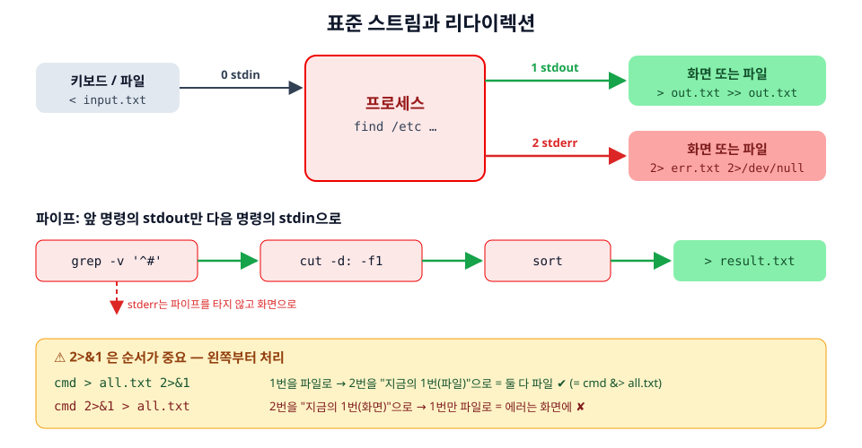
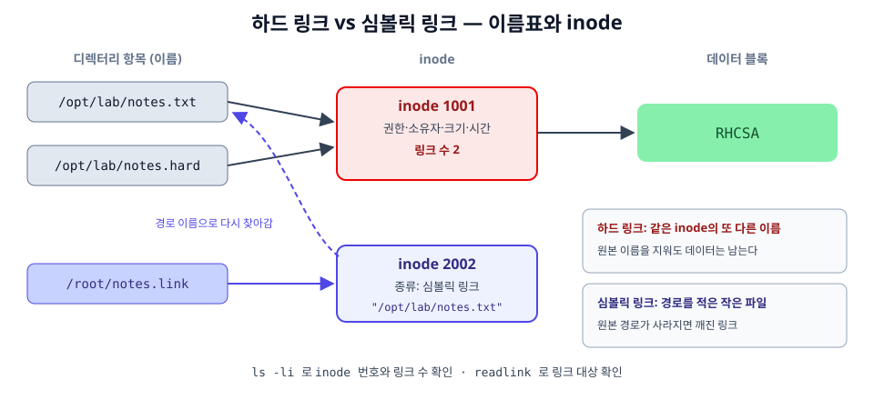

> **번외 · RHCSA(EX200) 대비** | 난이도 ★★☆☆☆ | 예상 소요 2 ~ 3시간

> ⚠️ 이 편의 연습 과제는 Red Hat 공식 목표를 바탕으로 **직접 만든 창작 과제**입니다. 실제 출제 문제가 아닙니다.
> 실습 환경은 [R00](./r00-exam-overview-lab.md)에서 만든 `servera`(192.168.56.11), `serverb`(192.168.56.12)입니다. 시작 전에 `vagrant snapshot restore clean --no-provision` 으로 초기화하세요.

## 🎯 오늘의 목표

- 표준 입력·출력·에러 스트림을 원하는 곳으로 보내고 파이프로 잇는다
- `grep`과 정규식으로 설정 파일·로그에서 필요한 줄만 뽑아 파일로 저장한다
- SSH로 다른 서버에 접속·명령 실행하고, 사용자를 전환한다
- `tar`·`gzip`·`bzip2`로 묶고 풀며, 하드 링크와 심볼릭 링크의 차이를 inode로 설명한다
- ugo/rwx 권한을 읽고 바꾸며, 인터넷 없이 `man`·`info`·`/usr/share/doc`에서 답을 찾는다

---

## 1. 목표 요약

공식 목표 ① "Understand and use essential tools"의 세부 항목을 우리말로 옮기면 다음과 같습니다.

| 공식 목표 | 이 편의 절 |
|---|---|
| 셸 프롬프트에서 올바른 문법으로 명령 실행 | 3-1 |
| 입출력 리다이렉션(`>`, `>>`, `\|`, `2>` 등) | 3-1 |
| grep과 정규식으로 텍스트 분석 | 3-2 |
| SSH로 원격 시스템 접속 | 3-3 |
| 멀티유저 타깃에서 로그인·사용자 전환 | 3-3 |
| tar, gzip, bzip2로 아카이브·압축과 해제 | 3-4 |
| 텍스트 파일 생성·편집 | 3-5 |
| 파일·디렉터리 생성, 삭제, 복사, 이동 | 3-5 |
| 하드 링크와 소프트 링크 생성 | 3-6 |
| 표준 ugo/rwx 권한 조회·설정·변경 | 3-7 |
| man, info, `/usr/share/doc` 문서 찾아 읽기 | 3-8 |

이 목표는 그 자체로 독립된 과제보다는 **다른 모든 과제의 재료**로 등장하는 경우가 많습니다. 손에 익을수록 시험 전체 속도가 빨라집니다.

---

## 2. 출제 유형

| 과제 형태 (창작 예시) | 채점 포인트 |
|---|---|
| "파일 X에서 조건에 맞는 줄을 찾아 `/root/결과파일`에 저장하라" | 결과 파일의 **위치·내용·순서**가 정확한가. 빈 줄·주석 포함 여부 |
| "디렉터리 Y를 bzip2로 압축한 아카이브 `/root/이름.tar.bz2`를 만들어라" | 파일 이름, **압축 형식**, 아카이브 안 경로 |
| "특정 파일에 대한 심볼릭 링크를 만들어라" | 링크 종류, **링크가 가리키는 경로**(절대/상대) |
| "파일 Z의 소유자·그룹·권한을 다음과 같이 맞춰라" | `ls -l` 결과가 요구와 정확히 같은가 |
| "특정 사용자가 소유한 파일을 모두 찾아 디렉터리에 복사하라" | 빠짐없이, 속성 유지(`-a`)해서 복사했는가 |

> 💡 결과 파일 과제는 채점 스크립트가 **파일 내용을 그대로 비교**한다고 생각하세요. 요구하지 않은 머리말, 앞뒤 공백, 에러 메시지가 섞이면 틀립니다. 그래서 에러는 `2>/dev/null` 로 따로 버리는 습관이 중요합니다.

---

## 3. 핵심 개념·명령

### 3-1. 셸과 리다이렉션



모든 프로세스는 세 개의 파일 디스크립터(fd)를 갖고 시작합니다. **0번 stdin(입력), 1번 stdout(정상 출력), 2번 stderr(에러 출력)**. 리다이렉션은 이 번호를 다른 곳에 연결하는 것입니다.

| 문법 | 의미 | 예 |
|---|---|---|
| `> file` | stdout을 파일로 (덮어쓰기) | `ls /etc > list.txt` |
| `>> file` | stdout을 파일 끝에 추가 | `date >> log.txt` |
| `2> file` | stderr를 파일로 | `find / -name x 2> err.txt` |
| `2> /dev/null` | 에러 버리기 | `find / -user bob 2>/dev/null` |
| `&> file` | stdout + stderr 모두 파일로 | `dnf check-update &> out.txt` |
| `> file 2>&1` | 위와 같음(POSIX 방식). **순서 중요** | `cmd > all.txt 2>&1` |
| `< file` | 파일을 stdin으로 | `wc -l < /etc/passwd` |
| `cmd1 \| cmd2` | cmd1의 stdout → cmd2의 stdin | `ps aux \| grep sshd` |
| `\| tee file` | 화면에도 보이고 파일에도 저장 | `ip a \| tee ip.txt` |
| `<<EOF … EOF` | here document — 여러 줄을 stdin으로 | 설정 파일 만들 때 |

> ⚠️ `cmd 2>&1 > file` 은 에러가 **화면에** 나옵니다. 왼쪽부터 처리되기 때문에, `2>&1` 시점의 1번은 아직 화면이었거든요. 헷갈리면 `&>` 를 쓰세요.

명령 문법 기본기도 같이 정리합니다.

| 문법 | 의미 |
|---|---|
| `cmd1 ; cmd2` | 순서대로 실행 |
| `cmd1 && cmd2` | cmd1이 성공(종료 코드 0)해야 cmd2 실행 |
| `cmd1 \|\| cmd2` | cmd1이 실패해야 cmd2 실행 |
| `'…'` / `"…"` | 작은따옴표는 아무것도 해석하지 않음, 큰따옴표는 `$변수`·`$(명령)`만 해석 |
| `*`, `?`, `[abc]`, `{a,b}` | 글롭(파일 이름 확장)과 중괄호 확장 — `mkdir -p /lab/{a,b,c}` |

### 3-2. grep과 정규식

| 명령 | 의미 |
|---|---|
| `grep 패턴 파일` | 패턴을 포함한 줄 |
| `grep -i` | 대소문자 무시 |
| `grep -v` | 패턴이 **없는** 줄 |
| `grep -n` | 줄 번호 표시 |
| `grep -c` | 일치한 줄 수 |
| `grep -r 패턴 디렉터리` | 하위 디렉터리까지 |
| `grep -l` | 일치한 **파일 이름**만 |
| `grep -w` | 단어 단위 일치 |
| `grep -E` | 확장 정규식(ERE) — `+ ? \| ()` 를 그대로 사용 |
| `grep -A 2` / `-B 2` | 일치 줄의 뒤/앞 2줄도 |

| 정규식 | 의미 | 예 |
|---|---|---|
| `^` / `$` | 줄 시작 / 줄 끝 | `^root`, `bash$` |
| `.` | 아무 글자 1개 | `r..t` |
| `*` | 앞 글자 0회 이상 | `ab*c` |
| `+` (ERE) | 앞 글자 1회 이상 | `-E '[0-9]+'` |
| `[abc]`, `[^abc]` | 문자 집합, 부정 집합 | `[0-9]`, `[^#]` |
| `\|` (ERE) | 또는 | `grep -E 'error\|fail'` |
| `\b` / `\<\>` | 단어 경계 | `'\<root\>'` |
| `^$` | 빈 줄 | `grep -v '^$'` |

설정 파일에서 **주석과 빈 줄을 빼고 실제 설정만** 보는 패턴은 시험 내내 쓰입니다.

```bash
grep -Ev '^[[:space:]]*(#|$)' /etc/ssh/sshd_config
```

### 3-3. SSH와 사용자 전환

```bash
ssh vagrant@serverb                    # 접속 (비밀번호 vagrant, R00 설정)
ssh vagrant@serverb 'hostname; uptime' # 원격 명령만 실행하고 돌아오기
ssh -p 2222 user@host                  # 포트 지정
```

| 명령 | 의미 |
|---|---|
| `su - 사용자` | 그 사용자의 **로그인 셸**로 전환(환경 변수·홈 디렉터리 적용) |
| `su 사용자` | 환경은 그대로 두고 사용자만 전환 — 시험에선 `su -` 를 기본으로 |
| `sudo 명령` | 허용된 경우 root 권한으로 명령 하나 실행 |
| `sudo -i` | root 로그인 셸 |
| `exit` | 이전 사용자로 복귀 |
| `whoami`, `id` | 현재 사용자, UID·그룹 확인 |
| `Ctrl+Alt+F2` ~ `F6` | 콘솔에서 다른 가상 터미널(tty)로 전환해 로그인 |

> 💡 "multi-user target에서 로그인"은 GUI 없이 텍스트 콘솔에서 로그인하는 상황입니다. `systemctl get-default` 가 `multi-user.target` 이면 부팅 후 텍스트 로그인 화면이 뜹니다. 타깃 자체는 R03·R06에서 다룹니다. 파일 전송(`scp`, `sftp`, `rsync`)은 R03, SSH 키 인증은 R09에서 이어집니다.

> ⚠️ RHEL 10은 root의 SSH **비밀번호** 로그인을 기본으로 막습니다(`PermitRootLogin prohibit-password`). 일반 사용자로 접속한 뒤 `sudo -i` 나 `su -` 로 전환하는 흐름을 익히세요.

### 3-4. 아카이브와 압축

| 명령 | 의미 |
|---|---|
| `tar -cvf a.tar 디렉터리` | 묶기(create) |
| `tar -czvf a.tar.gz 디렉터리` | 묶고 **gzip** 압축 |
| `tar -cjvf a.tar.bz2 디렉터리` | 묶고 **bzip2** 압축 |
| `tar -cJvf a.tar.xz 디렉터리` | 묶고 **xz** 압축 |
| `tar -tvf a.tar.gz` | 내용 보기(압축 형식은 자동 인식) |
| `tar -xvf a.tar.gz -C /대상` | 지정 위치에 풀기 |
| `gzip 파일` / `gunzip 파일.gz` | 파일 하나 압축/해제 — **원본이 사라짐** |
| `bzip2 파일` / `bunzip2 파일.bz2` | 같은 방식, bzip2 |
| `gzip -k`, `bzip2 -k` | 원본 유지 |
| `file 파일` | 실제 형식 확인 |

> 💡 tar는 절대 경로를 넣어도 기본적으로 **앞의 `/`를 떼고** 저장합니다(`Removing leading '/' from member names`). 그래서 `tar -xf` 하면 현재 디렉터리 아래에 `etc/...` 가 생깁니다. 원래 자리로 풀려면 `-C /`.

> ⚠️ 최소 설치에는 `bzip2` 명령이 없을 수 있습니다. `tar -cjf` 가 `bzip2: Cannot exec` 로 실패하면 `dnf install -y bzip2`.

### 3-5. 파일·디렉터리 다루기와 편집

| 명령 | 의미 |
|---|---|
| `mkdir -p /a/b/c` | 중간 디렉터리까지 생성 |
| `cp -a 원본 대상` | 권한·소유자·시간·링크를 **유지**하며 재귀 복사 |
| `cp -r` | 재귀 복사(속성 유지 X) |
| `mv` | 이동·이름 변경 |
| `rm -r`, `rmdir` | 디렉터리 삭제(내용 포함/빈 디렉터리만) |
| `touch` | 빈 파일 생성, 시간 갱신 |
| `find / -user bob -type f 2>/dev/null` | 조건으로 파일 찾기 |
| `find /etc -name '*.conf' -mtime -7` | 7일 이내 수정된 conf |
| `find … -exec cp -a {} /dest/ \;` | 찾은 파일마다 명령 실행 |

편집기는 `vim`(최소 설치는 `vi`)과 `nano` 중 편한 것을 쓰면 됩니다. vim 최소 생존 키만 정리합니다.

| 키 | 동작 |
|---|---|
| `i` / `Esc` | 입력 모드 / 명령 모드 |
| `:wq` / `:q!` | 저장 후 종료 / 저장 없이 종료 |
| `dd`, `yy`, `p` | 줄 삭제, 줄 복사, 붙여넣기 |
| `/단어`, `n` | 검색, 다음 |
| `u` | 실행 취소 |
| `:set nu` | 줄 번호 |

### 3-6. 하드 링크와 심볼릭 링크



리눅스 파일 이름은 **inode(실제 데이터와 메타데이터)를 가리키는 이름표**입니다.

| 구분 | 하드 링크 `ln 원본 링크` | 심볼릭 링크 `ln -s 대상 링크` |
|---|---|---|
| 가리키는 것 | 같은 **inode** | 대상의 **경로 문자열** |
| inode 번호 | 원본과 같음 | 다름(자기만의 inode) |
| 원본 삭제 시 | 데이터 유지(링크 수만 감소) | **깨진 링크**가 됨 |
| 디렉터리 | 불가 | 가능 |
| 다른 파일 시스템 | 불가 | 가능 |
| 확인 | `ls -li` 의 링크 수, 같은 inode | `ls -l` 의 `l` 타입, `->` 표시 |

> ⚠️ `ln -s` 의 대상 경로는 **링크가 놓인 위치 기준**으로 해석됩니다. `ln -s data.txt /root/link` 는 `/root/data.txt` 를 가리키게 됩니다. 헷갈리면 **절대 경로**로 만드세요.

### 3-7. ugo/rwx 권한

```
-rw-r-----. 1 root wheel 120 Nov 15 10:00 report.txt
│└┬┘└┬┘└┬┘   소유자 그룹
│ u  g  o
└ 파일 종류 (- 파일, d 디렉터리, l 링크)
```

| 권한 | 파일에서 | 디렉터리에서 |
|---|---|---|
| r (4) | 내용 읽기 | 목록 보기(`ls`) |
| w (2) | 내용 수정 | 안에서 파일 생성·삭제·이름 변경 |
| x (1) | 실행 | 들어가기(`cd`), 안의 파일 접근 |

| 명령 | 예 | 결과 |
|---|---|---|
| `chmod` 숫자 | `chmod 640 f` | `rw-r-----` |
| `chmod` 기호 | `chmod u+x,g-w,o= f` | 소유자 실행 추가, 그룹 쓰기 제거, 기타 전부 제거 |
| `chmod -R` | `chmod -R g+rX dir` | 하위 전체. 대문자 `X` 는 디렉터리(와 이미 실행 가능한 파일)에만 x |
| `chown` | `chown alice:devs f` | 소유자와 그룹 동시 변경 |
| `chgrp` | `chgrp devs f` | 그룹만 변경 |

> 💡 끝의 `.` 는 SELinux 컨텍스트가 있다는 표시입니다(R09). setuid·setgid·sticky 같은 특수 권한과 기본 권한(umask)은 R05·R09에서 다룹니다.

### 3-8. 시스템 문서 — 시험장의 유일한 검색 엔진

| 명령 | 용도 |
|---|---|
| `man 명령` | 매뉴얼. `/검색어`, `n`, `q` |
| `man 5 fstab` | 섹션 지정(1 명령, 5 파일 형식, 8 관리 명령) |
| `man -k 키워드` (= `apropos`) | 키워드로 매뉴얼 찾기 |
| `man -f 이름` (= `whatis`) | 그 이름의 섹션들 |
| `info 명령` | GNU 도구의 상세 문서(`info coreutils`) |
| `명령 --help` | 짧은 사용법 |
| `ls /usr/share/doc/패키지` | 예제 설정, README |
| `rpm -qd 패키지` | 그 패키지의 문서 파일 목록 |

> ⚠️ 새로 만든 VM에서 `man -k` 가 `nothing appropriate` 만 뱉으면 매뉴얼 색인이 아직 없는 것입니다. `sudo mandb` 로 색인을 만드세요. 시험장 시스템도 같은 상황일 수 있으니 기억해 두세요.

> ⚠️ Vagrant·클라우드 이미지는 용량을 줄이려고 문서 없이(`tsflags=nodocs`) 만들어지기도 합니다. `man ls` 가 `No manual entry` 라면 `grep -r nodocs /etc/dnf/` 로 확인하고, 그 줄을 지운 뒤 `dnf install -y man-db man-pages` 와 `dnf reinstall -y 패키지` 로 문서를 채우세요. 실제 시험 시스템에는 문서가 설치되어 있습니다.

> 💡 시험에서 자주 꺼내 볼 EXAMPLES 절: `man nmcli-examples`, `man 5 fstab`, `man semanage-fcontext`, `man 5 crontab`, `man systemd.timer`, `man 5 yum.conf`(dnf 저장소 옵션).

---

## 4. 자주 하는 실수

| 실수 | 결과 | 예방 |
|---|---|---|
| 결과 파일에 에러 메시지가 섞임 | 내용 비교에서 불일치 | `2>/dev/null` 로 stderr 분리 |
| `>` 와 `>>` 혼동 | 이전 결과를 덮어써 버림 | 추가가 요구되면 `>>`, 다시 만들 땐 `>` |
| `grep root` 로 "root 사용자 줄" 찾기 | `operator`의 홈 `/root` 같은 줄도 걸림 | `grep '^root:'` 처럼 위치를 고정 |
| `tar -czf` 로 bzip2 요구를 수행 | 형식 불일치 | `-j` = bzip2, `-z` = gzip, `-J` = xz. `file` 로 확인 |
| 심볼릭 링크를 상대 경로로 잘못 생성 | 깨진 링크(빨간색 표시) | 절대 경로 사용, `readlink -f` 로 확인 |
| `cp -r` 로 복사해 소유자·시간이 바뀜 | "속성 유지" 요구 위반 | `cp -a` |
| 루트 권한이 필요한 과제를 일반 사용자로 시도 | `Permission denied` | `sudo -i` 로 root 셸에서 작업 |
| `su` (하이픈 없이) 후 환경이 이전 사용자 것 | 경로·홈이 달라 과제 결과가 엉뚱한 곳에 | `su -` |

---

## 5. 창작 연습 과제

> 모든 과제는 **servera** 에서 root(`sudo -i`)로 수행합니다(과제 4는 serverb 포함). 공식 목표를 바탕으로 만든 창작 과제입니다.

### 과제 1. 셸 사용자 목록

`/etc/passwd` 에서 로그인 셸이 `/bin/bash` 인 계정의 **사용자 이름만** 알파벳 순으로 `/root/bash-users.txt` 에 저장하세요.

<details>
<summary>풀이·검증</summary>

```bash
grep -E ':/bin/bash$' /etc/passwd | cut -d: -f1 | sort > /root/bash-users.txt
```

검증:

```bash
cat /root/bash-users.txt          # root, vagrant 등 이름만 한 줄에 하나
awk -F: '$7=="/bin/bash"{print $1}' /etc/passwd | sort | diff - /root/bash-users.txt && echo OK
```
</details>

### 과제 2. 실제 설정만 추출

`/etc/chrony.conf` 에서 주석 줄(공백 뒤의 `#` 포함)과 빈 줄을 제외한 줄을 **원래 순서대로** `/root/chrony-active.conf` 에 저장하세요.

<details>
<summary>풀이·검증</summary>

```bash
grep -Ev '^[[:space:]]*(#|$)' /etc/chrony.conf > /root/chrony-active.conf
```

검증:

```bash
grep -c '' /root/chrony-active.conf              # 줄 수
grep -E '^[[:space:]]*#|^$' /root/chrony-active.conf || echo "주석·빈 줄 없음"
```
</details>

### 과제 3. 사용자 소유 파일 수집

시스템 전체에서 사용자 `vagrant` 가 소유한 **일반 파일**을 찾아 `/root/vagrant-files/` 디렉터리에 **속성을 유지한 채** 복사하세요. `/proc` 아래는 제외하고, 검색 중 나는 에러는 화면에 보이지 않게 하세요.

<details>
<summary>풀이·검증</summary>

```bash
mkdir -p /root/vagrant-files
find / \( -path /proc -o -path /root/vagrant-files \) -prune -o -user vagrant -type f -exec cp -a {} /root/vagrant-files/ \; 2>/dev/null
```

> 같은 이름의 파일이 여러 디렉터리에 있으면 덮어써집니다. 원래 경로 구조까지 살리라는 요구라면 `cp -a --parents` 를 씁니다.

검증:

```bash
ls -la /root/vagrant-files | head
find /root/vagrant-files -type f ! -user vagrant | wc -l   # 0 이어야 속성 유지 성공
```
</details>

### 과제 4. 원격 정보 수집

servera에서 **serverb에 SSH로 접속해** serverb의 커널 버전(`uname -r`)과 호스트명을 한 줄씩 servera의 `/root/serverb-info.txt` 에 저장하세요. 호스트명이 첫 줄입니다.

<details>
<summary>풀이·검증</summary>

```bash
ssh vagrant@serverb 'hostname; uname -r' > /root/serverb-info.txt
# 처음 접속이면 호스트 키 확인(yes)과 비밀번호(vagrant) 입력
```

검증:

```bash
cat /root/serverb-info.txt
# serverb.lab.example.com
# 6.12.0-…el10…
head -1 /root/serverb-info.txt | grep -q serverb && echo OK
```
</details>

### 과제 5. 두 가지 압축 아카이브

1. `/etc` 디렉터리 전체를 **bzip2** 로 압축한 `/root/etc-backup.tar.bz2` 를 만드세요.
2. `/var/log` 를 **gzip** 으로 압축한 `/root/logs.tar.gz` 를 만들고, 그 안의 내용을 `/tmp/restore/` 아래에 풀어 보세요.

<details>
<summary>풀이·검증</summary>

```bash
dnf install -y bzip2                    # 없을 때만
tar -cjf /root/etc-backup.tar.bz2 /etc
tar -czf /root/logs.tar.gz /var/log
mkdir -p /tmp/restore
tar -xzf /root/logs.tar.gz -C /tmp/restore
```

검증:

```bash
file /root/etc-backup.tar.bz2     # bzip2 compressed data
file /root/logs.tar.gz            # gzip compressed data
tar -tjf /root/etc-backup.tar.bz2 | head -3     # etc/ 로 시작
ls /tmp/restore/var/log | head
```
</details>

### 과제 6. 링크 만들기

1. `/opt/lab/notes.txt` 파일을 만들고 내용으로 `RHCSA` 한 줄을 넣으세요.
2. 같은 inode를 공유하는 `/opt/lab/notes.hard` 를 만드세요.
3. `/root/notes.link` 가 `/opt/lab/notes.txt` 를 가리키는 심볼릭 링크가 되게 하세요.

<details>
<summary>풀이·검증</summary>

```bash
mkdir -p /opt/lab
echo RHCSA > /opt/lab/notes.txt
ln /opt/lab/notes.txt /opt/lab/notes.hard
ln -s /opt/lab/notes.txt /root/notes.link
```

검증:

```bash
ls -li /opt/lab/        # 두 파일의 inode 번호가 같고 링크 수 2
readlink /root/notes.link          # /opt/lab/notes.txt
cat /root/notes.link               # RHCSA
```

원본을 지워 차이를 눈으로 확인해 보세요.

```bash
rm /opt/lab/notes.txt
cat /opt/lab/notes.hard            # RHCSA (데이터 유지)
cat /root/notes.link               # No such file or directory (깨진 링크)
```
</details>

### 과제 7. 권한 맞추기

`/srv/finance/report.txt` 를 만들고 다음 상태로 맞추세요.

- 소유자 `root`, 그룹 `wheel`
- 소유자는 읽기·쓰기, 그룹은 읽기만, 기타 사용자는 아무 권한 없음
- `/srv/finance` 디렉터리는 소유자 모든 권한, 그룹은 들어가서 목록을 볼 수만 있고, 기타 사용자는 접근 불가

<details>
<summary>풀이·검증</summary>

```bash
mkdir -p /srv/finance
touch /srv/finance/report.txt
chown root:wheel /srv/finance /srv/finance/report.txt
chmod 640 /srv/finance/report.txt
chmod 750 /srv/finance
```

검증:

```bash
stat -c '%A %U:%G %n' /srv/finance /srv/finance/report.txt
# drwxr-x--- root:wheel /srv/finance
# -rw-r----- root:wheel /srv/finance/report.txt
sudo -u vagrant cat /srv/finance/report.txt   # vagrant가 wheel이면 성공, 아니면 Permission denied
```
</details>

### 과제 8. 출력과 에러 분리

`/etc` 아래에서 이름이 `.conf` 로 끝나는 파일 경로를 **일반 사용자 vagrant 권한으로** 찾아, 찾은 목록은 `/home/vagrant/conf-list.txt`, 권한 에러는 `/home/vagrant/conf-errors.txt` 에 저장하세요. 그다음 목록의 줄 수를 `conf-list.txt` 맨 끝에 `TOTAL: N` 형식으로 추가하세요.

<details>
<summary>풀이·검증</summary>

```bash
su - vagrant -c 'find /etc -name "*.conf" > ~/conf-list.txt 2> ~/conf-errors.txt
  echo "TOTAL: $(wc -l < ~/conf-list.txt)" >> ~/conf-list.txt'
```

> `find` 는 권한 에러가 있으면 종료 코드 1을 돌려주지만 결과 파일은 정상으로 만들어집니다. 추가(`>>`)까지 vagrant로 하는 이유: root가 `/tmp` 처럼 sticky 디렉터리에 있는 **다른 사용자 소유 파일**에 쓰려 하면 `fs.protected_regular` 보호 때문에 거부될 수 있습니다.

검증:

```bash
tail -1 /home/vagrant/conf-list.txt                  # TOTAL: 숫자
grep -c 'Permission denied' /home/vagrant/conf-errors.txt   # 1 이상
grep -c 'Permission denied' /home/vagrant/conf-list.txt     # 0
```
</details>

### 과제 9. 문서에서 답 찾기

인터넷 없이 다음을 알아내 `/root/docs-answers.txt` 에 한 줄씩 적으세요.

1. `/etc/fstab` 의 형식을 설명하는 매뉴얼 **섹션 번호**
2. `tar` 에서 xz 압축을 뜻하는 **짧은 옵션** 글자
3. `/usr/share/doc` 아래에 있는 `chrony` 관련 디렉터리 이름

<details>
<summary>풀이·검증</summary>

```bash
mandb >/dev/null 2>&1          # 색인이 없을 때
man -k fstab                   # fstab (5) - static information about the filesystems
man tar                        # /xz 검색 → -J, --xz
ls -d /usr/share/doc/chrony*
```

```bash
cat > /root/docs-answers.txt <<'EOF'
5
J
chrony
EOF
```

검증:

```bash
man -f fstab               # 섹션 5 확인
tar --help | grep -- '-J'  # -J, --xz
cat /root/docs-answers.txt
```
</details>

---

## 6. 핵심 정리

- fd 0·1·2 = stdin·stdout·stderr. `>` 덮어쓰기, `>>` 추가, `2>/dev/null` 에러 버리기, `&>` 둘 다
- 결과 파일 과제는 **내용을 그대로 비교**한다고 생각하고, 에러·여분 출력이 섞이지 않게
- `grep -E` + `^`·`$` 위치 고정이 정확도의 핵심. 주석·빈 줄 제거는 `grep -Ev '^[[:space:]]*(#|$)'`
- `su -` 로 로그인 셸 전환, root SSH 비밀번호 로그인은 기본 차단
- `tar -c{z,j,J}f` 로 gzip/bzip2/xz, `-C` 로 풀 위치. `file` 로 형식 검증
- 하드 링크 = 같은 inode, 심볼릭 링크 = 경로. 심볼릭은 절대 경로로
- 권한은 `stat -c '%A %U:%G'` 로 검증하는 습관
- 문서: `man -k`(안 되면 `mandb`), `man 5 …`, `/usr/share/doc`, `--help`

---

## ⏭️ 다음 예고 — R02. 소프트웨어 관리 & 간단한 셸 스크립트

serverb가 제공하는 로컬 저장소를 `.repo` 파일로 등록해 `dnf`로 패키지를 설치하고, RHEL 10 목표에 새로 들어온 **Flatpak** 저장소 추가·설치·제거를 해 봅니다. 이어서 오늘 익힌 리다이렉션과 grep을 묶어 조건문·반복문·인자·종료 코드를 쓰는 **셸 스크립트**를 만듭니다.
