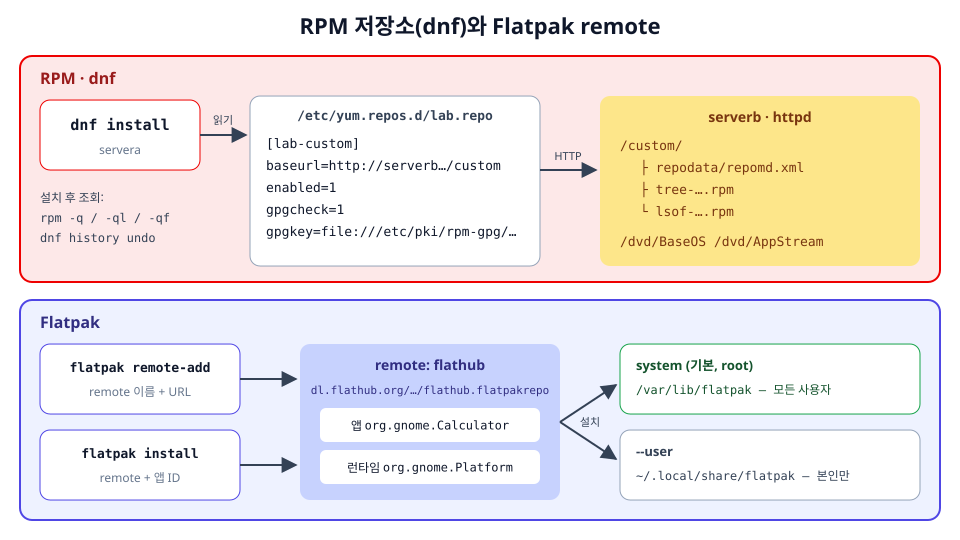
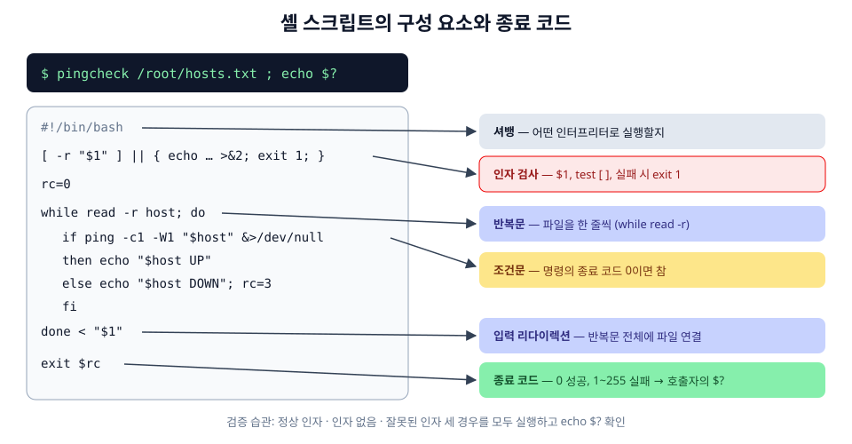

> **번외 · RHCSA(EX200) 대비** | 난이도 ★★☆☆☆ | 예상 소요 2.5 ~ 3.5시간 (Flatpak 다운로드 포함)

> ⚠️ 이 편의 연습 과제는 Red Hat 공식 목표를 바탕으로 **직접 만든 창작 과제**입니다. 실제 출제 문제가 아닙니다.
> 실습 환경은 [R00](./r00-exam-overview-lab.md)의 `servera`·`serverb`입니다. serverb는 `http://serverb.lab.example.com/custom`(작은 사용자 정의 저장소)과, DVD ISO를 연결했다면 `http://serverb.lab.example.com/dvd/BaseOS`·`/dvd/AppStream` 을 제공합니다.

## 🎯 오늘의 목표

- `.repo` 파일을 손으로 써서 RPM 저장소를 등록하고, `dnf`로 설치·제거·조회한다
- `rpm` 질의로 "이 파일은 어느 패키지 것인가"를 답한다
- Flatpak 원격 저장소(remote)를 추가하고 앱을 설치·제거한다
- 인자·조건문·반복문·명령 출력 처리·종료 코드를 쓰는 셸 스크립트를 작성한다

---

## 1. 목표 요약

| 공식 목표 | 이 편의 절 |
|---|---|
| ② RPM 저장소 접근 설정 | 3-1 |
| ② RPM 패키지 설치·제거 | 3-2, 3-3 |
| ② Flatpak 저장소 접근 설정 | 3-4 |
| ② Flatpak 패키지 설치·제거 | 3-4 |
| ③ 조건 실행(`if`, `test`, `[]` 등) | 4-3 |
| ③ 반복문(`for` 등)으로 파일·명령줄 입력 처리 | 4-4 |
| ③ 스크립트 입력 처리(`$1`, `$2` 등) | 4-2 |
| ③ 스크립트 안에서 셸 명령 출력 처리 | 4-5 |

> 💡 목표 ⑦의 "Red Hat CDN, 원격 저장소, 로컬 파일 시스템에서 패키지 설치·업데이트"도 이 편의 내용과 같은 기술입니다. R06에서 다시 짧게 이어집니다.

---

## 2. 출제 유형

| 과제 형태 (창작 예시) | 채점 포인트 |
|---|---|
| "다음 URL을 BaseOS·AppStream 저장소로 사용하도록 시스템을 설정하라" | `dnf repolist` 에 enabled로 보이는가, **실제로 설치가 되는가**, GPG 검증 설정 |
| "패키지 X를 설치하라 / Y를 제거하라" | `rpm -q` 결과 |
| "Flatpak 원격 저장소 Z를 시스템 전체에 추가하고 앱 A를 설치하라" | `flatpak remotes`, `flatpak list` 결과, **system/user 범위** |
| "인자로 디렉터리를 받아 ~를 출력하는 스크립트 `/usr/local/bin/이름`을 작성하라" | 실행 권한, 인자 없을 때 동작, **출력 형식**, **종료 코드** |
| "스크립트 실행 결과를 파일 W에 저장하라" | 결과 파일 내용 |

> 💡 저장소 과제는 보통 **다른 과제의 선행 조건**입니다. 저장소가 틀리면 뒤의 패키지 설치 과제가 전부 막히니 가장 먼저, 정확히 하세요.

---

## 3. 소프트웨어 관리



### 3-1. 저장소(.repo) 설정

`dnf`는 `/etc/yum.repos.d/*.repo` 파일을 읽어 어디서 패키지를 받을지 결정합니다. 저장소 URL 아래에는 `repodata/repomd.xml` 이 있어야 합니다.

```ini
# /etc/yum.repos.d/lab.repo
[lab-baseos]
name=Lab BaseOS
baseurl=http://serverb.lab.example.com/dvd/BaseOS
enabled=1
gpgcheck=1
gpgkey=file:///etc/pki/rpm-gpg/RPM-GPG-KEY-AlmaLinux-10

[lab-appstream]
name=Lab AppStream
baseurl=http://serverb.lab.example.com/dvd/AppStream
enabled=1
gpgcheck=1
gpgkey=file:///etc/pki/rpm-gpg/RPM-GPG-KEY-AlmaLinux-10
```

| 키 | 의미 |
|---|---|
| `[id]` | 저장소 ID. 공백 없이, 파일 전체에서 유일 |
| `name` | 설명 |
| `baseurl` | `http://`, `https://`, `ftp://`, `file:///` 모두 가능 |
| `enabled` | 1 사용 / 0 미사용 |
| `gpgcheck` | 1이면 패키지 서명 검증 |
| `gpgkey` | 검증에 쓸 공개 키 위치(로컬 `file:///` 또는 URL) |

> ⚠️ GPG 키 파일 이름은 배포판마다 다릅니다. `ls /etc/pki/rpm-gpg/` 로 확인하세요. RHEL은 `RPM-GPG-KEY-redhat-release`, AlmaLinux 10은 `RPM-GPG-KEY-AlmaLinux-10` 입니다. 과제가 키 URL을 주면 그대로 `gpgkey=` 에 쓰거나 `rpm --import URL` 로 가져옵니다. 과제가 "서명 검증 없이"라고 명시할 때만 `gpgcheck=0`.

손으로 쓰는 대신 `dnf config-manager` 를 쓸 수도 있습니다(`dnf-plugins-core` 패키지).

```bash
dnf config-manager --add-repo http://serverb.lab.example.com/custom
# → /etc/yum.repos.d/serverb.lab.example.com_custom.repo 생성 (gpgcheck 줄은 없음)
dnf config-manager --set-disabled baseos appstream    # 저장소 끄기
dnf config-manager --set-enabled crb                  # 저장소 켜기
```

> 💡 `--add-repo` 로 만든 파일에는 `gpgcheck` 줄이 없어서 `dnf.conf` 의 기본값을 따릅니다. 과제가 GPG 키를 요구하면 생성된 파일을 열어 `gpgcheck=1`, `gpgkey=` 를 직접 추가하세요. 결국 **손으로 쓰는 방법을 아는 것**이 가장 확실합니다. 옵션이 기억나지 않으면 `man 5 yum.conf`(dnf 저장소 옵션 설명)를 여세요.

RHEL에서는 Red Hat CDN 저장소를 `subscription-manager` 로 관리합니다. 시험에서는 보통 CDN 대신 로컬 URL이 주어집니다.

```bash
subscription-manager repos --list-enabled        # RHEL 전용
```

### 3-2. dnf 핵심 명령

| 명령 | 의미 |
|---|---|
| `dnf repolist` / `dnf repolist all` | 사용 중 / 전체 저장소 |
| `dnf clean all` | 메타데이터 캐시 삭제(저장소를 바꾼 뒤) |
| `dnf search 키워드` | 이름·요약 검색 |
| `dnf info 패키지` | 상세 정보 |
| `dnf provides /usr/bin/semanage` | 그 파일을 제공하는 패키지 |
| `dnf install -y 패키지` | 설치 |
| `dnf install -y ./파일.rpm` | 로컬 RPM 파일 설치(의존성은 저장소에서) |
| `dnf remove -y 패키지` | 제거 |
| `dnf update -y` / `dnf update 패키지` | 업데이트 |
| `dnf list installed`, `dnf list available` | 설치된 / 설치 가능한 목록 |
| `dnf group list`, `dnf group install "이름"` | 패키지 그룹 |
| `dnf history`, `dnf history undo N` | 트랜잭션 기록과 되돌리기 |
| `dnf --disablerepo='*' --enablerepo=ID install 패키지` | 특정 저장소에서만 설치 |

> ⚠️ **RHEL 10 변경점:** AppStream의 **모듈 스트림(modularity)이 없어졌습니다.** RHEL 8·9 자료에 나오는 `dnf module enable nodejs:20` 같은 과제는 RHEL 10 기준으로는 해당하지 않습니다. 여러 버전이 필요한 소프트웨어는 이름에 버전이 붙은 별도 패키지로 제공됩니다.

### 3-3. rpm 질의

`rpm` 은 저장소 없이 **이미 설치된 패키지 데이터베이스**나 **RPM 파일**을 조회합니다.

| 명령 | 의미 |
|---|---|
| `rpm -q 패키지` | 설치 여부와 버전 |
| `rpm -qa` | 전체 설치 목록 |
| `rpm -qi 패키지` | 정보 |
| `rpm -ql 패키지` | 패키지가 설치한 파일 목록 |
| `rpm -qc 패키지` / `rpm -qd 패키지` | 설정 파일 / 문서 파일만 |
| `rpm -qf /경로/파일` | 이 파일을 설치한 패키지 |
| `rpm -qpl 파일.rpm` | 설치 전 RPM 파일의 내용 |
| `rpm --import 키` | GPG 공개 키 가져오기 |
| `rpm -K 파일.rpm` | 서명 확인 |

### 3-4. Flatpak — RHEL 10 목표에 새로 들어온 항목

Flatpak은 데스크톱 앱을 **런타임(공통 라이브러리 묶음) + 앱**으로 나눠 샌드박스에서 실행하는 배포 방식입니다. RPM과 비교하면 이렇습니다.

| 구분 | RPM / dnf | Flatpak |
|---|---|---|
| 대상 | OS 구성 요소, 서버 소프트웨어 | 주로 데스크톱 앱 |
| 저장소 이름 | repo (`/etc/yum.repos.d/`) | **remote** |
| 의존성 | 시스템 라이브러리와 공유 | **런타임**을 따로 받아 공유 |
| 설치 위치 | `/usr` 등 | 시스템: `/var/lib/flatpak`, 사용자: `~/.local/share/flatpak` |
| 식별자 | 패키지 이름(`tree`) | 역도메인 앱 ID(`org.gnome.Calculator`) |

```bash
dnf install -y flatpak                     # 최소 설치에는 없을 수 있음
```

| 명령 | 의미 |
|---|---|
| `flatpak remote-add --if-not-exists 이름 URL` | remote 추가(기본 **system** 범위, root 필요) |
| `flatpak remote-add --user …` | 현재 사용자 범위로 추가 |
| `flatpak remotes` / `flatpak remotes --show-details` | remote 목록 |
| `flatpak remote-ls 이름 --app` | 그 remote에서 받을 수 있는 앱 |
| `flatpak search 키워드` | 앱 검색 |
| `flatpak install -y 이름 앱ID` | 설치(필요한 런타임도 함께) |
| `flatpak list --app` / `flatpak list --runtime` | 설치된 앱 / 런타임 |
| `flatpak info 앱ID` | 상세 정보 |
| `flatpak update -y` | 업데이트 |
| `flatpak uninstall -y 앱ID` | 앱 제거 |
| `flatpak uninstall --unused -y` | 쓰지 않는 런타임 정리 |
| `flatpak remote-modify --disable 이름` | remote 비활성화 |
| `flatpak remote-delete 이름` | remote 삭제 |

URL에는 두 가지 형태가 올 수 있습니다.

```bash
# 1) .flatpakrepo 파일 URL — 저장소 주소와 GPG 키가 함께 들어 있음 (가장 흔함)
flatpak remote-add --if-not-exists flathub https://dl.flathub.org/repo/flathub.flatpakrepo

# 2) 저장소 디렉터리 URL — 서명되지 않은 사내·실습 저장소라면 검증을 끄라는 지시가 함께 주어짐 (예시 URL)
flatpak remote-add --if-not-exists --no-gpg-verify labrepo http://repo.example.test/flatpak/repo
```

> 💡 RHEL에는 Red Hat이 제공하는 `rhel` remote(`https://flatpaks.redhat.io/rhel.flatpakrepo`)가 있고, 앱을 받으려면 Red Hat 계정 인증이 필요합니다. AlmaLinux 실습 환경에서는 Flathub로 같은 명령을 연습하면 됩니다. 명령 체계는 remote 이름만 다를 뿐 똑같습니다.

> ⚠️ **system과 user 범위를 섞지 마세요.** root로 `--user` remote를 추가하면 root 개인 범위에만 생기고, 일반 사용자로 system remote에 설치하려 하면 권한(polkit) 문제가 납니다. 과제가 "모든 사용자가 쓸 수 있게"라면 root로 **기본(system) 범위**에 추가·설치합니다. `flatpak remotes` 의 Options 열에 `system`/`user` 가 표시됩니다.

---

## 4. 간단한 셸 스크립트



### 4-1. 뼈대

```bash
#!/bin/bash
# 설명 한 줄
echo "Hello, $USER"
exit 0
```

```bash
chmod +x /usr/local/bin/hello.sh      # 실행 권한
hello.sh                              # /usr/local/bin 은 PATH에 있음
bash -n hello.sh                      # 문법 검사만
bash -x hello.sh                      # 한 줄씩 실행 과정 출력(디버깅)
```

> ⚠️ Windows 편집기로 쓴 파일을 복사하면 줄 끝 CRLF 때문에 `/bin/bash^M: bad interpreter` 가 납니다. 시험장에서는 VM 안의 vim으로 쓰므로 문제없지만, Vagrant 실습 중 호스트에서 복사했다면 `sed -i 's/\r$//' 파일` 로 고치세요(Day 20의 팁과 같습니다).

### 4-2. 인자와 특수 변수

| 변수 | 의미 |
|---|---|
| `$0` | 스크립트 이름 |
| `$1`, `$2`, … | 첫 번째, 두 번째 인자 |
| `$#` | 인자 개수 |
| `"$@"` | 모든 인자(각각 따로 따옴표 처리) — 반복문에서 사용 |
| `$?` | 직전 명령의 종료 코드 |
| `$$` | 현재 셸의 PID |
| `${VAR:-기본값}` | 비어 있으면 기본값 |

### 4-3. 조건문과 test

```bash
if [ $# -ne 1 ]; then
    echo "Usage: $0 <directory>" >&2
    exit 1
elif [ ! -d "$1" ]; then
    echo "Not a directory: $1" >&2
    exit 2
else
    echo "OK"
fi
```

| 테스트 | 참일 때 |
|---|---|
| `-e 경로` / `-f` / `-d` / `-L` | 존재 / 일반 파일 / 디렉터리 / 심볼릭 링크 |
| `-r` / `-w` / `-x` | 읽기 / 쓰기 / 실행 가능 |
| `-s 파일` | 크기가 0보다 큼 |
| `-z "$s"` / `-n "$s"` | 문자열이 비었음 / 비지 않았음 |
| `"$a" = "$b"` / `!=` | 문자열 같음 / 다름 |
| `$a -eq $b`, `-ne`, `-lt`, `-le`, `-gt`, `-ge` | 정수 비교 |
| `! 조건` | 부정 |
| `[ A ] && [ B ]`, `[ A ] \|\| [ B ]` | 그리고 / 또는 |

> 💡 `[` 는 사실 `test` 명령입니다. 그래서 `[` 와 `]` 양쪽에 **공백이 반드시** 있어야 합니다. `[$1 = x]` 는 문법 에러. 변수는 항상 큰따옴표로 감싸세요(`"$1"`). 빈 값이면 인자가 사라져 에러가 납니다. bash 전용 `[[ … ]]` 도 쓸 수 있습니다(패턴 매칭 `[[ $f == *.log ]]` 가능).

`if` 뒤에는 `[ ]` 뿐 아니라 **어떤 명령이든** 올 수 있습니다. 종료 코드가 0이면 참입니다.

```bash
if grep -q "^$1:" /etc/passwd; then
    echo "user $1 exists"
fi

if ! id "$1" &>/dev/null; then
    echo "no such user" >&2; exit 3
fi
```

`case` 는 값에 따라 분기할 때 깔끔합니다.

```bash
case "$1" in
    start) echo "starting" ;;
    stop)  echo "stopping" ;;
    *)     echo "Usage: $0 {start|stop}" >&2; exit 1 ;;
esac
```

### 4-4. 반복문

```bash
# 인자 하나하나
for arg in "$@"; do
    echo "arg: $arg"
done

# 목록·글롭
for f in /etc/*.conf; do
    echo "$f"
done

# 숫자 범위
for i in {1..5}; do echo "$i"; done

# 파일을 한 줄씩 (공백이 있는 줄도 안전)
while read -r line; do
    echo "line: $line"
done < /root/list.txt

# 명령 출력을 한 줄씩
ps -eo user= | sort -u | while read -r u; do
    echo "running user: $u"
done
```

> ⚠️ `for line in $(cat 파일)` 은 **공백 단위로** 쪼갭니다. "한 줄씩"이 요구되면 `while read -r` 를 쓰세요.

### 4-5. 명령 출력 처리

| 문법 | 의미 | 예 |
|---|---|---|
| `$(명령)` | 명령의 stdout을 문자열로 치환 | `today=$(date +%F)` |
| `` `명령` `` | 옛 문법(같은 의미) — 중첩이 어려워 `$( )` 권장 | |
| `명령 \| grep -q 패턴` | 출력에 패턴이 있는지만 종료 코드로 | `if systemctl is-active -q sshd` |
| `$(( 식 ))` | 정수 계산 | `total=$((a + b))` |
| `awk '{print $1}'`, `cut -d: -f1` | 필드 추출 | |
| `wc -l` | 줄 수 | `n=$(wc -l < 파일)` |

### 4-6. 종료 코드

- 모든 명령은 끝날 때 **0(성공) ~ 255** 사이의 종료 코드를 남깁니다. 직후 `echo $?` 로 확인.
- 스크립트에서는 `exit N` 으로 지정합니다. 지정하지 않으면 **마지막 명령의 종료 코드**가 스크립트의 종료 코드가 됩니다.
- 과제가 "인자가 없으면 종료 코드 1"처럼 요구하면 채점기는 `$?` 를 봅니다. 에러 메시지는 `>&2` 로 stderr에 보내는 것이 관례입니다.

---

## 5. 자주 하는 실수

| 실수 | 결과 | 예방 |
|---|---|---|
| `baseurl` 에 `repodata` 의 **상위**가 아닌 다른 경로를 씀 | `Cannot download repomd.xml` | 브라우저/`curl` 로 `URL/repodata/repomd.xml` 이 열리는지 먼저 확인 |
| `.repo` 파일 확장자 누락(`lab.conf`) | dnf가 파일을 읽지 않음 | 반드시 `/etc/yum.repos.d/*.repo` |
| 저장소 ID에 공백 | 파싱 에러 | `[lab-baseos]` 처럼 하이픈 사용 |
| 저장소 변경 후 오래된 캐시 | 새 저장소 패키지가 안 보임 | `dnf clean all` |
| `gpgcheck=1` 인데 `gpgkey` 없음 | `Public key … is not installed` | 키 경로 지정 또는 `rpm --import` |
| Flatpak remote를 `--user` 로 추가 | 다른 사용자·system 설치에서 안 보임 | 과제 범위 확인, 기본은 system |
| Flatpak 앱 제거 후 런타임이 남음 | 디스크 낭비(채점엔 보통 무관) | `flatpak uninstall --unused` |
| 스크립트에 실행 권한 없음 | `Permission denied` | `chmod +x`, `ls -l` 로 확인 |
| `[ $1 = x ]` 에서 인자 없음 | `unary operator expected` | `[ "$1" = x ]` |
| 정수 비교에 `=`, 문자열 비교에 `-eq` | 잘못된 결과 | 정수는 `-eq` 계열, 문자열은 `=` |
| 에러 메시지를 stdout으로 | 결과 파일에 에러가 섞임 | `echo … >&2` |

---

## 6. 창작 연습 과제

> **servera** 에서 root로 수행합니다. 공식 목표를 바탕으로 만든 창작 과제입니다. 저장소 과제(1~4)는 시험 상황처럼 **인터넷 저장소를 끈 상태**에서 연습합니다.

### 과제 1. 인터넷 저장소 끄고 로컬 저장소 등록

1. 현재 활성화된 기본 저장소를 모두 비활성화하세요(파일 삭제 금지).
2. `http://serverb.lab.example.com/custom` 을 ID `lab-custom` 인 저장소로 등록하세요. 패키지 서명은 **검증**해야 합니다.
3. `tree` 패키지를 설치하세요.

<details>
<summary>풀이·검증</summary>

```bash
dnf repolist                                   # 현재 ID 확인 (AlmaLinux 10: baseos, appstream, extras 등)
dnf config-manager --set-disabled baseos appstream   # repolist에 나온 ID 모두 (extras 등이 있으면 함께)
ls /etc/pki/rpm-gpg/                           # 키 파일 이름 확인

cat > /etc/yum.repos.d/lab-custom.repo <<'EOF'
[lab-custom]
name=Lab custom repo on serverb
baseurl=http://serverb.lab.example.com/custom
enabled=1
gpgcheck=1
gpgkey=file:///etc/pki/rpm-gpg/RPM-GPG-KEY-AlmaLinux-10
EOF

dnf clean all
dnf install -y tree
```

검증:

```bash
dnf repolist                 # lab-custom 하나만 enabled
rpm -q tree
dnf info tree | grep -i '^From repo'   # From repo : lab-custom
```

> custom 저장소의 RPM은 AlmaLinux 공식 패키지를 그대로 받아 둔 것이라 AlmaLinux 키로 검증됩니다.
</details>

### 과제 2. DVD 저장소 두 개 (ISO를 연결한 경우)

serverb의 `http://serverb.lab.example.com/dvd/BaseOS` 와 `…/dvd/AppStream` 을 각각 저장소 `lab-baseos`, `lab-appstream` 으로 등록하고(서명 검증), `httpd` 와 `bash-completion` 을 설치하세요.

<details>
<summary>풀이·검증</summary>

3-1의 `lab.repo` 예시를 그대로 `/etc/yum.repos.d/lab.repo` 로 작성한 뒤:

```bash
dnf clean all
dnf repolist
dnf install -y httpd bash-completion
```

검증:

```bash
rpm -q httpd bash-completion
dnf repoinfo lab-baseos | grep -E 'Repo-baseurl|Repo-pkgs'
```

> ISO를 연결하지 않았다면 이 과제는 인터넷 저장소를 다시 켜고(`dnf config-manager --set-enabled baseos appstream`) `.repo` 작성 연습만 해 두세요.
</details>

### 과제 3. 파일의 주인 찾기

1. `/etc/chrony.conf` 를 제공한 패키지 이름을 `/root/pkg-owner.txt` 에 저장하세요(버전 없이 이름만).
2. `tree` 패키지가 설치한 파일 중 `bin` 디렉터리에 있는 것을 `/root/tree-bins.txt` 에 저장하세요.

<details>
<summary>풀이·검증</summary>

```bash
rpm -qf --queryformat '%{NAME}\n' /etc/chrony.conf > /root/pkg-owner.txt
rpm -ql tree | grep '/bin/' > /root/tree-bins.txt
```

검증:

```bash
cat /root/pkg-owner.txt      # chrony
cat /root/tree-bins.txt      # /usr/bin/tree
```
</details>

### 과제 4. 설치 되돌리기

`lsof` 를 설치한 다음, `dnf history` 를 이용해 **그 설치 트랜잭션만** 되돌리세요.

<details>
<summary>풀이·검증</summary>

```bash
dnf install -y lsof
dnf history list | head -5          # 맨 위 ID 확인 (예: 7)
dnf history undo -y 7
```

검증:

```bash
rpm -q lsof                   # package lsof is not installed
dnf history list | head -3    # 맨 위에 Removed/undo 기록
```
</details>

### 과제 5. Flatpak remote와 앱

> 인터넷 저장소를 다시 켜고 진행합니다(`dnf config-manager --set-enabled baseos appstream` 등 과제 1에서 끈 ID 모두). GNOME 런타임 때문에 약 1 GB 이상을 내려받습니다.

1. Flathub를 이름 `flathub` 로 **시스템 전체**에 추가하세요.
2. 계산기 앱 `org.gnome.Calculator` 를 시스템 범위로 설치하세요.
3. 설치를 확인한 뒤 앱을 제거하고, 남은 런타임까지 정리하세요.

<details>
<summary>풀이·검증</summary>

```bash
dnf install -y flatpak
flatpak remote-add --if-not-exists flathub https://dl.flathub.org/repo/flathub.flatpakrepo
flatpak install -y flathub org.gnome.Calculator
```

검증(설치):

```bash
flatpak remotes                          # flathub  system
flatpak list --app                       # Calculator  org.gnome.Calculator ... system
flatpak info org.gnome.Calculator | grep -E 'Origin|Installation'
```

제거와 정리:

```bash
flatpak uninstall -y org.gnome.Calculator
flatpak uninstall --unused -y
flatpak list                             # 비어 있으면 성공
```

> 최소 설치 VM에는 디스플레이가 없으므로 `flatpak run` 은 실패합니다. 시험 채점도 설치 상태로 이루어지니 실행은 필요 없습니다.
</details>

### 과제 6. 인자 검사 스크립트

`/usr/local/bin/countfiles` 스크립트를 작성하세요.

- 인자로 디렉터리 하나를 받아, 그 디렉터리 바로 아래 **일반 파일 개수**를 `<디렉터리>: <개수>` 형식으로 출력
- 인자가 하나가 아니면 `Usage: countfiles <directory>` 를 stderr로 출력하고 종료 코드 **1**
- 인자가 디렉터리가 아니면 `Not a directory` 를 stderr로 출력하고 종료 코드 **2**

<details>
<summary>풀이·검증</summary>

```bash
cat > /usr/local/bin/countfiles <<'EOF'
#!/bin/bash
if [ $# -ne 1 ]; then
    echo "Usage: countfiles <directory>" >&2
    exit 1
fi
if [ ! -d "$1" ]; then
    echo "Not a directory" >&2
    exit 2
fi
count=$(find "$1" -maxdepth 1 -type f | wc -l)
echo "$1: $count"
EOF
chmod 755 /usr/local/bin/countfiles
```

검증:

```bash
countfiles /etc; echo "rc=$?"          # /etc: 숫자, rc=0
countfiles; echo "rc=$?"               # Usage…, rc=1
countfiles /etc/hosts; echo "rc=$?"    # Not a directory, rc=2
countfiles 2>/dev/null; echo "rc=$?"   # 메시지 없이 rc=1 → stderr로 나갔음
```
</details>

### 과제 7. 목록 파일로 일괄 처리

`/root/hosts.txt` 에 다음 세 줄을 만드세요: `servera`, `serverb`, `serverc`. 그리고 `/usr/local/bin/pingcheck` 를 작성하세요.

- 첫 번째 인자로 받은 파일을 **한 줄씩** 읽어, 각 호스트에 `ping -c1 -W1` 을 보내 `호스트 UP` 또는 `호스트 DOWN` 출력
- 하나라도 DOWN이면 종료 코드 **3**, 모두 UP이면 **0**

<details>
<summary>풀이·검증</summary>

```bash
printf '%s\n' servera serverb serverc > /root/hosts.txt

cat > /usr/local/bin/pingcheck <<'EOF'
#!/bin/bash
[ -r "$1" ] || { echo "Usage: pingcheck <file>" >&2; exit 1; }
rc=0
while read -r host; do
    [ -z "$host" ] && continue
    if ping -c1 -W1 "$host" &>/dev/null; then
        echo "$host UP"
    else
        echo "$host DOWN"
        rc=3
    fi
done < "$1"
exit $rc
EOF
chmod 755 /usr/local/bin/pingcheck
```

검증:

```bash
pingcheck /root/hosts.txt; echo "rc=$?"
# servera UP / serverb UP / serverc DOWN / rc=3
sed -i '/serverc/d' /root/hosts.txt
pingcheck /root/hosts.txt; echo "rc=$?"      # rc=0
```

> `while read` 를 파이프(`cat file | while …`)로 쓰면 반복문이 서브셸에서 돌아 `rc=3` 이 바깥에 전달되지 않습니다. 입력 리다이렉션(`done < "$1"`)을 쓴 이유입니다.
</details>

### 과제 8. 명령 출력 가공

`/usr/local/bin/bigusers` 를 작성하세요. UID가 **1000 이상**인 일반 사용자마다 `사용자명 홈디렉터리 존재여부(yes/no)` 를 출력합니다. 실행 결과를 `/root/bigusers.txt` 에 저장하세요.

<details>
<summary>풀이·검증</summary>

```bash
cat > /usr/local/bin/bigusers <<'EOF'
#!/bin/bash
for entry in $(awk -F: '$3 >= 1000 && $3 < 65534 {print $1 ":" $6}' /etc/passwd); do
    user=${entry%%:*}
    home=${entry#*:}
    if [ -d "$home" ]; then
        echo "$user $home yes"
    else
        echo "$user $home no"
    fi
done
EOF
chmod 755 /usr/local/bin/bigusers
bigusers > /root/bigusers.txt
```

> 사용자명과 홈 경로에는 공백이 없으므로 여기서는 `for … in $(…)` 도 안전합니다. `65534` 는 `nobody` 를 빼기 위한 조건입니다. `${entry%%:*}` 는 첫 `:` 앞, `${entry#*:}` 는 첫 `:` 뒤를 잘라 냅니다.

검증:

```bash
cat /root/bigusers.txt            # vagrant /home/vagrant yes
useradd -M tester                 # 홈 없는 사용자로 시험
bigusers | grep tester            # tester /home/tester no
userdel tester
```
</details>

### 과제 9. 인자 여러 개 반복 + 재부팅 후 확인

`/usr/local/bin/mkbackup` 을 작성하세요.

- 인자로 받은 **여러 개의 파일·디렉터리**를 `/backup/backup-YYYYMMDD.tar.gz` 하나로 묶음(날짜는 실행 당일)
- 존재하지 않는 인자는 `skip: 이름` 을 stderr로 출력하고 건너뜀
- 묶을 것이 하나도 없으면 종료 코드 **1**
- 재부팅 후에도 스크립트가 그대로 실행되어야 합니다

<details>
<summary>풀이·검증</summary>

```bash
cat > /usr/local/bin/mkbackup <<'EOF'
#!/bin/bash
targets=()
for item in "$@"; do
    if [ -e "$item" ]; then
        targets+=("$item")
    else
        echo "skip: $item" >&2
    fi
done
[ ${#targets[@]} -eq 0 ] && exit 1
mkdir -p /backup
out="/backup/backup-$(date +%Y%m%d).tar.gz"
tar -czf "$out" "${targets[@]}" 2>/dev/null
echo "$out"
EOF
chmod 755 /usr/local/bin/mkbackup
```

검증:

```bash
mkbackup /etc/hosts /etc/chrony.conf /nope; echo "rc=$?"
# skip: /nope
# /backup/backup-20261115.tar.gz
# rc=0
tar -tzf /backup/backup-$(date +%Y%m%d).tar.gz   # etc/hosts, etc/chrony.conf
mkbackup /nope1 /nope2; echo "rc=$?"              # rc=1
systemctl reboot
# 재접속 후
ls -l /usr/local/bin/mkbackup && mkbackup /etc/hosts
```
</details>

---

## 7. 핵심 정리

- 저장소 = `/etc/yum.repos.d/*.repo` 의 `[id]`, `baseurl`, `enabled`, `gpgcheck`, `gpgkey`. URL 아래 `repodata/` 가 있어야 한다
- 저장소를 바꾸면 `dnf clean all` → `dnf repolist` → 실제 설치로 검증
- `rpm -qf`(파일의 주인), `rpm -ql`(패키지의 파일), `dnf provides`(아직 없는 파일의 주인)
- RHEL 10에는 **dnf 모듈 스트림이 없다**
- Flatpak = remote + 런타임 + 앱 ID. `remote-add --if-not-exists`, `install`, `list --app`, `uninstall`, `uninstall --unused`. 기본 범위는 **system**
- 스크립트: `#!/bin/bash`, `chmod +x`, `$#`·`$1`·`"$@"`, `[ ]` 안팎 공백과 큰따옴표, 한 줄씩은 `while read -r`, 출력은 `$( )`
- 종료 코드는 `exit N` 으로 명시하고, 에러 메시지는 `>&2`

---

## ⏭️ 다음 예고 — R03. 실행 중인 시스템 운영

부팅·재부팅·종료와 타깃 전환, 그리고 RHCSA의 상징 같은 과제인 **부팅을 중단해 root 비밀번호 복구하기**를 VirtualBox 콘솔에서 직접 해 봅니다. 프로세스 우선순위(nice), tuned 프로파일, journal 영구 보존, `scp`·`rsync` 를 이용한 안전한 파일 전송까지 다룹니다.
