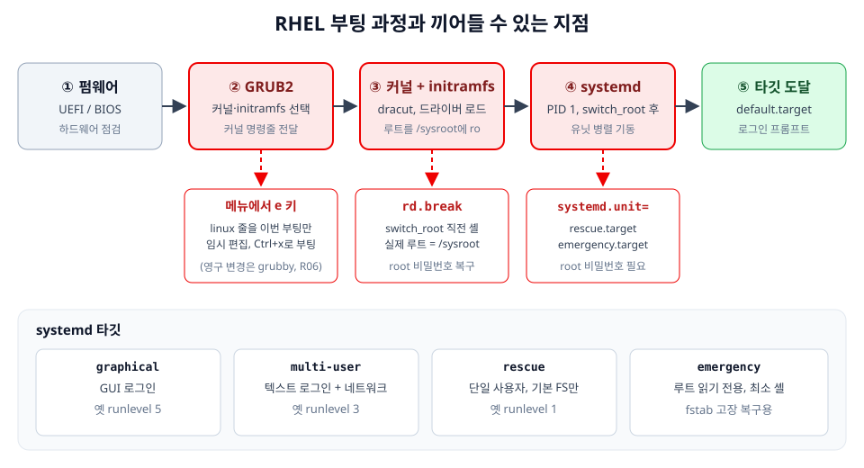
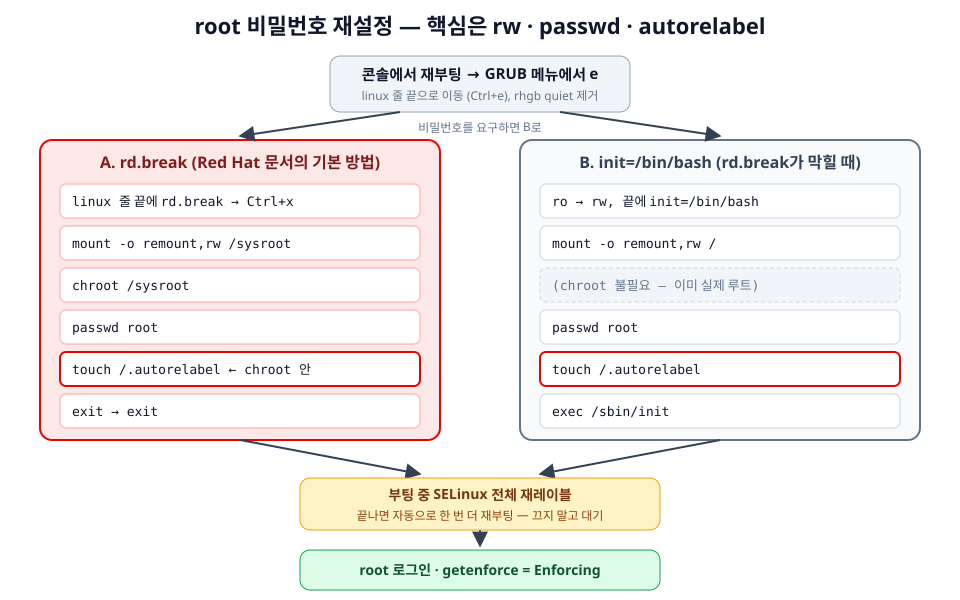
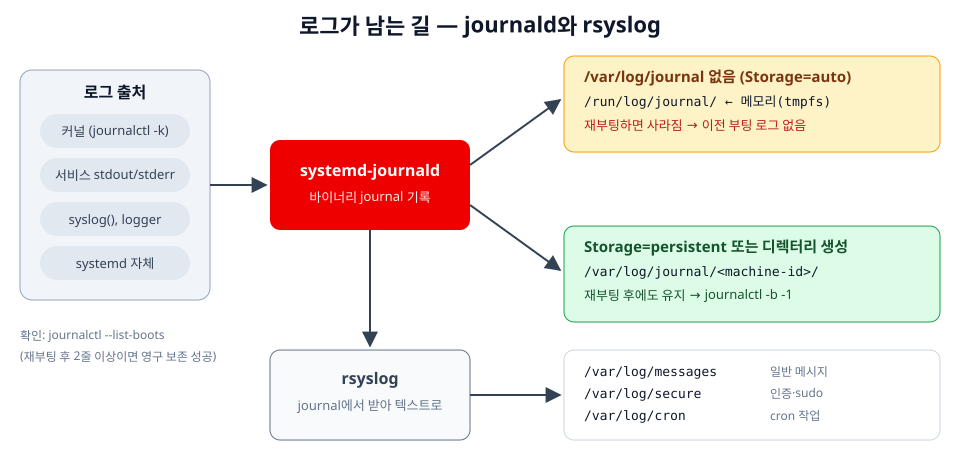

> **번외 · RHCSA(EX200) 대비** | 난이도 ★★★☆☆ | 예상 소요 2 ~ 2.5시간

> ⚠️ 이 편의 모든 연습 과제는 Red Hat이 공개한 **EX200 공식 목표를 바탕으로 직접 창작한** 시험 스타일 과제입니다. 실제 시험 문제(덤프)가 아니며, 실제 출제 내용과 무관합니다.

## 🎯 오늘의 목표

- 시스템을 안전하게 **재부팅·종료**하고, systemd **타깃**을 전환하거나 기본값으로 지정할 수 있다
- GRUB에서 부팅을 **중단**해 root 비밀번호를 재설정하고 **SELinux 레이블**까지 복구할 수 있다
- `ps`/`top`으로 부하가 큰 프로세스를 찾고 `kill`·`nice`·`renice`로 다룰 수 있다
- `tuned-adm`으로 튜닝 프로파일을 바꾸고, `journalctl`로 로그를 걸러 보며 **journal을 영구 보존**할 수 있다
- `sshd` 같은 네트워크 서비스를 관리하고 `scp`/`sftp`/`rsync`로 파일을 안전하게 옮길 수 있다

---

## 1. 목표 요약 — 공식 목표 ④ Operate running systems

R02까지는 "시스템을 다루는 도구"였다면, 이번 편은 **돌아가고 있는 서버를 운영하는 손기술**입니다. 공식 목표 항목을 그대로 풀어 보면 다음과 같습니다.

| 공식 목표 항목 | 이 편의 섹션 |
|---|---|
| Boot, reboot, and shut down a system normally | 2 |
| Boot systems into different targets manually | 2 |
| Interrupt the boot process in order to gain access to a system | 3, 4 |
| Identify CPU/memory intensive processes and kill processes | 5 |
| Adjust process scheduling | 5 |
| Manage tuning profiles | 6 |
| Locate and interpret system log files and journals | 7 |
| Preserve system journals | 7 |
| Start, stop, and check the status of network services | 8 |
| Securely transfer files between systems | 8 |

실습은 R00에서 만든 `servera`(192.168.56.11)와 `serverb`(192.168.56.12)를 씁니다. root 비밀번호 복구처럼 **콘솔 화면이 필요한 과제**는 `vagrant ssh`로는 할 수 없으니 VirtualBox 관리자에서 VM 창(콘솔)을 열어서 진행하세요. 시작 전에 `vagrant snapshot save servera r03-start`로 스냅숏을 떠 두면 실수해도 바로 돌아올 수 있습니다.

---

## 2. 출제 유형 — 어떻게 채점되는가

이 목표 그룹의 과제는 대개 아래 셋 중 하나의 모양입니다.

| 과제 형태 | 예시 문장(창작) | 채점 포인트 |
|---|---|---|
| **접근 회복형** | "servera의 root 비밀번호를 모른다. `xxxx`로 재설정하라." | 재부팅 후 root로 **로그인이 되는가**. SELinux 레이블을 안 고치면 로그인 실패 → 0점, 그리고 **나머지 과제 채점까지 막힐 수 있음** |
| **상태 유지형** | "기본 부팅 타깃을 multi-user로", "journal이 재부팅 후에도 남게", "권장 tuned 프로파일 적용" | **재부팅 후에도** 설정이 유지되는가 |
| **조치형** | "CPU를 가장 많이 쓰는 프로세스의 nice 값을 10으로", "특정 파일을 serverb로 복사" | 결과물(파일·값)이 정확히 있는가 |

> 💡 시험은 채점 전에 시스템을 **재부팅**한다고 가정하고 준비하세요. 그래서 이 시리즈의 모든 풀이는 "재부팅 후 확인" 단계로 끝납니다.

---

## 3. 부팅 과정과 타깃



| 단계 | 하는 일 | 끼어들 수 있는 지점 |
|---|---|---|
| 펌웨어(UEFI/BIOS) | 하드웨어 점검, 부트로더 로드 | — |
| **GRUB2** | 커널·initramfs 선택, 커널 명령줄 전달 | 메뉴에서 `e`로 커널 명령줄 **임시 편집** |
| 커널 + **initramfs**(dracut) | 드라이버 로드, 실제 루트 FS를 `/sysroot`에 **읽기 전용** 마운트 | `rd.break` → switch_root 직전 셸 |
| **systemd (PID 1)** | `default.target`까지 유닛을 병렬 기동 | `systemd.unit=rescue.target` / `emergency.target` |
| 타깃 도달 | 로그인 프롬프트(TTY 또는 GDM) | — |

### 3-1. 타깃(target)

타깃은 "이 상태가 되려면 어떤 유닛들이 떠 있어야 하는가"를 묶은 systemd 유닛입니다. 예전 runlevel과 대응됩니다.

| 타깃 | 의미 | 옛 runlevel |
|---|---|---|
| `graphical.target` | GUI 로그인 | 5 |
| `multi-user.target` | 텍스트 로그인, 네트워크·서비스 모두 | 3 |
| `rescue.target` | 단일 사용자, 기본 파일 시스템만 마운트, root 비밀번호 필요 | 1 |
| `emergency.target` | 루트를 **읽기 전용**으로만 마운트한 최소 셸, root 비밀번호 필요 | — |

### 3-2. 핵심 명령

| 하고 싶은 일 | 명령 |
|---|---|
| 재부팅 / 종료 | `systemctl reboot` / `systemctl poweroff` |
| 5분 뒤 재부팅 예약, 취소 | `shutdown -r +5 "점검"` / `shutdown -c` |
| 현재 기본 타깃 보기 | `systemctl get-default` |
| **기본 타깃 영구 변경** | `systemctl set-default multi-user.target` |
| 지금 당장 타깃 전환(일시적) | `systemctl isolate multi-user.target` |
| 부팅 한 번만 다른 타깃 | GRUB에서 `e` → `linux` 줄 끝에 `systemd.unit=rescue.target` → `Ctrl+x` |

```bash
[root@servera ~]# systemctl get-default
multi-user.target
[root@servera ~]# systemctl set-default graphical.target
Removed '/etc/systemd/system/default.target'.
Created symlink '/etc/systemd/system/default.target' → '/usr/lib/systemd/system/graphical.target'.
```

> ⚠️ `set-default`는 **다음 부팅부터**, `isolate`는 **지금만** 적용됩니다. "기본 타깃을 바꿔라"는 과제에 `isolate`만 하면 재부팅 후 원래대로 돌아가 0점입니다. 반대로 서버에 GUI 패키지가 없는데 `graphical.target`을 기본으로 두면 결국 텍스트 로그인으로 떨어지니, 과제 문장에 있는 타깃만 지정하세요.
> 💡 GRUB 기본 항목·커널 인자를 **영구히** 바꾸는 `grubby`는 R06(부트로더 수정)에서 다룹니다.

---

## 4. root 비밀번호 재설정 — 부팅 중단



### 4-1. 원리

`rd.break`를 커널 명령줄에 넣으면 initramfs가 실제 루트로 전환(switch_root)하기 **직전에** 셸을 줍니다. 이때 실제 루트 파일 시스템은 `/sysroot`에 읽기 전용으로 붙어 있으므로, 읽기·쓰기로 다시 마운트하고 `chroot`로 들어가 `passwd`를 하면 됩니다.

문제는 **SELinux**입니다. initramfs 안에서는 SELinux 정책이 아직 로드되지 않았기 때문에 `passwd`가 새로 쓴 `/etc/shadow`에는 올바른 SELinux 컨텍스트(`shadow_t`)가 붙지 않습니다. 그대로 부팅하면 enforcing 모드에서 로그인 프로세스가 `/etc/shadow`를 읽지 못해 **새 비밀번호로도 로그인이 안 됩니다.** 그래서 `/.autorelabel` 파일을 만들어 다음 부팅 때 전체 파일 시스템을 다시 레이블링하게 합니다.

### 4-2. 절차 (rd.break — Red Hat 문서의 기본 방법)

Red Hat의 RHEL 8/9 문서("Resetting the root password using rd.break")가 안내하는 절차이며 RHEL 10 계열에서도 같은 흐름으로 동작합니다.

1. VM **콘솔**에서 재부팅. GRUB 메뉴가 보이면 방향키로 카운트다운을 멈추고 기본 항목에서 `e`.
2. `linux`로 시작하는 줄(UEFI면 `linuxefi`일 수도 있음)의 **끝**으로 이동(`Ctrl+e`)해 ` rd.break`를 덧붙입니다. 콘솔에 출력이 안 보이면 같은 줄의 `rhgb quiet`를 지우고, 가상 직렬 콘솔을 가리키는 `console=ttyS0,...`가 있다면 함께 지웁니다.
3. `Ctrl+x`로 부팅 → `switch_root:/#` 프롬프트가 나옵니다.

```bash
switch_root:/# mount -o remount,rw /sysroot     # 실제 루트를 읽기·쓰기로
switch_root:/# chroot /sysroot                  # 실제 시스템 안으로
sh-5.2# passwd root                             # 새 비밀번호 두 번 입력
sh-5.2# touch /.autorelabel                     # 다음 부팅 때 SELinux 전체 재레이블
sh-5.2# exit                                    # chroot 빠져나오기
switch_root:/# exit                             # 부팅 계속
```

4. 부팅 중 **SELinux relabel**이 진행되고 시스템이 **한 번 더 자동 재부팅**됩니다. 디스크 크기에 따라 수십 초~수 분 걸리니 기다립니다.
5. root로 로그인해 확인합니다.

```bash
[root@servera ~]# ls -Z /etc/shadow
system_u:object_r:shadow_t:s0 /etc/shadow
[root@servera ~]# getenforce
Enforcing
```

> ⚠️ `touch /.autorelabel`을 **chroot 안에서** 해야 합니다. chroot 밖(`switch_root:/#`)에서 만들면 initramfs의 임시 루트에 생겨 아무 효과가 없습니다. 헷갈리면 `ls /sysroot/.autorelabel`로 확인하세요.

### 4-3. rd.break가 막힐 때 — init=/bin/bash 대안

배포판·dracut 버전에 따라 `rd.break` 셸이 열리기 전에 **root 비밀번호를 요구**(sulogin)하는 경우가 보고되어 왔습니다(RHEL 9 베타 시절 Bugzilla 2057365, 이후 dracut 업데이트로 수정). 비밀번호 요구 화면이 나오면 다음 대안을 씁니다.

1. GRUB에서 `e` → `linux` 줄의 `ro`를 `rw`로 바꾸고, 끝에 ` init=/bin/bash`를 덧붙인 뒤 `Ctrl+x`.
2. 이 방식은 systemd 대신 bash가 PID 1이 되며, 루트가 **이미 실제 루트**이므로 chroot가 필요 없습니다.

```bash
bash-5.2# mount -o remount,rw /     # rw로 부팅했어도 한 번 더 확실히
bash-5.2# passwd root
bash-5.2# touch /.autorelabel
bash-5.2# exec /sbin/init           # bash를 systemd로 교체해 정상 부팅 계속
```

> 💡 어느 방법이든 **핵심 3단계는 같습니다**: ① 실제 루트를 rw로 ② `passwd` ③ `/.autorelabel`. 시험장에서 하나가 안 되면 당황하지 말고 다른 하나로 바꾸세요.
> ⚠️ 디스크가 LUKS로 암호화되어 있으면 패스프레이즈를 알아야 하고, GRUB에 비밀번호가 걸려 있으면 편집 자체가 막힙니다. 시험 환경은 보통 이런 제약이 없지만, 실무에서는 설치 미디어의 rescue 모드를 씁니다.

---

## 5. 프로세스 — 찾기, 죽이기, 우선순위

### 5-1. 무거운 프로세스 찾기

```bash
# CPU 사용률 순, 상위 5개
ps -eo pid,user,ni,%cpu,%mem,comm --sort=-%cpu | head -6
# 메모리 사용률 순
ps -eo pid,user,%mem,rss,comm --sort=-%mem | head -6
# 이름으로 PID 찾기
pgrep -l sshd
# 전체 요약: 부하 평균, 메모리
uptime; free -h; nproc
```

`top` 안에서 쓰는 단축키는 시험장에서 man 없이 바로 쓰도록 외워 둡니다.

| 키 | 동작 |
|---|---|
| `P` / `M` | CPU / 메모리 순 정렬 |
| `k` | PID 입력 후 시그널 보내기 (기본 15) |
| `r` | PID 입력 후 renice |
| `1` | CPU 코어별 표시 |
| `q` | 종료 |

> 💡 `uptime`의 load average 3개 값(1·5·15분)은 **CPU 코어 수(`nproc`)와 비교**해서 읽습니다. 코어 2개에 load 2.0이면 꽉 찬 상태입니다.

### 5-2. 시그널과 kill

| 시그널 | 번호 | 의미 |
|---|---|---|
| `SIGHUP` | 1 | 설정 다시 읽기(데몬 관례) |
| `SIGINT` | 2 | `Ctrl+c` |
| `SIGKILL` | 9 | 즉시 강제 종료 — 정리 작업 불가 |
| `SIGTERM` | 15 | 정상 종료 요청 (**기본값**) |
| `SIGCONT` / `SIGSTOP` | 18 / 19 | 재개 / 일시 정지 |

```bash
kill 2345              # SIGTERM
kill -9 2345           # 응답 없을 때만 SIGKILL
pkill -u student dd    # student의 dd 프로세스 전부
pkill -t pts/1         # 특정 터미널의 프로세스들
kill -l                # 시그널 목록
```

### 5-3. nice와 renice

nice 값은 **-20(가장 우선) ~ 19(가장 양보)**, 기본 0입니다. 일반 사용자는 값을 **올리기만**(양보) 할 수 있고, 내리는 건 root만 됩니다.

```bash
nice -n 10 sha256sum /dev/zero &          # nice 10으로 시작
renice -n 5 -p 2345                       # 실행 중인 프로세스를 5로
renice -n 15 -u student                   # student의 모든 프로세스
ps -o pid,ni,comm -p 2345                 # 확인 (NI 열)
```

> ⚠️ `nice -n -5 명령`처럼 음수는 root만 가능합니다. 일반 사용자로 하면 `Permission denied`. 또 `renice`는 **실행 중인 프로세스에만** 적용되므로, 프로세스가 재시작되면 원래 값으로 돌아갑니다. "영구히"를 요구하면 systemd 유닛의 `Nice=` 설정 같은 다른 방법이 필요합니다.

---

## 6. 튜닝 프로파일 — tuned

`tuned`는 용도별(가상 게스트, 처리량, 지연 시간, 절전 등)로 커널·디스크·CPU 설정을 묶어 적용하는 데몬입니다. 설정은 데몬이 기억하므로 **재부팅 후에도 유지**됩니다.

```bash
dnf install -y tuned                  # 최소 설치라면
systemctl enable --now tuned
tuned-adm list                        # 사용 가능한 프로파일
tuned-adm recommend                   # 이 시스템에 권장되는 프로파일
tuned-adm profile virtual-guest       # 적용
tuned-adm active                      # 확인
tuned-adm verify                      # 실제 시스템 값이 프로파일과 일치하는지
```

```
Current active profile: virtual-guest
```

| 자주 보는 프로파일 | 용도 |
|---|---|
| `virtual-guest` | VM 게스트 (VirtualBox VM이면 보통 이것이 권장) |
| `throughput-performance` | 처리량 중심 서버 |
| `latency-performance` | 지연 시간 중심 |
| `balanced` / `powersave` | 균형 / 절전 |

> ⚠️ `tuned` 서비스를 **enable하지 않으면** 재부팅 후 프로파일이 적용되지 않습니다. "권장 프로파일을 적용하라"는 과제는 `recommend`가 출력한 이름을 그대로 쓰세요. 직접 고르지 말고요.

---

## 7. 로그와 journal



RHEL은 로그가 두 갈래로 남습니다. **systemd-journald**가 모든 로그를 바이너리 journal로 받고, **rsyslog**가 그중 일부를 `/var/log/messages`, `/var/log/secure`(인증), `/var/log/cron` 같은 텍스트 파일로 씁니다.

### 7-1. journalctl 필터

| 하고 싶은 일 | 명령 |
|---|---|
| 특정 서비스 | `journalctl -u sshd` |
| 우선순위 err 이상 | `journalctl -p err` |
| 시간 범위 | `journalctl --since "2026-11-15 09:00" --until "2026-11-15 10:00"` |
| 최근 1시간 | `journalctl --since "-1h"` |
| 이번 부팅 / 이전 부팅 | `journalctl -b` / `journalctl -b -1` |
| 부팅 목록 | `journalctl --list-boots` |
| 실시간 / 최근 20줄 | `journalctl -f` / `journalctl -n 20` |
| 커널 메시지 | `journalctl -k` |
| 특정 PID·실행 파일 | `journalctl _PID=1234` / `journalctl _COMM=sshd` |
| 모든 필드 보기 | `journalctl -o verbose -n 1` |

```bash
# 오늘 sshd에서 난 경고 이상만
journalctl -u sshd -p warning --since today
# 테스트 로그 남기기
logger -p user.err "R03 test message"
journalctl -p err -n 5
grep "R03 test" /var/log/messages
```

### 7-2. journal 영구 보존

기본값은 `Storage=auto`입니다. **`/var/log/journal` 디렉터리가 있으면** 디스크에, 없으면 `/run/log/journal`(메모리, 재부팅 시 소멸)에 씁니다. 방법은 두 가지이고 어느 쪽이든 결과는 같습니다.

```bash
# 방법 A: 설정으로 명시 (drop-in 파일 권장)
mkdir -p /etc/systemd/journald.conf.d
cat > /etc/systemd/journald.conf.d/persistent.conf <<'EOF'
[Journal]
Storage=persistent
EOF
systemctl restart systemd-journald

# 방법 B: Storage=auto 상태에서 디렉터리만 만들기
mkdir -p /var/log/journal
systemd-tmpfiles --create --prefix /var/log/journal
systemctl restart systemd-journald     # 또는 journalctl --flush
```

```bash
ls /var/log/journal/                   # 머신 ID 이름의 디렉터리가 생겨야 함
journalctl --disk-usage
```

> 💡 `/etc/systemd/journald.conf`를 직접 고쳐도 되지만, 최근 systemd는 `/etc` 아래 기본 설정 파일을 두지 않는 방향이라 파일이 없을 수도 있습니다. `journald.conf.d/*.conf` drop-in은 어느 경우든 동작합니다. 옵션 설명은 `man journald.conf`.
> ⚠️ 영구 보존 확인은 **재부팅 후 `journalctl --list-boots`에 부팅이 2개 이상** 보이는지로 합니다.

---

## 8. 네트워크 서비스와 안전한 파일 전송

### 8-1. 서비스 관리 (sshd 예시)

| 동작 | 명령 |
|---|---|
| 상태 | `systemctl status sshd` |
| 시작 / 중지 / 재시작 | `systemctl start` / `stop` / `restart sshd` |
| 설정만 다시 읽기 | `systemctl reload sshd` |
| 부팅 시 자동 시작 | `systemctl enable --now sshd` |
| 자동 시작 여부 | `systemctl is-enabled sshd` |
| 듣는 포트 | `ss -tlnp \| grep sshd` |

```bash
# sshd 설정은 drop-in으로 (RHEL 9부터 /etc/ssh/sshd_config.d/ 사용)
cat > /etc/ssh/sshd_config.d/50-r03.conf <<'EOF'
PermitRootLogin no
EOF
sshd -t && systemctl reload sshd       # 문법 검사 통과할 때만 반영
```

> ⚠️ `sshd -t` 없이 재시작했다가 문법 오류로 sshd가 죽으면 원격 접속이 끊깁니다. 포트 변경은 firewalld와 SELinux 포트 라벨(`semanage port`)까지 필요하며 R09에서 다룹니다.

### 8-2. scp / sftp / rsync

```bash
# servera → serverb 복사
scp /etc/hosts student@serverb:/tmp/
scp -r /etc/ssh student@serverb:/tmp/ssh-backup      # 디렉터리
scp student@serverb:/etc/os-release ./               # 가져오기

# 대화형
sftp student@serverb
sftp> put /etc/hosts
sftp> get /etc/redhat-release
sftp> bye

# 동기화: 바뀐 것만, 권한·시간 보존
rsync -av /var/log/ student@serverb:/backup/servera-log/
rsync -av --delete /srv/web/ serverb:/srv/web/       # 원본에 없는 파일은 대상에서도 삭제
rsync -avn /srv/web/ serverb:/srv/web/               # -n: 미리 보기(dry run)
```

> 💡 RHEL 9부터 `scp`는 내부적으로 **SFTP 프로토콜**을 씁니다. 아주 오래된 서버와 안 맞으면 `scp -O`(옛 SCP 프로토콜)를 씁니다.
> ⚠️ `rsync`는 **양쪽 모두** 설치되어 있어야 합니다(`dnf install -y rsync`). 또 원본 경로 끝의 `/` 유무에 따라 결과가 다릅니다. `dir/`는 "안의 내용", `dir`은 "디렉터리 자체"를 복사합니다.

---

## 9. 자주 하는 실수

| 실수 | 결과 | 바로잡기 |
|---|---|---|
| root 재설정 후 `/.autorelabel` 누락 | 새 비밀번호로도 로그인 실패 | 다시 부팅 중단 → autorelabel 생성 |
| `/.autorelabel`을 chroot 밖에서 생성 | relabel 안 됨 | chroot 안(또는 `/sysroot/.autorelabel`)에 생성 |
| relabel 중 강제 전원 끄기 | 레이블 불완전 | 끝날 때까지 대기 |
| 기본 타깃을 `isolate`로만 변경 | 재부팅 후 원래대로 | `systemctl set-default` |
| tuned 프로파일만 바꾸고 서비스 disable 상태 | 재부팅 후 미적용 | `systemctl enable --now tuned` |
| journal 디렉터리 만들고 journald 재시작 안 함 | 현재 부팅 로그가 메모리에만 | `systemctl restart systemd-journald` |
| `rsync src dst`에서 `/` 혼동 | 디렉터리가 한 단계 더 중첩 | 원본 끝 `/` 의미 확인, `-n`으로 미리 보기 |
| `kill -9`부터 사용 | 임시 파일·락 정리 안 됨 | 먼저 `kill`(15), 안 될 때만 9 |

---

## 10. 창작 연습 과제

> 아래 과제는 모두 **공식 목표를 바탕으로 창작한** 연습 문제입니다. 특별한 말이 없으면 `servera`에서 root로 작업합니다.

### 과제 1. 기본 부팅 타깃

servera가 부팅하면 텍스트 로그인(`multi-user.target`)으로 시작하도록 설정하라. 단, 지금 작업 중인 세션은 끊기지 않아야 한다.

<details>
<summary>풀이·검증</summary>

```bash
systemctl set-default multi-user.target
systemctl get-default          # multi-user.target
```

현재 세션에 영향을 주지 않으려면 `isolate`는 하지 않습니다.
재부팅 후 확인:

```bash
systemctl reboot
# 재접속 후
systemctl get-default
systemctl list-units --type=target --state=active | grep -E 'multi-user|graphical'
```
</details>

### 과제 2. 일회성 rescue 부팅

servera를 **이번 한 번만** `rescue.target`으로 부팅해 `/etc/fstab` 내용을 확인한 뒤, 다시 정상 부팅하라. 기본 타깃은 바뀌면 안 된다.

<details>
<summary>풀이·검증</summary>

1. 콘솔에서 재부팅 → GRUB에서 `e`
2. `linux` 줄 끝에 ` systemd.unit=rescue.target` 추가 → `Ctrl+x`
3. root 비밀번호 입력 → `cat /etc/fstab`
4. `systemctl default` 또는 `systemctl reboot`

```bash
systemctl get-default         # 여전히 multi-user.target
cat /proc/cmdline             # 정상 부팅 후에는 systemd.unit= 이 없어야 함
```
</details>

### 과제 3. root 비밀번호 복구

servera의 root 비밀번호를 `Recover#R03`으로 재설정하라. 재설정 후에도 SELinux는 enforcing이어야 한다.

<details>
<summary>풀이·검증</summary>

콘솔에서 재부팅 → GRUB `e` → `linux` 줄 끝 ` rd.break` → `Ctrl+x`

```bash
mount -o remount,rw /sysroot
chroot /sysroot
echo 'Recover#R03' | passwd --stdin root     # 또는 passwd root 대화형
touch /.autorelabel
exit
exit
```

relabel 후 자동 재부팅을 기다립니다. `rd.break`에서 비밀번호를 요구하면 4-3의 `init=/bin/bash` 방법을 씁니다.

```bash
# 콘솔에서 root / Recover#R03 로 로그인
getenforce                    # Enforcing
ls -Z /etc/shadow             # ... shadow_t ...
ls /.autorelabel              # 파일이 없어야 함(relabel 후 자동 삭제)
```
</details>

### 과제 4. 폭주 프로세스 처리

student 사용자로 아래 명령을 실행해 CPU를 쓰는 프로세스 3개를 만든다. root로 CPU 사용률 1위 프로세스의 nice 값을 **10**으로, 나머지 student의 `sha1sum` 프로세스는 모두 종료하라.

```bash
su - student -c 'for i in 1 2 3; do (sha1sum /dev/zero &) ; done'
```

<details>
<summary>풀이·검증</summary>

```bash
ps -eo pid,user,ni,%cpu,comm --sort=-%cpu | head -5
TOP=$(ps -eo pid,comm --sort=-%cpu --no-headers | awk '$2=="sha1sum"{print $1; exit}')
renice -n 10 -p "$TOP"
pgrep -u student sha1sum | grep -vx "$TOP" | xargs kill
ps -o pid,ni,%cpu,comm -u student      # 남은 1개, NI=10
```

정리: `pkill -u student sha1sum`
</details>

### 과제 5. 낮은 우선순위로 실행

student 사용자가 `/home/student/bin/backup.sh`(임의 스크립트)를 nice 값 **15**로 백그라운드 실행하도록 하라. 실행 중인 프로세스의 NI 값을 확인해 제출한다.

<details>
<summary>풀이·검증</summary>

```bash
su - student
mkdir -p ~/bin
printf '#!/bin/bash\nsleep 600\n' > ~/bin/backup.sh && chmod +x ~/bin/backup.sh
nice -n 15 ~/bin/backup.sh &
ps -o pid,ni,cmd -C backup.sh
```

일반 사용자도 nice 값을 **높이는** 것은 가능합니다. `-5`처럼 낮추려 하면 거부되는 것도 확인해 보세요.
</details>

### 과제 6. 권장 튜닝 프로파일

servera에 tuned가 권장하는 프로파일을 적용하고, 재부팅 후에도 유지되게 하라.

<details>
<summary>풀이·검증</summary>

```bash
dnf install -y tuned
systemctl enable --now tuned
tuned-adm recommend           # 예: virtual-guest
tuned-adm profile "$(tuned-adm recommend)"
tuned-adm active
```

재부팅 후:

```bash
systemctl is-enabled tuned    # enabled
tuned-adm active              # Current active profile: virtual-guest
```
</details>

### 과제 7. journal 영구 보존과 필터

servera의 journal이 재부팅 후에도 남도록 설정하라. 그다음 **이전 부팅**에서 `sshd` 유닛이 남긴 로그 중 우선순위 `info` 이상을 `/root/sshd-prev.log`에 저장하라.

<details>
<summary>풀이·검증</summary>

```bash
mkdir -p /etc/systemd/journald.conf.d
printf '[Journal]\nStorage=persistent\n' > /etc/systemd/journald.conf.d/persistent.conf
systemctl restart systemd-journald
systemctl reboot
```

재부팅 후:

```bash
journalctl --list-boots              # -1 과 0 두 줄 이상
ls /var/log/journal/
journalctl -b -1 -u sshd -p info > /root/sshd-prev.log
wc -l /root/sshd-prev.log            # 0보다 커야 함
```
</details>

### 과제 8. 시간대별 오류 로그

오늘 09:00부터 지금까지 우선순위 `err` 이상인 journal 항목만 `/root/errors-today.txt`에 저장하라. 시험 삼아 `logger`로 err 메시지 하나를 남기고 파일에 들어 있는지 확인한다.

<details>
<summary>풀이·검증</summary>

```bash
logger -p user.err "R03-TASK8 disk check failed"
journalctl -p err --since "$(date +%F) 09:00" > /root/errors-today.txt
grep R03-TASK8 /root/errors-today.txt
grep R03-TASK8 /var/log/messages     # rsyslog 텍스트 로그에도 남음
```
</details>

### 과제 9. sshd 관리와 파일 전송

1. serverb의 sshd가 부팅 시 자동 시작되고 현재 실행 중인지 확인하라.
2. servera의 `/etc/sysconfig` 디렉터리 전체를 serverb의 `/root/backup/sysconfig/`로 **권한과 시간을 보존해** 동기화하라.
3. serverb의 `/etc/os-release`를 sftp로 servera의 `/root/serverb-os-release`로 가져오라.

<details>
<summary>풀이·검증</summary>

```bash
ssh root@serverb 'systemctl enable --now sshd; systemctl is-active sshd; systemctl is-enabled sshd'
ssh root@serverb 'dnf install -y rsync; mkdir -p /root/backup'
dnf install -y rsync
rsync -av /etc/sysconfig/ root@serverb:/root/backup/sysconfig/
sftp root@serverb <<'EOF'
get /etc/os-release /root/serverb-os-release
EOF
```

검증:

```bash
rsync -avn /etc/sysconfig/ root@serverb:/root/backup/sysconfig/   # 전송할 파일 목록이 비어 있어야 함
ls -l /root/serverb-os-release
```

RHEL 10 계열은 기본값으로 root의 **비밀번호** SSH 로그인을 막습니다. R00 환경에서 `root@serverb` 접속이 거부되면 servera의 root에서 `ssh-keygen` 후 `ssh-copy-id vagrant@serverb`로 키를 등록하고, `vagrant@serverb`(sudo 가능)로 바꿔 진행합니다. 원격 경로가 `/root` 아래라면 `rsync --rsync-path="sudo rsync"`를 붙입니다.
</details>

---

## 11. 핵심 정리

- 기본 타깃은 `systemctl set-default`(영구), 지금 전환은 `isolate`(일시), 한 번만은 GRUB에서 `systemd.unit=`
- root 비밀번호 복구 3단계: **실제 루트 rw → `passwd` → `/.autorelabel`** (`rd.break`면 `/sysroot` + `chroot`, 막히면 `init=/bin/bash` + `exec /sbin/init`)
- 무거운 프로세스는 `ps --sort=-%cpu` / `top`(P, M, k, r), 종료는 15 먼저 9는 나중
- nice는 -20~19, 일반 사용자는 올리기만. `renice -n N -p PID`
- tuned: `enable --now` + `tuned-adm recommend/profile/active`
- journal 영구 보존: `Storage=persistent` 또는 `/var/log/journal` 생성 후 journald 재시작, 확인은 `--list-boots`
- 서비스는 `systemctl enable --now`, sshd 설정은 `sshd_config.d/` + `sshd -t`. 파일 전송은 `scp`/`sftp`/`rsync -av`

---

## ⏭️ 다음 예고 — R04. 로컬 스토리지

servera에 붙여 둔 빈 디스크 `/dev/sdb`(5GB)와 `/dev/sdc`(2GB)를 드디어 씁니다. GPT 파티션을 만들고 지우고, PV → VG → LV로 쌓아 올리며, swap을 추가하고, UUID·라벨로 `/etc/fstab`에 등록해 재부팅해도 살아 있는 스토리지를 만듭니다. 마지막으로 데이터를 지우지 않고 VG에 디스크를 더하는 **비파괴적 확장**까지 해 봅니다.
