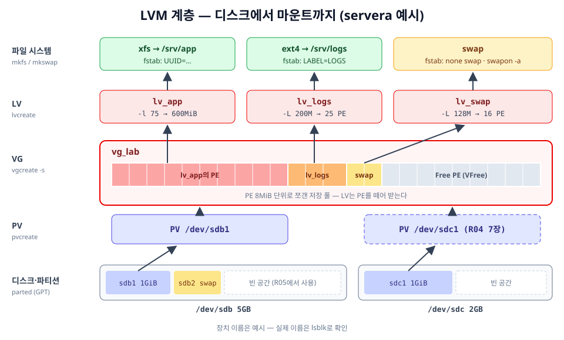
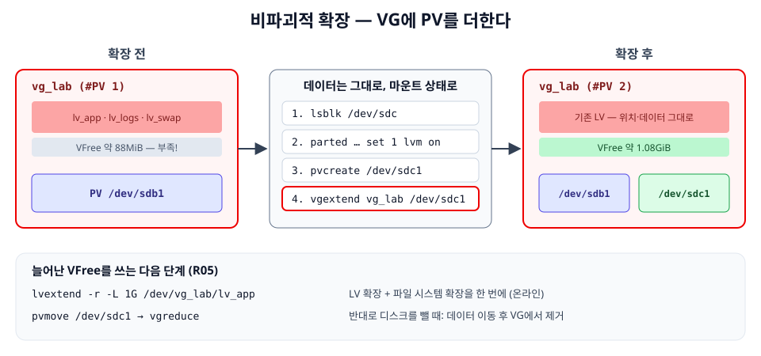

> **번외 · RHCSA(EX200) 대비** | 난이도 ★★★☆☆ | 예상 소요 2 ~ 2.5시간

> ⚠️ 이 편의 모든 연습 과제는 Red Hat이 공개한 **EX200 공식 목표를 바탕으로 직접 창작한** 시험 스타일 과제입니다. 실제 시험 문제(덤프)가 아니며, 실제 출제 내용과 무관합니다.

## 🎯 오늘의 목표

- `lsblk`로 디스크를 확인하고 `parted`로 **GPT 파티션을 만들고 지울** 수 있다
- PV → VG → LV를 만들면서 **PE 크기**와 **LV 이름**을 원하는 대로 지정할 수 있다
- swap을 **파티션**과 **LV** 두 가지로 추가하고 부팅 시 활성화되게 할 수 있다
- 파일 시스템을 **UUID**나 **LABEL**로 `/etc/fstab`에 등록해 재부팅 후에도 마운트되게 할 수 있다
- 기존 데이터를 건드리지 않고 VG에 PV를 더해 **용량을 늘릴** 수 있다

---

## 1. 목표 요약 — 공식 목표 ⑤ Configure local storage

| 공식 목표 항목 | 이 편의 섹션 |
|---|---|
| List, create, delete partitions on GPT disks | 3 |
| Create and remove physical volumes | 4 |
| Assign physical volumes to volume groups | 4 |
| Create and delete logical volumes | 4 |
| Configure systems to mount file systems at boot by UUID or label | 5 |
| Add new partitions and logical volumes, and swap to a system non-destructively | 6, 7 |

실습은 **servera**에서 합니다. R00에서 servera에 빈 디스크 두 개(5GB, 2GB)를 붙였습니다. 이 글은 예시 장치명을 `/dev/sdb`(5GB), `/dev/sdc`(2GB)로 쓰지만, **실제 이름은 반드시 `lsblk`로 확인**하세요. VirtualBox 컨트롤러 종류나 디스크 순서에 따라 이름이 달라질 수 있습니다.

```bash
[root@servera ~]# lsblk
NAME          MAJ:MIN RM  SIZE RO TYPE MOUNTPOINTS
sda             8:0    0   20G  0 disk
├─sda1          8:1    0    1G  0 part /boot
└─sda2          8:2    0   19G  0 part
  ├─rhel-root 253:0    0   17G  0 lvm  /
  └─rhel-swap 253:1    0    2G  0 lvm  [SWAP]
sdb             8:16   0    5G  0 disk
sdc             8:32   0    2G  0 disk
```

> 💡 시작 전에 Windows 호스트에서 `vagrant snapshot save servera r04-start`. 파티션을 망쳐도 몇 초 만에 되돌릴 수 있습니다.

---

## 2. 출제 유형 — 어떻게 채점되는가

| 과제 형태 | 예시 문장(창작) | 채점 포인트 |
|---|---|---|
| **LV 생성형** | "VG `vgdata`(PE 16MiB)에 50 PE 크기의 LV `lvweb`을 만들고 xfs로 `/web`에 마운트" | VG의 **PE 크기**, LV **이름과 크기**(PE 개수), 마운트 지점, 재부팅 후 마운트 |
| **swap 추가형** | "512MiB swap을 추가하고 부팅 시 활성화" | `swapon --show`에 보이는가, **기존 swap은 그대로인가** |
| **영구 마운트형** | "UUID로(또는 라벨로) 마운트" | fstab 첫 필드가 지정 방식과 일치하는가 |
| **확장형** | "데이터를 잃지 않고 VG를 늘려라" | 기존 LV·데이터 **보존** + VG 크기 증가 |

> ⚠️ 스토리지 과제는 `/etc/fstab` 실수 하나로 **시스템이 부팅하지 못해** 다른 과제까지 채점 불가가 될 수 있는, 가장 위험한 영역입니다. fstab을 고친 뒤에는 **반드시 `mount -a`와 `findmnt --verify`** 로 확인하고 재부팅하세요.

---

## 3. GPT 파티션

### 3-1. 크기 단위부터

| 단위 | 크기 | 쓰이는 곳 |
|---|---|---|
| `MB` / `GB` | 10⁶ / 10⁹ 바이트 | 디스크 제조사 표기 |
| `MiB` / `GiB` | 2²⁰ / 2³⁰ 바이트 | `parted`에서 `MiB`로 쓰면 정확히 이것 |
| `M` / `G` | **MiB / GiB** | `lvcreate -L 500M`, `lsblk` 출력 |

과제에서 "500MiB 파티션"이라고 하면 `parted`에서 **MiB 단위**로 시작·끝을 지정하는 게 가장 정확합니다. 첫 파티션은 정렬을 위해 `1MiB`부터 시작합니다.

### 3-2. parted로 만들기

```bash
parted /dev/sdb print                 # 레이블이 없으면 "unrecognised disk label"
parted /dev/sdb mklabel gpt           # GPT 레이블 생성 (디스크의 기존 파티션 정보 삭제!)

# mkpart <이름> [파일시스템유형] <시작> <끝>  — GPT는 첫 인자가 파티션 '이름'
parted /dev/sdb mkpart lvm1 1MiB 1025MiB
parted /dev/sdb set 1 lvm on          # 파티션 타입: Linux LVM
parted /dev/sdb mkpart swap1 linux-swap 1025MiB 1537MiB
parted /dev/sdb print
udevadm settle                        # /dev/sdb1, sdb2 장치 파일이 생길 때까지 대기
```

```
Number  Start   End     Size    File system  Name   Flags
 1      1049kB  1075MB  1074MB               lvm1   lvm
 2      1075MB  1612MB  537MB   linux-swap   swap1  swap
```

> 💡 `parted`의 **파일 시스템 유형 인자는 파티션 타입 표시용**일 뿐 실제로 포맷하지 않습니다. 포맷은 `mkfs`·`mkswap`이 합니다. `print`의 단위를 바꾸려면 `parted /dev/sdb unit MiB print`.

### 3-3. fdisk로 만들기(대안)

대화형이 편하다면 `fdisk`도 GPT를 지원합니다.

```
fdisk /dev/sdc
 g        ← 새 GPT 레이블
 n        ← 새 파티션, 번호 1, 첫 섹터 Enter, 마지막 섹터 +1G
 t        ← 타입 변경, 별칭 lvm 입력
 p        ← 확인
 w        ← 저장
```

### 3-4. 지우기

```bash
parted /dev/sdb rm 3                  # 3번 파티션 삭제
udevadm settle
lsblk /dev/sdb
```

> ⚠️ 사용 중인(마운트됐거나 PV로 쓰는) 파티션은 지우기 전에 **fstab 항목 제거 → umount/swapoff → (LVM이면) LV·VG·PV 정리** 순서로 풀어야 합니다. 커널이 새 파티션 표를 못 읽었다는 경고가 나오면 `partprobe /dev/sdb`.

---

## 4. LVM — PV, VG, LV



| 계층 | 무엇 | 만드는 명령 | 보는 명령 |
|---|---|---|---|
| **PV** (Physical Volume) | LVM이 쓰도록 표시한 파티션/디스크 | `pvcreate /dev/sdb1` | `pvs`, `pvdisplay` |
| **VG** (Volume Group) | PV들을 묶은 저장 풀. **PE**(Physical Extent) 단위로 나눔 | `vgcreate -s 8M vg_lab /dev/sdb1` | `vgs`, `vgdisplay` |
| **LV** (Logical Volume) | VG에서 PE를 떼어 만든 가상 파티션 | `lvcreate -n lv_app -L 600M vg_lab` | `lvs`, `lvdisplay` |

### 4-1. PE 크기

PE는 VG가 공간을 나눠 주는 **최소 단위**입니다. 기본값은 4MiB이고 `vgcreate -s`로 VG를 만들 때만 정할 수 있습니다. LV 크기는 항상 PE의 배수로 반올림됩니다.

```bash
pvcreate /dev/sdb1
vgcreate -s 8M vg_lab /dev/sdb1
vgdisplay vg_lab | grep -E 'PE Size|Total PE|Free  PE'
```

```
  PE Size               8.00 MiB
  Total PE              127
  Free  PE / Size       127 / 1016.00 MiB
```

### 4-2. LV 만들기 — 크기로, 또는 PE 개수로

```bash
lvcreate -n lv_app -L 600M vg_lab         # 크기로
lvcreate -n lv_logs -l 25 vg_lab          # PE 개수로: 25 × 8MiB = 200MiB
lvcreate -n lv_tmp -l 50%FREE vg_lab      # 남은 공간의 50%
lvs vg_lab
```

```
  LV      VG     Attr       LSize   ...
  lv_app  vg_lab -wi-a----- 600.00m
  lv_logs vg_lab -wi-a----- 200.00m
```

| 옵션 | 의미 |
|---|---|
| `-n 이름` | LV 이름. 장치는 `/dev/vg_lab/lv_app` = `/dev/mapper/vg_lab-lv_app` |
| `-L 크기` | 크기(`M`, `G` = MiB, GiB) |
| `-l 개수` | PE 개수 또는 `%FREE`, `%VG` |

> ⚠️ "PE 크기 16MiB, LV는 **20 extents**"처럼 나오면 **`-l 20`** 입니다. `-L 20M`과 헷갈리지 마세요. 반대로 `-L 100M`을 PE 16MiB VG에 요청하면 112MiB(7 PE)로 **반올림**됩니다.

### 4-3. 삭제는 역순으로

```bash
umount /srv/tmp                  # 마운트되어 있었다면 (fstab 항목도 먼저 제거)
lvremove /dev/vg_lab/lv_tmp      # LV
vgremove vg_old                  # VG (안의 LV가 모두 없어야)
pvremove /dev/sdX1               # PV
```

> 💡 **RHEL 9부터 LVM devices 파일**(`/etc/lvm/devices/system.devices`)이 기본으로 켜져 있어, LVM은 이 파일에 등록된 장치만 봅니다. `pvcreate`·`vgcreate`·`vgextend`로 만든 장치는 자동 등록되므로 평소엔 신경 쓸 필요가 없지만, 다른 시스템에서 옮겨 온 디스크의 VG가 안 보이면 `lvmdevices --adddev /dev/sdX1` 또는 `vgimportdevices -a`를 떠올리세요.

---

## 5. 부팅 시 마운트 — UUID와 LABEL

장치 이름(`/dev/sdb1`)은 디스크 순서가 바뀌면 달라질 수 있습니다. 그래서 fstab에는 파일 시스템 자체에 기록된 **UUID**나 **LABEL**을 씁니다. (LV는 `/dev/vg_lab/lv_app`처럼 이름이 고정이지만, 과제가 UUID를 요구하면 UUID를 써야 합니다.)

```bash
mkfs.xfs /dev/vg_lab/lv_app
mkfs.ext4 -L LOGS /dev/vg_lab/lv_logs       # 만들 때 라벨 지정
blkid /dev/vg_lab/lv_app /dev/vg_lab/lv_logs
lsblk -f /dev/sdb
```

```
/dev/vg_lab/lv_app: UUID="0f3b6f0e-7c51-4a1d-9b2e-2b0c5a1d9e11" TYPE="xfs"
/dev/vg_lab/lv_logs: LABEL="LOGS" UUID="5d2c..." TYPE="ext4"
```

| 파일 시스템 | 라벨 지정(생성 시) | 라벨 변경(생성 후) |
|---|---|---|
| xfs | `mkfs.xfs -L 이름` (최대 12자) | `xfs_admin -L 이름 장치` (**언마운트 상태**) |
| ext4 | `mkfs.ext4 -L 이름` | `e2label 장치 이름` |
| swap | `mkswap -L 이름` | `swaplabel -L 이름 장치` |

### 5-1. /etc/fstab

```
# <장치>                                    <마운트 지점>  <유형>  <옵션>    <dump> <fsck>
UUID=0f3b6f0e-7c51-4a1d-9b2e-2b0c5a1d9e11  /srv/app      xfs     defaults  0 0
LABEL=LOGS                                  /srv/logs     ext4    defaults  0 0
```

UUID를 손으로 옮겨 적다 틀리는 사고를 막으려면 `blkid` 출력을 바로 붙입니다.

```bash
mkdir -p /srv/app /srv/logs
echo "UUID=$(blkid -s UUID -o value /dev/vg_lab/lv_app) /srv/app xfs defaults 0 0" >> /etc/fstab
echo "LABEL=LOGS /srv/logs ext4 defaults 0 0" >> /etc/fstab
systemctl daemon-reload        # fstab 변경을 systemd가 다시 읽도록
mount -a                       # 오류가 있으면 여기서 드러남
findmnt --verify               # fstab 문법·장치 존재 여부 검사
findmnt /srv/app; findmnt /srv/logs
```

> ⚠️ `>>` 대신 `>`를 쓰면 fstab 전체가 날아가 **부팅이 안 됩니다.** 실수했다면 재부팅하지 말고 바로 복구하세요. 부팅이 이미 막혔다면 emergency 셸에서 `mount -o remount,rw /` 후 fstab을 고칩니다(R03의 타깃 내용 참고).

---

## 6. swap — 파티션과 LV

swap 추가는 "기존 swap을 유지한 채 더하는 것"이 기본입니다.

```bash
# (1) swap 파티션 — 3장에서 만든 /dev/sdb2
mkswap -L SWAP_PART /dev/sdb2
# (2) swap LV
lvcreate -n lv_swap -L 128M vg_lab
mkswap /dev/vg_lab/lv_swap

# fstab 등록: 마운트 지점 자리는 none, 유형 swap
echo "UUID=$(blkid -s UUID -o value /dev/sdb2) none swap defaults 0 0" >> /etc/fstab
echo "/dev/vg_lab/lv_swap none swap defaults 0 0" >> /etc/fstab
systemctl daemon-reload
swapon -a                       # fstab의 swap을 모두 활성화
swapon --show
free -h
```

```
NAME      TYPE      SIZE USED PRIO
/dev/dm-1 partition   2G   0B   -2
/dev/sdb2 partition 512M   0B   -3
/dev/dm-4 partition 128M   0B   -4
```

> 💡 swap 우선순위는 fstab 옵션 `pri=10`처럼 줄 수 있습니다(값이 클수록 먼저 사용). 과제에 우선순위 요구가 있을 때만 넣으세요.
> ⚠️ `swapon /dev/sdb2`만 하고 fstab에 안 넣으면 재부팅 후 사라집니다. 반대로 fstab만 고치고 `swapon -a`를 안 하면, 재부팅 전 검증에서 오류를 놓칩니다.

---

## 7. 비파괴적 확장 — VG에 PV 추가



VG의 여유 공간이 부족할 때 **기존 PV·LV·데이터를 그대로 둔 채** 새 PV를 더하는 것이 `vgextend`입니다.

```bash
lsblk /dev/sdc                         # 빈 디스크 확인
parted /dev/sdc mklabel gpt
parted /dev/sdc mkpart lvm2 1MiB 1025MiB
parted /dev/sdc set 1 lvm on
udevadm settle
pvcreate /dev/sdc1
vgextend vg_lab /dev/sdc1
vgs vg_lab
pvs
```

```
  VG     #PV #LV #SN Attr   VSize  VFree
  vg_lab   2   3   0 wz--n- <1.98g   1.08g
```

이제 늘어난 VFree를 LV에 나눠 주는 `lvextend`(와 파일 시스템 확장)는 R05에서 이어서 합니다.

> 💡 `vgextend`는 기존 PV의 PE 배치를 전혀 건드리지 않으므로 마운트된 상태에서 해도 안전합니다. 디스크를 **빼는** 쪽은 `pvmove /dev/sdc1`(데이터를 다른 PV로 이동) → `vgreduce vg_lab /dev/sdc1` 순서입니다.

---

## 8. 핵심 명령 표

| 분류 | 명령 |
|---|---|
| 확인 | `lsblk`, `lsblk -f`, `blkid`, `parted 장치 print`, `pvs`/`vgs`/`lvs`, `swapon --show`, `findmnt` |
| 파티션 | `parted 장치 mklabel gpt`, `mkpart 이름 [유형] 시작 끝`, `set N lvm on`, `rm N`, `udevadm settle` |
| LVM 생성 | `pvcreate`, `vgcreate -s PE크기 VG PV`, `lvcreate -n 이름 -L 크기 \| -l PE수 VG` |
| LVM 확장·삭제 | `vgextend VG PV`, `lvremove`, `vgremove`, `pvremove`, `pvmove`, `vgreduce` |
| 파일 시스템·swap | `mkfs.xfs [-L]`, `mkfs.ext4 [-L]`, `mkswap [-L]`, `xfs_admin -L`, `e2label` |
| 영구화 | `/etc/fstab` + `systemctl daemon-reload` + `mount -a` / `swapon -a` + `findmnt --verify` |

---

## 9. 자주 하는 실수

| 실수 | 결과 | 바로잡기 |
|---|---|---|
| `lsblk` 확인 없이 `/dev/sdb` 가정 | 엉뚱한 디스크(최악은 시스템 디스크) 초기화 | 항상 `lsblk`로 크기·마운트 여부 확인 |
| `-l`(PE 수)과 `-L`(크기) 혼동 | LV 크기 틀림 | 과제 문장의 단위(extents/MiB) 확인 |
| VG 만든 뒤 PE 크기 요구를 발견 | PE 크기 변경 어려움 | VG 지우고 `vgcreate -s`로 다시 (데이터 없을 때) |
| fstab에 `>` 사용 / 오타 | 부팅 실패 | `>>` 사용, `mount -a` + `findmnt --verify` |
| UUID를 손으로 옮겨 적음 | 오타로 마운트 실패 | `blkid -s UUID -o value` 결과를 바로 붙이기 |
| 새 swap 추가하며 기존 swap 줄 삭제 | 기존 swap 사라져 감점 | 기존 줄은 두고 **추가만** |
| 파티션 만든 직후 `/dev/sdb1` 없음 | `No such file` | `udevadm settle` 또는 `partprobe` |
| 마운트 지점 디렉터리 미생성 | `mount point does not exist` | `mkdir -p` |

---

## 10. 창작 연습 과제

> 아래 과제는 모두 **공식 목표를 바탕으로 창작한** 연습 문제입니다. servera에서 root로 작업하며, 과제 1부터 순서대로 하면 R05가 이어서 쓰는 상태가 됩니다. 장치명은 `lsblk`로 확인한 실제 이름으로 바꿔 쓰세요.

### 과제 1. GPT 파티션 만들고 지우기

`/dev/sdb`에 GPT 레이블을 만들고 다음 파티션을 만들라.
- 1번: 이름 `lvm1`, 1GiB, LVM 플래그
- 2번: 이름 `swap1`, 512MiB, swap 용도
- 3번: 이름 `scratch`, 200MiB (만든 뒤 **삭제**)

<details>
<summary>풀이·검증</summary>

```bash
lsblk /dev/sdb                                    # 5G, 파티션·마운트 없음 확인
parted /dev/sdb mklabel gpt
parted /dev/sdb mkpart lvm1 1MiB 1025MiB
parted /dev/sdb set 1 lvm on
parted /dev/sdb mkpart swap1 linux-swap 1025MiB 1537MiB
parted /dev/sdb mkpart scratch 1537MiB 1737MiB
udevadm settle; lsblk /dev/sdb                    # sdb1~3
parted /dev/sdb rm 3
udevadm settle
```

```bash
parted /dev/sdb unit MiB print    # 1, 2번만 남고 Name/Flags 일치
```
</details>

### 과제 2. PE 크기를 지정한 VG와 LV

`/dev/sdb1`로 VG `vg_lab`을 PE 크기 **8MiB**로 만들고, 그 안에 LV `lv_app`을 **75 extents**로 만들어라. xfs로 포맷해 `/srv/app`에 **UUID로** 영구 마운트한다.

<details>
<summary>풀이·검증</summary>

```bash
pvcreate /dev/sdb1
vgcreate -s 8M vg_lab /dev/sdb1
lvcreate -n lv_app -l 75 vg_lab           # 75 × 8MiB = 600MiB
mkfs.xfs /dev/vg_lab/lv_app
mkdir -p /srv/app
echo "UUID=$(blkid -s UUID -o value /dev/vg_lab/lv_app) /srv/app xfs defaults 0 0" >> /etc/fstab
systemctl daemon-reload && mount -a && findmnt --verify
```

```bash
vgdisplay vg_lab | grep 'PE Size'         # 8.00 MiB
lvdisplay /dev/vg_lab/lv_app | grep 'Current LE'   # 75
findmnt /srv/app
```
</details>

### 과제 3. 라벨로 마운트하는 LV

`vg_lab`에 LV `lv_logs`를 200MiB로 만들고 ext4, 라벨 `LOGS`로 포맷해 `/srv/logs`에 **라벨로** 영구 마운트하라.

<details>
<summary>풀이·검증</summary>

```bash
lvcreate -n lv_logs -L 200M vg_lab
mkfs.ext4 -L LOGS /dev/vg_lab/lv_logs
mkdir -p /srv/logs
echo "LABEL=LOGS /srv/logs ext4 defaults 0 0" >> /etc/fstab
systemctl daemon-reload && mount -a
```

```bash
blkid -L LOGS                 # /dev/mapper/vg_lab-lv_logs
grep LOGS /etc/fstab
findmnt /srv/logs
```
</details>

### 과제 4. swap 파티션 추가

과제 1의 `/dev/sdb2`를 swap으로 만들어 부팅 시 활성화되게 하라. 기존 swap은 그대로 유지해야 한다.

<details>
<summary>풀이·검증</summary>

```bash
swapon --show                               # 기존 swap 기록
mkswap /dev/sdb2
echo "UUID=$(blkid -s UUID -o value /dev/sdb2) none swap defaults 0 0" >> /etc/fstab
systemctl daemon-reload && swapon -a
swapon --show                               # 기존 + /dev/sdb2
```
</details>

### 과제 5. swap LV 추가

`vg_lab`에 LV `lv_swap`(128MiB)을 만들어 swap으로 추가하고, 우선순위를 **10**으로 하라.

<details>
<summary>풀이·검증</summary>

```bash
lvcreate -n lv_swap -L 128M vg_lab
mkswap /dev/vg_lab/lv_swap
echo "/dev/vg_lab/lv_swap none swap defaults,pri=10 0 0" >> /etc/fstab
systemctl daemon-reload && swapon -a
swapon --show                               # PRIO 10 확인
```
</details>

### 과제 6. 비파괴적 VG 확장

`vg_lab`의 여유 공간이 부족하다. `/dev/sdc`에 1GiB GPT 파티션을 만들어 `vg_lab`에 추가하라. `/srv/app`의 기존 데이터는 그대로여야 한다.

<details>
<summary>풀이·검증</summary>

```bash
echo "keep-me" > /srv/app/marker.txt          # 확장 전 데이터
vgs vg_lab                                    # 확장 전 VSize 기록
parted /dev/sdc mklabel gpt
parted /dev/sdc mkpart lvm2 1MiB 1025MiB
parted /dev/sdc set 1 lvm on
udevadm settle
pvcreate /dev/sdc1
vgextend vg_lab /dev/sdc1
```

```bash
vgs vg_lab                                    # #PV 2, VSize 약 2GiB
pvs -o pv_name,vg_name,pv_size,pv_free
cat /srv/app/marker.txt                       # keep-me
```
</details>

### 과제 7. 다른 PE 크기의 VG 만들고 정리하기

`/dev/sdc`의 남은 공간에 파티션(이름 `lvm3`, 512MiB)을 만들어 VG `vg_tmp`(PE **16MiB**)를 만들고, LV `lv_t1`을 **100MiB**로 요청해 실제 크기를 확인하라. 확인 후 LV·VG·PV·파티션을 모두 깨끗이 지워라.

<details>
<summary>풀이·검증</summary>

```bash
parted /dev/sdc mkpart lvm3 1025MiB 1537MiB
parted /dev/sdc set 2 lvm on
udevadm settle
pvcreate /dev/sdc2
vgcreate -s 16M vg_tmp /dev/sdc2
lvcreate -n lv_t1 -L 100M vg_tmp     # "Rounding up size to full physical extent 112.00 MiB"
lvs vg_tmp
lvremove -y /dev/vg_tmp/lv_t1
vgremove vg_tmp
pvremove /dev/sdc2
parted /dev/sdc rm 2
udevadm settle
```

```bash
vgs                         # vg_tmp 없음
lsblk /dev/sdc              # sdc1만 남음
```
</details>

### 과제 8. 재부팅 최종 확인

과제 1~7을 마친 상태에서 재부팅하고, 모든 마운트와 swap이 살아 있는지 확인하라.

<details>
<summary>풀이·검증</summary>

```bash
findmnt --verify && systemctl reboot
# 재접속 후
findmnt /srv/app; findmnt /srv/logs
swapon --show               # 기존 swap + sdb2 + lv_swap(PRIO 10)
vgs vg_lab; lvs vg_lab
cat /srv/app/marker.txt
```

부팅이 emergency 모드로 떨어지면 콘솔에서 root로 로그인 → `journalctl -xb | grep -i mount`로 원인 확인 → fstab 수정 → `systemctl daemon-reload` → `reboot`.
</details>

---

## 11. 핵심 정리

- 장치명은 **항상 `lsblk`로 확인**. 예시의 `/dev/sdb`·`/dev/sdc`는 환경마다 다를 수 있다
- GPT 파티션: `parted 장치 mklabel gpt` → `mkpart 이름 [유형] 시작 끝` → `set N lvm on` → `udevadm settle`. 삭제는 `rm N`
- LVM: `pvcreate` → `vgcreate -s PE크기` → `lvcreate -n 이름 -L 크기 | -l PE수`. 삭제는 역순
- 영구 마운트: `blkid`로 UUID/LABEL 확인 → fstab → `daemon-reload` → `mount -a` → `findmnt --verify`
- swap: `mkswap` → fstab(`none swap defaults`) → `swapon -a` → `swapon --show`. 기존 swap은 유지
- 비파괴적 확장: 새 파티션 → `pvcreate` → `vgextend`. 데이터는 그대로

---

## ⏭️ 다음 예고 — R05. 파일 시스템

이번 편에서 늘려 둔 `vg_lab`의 여유 공간으로 `lvextend -r`을 써서 마운트된 파일 시스템을 **온라인으로 확장**합니다. VFAT·ext4·XFS를 각각 만들어 보고, serverb에 NFS 서버를 세워 servera에서 마운트하며, autofs로 접근할 때만 자동 마운트되는 direct·indirect 맵과 와일드카드 홈 디렉터리를 구성합니다. 마지막으로 SGID·sticky·ACL로 공유 디렉터리 권한 문제를 진단합니다.
