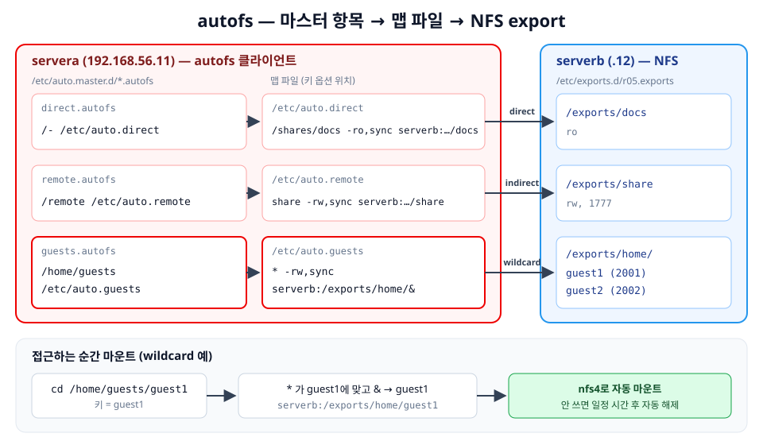
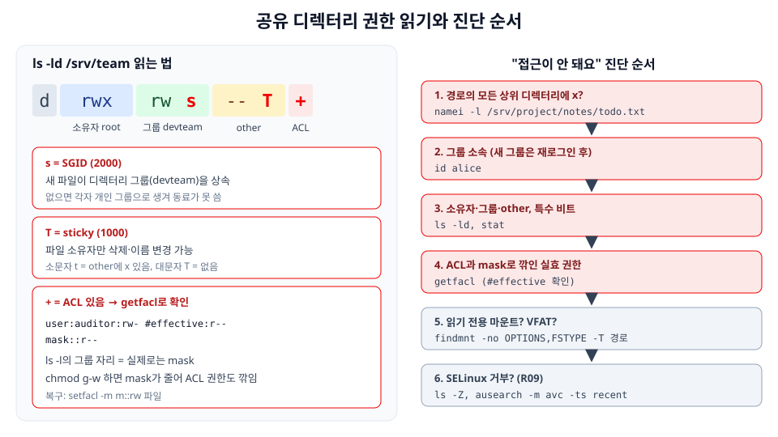

> **번외 · RHCSA(EX200) 대비** | 난이도 ★★★★☆ | 예상 소요 2.5 ~ 3시간

> ⚠️ 이 편의 모든 연습 과제는 Red Hat이 공개한 **EX200 공식 목표를 바탕으로 직접 창작한** 시험 스타일 과제입니다. 실제 시험 문제(덤프)가 아니며, 실제 출제 내용과 무관합니다.

## 🎯 오늘의 목표

- VFAT·ext4·XFS 파일 시스템을 만들고 영구 마운트할 수 있다
- serverb에 **NFS 서버**를 세우고 servera에서 NFS를 마운트할 수 있다
- **autofs**로 direct 맵, indirect 맵, **와일드카드 홈 디렉터리**를 구성할 수 있다
- `lvextend -r`로 마운트된 파일 시스템을 온라인 확장하고, XFS가 축소되지 않는 이유를 안다
- SGID·sticky·ACL로 공유 디렉터리를 만들고 **권한 문제를 진단**할 수 있다

---

## 1. 목표 요약 — 공식 목표 ⑥ Create and configure file systems

| 공식 목표 항목 | 이 편의 섹션 |
|---|---|
| Create, mount, unmount, and use vfat, ext4, and xfs file systems | 3 |
| Mount and unmount network file systems using NFS | 4 |
| Configure autofs | 5 |
| Extend existing logical volumes | 6 |
| Diagnose and correct file permission problems | 7 |

실습 환경은 R00의 `servera`(192.168.56.11, NFS 클라이언트)와 `serverb`(192.168.56.12, NFS 서버)입니다. 스토리지는 **R04를 마친 상태**를 이어서 씁니다.

| 장치 | R04 이후 상태 | 이번 편에서 쓸 곳 |
|---|---|---|
| `/dev/sdb`(5GB) | 1번 `lvm1`(PV), 2번 `swap1` 사용 중, 1537MiB 이후 비어 있음 | VFAT·ext4 파티션 |
| `/dev/sdc`(2GB) | 1번 `lvm2`(PV) 사용 중, 1025MiB 이후 비어 있음 | XFS 파티션 |
| `vg_lab` | `lv_app`(600MiB, xfs, `/srv/app`), 여유 약 1GiB | `lv_app` 확장 |

장치명은 이번에도 **`lsblk`로 실제 이름을 확인**하세요. R04를 건너뛰었다면 R04의 과제 1·2·6을 먼저 하면 됩니다.

---

## 2. 출제 유형 — 어떻게 채점되는가

| 과제 형태 | 예시 문장(창작) | 채점 포인트 |
|---|---|---|
| **FS 생성·마운트형** | "200MiB vfat 파일 시스템을 `/mnt/media`에 영구 마운트" | 파일 시스템 유형, 크기, 재부팅 후 마운트 |
| **NFS 마운트형** | "serverb의 `/exports/share`를 `/mnt/share`에 부팅 시 마운트" | 재부팅 후 마운트, 네트워크 대기(`_netdev`) |
| **autofs형** | "`/home/guests/<사용자>`로 접근하면 serverb의 홈이 자동 마운트" | 접근 시 마운트되는가, **autofs가 enable** 되었는가 |
| **확장형** | "`lv_app`을 1GiB로, 파일 시스템도 함께" | LV 크기 **와** `df` 크기가 모두 늘었는가, 데이터 보존 |
| **권한형** | "그룹 `devteam`이 공유하는 디렉터리, 남의 파일은 못 지우게" | 소유 그룹, SGID·sticky 비트, ACL 결과 |

> 💡 "크기 허용 오차"를 주는 과제가 많습니다(예: 950~1050MiB). 정확히 맞추려 애쓰기보다 **요청 범위 안에 있는지**를 `lsblk`/`df -h`로 확인하세요.

---

## 3. VFAT / ext4 / XFS

| 항목 | VFAT | ext4 | XFS (RHEL 기본) |
|---|---|---|---|
| 만들기 | `mkfs.vfat` (`dosfstools`) | `mkfs.ext4` | `mkfs.xfs` |
| 라벨 | `-n 이름` (대문자, 11자) | `-L 이름` | `-L 이름` (12자) |
| 리눅스 권한·소유자 | **없음** (마운트 옵션으로 흉내) | 있음 | 있음 |
| 확장 | — | 온라인 `resize2fs` | 온라인 `xfs_growfs` |
| **축소** | — | 오프라인으로 가능 | **불가** |
| 쓰임 | USB, EFI 시스템 파티션 | 범용 | 범용, 대용량 |

```bash
lsblk /dev/sdb /dev/sdc
# VFAT: sdb3 256MiB
parted /dev/sdb mkpart media fat32 1537MiB 1793MiB
# ext4: sdb4 1GiB
parted /dev/sdb mkpart extdata ext4 1793MiB 2817MiB
# XFS: sdc2 512MiB
parted /dev/sdc mkpart xfsdata xfs 1025MiB 1537MiB
udevadm settle

rpm -q dosfstools || dnf install -y dosfstools
mkfs.vfat -n MEDIA /dev/sdb3
mkfs.ext4 -L EXTDATA /dev/sdb4
mkfs.xfs -L XFSDATA /dev/sdc2
lsblk -f /dev/sdb /dev/sdc
```

```
NAME   FSTYPE      FSVER LABEL     UUID                                 ...
├─sdb3 vfat        FAT32 MEDIA     6A1F-3C2B
├─sdb4 ext4        1.0   EXTDATA   9e0d1c6a-...
└─sdc2 xfs               XFSDATA   41b7e9a2-...
```

VFAT의 UUID는 `6A1F-3C2B`처럼 짧은 형식입니다. fstab에도 그대로 씁니다.

```bash
mkdir -p /mnt/media /srv/ext /srv/xfs
cat >> /etc/fstab <<EOF
UUID=$(blkid -s UUID -o value /dev/sdb3) /mnt/media vfat defaults,uid=1000,gid=1000,umask=022 0 0
UUID=$(blkid -s UUID -o value /dev/sdb4) /srv/ext   ext4 defaults 0 0
LABEL=XFSDATA                             /srv/xfs   xfs  defaults 0 0
EOF
systemctl daemon-reload
mount -a && findmnt --verify
df -hT /mnt/media /srv/ext /srv/xfs
```

> ⚠️ VFAT에는 리눅스 소유자·권한 개념이 없어 `chown`/`chmod`가 실패합니다. 특정 사용자가 쓰게 하려면 **마운트 옵션** `uid=`, `gid=`, `umask=`로 지정합니다. 값은 숫자 UID/GID로 쓰는 것이 안전합니다(`id student`로 확인, 예시의 1000은 student라고 가정).
> 💡 일시적으로만 붙였다 떼려면 `mount /dev/sdb3 /mnt/media` → `umount /mnt/media`. `target is busy`가 나오면 `lsof /mnt/media` 또는 `fuser -vm /mnt/media`로 붙잡고 있는 프로세스를 찾고, 내 셸이 그 디렉터리 안에 있지 않은지(`cd /`)부터 확인하세요.

---

## 4. NFS — 서버(serverb)와 클라이언트(servera)

### 4-1. serverb에 NFS 서버 구성

시험에서는 NFS 서버가 미리 준비되어 있지만, 연습하려면 직접 세워야 합니다. 서버 구성 자체는 RHCSA 목표가 아니므로 순서만 정확히 따라 하면 됩니다.

```bash
[root@serverb ~]# dnf install -y nfs-utils
[root@serverb ~]# mkdir -p /exports/{share,docs,home/guest1,home/guest2}
[root@serverb ~]# chmod 1777 /exports/share                 # root_squash 때문에 nobody도 쓸 수 있게
[root@serverb ~]# echo "NFS docs from serverb" > /exports/docs/README.txt
[root@serverb ~]# for u in 1 2; do useradd -u 200$u -d /exports/home/guest$u -M guest$u; \
                     chown guest$u:guest$u /exports/home/guest$u; chmod 700 /exports/home/guest$u; done
[root@serverb ~]# cat > /etc/exports.d/r05.exports <<'EOF'
/exports/share  192.168.56.0/24(rw,sync)
/exports/docs   192.168.56.0/24(ro,sync)
/exports/home   192.168.56.0/24(rw,sync)
EOF
[root@serverb ~]# systemctl enable --now nfs-server
[root@serverb ~]# exportfs -rav
[root@serverb ~]# firewall-cmd --permanent --add-service=nfs --add-service=rpc-bind --add-service=mountd
[root@serverb ~]# firewall-cmd --reload
```

| 설정 | 의미 |
|---|---|
| `rw` / `ro` | 읽기·쓰기 / 읽기 전용 |
| `sync` | 디스크에 쓴 뒤 응답 (안전) |
| `root_squash` (기본값) | 클라이언트의 root를 `nobody`로 매핑 → 클라이언트 root라도 서버 파일을 마음대로 못 바꿈 |
| 방화벽 `nfs` | NFSv4(2049/tcp)는 이것만으로 충분 |
| 방화벽 `rpc-bind`, `mountd` | `showmount -e`로 목록을 보려면 필요 |

### 4-2. servera에서 마운트

```bash
[root@servera ~]# dnf install -y nfs-utils
[root@servera ~]# showmount -e serverb
Export list for serverb:
/exports/home  192.168.56.0/24
/exports/docs  192.168.56.0/24
/exports/share 192.168.56.0/24
[root@servera ~]# mkdir -p /mnt/share
[root@servera ~]# mount -t nfs serverb:/exports/share /mnt/share     # 일시 마운트
[root@servera ~]# findmnt /mnt/share
TARGET     SOURCE                 FSTYPE OPTIONS
/mnt/share serverb:/exports/share nfs4   rw,relatime,vers=4.2,...
[root@servera ~]# umount /mnt/share
```

영구 마운트는 fstab에 `_netdev`를 붙여 **네트워크가 올라온 뒤** 마운트하게 합니다.

```
serverb:/exports/share  /mnt/share  nfs  defaults,_netdev  0 0
```

```bash
systemctl daemon-reload && mount -a && findmnt /mnt/share
```

> 💡 `serverb` 이름은 R00에서 `/etc/hosts`에 등록했습니다. 이름 해석이 안 되면 `192.168.56.12:/exports/share`처럼 IP를 써도 됩니다.
> ⚠️ NFS 서버가 꺼져 있을 때 `_netdev` 없는 fstab 항목은 부팅을 오래 붙잡거나 실패시킬 수 있습니다. 시험장 NFS 서버는 켜져 있다고 가정되지만 `_netdev`는 습관처럼 붙이세요.

---

## 5. autofs — 필요할 때만 마운트



fstab 마운트는 부팅할 때 항상 붙여 둡니다. **autofs**는 누군가 그 경로에 **접근하는 순간** 마운트하고, 한동안(기본 5분) 안 쓰면 자동으로 떼어 냅니다. 사용자가 수백 명인 NFS 홈 디렉터리를 전부 상시 마운트할 수 없으니 생긴 방식입니다.

```bash
dnf install -y autofs nfs-utils
systemctl enable --now autofs
```

| 파일 | 역할 |
|---|---|
| `/etc/auto.master` | 마스터 맵. `+dir:/etc/auto.master.d`로 아래 디렉터리를 읽음 |
| `/etc/auto.master.d/*.autofs` | **내가 추가하는 마스터 항목** (확장자 `.autofs` 필수) |
| `/etc/auto.이름` | 실제 맵 파일: "키 → 옵션 → NFS 위치" |

### 5-1. direct 맵 — 절대 경로 하나하나를 지정

```bash
# 마스터 항목: 마운트 지점 자리에 /- 를 쓰면 direct 맵
echo "/- /etc/auto.direct" > /etc/auto.master.d/direct.autofs
# 맵: 키가 절대 경로
echo "/shares/docs -ro,sync serverb:/exports/docs" > /etc/auto.direct
systemctl restart autofs
cat /shares/docs/README.txt          # 접근하는 순간 마운트
findmnt /shares/docs
```

### 5-2. indirect 맵 — 상위 디렉터리 아래에 키 이름으로

```bash
# 마스터 항목: /remote 아래를 autofs가 관리
echo "/remote /etc/auto.remote" > /etc/auto.master.d/remote.autofs
# 맵: 키는 /remote 아래 하위 디렉터리 이름
echo "share -rw,sync serverb:/exports/share" > /etc/auto.remote
systemctl restart autofs
ls /remote             # 아무것도 안 보임 (정상)
ls /remote/share       # 이름을 정확히 부르면 마운트
```

### 5-3. 와일드카드 — NFS 홈 디렉터리

```bash
echo "/home/guests /etc/auto.guests" > /etc/auto.master.d/guests.autofs
echo "* -rw,sync serverb:/exports/home/&" > /etc/auto.guests
systemctl restart autofs
```

`*`는 "어떤 키든", `&`는 "그 키 문자열"로 치환됩니다. `/home/guests/guest1`에 접근하면 `serverb:/exports/home/guest1`이 마운트됩니다. servera에도 **같은 UID**의 사용자가 있어야 파일 소유자가 맞게 보입니다.

```bash
for u in 1 2; do useradd -u 200$u -d /home/guests/guest$u -M guest$u; echo 'Guest#123' | passwd --stdin guest$u; done
setsebool -P use_nfs_home_dirs on        # SELinux: NFS 홈 디렉터리로 로그인 허용
su - guest1 -c 'pwd; touch ~/hello; ls -l ~'
```

| 맵 종류 | 마스터 항목 | 맵 파일의 키 | 접근 경로 |
|---|---|---|---|
| direct | `/- /etc/auto.direct` | `/shares/docs` (절대 경로) | `/shares/docs` |
| indirect | `/remote /etc/auto.remote` | `share` | `/remote/share` |
| 와일드카드 | `/home/guests /etc/auto.guests` | `*` + `&` | `/home/guests/<아무 이름>` |

> ⚠️ indirect 맵의 상위 디렉터리(`/remote`, `/home/guests`)를 `ls`하면 **비어 보이는 게 정상**입니다. "마운트가 안 됐다"고 착각하지 말고 하위 경로까지 직접 접근하세요. 디렉터리 이름을 미리 보여 주고 싶다면 `/etc/autofs.conf`의 `browse_mode = yes`(간접 맵 한정)를 쓸 수 있지만, 와일드카드 키는 목록에 나타나지 않습니다.
> ⚠️ autofs가 관리할 마운트 지점(`/shares/docs`, `/home/guests/guest1`)을 **직접 `mkdir`하지 마세요**. autofs가 만듭니다. 같은 경로를 fstab에도 넣으면 충돌합니다.

---

## 6. LV 확장 — lvextend -r

R04에서 `vg_lab`에 PV를 추가해 여유 공간을 만들었습니다. 이제 `lv_app`을 늘립니다. **`-r`(`--resizefs`)** 을 붙이면 LV 확장 직후 파일 시스템 확장(`xfs_growfs` / `resize2fs`)까지 한 번에 해 줍니다. 마운트된 상태 그대로 됩니다.

```bash
vgs vg_lab                                   # VFree 확인
df -h /srv/app                               # 확장 전
lvextend -r -L 1G /dev/vg_lab/lv_app         # 전체 크기를 1GiB로
# lvextend -r -L +400M ...                   # 400MiB만큼 더
# lvextend -r -l +50%FREE ...                # 여유 공간의 절반만큼 더
lvs vg_lab; df -h /srv/app                   # 두 값 모두 늘었는지
```

| 상황 | 명령 |
|---|---|
| `-r`을 깜빡한 XFS | `xfs_growfs /srv/app` (**마운트 지점**을 인자로) |
| `-r`을 깜빡한 ext4 | `resize2fs /dev/vg_lab/lv_logs` (장치를 인자로) |
| VG 여유 공간 부족 | 먼저 R04처럼 `pvcreate` + `vgextend` |

> ⚠️ **XFS는 축소할 수 없습니다.** `lvreduce -r`을 XFS에 시도하면 파일 시스템 축소 단계에서 거부됩니다. `-r` 없이 LV만 줄이면 파일 시스템이 망가집니다. XFS를 작게 만들어야 한다면 백업 → 새로 작은 LV 생성·포맷 → 복원뿐입니다. ext4는 언마운트 후 `lvreduce -r`로 축소할 수 있습니다.

---

## 7. 권한 문제 진단 — SGID, sticky, ACL



### 7-1. 특수 비트

| 비트 | 숫자 | 디렉터리에 설정하면 | `ls -ld` 표시 |
|---|---|---|---|
| SGID | 2000 | 안에 만든 파일·디렉터리가 **디렉터리의 그룹**을 상속 | `drwxrws---` |
| sticky | 1000 | 파일 **소유자(와 디렉터리 소유자, root)만** 그 파일을 삭제·이름 변경 | `drwxrwx--T` / `drwxrwxrwt` |

```bash
groupadd devteam
for u in alice bob; do useradd -G devteam $u; done
useradd auditor
mkdir -p /srv/team
chgrp devteam /srv/team
chmod 3770 /srv/team          # 2000(SGID) + 1000(sticky) + 770
ls -ld /srv/team
# drwxrws--T. 2 root devteam 6 Nov 15 10:00 /srv/team
```

### 7-2. ACL — 그룹 외의 특정 사용자에게만 권한

```bash
setfacl -m u:auditor:rx /srv/team           # 지금 디렉터리에 대한 권한
setfacl -m d:u:auditor:rx /srv/team         # 앞으로 생길 파일에 상속(default ACL)
getfacl /srv/team
```

```
# file: srv/team
# owner: root
# group: devteam
# flags: -st
user::rwx
user:auditor:r-x
group::rwx
mask::rwx
other::---
default:user::rwx
default:user:auditor:r-x
...
```

`ls -l`에서 권한 끝에 **`+`** 가 붙어 있으면 ACL이 있다는 뜻입니다. 이때 `ls -l`이 보여 주는 그룹 자리는 실제 그룹 권한이 아니라 **mask**입니다.

### 7-3. 진단 순서

"사용자 X가 파일 Y에 접근할 수 없다"는 과제는 다음 순서로 봅니다.

| 순서 | 확인 | 명령 |
|---|---|---|
| 1 | 경로의 **모든 상위 디렉터리**에 `x`가 있는가 | `namei -l /srv/team/report.txt` |
| 2 | 사용자의 그룹 소속 (새 그룹은 **재로그인** 후 반영) | `id alice` |
| 3 | 소유자·그룹·other 권한, 특수 비트 | `ls -ld`, `stat` |
| 4 | ACL과 **mask**로 깎인 실효 권한 | `getfacl` (`#effective:` 표시) |
| 5 | 파일 시스템이 읽기 전용이거나 VFAT인가 | `findmnt -no OPTIONS 경로` |
| 6 | SELinux 거부인가 (R09) | `ls -Z`, `ausearch -m avc -ts recent` |

```bash
# mask 때문에 auditor의 권한이 깎인 예
chmod g-w /srv/team/plan.txt          # chmod가 mask를 r-x로 줄임
getfacl /srv/team/plan.txt
# user:auditor:rw-        #effective:r--
setfacl -m m::rw /srv/team/plan.txt   # mask 복구
```

> ⚠️ ACL이 있는 파일에 `chmod g=...`를 하면 그룹 권한이 아니라 **mask가 바뀝니다.** "ACL을 줬는데 안 된다"의 대표 원인입니다. 또 `cp`는 기본적으로 ACL을 복사하지 않습니다(`cp -a` 또는 `--preserve=all`).

---

## 8. 핵심 명령 표

| 분류 | 명령 |
|---|---|
| 파일 시스템 생성 | `mkfs.vfat [-n LABEL]`, `mkfs.ext4 [-L]`, `mkfs.xfs [-L]` |
| 마운트 | `mount`, `umount`, `findmnt`, `df -hT`, `lsof`/`fuser -vm` |
| 영구화 | `/etc/fstab`(UUID/LABEL, NFS는 `_netdev`) → `systemctl daemon-reload` → `mount -a` |
| NFS 서버 | `nfs-utils`, `/etc/exports(.d)`, `systemctl enable --now nfs-server`, `exportfs -rav`, 방화벽 `nfs`·`rpc-bind`·`mountd` |
| NFS 클라이언트 | `showmount -e 서버`, `mount -t nfs 서버:/경로 지점` |
| autofs | `autofs` 패키지, `/etc/auto.master.d/*.autofs`, 맵 파일, `systemctl enable --now autofs` |
| LV 확장 | `lvextend -r -L 크기 \| +크기 \| -l +N%FREE`, `xfs_growfs 마운트지점`, `resize2fs 장치` |
| 권한 | `chmod 2770/1770/3770`, `chgrp`, `setfacl -m u:/g:/d:/m::`, `getfacl`, `namei -l`, `id` |

---

## 9. 자주 하는 실수

| 실수 | 결과 | 바로잡기 |
|---|---|---|
| autofs 설정 후 `enable` 안 함 | 재부팅 후 자동 마운트 안 됨 | `systemctl enable --now autofs` |
| 마스터 파일 확장자를 `.conf` 등으로 | 마스터 항목 무시 | `/etc/auto.master.d/이름.autofs` |
| indirect 상위 디렉터리를 `ls`하고 실패로 판단 | 불필요한 재설정 | 하위 경로(`/home/guests/guest1`)까지 접근 |
| 와일드카드 맵에서 `&` 누락 | 모든 사용자가 같은 디렉터리로 | `* ... 서버:/경로/&` |
| NFS fstab에 `_netdev` 없음 | 부팅 지연·실패 가능 | `defaults,_netdev` |
| `lvextend`만 하고 `-r` 누락 | `lvs`는 늘었는데 `df`는 그대로 | `xfs_growfs` / `resize2fs` |
| XFS를 `lvreduce`로 줄이려 함 | 거부 또는 파일 시스템 손상 | XFS는 축소 불가 — 백업 후 재생성 |
| SGID 없이 공유 디렉터리 생성 | 파일 그룹이 개인 그룹이라 동료가 못 씀 | `chmod g+s`, 기존 파일은 `chgrp -R` |
| ACL 파일에 `chmod g-...` | mask가 줄어 ACL 사용자 권한 감소 | `getfacl`의 `#effective` 확인, `setfacl -m m::...` |

---

## 10. 창작 연습 과제

> 아래 과제는 모두 **공식 목표를 바탕으로 창작한** 연습 문제입니다. 특별한 말이 없으면 servera에서 root로 작업하고, 4-1의 serverb NFS 서버 구성은 미리 해 둡니다. 장치명은 `lsblk`로 확인한 실제 이름을 쓰세요.

### 과제 1. VFAT 미디어 파티션

`/dev/sdb`의 빈 공간에 256MiB 파티션을 만들어 vfat(라벨 `MEDIA`)로 포맷하고, `/mnt/media`에 **UUID로** 영구 마운트하라. 마운트된 파일은 `student` 소유로 보여야 한다.

<details>
<summary>풀이·검증</summary>

```bash
parted /dev/sdb unit MiB print free          # 빈 공간 시작점 확인 (1537MiB)
parted /dev/sdb mkpart media fat32 1537MiB 1793MiB
udevadm settle
mkfs.vfat -n MEDIA /dev/sdb3
mkdir -p /mnt/media
echo "UUID=$(blkid -s UUID -o value /dev/sdb3) /mnt/media vfat defaults,uid=$(id -u student),gid=$(id -g student) 0 0" >> /etc/fstab
systemctl daemon-reload && mount -a
```

```bash
df -hT /mnt/media                            # vfat, 약 255M
touch /mnt/media/a && ls -l /mnt/media/a     # 소유자 student
```
</details>

### 과제 2. ext4와 XFS

- `/dev/sdb`에 1GiB 파티션을 만들어 ext4로 `/srv/ext`에 UUID로 마운트하라.
- `/dev/sdc`의 빈 공간에 512MiB 파티션을 만들어 xfs(라벨 `XFSDATA`)로 `/srv/xfs`에 **라벨로** 마운트하라.

<details>
<summary>풀이·검증</summary>

```bash
parted /dev/sdb mkpart extdata ext4 1793MiB 2817MiB
parted /dev/sdc mkpart xfsdata xfs 1025MiB 1537MiB
udevadm settle
mkfs.ext4 /dev/sdb4
mkfs.xfs -L XFSDATA /dev/sdc2
mkdir -p /srv/ext /srv/xfs
echo "UUID=$(blkid -s UUID -o value /dev/sdb4) /srv/ext ext4 defaults 0 0" >> /etc/fstab
echo "LABEL=XFSDATA /srv/xfs xfs defaults 0 0" >> /etc/fstab
systemctl daemon-reload && mount -a && findmnt --verify
```

```bash
df -hT /srv/ext /srv/xfs
```
</details>

### 과제 3. NFS 영구 마운트

serverb의 `/exports/share`를 servera의 `/mnt/share`에 부팅 시 자동으로 마운트하라. student 사용자가 파일을 만들 수 있어야 한다.

<details>
<summary>풀이·검증</summary>

```bash
dnf install -y nfs-utils
showmount -e serverb
mkdir -p /mnt/share
echo "serverb:/exports/share /mnt/share nfs defaults,_netdev 0 0" >> /etc/fstab
systemctl daemon-reload && mount -a
```

```bash
findmnt /mnt/share                       # nfs4
su - student -c 'touch /mnt/share/from-student && ls -l /mnt/share'
```

serverb의 `/exports/share`가 `1777`이므로 student도 쓸 수 있습니다. root로 만든 파일은 `root_squash` 때문에 `nobody` 소유가 됩니다.
</details>

### 과제 4. autofs direct 맵

serverb의 `/exports/docs`를 servera의 `/shares/docs`로 **접근할 때만** 읽기 전용 마운트되게 하라.

<details>
<summary>풀이·검증</summary>

```bash
dnf install -y autofs
echo "/- /etc/auto.direct" > /etc/auto.master.d/direct.autofs
echo "/shares/docs -ro,sync serverb:/exports/docs" > /etc/auto.direct
systemctl enable --now autofs
systemctl restart autofs
```

```bash
cat /shares/docs/README.txt              # NFS docs from serverb
findmnt /shares/docs                     # nfs4, ro
touch /shares/docs/x                     # Read-only file system (정상)
```
</details>

### 과제 5. autofs 와일드카드 홈 디렉터리

serverb의 `/exports/home/<사용자>`가 servera의 `/home/guests/<사용자>`로 자동 마운트되게 하라. 사용자 `guest1`(UID 2001), `guest2`(UID 2002)가 servera에 SSH로 로그인하면 자기 홈 디렉터리에 쓸 수 있어야 한다.

<details>
<summary>풀이·검증</summary>

```bash
echo "/home/guests /etc/auto.guests" > /etc/auto.master.d/guests.autofs
echo "* -rw,sync serverb:/exports/home/&" > /etc/auto.guests
for u in 1 2; do useradd -u 200$u -d /home/guests/guest$u -M guest$u; echo 'Guest#123' | passwd --stdin guest$u; done
setsebool -P use_nfs_home_dirs on
systemctl restart autofs
```

```bash
ssh guest1@localhost 'pwd; touch ~/ok; ls -ln ~'     # /home/guests/guest1, UID 2001
findmnt -t nfs4 | grep guests
ls /home/guests                                       # 마운트된 것만 보임
```
</details>

### 과제 6. 온라인 LV 확장

`/srv/app`(`vg_lab/lv_app`, xfs)을 마운트를 해제하지 않은 채 **950~1050MiB**로 늘려라. 기존 파일은 그대로여야 한다.

<details>
<summary>풀이·검증</summary>

```bash
cat /srv/app/marker.txt                    # R04에서 만든 파일
vgs vg_lab                                 # VFree가 400MiB 이상인지
lvextend -r -L 1G /dev/vg_lab/lv_app
```

```bash
lvs vg_lab/lv_app                          # 1.00g
df -h /srv/app                             # 약 1014M (메타데이터 제외)
cat /srv/app/marker.txt
```

`-r`을 빠뜨렸다면 `xfs_growfs /srv/app`.
</details>

### 과제 7. XFS 축소 시도 관찰

`/srv/xfs`를 256MiB로 줄여 보라. 실패한다면 그 이유를 `/root/xfs-shrink.txt`에 한 줄로 적어라. (데이터를 잃으면 안 된다.)

<details>
<summary>풀이·검증</summary>

`/srv/xfs`는 파티션(`/dev/sdc2`) 위의 XFS라서 `lvreduce` 대상조차 아니고, XFS 자체도 축소를 지원하지 않습니다. LV 위의 XFS라도 `lvreduce -r`은 파일 시스템 축소 단계에서 거부됩니다.

```bash
echo "XFS는 축소를 지원하지 않으므로 백업 후 작은 크기로 재생성해야 한다" > /root/xfs-shrink.txt
df -h /srv/xfs                             # 크기 변화 없음
```
</details>

### 과제 8. 협업 디렉터리

`/srv/team`을 다음 조건으로 만들어라.
- 그룹 `devteam`(구성원 `alice`, `bob`)이 읽기·쓰기 가능, 그 외 사용자는 접근 불가
- 안에 만들어지는 파일은 자동으로 `devteam` 그룹
- 구성원은 서로의 파일을 **삭제할 수 없음**
- 사용자 `auditor`는 디렉터리와 앞으로 생기는 파일을 **읽기만** 가능

<details>
<summary>풀이·검증</summary>

```bash
groupadd devteam
for u in alice bob; do useradd -G devteam $u; done
useradd auditor
mkdir -p /srv/team
chgrp devteam /srv/team
chmod 3770 /srv/team
setfacl -m u:auditor:rx /srv/team
setfacl -m d:u:auditor:rx /srv/team
```

```bash
su - alice -c 'echo hi > /srv/team/a.txt; ls -l /srv/team/a.txt'   # 그룹 devteam
su - bob   -c 'rm -f /srv/team/a.txt'                              # Operation not permitted
su - auditor -c 'cat /srv/team/a.txt; touch /srv/team/z'           # cat 성공, touch 실패
getfacl /srv/team/a.txt                                             # user:auditor:r-x #effective:r--
```

auditor의 파일 권한이 `r--`로 나오는 것은 새 파일의 생성 모드(666)가 mask를 `rw-`로 만들기 때문입니다.
</details>

### 과제 9. 권한 문제 진단

아래 상태를 만든 뒤, `alice`가 `/srv/project/notes/todo.txt`를 **읽고 쓸 수 있도록** 원인을 찾아 고쳐라. 다른 사용자에게 권한을 넓히지 말 것.

```bash
mkdir -p /srv/project/notes
echo "todo" > /srv/project/notes/todo.txt
chmod 700 /srv/project
chown root:devteam /srv/project/notes /srv/project/notes/todo.txt
chmod 770 /srv/project/notes
setfacl -m u:alice:rw /srv/project/notes/todo.txt
chmod 640 /srv/project/notes/todo.txt
```

<details>
<summary>풀이·검증</summary>

```bash
namei -l /srv/project/notes/todo.txt
# drwx------ root root    project   ← alice가 통과(x) 못 함 (원인 1)
getfacl /srv/project/notes/todo.txt
# user:alice:rw-   #effective:r--    ← chmod 640이 mask를 r--로 (원인 2)
```

수정: 상위 디렉터리는 `devteam`에게만 통과 권한을 주고, mask를 복구합니다.

```bash
chgrp devteam /srv/project
chmod 750 /srv/project
setfacl -m m::rw /srv/project/notes/todo.txt
su - alice -c 'echo done >> /srv/project/notes/todo.txt && cat /srv/project/notes/todo.txt'
su - auditor -c 'cat /srv/project/notes/todo.txt'     # 여전히 Permission denied
```
</details>

### 과제 10. 재부팅 최종 확인

servera를 재부팅하고 과제 1~9의 결과가 모두 유지되는지 확인하라.

<details>
<summary>풀이·검증</summary>

```bash
findmnt --verify && systemctl reboot
# 재접속 후
df -hT /mnt/media /srv/ext /srv/xfs /srv/app /mnt/share
systemctl is-enabled autofs                   # enabled
cat /shares/docs/README.txt
ssh guest2@localhost 'touch ~/after-reboot && ls ~'
getsebool use_nfs_home_dirs                   # on
ls -ld /srv/team; getfacl -p /srv/team | grep auditor
```
</details>

---

## 11. 핵심 정리

- VFAT은 리눅스 권한이 없어 `uid=`/`gid=`/`umask=` 마운트 옵션으로, ext4·XFS는 `-L` 라벨과 UUID로 fstab 등록
- NFS 서버(연습용): `nfs-utils` → `/etc/exports.d/*.exports` → `nfs-server` enable → `exportfs -rav` → 방화벽 `nfs`·`rpc-bind`·`mountd`
- NFS 클라이언트 영구 마운트는 `defaults,_netdev`
- autofs: 마스터 `/etc/auto.master.d/*.autofs` + 맵 파일. direct는 `/-`, indirect는 상위 디렉터리, 와일드카드는 `*` + `&`. **`enable --now autofs`**
- LV 확장은 `lvextend -r`. 빠뜨리면 `xfs_growfs 마운트지점` / `resize2fs 장치`. **XFS는 축소 불가**
- 공유 디렉터리 = 그룹 소유 + SGID(2) + sticky(1) + 필요 시 ACL(default 포함). 진단은 `namei -l` → `id` → `ls -l` → `getfacl`(#effective, mask)

---

## ⏭️ 다음 예고 — R06. 시스템 배포·유지

지금까지는 손으로 한 번 하는 작업이었습니다. 다음 편에서는 `at`·`cron`·systemd timer로 작업을 **예약**하고, 서비스를 부팅 시 자동 시작하며, 기본 부팅 타깃과 `grubby`로 **부트로더**를 영구 수정합니다. chrony로 시간 동기화 클라이언트를 설정하고, 여러 소스에서 패키지를 설치하는 방법까지 다룹니다.
