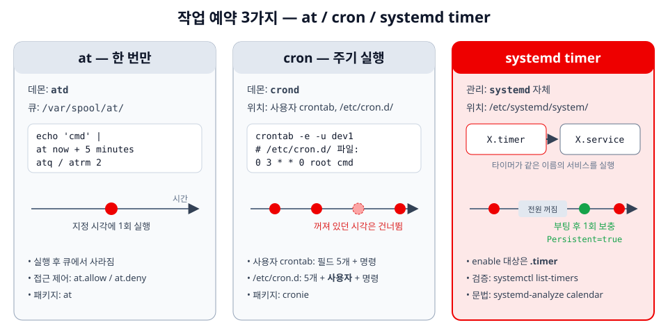
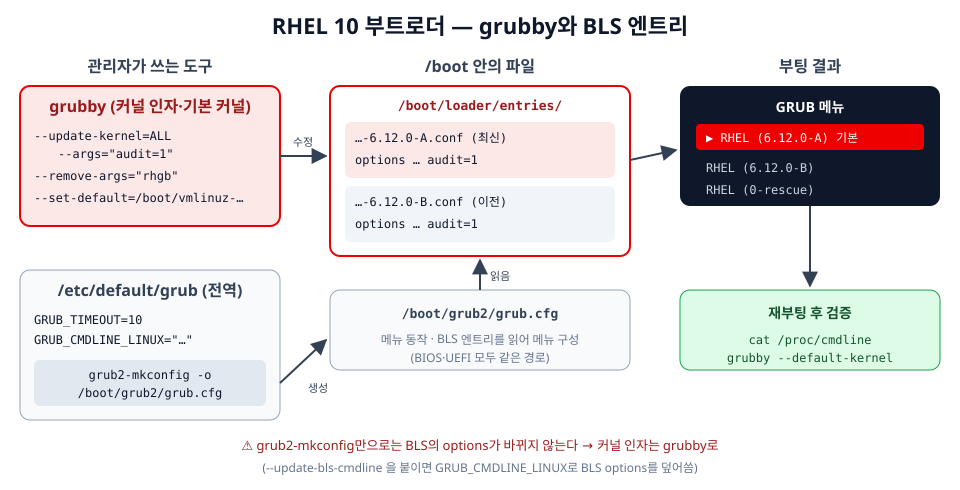

> **번외 · RHCSA(EX200) 대비** | 난이도 ★★★☆☆ | 예상 소요 2.5 ~ 3시간

> ⚠️ 이 편의 연습 과제는 모두 Red Hat 공식 목표를 바탕으로 **직접 창작한 시험 스타일 과제**입니다. 실제 시험 문제를 옮기거나 재구성한 것이 아닙니다.

## 🎯 이번 편의 목표

공식 목표 ⑦ **Deploy, configure, and maintain systems** 를 다룹니다.

- 작업을 **한 번(at)**, **주기적으로(cron)**, **systemd timer**로 예약하고 차이를 설명할 수 있다
- 서비스를 부팅 시 시작/중지/차단(enable · disable · mask)하고 **기본 부팅 타깃**을 바꿀 수 있다
- chrony를 **시간 동기화 클라이언트**로 설정하고 `chronyc`로 동기화 상태를 검증할 수 있다
- 로컬 rpm 파일, 저장소, URL 등 **여러 소스에서 패키지를 설치**할 수 있다
- `grubby`로 **커널 인자를 추가·제거**하고 **기본 커널**을 바꿀 수 있다

실습 환경은 R00에서 만든 VM 2대 — `servera`(192.168.56.11), `serverb`(192.168.56.12), RHEL 10(또는 Rocky/AlmaLinux 10)입니다. 명령은 모두 `root`(또는 `sudo`) 기준입니다.

---

## 1. 출제 유형

이 목표에서 나올 수 있는 과제 형태와 채점 포인트를 먼저 정리합니다.

| 과제 형태 | 예시 지시문 (창작) | 채점 포인트 |
|---|---|---|
| 사용자 cron | "사용자 `dev1`이 매일 14:23에 `logger` 로 메시지를 남기게 하라" | **해당 사용자**의 crontab에 있는가, 시간 필드가 정확한가 |
| 시스템 cron | "`/etc/cron.d/`에 작업을 등록하라" | **사용자 필드**를 넣었는가 |
| at | "10분 뒤 한 번만 실행" | `atd` 가 enable 되어 있는가, `atq`에 보이는가 |
| systemd timer | "타이머로 매 시간 실행, 부팅 시 놓친 실행 보충" | 유닛 파일 위치, `enable --now`, `Persistent=true` |
| 서비스 | "`httpd`를 부팅 시 시작" / "`cups`를 절대 시작 못 하게" | `is-enabled` 결과(enabled / masked) |
| 기본 타깃 | "부팅 시 텍스트 모드" | `systemctl get-default` |
| 시간 동기화 | "`serverb`를 시간 서버로 사용" | `/etc/chrony.conf`, `chronyc sources` 에 `^*` |
| 패키지 설치 | "주어진 URL의 rpm 설치" | `rpm -q` 로 설치 확인 |
| 부트로더 | "모든 커널에 인자 X 추가", "기본 커널을 Y로" | **재부팅 후** `/proc/cmdline`, `grubby --default-kernel` |

> 💡 공통 채점 원칙: **재부팅 후에도 유지**되어야 합니다. `systemctl start`만 하고 `enable`을 빠뜨리거나, 런타임에만 바꾼 설정은 0점으로 생각하세요.

---

## 2. 작업 예약 — at vs cron vs systemd timer



| 구분 | at | cron | systemd timer |
|---|---|---|---|
| 실행 횟수 | **한 번** | 주기적 | 주기적 또는 한 번(`OnActiveSec=`) |
| 데몬 | `atd` | `crond` | `systemd` 자체 |
| 정의 위치 | 큐(`/var/spool/at/`) | `crontab -e`, `/etc/crontab`, `/etc/cron.d/` | `/etc/systemd/system/*.timer` + `*.service` |
| 로그 | 메일/journal | journal(`crond`) | `journalctl -u 서비스명` |
| 놓친 실행 보충 | 없음 | 없음(anacron은 일 단위만) | `Persistent=true` |
| 패키지 | `at` | `cronie` | `systemd` |

### 2-1. at — 한 번만 실행

```bash
dnf install -y at                  # 최소 설치에는 없을 수 있음
systemctl enable --now atd

echo 'date >> /tmp/at-test.txt' | at now + 5 minutes
at 23:30 tomorrow <<'EOF'
logger "at job from servera"
EOF

atq                    # 대기 중인 작업 목록 (번호 확인)
at -c 2 | tail -5      # 2번 작업 내용 보기
atrm 2                 # 2번 작업 삭제
```

| 시간 표현 | 의미 |
|---|---|
| `now + 10 minutes` | 지금부터 10분 뒤 |
| `16:00` | 오늘 16:00 (지났으면 내일) |
| `noon tomorrow` | 내일 정오 |
| `09:00 2026-12-24` | 특정 날짜·시각 |

### 2-2. cron — 주기 실행

```
┌───────── 분 (0-59)
│ ┌─────── 시 (0-23)
│ │ ┌───── 일 (1-31)
│ │ │ ┌─── 월 (1-12)
│ │ │ │ ┌─ 요일 (0-7, 0과 7=일요일)
│ │ │ │ │
*/15 9-18 * * 1-5   명령      ← 평일 9~18시, 15분마다
```

**사용자별 crontab** (`/var/spool/cron/<사용자>` 에 저장, 직접 편집하지 말 것):

```bash
crontab -e -u dev1          # root가 dev1의 crontab 편집
crontab -l -u dev1          # 확인
crontab -r -u dev1          # 전체 삭제 (주의!)
```

비대화식으로 넣어야 할 때(스크립트 등):

```bash
( crontab -l -u dev1 2>/dev/null; echo '23 14 * * * /usr/bin/logger "dev1 daily"' ) | crontab -u dev1 -
```

**시스템 cron** — `/etc/cron.d/` 파일은 **6번째 필드가 실행 사용자**입니다.

```bash
cat > /etc/cron.d/cleanup-tmp <<'EOF'
# 매주 일요일 03:00, root로 실행
0 3 * * 0  root  /usr/bin/find /var/tmp -name '*.old' -mtime +7 -delete
EOF
chmod 644 /etc/cron.d/cleanup-tmp
```

> ⚠️ 사용자 crontab에 사용자 필드를 넣거나, `/etc/cron.d/` 파일에 사용자 필드를 빼는 실수가 가장 흔합니다. 두 형식은 **필드 개수가 다릅니다**.

> 💡 cron 환경의 `PATH`는 매우 짧습니다(`/usr/bin:/bin`). 명령은 **절대 경로**로 쓰는 습관을 들이세요. 접근 제어는 `/etc/cron.allow`(있으면 여기 적힌 사용자만), `/etc/cron.deny` 순으로 적용됩니다. at도 `/etc/at.allow`, `/etc/at.deny`로 같은 방식입니다.

### 2-3. systemd timer — 유닛 파일 전문

타이머는 **같은 이름의 `.service`를 실행**합니다. `etc-backup.timer` → `etc-backup.service`. (다른 이름을 실행하려면 `[Timer]`에 `Unit=`을 지정)

`/etc/systemd/system/etc-backup.service`

```ini
[Unit]
Description=Archive /etc into /var/backups

[Service]
Type=oneshot
ExecStartPre=/usr/bin/mkdir -p /var/backups
ExecStart=/usr/bin/tar -czf /var/backups/etc-latest.tar.gz /etc
```

`/etc/systemd/system/etc-backup.timer`

```ini
[Unit]
Description=Run etc-backup.service every day at 02:30

[Timer]
OnCalendar=*-*-* 02:30:00
Persistent=true
RandomizedDelaySec=0

[Install]
WantedBy=timers.target
```

```bash
systemctl daemon-reload
systemctl enable --now etc-backup.timer     # .service가 아니라 .timer를 enable!
systemctl list-timers etc-backup.timer
systemctl start etc-backup.service          # 즉시 한 번 실행해 보기
journalctl -u etc-backup.service -n 5
```

```
NEXT                        LEFT     LAST PASSED UNIT             ACTIVATES
Mon 2026-11-16 02:30:00 KST 10h left -    -      etc-backup.timer etc-backup.service
```

`OnCalendar` 표현식은 **`systemd-analyze calendar`** 로 바로 검증할 수 있습니다.

```bash
systemd-analyze calendar 'Mon..Fri *-*-* 08:00:00'
systemd-analyze calendar 'hourly'
systemd-analyze calendar '*:0/10'          # 10분마다
```

| 키 | 의미 |
|---|---|
| `OnCalendar=` | 달력 기반(cron과 비슷) |
| `OnBootSec=` | 부팅 후 N 뒤 |
| `OnUnitActiveSec=` | 마지막 실행 후 N 뒤(반복) |
| `Persistent=true` | 꺼져 있던 동안 놓친 실행을 부팅 후 1회 보충 |

> 💡 시험장에서 문법이 기억나지 않으면 `man systemd.timer`, `man systemd.time`(EXAMPLES 섹션)을 보세요. 시스템에 이미 있는 타이머(`systemctl cat dnf-makecache.timer`)를 참고하는 것도 좋은 방법입니다.

---

## 3. 서비스와 기본 부팅 타깃

| 명령 | 효과 | 재부팅 후 |
|---|---|---|
| `systemctl start X` | 지금 시작 | 유지 안 됨 |
| `systemctl enable X` | 부팅 시 자동 시작(심볼릭 링크 생성) | 유지 |
| `systemctl enable --now X` | 둘 다 | 유지 |
| `systemctl disable --now X` | 지금 중지 + 자동 시작 해제 | 유지 |
| `systemctl mask --now X` | `/dev/null` 링크 — **수동으로도 시작 불가** | 유지 |
| `systemctl unmask X` | mask 해제 | — |

```bash
systemctl enable --now chronyd
systemctl is-enabled chronyd ; systemctl is-active chronyd
systemctl mask --now cups 2>/dev/null || echo "cups 미설치"
systemctl start cups      # Failed to start cups.service: Unit cups.service is masked.
```

**기본 부팅 타깃**

```bash
systemctl get-default                       # graphical.target 또는 multi-user.target
systemctl set-default multi-user.target     # 텍스트 모드로 부팅
systemctl isolate multi-user.target         # 지금 바로 전환(재부팅 없이)
```

> 💡 R03에서 본 것처럼 `set-default`는 `/etc/systemd/system/default.target` 심볼릭 링크를 바꿉니다. 재부팅 없이도 `ls -l /etc/systemd/system/default.target`로 확인할 수 있습니다.

---

## 4. 시간 동기화 클라이언트 — chrony

RHEL 10의 NTP 구현은 **chrony**(`chronyd` 데몬, `chronyc` 클라이언트 도구)입니다. 설정 파일은 `/etc/chrony.conf` 하나입니다.

| 지시어 | 의미 |
|---|---|
| `server <호스트> iburst` | 특정 NTP 서버 하나 |
| `pool <풀이름> iburst` | DNS로 여러 서버를 받는 풀 |
| `iburst` | 시작 직후 빠르게 4~8번 질의해 초기 동기화 단축 |
| `allow <네트워크>` | (서버 역할) 이 대역의 클라이언트 질의 허용 |
| `local stratum 10` | (서버 역할) 외부 소스가 없어도 자기 시계를 제공 |

### 4-1. 실습용 시간 서버 만들기 (serverb)

인터넷 없는 시험장처럼 **`serverb`를 시간 서버**로 만들어 둡니다.

```bash
# serverb
cat >> /etc/chrony.conf <<'EOF'
allow 192.168.56.0/24
local stratum 10
EOF
systemctl restart chronyd
firewall-cmd --permanent --add-service=ntp && firewall-cmd --reload
```

### 4-2. 클라이언트 설정 (servera)

```bash
# servera — 기존 pool/server 줄을 주석 처리하고 serverb만 사용
sed -i 's/^\(pool\|server\)/#&/' /etc/chrony.conf
echo 'server 192.168.56.12 iburst' >> /etc/chrony.conf
systemctl enable --now chronyd
systemctl restart chronyd
timedatectl set-ntp true
```

### 4-3. 검증

```bash
chronyc sources -v
```

```
MS Name/IP address         Stratum Poll Reach LastRx Last sample
===============================================================================
^* 192.168.56.12                10   6    17    12    +15us[  +22us] +/-  210us
```

| 기호 | 의미 |
|---|---|
| `^*` | **현재 동기화 중인 소스** (이게 보여야 성공) |
| `^+` | 후보로 함께 쓰이는 소스 |
| `^?` | 연결 안 됨 / 아직 판단 전 |

```bash
chronyc tracking            # Reference ID, System time 오차
timedatectl                 # System clock synchronized: yes / NTP service: active
timedatectl set-timezone Asia/Seoul
```

> ⚠️ `^?`만 계속 보이면 ① 서버 쪽 `allow` 누락 ② 서버 방화벽 `ntp`(UDP 123) 미개방 ③ 오타 순서로 의심하세요. `chronyc makestep`은 큰 오차를 즉시 맞출 때 씁니다.

---

## 5. 여러 소스에서 패키지 설치

R02에서 저장소 설정과 기본 `dnf` 사용을 다뤘습니다. 여기서는 **소스별 설치 방법**만 정리합니다.

| 소스 | 명령 | 의존성 해결 |
|---|---|---|
| 저장소 | `dnf install -y tree` | O |
| 로컬 rpm 파일 | `dnf install -y ./pkg.rpm` | O (저장소에서 의존성 가져옴) |
| 로컬 rpm 파일 | `rpm -ivh pkg.rpm` | **X** (의존성 없으면 실패) |
| URL | `dnf install -y http://serverb/pkgs/pkg.rpm` | O |
| URL | `rpm -ivh http://serverb/pkgs/pkg.rpm` | X |

```bash
# serverb에서 rpm 파일을 http로 제공한다고 가정 (R00의 로컬 저장소 서버)
dnf download tree                                    # 실습용 rpm 받아두기
dnf install -y ./tree-*.rpm
rpm -q tree                                          # 설치 확인
rpm -qi tree | head -5 ; rpm -ql tree | head          # 정보 / 파일 목록
rpm -qf /usr/bin/tree                                # 이 파일은 어느 패키지?
dnf provides '*/semanage'                            # 이 파일을 주는 패키지 찾기
```

서명 검증에서 막히면 GPG 키를 가져옵니다. 키를 **무시하지 말고 가져오는 것이 정석**입니다.

```bash
rpm --import /etc/pki/rpm-gpg/RPM-GPG-KEY-redhat-release   # Rocky/Alma는 파일명이 다름
rpm -K ./tree-*.rpm                                        # 서명 확인: digests signatures OK
```

> 💡 `dnf install ./파일.rpm` 처럼 **`./`를 붙여야** 로컬 파일로 인식합니다. 그냥 `파일.rpm`이면 저장소에서 그 이름을 찾으려 할 수 있습니다.

---

## 6. 부트로더 수정 — grubby



RHEL 10의 GRUB2는 **BLS(Boot Loader Specification)** 방식입니다. 커널마다 `/boot/loader/entries/<machine-id>-<커널버전>.conf` 파일이 하나씩 있고, 커널 인자는 그 파일의 `options` 줄에 들어갑니다. **`grubby`는 이 엔트리를 고치는 공식 도구**입니다.

| 작업 | 명령 |
|---|---|
| 기본 커널 확인 | `grubby --default-kernel` / `grubby --default-index` |
| 전체 엔트리 보기 | `grubby --info=ALL` |
| 모든 커널에 인자 추가 | `grubby --update-kernel=ALL --args="audit=1 audit_backlog_limit=8192"` |
| 모든 커널에서 인자 제거 | `grubby --update-kernel=ALL --remove-args="rhgb quiet"` |
| 현재 커널에만 | `grubby --update-kernel=/boot/vmlinuz-$(uname -r) --args="..."` |
| 기본 커널 변경 | `grubby --set-default=/boot/vmlinuz-<버전>` |
| 인덱스로 변경 | `grubby --set-default-index=1` |

```bash
grubby --info=ALL | grep -E '^(index|kernel|args)'
grubby --update-kernel=ALL --args="audit=1"
grubby --update-kernel=ALL --remove-args="rhgb"
grubby --info=DEFAULT | grep args
reboot
# 재부팅 후
cat /proc/cmdline
```

**기본 커널 바꾸기** — 커널이 2개 이상일 때 의미가 있습니다(`dnf update kernel` 또는 `dnf install kernel-<버전>`).

```bash
ls /boot/vmlinuz-*
grubby --set-default=/boot/vmlinuz-6.12.0-55.9.1.el10_0.x86_64   # 예시 버전, 실제 값은 ls로 확인
grubby --default-kernel
```

**GRUB 메뉴 대기 시간 같은 전역 설정**은 `/etc/default/grub`를 고친 뒤 `grub2-mkconfig`로 다시 만듭니다.

```bash
sed -i 's/^GRUB_TIMEOUT=.*/GRUB_TIMEOUT=10/' /etc/default/grub
grub2-mkconfig -o /boot/grub2/grub.cfg       # RHEL 9부터 BIOS·UEFI 모두 이 경로
```

> ⚠️ **RHEL 10 주의점** — Red Hat RHEL 10 문서에 따르면 grubby로 넣은 인자는 BLS 엔트리에 반영되고, `grub2-mkconfig`만 실행해서는 BLS 엔트리의 `options`가 바뀌지 않습니다. `/etc/default/grub`의 `GRUB_CMDLINE_LINUX`를 BLS 엔트리에 덮어쓰려면 `grub2-mkconfig -o /boot/grub2/grub.cfg --update-bls-cmdline` 을 씁니다. 반대로 이 옵션은 grubby로 넣은 인자를 덮어쓸 수 있으니 **커널 인자는 grubby, 메뉴 동작은 `/etc/default/grub`** 으로 역할을 나누세요. 앞으로 설치될 새 커널에도 인자가 붙게 하려면 `/etc/default/grub`의 `GRUB_CMDLINE_LINUX`도 같은 값인지 확인해 둡니다.

> 💡 `grubby --info=ALL`의 `args=`와 재부팅 후 `/proc/cmdline` 두 가지를 모두 확인하는 습관이 채점 기준과 가장 가깝습니다.

---

## 7. 자주 하는 실수

| 실수 | 결과 | 예방 |
|---|---|---|
| `systemctl start`만 하고 `enable` 누락 | 재부팅 후 서비스 꺼짐 | 항상 `enable --now` |
| 타이머 대신 `.service`를 enable | 타이머가 동작 안 함 | `systemctl enable --now X.timer` |
| 유닛 파일 수정 후 `daemon-reload` 누락 | 옛 설정으로 동작 | 수정 → `daemon-reload` → 재시작 |
| `/etc/cron.d/` 파일에 사용자 필드 누락 | 명령이 실행 안 됨(journal에 오류) | `분 시 일 월 요일 사용자 명령` |
| root의 crontab에 다른 사용자 작업 등록 | "사용자 X의 작업"으로 채점 안 됨 | `crontab -e -u X` |
| `atd` 미기동 | `at` 작업이 큐에만 쌓임 | `systemctl enable --now atd` |
| chrony 설정 후 재시작 안 함 | 옛 서버 계속 사용 | `systemctl restart chronyd` 후 `chronyc sources` |
| `rpm -ivh`로 의존성 있는 패키지 설치 | `Failed dependencies` | `dnf install ./pkg.rpm` |
| `/etc/default/grub`만 고치고 끝 | 커널 인자 미반영 | 커널 인자는 `grubby --update-kernel=ALL` |
| `mask`와 `disable` 혼동 | "시작할 수 없게" 과제 감점 | 시작 자체를 막으라면 `mask` |

---

## 8. 창작 연습 과제

> 아래 과제는 공식 목표 ⑦을 바탕으로 직접 만든 연습 문제입니다. `vagrant snapshot save servera r06-before`로 스냅샷을 찍고 시작하세요.

### 과제 1. 사용자 cron (servera)

사용자 `dev1`(없으면 생성)이 **평일(월~금) 매일 08:45**에 `/usr/bin/logger "dev1-standup"` 을 실행하도록 설정하라.

<details>
<summary>풀이·검증</summary>

```bash
id dev1 || useradd dev1
crontab -e -u dev1
# 45 8 * * 1-5 /usr/bin/logger "dev1-standup"
```

검증

```bash
crontab -l -u dev1
ls -l /var/spool/cron/dev1
systemctl is-enabled crond          # enabled
# 재부팅 후에도 crontab -l -u dev1 이 그대로인지 확인
```

시간을 2분 뒤로 잠시 바꿔 `journalctl -t dev1 --since "5 min ago"` 또는 `journalctl --since "5 min ago" | grep dev1-standup`으로 실제 실행도 확인해 보세요.
</details>

### 과제 2. 시스템 cron (servera)

`/etc/cron.d/df-report` 파일을 만들어 **매 30분마다** root 권한으로 `df -h / >> /var/log/df-report.log`를 실행하라.

<details>
<summary>풀이·검증</summary>

```bash
cat > /etc/cron.d/df-report <<'EOF'
*/30 * * * * root /usr/bin/df -h / >> /var/log/df-report.log 2>&1
EOF
chmod 644 /etc/cron.d/df-report
```

검증

```bash
cat /etc/cron.d/df-report
journalctl -u crond --since "-40min" | grep df-report    # 30분 이상 지난 뒤
ls -l /var/log/df-report.log
```
</details>

### 과제 3. at 일회성 작업 (servera)

지금부터 **3분 뒤** `/root/at-done` 파일을 만드는 작업을 예약하라. `atd`는 재부팅 후에도 실행되어야 한다.

<details>
<summary>풀이·검증</summary>

```bash
dnf install -y at
systemctl enable --now atd
echo 'touch /root/at-done' | at now + 3 minutes
```

검증

```bash
atq                                 # 작업 번호와 시각
systemctl is-enabled atd            # enabled
# 3분 뒤
ls -l /root/at-done ; atq           # 파일 존재, 큐는 비어 있음
```
</details>

### 과제 4. systemd timer (servera)

`/usr/local/bin/heartbeat.sh` 스크립트(내용: `date >> /var/log/heartbeat.log`)를 **매 15분**마다 실행하는 `heartbeat.service`와 `heartbeat.timer`를 만들어라. 꺼져 있던 동안 놓친 실행은 부팅 후 보충되어야 한다.

<details>
<summary>풀이·검증</summary>

```bash
cat > /usr/local/bin/heartbeat.sh <<'EOF'
#!/bin/bash
date >> /var/log/heartbeat.log
EOF
chmod 755 /usr/local/bin/heartbeat.sh

cat > /etc/systemd/system/heartbeat.service <<'EOF'
[Unit]
Description=Write heartbeat timestamp

[Service]
Type=oneshot
ExecStart=/usr/local/bin/heartbeat.sh
EOF

cat > /etc/systemd/system/heartbeat.timer <<'EOF'
[Unit]
Description=Run heartbeat every 15 minutes

[Timer]
OnCalendar=*:0/15
Persistent=true

[Install]
WantedBy=timers.target
EOF

systemctl daemon-reload
systemctl enable --now heartbeat.timer
```

검증

```bash
systemd-analyze calendar '*:0/15'
systemctl list-timers heartbeat.timer
systemctl start heartbeat.service && tail -1 /var/log/heartbeat.log
reboot
# 재부팅 후
systemctl is-enabled heartbeat.timer ; systemctl list-timers heartbeat.timer
```

> `/usr/local/bin`의 스크립트는 SELinux 컨텍스트 `bin_t`를 받습니다. 다른 위치(예: `/root`)에서 만들어 `mv`로 옮기면 컨텍스트가 따라와 실행이 거부될 수 있으니 `restorecon -v /usr/local/bin/heartbeat.sh`를 해 두면 안전합니다(R09 참고).
</details>

### 과제 5. 서비스와 기본 타깃 (servera)

① `httpd`를 설치하고 부팅 시 시작되게 하라. ② `postfix`(설치되어 있다면)는 **수동으로도 시작할 수 없게** 하라. ③ 기본 부팅 타깃을 `multi-user.target`으로 하라.

<details>
<summary>풀이·검증</summary>

```bash
dnf install -y httpd
systemctl enable --now httpd
systemctl mask --now postfix
systemctl set-default multi-user.target
```

검증

```bash
systemctl is-enabled httpd postfix     # enabled / masked
systemctl start postfix                # Unit postfix.service is masked.
systemctl get-default                  # multi-user.target
reboot ; systemctl is-active httpd     # 재부팅 후 active
```
</details>

### 과제 6. 시간 동기화 클라이언트 (servera ← serverb)

`serverb`가 시간 서버 역할을 하도록 하고(4-1 참고), `servera`는 **`serverb`만** 시간 소스로 사용하게 하라. 시간대는 `Asia/Seoul`.

<details>
<summary>풀이·검증</summary>

serverb는 4-1 그대로. servera:

```bash
sed -i 's/^\(pool\|server\)/#&/' /etc/chrony.conf
echo 'server 192.168.56.12 iburst' >> /etc/chrony.conf
systemctl enable --now chronyd ; systemctl restart chronyd
timedatectl set-timezone Asia/Seoul
```

검증

```bash
grep -E '^(server|pool)' /etc/chrony.conf     # server 192.168.56.12 iburst 한 줄
chronyc sources                               # ^* 192.168.56.12
timedatectl | grep -E 'Time zone|synchronized'
reboot ; chronyc sources                      # 재부팅 후에도 ^*
```
</details>

### 과제 7. URL과 로컬 rpm 설치 (servera)

`serverb`가 `http://192.168.56.12/pkgs/`에서 rpm 파일을 제공한다. 그중 `tree` 패키지를 **URL로 직접** 설치하라. (준비: serverb에서 `dnf install -y httpd`, `mkdir -p /var/www/html/pkgs && cd /var/www/html/pkgs && dnf download tree`, `systemctl enable --now httpd`, `firewall-cmd --permanent --add-service=http && firewall-cmd --reload`)

<details>
<summary>풀이·검증</summary>

```bash
curl -s http://192.168.56.12/pkgs/ | grep -o 'tree-[^"]*\.rpm' | head -1   # 정확한 파일명 확인
dnf install -y http://192.168.56.12/pkgs/tree-<버전>.rpm
```

검증

```bash
rpm -q tree
rpm -qi tree | grep -E 'Name|Version'
tree -L 1 /etc/systemd | head -3
```
</details>

### 과제 8. 커널 인자와 기본 커널 (servera)

① **모든 커널**의 부팅 인자에 `audit=1`을 추가하고 `rhgb`를 제거하라. ② 커널이 2개 이상이라면 **가장 오래된 커널**을 기본 커널로 지정한 뒤, 확인이 끝나면 최신 커널로 되돌려라.

<details>
<summary>풀이·검증</summary>

```bash
grubby --update-kernel=ALL --args="audit=1"
grubby --update-kernel=ALL --remove-args="rhgb"
ls -1 /boot/vmlinuz-* | grep -v rescue
grubby --set-default=/boot/vmlinuz-<가장 오래된 버전>
```

검증

```bash
grubby --info=ALL | grep -E '^(kernel|args)'   # 모든 엔트리에 audit=1, rhgb 없음
grubby --default-kernel
reboot
cat /proc/cmdline ; uname -r                   # 재부팅 후 실제 반영 확인
grubby --set-default=/boot/vmlinuz-<최신 버전>  # 원복
```
</details>

---

## 9. 핵심 정리

- **at = 한 번**(`atd`), **cron = 주기**(`crond`), **systemd timer = 주기 + 놓친 실행 보충**(`Persistent=true`)
- 사용자 cron은 `crontab -e -u 사용자`, `/etc/cron.d/` 파일은 **사용자 필드가 하나 더** 있다
- 타이머는 `.service` + `.timer` 한 쌍, `daemon-reload` 후 **`.timer`를 `enable --now`**, `systemd-analyze calendar`로 검증
- 서비스: `enable --now` / `disable --now` / `mask --now`, 확인은 `is-enabled`. 기본 타깃은 `set-default`
- chrony: `/etc/chrony.conf`의 `server … iburst`, `restart chronyd`, `chronyc sources`에서 **`^*`**
- 패키지: `dnf install ./파일.rpm` 과 `dnf install http://…/파일.rpm` 은 의존성까지 해결, `rpm -ivh`는 아님
- 커널 인자는 **`grubby --update-kernel=ALL --args/--remove-args`**, 기본 커널은 **`grubby --set-default`**, 검증은 재부팅 후 `/proc/cmdline`

---

## ⏭️ 다음 예고 — R07. 기본 네트워킹

`nmcli` 하나로 IPv4/IPv6 고정 주소·게이트웨이·DNS를 설정하고, RHEL 10에서 **ifcfg 파일이 완전히 사라진 이유**와 keyfile 형식을 봅니다. 호스트명 해석(`/etc/hosts`, `nsswitch.conf`)과 firewalld로 접근을 제한하는 첫걸음, 그리고 **네트워크를 잘못 건드려 연결이 끊겼을 때** 콘솔로 복구하는 법까지 다룹니다.
