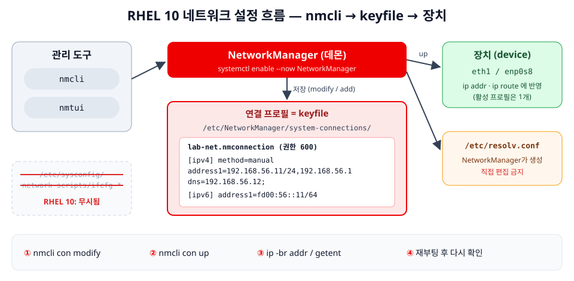
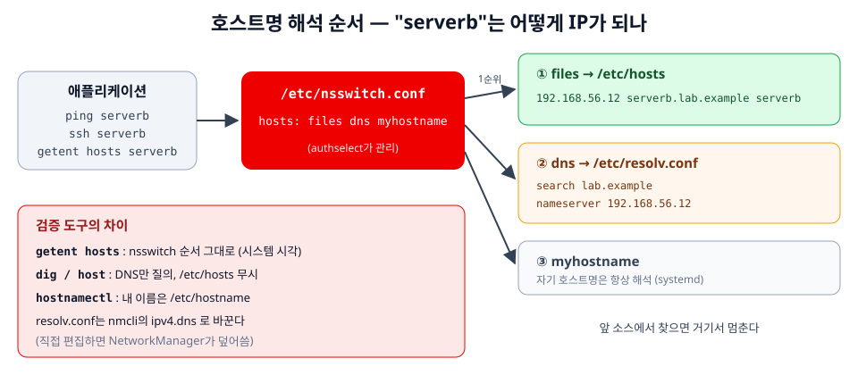

> **번외 · RHCSA(EX200) 대비** | 난이도 ★★★☆☆ | 예상 소요 2.5 ~ 3시간

> ⚠️ 이 편의 연습 과제는 모두 Red Hat 공식 목표를 바탕으로 **직접 창작한 시험 스타일 과제**입니다. 실제 시험 문제를 옮기거나 재구성한 것이 아닙니다.

## 🎯 이번 편의 목표

공식 목표 ⑧ **Manage basic networking** 을 다룹니다.

- `nmcli`로 **IPv4/IPv6 고정 주소, 게이트웨이, DNS**를 설정하고 부팅 시 자동 연결되게 할 수 있다
- RHEL 10에서 **ifcfg 파일이 지원되지 않고 keyfile만 쓰는** 구조를 이해한다
- `hostnamectl`, `/etc/hosts`, `resolv.conf`, `nsswitch.conf`로 **호스트명 해석** 순서를 설명할 수 있다
- 네트워크 서비스를 **부팅 시 시작**되게 하고 확인할 수 있다
- `firewalld`로 서비스·포트·rich rule·zone 단위 **접근 제한**을 걸 수 있다
- 네트워크 설정 실수로 접속이 끊겼을 때 **콘솔로 복구**할 수 있다

실습 환경은 R00의 `servera`(192.168.56.11), `serverb`(192.168.56.12)입니다. Vagrant VM은 NIC가 2개입니다 — **1번(NAT, `vagrant ssh`용)** 과 **2번(host-only, 192.168.56.0/24)**. 이 편에서는 **2번 NIC만** 다룹니다.

---

## 0. 먼저 읽기 — 네트워크를 잘못 건드리면 연결이 끊긴다

> ⚠️ **SSH로 접속한 바로 그 인터페이스의 주소를 바꾸고 `nmcli con up`을 하면, 그 순간 SSH 세션이 끊깁니다.** 주소를 잘못 넣었다면 다시 들어갈 방법이 없어집니다. 시험에서도 마찬가지이니, 네트워크 과제는 **콘솔**에서 하는 습관을 들이세요.

| 상황 | 콘솔 여는 법 |
|---|---|
| VirtualBox GUI | VirtualBox 관리자에서 VM 선택 → **표시(Show)** (headless로 떠 있어도 열림) |
| Vagrant로 GUI 함께 띄우기 | `Vagrantfile`에 `vb.gui = true` 후 `vagrant reload` |
| NAT NIC는 살아 있을 때 | `vagrant ssh servera` — 1번 NIC(NAT, 포트 포워딩)로 들어가므로 2번 NIC를 망가뜨려도 접속 가능 |
| 시험장 | 시험 환경에서 제공하는 VM 콘솔 사용 (화면 구성은 시험 시작 시 안내 확인) |

> 💡 그래서 이 편의 실습은 **2번 NIC(host-only)만** 바꿉니다. 1번 NIC(NAT)의 연결 프로필은 건드리지 마세요. 건드리면 `vagrant ssh`도 끊깁니다.

---

## 1. 출제 유형

| 과제 형태 | 예시 지시문 (창작) | 채점 포인트 |
|---|---|---|
| 고정 IPv4 | "주소 X/24, 게이트웨이 Y, DNS Z" | `ip -4 addr`, `ip route`, `/etc/resolv.conf`, **재부팅 후 유지** |
| IPv6 추가 | "IPv6 주소 fd00:…/64도 함께" | `ip -6 addr`, 두 주소 모두 동작 |
| 자동 연결 | "부팅 시 자동으로 올라오게" | `connection.autoconnect yes` |
| 호스트명 | "호스트명을 servera.lab.example로" | `hostnamectl`, `/etc/hostname` |
| 이름 해석 | "serverb를 이름으로 접근 가능하게" | `getent hosts serverb` |
| 부팅 시 서비스 | "sshd와 httpd가 부팅 시 시작" | `systemctl is-enabled` |
| 방화벽 | "http 허용, 특정 호스트만 8080 허용" | `firewall-cmd --list-all` (permanent), 다른 VM에서 실제 접속 |

> 💡 채점은 대부분 **재부팅 후** 이루어진다고 생각하세요. `ip addr add`처럼 런타임에만 넣은 주소는 재부팅하면 사라집니다. 반드시 **NetworkManager 연결 프로필**로 설정해야 합니다.

---

## 2. NetworkManager와 연결 프로필



| 용어 | 의미 | 확인 명령 |
|---|---|---|
| **장치(device)** | 실제 NIC (`eth1`, `enp0s8` 등) | `nmcli device status` |
| **연결(connection)** | 장치에 적용할 설정 묶음(프로필). 한 장치에 여러 개 가능, 활성은 1개 | `nmcli connection show` |
| **keyfile** | 연결 프로필이 저장되는 파일 | `/etc/NetworkManager/system-connections/*.nmconnection` |

> ⚠️ **RHEL 10 변경점 — ifcfg는 더 이상 지원되지 않습니다.** Red Hat의 RHEL 10 문서(Considerations in adopting RHEL 10, Networking)에 따르면 `/etc/sysconfig/network-scripts/ifcfg-*` 형식의 연결 프로필은 RHEL 10에서 지원되지 않고 NetworkManager가 **무시**합니다. RHEL 10에서는 ifcfg를 keyfile로 변환하는 경로도 없어서 업그레이드 전에 RHEL 9에서 `nmcli connection migrate`로 옮겨 두어야 합니다. 프로필은 오직 **keyfile**(`/etc/NetworkManager/system-connections/<이름>.nmconnection`)로 저장됩니다. 옛 자료의 "ifcfg 파일 직접 편집", `ifup`/`ifdown`, `network.service` 방식은 RHEL 10 시험에서 쓰면 안 됩니다.

```bash
nmcli device status
```

```
DEVICE  TYPE      STATE                   CONNECTION
eth0    ethernet  connected               System eth0
eth1    ethernet  connected               System eth1
lo      loopback  connected (externally)  lo
```

> 💡 장치 이름(`eth1` / `enp0s8`)과 연결 이름(`System eth1`, `Wired connection 2` 등)은 배포판과 Vagrant 박스마다 다릅니다. 아래 명령의 이름은 **위 출력에서 확인한 값으로 바꿔** 쓰세요. 이 편에서는 장치 `eth1`, 연결 이름 `lab-net`을 예로 씁니다.

---

## 3. nmcli로 고정 주소 설정

### 3-1. 핵심 속성

| 속성 | 예시 값 | 설명 |
|---|---|---|
| `ipv4.method` | `manual` / `auto` | 고정 / DHCP |
| `ipv4.addresses` | `192.168.56.11/24` | **접두사 길이 필수** (빠지면 /32) |
| `ipv4.gateway` | `192.168.56.1` | 기본 게이트웨이 |
| `ipv4.dns` | `192.168.56.12` | 여러 개면 `"a b"` 또는 `a,b` |
| `ipv4.dns-search` | `lab.example` | 검색 도메인 |
| `ipv4.ignore-auto-dns` | `yes` | DHCP가 주는 DNS 무시 |
| `ipv6.method` | `manual` / `auto` / `disabled` | |
| `ipv6.addresses` | `fd00:56::11/64` | |
| `ipv6.gateway` | `fd00:56::1` | |
| `connection.autoconnect` | `yes` | **부팅 시 자동 활성화** |

### 3-2. 기존 프로필 수정하기

```bash
nmcli connection modify "System eth1" connection.id lab-net     # 이름 바꾸기(선택)

nmcli connection modify lab-net \
  ipv4.method manual \
  ipv4.addresses 192.168.56.11/24 \
  ipv4.gateway 192.168.56.1 \
  ipv4.route-metric 300 \
  ipv4.dns 192.168.56.12 \
  ipv4.dns-search lab.example \
  ipv6.method manual \
  ipv6.addresses fd00:56::11/64 \
  connection.autoconnect yes

nmcli connection up lab-net          # 수정 내용은 up(재활성화)해야 적용됨
```

> 💡 실습 VM에는 NAT NIC의 기본 경로가 이미 있어서, 2번 NIC에도 게이트웨이를 주면 기본 경로가 둘이 됩니다. `ipv4.route-metric 300`으로 우선순위를 낮춰 인터넷(NAT)이 계속 1순위가 되게 했습니다. NIC가 하나인 시험 환경이라면 이 옵션은 필요 없습니다.

### 3-3. 새 프로필 만들기

```bash
nmcli connection add con-name lab-net2 type ethernet ifname eth1 \
  ipv4.method manual ipv4.addresses 192.168.56.21/24 \
  connection.autoconnect no
```

여러 값 중 하나만 더하거나 빼려면 `+` / `-` 접두사를 씁니다.

```bash
nmcli connection modify lab-net +ipv4.addresses 192.168.56.111/24   # 보조 주소 추가
nmcli connection modify lab-net -ipv4.addresses 192.168.56.111/24   # 제거
nmcli connection modify lab-net +ipv4.dns 1.1.1.1
```

### 3-4. 검증

```bash
nmcli connection show lab-net | grep -E 'ipv4.(method|addresses|gateway|dns)|ipv6.addresses|autoconnect:'
ip -br addr show eth1
ip route ; ip -6 route
cat /etc/resolv.conf
ping -c2 192.168.56.12
cat /etc/NetworkManager/system-connections/lab-net.nmconnection
```

```ini
[connection]
id=lab-net
type=ethernet
interface-name=eth1

[ipv4]
address1=192.168.56.11/24,192.168.56.1
dns=192.168.56.12;
dns-search=lab.example;
method=manual
route-metric=300

[ipv6]
address1=fd00:56::11/64
method=manual
```

> 💡 기본값과 같은 속성(예: `autoconnect=true`)은 keyfile에 적히지 않습니다. 줄이 없으면 기본값이 적용된 것입니다.

> ⚠️ keyfile을 직접 편집했다면 `nmcli connection reload` 후 `nmcli connection up lab-net`을 해야 반영됩니다. 파일 권한은 `600`(root 소유)이어야 하며, 아니면 NetworkManager가 무시합니다. 시험에서는 **직접 편집보다 `nmcli`**(또는 메뉴형 `nmtui`)가 안전합니다.

---

## 4. 호스트명과 이름 해석



### 4-1. 호스트명

```bash
hostnamectl hostname servera.lab.example     # /etc/hostname 에 저장 (재부팅 후 유지)
hostnamectl                                  # Static hostname 확인
hostname -s ; hostname -f
```

> 💡 예전 문법 `hostnamectl set-hostname`도 여전히 동작합니다. 어느 쪽이든 `/etc/hostname`이 바뀌는지 확인하세요.

### 4-2. 해석 순서 — nsswitch.conf

```bash
grep ^hosts /etc/nsswitch.conf
# hosts:      files dns myhostname
```

| 순서 | 소스 | 파일 |
|---|---|---|
| 1 | `files` | `/etc/hosts` |
| 2 | `dns` | `/etc/resolv.conf`의 `nameserver` |
| 3 | `myhostname` | 자기 호스트명은 항상 해석(systemd 모듈) |

> ⚠️ RHEL 10의 `/etc/nsswitch.conf`는 **authselect**가 관리합니다. 파일 머리말에 "Generated by authselect" 주석이 있으면 직접 편집하지 말고 그대로 두세요(다음 `authselect` 실행 때 덮어쓰입니다). 시험에서 해석 순서를 바꿀 일은 드물고, 보통은 `/etc/hosts`와 DNS만 다룹니다.

### 4-3. /etc/hosts

```bash
cat >> /etc/hosts <<'EOF'
192.168.56.11  servera.lab.example  servera
192.168.56.12  serverb.lab.example  serverb
EOF
```

### 4-4. resolv.conf는 NetworkManager가 만든다

```bash
cat /etc/resolv.conf
# Generated by NetworkManager
search lab.example
nameserver 192.168.56.12
```

> ⚠️ `/etc/resolv.conf`를 직접 고치면 **NetworkManager가 다음 활성화 때 덮어씁니다**. DNS 서버는 `nmcli connection modify … ipv4.dns …`로 바꾸세요.

### 4-5. 이름 해석 확인 도구의 차이

| 명령 | nsswitch(=/etc/hosts) 사용 | 비고 |
|---|---|---|
| `getent hosts serverb` | O | **시스템이 실제로 보는 결과** — 검증에 가장 적합 |
| `ping serverb` | O | |
| `dig serverb` / `host serverb` | X (DNS만) | `bind-utils` 패키지 필요 |

---

## 5. 부팅 시 네트워크 서비스 시작

네트워크 관련으로 부팅 시 살아 있어야 하는 것은 세 층입니다.

| 층 | 확인 | 설정 |
|---|---|---|
| NetworkManager 자체 | `systemctl is-enabled NetworkManager` | `systemctl enable --now NetworkManager` |
| 연결 프로필 | `nmcli -f NAME,AUTOCONNECT con show` | `nmcli con mod X connection.autoconnect yes` |
| 네트워크 서비스(sshd, httpd 등) | `systemctl is-enabled sshd httpd` | `systemctl enable --now httpd` |

```bash
nmcli -f NAME,DEVICE,AUTOCONNECT connection show
systemctl is-enabled NetworkManager sshd
ss -tlnp | grep -E ':22|:80'          # 실제 리슨 확인
```

> 💡 서비스를 열었으면 **방화벽까지** 열어야 다른 VM에서 접속됩니다. "서비스 enable → 방화벽 permanent 허용 → 다른 VM에서 `curl`" 을 한 세트로 기억하세요.

---

## 6. firewalld로 접근 제한 (기초)

R09에서 zone 선택 원리와 심화를 다루고, 여기서는 과제에서 바로 쓰는 기본을 정리합니다.

| 작업 | 명령 |
|---|---|
| 상태·기본 zone | `firewall-cmd --state` / `--get-default-zone` / `--get-active-zones` |
| 현재 규칙 | `firewall-cmd --list-all` (`--zone=X`) |
| 서비스 허용 | `firewall-cmd --permanent --add-service=http` |
| 포트 허용 | `firewall-cmd --permanent --add-port=8080/tcp` |
| 제거 | `--remove-service=` / `--remove-port=` |
| 적용 | `firewall-cmd --reload` |
| 서비스 정의 보기 | `firewall-cmd --info-service=http`, `--get-services` |

```bash
systemctl enable --now firewalld
firewall-cmd --permanent --add-service=http
firewall-cmd --permanent --add-port=8080/tcp
firewall-cmd --reload
firewall-cmd --list-all
```

**특정 출발지만 허용 — rich rule**

```bash
# serverb(192.168.56.12)에서만 TCP 8080 허용
firewall-cmd --permanent --remove-port=8080/tcp
firewall-cmd --permanent --add-rich-rule='rule family="ipv4" source address="192.168.56.12/32" port port="8080" protocol="tcp" accept'
firewall-cmd --reload
firewall-cmd --list-rich-rules
```

**출발지 기반 zone**

```bash
# 192.168.56.12에서 오는 트래픽은 기본 zone(public) 대신 work zone 규칙을 적용
firewall-cmd --permanent --zone=work --add-source=192.168.56.12/32
firewall-cmd --permanent --zone=work --add-service=ssh
firewall-cmd --reload
firewall-cmd --get-active-zones
```

> ⚠️ `--permanent` 없이 넣은 규칙은 **런타임에만** 있고 재부팅/`--reload`하면 사라집니다. 반대로 `--permanent`만 넣고 `--reload`를 안 하면 **지금은 적용되지 않습니다.** "permanent로 넣고 reload" 가 가장 안전한 순서입니다.

---

## 7. 자주 하는 실수

| 실수 | 결과 | 예방 |
|---|---|---|
| `ipv4.addresses`에 `/24` 누락 | /32로 들어가 같은 대역과 통신 불가 | 접두사 길이 항상 명시 |
| `ipv4.method manual` 누락 | DHCP 그대로, 주소가 추가로만 붙음 | 고정 주소면 method부터 |
| `modify` 후 `up` 안 함 | 지금은 옛 주소, 재부팅해야 바뀜 → 즉시 검증 불가 | `nmcli con up 이름` |
| `ip addr add`로만 설정 | 재부팅 후 사라짐 | nmcli 프로필 사용 |
| ifcfg 파일 작성 | RHEL 10에서 무시됨 | keyfile/nmcli만 |
| `/etc/resolv.conf` 직접 수정 | NetworkManager가 덮어씀 | `ipv4.dns` |
| SSH 중인 NIC 주소 변경 | 세션 끊김 | 콘솔에서 작업 |
| `/etc/hosts`에 오타 | 이름 해석 실패 | `getent hosts 이름` 으로 확인 |
| firewall `--permanent` 누락 | 재부팅 후 규칙 사라짐 | permanent + reload |
| `autoconnect no` 인 프로필 | 재부팅 후 NIC 내려가 있음 | `connection.autoconnect yes` |

---

## 8. 창작 연습 과제

> 공식 목표 ⑧을 바탕으로 직접 만든 연습 문제입니다. 시작 전에 `vagrant snapshot save servera r07-before`, `vagrant snapshot save serverb r07-before`. **2번 NIC만** 바꾸고, 가능하면 VirtualBox 콘솔에서 작업하세요.

### 과제 1. 고정 IPv4 (servera)

servera의 host-only NIC에 연결 프로필 `lab-net`을 구성하라: 주소 `192.168.56.11/24`, 게이트웨이 `192.168.56.1`(route-metric 300), DNS `192.168.56.12`, 검색 도메인 `lab.example`, 부팅 시 자동 연결.

<details>
<summary>풀이·검증</summary>

```bash
nmcli device status                                       # 2번 NIC 장치명·연결명 확인
nmcli connection modify "System eth1" connection.id lab-net
nmcli connection modify lab-net ipv4.method manual \
  ipv4.addresses 192.168.56.11/24 ipv4.gateway 192.168.56.1 ipv4.route-metric 300 \
  ipv4.dns 192.168.56.12 ipv4.dns-search lab.example connection.autoconnect yes
nmcli connection up lab-net
```

검증

```bash
ip -br -4 addr show eth1                 # 192.168.56.11/24
ip route | grep 192.168.56.1             # default via 192.168.56.1 ... metric 300
grep -E 'search|nameserver' /etc/resolv.conf
ls /etc/NetworkManager/system-connections/
reboot ; ip -br -4 addr show eth1        # 재부팅 후 동일
```
</details>

### 과제 2. IPv6 주소 추가 (servera, serverb)

기존 IPv4는 유지한 채 servera에 `fd00:56::11/64`, serverb에 `fd00:56::12/64`를 추가하고, 서로 IPv6로 ping이 되게 하라.

<details>
<summary>풀이·검증</summary>

```bash
# servera
nmcli connection modify lab-net ipv6.method manual ipv6.addresses fd00:56::11/64
nmcli connection up lab-net
# serverb (연결 이름은 serverb에서 확인)
nmcli connection modify "System eth1" ipv6.method manual ipv6.addresses fd00:56::12/64
nmcli connection up "System eth1"
```

검증

```bash
ip -br -6 addr show eth1          # fd00:56::11/64 와 fe80:: 링크 로컬
ping -6 -c2 fd00:56::12
ip -br -4 addr show eth1          # IPv4도 그대로
```
</details>

### 과제 3. 보조 프로필로 전환하고 되돌리기 (servera)

같은 NIC에 `lab-alt` 프로필(주소 `192.168.56.31/24`, **자동 연결 안 함**)을 만들고 활성화해 주소가 바뀌는 것을 확인한 뒤, 다시 `lab-net`으로 돌아오라. 재부팅 후에는 `lab-net`이 올라와야 한다.

<details>
<summary>풀이·검증</summary>

```bash
nmcli connection add con-name lab-alt type ethernet ifname eth1 \
  ipv4.method manual ipv4.addresses 192.168.56.31/24 connection.autoconnect no
nmcli connection up lab-alt          # 이 시점에 192.168.56.11로 들어온 SSH는 끊김 → 콘솔에서!
ip -br -4 addr show eth1             # .31
nmcli connection up lab-net
```

검증

```bash
nmcli -f NAME,DEVICE,AUTOCONNECT connection show   # lab-net yes / lab-alt no
reboot ; nmcli -f NAME,DEVICE connection show --active
```
</details>

### 과제 4. 호스트명과 이름 해석 (servera, serverb)

두 VM의 정적 호스트명을 각각 `servera.lab.example`, `serverb.lab.example`로 설정하고, 서로를 짧은 이름(`servera`, `serverb`)으로 해석할 수 있게 하라. DNS 서버는 없다고 가정한다.

<details>
<summary>풀이·검증</summary>

```bash
hostnamectl hostname servera.lab.example        # serverb에서는 serverb.lab.example
cat >> /etc/hosts <<'EOF'
192.168.56.11  servera.lab.example  servera
192.168.56.12  serverb.lab.example  serverb
EOF
```

검증

```bash
cat /etc/hostname
getent hosts serverb ; getent hosts servera.lab.example
ping -c1 serverb
reboot ; hostname -f
```
</details>

### 과제 5. 웹 서비스 공개와 부팅 시 시작 (servera)

servera에 `httpd`를 설치해 `servera-web` 이라는 내용의 기본 페이지를 제공하고, 부팅 시 시작되게 하라. 방화벽은 http 서비스만 추가로 허용한다. serverb에서 `curl http://servera` 가 성공해야 한다.

<details>
<summary>풀이·검증</summary>

```bash
dnf install -y httpd
echo servera-web > /var/www/html/index.html
systemctl enable --now httpd
firewall-cmd --permanent --add-service=http
firewall-cmd --reload
```

검증

```bash
systemctl is-enabled httpd ; firewall-cmd --list-services
# serverb에서
curl -s http://servera                   # servera-web
# servera 재부팅 후 serverb에서 다시 curl
```
</details>

### 과제 6. 특정 호스트만 허용하는 포트 (servera)

servera의 TCP 8080 포트를 **serverb에서만** 접근할 수 있게 하라. 확인용으로 `python3 -m http.server 8080` 을 잠깐 띄워 테스트한다(호스트 PC나 다른 출발지는 거부되어야 함).

<details>
<summary>풀이·검증</summary>

```bash
firewall-cmd --permanent --add-rich-rule='rule family="ipv4" source address="192.168.56.12/32" port port="8080" protocol="tcp" accept'
firewall-cmd --reload
cd /tmp && python3 -m http.server 8080 &
```

검증

```bash
firewall-cmd --list-rich-rules
firewall-cmd --list-ports               # 8080이 일반 포트 목록에는 없어야 함
# serverb에서: curl -s -o /dev/null -w '%{http_code}\n' http://servera:8080   → 200
# 호스트 PC(192.168.56.1)에서: 접속 거부/타임아웃
kill %1
```
</details>

### 과제 7. 복구 훈련 — 끊긴 네트워크 되살리기 (servera)

일부러 `nmcli connection modify lab-net ipv4.addresses 192.168.65.11/24 && nmcli connection up lab-net` 으로 잘못된 주소를 넣어 serverb와 통신이 끊기게 한 뒤, **VirtualBox 콘솔**(또는 `vagrant ssh`)로 들어가 원래대로 복구하라.

<details>
<summary>풀이·검증</summary>

```bash
# 콘솔 로그인 후
nmcli connection show lab-net | grep ipv4.addresses     # 잘못된 값 확인
nmcli connection modify lab-net ipv4.addresses 192.168.56.11/24
nmcli connection up lab-net
```

검증

```bash
ping -c2 192.168.56.12
# serverb에서 ssh servera 가 다시 되는지
```

> 콘솔 사용이 익숙해지는 것이 이 과제의 목적입니다. 시험에서도 네트워크 작업 전에는 콘솔 위치를 먼저 확인하세요.
</details>

---

## 9. 핵심 정리

- RHEL 10은 **NetworkManager keyfile만** 사용, ifcfg는 무시된다 → 설정은 `nmcli`(또는 `nmtui`)로
- 고정 주소 세트: `ipv4.method manual` + `ipv4.addresses IP/접두사` + `ipv4.gateway` + `ipv4.dns` + `connection.autoconnect yes` → **`nmcli con up`**
- IPv6는 `ipv6.method manual ipv6.addresses …/64` 로 같은 패턴
- 호스트명은 `hostnamectl hostname`, 해석 순서는 `nsswitch.conf`의 `hosts: files dns myhostname`, 검증은 **`getent hosts`**
- `/etc/resolv.conf`는 NetworkManager가 생성 → 직접 편집 금지
- 부팅 시 서비스: `systemctl enable --now` + 방화벽 `--permanent` + `--reload` + 다른 VM에서 실제 접속
- 출발지 제한은 rich rule 또는 `--add-source`로 zone 지정
- 네트워크 작업은 **콘솔에서**, NAT NIC는 건드리지 않는다

---

## ⏭️ 다음 예고 — R08. 사용자·그룹

`useradd`/`usermod`의 UID·보조 그룹·셸 옵션, `nologin` 계정, `chage`로 비밀번호 만료 정책을 걸고, `/etc/login.defs` 기본값을 바꿉니다. 마지막으로 `/etc/sudoers.d/`에 그룹·사용자·명령 단위 sudo 권한을 넣고 `visudo -c`로 문법을 검증합니다.
