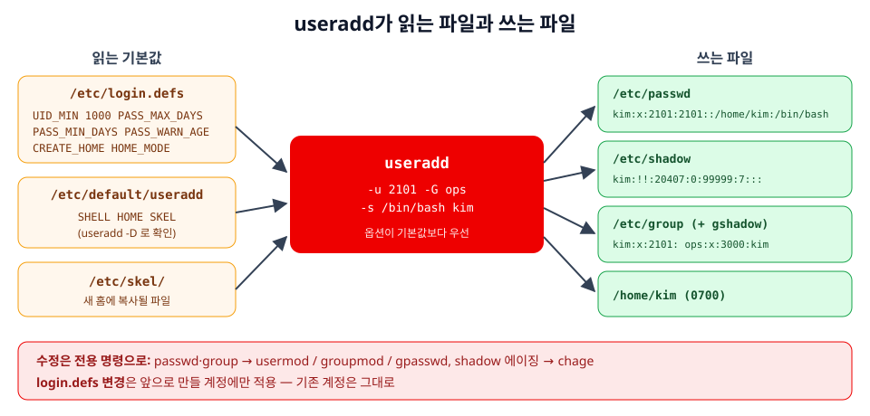
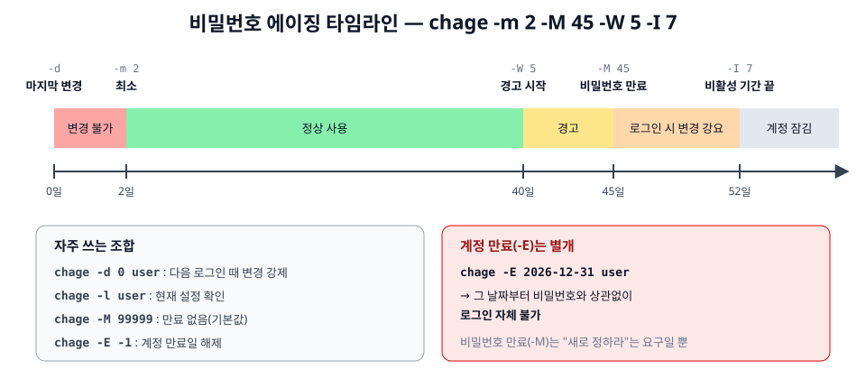

> **번외 · RHCSA(EX200) 대비** | 난이도 ★★☆☆☆ | 예상 소요 2 ~ 2.5시간

> ⚠️ 이 편의 연습 과제는 모두 Red Hat 공식 목표를 바탕으로 **직접 창작한 시험 스타일 과제**입니다. 실제 시험 문제를 옮기거나 재구성한 것이 아닙니다.

## 🎯 이번 편의 목표

공식 목표 ⑨ **Manage users and groups** 를 다룹니다.

- `useradd`/`usermod`/`userdel`로 **UID, 보조 그룹, 셸, nologin** 계정을 만들고 바꿀 수 있다
- `groupadd`/`groupmod`/`gpasswd`로 그룹과 멤버십을 관리할 수 있다
- `passwd`와 `chage`로 **비밀번호 에이징**(최대·최소 사용 기간, 경고, 만료)을 설정할 수 있다
- `/etc/login.defs`의 기본값을 바꿔 **앞으로 만들 계정**의 정책을 정할 수 있다
- `/etc/sudoers.d/`로 **그룹·사용자·명령 단위 sudo 권한**을 주고 `visudo -c`로 검증할 수 있다

실습 환경은 R00의 `servera`(192.168.56.11), `serverb`(192.168.56.12)입니다. 이 편은 주로 `servera`에서 작업합니다.

---

## 1. 출제 유형

| 과제 형태 | 예시 지시문 (창작) | 채점 포인트 |
|---|---|---|
| 사용자 생성 | "UID 2101인 사용자 `kim`, 보조 그룹 `ops`" | `id kim` 결과 |
| 로그인 불가 계정 | "`svcbackup`은 대화형 로그인 불가" | 셸이 `/sbin/nologin` |
| 비밀번호 | "모든 사용자 비밀번호는 X" | 실제 로그인(`su - 사용자`, ssh) |
| 비밀번호 에이징 | "90일마다 변경, 첫 로그인 시 변경 강제" | `chage -l` |
| 기본 정책 | "앞으로 만들 계정의 최대 사용 기간 60일" | `/etc/login.defs` + 새 계정 생성 시 반영 |
| 계정 만료 | "2026-12-31 이후 계정 사용 불가" | `chage -l`의 Account expires |
| sudo | "그룹 `ops`는 비밀번호 없이 모든 명령" / "`kim`은 httpd 재시작만" | `sudo -l -U 사용자`, 실제 실행 |

> 💡 사용자·그룹 과제는 다른 과제의 **전제 조건**으로도 자주 등장합니다(공유 디렉터리 권한, NFS, cron 등). UID/GID를 지정하라는 지시가 있으면 반드시 그대로 맞추세요. 다른 편 과제의 채점이 거기에 기대는 경우가 많습니다.

---

## 2. 계정 관련 파일



| 파일 | 내용 | 직접 편집 |
|---|---|---|
| `/etc/passwd` | `이름:x:UID:GID:설명:홈:셸` | 하지 말 것(`usermod`) |
| `/etc/shadow` | 비밀번호 해시와 **에이징 필드** | 하지 말 것(`chage`, `passwd`) |
| `/etc/group` | `그룹:x:GID:멤버목록` | 하지 말 것(`groupmod`, `gpasswd`) |
| `/etc/gshadow` | 그룹 비밀번호·관리자 | — |
| `/etc/login.defs` | UID 범위, 비밀번호 에이징 기본값, 홈 생성 여부 | **기본값 변경용으로 편집** |
| `/etc/default/useradd` | 기본 셸, 홈 위치, skel 경로 | `useradd -D`로 보기/변경 |
| `/etc/skel/` | 새 홈 디렉터리에 복사될 파일 | 파일 추가 가능 |

```bash
getent passwd kim
# kim:x:2101:2101:Kim Ops:/home/kim:/bin/bash

getent shadow kim          # root만
# kim:$6$...:20407:0:90:7:::
#      해시  마지막변경 최소 최대 경고 비활성 만료
```

> 💡 `/etc/shadow`의 날짜 필드는 **1970-01-01부터 지난 일수**입니다. 사람이 읽기 좋은 형태는 `chage -l 사용자`로 봅니다.

---

## 3. 사용자 관리 — useradd / usermod / userdel

### 3-1. 옵션 정리

| 옵션 | useradd | usermod | 의미 |
|---|---|---|---|
| `-u UID` | O | O | UID 지정 (usermod는 홈 안 파일 소유자도 바꿔 줌) |
| `-g 그룹` | O | O | **기본(1차) 그룹** |
| `-G g1,g2` | O | O | **보조 그룹** — usermod에서는 `-a`와 함께! |
| `-a` | — | O | append: 기존 보조 그룹 유지하고 추가 |
| `-s 셸` | O | O | 로그인 셸 (`/sbin/nologin` = 로그인 불가) |
| `-c "설명"` | O | O | GECOS(이름 등) |
| `-d 경로` | O | O | 홈 디렉터리 (usermod는 `-m`과 함께 써야 내용 이동) |
| `-m` / `-M` | O | — | 홈 만들기 / 만들지 않기 |
| `-e YYYY-MM-DD` | O | O | **계정 만료일** |
| `-L` / `-U` | — | O | 비밀번호 잠금 / 해제 |
| `-r` | O | — | 시스템 계정(SYS_UID 범위) |

```bash
groupadd -g 3000 ops
useradd -u 2101 -G ops -c "Kim Ops" kim
useradd -u 2102 -G ops,wheel lee
useradd -s /sbin/nologin -M svcbackup         # 로그인 불가, 홈 없음
id kim ; id lee ; getent passwd svcbackup
```

```
uid=2101(kim) gid=2101(kim) groups=2101(kim),3000(ops)
```

> 💡 RHEL은 사용자와 같은 이름의 **개인 그룹(User Private Group)** 을 만들어 1차 그룹으로 씁니다(`gid=2101(kim)`). 과제에서 "그룹에 속하게"라고 하면 보통 **보조 그룹(`-G`)** 입니다.

### 3-2. usermod의 가장 위험한 실수

```bash
usermod -G dev kim        # ❌ 기존 보조 그룹(ops)이 사라지고 dev만 남음
usermod -aG dev kim       # ✅ ops 유지 + dev 추가
```

### 3-3. 그 밖의 변경

```bash
usermod -s /sbin/nologin svcbackup     # 셸 변경
usermod -L lee ; usermod -U lee        # 잠금/해제 (shadow 해시 앞에 ! 붙음)
usermod -u 2201 lee                    # UID 변경 (홈 밖 파일은 find로 직접 정리)
userdel -r tempuser                    # 홈·메일 스풀까지 삭제
```

> ⚠️ `nologin` 셸 계정은 **대화형 로그인만** 막습니다. `su - svcbackup` 은 "This account is currently not available." 로 실패하지만, 그 사용자 권한으로 서비스·cron 작업은 실행될 수 있습니다.

---

## 4. 그룹 관리

| 명령 | 의미 |
|---|---|
| `groupadd -g 3000 ops` | GID 지정해 그룹 생성 |
| `groupmod -n operators ops` | 이름 변경 |
| `groupmod -g 3100 ops` | GID 변경 |
| `gpasswd -a kim ops` | 멤버 추가 (= `usermod -aG ops kim`) |
| `gpasswd -d kim ops` | 멤버 제거 |
| `gpasswd -M kim,lee ops` | 멤버 목록을 통째로 설정 |
| `groupdel ops` | 삭제 (누군가의 1차 그룹이면 실패) |

```bash
getent group ops
# ops:x:3000:kim,lee
```

> 💡 그룹 변경은 **새 로그인 세션부터** 반영됩니다. 이미 로그인한 셸에서 `id`를 해도 옛 그룹만 보입니다. 검증은 `id 사용자`(새로 조회) 또는 다시 로그인해서 하세요.

---

## 5. 비밀번호와 에이징

### 5-1. 비밀번호 설정

```bash
passwd kim                                  # 대화형 (시험에서 가장 확실)
echo 'Lab-Pass-2026' | passwd --stdin kim   # 비대화형 (RHEL 10에서도 사용 가능)
echo 'lee:Lab-Pass-2026' | chpasswd         # 여러 명 한 번에
```

> 💡 RHEL 10의 `passwd`는 `shadow-utils` 패키지가 제공합니다. `--stdin`은 계속 지원되지만 성공 메시지가 출력되지 않을 수 있습니다(Red Hat Jira RHEL-39280). 결과는 `echo $?`(0이면 성공)나 실제 로그인으로 확인하세요. 비밀번호 품질 검사(`pwquality`)에 걸려 "BAD PASSWORD" 경고가 나와도 root가 설정하면 적용됩니다.

### 5-2. chage — 비밀번호 에이징



| 옵션 | shadow 필드 | 의미 |
|---|---|---|
| `-d 날짜` | 마지막 변경일 | **`-d 0`** = 다음 로그인 때 변경 강제 |
| `-m 일수` | 최소 | 변경 후 N일 동안 다시 못 바꿈 |
| `-M 일수` | 최대 | N일 지나면 비밀번호 만료 |
| `-W 일수` | 경고 | 만료 N일 전부터 경고 |
| `-I 일수` | 비활성 | 만료 후 N일 지나면 계정 잠김 |
| `-E YYYY-MM-DD` | 만료 | 이 날짜부터 **계정 자체** 사용 불가 (`-E -1` 해제) |
| `-l` | — | 현재 설정 보기 |

```bash
chage -M 90 -m 1 -W 7 -I 14 kim
chage -d 0 kim                      # 첫 로그인 때 변경 강제
chage -E 2026-12-31 lee
chage -l kim
```

```
Last password change                                    : password must be changed
Password expires                                        : password must be changed
Password inactive                                       : password must be changed
Account expires                                         : never
Minimum number of days between password change          : 1
Maximum number of days between password change          : 90
Number of days of warning before password expires       : 7
```

> ⚠️ **비밀번호 만료(`-M`)** 와 **계정 만료(`-E`)** 는 다릅니다. 비밀번호 만료는 "로그인하면 새 비밀번호를 정하라"고 요구할 뿐이지만, 계정 만료일이 지나면 **로그인 자체가 불가**합니다.

---

## 6. /etc/login.defs — 앞으로 만들 계정의 기본값

```bash
grep -Ev '^#|^$' /etc/login.defs | grep -E 'PASS_|UID_|GID_|CREATE_HOME|UMASK|HOME_MODE'
```

| 항목 | RHEL 기본값(예) | 의미 |
|---|---|---|
| `PASS_MAX_DAYS` | `99999` | 새 계정의 최대 사용 기간 |
| `PASS_MIN_DAYS` | `0` | 최소 사용 기간 |
| `PASS_WARN_AGE` | `7` | 경고 일수 |
| `UID_MIN` / `UID_MAX` | `1000` / `60000` | 일반 사용자 UID 범위 |
| `GID_MIN` / `GID_MAX` | `1000` / `60000` | 일반 그룹 GID 범위 |
| `CREATE_HOME` | `yes` | 홈 자동 생성 |
| `UMASK` | `022` | 홈 디렉터리 권한 계산에 사용 |
| `HOME_MODE` | `0700` | 새 홈 디렉터리 권한 |

```bash
sed -i 's/^PASS_MAX_DAYS.*/PASS_MAX_DAYS\t60/' /etc/login.defs
sed -i 's/^PASS_WARN_AGE.*/PASS_WARN_AGE\t10/' /etc/login.defs
useradd newbie && chage -l newbie | grep -E 'Maximum|warning'
```

> ⚠️ `/etc/login.defs`를 바꿔도 **이미 있는 계정에는 적용되지 않습니다.** "모든 기존 사용자에게도"라는 지시가 있으면 `chage`로 따로 바꿔야 합니다. 또 비밀번호 최소 길이는 `login.defs`가 아니라 `/etc/security/pwquality.conf`(`minlen`)가 담당합니다.

`/etc/default/useradd` 는 `useradd -D`로 확인·변경합니다.

```bash
useradd -D                      # GROUP, HOME, INACTIVE, EXPIRE, SHELL, SKEL 등
useradd -D -s /bin/bash         # 기본 셸 변경
```

---

## 7. sudo 권한 — /etc/sudoers.d

RHEL의 `/etc/sudoers`에는 이미 다음 두 줄이 있습니다.

```
%wheel  ALL=(ALL)       ALL
#includedir /etc/sudoers.d
```

그래서 **`wheel` 그룹에 넣기만 해도 전체 sudo 권한**이 생깁니다. 그 외 세분화된 권한은 `/etc/sudoers.d/`에 파일을 따로 만드는 것이 안전합니다(본 파일을 망가뜨리면 sudo 전체가 멈춤).

### 7-1. 문법

```
누가    어느호스트=(누구로)   [NOPASSWD:] 명령목록
kim     ALL=(ALL)             /usr/bin/systemctl restart httpd
%ops    ALL=(ALL)             NOPASSWD: ALL
```

| 요소 | 의미 |
|---|---|
| `kim` / `%ops` | 사용자 / 그룹(`%` 접두사) |
| `ALL=` | 모든 호스트 |
| `(ALL)` | 어떤 사용자로든 실행 가능(`-u`) |
| `NOPASSWD:` | 비밀번호 묻지 않음 |
| 명령 | **절대 경로**, 쉼표로 여러 개, 인자까지 지정 가능 |
| `Cmnd_Alias` | 명령 묶음에 이름 붙이기 |

### 7-2. 작성과 검증

```bash
visudo -f /etc/sudoers.d/ops-team
```

```
# /etc/sudoers.d/ops-team
Cmnd_Alias WEBCTL = /usr/bin/systemctl start httpd, /usr/bin/systemctl stop httpd, /usr/bin/systemctl restart httpd
%ops    ALL=(ALL)   NOPASSWD: ALL
kim     ALL=(root)  WEBCTL
```

```bash
visudo -c                       # 전체 문법 검사
# /etc/sudoers: parsed OK
# /etc/sudoers.d/ops-team: parsed OK
ls -l /etc/sudoers.d/ops-team   # -r--r----- root root (0440 권장)
sudo -l -U kim                  # kim이 쓸 수 있는 명령 목록
```

> ⚠️ `/etc/sudoers.d/` 안의 파일 이름에 **`.`이 들어가거나 `~`로 끝나면 무시**됩니다(`ops.conf` ❌, `ops-team` ✅). 또 `vi`로 직접 편집하다 문법이 틀리면 sudo가 모두 막힐 수 있으니 항상 `visudo -f` 를 쓰고, 마지막에 `visudo -c`로 확인하세요.

> 💡 `which systemctl`로 절대 경로를 확인하세요. RHEL 10은 `/usr/bin/systemctl`입니다. 경로가 틀리면 문법 검사는 통과해도 실행 시 "not allowed"가 납니다.

---

## 8. 자주 하는 실수

| 실수 | 결과 | 예방 |
|---|---|---|
| `usermod -G` (`-a` 누락) | 기존 보조 그룹 삭제 | 항상 `usermod -aG` |
| `-g`와 `-G` 혼동 | 1차 그룹이 바뀜 | 보조 그룹은 대문자 `-G` |
| UID 지정 누락 | 다른 과제(NFS 권한 등) 채점 실패 | 지시된 UID/GID 그대로 |
| nologin 셸 경로 오타 | 로그인이 막히지 않거나 계정 깨짐 | `/sbin/nologin` (`/usr/sbin/nologin`도 같은 파일) |
| login.defs만 고치고 끝 | 기존 계정은 그대로 | 기존 계정은 `chage` |
| `-M`(비밀번호 만료)와 `-E`(계정 만료) 혼동 | 요구와 다른 동작 | 지시문의 "계정"/"비밀번호" 구분 |
| sudoers.d 파일명에 `.` | 규칙 무시됨 | `ops-team` 처럼 점 없이 |
| `vi /etc/sudoers` 로 문법 오류 | sudo 전체 불능 | `visudo -f`, `visudo -c` |
| 명령을 상대 경로로 | sudo 거부 | 절대 경로 |
| 이미 로그인한 셸에서 `id`로 그룹 확인 | 반영 안 된 것처럼 보임 | `id 사용자` 또는 재로그인 |

---

## 9. 창작 연습 과제

> 공식 목표 ⑨를 바탕으로 직접 만든 연습 문제입니다. 시작 전에 `vagrant snapshot save servera r08-before`. 모든 비밀번호는 `Lab-Pass-2026`으로 합니다(실습용 값).

### 과제 1. 그룹과 사용자 (servera)

GID 4000인 그룹 `analysts`를 만들고, 다음 사용자를 만들어라.
- `ana1`: UID 4101, 보조 그룹 `analysts`
- `ana2`: UID 4102, 보조 그룹 `analysts`와 `wheel`
- `report`: 보조 그룹 없음, **대화형 로그인 불가**

<details>
<summary>풀이·검증</summary>

```bash
groupadd -g 4000 analysts
useradd -u 4101 -G analysts ana1
useradd -u 4102 -G analysts,wheel ana2
useradd -s /sbin/nologin report
for u in ana1 ana2 report; do echo 'Lab-Pass-2026' | passwd --stdin $u; done
```

검증

```bash
id ana1 ; id ana2 ; getent passwd report
getent group analysts                     # analysts:x:4000:ana1,ana2
su - report                               # This account is currently not available.
su - ana1 -c id                           # root에서는 비밀번호 없이 확인 가능
```
</details>

### 과제 2. 보조 그룹 추가 — 기존 그룹 유지 (servera)

`ana1`을 그룹 `auditors`(새로 생성, GID 자유)에도 추가하라. `analysts` 멤버십은 유지되어야 한다.

<details>
<summary>풀이·검증</summary>

```bash
groupadd auditors
usermod -aG auditors ana1
```

검증

```bash
id ana1          # groups=...,4000(analysts),...(auditors) 둘 다 있어야 함
```
</details>

### 과제 3. 비밀번호 에이징 (servera)

`ana1`의 비밀번호는 **45일마다** 바꿔야 하고, 바꾼 뒤 **2일 동안은 다시 바꿀 수 없으며**, 만료 **5일 전**부터 경고가 나와야 한다. 또 `ana2`는 **다음 로그인 때 비밀번호를 반드시 바꾸게** 하라.

<details>
<summary>풀이·검증</summary>

```bash
chage -M 45 -m 2 -W 5 ana1
chage -d 0 ana2
```

검증

```bash
chage -l ana1 | grep -E 'Minimum|Maximum|warning'
chage -l ana2 | head -2              # password must be changed
# serverb에서 ssh ana2@servera → "You are required to change your password immediately"
```
</details>

### 과제 4. 계정 만료일 (servera)

임시 사용자 `intern`(UID 4200)을 만들고 **2026-12-31 이후로는 계정을 쓸 수 없게** 하라.

<details>
<summary>풀이·검증</summary>

```bash
useradd -u 4200 -e 2026-12-31 intern
# 또는 이미 있다면: chage -E 2026-12-31 intern
echo 'Lab-Pass-2026' | passwd --stdin intern
```

검증

```bash
chage -l intern | grep 'Account expires'       # Dec 31, 2026
getent shadow intern | cut -d: -f8             # 만료일(일수)
```
</details>

### 과제 5. 새 계정 기본 정책 (servera)

앞으로 만드는 모든 일반 사용자는 **비밀번호 최대 사용 기간 60일, 경고 10일**이 기본으로 적용되게 하라. 확인용 사용자 `policytest`를 만들어 검증한다.

<details>
<summary>풀이·검증</summary>

```bash
sed -i 's/^PASS_MAX_DAYS.*/PASS_MAX_DAYS\t60/' /etc/login.defs
sed -i 's/^PASS_WARN_AGE.*/PASS_WARN_AGE\t10/' /etc/login.defs
useradd policytest
```

검증

```bash
grep -E '^PASS_(MAX_DAYS|WARN_AGE)' /etc/login.defs
chage -l policytest | grep -E 'Maximum|warning'   # 60 / 10
chage -l ana1 | grep Maximum                      # 기존 계정은 45 그대로(영향 없음)
```
</details>

### 과제 6. 그룹 단위 sudo (servera)

그룹 `analysts`의 멤버는 **비밀번호 없이 모든 명령**을 sudo로 실행할 수 있어야 한다. `/etc/sudoers`는 수정하지 말 것.

<details>
<summary>풀이·검증</summary>

```bash
visudo -f /etc/sudoers.d/analysts
# %analysts   ALL=(ALL)   NOPASSWD: ALL
chmod 440 /etc/sudoers.d/analysts
visudo -c
```

검증

```bash
sudo -l -U ana1 | tail -2
su - ana1 -c 'sudo -n whoami'          # root (-n: 비밀번호 요구 시 실패)
```
</details>

### 과제 7. 명령 제한 sudo (servera)

사용자 `report`는 로그인 셸이 없지만, 운영자가 `sudo -u report` 로 작업을 돌릴 수 있어야 한다. 대신 별도로 사용자 `webop`(새로 생성)은 **httpd 서비스의 시작·중지·재시작과 상태 조회만** sudo로 할 수 있게 하라(비밀번호는 물어야 함).

<details>
<summary>풀이·검증</summary>

```bash
useradd webop && echo 'Lab-Pass-2026' | passwd --stdin webop
visudo -f /etc/sudoers.d/webop
```

```
Cmnd_Alias HTTPDCTL = /usr/bin/systemctl start httpd, /usr/bin/systemctl stop httpd, \
                      /usr/bin/systemctl restart httpd, /usr/bin/systemctl status httpd
webop   ALL=(root)  HTTPDCTL
```

```bash
visudo -c
```

검증

```bash
sudo -l -U webop
su - webop
sudo systemctl restart httpd       # 비밀번호 입력 후 성공 (httpd 설치되어 있어야 함)
sudo systemctl restart sshd        # Sorry, user webop is not allowed to execute ...
exit
sudo -u report /usr/bin/id         # root는 nologin 계정으로도 명령 실행 가능
```
</details>

### 과제 8. 정리 훈련 (servera)

`intern` 계정을 홈 디렉터리와 함께 삭제하고, 그룹 `auditors`도 삭제하라. `ana1`의 다른 그룹 멤버십은 유지되어야 한다.

<details>
<summary>풀이·검증</summary>

```bash
userdel -r intern
groupdel auditors
```

검증

```bash
getent passwd intern ; ls -d /home/intern    # 아무것도 없음
id ana1                                      # analysts는 남아 있음
reboot ; id ana1 ; sudo -l -U ana1           # 재부팅 후에도 동일
```
</details>

---

## 10. 핵심 정리

- 사용자 만들기: `useradd -u UID -G 보조그룹 -s 셸`, 로그인 불가 계정은 `-s /sbin/nologin`
- 보조 그룹 추가는 반드시 **`usermod -aG`** (`-a` 없으면 기존 그룹 삭제)
- 비밀번호: `passwd` (RHEL 10에서도 `--stdin` 사용 가능), 여러 명은 `chpasswd`
- 에이징: `chage -M 최대 -m 최소 -W 경고 -I 비활성 -E 계정만료`, `-d 0`은 첫 로그인 변경 강제, 확인은 `chage -l`
- `/etc/login.defs`는 **새 계정에만** 적용, 기존 계정은 `chage`
- sudo: `wheel` 그룹 = 전체 권한, 세부 권한은 `visudo -f /etc/sudoers.d/이름`(점 없는 파일명), 명령은 절대 경로, 검증은 **`visudo -c`** 와 `sudo -l -U 사용자`

---

## ⏭️ 다음 예고 — R09. 보안

firewalld를 zone 선택 원리부터 다시 보고, `umask` 기본값을 사용자별·전역으로 바꿉니다. `serverb → servera` SSH 키 인증을 만들고 비밀번호 로그인을 제한한 뒤, SELinux의 모드 전환·파일 컨텍스트(`semanage fcontext` + `restorecon`)·포트 라벨·불리언, 그리고 `ausearch`와 `sealert`로 거부 원인을 찾는 법까지 다룹니다.
