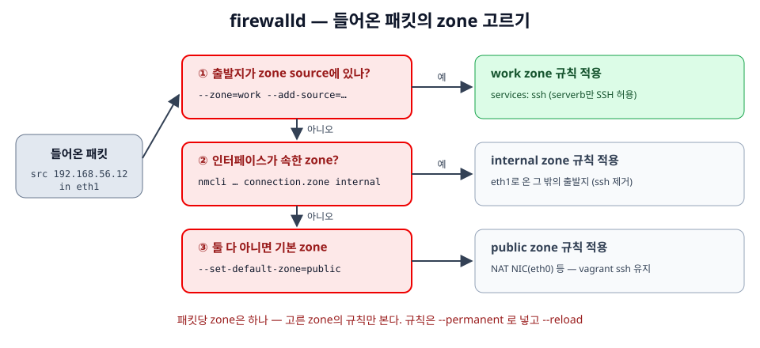
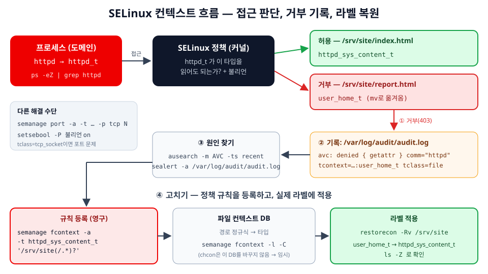

> **번외 · RHCSA(EX200) 대비** | 난이도 ★★★★☆ | 예상 소요 3 ~ 4시간

> ⚠️ 이 편의 연습 과제는 모두 Red Hat 공식 목표를 바탕으로 **직접 창작한 시험 스타일 과제**입니다. 실제 시험 문제를 옮기거나 재구성한 것이 아닙니다.

## 🎯 이번 편의 목표

공식 목표 ⑩ **Manage security** 를 다룹니다.

- firewalld의 **zone 선택 순서**를 이해하고 zone·소스·인터페이스·포워딩을 다룰 수 있다
- `umask` 기본값을 **사용자별·전역**으로 바꿀 수 있다
- **serverb → servera SSH 키 인증**을 만들고 비밀번호 로그인을 제한할 수 있다
- SELinux를 **enforcing/permissive**로 전환하고 영구 설정할 수 있다
- `ls -Z`/`ps -Z`로 컨텍스트를 읽고, `semanage fcontext` + `restorecon`, `semanage port`, `setsebool -P`로 문제를 고칠 수 있다
- `ausearch`와 `sealert`로 **SELinux 거부 원인**을 찾을 수 있다

실습 환경은 R00의 `servera`(192.168.56.11), `serverb`(192.168.56.12)입니다. R07의 firewalld 기초와 R08의 사용자 관리를 알고 있다고 가정합니다.

---

## 1. 출제 유형

| 과제 형태 | 예시 지시문 (창작) | 채점 포인트 |
|---|---|---|
| 방화벽 | "serverb 대역만 ssh 허용, 나머지는 거부" | permanent 규칙, 실제 접속 결과 |
| umask | "사용자 X가 만드는 파일은 그룹·기타에 쓰기 권한 없음" | 새로 로그인한 셸의 `umask` |
| SSH 키 | "serverb의 사용자 Y가 비밀번호 없이 servera에 접속" | `ssh -o BatchMode=yes` 성공 |
| SSH 제한 | "root는 비밀번호로 SSH 로그인 불가" | `sshd -T` 결과 |
| SELinux 모드 | "enforcing 상태로 부팅되게" | `getenforce`, `/etc/selinux/config` |
| 파일 컨텍스트 | "웹 문서 루트를 /srv/site로 바꿔도 동작" | `ls -Zd`, `semanage fcontext -l`, `curl` |
| 포트 라벨 | "httpd가 TCP 8090에서 리슨" | `semanage port -l`, 서비스 active |
| 불리언 | "httpd가 사용자 홈 디렉터리 제공" | `getsebool`, **재부팅 후 유지(-P)** |

> 💡 SELinux 과제의 정석은 **"SELinux를 끄지 않고"** 해결하는 것입니다. `setenforce 0`으로 넘어가면 채점 시점(재부팅 후 enforcing)에 서비스가 실패합니다. 시험에서 SELinux는 enforcing이 기본이라고 생각하세요.

---

## 2. firewalld 심화

### 2-1. 패킷은 어느 zone으로 가는가



firewalld는 들어온 패킷마다 **딱 하나의 zone**을 고르고 그 zone의 규칙만 적용합니다.

| 순서 | 기준 | 설정 |
|---|---|---|
| 1 | **출발지 주소**가 어떤 zone의 source에 속하면 | `--zone=X --add-source=192.168.56.12/32` |
| 2 | 들어온 **인터페이스**가 속한 zone | `--zone=X --change-interface=eth1` 또는 `nmcli con mod … connection.zone X` |
| 3 | 둘 다 아니면 **기본 zone** | `--set-default-zone=public` |

| 기본 제공 zone | 들어오는 연결 기본 동작 |
|---|---|
| `drop` | 모두 조용히 버림(응답 없음) |
| `block` | 모두 거부(icmp-prohibited 응답) |
| `public` | 기본 zone. ssh, dhcpv6-client, cockpit 등 일부만 허용 |
| `work` / `home` / `internal` | public보다 조금 더 허용 |
| `trusted` | **모두 허용** |

```bash
firewall-cmd --get-default-zone
firewall-cmd --get-active-zones
firewall-cmd --list-all --zone=public
firewall-cmd --list-all-zones | less
```

### 2-2. 인터페이스 zone은 NetworkManager로

```bash
nmcli connection modify lab-net connection.zone internal
nmcli connection up lab-net
firewall-cmd --get-zone-of-interface=eth1          # internal
```

> 💡 firewalld와 NetworkManager가 함께 있을 때 인터페이스의 zone은 **연결 프로필의 `connection.zone`** 에 저장하는 것이 가장 확실하게 재부팅 후에도 유지됩니다.

### 2-3. 자주 쓰는 고급 동작

```bash
# 런타임에서 시험해 보고, 괜찮으면 통째로 영구 저장
firewall-cmd --add-service=https
firewall-cmd --runtime-to-permanent

# 특정 출발지 거부 (reject: 거부 응답 / drop: 무응답)
firewall-cmd --permanent --add-rich-rule='rule family="ipv4" source address="192.168.56.1/32" service name="ssh" reject'

# 포트 포워딩: 들어온 TCP 8080 → 같은 호스트의 80
firewall-cmd --permanent --add-forward-port=port=8080:proto=tcp:toport=80

# 서비스 정의 확인 (어떤 포트를 여는지)
firewall-cmd --info-service=nfs
firewall-cmd --reload
```

> ⚠️ **방화벽과 SELinux는 따로 막습니다.** 비표준 포트(예: httpd 8090)는 ① `semanage port`로 SELinux 라벨 ② `firewall-cmd --add-port`로 방화벽, **둘 다** 해야 다른 VM에서 접속됩니다.

---

## 3. umask — 새 파일의 기본 권한

새 파일은 `666`, 새 디렉터리는 `777`에서 **umask 비트를 뺀** 권한으로 만들어집니다.

| umask | 새 파일 | 새 디렉터리 | 용도 |
|---|---|---|---|
| `0022` | `644` rw-r--r-- | `755` rwxr-xr-x | 일반적 기본값 |
| `0002` | `664` | `775` | 그룹 협업 |
| `0027` | `640` | `750` | 기타 사용자 차단 |
| `0077` | `600` | `700` | 본인만 |

```bash
umask            # 0022
umask -S         # u=rwx,g=rx,o=rx
grep -n umask /etc/profile /etc/bashrc ; grep ^UMASK /etc/login.defs   # 현재 기본값이 어디서 오는지
```

**설정 위치**

| 범위 | 파일 | 비고 |
|---|---|---|
| 한 사용자 | `~/.bashrc` (또는 `~/.bash_profile`) 끝에 `umask 027` | 그 사용자의 새 셸부터 |
| 전체 사용자 | `/etc/profile.d/lab-umask.sh` 에 `umask 027` | RHEL의 `/etc/profile`과 `/etc/bashrc`가 모두 `profile.d/*.sh`를 읽음 |
| 새 홈 디렉터리 | `/etc/login.defs`의 `UMASK`, `HOME_MODE` | 계정 생성 시 홈 권한 |

```bash
echo 'umask 027' >> /home/ana1/.bashrc
echo 'umask 027' > /etc/profile.d/lab-umask.sh
```

> ⚠️ `/etc/profile`이나 `/etc/bashrc`를 직접 고치면 패키지 업데이트 때 `.rpmnew`로 갈라질 수 있습니다. 전역 설정은 `/etc/profile.d/`에 별도 파일로 두는 편이 안전합니다. 검증은 **새로 로그인한 셸**에서 `umask`와 `touch` 결과로 하세요.

---

## 4. SSH 키 인증과 비밀번호 로그인 제한

### 4-1. serverb → servera 키 인증

```bash
# serverb, 사용자 ana1로
ssh-keygen -t ed25519 -N '' -f ~/.ssh/id_ed25519      # 시험 지시가 패스프레이즈를 요구하면 -N 생략
ssh-copy-id ana1@servera                              # 비밀번호 한 번 입력
ssh -o BatchMode=yes ana1@servera hostname            # 비밀번호 없이 servera 출력되면 성공
```

servera에 생긴 파일과 권한:

| 경로 | 권한 | 비고 |
|---|---|---|
| `~ana1/.ssh/` | `700` | |
| `~ana1/.ssh/authorized_keys` | `600` | 공개키 한 줄씩 |
| SELinux 컨텍스트 | `ssh_home_t` | `ssh-copy-id`가 아니라 손으로 만들었다면 `restorecon -Rv ~ana1/.ssh` |

> ⚠️ `authorized_keys`를 수동으로 만들 때 **권한(600/700)이나 SELinux 라벨**이 틀리면 키를 무시하고 비밀번호를 묻습니다. 원인은 servera의 `journalctl -u sshd`에 남습니다.

### 4-2. 비밀번호 로그인 제한

RHEL 10의 `/etc/ssh/sshd_config`는 맨 앞에서 `/etc/ssh/sshd_config.d/*.conf`를 읽고, sshd는 **같은 키워드는 먼저 읽은 값이 이깁니다**. 그래서 숫자가 작은 이름으로 drop-in 파일을 만들면 기본 파일(예: `50-redhat.conf`)보다 우선합니다.

```bash
# servera — 다른 터미널(또는 콘솔)을 열어 둔 채로 작업
cat > /etc/ssh/sshd_config.d/01-lab.conf <<'EOF'
PermitRootLogin prohibit-password
PasswordAuthentication no
EOF
sshd -t                                        # 문법 검사 (출력 없으면 OK)
systemctl restart sshd
sshd -T | grep -Ei '^(permitrootlogin|passwordauthentication)'
```

```
permitrootlogin without-password      ← prohibit-password와 같은 뜻으로 표시됨
passwordauthentication no
```

| 옵션 | 값 | 의미 |
|---|---|---|
| `PermitRootLogin` | `no` / `prohibit-password` / `yes` | root 로그인 금지 / 키만 허용 / 모두 허용 |
| `PasswordAuthentication` | `no` | 모든 사용자 비밀번호 인증 금지 |
| `Match User 이름` 블록 | | 특정 사용자에게만 다른 규칙 |

```
# 특정 사용자만 비밀번호 허용하는 예 (파일 맨 끝에)
Match User ana2
    PasswordAuthentication yes
```

> ⚠️ `PasswordAuthentication no`를 넣기 전에 **키 로그인이 되는지 먼저 확인**하고, 지금 연결된 세션은 닫지 마세요. Vagrant VM은 `vagrant ssh`가 키로 접속하므로 영향이 없지만, 다른 사용자가 비밀번호로만 들어오던 경로는 끊깁니다. 시험에서 "비밀번호 로그인 제한" 범위(root만인지, 전체인지)를 지시문대로 정확히 지키세요.

---

## 5. SELinux

### 5-1. 모드 확인과 전환

| 모드 | 정책 검사 | 거부 | 로그 |
|---|---|---|---|
| `enforcing` | O | **차단함** | AVC 기록 |
| `permissive` | O | 차단 안 함 | AVC 기록(문제 진단용) |
| `disabled` | X | — | — |

```bash
getenforce
sestatus
setenforce 0        # permissive (런타임, 재부팅하면 원래대로)
setenforce 1        # enforcing
```

영구 설정은 `/etc/selinux/config`:

```bash
grep ^SELINUX= /etc/selinux/config
sed -i 's/^SELINUX=.*/SELINUX=enforcing/' /etc/selinux/config
```

> ⚠️ `disabled` ↔ `enforcing` 전환은 재부팅과 전체 재라벨링이 필요하고, RHEL 9부터는 config 파일만으로 SELinux를 완전히 끌 수 없습니다(커널 인자 `selinux=0` 필요). 시험에서 SELinux를 끄라는 지시가 없는 한 **disabled는 절대 쓰지 마세요.** 진단할 때만 잠깐 `setenforce 0`, 끝나면 `setenforce 1`.

### 5-2. 컨텍스트 읽기



컨텍스트 형식은 `사용자:역할:타입:레벨`이고, RHCSA에서 보는 것은 거의 **타입(`_t`)** 입니다. **프로세스 타입(도메인)이 파일·포트 타입에 접근해도 되는지**를 정책이 정합니다.

```bash
ls -Zd /var/www/html /home/ana1
# system_u:object_r:httpd_sys_content_t:s0 /var/www/html
# unconfined_u:object_r:user_home_dir_t:s0 /home/ana1

ps -eZ | grep httpd
# system_u:system_r:httpd_t:s0    1234 ?  00:00:00 httpd

id -Z                         # 내 셸의 컨텍스트
```

### 5-3. 파일 컨텍스트 — semanage fcontext + restorecon

| 명령 | 효과 | 재라벨 후 유지 |
|---|---|---|
| `chcon -t 타입 파일` | 파일 라벨만 즉시 바꿈 | **X** (restorecon하면 되돌아감) |
| `semanage fcontext -a -t 타입 '경로(/.*)?'` | **정책 규칙** 추가 | O |
| `restorecon -Rv 경로` | 규칙대로 실제 라벨 적용 | — |

```bash
dnf install -y policycoreutils-python-utils     # semanage 제공 (없을 때)
mkdir -p /srv/site && echo 'site-ok' > /srv/site/index.html
ls -Zd /srv/site                                 # var_t 등 — httpd가 못 읽음

semanage fcontext -a -t httpd_sys_content_t '/srv/site(/.*)?'
restorecon -Rv /srv/site
ls -Z /srv/site/index.html                       # httpd_sys_content_t
semanage fcontext -l -C                          # 내가 추가한 규칙만 보기
```

> 💡 어떤 타입을 써야 할지 모르면 **원래 정상 동작하는 경로의 타입**을 보세요(`ls -Zd /var/www/html`). 정규식 `'(/.*)?'`는 "디렉터리 자신과 그 아래 전부"이고 **반드시 작은따옴표**로 감쌉니다. 규칙 수정은 `-m`, 삭제는 `-d`.

> ⚠️ `mv`는 **원래 라벨을 그대로 가져오고**, `cp`는 대상 위치의 라벨을 새로 받습니다. 홈에서 만든 파일을 `mv`로 `/var/www/html`에 옮기면 `user_home_t`가 남아 403이 납니다. `restorecon -Rv /var/www/html`로 해결합니다.

### 5-4. 포트 라벨 — semanage port

```bash
semanage port -l | grep -w http_port_t
# http_port_t   tcp   80, 81, 443, 488, 8008, 8009, 8443, 9000

semanage port -a -t http_port_t -p tcp 8090     # 추가
semanage port -m -t http_port_t -p tcp 8090     # 이미 다른 타입이면 수정(-m)
semanage port -d -t http_port_t -p tcp 8090     # 삭제
```

> 💡 "ValueError: Port tcp/8090 already defined" 가 나오면 이미 다른 타입에 속한 포트입니다. `-a` 대신 **`-m`** 으로 바꾸세요.

### 5-5. 불리언 — setsebool -P

```bash
getsebool -a | grep httpd | head
semanage boolean -l | grep httpd_enable_homedirs     # 설명 포함
setsebool -P httpd_enable_homedirs on                 # -P = 영구
getsebool httpd_enable_homedirs
```

| 자주 보는 불리언 | 의미 |
|---|---|
| `httpd_enable_homedirs` | httpd가 `~/public_html` 제공 |
| `httpd_can_network_connect` | httpd가 외부로 네트워크 연결(리버스 프록시 등) |
| `httpd_use_nfs` | httpd가 NFS 콘텐츠 제공 |
| `use_nfs_home_dirs` | NFS 홈 디렉터리 사용(R05 autofs와 연결) |
| `ftpd_anon_write` | 익명 FTP 쓰기 |

> ⚠️ `-P` 없이 `setsebool`하면 **재부팅 시 원래 값으로 돌아갑니다.**

### 5-6. 거부 원인 찾기 — audit 로그와 sealert

```bash
# 1) AVC 거부 기록 찾기
ausearch -m AVC -ts recent
grep 'denied' /var/log/audit/audit.log | tail -3
```

```
type=AVC msg=audit(...): avc:  denied  { getattr } for  pid=2345 comm="httpd"
  path="/srv/site/index.html" scontext=system_u:system_r:httpd_t:s0
  tcontext=unconfined_u:object_r:var_t:s0 tclass=file permissive=0
```

| 필드 | 읽는 법 |
|---|---|
| `comm="httpd"` | 누가 (프로세스) |
| `scontext=…httpd_t` | 출발 도메인 |
| `tcontext=…var_t` | 대상 라벨 — **이게 잘못된 경우가 대부분** |
| `tclass=file` / `tcp_socket` | 파일 문제인가, 포트 문제인가 |

```bash
# 2) 사람이 읽는 해설과 해결책
dnf install -y setroubleshoot-server
sealert -a /var/log/audit/audit.log | less
journalctl -t setroubleshoot --since "10 min ago"
```

`sealert`는 "`semanage fcontext -a -t httpd_sys_content_t '/srv/site/index.html'` 후 `restorecon`하라"처럼 **구체적인 명령을 제안**합니다. 여러 제안 중 신뢰도(%)가 높은 것부터 보되, `audit2allow`로 정책 모듈을 만드는 제안은 RHCSA 범위에서는 마지막 수단입니다.

> 💡 시험장에서 타입 이름이 기억나지 않으면 `man -k _selinux` 로 서비스별 SELinux 매뉴얼(`httpd_selinux` 등)을 찾아보세요. 이 매뉴얼은 `selinux-policy-doc` 패키지가 설치되어 있어야 보입니다.

---

## 6. 자주 하는 실수

| 실수 | 결과 | 예방 |
|---|---|---|
| `setenforce 0`으로 문제 회피 | 재부팅 후 enforcing에서 서비스 실패 | 원인을 고치고 enforcing 유지 |
| `chcon`만 사용 | 재라벨(`restorecon`, autorelabel) 시 원복 | `semanage fcontext` + `restorecon` |
| fcontext 정규식에 따옴표 누락 | 셸이 괄호를 해석해 오류 | `'/srv/site(/.*)?'` |
| `semanage fcontext`만 하고 `restorecon` 안 함 | 실제 라벨 그대로 | 규칙 추가 → 적용 |
| `setsebool` 에 `-P` 누락 | 재부팅 후 원복 | 항상 `-P` |
| SELinux 포트만 / 방화벽만 처리 | 로컬은 되는데 원격 실패(또는 그 반대) | 비표준 포트는 둘 다 |
| `authorized_keys` 권한 644, `.ssh` 755 | 키 무시 | 600 / 700, `restorecon -Rv ~/.ssh` |
| sshd drop-in 파일 이름 순서 | 다른 파일의 값이 먼저 적용 | `01-` 처럼 앞 번호, `sshd -T`로 확인 |
| sshd 재시작 전 문법 미검사 | sshd 기동 실패 → 원격 접속 불가 | `sshd -t` |
| umask를 이미 열린 셸에서 확인 | 바뀐 것처럼 보이지 않음 | 새로 로그인해서 확인 |

---

## 7. 창작 연습 과제

> 공식 목표 ⑩을 바탕으로 직접 만든 연습 문제입니다. 시작 전에 `vagrant snapshot save servera r09-before`, `vagrant snapshot save serverb r09-before`. R08의 사용자 `ana1`, `ana2`가 있다고 가정합니다(없으면 `useradd`로 만드세요).

### 과제 1. SELinux 모드 (servera)

servera가 현재 permissive라고 가정하고(`setenforce 0`으로 만들어 두기), 지금 즉시 그리고 재부팅 후에도 **enforcing**으로 동작하게 하라.

<details>
<summary>풀이·검증</summary>

```bash
setenforce 1
sed -i 's/^SELINUX=.*/SELINUX=enforcing/' /etc/selinux/config
```

검증

```bash
getenforce                              # Enforcing
grep ^SELINUX= /etc/selinux/config      # SELINUX=enforcing
reboot ; getenforce
```
</details>

### 과제 2. 새 문서 루트 (servera)

httpd의 DocumentRoot를 `/srv/site`로 바꾸고 `site-ok`를 내용으로 하는 `index.html`을 제공하라. SELinux는 enforcing을 유지해야 하며, serverb에서 `curl http://servera`가 `site-ok`를 받아야 한다.

<details>
<summary>풀이·검증</summary>

```bash
dnf install -y httpd
mkdir -p /srv/site && echo site-ok > /srv/site/index.html
sed -i 's#/var/www/html#/srv/site#g' /etc/httpd/conf/httpd.conf    # DocumentRoot와 <Directory> 둘 다
semanage fcontext -a -t httpd_sys_content_t '/srv/site(/.*)?'
restorecon -Rv /srv/site
systemctl enable --now httpd ; systemctl restart httpd
firewall-cmd --permanent --add-service=http ; firewall-cmd --reload
```

검증

```bash
ls -Zd /srv/site /srv/site/index.html           # httpd_sys_content_t
semanage fcontext -l -C | grep /srv/site
curl -s http://localhost                        # site-ok
# serverb에서 curl -s http://servera
reboot ; curl -s http://localhost
```
</details>

### 과제 3. 거부 원인 추적 (servera)

`ana1`의 홈에서 `report.html`을 만들어 `mv`로 `/srv/site/`에 옮긴 뒤 `curl http://localhost/report.html`이 403이 나는 것을 확인하라. **audit 로그와 sealert로 원인을 찾아** 고쳐라.

<details>
<summary>풀이·검증</summary>

```bash
su - ana1 -c 'echo report > ~/report.html'
mv /home/ana1/report.html /srv/site/
curl -s -o /dev/null -w '%{http_code}\n' http://localhost/report.html     # 403
ausearch -m AVC -ts recent | grep report.html                              # tcontext=...user_home_t
sealert -a /var/log/audit/audit.log | grep -A3 report.html
restorecon -v /srv/site/report.html
chmod 644 /srv/site/report.html                                            # 일반 권한도 확인
```

검증

```bash
ls -Z /srv/site/report.html                    # httpd_sys_content_t
curl -s http://localhost/report.html           # report
```
</details>

### 과제 4. 비표준 포트 (servera)

httpd가 80과 함께 **TCP 8090**에서도 리슨하게 하고, serverb에서 `curl http://servera:8090`이 성공하게 하라.

<details>
<summary>풀이·검증</summary>

```bash
echo 'Listen 8090' > /etc/httpd/conf.d/port8090.conf
semanage port -a -t http_port_t -p tcp 8090
systemctl restart httpd
firewall-cmd --permanent --add-port=8090/tcp ; firewall-cmd --reload
```

검증

```bash
semanage port -l | grep -w http_port_t        # 8090 포함
ss -tlnp | grep 8090
# serverb에서 curl -s http://servera:8090
reboot ; systemctl is-active httpd
```

`semanage port`를 빼먹으면 `systemctl restart httpd`가 실패하고 `journalctl -u httpd`에 "Permission denied: AH00072: make_sock: could not bind to address [::]:8090" 이 남습니다.
</details>

### 과제 5. 불리언 (servera)

`ana2`의 `~/public_html/index.html`(내용 `ana2-page`)을 `http://servera/~ana2/` 로 제공하라. SELinux enforcing 유지, 설정은 재부팅 후에도 유지.

<details>
<summary>풀이·검증</summary>

```bash
# 1) httpd userdir 모듈 설정: UserDir disabled → UserDir public_html
sed -i 's/^\s*UserDir disabled/    #UserDir disabled/; s/^\s*#UserDir public_html/    UserDir public_html/' /etc/httpd/conf.d/userdir.conf
su - ana2 -c 'mkdir -p ~/public_html && echo ana2-page > ~/public_html/index.html'
chmod 711 /home/ana2 ; chmod 755 /home/ana2/public_html
# 2) SELinux
setsebool -P httpd_enable_homedirs on
restorecon -Rv /home/ana2/public_html          # httpd_user_content_t
systemctl restart httpd
```

검증

```bash
getsebool httpd_enable_homedirs                 # on
ls -Zd /home/ana2/public_html
curl -s http://localhost/~ana2/                 # ana2-page
reboot ; getsebool httpd_enable_homedirs ; curl -s http://localhost/~ana2/
```
</details>

### 과제 6. SSH 키 인증과 비밀번호 제한 (serverb → servera)

serverb의 사용자 `ana1`이 **비밀번호 없이** servera의 `ana1`로 SSH 접속할 수 있게 하라. 그 다음 servera에서 **root의 비밀번호 SSH 로그인을 금지**하라(키 로그인은 허용).

<details>
<summary>풀이·검증</summary>

```bash
# serverb (ana1이 없으면 useradd ana1 후)
su - ana1
ssh-keygen -t ed25519 -N '' -f ~/.ssh/id_ed25519
ssh-copy-id ana1@192.168.56.11
exit

# servera
echo 'PermitRootLogin prohibit-password' > /etc/ssh/sshd_config.d/01-lab.conf
sshd -t && systemctl restart sshd
```

검증

```bash
# serverb
su - ana1 -c 'ssh -o BatchMode=yes ana1@192.168.56.11 hostname'      # servera...
ssh -o PreferredAuthentications=password -o PubkeyAuthentication=no root@192.168.56.11   # Permission denied
# servera
sshd -T | grep -i permitrootlogin                                    # without-password (= prohibit-password)
ls -ld ~ana1/.ssh ; ls -lZ ~ana1/.ssh/authorized_keys                # 700 / 600, ssh_home_t
```
</details>

### 과제 7. umask (servera)

① 사용자 `ana1`이 만드는 새 파일은 **기타 사용자에게 아무 권한도 없게**(파일 640, 디렉터리 750) 하라. ② 그 외 모든 사용자의 로그인 셸 기본 umask는 `022`로 명시해 둔다.

<details>
<summary>풀이·검증</summary>

```bash
echo 'umask 022' > /etc/profile.d/lab-umask.sh
echo 'umask 027' >> /home/ana1/.bashrc
```

`~/.bashrc`는 `/etc/profile.d`보다 나중에 읽히므로 ana1에게는 027이 최종 적용됩니다.

검증

```bash
su - ana1 -c 'umask; touch ~/t1; mkdir ~/d1; ls -ld ~/t1 ~/d1'
# 0027 / -rw-r----- / drwxr-x---
su - ana2 -c 'umask'                     # 0022
```
</details>

### 과제 8. 출발지 기반 접근 제한 (servera)

servera의 SSH는 **serverb(192.168.56.12)에서만** 허용하고, 같은 host-only 대역의 다른 주소(예: 호스트 PC 192.168.56.1)에서는 거부하라. `vagrant ssh`(NAT NIC)는 계속 동작해야 한다.

<details>
<summary>풀이·검증</summary>

host-only NIC를 별도 zone(`internal`)에 넣어 ssh를 빼고, serverb 주소만 `work` zone의 source로 지정해 ssh를 허용합니다. 출발지 규칙이 인터페이스보다 먼저 적용되므로 serverb의 패킷은 `work` zone 규칙을 탑니다.

```bash
nmcli connection modify lab-net connection.zone internal ; nmcli connection up lab-net
firewall-cmd --permanent --zone=internal --remove-service=ssh
firewall-cmd --permanent --zone=work --add-source=192.168.56.12/32
firewall-cmd --permanent --zone=work --add-service=ssh
firewall-cmd --reload
```

NAT NIC는 기본 zone(public)에 남아 ssh가 허용되므로 `vagrant ssh`는 영향이 없습니다. 단, 과제 2·4에서 public zone에 열어 둔 http·8090은 이제 eth1로 들어오는 트래픽에 적용되지 않으므로, 계속 필요하면 `--zone=work`(serverb용)와 `--zone=internal`에도 추가하세요.

검증

```bash
firewall-cmd --get-active-zones                     # internal: eth1 / work: sources 192.168.56.12/32
firewall-cmd --list-all --zone=internal | grep services
# serverb: ssh ana1@192.168.56.11 → 접속됨
# 호스트 PC: ssh vagrant@192.168.56.11 → 거부(타임아웃/거부)
reboot ; firewall-cmd --get-active-zones
```

> rich rule 하나(`source address=192.168.56.12 service name=ssh accept`)와 public zone에서 ssh 제거로도 풀 수 있지만, 그러면 NAT NIC의 ssh도 막혀 `vagrant ssh`가 끊깁니다. 어느 zone이 어느 인터페이스에 걸리는지 먼저 보는 습관이 중요합니다.
</details>

---

## 8. 핵심 정리

- firewalld zone 선택: **source → interface → default**. 인터페이스 zone은 `nmcli … connection.zone`, 규칙은 permanent + reload
- umask: 사용자별은 `~/.bashrc`, 전역은 `/etc/profile.d/*.sh`, 확인은 **새 로그인 셸**에서
- SSH 키: `ssh-keygen` → `ssh-copy-id` → `ssh -o BatchMode=yes`. 제한은 `/etc/ssh/sshd_config.d/01-*.conf`, `sshd -t`, `sshd -T`
- SELinux 모드: `setenforce`(런타임) + `/etc/selinux/config`(영구), disabled는 쓰지 않는다
- 파일: **`semanage fcontext -a -t 타입 '경로(/.*)?'` + `restorecon -Rv`**, `chcon`은 임시
- 포트: `semanage port -a/-m -t 타입 -p tcp 번호` + 방화벽
- 불리언: **`setsebool -P`**
- 원인: `ausearch -m AVC -ts recent`의 `tcontext`/`tclass`, `sealert -a /var/log/audit/audit.log`

---

## ⏭️ 다음 예고 — R10. 모의고사 1

R01~R09에서 다룬 10개 목표를 섞은 **창작 모의고사 약 20문항**을 제한 시간 안에 풀어 봅니다. root 비밀번호 복구부터 LVM, autofs, 네트워크, SELinux까지 한 번에 손으로 처리하고, 마지막에 **재부팅 후 채점 체크리스트**로 스스로 점수를 매깁니다.
