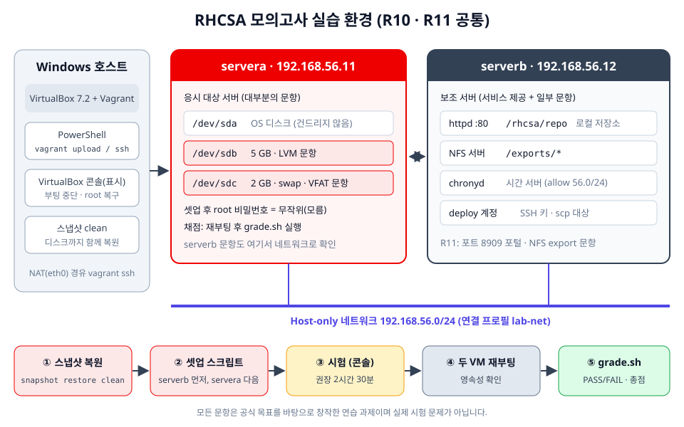

> **번외 · RHCSA(EX200) 대비** | 난이도 ★★★☆☆ | 예상 소요 시험 2시간 30분 + 채점·복기 1.5시간

> ⚠️ **이 모의고사의 모든 문항은 Red Hat이 공개한 EX200 공식 목표(RHEL 10 기준 10개 그룹)를 바탕으로 이 시리즈가 직접 창작한 연습 과제입니다.** 실제 시험 문제나 유출 문제(덤프)가 아니고, 그런 것을 재현하지도 않습니다. Red Hat 시험은 NDA로 보호되므로 "실제 출제 문제"라고 주장하는 자료는 믿지도, 퍼뜨리지도 마세요. 사용자명·수치·경로도 모두 새로 지은 것입니다.

## 🎯 오늘의 목표

- R01~R09에서 익힌 10개 목표 그룹을 **시간 제한 안에** 한 번에 풀어 본다
- 사전 준비 스크립트로 "모르는 root 비밀번호, 잘못된 SELinux 컨텍스트, 빠진 저장소" 같은 **시험다운 출발 상태**를 만든다
- **재부팅 후** 자동 채점 스크립트(`r10-grade.sh`)로 PASS/FAIL과 총점을 확인한다
- 틀린 문항을 목표 그룹별로 분류해 **다시 볼 편(R01~R09)** 을 정한다

---

## 1. 시험 안내

### 1-1. 형식과 규칙

| 항목 | 이 모의고사 | 비고 |
|---|---|---|
| 제한 시간 | **2시간 30분 권장** | 실제 시험 시간은 공식 페이지에 명시가 없어 단정할 수 없습니다. 흔히 약 3시간으로 알려져 있으나 **공식 확인 필요**. 여유 30분은 재부팅 확인용으로 남겨 두는 연습 |
| 문항 수·배점 | 24문항, 합계 300점 | 70%(210점)를 참고선으로 둡니다. 실제 합격 기준도 공식 확인 필요 |
| 대상 | servera(192.168.56.11), serverb(192.168.56.12) | 문항마다 작업 위치를 표시 |
| 참고 자료 | `man`, `info`, `/usr/share/doc`, `--help`만 | **인터넷 검색·이 시리즈 문서·노트 금지** |
| 영속성 | **모든 설정은 재부팅 후에도 유지**되어야 함 | 채점은 두 VM을 재부팅한 뒤 실행 |
| 부분 점수 | 없음 (문항 단위 PASS/FAIL) | 한 문항 안의 요구 사항을 모두 만족해야 PASS |

시험 중 지킬 규칙:

1. **Q1을 가장 먼저** 풉니다. 셋업이 servera의 root 비밀번호를 아무도 모르는 값으로 바꾸기 때문에, 콘솔에서 root로 로그인하려면 부팅을 중단해 비밀번호를 재설정해야 합니다.
2. Q1을 마친 뒤에는 편의를 위해 `vagrant ssh servera` → `sudo -i` 로 작업해도 됩니다(복사·붙여넣기 때문). 단, **Q1 전에 vagrant 계정의 sudo로 비밀번호를 바꾸는 것은 반칙**입니다.
3. 셋업 스크립트를 미리 읽으면 무엇이 망가져 있는지 보입니다. **실행만 하고 내용은 시험 후에** 보세요(그래서 접어 두었습니다).
4. 문항 사이 순서는 자유입니다. 다만 Q4(저장소)를 풀어야 설치할 수 있는 패키지가 있습니다.
5. 끝나면 **servera와 serverb를 VM 안에서 재부팅**(`systemctl reboot`)하고 채점합니다. `vagrant reload`는 Vagrantfile의 호스트명 설정을 다시 덮어쓰므로 쓰지 않습니다.



### 1-2. 환경 초기화와 진행 순서

R00에서 만든 `clean` 스냅샷(두 VM, 추가 디스크 포함)에서 출발합니다. 아래 3절의 스크립트 3개를 Vagrantfile 옆 `mock` 폴더(예: `C:\lab\rhcsa\mock\`)에 저장합니다. R00의 Vagrantfile은 공유 폴더를 끄므로 `vagrant upload`로 VM에 올립니다.

```powershell
cd C:\lab\rhcsa
vagrant snapshot restore clean --no-provision      # 1) 두 VM 초기화

# 2) 스크립트 업로드 (vagrant upload <원본> <대상> <VM>)
vagrant upload .\mock\r10-setup-serverb.sh /home/vagrant/r10-setup-serverb.sh serverb
vagrant upload .\mock\r10-setup-servera.sh /home/vagrant/r10-setup-servera.sh servera

# 3) serverb 먼저, servera 다음 (Windows 줄바꿈 CRLF 제거 후 실행)
vagrant ssh serverb -c "sudo sed -i 's/\r$//' r10-setup-serverb.sh; sudo bash r10-setup-serverb.sh"
vagrant ssh servera -c "sudo sed -i 's/\r$//' r10-setup-servera.sh; sudo bash r10-setup-servera.sh"

# 4) servera 재부팅 → VirtualBox 관리자에서 rhcsa-servera [표시] → 시험 시작
vagrant ssh servera -c "sudo systemctl reboot"
```

```
==> serverb: [*] serverb ready for mock exam 1
==> servera: [*] servera ready. Reboot it and start the exam.
```

> 💡 셋업은 serverb에서 인터넷으로 패키지를 내려받아 로컬 저장소를 만들기 때문에 수 분 걸립니다. 시험 시간은 4)의 재부팅부터 잽니다.

> ⚠️ 셋업 스크립트는 `/dev/sdb`, `/dev/sdc`가 **비어 있는 디스크인지** 먼저 확인하고, 아니면 멈춥니다. 장치명이 다르면 `DISK1=/dev/vdb DISK2=/dev/vdc bash r10-setup-servera.sh`처럼 환경 변수로 넘기세요. 채점 스크립트도 같은 변수를 읽습니다.

---

## 2. 문항 한눈에 보기

| # | 위치 | 목표 그룹 | 주제 | 배점 |
|---|---|---|---|---|
| Q1 | servera | ④ 실행 중인 시스템 | 부팅 중단으로 root 비밀번호 재설정 | 15 |
| Q2 | servera | ⑧ 네트워킹 | IPv4 보조 주소 + IPv6 고정 주소 | 15 |
| Q3 | servera | ⑧ 네트워킹 | 호스트명과 이름 해석 | 10 |
| Q4 | servera | ② 소프트웨어 / ⑦ 배포·유지 | 저장소 설정과 패키지 설치 | 15 |
| Q5 | servera | ⑨ 사용자·그룹 | 그룹·사용자 생성 | 15 |
| Q6 | servera | ⑨ 사용자·그룹 | 비밀번호 에이징 | 10 |
| Q7 | servera | ⑨ 사용자·그룹 | sudo 권한 | 10 |
| Q8 | servera | ① 필수 도구 / ⑥ 파일 시스템 | 공동 작업 디렉터리(setgid) | 10 |
| Q9 | servera | ① 필수 도구 | find로 찾아 복사 + tar 아카이브 | 15 |
| Q10 | servera | ① 필수 도구 | grep으로 로그 추출 | 10 |
| Q11 | servera | ③ 셸 스크립트 | 인자·종료 코드가 있는 스크립트 | 15 |
| Q12 | servera | ⑤ 로컬 스토리지 | GPT 파티션 + LVM + UUID 마운트 | 20 |
| Q13 | servera | ⑤ 로컬 스토리지 | swap 파티션 추가 | 10 |
| Q14 | servera | ⑥ 파일 시스템 | VFAT + 레이블 마운트 | 10 |
| Q15 | servera | ⑥ 파일 시스템 | 논리 볼륨 확장 | 10 |
| Q16 | **serverb** | ⑥ 파일 시스템 | NFS export | 10 |
| Q17 | servera | ⑥ 파일 시스템 | NFS 영구 마운트 | 10 |
| Q18 | servera | ⑥ 파일 시스템 | autofs 간접 맵 | 15 |
| Q19 | servera | ⑦ 배포·유지 | cron 작업 | 10 |
| Q20 | servera | ⑦ 배포·유지 | 시간 동기화(chrony) | 10 |
| Q21 | servera | ④ 실행 중인 시스템 | tuned 권장 프로필 + journal 영구 보존 | 15 |
| Q22 | servera | ⑩ 보안 / ⑧ 네트워킹 | 비표준 포트 웹 서비스(SELinux·firewalld) | 15 |
| Q23 | servera → serverb | ⑩ 보안 | umask + SSH 키 인증 | 15 |
| Q24 | servera | ⑦ 배포·유지 | 기본 타깃 + 커널 인자(부트로더) | 10 |
| | | | **합계** | **300** |

---

## 3. 사전 준비 스크립트

세 파일 모두 **LF 줄바꿈**, ASCII로 저장하세요(위 명령의 `sed`가 CRLF를 지워 주긴 합니다). 내용은 시험이 끝난 뒤에 열어 보세요.

<details><summary>r10-setup-serverb.sh (serverb에서 root로 실행)</summary>

```bash
#!/bin/bash
# r10-setup-serverb.sh -- RHCSA mock exam 1, run as root on serverb
set -euo pipefail
[[ $EUID -eq 0 ]] || { echo "run as root" >&2; exit 1; }

REPO=/var/www/html/rhcsa/repo
PKGS="autofs nfs-utils dosfstools tree zsh flatpak"

echo "[*] building local repository (needs internet on serverb) ..."
dnf -y -q install dnf-plugins-core
mkdir -p "$REPO"
# download first, so that dependencies missing on a fresh box are included
dnf -q download --resolve --destdir "$REPO" $PKGS
dnf -y -q install httpd createrepo_c nfs-utils chrony firewalld
createrepo_c -q "$REPO"
restorecon -R /var/www/html
systemctl enable --now httpd firewalld nfs-server chronyd >/dev/null 2>&1

echo "[*] NFS shares ..."
mkdir -p /exports/public /exports/docs
echo "public share mock10" > /exports/public/README.txt
echo "docs mock10" > /exports/docs/README.txt
rm -f /etc/exports.d/mock*.exports
echo "/exports/docs 192.168.56.0/24(rw,sync)" > /etc/exports.d/mock-docs.exports
exportfs -ra

echo "[*] time server ..."
grep -q '^allow 192.168.56.0/24' /etc/chrony.conf || echo 'allow 192.168.56.0/24' >> /etc/chrony.conf
grep -q '^local stratum' /etc/chrony.conf || echo 'local stratum 8' >> /etc/chrony.conf
systemctl restart chronyd

echo "[*] firewall ..."
for s in ssh http nfs mountd rpc-bind ntp; do
  firewall-cmd -q --permanent --add-service="$s"
done
firewall-cmd -q --reload

echo "[*] remote account for the SSH task ..."
id deploy >/dev/null 2>&1 || useradd deploy
echo 'deploy:Deploy#2026' | chpasswd
echo 'PasswordAuthentication yes' > /etc/ssh/sshd_config.d/01-lab.conf
systemctl reload sshd

echo "[*] serverb ready for mock exam 1"
```

</details>

<details><summary>r10-setup-servera.sh (servera에서 root로 실행)</summary>

```bash
#!/bin/bash
# r10-setup-servera.sh -- RHCSA mock exam 1, run as root on servera
set -euo pipefail
[[ $EUID -eq 0 ]] || { echo "run as root" >&2; exit 1; }
DISK1=${DISK1:-/dev/sdb}
DISK2=${DISK2:-/dev/sdc}

# safety: both extra disks must exist and be completely empty
for d in "$DISK1" "$DISK2"; do
  [[ -b $d ]] || { echo "ERROR: $d not found (set DISK1/DISK2)" >&2; exit 1; }
  if [[ $(lsblk -nr -o NAME "$d" | wc -l) -ne 1 ]] || blkid "$d" >/dev/null 2>&1; then
    echo "ERROR: $d is not empty - restore the clean snapshot first" >&2; exit 1
  fi
done

echo "[*] packages that must exist before the repositories disappear ..."
dnf -y -q install httpd tuned chrony nfs-utils policycoreutils-python-utils

echo "[*] boot menu visible (so the boot can be interrupted) ..."
sed -i 's/^GRUB_TIMEOUT=.*/GRUB_TIMEOUT=5/' /etc/default/grub
grub2-editenv - unset menu_auto_hide || true
grub2-mkconfig -o /boot/grub2/grub.cfg >/dev/null 2>&1

echo "[*] starting state ..."
hostnamectl set-hostname localhost.localdomain
sed -i '/serverb/d' /etc/hosts
systemctl set-default graphical.target >/dev/null 2>&1
systemctl enable --now tuned >/dev/null 2>&1
tuned-adm profile powersave
rm -rf /var/log/journal
systemctl restart systemd-journald

echo "mock10 web OK" > /root/index.html
mv -f /root/index.html /var/www/html/index.html
systemctl disable --now httpd >/dev/null 2>&1 || true

echo "[*] data files ..."
id legacy >/dev/null 2>&1 || useradd -M -u 2999 -s /sbin/nologin legacy
mkdir -p /opt/legacy-data /usr/local/share
echo "legacy=1" > /opt/legacy-data/a.conf
echo "hidden" > /var/tmp/.legacy_hidden
echo "notes" > /usr/local/share/legacy-notes.txt
chown legacy: /opt/legacy-data/a.conf /var/tmp/.legacy_hidden /usr/local/share/legacy-notes.txt

mkdir -p /opt/app/logs
log=/opt/app/logs/service.log
: > "$log"
for i in $(seq 1 60); do
  ts="2026-11-0$((i % 9 + 1))T10:$(printf '%02d' $((i % 60))):00"
  case $((i % 7)) in
    0) echo "$ts level=ERROR svc=api code=$((500 + i % 4)) req=$i" ;;
    3) echo "$ts level=error svc=batch retry=$i" ;;
    *) echo "$ts level=INFO svc=api req=$i" ;;
  esac >> "$log"
done

echo "[*] root password nobody knows ..."
echo "root:$(head -c 24 /dev/urandom | base64)" | chpasswd

echo "[*] removing default repositories ..."
mkdir -p /root/.mock-orig-repos
find /etc/yum.repos.d -maxdepth 1 -name '*.repo' -exec mv -t /root/.mock-orig-repos/ {} +
if command -v subscription-manager >/dev/null 2>&1; then
  subscription-manager config --rhsm.manage_repos=0 >/dev/null 2>&1 || true
fi
dnf clean all >/dev/null

echo "[*] servera ready. Reboot it and start the exam."
```

</details>

---

## 4. 문항

> 공통 조건: 별도 언급이 없으면 비밀번호는 `Mock#Pass10`, serverb 주소는 `192.168.56.12`, servera의 Host-only 연결 프로필 이름은 `lab-net`입니다. 모든 설정은 재부팅 후에도 유지되어야 합니다.

### Q1. root 비밀번호 재설정 — servera · 15점

servera의 root 비밀번호를 모릅니다. 부팅 과정을 중단해 시스템에 접근한 뒤 root 비밀번호를 `Rh-Mock10!` 로 설정하라. 재설정 후 콘솔에서 root로 정상 로그인되어야 한다.

### Q2. IP 주소 추가 — servera · 15점

연결 프로필 `lab-net`에 다음을 영구 설정하라. 기존 주소 `192.168.56.11/24`는 그대로 유지한다.

- IPv4 보조 주소 `192.168.56.111/24`
- IPv6 고정 주소 `fd00:56::11/64` (IPv6 방식은 수동)

### Q3. 호스트명과 이름 해석 — servera · 10점

- 정적 호스트명을 `servera.lab.example.com`으로 설정하라.
- `serverb.lab.example.com`과 짧은 이름 `serverb`가 모두 `192.168.56.12`로 해석되게 하라(DNS 서버 없음).

### Q4. 저장소와 패키지 — servera · 15점

servera에는 활성화된 저장소가 없다. 다음 저장소를 영구 설정하고 `tree` 패키지를 설치하라.

- 저장소 ID `rhcsa-local`, 이름 자유
- URL `http://192.168.56.12/rhcsa/repo`
- GPG 서명 검사는 하지 않는다

### Q5. 그룹과 사용자 — servera · 15점

- GID가 `3100`인 그룹 `opsteam`을 만든다.
- 사용자 `mira`, `dongha`를 만들고 둘 다 보조 그룹으로 `opsteam`에 속하게 한다.
- 사용자 `tobin`을 만든다. `tobin`은 대화형 셸을 가질 수 없고 `opsteam`에 속하지 않는다.
- 세 사용자의 비밀번호는 모두 `Mock#Pass10`.

### Q6. 비밀번호 에이징 — servera · 10점

- `mira`의 비밀번호 최대 사용 기간을 60일, 만료 경고를 10일 전으로 설정하라.
- 앞으로 새로 만드는 모든 사용자의 비밀번호 최대 사용 기간 기본값을 90일로 하라.

### Q7. sudo — servera · 10점

`opsteam` 그룹의 구성원은 비밀번호 입력 없이 sudo로 모든 명령을 실행할 수 있어야 한다. `/etc/sudoers` 파일 자체는 수정하지 않는다.

### Q8. 공동 작업 디렉터리 — servera · 10점

디렉터리 `/srv/opsdata`를 만들어라.

- 그룹 소유자는 `opsteam`, 그룹 구성원은 읽기·쓰기·접근 가능
- 그 밖의 사용자(other)는 아무 권한이 없음
- 이 디렉터리 안에 새로 생기는 파일은 자동으로 그룹 `opsteam` 소유가 됨

### Q9. 파일 찾기와 아카이브 — servera · 15점

- 시스템에서 사용자 `legacy`가 소유한 **일반 파일**을 모두 찾아, 디렉터리 구조 없이 `/root/legacy-found/` 에 복사하라. 복사본도 소유자·권한·시간 정보가 원본과 같아야 한다.
- 그 다음 `/root/legacy-found` 디렉터리를 gzip으로 압축한 tar 아카이브 `/root/legacy-found.tar.gz` 로 만들어라.

### Q10. 로그 추출 — servera · 10점

`/opt/app/logs/service.log`에서 문자열 `level=ERROR`(대소문자 구분)가 들어 있는 줄만 원래 순서대로 `/root/service-errors.txt`에 저장하라.

### Q11. 셸 스크립트 — servera · 15점

스크립트 `/usr/local/bin/sizecheck`를 작성하라. 모든 사용자가 실행할 수 있어야 한다.

- 인자가 정확히 1개가 아니면 표준 오류로 `Usage: sizecheck DIRECTORY`를 출력하고 종료 코드 `1`로 끝난다.
- 인자가 디렉터리가 아니면 표준 오류로 `Not a directory: <인자>`를 출력하고 종료 코드 `2`로 끝난다.
- 그 외에는 해당 디렉터리 아래(하위 디렉터리 포함)에서 크기가 1 MiB를 **초과**하는 일반 파일의 경로를 한 줄에 하나씩 표준 출력으로 출력하고 종료 코드 `0`으로 끝난다.

### Q12. LVM — servera · 20점

- `/dev/sdb`에 GPT 파티션 테이블을 만들고 약 3 GiB(2900~3100 MiB) 크기의 파티션을 만든다.
- 이 파티션으로 볼륨 그룹 `vgdata`를 만들되 **물리 익스텐트 크기는 8 MiB**.
- 논리 볼륨 `lvweb`을 **120개 익스텐트** 크기로 만들고 XFS로 포맷한다.
- 부팅 시 `/mnt/web`에 **UUID**로 자동 마운트되게 한다.

### Q13. swap — servera · 10점

`/dev/sdc`에 GPT 파티션 테이블을 만들고 512 MiB swap 파티션을 추가하라. 부팅 시 자동으로 활성화되어야 하며, 시스템에 이미 있는 swap이 있다면 그대로 둔다.

### Q14. VFAT — servera · 10점

`/dev/sdc`에 256 MiB 파티션을 하나 더 만들어 VFAT 파일 시스템(레이블 `EXCHG`)으로 포맷하고, 부팅 시 `/mnt/exchange`에 **레이블로** 자동 마운트되게 하라.

### Q15. 논리 볼륨 확장 — servera · 10점

Q12의 `lvweb`을 데이터 손실 없이 1400~1600 MiB 크기로 늘려라. 파일 시스템도 같은 크기로 늘어나야 한다.

### Q16. NFS export — serverb · 10점

serverb에서 디렉터리 `/exports/public`(이미 존재)을 `192.168.56.0/24` 대역에 **읽기 전용**으로 공유하라. 기존 공유는 유지한다.

### Q17. NFS 영구 마운트 — servera · 10점

serverb의 `/exports/public`을 servera의 `/mnt/public`에 **읽기 전용**으로, 부팅 시 자동 마운트되게 하라.

### Q18. autofs — servera · 15점

serverb가 `/exports/docs`를 공유하고 있다. servera에서 `/shared/docs`에 접근하는 순간 이 공유가 자동으로 마운트되도록 autofs를 구성하라(읽기·쓰기 옵션). `/etc/fstab`은 사용하지 않는다.

### Q19. cron — servera · 10점

사용자 `mira`의 작업으로, **월~금 14시 30분**마다 `logger -t mock10 heartbeat` 를 실행하도록 예약하라.

### Q20. 시간 동기화 — servera · 10점

servera가 serverb(`192.168.56.12`)를 시간 소스로 사용하는 NTP 클라이언트가 되게 하라. 시간 동기화 서비스는 부팅 시 자동 시작되어야 한다.

### Q21. 튜닝과 로그 — servera · 15점

- tuned가 **권장하는** 프로필을 활성 프로필로 설정하라.
- systemd journal이 재부팅 후에도 보존되도록 영구 저장을 설정하라.

### Q22. 웹 서비스 — servera · 15점

servera의 Apache HTTP Server가 **TCP 82번 포트**에서 기존 `/var/www/html/index.html`을 제공하게 하라.

- SELinux는 enforcing 모드를 유지한다.
- serverb에서 `curl http://192.168.56.11:82/` 로 내용을 받을 수 있도록 방화벽을 영구 설정한다.
- 서비스는 부팅 시 자동 시작된다.

### Q23. umask와 SSH 키 — servera → serverb · 15점

- 사용자 `dongha`가 로그인하면 umask가 `0027`이 되게 하라.
- servera의 사용자 `mira`가 비밀번호 없이 SSH 키로 serverb의 `deploy` 계정에 로그인할 수 있게 하라. `deploy`의 현재 비밀번호는 `Deploy#2026`이다.

### Q24. 기본 타깃과 부트로더 — servera · 10점

- 시스템이 그래픽 환경이 아닌 **다중 사용자 텍스트 모드**로 부팅되게 하라.
- 설치된 **모든 커널**의 부팅 명령줄에 `consoleblank=0` 인자를 영구 추가하라.

---

## 5. 채점

### 5-1. 채점 절차

1. servera와 serverb를 **VM 안에서** 재부팅합니다(`systemctl reboot`). 재부팅 후 servera 콘솔에 root로 로그인되는지 먼저 봅니다.
2. Windows에서 채점 스크립트를 올리고 실행합니다.

```powershell
vagrant upload .\mock\r10-grade.sh /home/vagrant/r10-grade.sh servera
vagrant ssh servera -c "sudo sed -i 's/\r$//' r10-grade.sh; sudo bash r10-grade.sh"
```

```
== RHCSA mock exam 1 grading  boot: 2026-11-15 14:02  ==
Q01  PASS   15/ 15  root password reset
Q02  PASS   15/ 15  IPv4 secondary + IPv6 address
Q03  FAIL    0/ 10  hostname and name resolution
...
---------------------------------------------------
TOTAL: 245 / 300   (PASS 20, FAIL 4)
RESULT: reference line (210) reached
```

### 5-2. 채점 체크리스트 (수동 확인용)

| # | 검증 명령 | 기대 결과 |
|---|---|---|
| Q1 | 콘솔에서 `root` / `Rh-Mock10!` 로그인 | 로그인 성공 |
| Q2 | `ip -o addr show` | `192.168.56.11/24`, `192.168.56.111/24`, `fd00:56::11/64` 모두 보임 |
| Q3 | `cat /etc/hostname`; `getent hosts serverb serverb.lab.example.com` | `servera.lab.example.com`; 두 이름 모두 `192.168.56.12` |
| Q4 | `dnf repolist`; `rpm -q tree` | `rhcsa-local` 활성, tree 설치됨 |
| Q5 | `getent group opsteam`; `id mira dongha tobin`; `getent passwd tobin` | GID 3100, mira·dongha만 opsteam, tobin 셸 `/sbin/nologin` |
| Q6 | `chage -l mira`; `grep ^PASS_MAX_DAYS /etc/login.defs` | 최대 60, 경고 10; `PASS_MAX_DAYS 90` |
| Q7 | `sudo -l -U dongha`; `visudo -c` | `(ALL) NOPASSWD: ALL`; 문법 OK |
| Q8 | `stat -c '%a %G' /srv/opsdata` | `2770 opsteam` |
| Q9 | `ls -la /root/legacy-found`; `tar tzf /root/legacy-found.tar.gz` | 파일 3개, 소유자 legacy; 아카이브에 같은 파일 |
| Q10 | `diff <(grep 'level=ERROR' /opt/app/logs/service.log) /root/service-errors.txt` | 출력 없음 |
| Q11 | `sizecheck; echo $?`, `sizecheck /nope; echo $?`, `sizecheck /usr/bin` | 1, 2, 1 MiB 초과 파일 목록 |
| Q12 | `vgs -o vg_name,vg_extent_size vgdata`; `findmnt /mnt/web`; `grep /mnt/web /etc/fstab` | 8.00m; xfs 마운트; `UUID=` 항목 |
| Q13 | `swapon --show` | `/dev/sdc1` 약 512M |
| Q14 | `findmnt /mnt/exchange`; `grep EXCHG /etc/fstab` | vfat; `LABEL=EXCHG` |
| Q15 | `lvs vgdata/lvweb`; `df -h /mnt/web` | 1.37~1.56 GiB, df 크기도 증가 |
| Q16 | `showmount -e 192.168.56.12` | `/exports/public` 표시 |
| Q17 | `findmnt /mnt/public` | nfs4, `ro` |
| Q18 | `ls /shared/docs; findmnt /shared/docs` | README.txt 보임, nfs4 |
| Q19 | `crontab -l -u mira` | `30 14 * * 1-5 ...logger...` |
| Q20 | `chronyc sources` | `192.168.56.12` 표시, chronyd enabled |
| Q21 | `tuned-adm active`; `tuned-adm recommend`; `ls /var/log/journal` | 두 값 동일; machine-id 디렉터리 존재 |
| Q22 | `curl http://192.168.56.11:82/` (serverb에서) | `mock10 web OK` |
| Q23 | `su - dongha -c umask`; `su - mira -c 'ssh deploy@192.168.56.12 hostname'` | `0027`; 비밀번호 없이 호스트명 출력 |
| Q24 | `systemctl get-default`; `cat /proc/cmdline` | `multi-user.target`; `consoleblank=0` 포함 |

### 5-3. 자동 채점 스크립트 `r10-grade.sh` 전문

servera에서 root로 실행합니다. serverb 문항(Q16)과 serverb가 관련된 문항(Q22, Q23)은 servera에서 네트워크로 확인합니다. Q22의 방화벽은 servera 자신에게서 확인할 수 없으므로 firewalld 설정을 읽어 판정합니다.

```bash
#!/bin/bash
# r10-grade.sh -- RHCSA mock exam 1 auto grader
# run as root on servera AFTER rebooting both VMs
SA=192.168.56.11
SB=192.168.56.12
DISK1=${DISK1:-/dev/sdb}
DISK2=${DISK2:-/dev/sdc}
SCORE=0; MAX=0; NPASS=0; NFAIL=0

[[ $EUID -eq 0 ]] || { echo "run as root" >&2; exit 1; }

check() {   # check <no> <points> <title> <function>
  local no=$1 pts=$2 title=$3 fn=$4
  MAX=$((MAX + pts))
  if ( "$fn" ) >/dev/null 2>&1; then
    SCORE=$((SCORE + pts)); NPASS=$((NPASS + 1))
    printf 'Q%02d  PASS  %3d/%3d  %s\n' "$no" "$pts" "$pts" "$title"
  else
    NFAIL=$((NFAIL + 1))
    printf 'Q%02d  FAIL  %3d/%3d  %s\n' "$no" 0 "$pts" "$title"
  fi
}

# --- helpers -----------------------------------------------------------
pw_ok() {   # pw_ok <user> <password> : compare with the hash in /etc/shadow
  local h
  h=$(getent shadow "$1" | cut -d: -f2)
  [[ -n $h && $h != '!'* && $h != '*' ]] || return 1
  if command -v perl >/dev/null 2>&1; then
    perl -e 'exit(crypt($ARGV[1], $ARGV[0]) eq $ARGV[0] ? 0 : 1)' "$h" "$2"
  else
    python3 -W ignore -c 'import crypt,sys; h=sys.argv[1]; sys.exit(0 if crypt.crypt(sys.argv[2], h) == h else 1)' "$h" "$2"
  fi
}
shadow_field() { getent shadow "$1" | cut -d: -f"$2"; }
in_group() { id -nG "$1" 2>/dev/null | tr ' ' '\n' | grep -qx "$2"; }
fw_has_port() {
  local z
  for z in $(firewall-cmd --get-active-zones | grep -v '^[[:space:]]' | awk '{print $1}'); do
    firewall-cmd --zone="$z" --list-ports | tr ' ' '\n' | grep -qx "$1" && return 0
  done
  return 1
}
mib_of_lv() { local s; s=$(lvs --noheadings --units m --nosuffix -o lv_size "$1" | tr -d ' '); echo "${s%.*}"; }

# --- checks ------------------------------------------------------------
q01() { pw_ok root 'Rh-Mock10!'; }

q02() {
  local a; a=$(ip -o addr show)
  [[ $a == *" 192.168.56.11/24"* && $a == *" 192.168.56.111/24"* && $a == *" fd00:56::11/64"* ]] &&
  nmcli -g ipv6.method connection show lab-net | grep -qx manual
}

q03() {
  [[ $(cat /etc/hostname) == servera.lab.example.com ]] &&
  [[ $(getent hosts serverb.lab.example.com | awk '{print $1}') == "$SB" ]] &&
  [[ $(getent hosts serverb | awk '{print $1}') == "$SB" ]]
}

q04() {
  grep -Eqs "^[[:space:]]*baseurl[[:space:]]*=[[:space:]]*http://(192\.168\.56\.12|serverb(\.lab\.example\.com)?)/rhcsa/repo/?[[:space:]]*$" /etc/yum.repos.d/*.repo &&
  dnf -q repolist --enabled | awk '{print $1}' | grep -qx rhcsa-local &&
  rpm -q tree
}

q05() {
  [[ $(getent group opsteam | cut -d: -f3) == 3100 ]] &&
  in_group mira opsteam && in_group dongha opsteam &&
  id tobin && ! in_group tobin opsteam &&
  [[ $(getent passwd tobin | cut -d: -f7) == */nologin ]] &&
  pw_ok mira 'Mock#Pass10' && pw_ok dongha 'Mock#Pass10' && pw_ok tobin 'Mock#Pass10'
}

q06() {
  [[ $(shadow_field mira 5) == 60 && $(shadow_field mira 6) == 10 ]] &&
  grep -Eq '^PASS_MAX_DAYS[[:space:]]+90[[:space:]]*$' /etc/login.defs
}

q07() {
  visudo -c -q &&
  sudo -l -U dongha | grep -q 'NOPASSWD: ALL' &&
  sudo -l -U mira | grep -q 'NOPASSWD: ALL' &&
  ! sudo -l -U tobin | grep -q 'NOPASSWD'
}

q08() { [[ $(stat -c '%a %G' /srv/opsdata) == "2770 opsteam" ]]; }

q09() {
  local f
  for f in a.conf .legacy_hidden legacy-notes.txt; do
    [[ $(stat -c %U "/root/legacy-found/$f") == legacy ]] || return 1
  done
  tar -tzf /root/legacy-found.tar.gz | grep -q 'legacy-found/legacy-notes.txt$'
}

q10() {
  [[ -s /root/service-errors.txt ]] &&
  diff -q <(grep 'level=ERROR' /opt/app/logs/service.log) /root/service-errors.txt
}

q11() {
  local t rc1 rc2 out
  [[ -x /usr/local/bin/sizecheck ]] || return 1
  [[ $(stat -c %A /usr/local/bin/sizecheck) == *x ]] || return 1
  t=$(mktemp -d)
  head -c 2M /dev/zero > "$t/big.bin"
  mkdir "$t/sub"; head -c 3M /dev/zero > "$t/sub/deep.bin"
  head -c 100K /dev/zero > "$t/small.bin"
  /usr/local/bin/sizecheck >/dev/null 2>&1; rc1=$?
  /usr/local/bin/sizecheck /nonexistent-mock10 >/dev/null 2>&1; rc2=$?
  out=$(/usr/local/bin/sizecheck "$t" 2>/dev/null)
  rm -rf "$t"
  [[ $rc1 -eq 1 && $rc2 -eq 2 && $out == *big.bin* && $out == *deep.bin* && $out != *small.bin* ]]
}

q12() {
  [[ $(vgs --noheadings --units m -o vg_extent_size vgdata | tr -d ' ') == 8.00m ]] &&
  pvs --noheadings -o pv_name,vg_name | awk -v d="$DISK1" '$2 == "vgdata" && index($1, d) == 1' | grep -q . &&
  [[ $(findmnt -n -o FSTYPE /mnt/web) == xfs ]] &&
  [[ $(findmnt -n -o SOURCE /mnt/web) == /dev/mapper/vgdata-lvweb ]] &&
  grep -Eq '^UUID=[^[:space:]]+[[:space:]]+/mnt/web[[:space:]]+xfs' /etc/fstab
}

q13() {
  swapon --show=NAME,SIZE --bytes --noheadings |
    awk -v d="$DISK2" 'index($1, d) == 1 && $2 >= 480000000 && $2 <= 560000000' | grep -q . &&
  grep -Eq '^[^#].*[[:space:]]swap[[:space:]]' /etc/fstab
}

q14() {
  local src
  src=$(findmnt -n -o SOURCE /mnt/exchange) || return 1
  [[ $(findmnt -n -o FSTYPE /mnt/exchange) == vfat ]] &&
  [[ $(blkid -s LABEL -o value "$src") == EXCHG ]] &&
  (( $(blockdev --getsize64 "$src") >= 250000000 && $(blockdev --getsize64 "$src") <= 290000000 )) &&
  grep -Eq '^LABEL=EXCHG[[:space:]]+/mnt/exchange[[:space:]]+vfat' /etc/fstab
}

q15() {
  local lv fs
  lv=$(mib_of_lv vgdata/lvweb)
  fs=$(df -m --output=size /mnt/web | tail -1 | tr -d ' ')
  (( lv >= 1400 && lv <= 1600 && fs >= 1350 ))
}

q16() {
  showmount -e "$SB" | awk '{print $1}' | grep -qx /exports/public &&
  showmount -e "$SB" | awk '{print $1}' | grep -qx /exports/docs
}

q17() {
  [[ $(findmnt -n -o FSTYPE /mnt/public) == nfs* ]] &&
  findmnt -n -o OPTIONS /mnt/public | tr ',' '\n' | grep -qx ro &&
  grep -Eq '^(192\.168\.56\.12|serverb[.a-z]*):/exports/public/?[[:space:]]+/mnt/public[[:space:]]+nfs' /etc/fstab
}

q18() {
  systemctl is-enabled autofs &&
  grep -q 'docs mock10' /shared/docs/README.txt &&
  [[ $(findmnt -n -o FSTYPE /shared/docs) == nfs* ]] &&
  ! grep -q '/exports/docs' /etc/fstab
}

q19() {
  crontab -l -u mira | grep -Eq '^[[:space:]]*30[[:space:]]+14[[:space:]]+\*[[:space:]]+\*[[:space:]]+(1-5|[Mm][Oo][Nn]-[Ff][Rr][Ii])[[:space:]].*logger.*mock10.*heartbeat'
}

q20() {
  systemctl is-enabled chronyd && systemctl is-active chronyd &&
  grep -Ehs '^[[:space:]]*(server|pool)[[:space:]]' /etc/chrony.conf /etc/chrony.d/*.conf | grep -Eq '192\.168\.56\.12|serverb' &&
  chronyc -n sources | grep -q '192\.168\.56\.12'
}

q21() {
  systemctl is-enabled tuned &&
  [[ "$(tuned-adm active | awk -F': ' '{print $2}')" == "$(tuned-adm recommend)" ]] &&
  ls /var/log/journal/*/system.journal
}

q22() {
  [[ $(getenforce) == Enforcing ]] &&
  systemctl is-enabled httpd &&
  curl -s --max-time 5 "http://$SA:82/" | grep -q 'mock10 web OK' &&
  semanage port -l | grep -Eq '^http_port_t[[:space:]]+tcp[[:space:]]+(.*,[[:space:]]*)?82(,|$)' &&
  fw_has_port 82/tcp
}

q23() {
  [[ $(su - dongha -c umask 2>/dev/null | tail -1) == 0027 ]] &&
  su - mira -c "ssh -o BatchMode=yes -o StrictHostKeyChecking=accept-new -o ConnectTimeout=5 deploy@$SB true"
}

q24() {
  [[ $(systemctl get-default) == multi-user.target ]] &&
  grep -qw 'consoleblank=0' /proc/cmdline &&
  ! grubby --info=ALL | grep '^args=' | grep -v 'consoleblank=0' | grep -q .
}

# --- run ---------------------------------------------------------------
echo "== RHCSA mock exam 1 grading  boot: $(uptime -s)  =="
check  1 15 "root password reset"                 q01
check  2 15 "IPv4 secondary + IPv6 address"       q02
check  3 10 "hostname and name resolution"        q03
check  4 15 "repository + tree"                   q04
check  5 15 "group and users"                     q05
check  6 10 "password aging"                      q06
check  7 10 "sudo for opsteam"                    q07
check  8 10 "setgid shared directory"             q08
check  9 15 "find + tar"                          q09
check 10 10 "grep ERROR lines"                    q10
check 11 15 "sizecheck script"                    q11
check 12 20 "LVM vgdata/lvweb"                    q12
check 13 10 "swap partition"                      q13
check 14 10 "VFAT by label"                       q14
check 15 10 "extend lvweb"                        q15
check 16 10 "serverb NFS export (read-only)"      q16
check 17 10 "NFS mount /mnt/public"               q17
check 18 15 "autofs /shared/docs"                 q18
check 19 10 "cron for mira"                       q19
check 20 10 "chrony client"                       q20
check 21 15 "tuned + persistent journal"          q21
check 22 15 "httpd on port 82 (SELinux/firewall)" q22
check 23 15 "umask + SSH key"                     q23
check 24 10 "default target + kernel argument"    q24
echo "---------------------------------------------------"
printf 'TOTAL: %d / %d   (PASS %d, FAIL %d)\n' "$SCORE" "$MAX" "$NPASS" "$NFAIL"
if (( SCORE >= 210 )); then
  echo "RESULT: reference line (210) reached"
else
  echo "RESULT: below reference line (210)"
fi
```

> 💡 **비밀번호 채점 원리.** `/etc/shadow`의 해시를 솔트 삼아 같은 비밀번호를 다시 해시해 비교합니다. RHEL 10 계열의 기본 해시는 yescrypt(`$y$`)라 `openssl passwd`로는 비교할 수 없고, libxcrypt를 쓰는 `perl`의 `crypt()`(없으면 Python 3.12의 `crypt` 모듈)를 사용합니다.

> ⚠️ Q16은 serverb의 기존 공유(`/exports/docs`)가 **사라지지 않았는지**도 봅니다. `/etc/exports.d/mock-docs.exports`를 덮어써 버리는 실수를 잡기 위해서입니다.

---

## 6. 풀이

각 풀이는 한 가지 정답 예시입니다. 요구 사항을 만족하면 다른 방법도 정답입니다.

<details><summary>풀이 — Q1. root 비밀번호 재설정</summary>

1. VirtualBox 콘솔에서 servera를 재부팅하고 GRUB 메뉴에서 첫 항목을 고른 채 `e`.
2. `linux`로 시작하는 줄 끝(`Ctrl+e`)에 ` rd.break`를 덧붙입니다. 화면이 안 나오면 `console=ttyS0,...`, `rhgb quiet`를 지웁니다. `Ctrl+x`로 부팅.

```bash
switch_root:/# mount -o remount,rw /sysroot
switch_root:/# chroot /sysroot
sh-5.2# passwd root                 # Rh-Mock10! 두 번 입력
sh-5.2# touch /.autorelabel
sh-5.2# exit
switch_root:/# exit                 # 부팅 계속 → relabel 후 자동 재부팅
```

`rd.break`에서 비밀번호를 요구하면 `linux` 줄의 `ro`를 `rw`로 바꾸고 ` init=/bin/bash`를 붙여 부팅한 뒤 `passwd root` → `touch /.autorelabel` → `exec /sbin/init` 순서로 진행합니다(R03 4-3).

**흔한 감점:** `/.autorelabel` 누락(enforcing에서 새 비밀번호로도 로그인 실패), chroot 밖에서 `touch`, relabel 중 강제 종료.

</details>

<details><summary>풀이 — Q2. IP 주소 추가</summary>

```bash
nmcli connection modify lab-net +ipv4.addresses 192.168.56.111/24
nmcli connection modify lab-net ipv6.method manual ipv6.addresses fd00:56::11/64
nmcli connection up lab-net
ip -o addr show | grep -E '56\.11|fd00'
```

**흔한 감점:** `+` 없이 `ipv4.addresses 192.168.56.111/24`로 쓰면 기존 `.11` 주소가 **교체**됩니다. 또 `nmcli connection up`을 안 하면 지금은 반영되지 않지만 재부팅 후에는 반영되므로, 지금 확인하려면 꼭 다시 올리세요. RHEL 10은 ifcfg 파일을 지원하지 않으므로 `/etc/sysconfig/network-scripts`를 고치는 방법은 쓸 수 없습니다(설정은 `/etc/NetworkManager/system-connections/lab-net.nmconnection` keyfile).

</details>

<details><summary>풀이 — Q3. 호스트명과 이름 해석</summary>

```bash
hostnamectl hostname servera.lab.example.com
echo '192.168.56.12 serverb.lab.example.com serverb' >> /etc/hosts
getent hosts serverb serverb.lab.example.com
```

**흔한 감점:** `hostname servera...`(일시적), `/etc/hosts`에 짧은 이름 누락, IP 오타. `ping`은 방화벽 영향이 있으니 해석 확인은 `getent hosts`가 정확합니다.

</details>

<details><summary>풀이 — Q4. 저장소와 패키지</summary>

```bash
cat > /etc/yum.repos.d/rhcsa-local.repo <<'EOF'
[rhcsa-local]
name=RHCSA local repository
baseurl=http://192.168.56.12/rhcsa/repo
enabled=1
gpgcheck=0
EOF
dnf clean all
dnf repolist
dnf install -y tree
```

**흔한 감점:** 섹션 이름(`[rhcsa-local]`)이 곧 저장소 ID입니다. 파일 이름만 맞추고 섹션 이름을 다르게 쓰면 틀립니다. `baseurl`에 `repodata`까지 붙이는 실수도 흔합니다(그 **상위** 디렉터리를 가리켜야 함). `dnf config-manager --add-repo`로 만들면 `gpgcheck` 줄이 없어 `dnf.conf`의 기본값(`gpgcheck=1`)을 따르므로 직접 `gpgcheck=0`을 넣어야 요구 사항과 맞습니다.

</details>

<details><summary>풀이 — Q5. 그룹과 사용자</summary>

```bash
groupadd -g 3100 opsteam
useradd -G opsteam mira
useradd -G opsteam dongha
useradd -s /sbin/nologin tobin
for u in mira dongha tobin; do echo "$u:Mock#Pass10" | chpasswd; done
id mira; id tobin
```

**흔한 감점:** `-g opsteam`(주 그룹)과 `-G opsteam`(보조 그룹) 혼동. 이미 있는 사용자에 그룹을 더할 때 `usermod -G`만 쓰면 기존 보조 그룹이 지워지므로 `usermod -aG`.

</details>

<details><summary>풀이 — Q6. 비밀번호 에이징</summary>

```bash
chage -M 60 -W 10 mira
chage -l mira
sed -i 's/^PASS_MAX_DAYS.*/PASS_MAX_DAYS\t90/' /etc/login.defs
grep ^PASS_MAX_DAYS /etc/login.defs
```

**흔한 감점:** `login.defs`는 **앞으로 만들 사용자**에게만 적용됩니다. 그래서 Q5에서 만든 사용자는 자동으로 바뀌지 않으며, 이 문항도 그것을 요구하지 않습니다. `-W`(경고)와 `-I`(비활성) 혼동 주의.

</details>

<details><summary>풀이 — Q7. sudo</summary>

```bash
echo '%opsteam ALL=(ALL) NOPASSWD: ALL' > /etc/sudoers.d/opsteam
chmod 440 /etc/sudoers.d/opsteam
visudo -cf /etc/sudoers.d/opsteam
sudo -l -U dongha
```

**흔한 감점:** 그룹 앞 `%` 누락(사용자 `opsteam`으로 해석됨), 파일 이름에 `.`이나 `~`가 들어가면 sudo가 **무시**합니다(`opsteam.conf` ✗).

</details>

<details><summary>풀이 — Q8. 공동 작업 디렉터리</summary>

```bash
mkdir -p /srv/opsdata
chgrp opsteam /srv/opsdata
chmod 2770 /srv/opsdata
ls -ld /srv/opsdata      # drwxrws---. root opsteam
```

**흔한 감점:** `chmod g+s`만 하고 other 권한을 남겨 두거나, 반대로 `chmod 770` 뒤에 setgid를 빠뜨리는 경우.

</details>

<details><summary>풀이 — Q9. 파일 찾기와 아카이브</summary>

```bash
mkdir -p /root/legacy-found
find / -path /proc -prune -o -path /root/legacy-found -prune -o \
     -type f -user legacy -print 2>/dev/null
find / -path /proc -prune -o -path /root/legacy-found -prune -o \
     -type f -user legacy -exec cp -p {} /root/legacy-found/ \; 2>/dev/null
ls -la /root/legacy-found
tar -czf /root/legacy-found.tar.gz -C /root legacy-found
tar -tzf /root/legacy-found.tar.gz
```

**흔한 감점:** `cp -p` 없이 복사하면 소유자가 root로 바뀝니다. 숨김 파일(`/var/tmp/.legacy_hidden`)을 `ls`로 찾다가 놓치는 경우, 그리고 `tar -czf`에서 `f` 뒤에 파일 이름이 와야 한다는 순서 실수.

</details>

<details><summary>풀이 — Q10. 로그 추출</summary>

```bash
grep 'level=ERROR' /opt/app/logs/service.log > /root/service-errors.txt
wc -l /root/service-errors.txt
```

**흔한 감점:** `grep -i`를 쓰면 `level=error` 줄까지 들어갑니다. `sort`를 붙여 순서를 바꾸는 것도 감점입니다.

</details>

<details><summary>풀이 — Q11. 셸 스크립트</summary>

```bash
cat > /usr/local/bin/sizecheck <<'EOF'
#!/bin/bash
if [ $# -ne 1 ]; then
    echo "Usage: sizecheck DIRECTORY" >&2
    exit 1
fi
if [ ! -d "$1" ]; then
    echo "Not a directory: $1" >&2
    exit 2
fi
find "$1" -type f -size +1M
exit 0
EOF
chmod 755 /usr/local/bin/sizecheck
sizecheck; echo "rc=$?"
sizecheck /nope; echo "rc=$?"
sizecheck /usr/bin | head -3
```

**흔한 감점:** 오류 메시지를 표준 출력으로 내보냄(`>&2` 누락), `"$1"` 따옴표 누락(공백 경로에서 깨짐), `-size 1M`(정확히 1 MiB 블록인 파일만 찾음)과 `-size +1M` 혼동, 실행 권한 누락.

</details>

<details><summary>풀이 — Q12. LVM</summary>

```bash
lsblk /dev/sdb
parted -s /dev/sdb mklabel gpt
parted -s /dev/sdb mkpart vgdata 1MiB 3073MiB
parted -s /dev/sdb set 1 lvm on
udevadm settle
pvcreate /dev/sdb1
vgcreate -s 8M vgdata /dev/sdb1
lvcreate -l 120 -n lvweb vgdata
mkfs.xfs /dev/vgdata/lvweb
mkdir -p /mnt/web
blkid -s UUID -o value /dev/vgdata/lvweb
echo "UUID=$(blkid -s UUID -o value /dev/vgdata/lvweb) /mnt/web xfs defaults 0 0" >> /etc/fstab
systemctl daemon-reload
mount -a && findmnt /mnt/web
```

**흔한 감점:** `-l 120`(익스텐트 수)과 `-L 120M`(크기) 혼동, PE 크기 `-s 8M` 누락(기본 4 MiB면 120 익스텐트 = 480 MiB), fstab에 `/dev/sdb1`처럼 장치명 기재, fstab 수정 후 `mount -a`로 검증하지 않음(오타가 있으면 **부팅 실패**).

</details>

<details><summary>풀이 — Q13. swap</summary>

```bash
parted -s /dev/sdc mklabel gpt
parted -s /dev/sdc mkpart swap1 linux-swap 1MiB 513MiB
udevadm settle
mkswap /dev/sdc1
echo "UUID=$(blkid -s UUID -o value /dev/sdc1) none swap defaults 0 0" >> /etc/fstab
systemctl daemon-reload
swapon -a
swapon --show
```

**흔한 감점:** `swapon /dev/sdc1`만 하고 fstab 누락, 기존 swap 줄을 지우거나 덮어씀.

</details>

<details><summary>풀이 — Q14. VFAT</summary>

```bash
parted -s /dev/sdc mkpart exch fat32 513MiB 769MiB
udevadm settle
mkfs.vfat -n EXCHG /dev/sdc2        # dosfstools 필요 → Q4 저장소에서 설치
mkdir -p /mnt/exchange
echo "LABEL=EXCHG /mnt/exchange vfat defaults 0 0" >> /etc/fstab
systemctl daemon-reload
mount -a && findmnt /mnt/exchange
```

**흔한 감점:** `mkfs.vfat` 명령이 없다고 당황하기(`dnf install dosfstools`), 레이블을 소문자로 지정(`mkfs.fat`이 경고를 내고 도구마다 대소문자가 다르게 보일 수 있어 fstab과 어긋나기 쉬움), 파티션 시작점을 앞 파티션과 겹치게 지정.

</details>

<details><summary>풀이 — Q15. 논리 볼륨 확장</summary>

```bash
vgs vgdata                       # 남은 공간 확인
lvextend -r -L 1.5G /dev/vgdata/lvweb
df -h /mnt/web
```

`-r`(`--resizefs`)이 XFS면 `xfs_growfs`를 대신 실행합니다. 따로 하려면 `lvextend -L 1.5G ...` 후 `xfs_growfs /mnt/web`.

**흔한 감점:** LV만 늘리고 파일 시스템을 안 늘림(`df` 크기 그대로), `-L +1.5G`처럼 `+`를 붙여 범위를 넘김, XFS를 `resize2fs`로 늘리려 함.

</details>

<details><summary>풀이 — Q16. NFS export (serverb)</summary>

```bash
echo '/exports/public 192.168.56.0/24(ro,sync)' > /etc/exports.d/public.exports
exportfs -rav
showmount -e localhost
```

**흔한 감점:** `192.168.56.0/24 (ro)`처럼 주소와 괄호 사이에 공백을 넣으면 괄호 안 옵션이 **모든 호스트(`*`)** 에 적용되고, 지정한 대역에는 기본 옵션이 붙는 전혀 다른 규칙이 됩니다. 기존 `mock-docs.exports`를 덮어써 `/exports/docs` 공유를 없애는 실수도 감점입니다. 방화벽은 셋업에서 열려 있습니다.

</details>

<details><summary>풀이 — Q17. NFS 영구 마운트</summary>

```bash
mkdir -p /mnt/public
echo '192.168.56.12:/exports/public /mnt/public nfs ro,_netdev 0 0' >> /etc/fstab
systemctl daemon-reload
mount -a && findmnt /mnt/public
```

**흔한 감점:** 파일 시스템 형식을 `nfs4`로 써도 되지만 `nfs`로 쓰면 협상 후 `nfs4`로 마운트됩니다. `ro` 누락(서버가 ro라도 문항은 클라이언트 옵션을 요구).

</details>

<details><summary>풀이 — Q18. autofs</summary>

```bash
dnf install -y autofs
echo '/shared  /etc/auto.shared' > /etc/auto.master.d/shared.autofs
echo 'docs  -rw,sync  192.168.56.12:/exports/docs' > /etc/auto.shared
systemctl enable --now autofs
ls /shared/docs && findmnt /shared/docs
```

**흔한 감점:** `/shared/docs`를 미리 `mkdir`(autofs가 관리하는 디렉터리라 필요 없음), 마스터 맵 파일 확장자를 `.autofs`가 아닌 다른 것으로 지정(무시됨), `enable` 누락으로 재부팅 후 동작 안 함.

</details>

<details><summary>풀이 — Q19. cron</summary>

```bash
crontab -e -u mira
# 30 14 * * 1-5 /usr/bin/logger -t mock10 heartbeat
crontab -l -u mira
```

**흔한 감점:** 필드 순서(분 시 일 월 요일) 혼동으로 `14 30 ...`, 요일 `1-5` 대신 `0-4`(0은 일요일), root의 crontab에 등록.

</details>

<details><summary>풀이 — Q20. 시간 동기화</summary>

```bash
vi /etc/chrony.conf
#   기본 pool 줄은 주석 처리(# pool 2.almalinux.pool.ntp.org iburst 등)
#   추가: server 192.168.56.12 iburst
systemctl enable --now chronyd
systemctl restart chronyd
chronyc sources -v
```

**흔한 감점:** 설정만 바꾸고 `restart`를 안 해 지금은 적용 안 됨, `enable` 누락. `chronyc sources`에서 `^*`(선택된 소스)가 되기까지 수십 초 걸릴 수 있습니다.

</details>

<details><summary>풀이 — Q21. 튜닝과 로그</summary>

```bash
tuned-adm recommend                  # 예: virtual-guest
tuned-adm profile "$(tuned-adm recommend)"
tuned-adm active
systemctl is-enabled tuned

mkdir -p /etc/systemd/journald.conf.d
printf '[Journal]\nStorage=persistent\n' > /etc/systemd/journald.conf.d/persistent.conf
systemctl restart systemd-journald
journalctl --flush
ls /var/log/journal/
```

**흔한 감점:** RHEL 10 계열은 `journald.conf` 원본이 `/usr/lib/systemd/` 아래에 있을 수 있어 `/etc/systemd/journald.conf`가 없다고 당황하기 — drop-in 디렉터리를 쓰면 됩니다. `/var/log/journal`만 만들어도(`Storage=auto`) 영구 저장이 되지만, 디렉터리를 만든 뒤 journald를 재시작하지 않으면 지금 부팅의 로그는 계속 `/run`에 쌓입니다.

</details>

<details><summary>풀이 — Q22. 웹 서비스</summary>

```bash
sed -i 's/^Listen 80$/Listen 82/' /etc/httpd/conf/httpd.conf
semanage port -a -t http_port_t -p tcp 82
ls -Z /var/www/html/index.html        # admin_home_t → 잘못된 컨텍스트
restorecon -v /var/www/html/index.html
firewall-cmd --permanent --add-port=82/tcp
firewall-cmd --reload
systemctl enable --now httpd
curl http://localhost:82/
```

**흔한 감점:** `setenforce 0`으로 해결한 척하기(재부팅 후 enforcing이면 실패, 문항 위반), 파일에 `chcon -t httpd_sys_content_t`를 쓴 경우(지금은 되지만 정책 규칙과 다른 수동 값이라 relabel 때 원복될 수 있음 — `/var/www/html`은 이미 규칙이 있으니 `restorecon`이 정답), `--permanent` 누락, 포트를 열었는데 `--reload` 안 함. 어떤 거부가 났는지는 `ausearch -m AVC -ts recent` 또는 `journalctl -t setroubleshoot`로 확인합니다.

</details>

<details><summary>풀이 — Q23. umask와 SSH 키</summary>

```bash
echo 'umask 027' >> /home/dongha/.bashrc
su - dongha -c umask                 # 0027

su - mira
ssh-keygen -t ed25519 -N '' -f ~/.ssh/id_ed25519
ssh-copy-id deploy@192.168.56.12     # Deploy#2026 입력
ssh deploy@192.168.56.12 hostname    # 비밀번호 없이 출력되면 성공
exit
```

**흔한 감점:** root로 키를 만들어 root의 키가 복사됨(문항은 `mira`), `umask 027`을 `/etc/profile`에 넣어 **모든 사용자**에게 적용, `.bashrc` 대신 소유자가 root인 새 파일을 만들어 권한 문제 발생.

</details>

<details><summary>풀이 — Q24. 기본 타깃과 부트로더</summary>

```bash
systemctl set-default multi-user.target
grubby --update-kernel=ALL --args="consoleblank=0"
grubby --info=ALL | grep ^args
```

**흔한 감점:** `systemctl isolate multi-user.target`(지금만 전환), `/etc/default/grub`의 `GRUB_CMDLINE_LINUX`만 고치고 `grub2-mkconfig`를 안 돌림 — RHEL 10의 BLS 항목에는 `grubby`가 확실합니다. 앞으로 설치할 커널까지 포함하려면 `/etc/default/grub`에도 넣고 `grub2-mkconfig -o /boot/grub2/grub.cfg`를 실행해 두는 것이 좋습니다.

</details>

---

## 7. 결과 해석

### 7-1. 점수대별 다음 행동

| 점수 | 해석 | 다음 행동 |
|---|---|---|
| 270~300 | 기본기 충분 | 바로 [R11 모의고사 2](./r11-mock-exam-2.md)로. 시간을 2시간으로 줄여 다시 풀어 보기 |
| 210~269 | 참고선 통과, 구멍 있음 | 틀린 문항의 편만 복습 후 이 모의고사를 **처음부터** 다시(스냅샷 복원) |
| 150~209 | 목표 그룹 몇 개가 비어 있음 | 아래 표에서 틀린 그룹의 편을 연습 과제까지 다시 풀기 |
| 0~149 | 기초 명령이 손에 안 붙음 | [R01](./r01-essential-tools.md)부터 연습 과제 위주로 한 바퀴 |

### 7-2. 틀린 문항 → 다시 볼 편

| 틀린 문항 | 목표 그룹 | 다시 볼 편 |
|---|---|---|
| Q9, Q10 | ① 필수 도구 | [R01 필수 도구](./r01-essential-tools.md) |
| Q4, Q11 | ② 소프트웨어 / ③ 셸 스크립트 | [R02 소프트웨어 & 셸 스크립트](./r02-software-shell-scripts.md) |
| Q1, Q21 | ④ 실행 중인 시스템 | [R03 실행 중인 시스템 운영](./r03-operate-running-systems.md) |
| Q12, Q13 | ⑤ 로컬 스토리지 | [R04 로컬 스토리지](./r04-local-storage.md) |
| Q8, Q14~Q18 | ⑥ 파일 시스템 | [R05 파일 시스템](./r05-file-systems.md) |
| Q19, Q20, Q24 | ⑦ 배포·유지 | [R06 시스템 배포·유지](./r06-deploy-maintain.md) |
| Q2, Q3 | ⑧ 네트워킹 | [R07 기본 네트워킹](./r07-networking.md) |
| Q5, Q6, Q7 | ⑨ 사용자·그룹 | [R08 사용자·그룹](./r08-users-groups.md) |
| Q22, Q23 | ⑩ 보안 | [R09 보안](./r09-security.md) |

> 💡 **"지금은 됐는데 채점에서 FAIL"** 이 많다면 영속성 문제입니다. `--permanent`, `enable`, fstab, `nmcli connection modify`, `semanage`처럼 **재부팅 후에도 남는 방식**으로 했는지 문항별로 다시 확인하세요.

---

## 트러블슈팅

| 증상 | 원인 | 해결 |
|---|---|---|
| 셋업이 `ERROR: /dev/sdb is not empty`로 멈춤 | 이전 연습의 파티션이 남음 | `vagrant snapshot restore clean --no-provision` 후 다시 실행 |
| serverb 셋업의 `dnf download`가 실패 | serverb에 인터넷이 없거나 미러 일시 장애 | `vagrant ssh serverb -c "curl -sI https://almalinux.org"`로 확인 후 재실행 |
| GRUB 메뉴가 안 보이고 바로 부팅 | 셋업 전 재부팅했거나 콘솔 창을 늦게 엶 | 셋업 후 재부팅하고, 콘솔 창을 먼저 열어 둔 채 부팅 |
| `rd.break` 후 화면이 멈춘 듯 아무것도 안 보임 | 출력이 직렬 콘솔(`console=ttyS0`)로 감 | GRUB 편집 시 `console=ttyS0,...` 항목 삭제 |
| 채점에서 Q23만 계속 FAIL | known_hosts 질문, 키를 root로 만듦 | `su - mira -c 'ssh -o BatchMode=yes deploy@192.168.56.12 true'`로 직접 확인 |
| `vagrant ssh`가 Q1 전부터 sudo로 다 됨 | Vagrant 계정은 셋업이 건드리지 않음 | 규칙 2 참고 — 시험 중에는 콘솔 root만 쓰는 것이 원칙 |

---

## 핵심 정리

- 모의고사의 진짜 목적은 **시간 배분과 영속성 습관**입니다. 문항을 다 풀고 30분을 남겨 재부팅·검증하세요.
- 출발 상태가 망가져 있는 문항(root 비밀번호, SELinux 컨텍스트, 비활성 서비스, 저장소 없음)은 **원인 확인 → 영구 조치 → 재부팅 후 재확인** 순서로 풉니다.
- 스토리지 문항은 fstab 한 줄의 오타가 **부팅 불가**로 이어집니다. 항상 `systemctl daemon-reload` → `mount -a`로 검증.
- 사용자·sudo·cron은 "**누구의**" 설정인지가 채점 포인트입니다(`mira`의 crontab, `mira`의 SSH 키).
- 채점이 PASS여도 풀이의 "흔한 감점"을 읽어 두세요. R11에서는 바로 그 지점이 함정으로 나옵니다.

---

## ⏭️ 다음 예고 — RHCSA R11. 모의고사 2 (함정 난이도)

R11은 **부팅이 안 되는 servera**에서 시작합니다. fstab이 망가진 상태에서 root 비밀번호까지 모르는 상황을 복구하고, 여유 공간이 모자란 볼륨 그룹을 데이터 손실 없이 늘리고, SELinux와 firewalld 존 설정이 겹쳐 "분명 열었는데 안 되는" 웹 서비스를 고치고, autofs로 NFS 홈 디렉터리를 사용자 계정과 연동합니다. 문항 수는 비슷하지만 **한 문항 안에 확인할 것이 두세 개씩** 숨어 있습니다.
