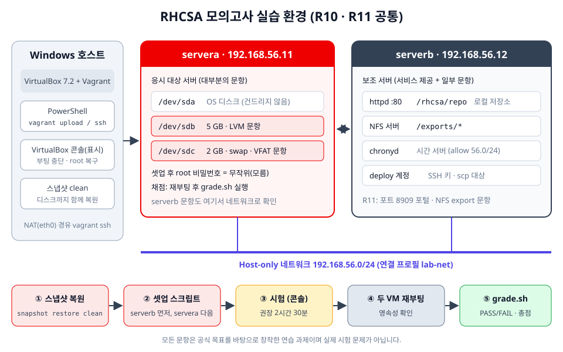

> **번외 · RHCSA(EX200) 대비** | 난이도 ★★★★☆ | 예상 소요 시험 2시간 30분 + 채점·복기 2시간

> ⚠️ **이 모의고사의 모든 문항은 Red Hat이 공개한 EX200 공식 목표(RHEL 10 기준 10개 그룹)를 바탕으로 이 시리즈가 직접 창작한 연습 과제입니다.** 실제 시험 문제나 유출 문제(덤프)가 아니고, 그런 것을 재현하지도 않습니다. "실제 출제 문제"라고 주장하는 자료는 Red Hat NDA 위반이니 믿지도, 퍼뜨리지도 마세요. 사용자명·수치·경로는 모두 새로 지은 것입니다.

## 🎯 오늘의 목표

- **부팅이 안 되는 서버**에서 출발해 root 접근을 되찾고 원인까지 고친다
- 한 문항에 요구 사항이 두세 개씩 겹친 과제(SELinux + firewalld 존, autofs + 사용자 UID + SELinux 불리언)를 빠짐없이 처리한다
- 여유 공간이 모자란 볼륨 그룹을 **데이터 손실 없이** 키우는 순서를 손에 익힌다
- 재부팅 후 자동 채점(`r11-grade.sh`)으로 R10과 비교해 약점이 줄었는지 확인한다

---

## 1. 시험 안내

### 1-1. 형식과 규칙

[R10](./r10-mock-exam-1.md)과 같습니다. 다른 점만 표시합니다.

| 항목 | 이 모의고사 | 비고 |
|---|---|---|
| 제한 시간 | **2시간 30분 권장** | 실제 시험 시간·합격 점수는 공식 페이지에 명시가 없으므로 **공식 확인 필요**(흔히 약 3시간, 300점 중 210점으로 알려짐) |
| 문항 수·배점 | 21문항, 합계 300점 | 문항당 배점이 R10보다 큼 → 하나 놓치면 타격이 큼 |
| 출발 상태 | **servera가 정상 부팅되지 않음** | Q1을 풀기 전에는 servera에 로그인할 수 없음 |
| 참고 자료 | `man`, `info`, `/usr/share/doc`, `--help`만 | 인터넷·노트·이 시리즈 문서 금지 |
| 영속성 | 모든 설정은 재부팅 후 유지 | 채점은 두 VM을 재부팅한 뒤 실행 |

시험 중 규칙:

1. **Q1이 끝나기 전에는 servera에 다른 방법으로 들어가지 않습니다.** 응급 모드에서 `vagrant ssh`가 안 되는 것이 정상입니다. Q1 이후에는 `vagrant ssh servera` → `sudo -i` 사용 가능.
2. serverb는 처음부터 `vagrant ssh serverb` → `sudo -i`로 작업해도 됩니다(실제 시험에서 두 번째 시스템의 root 접근이 주어지는 상황을 흉내).
3. 셋업 스크립트는 **시험이 끝난 뒤** 읽으세요. 함정이 그대로 보입니다.
4. 함정 문항이 많습니다. **문항 본문의 단어 하나하나가 채점 조건**이라고 생각하고 읽으세요.



### 1-2. 환경 초기화와 진행 순서

R10과 같은 `mock` 폴더에 아래 스크립트 3개를 저장합니다.

```powershell
cd C:\lab\rhcsa
vagrant snapshot restore clean --no-provision

vagrant upload .\mock\r11-setup-serverb.sh /home/vagrant/r11-setup-serverb.sh serverb
vagrant upload .\mock\r11-setup-servera.sh /home/vagrant/r11-setup-servera.sh servera

vagrant ssh serverb -c "sudo sed -i 's/\r$//' r11-setup-serverb.sh; sudo bash r11-setup-serverb.sh"
vagrant ssh servera -c "sudo sed -i 's/\r$//' r11-setup-servera.sh; sudo bash r11-setup-servera.sh"

# VirtualBox 관리자에서 rhcsa-servera [표시]를 먼저 열어 둔 뒤 재부팅 → 시험 시작
vagrant ssh servera -c "sudo systemctl reboot"
```

```
==> serverb: [*] serverb ready for mock exam 2
==> servera: [*] servera ready. Open the VirtualBox console, then reboot.
```

재부팅 후 servera 콘솔은 1~2분 동안 멈춘 듯 보이다가 다음과 비슷한 화면에서 멈춥니다. 여기서부터가 Q1입니다.

```
You are in emergency mode. After logging in, type "journalctl -xb" to view
system logs, "systemctl reboot" to reboot, or "exit" to continue bootup.
Give root password for maintenance
(or press Control-D to continue):
```

> ⚠️ 셋업은 R10과 마찬가지로 추가 디스크가 비어 있는지 확인한 뒤에만 파티션을 만듭니다. 장치명이 다르면 `DISK1=… DISK2=…`를 넘기세요. **OS 디스크를 넘기면 안 됩니다.**

---

## 2. 문항 한눈에 보기

| # | 위치 | 목표 그룹 | 주제 | 배점 |
|---|---|---|---|---|
| Q1 | servera | ④ / ⑥ | 부팅 불가 복구 + root 비밀번호 + 마운트 복원 | 25 |
| Q2 | servera | ② / ⑦ | 고장 난 저장소 정리 + 패키지 설치 | 15 |
| Q3 | servera | ② | Flatpak 원격 저장소(시스템 범위) | 10 |
| Q4 | servera | ⑧ | 이름 해석 수정 + IPv6 + DNS 검색 도메인 | 15 |
| Q5 | servera | ⑨ / ⑩ | 사용자·만료·강제 변경·기본 정책·umask | 15 |
| Q6 | servera | ⑨ | 명령 제한 sudo | 10 |
| Q7 | servera | ① / ⑥ | 권한 문제 진단 + ACL | 15 |
| Q8 | servera | ① | 아카이브 풀기 + grep + find | 15 |
| Q9 | servera | ③ | 입력 파일을 처리하는 스크립트 | 15 |
| Q10 | servera | ⑤ | 공간 부족 VG에 LV 추가(비파괴 확장) | 20 |
| Q11 | servera | ⑤ | 우선순위 지정 swap | 10 |
| Q12 | servera | ⑥ | 기존 LV 확장(데이터 보존) | 10 |
| Q13 | **serverb + servera** | ⑥ / ⑨ / ⑩ | NFS export + autofs 홈 + SELinux 불리언 | 20 |
| Q14 | **serverb** | ⑩ / ⑧ | 비표준 디렉터리·포트 웹 + firewalld 존 | 25 |
| Q15 | servera | ⑦ | 시간 소스 단일화 | 10 |
| Q16 | servera | ⑦ | systemd 타이머 | 15 |
| Q17 | servera | ④ | 폭주 프로세스와 서비스 차단 | 10 |
| Q18 | servera | ④ | journal 영구 보존 + 용량 제한 | 10 |
| Q19 | servera | ④ | 안전한 파일 전송 | 10 |
| Q20 | servera → serverb | ⑩ | SSH 키 인증 | 15 |
| Q21 | servera | ⑩ | SELinux 모드 | 10 |
| | | | **합계** | **300** |

---

## 3. 사전 준비 스크립트

<details><summary>r11-setup-serverb.sh (serverb에서 root로 실행)</summary>

```bash
#!/bin/bash
# r11-setup-serverb.sh -- RHCSA mock exam 2, run as root on serverb
set -euo pipefail
[[ $EUID -eq 0 ]] || { echo "run as root" >&2; exit 1; }

REPO=/var/www/html/rhcsa/repo
FPREPO=/var/www/html/rhcsa/flatpak
PKGS="autofs nfs-utils dosfstools tree zsh flatpak"

echo "[*] local repository (needs internet on serverb) ..."
dnf -y -q install dnf-plugins-core
mkdir -p "$REPO"
dnf -q download --resolve --destdir "$REPO" $PKGS
dnf -y -q install httpd createrepo_c nfs-utils chrony firewalld flatpak policycoreutils-python-utils
createrepo_c -q "$REPO"

echo "[*] empty flatpak (OSTree) repository ..."
dnf -y -q install ostree || true
if command -v ostree >/dev/null 2>&1; then
  rm -rf "$FPREPO"
  ostree init --mode=archive --repo="$FPREPO"
  flatpak build-update-repo "$FPREPO" >/dev/null || true
else
  echo "WARN: ostree not available, flatpak repo not created (Q3 is graded on config only)"
fi
restorecon -R /var/www/html
systemctl enable --now httpd firewalld nfs-server chronyd >/dev/null 2>&1

echo "[*] NFS home directories (not exported yet) ..."
mkdir -p /exports/rhome
for entry in 4101:lab1101 4102:lab1102; do
  uid=${entry%%:*}; name=${entry#*:}
  mkdir -p "/exports/rhome/$name"
  echo "home of $name (mock11)" > "/exports/rhome/$name/welcome.txt"
  chown -R "$uid:$uid" "/exports/rhome/$name"
  chmod 700 "/exports/rhome/$name"
done
rm -f /etc/exports.d/mock*.exports
exportfs -ra

echo "[*] web content for the portal ..."
mkdir -p /srv/portal
echo "portal mock11 OK" > /root/portal-index.html
mv -f /root/portal-index.html /srv/portal/index.html

echo "[*] time server ..."
grep -q '^allow 192.168.56.0/24' /etc/chrony.conf || echo 'allow 192.168.56.0/24' >> /etc/chrony.conf
grep -q '^local stratum' /etc/chrony.conf || echo 'local stratum 8' >> /etc/chrony.conf
systemctl restart chronyd

echo "[*] firewall zones ..."
nmcli connection modify lab-net connection.zone internal
nmcli connection up lab-net >/dev/null
for s in ssh http nfs mountd rpc-bind ntp; do
  firewall-cmd -q --permanent --zone=internal --add-service="$s"
  firewall-cmd -q --permanent --zone=public --add-service="$s"
done
firewall-cmd -q --reload

echo "[*] deploy account ..."
id deploy >/dev/null 2>&1 || useradd deploy
echo 'deploy:Deploy#2026' | chpasswd
mkdir -p /home/deploy/reports /home/deploy/.ssh
seq 1 500 | awk '{printf "%d,%d\n", $1, ($1 * 7) % 13}' > /home/deploy/reports/q3.csv
touch -d '2026-09-30 18:00:00' /home/deploy/reports/q3.csv
chown -R deploy:deploy /home/deploy/reports /home/deploy/.ssh
chmod 777 /home/deploy/.ssh
echo 'PasswordAuthentication yes' > /etc/ssh/sshd_config.d/01-lab.conf
systemctl reload sshd

echo "[*] serverb ready for mock exam 2"
```

</details>

<details><summary>r11-setup-servera.sh (servera에서 root로 실행)</summary>

```bash
#!/bin/bash
# r11-setup-servera.sh -- RHCSA mock exam 2, run as root on servera
set -euo pipefail
[[ $EUID -eq 0 ]] || { echo "run as root" >&2; exit 1; }
DISK1=${DISK1:-/dev/sdb}
DISK2=${DISK2:-/dev/sdc}

for d in "$DISK1" "$DISK2"; do
  [[ -b $d ]] || { echo "ERROR: $d not found (set DISK1/DISK2)" >&2; exit 1; }
  if [[ $(lsblk -nr -o NAME "$d" | wc -l) -ne 1 ]] || blkid "$d" >/dev/null 2>&1; then
    echo "ERROR: $d is not empty - restore the clean snapshot first" >&2; exit 1
  fi
done

echo "[*] packages needed before the repositories disappear ..."
dnf -y -q install tuned chrony nfs-utils lvm2 xfsprogs policycoreutils-python-utils

echo "[*] boot menu visible ..."
sed -i 's/^GRUB_TIMEOUT=.*/GRUB_TIMEOUT=5/' /etc/default/grub
grub2-editenv - unset menu_auto_hide || true
grub2-mkconfig -o /boot/grub2/grub.cfg >/dev/null 2>&1

echo "[*] storage ..."
parted -s "$DISK1" mklabel gpt mkpart app1 1MiB 3585MiB set 1 lvm on
parted -s "$DISK2" mklabel gpt mkpart scratch xfs 1MiB 513MiB
udevadm settle
P1=$(lsblk -nrpo NAME "$DISK1" | sed -n 2p)
C1=$(lsblk -nrpo NAME "$DISK2" | sed -n 2p)

pvcreate -q "$P1"
vgcreate -q -s 16M vgapp "$P1"
lvcreate -q -y -L 3328M -n lvlogs vgapp
mkfs.xfs -q /dev/vgapp/lvlogs
mkdir -p /mnt/logs
echo "UUID=$(blkid -s UUID -o value /dev/vgapp/lvlogs) /mnt/logs xfs defaults 0 0" >> /etc/fstab
systemctl daemon-reload
mount /mnt/logs
mkdir -p /mnt/logs/keep /var/lib/mock11
head -c 1M /dev/urandom | base64 > /mnt/logs/keep/marker.txt
sha256sum /mnt/logs/keep/marker.txt | awk '{print $1}' > /var/lib/mock11/marker.sha256

mkfs.xfs -q -f -L SCRATCH "$C1"
mkdir -p /mnt/scratch
mount "$C1" /mnt/scratch
echo "scratch volume mock11" > /mnt/scratch/scratch-id.txt
umount /mnt/scratch

echo "[*] users and data ..."
getent group analysts >/dev/null || groupadd -g 4200 analysts
id ana1 >/dev/null 2>&1 || useradd -G analysts ana1
id aud1 >/dev/null 2>&1 || useradd aud1
id guest1 >/dev/null 2>&1 || useradd guest1
mkdir -p /srv/reports
echo "Q1 revenue draft" > /srv/reports/q1.txt
chmod 700 /srv/reports
chmod 600 /srv/reports/q1.txt

tmp=$(mktemp -d)
mkdir -p "$tmp/bundle/bin" "$tmp/bundle/conf" "$tmp/bundle/docs" "$tmp/bundle/.hidden"
printf '#!/bin/bash\necho run\n' > "$tmp/bundle/bin/run.sh"
echo 'TOKEN=abc123' > "$tmp/bundle/conf/app.env"
echo 'DB_HOST=db1' > "$tmp/bundle/conf/db.env"
echo 'Set TOKEN=<value> in conf/app.env' > "$tmp/bundle/docs/notes.md"
echo 'TOKEN=zzz' > "$tmp/bundle/.hidden/secret.env"
chmod 750 "$tmp/bundle/bin/run.sh"
chmod 640 "$tmp/bundle/conf/"*.env
mkdir -p /root/incoming
tar -cJf /root/incoming/bundle.tar.xz -C "$tmp" bundle
rm -rf "$tmp"

cat > /usr/lib/systemd/system/datacrunch.service <<'EOF'
[Unit]
Description=Data crunch worker

[Service]
ExecStart=/usr/bin/sha256sum /dev/zero

[Install]
WantedBy=multi-user.target
EOF
systemctl daemon-reload
systemctl enable datacrunch.service >/dev/null 2>&1

echo "[*] starting state ..."
sed -i '/serverb/d' /etc/hosts
echo '192.168.56.99 serverb.lab.example.com serverb' >> /etc/hosts
sed -i 's/^SELINUX=.*/SELINUX=permissive/' /etc/selinux/config
rm -rf /var/log/journal
systemctl restart systemd-journald

mkdir -p /root/.mock-orig-repos
find /etc/yum.repos.d -maxdepth 1 -name '*.repo' -exec mv -t /root/.mock-orig-repos/ {} +
if command -v subscription-manager >/dev/null 2>&1; then
  subscription-manager config --rhsm.manage_repos=0 >/dev/null 2>&1 || true
fi
cat > /etc/yum.repos.d/legacy-mirror.repo <<'EOF'
[legacy-mirror]
name=Legacy mirror (decommissioned)
baseurl=http://192.168.56.99/legacy/
enabled=1
gpgcheck=0
EOF
dnf clean all >/dev/null

echo "root:$(head -c 24 /dev/urandom | base64)" | chpasswd
echo "UUID=$(cat /proc/sys/kernel/random/uuid) /mnt/scratch xfs defaults 0 0" >> /etc/fstab
systemctl daemon-reload

echo "[*] servera ready. Open the VirtualBox console, then reboot."
```

</details>

---

## 4. 문항

> 공통 조건: 별도 언급이 없으면 비밀번호는 `Mock#Pass11`, serverb 주소는 `192.168.56.12`, Host-only 연결 프로필 이름은 `lab-net`입니다. 모든 설정은 재부팅 후에도 유지되어야 하며, 기존 데이터를 지우면 해당 문항은 0점입니다.

### Q1. 부팅 복구 — servera · 25점

servera가 정상적으로 부팅되지 않고 root 비밀번호도 알 수 없다.

- root 비밀번호를 `Rh-Mock11!` 로 설정하라.
- servera가 사람의 개입 없이 정상 부팅(`multi-user.target` 도달)되게 하라.
- `/mnt/scratch`에는 레이블이 `SCRATCH`인 **기존** 파일 시스템이 부팅 시 자동 마운트되어야 한다. 그 안의 데이터는 보존한다.

### Q2. 저장소 정리 — servera · 15점

servera의 패키지 관리자가 오류를 낸다.

- 더 이상 존재하지 않는 미러를 가리키는 저장소는 사용하지 않게 하라(파일 삭제 또는 비활성화).
- `http://192.168.56.12/rhcsa/repo`를 저장소 ID `rhcsa-local`로 영구 설정하라(GPG 검사 안 함).
- 패키지 `zsh`와 `tree`를 설치하라.

### Q3. Flatpak 원격 저장소 — servera · 10점

`flatpak`을 설치하고, **시스템 전체**에 적용되는 Flatpak 원격 저장소 `labhub`를 추가하라. URL은 `http://192.168.56.12/rhcsa/flatpak`이며, 이 저장소는 GPG 서명이 없다.

### Q4. 네트워크 — servera · 15점

- `serverb.lab.example.com`과 `serverb`가 올바른 주소(`192.168.56.12`)로 해석되게 하라.
- 연결 프로필 `lab-net`에 IPv6 고정 주소 `fd00:56::11/64`를 설정하라(IPv6 방식 수동).
- 같은 프로필의 IPv4 DNS 검색 도메인을 `lab.example.com`으로 설정하라.

### Q5. 사용자 정책 — servera · 15점

- GID `4500`인 그룹 `devops`를 만든다.
- 사용자 `kwon`(UID `4501`)과 `lee`를 만들고 둘 다 보조 그룹 `devops`에 넣는다. 비밀번호는 둘 다 `Mock#Pass11`.
- `lee` 계정은 **2027-06-30**에 만료되고, **다음 로그인 시 비밀번호를 반드시 바꿔야** 한다.
- 앞으로 새로 만드는 사용자의 비밀번호 최대 사용 기간 기본값은 45일이다.
- `kwon`이 로그인하면 umask가 `0077`이 된다.

### Q6. 제한된 sudo — servera · 10점

`devops` 그룹 구성원은 sudo로 root 권한의 `/usr/bin/systemctl`과 `/usr/bin/journalctl` **만** 실행할 수 있어야 한다. 실행할 때는 자신의 비밀번호를 입력해야 한다.

### Q7. 권한 문제 해결 — servera · 15점

`analysts` 그룹 사용자들이 `/srv/reports`를 쓰지 못한다고 한다. 다음을 모두 만족하게 하라.

- `analysts` 구성원은 `/srv/reports` 안에서 파일을 만들 수 있고, **기존 파일 `q1.txt`도 수정**할 수 있다.
- 디렉터리 안에 새로 생기는 파일은 자동으로 그룹 `analysts` 소유가 된다.
- 사용자 `aud1`은 그룹에 속하지 않지만 디렉터리 목록을 보고 **기존·향후** 파일을 읽을 수 있다. 쓰기는 불가.
- 그 밖의 사용자(예: `guest1`)는 디렉터리에 접근할 수 없다.

### Q8. 아카이브와 검색 — servera · 15점

- `/root/incoming/bundle.tar.xz`를 풀어 `/opt/bundle`이 되게 하라. 원래 권한을 보존한다.
- `/opt/bundle` 아래(숨김 파일 포함)에서 문자열 `TOKEN=`이 들어 있는 파일의 **절대 경로**를 정렬해 `/root/token-files.txt`에 저장하라.
- `/usr/bin`에서 SUID 비트가 설정된 일반 파일의 절대 경로를 정렬해 `/root/suid-usrbin.txt`에 저장하라.

### Q9. 셸 스크립트 — servera · 15점

모든 사용자가 실행할 수 있는 `/usr/local/bin/userreport`를 작성하라.

- 인자가 정확히 1개가 아니면 표준 오류로 `Usage: userreport FILE`, 종료 코드 `1`.
- 인자 파일을 읽을 수 없으면 표준 오류로 `Cannot read: <인자>`, 종료 코드 `2`.
- 파일의 각 줄은 사용자 이름이다. **빈 줄은 건너뛴다.** 존재하는 사용자는 표준 출력에 `이름:UID:로그인셸`, 존재하지 않는 사용자는 표준 오류에 `이름:missing`을 출력한다(입력 순서 유지).
- 없는 사용자가 하나라도 있으면 종료 코드 `3`, 아니면 `0`.

### Q10. 볼륨 그룹 공간 확보 — servera · 20점

볼륨 그룹 `vgapp`에 논리 볼륨 `lvarchive`를 **정확히 50개 익스텐트** 크기로 만들어 ext4(레이블 `ARCHIVE`)로 포맷하고 `/mnt/archive`에 **레이블로** 영구 마운트하라.

- 필요한 공간은 `/dev/sdb`의 남은 공간에서만 확보한다(`/dev/sdc` 사용 금지).
- `vgapp`의 기존 논리 볼륨과 데이터는 그대로 유지한다.

### Q11. swap — servera · 10점

`/dev/sdc`의 남은 공간에 512 MiB swap 파티션을 만들어 **우선순위 10**으로 부팅 시 활성화되게 하라.

### Q12. 기존 LV 확장 — servera · 10점

`/mnt/logs`에 마운트된 논리 볼륨 `lvlogs`를 **정확히 3584 MiB**로 늘리고 파일 시스템도 함께 늘려라. 데이터는 보존한다.

### Q13. NFS 홈 디렉터리 — serverb + servera · 20점

serverb의 `/exports/rhome` 아래에 사용자별 홈 디렉터리(`lab1101`, `lab1102`)가 준비되어 있다.

- **serverb:** `/exports/rhome`을 `192.168.56.0/24`에 읽기·쓰기로 공유하라.
- **servera:** 사용자 `lab1101`(UID `4101`), `lab1102`(UID `4102`)를 만들고 비밀번호는 `Mock#Pass11`. 각 사용자의 홈은 `/rhome/<사용자명>`이며, 접근 시 serverb의 `/exports/rhome/<사용자명>`이 autofs로 자동 마운트되어야 한다(하나의 와일드카드 항목 사용). 로컬에 홈 디렉터리를 만들지 않는다.
- **servera:** NFS 홈 디렉터리를 쓰는 사용자의 원격 로그인이 SELinux에 막히지 않도록 관련 불리언을 영구 설정하라.

### Q14. 사내 포털 — serverb · 25점

serverb의 Apache가 기존 서비스(80번 포트의 저장소)를 유지하면서 **TCP 8909번 포트**에서 `/srv/portal` 디렉터리의 내용을 제공하게 하라.

- servera에서 `curl http://192.168.56.12:8909/`로 `/srv/portal/index.html`의 내용이 보여야 한다.
- SELinux는 enforcing을 유지하며, 파일 시스템 전체 relabel 후에도 동작해야 한다.
- 방화벽은 영구 설정한다.

### Q15. 시간 소스 — servera · 10점

servera의 시간 소스는 **serverb 하나뿐**이어야 한다. 시간 동기화 서비스는 부팅 시 자동 시작된다.

### Q16. systemd 타이머 — servera · 15점

서비스 유닛 `tmpreport.service`와 타이머 유닛 `tmpreport.timer`를 `/etc/systemd/system`에 만들어라.

- 서비스가 실행될 때마다 `/var/log/tmpreport.log`에 `tmpreport YYYY-MM-DD HH:MM:SS` 형식(실행 시각)의 줄 하나를 덧붙인다.
- 타이머는 **매일 03:15**에 서비스를 실행하고, 그 시각에 꺼져 있었다면 다음 부팅 후 놓친 실행을 한 번 수행한다.
- 타이머는 부팅 시 자동 시작된다.

### Q17. 폭주 프로세스 — servera · 10점

servera의 CPU를 계속 100% 가까이 쓰는 프로세스가 있다. 이 프로세스를 멈추고, 이를 실행하는 서비스가 **재부팅 후에도, 누군가 수동으로 시작하려 해도** 실행되지 않게 하라.

### Q18. journal — servera · 10점

systemd journal이 재부팅 후에도 보존되게 하고, 디스크에서 journal이 차지하는 최대 용량을 200 MiB로 제한하라. 배포판이 제공하는 원본 설정 파일은 수정하지 않는다.

### Q19. 안전한 파일 전송 — servera · 10점

serverb의 `/home/deploy/reports/q3.csv`를 servera의 `/root/q3.csv`로 **암호화된 채널로** 복사하라. 파일의 수정 시각은 원본과 같아야 한다. (`deploy` 비밀번호: `Deploy#2026`)

### Q20. SSH 키 인증 — servera → serverb · 15점

servera의 사용자 `kwon`이 비밀번호 없이 SSH 키로 serverb의 `deploy` 계정에 로그인할 수 있게 하라. serverb의 sshd 설정 파일은 수정하지 않는다.

### Q21. SELinux — servera · 10점

servera의 SELinux가 **현재**와 **재부팅 후** 모두 enforcing 모드여야 한다.

---

## 5. 채점

### 5-1. 채점 절차

```powershell
# 두 VM을 VM 안에서 재부팅한 뒤
vagrant upload .\mock\r11-grade.sh /home/vagrant/r11-grade.sh servera
vagrant ssh servera -c "sudo sed -i 's/\r$//' r11-grade.sh; sudo bash r11-grade.sh"
```

```
== RHCSA mock exam 2 grading  boot: 2026-11-15 16:40:12  ==
Q01  PASS   25/ 25  boot recovery + root password + /mnt/scratch
Q02  PASS   15/ 15  repositories + zsh/tree
Q03  FAIL    0/ 10  flatpak remote labhub (system)
...
---------------------------------------------------
TOTAL: 230 / 300   (PASS 17, FAIL 4)
RESULT: reference line (210) reached
```

### 5-2. 채점 체크리스트

| # | 검증 명령 | 기대 결과 |
|---|---|---|
| Q1 | 콘솔 root 로그인; `systemctl is-system-running`; `findmnt /mnt/scratch`; `cat /mnt/scratch/scratch-id.txt` | 로그인 성공; `running`(또는 `degraded`); xfs, 레이블 SCRATCH; 원래 내용 |
| Q2 | `dnf repolist`; `rpm -q zsh tree` | `legacy-mirror` 없음, `rhcsa-local`만; 둘 다 설치 |
| Q3 | `flatpak remotes --system -d` | `labhub` + URL |
| Q4 | `getent hosts serverb`; `ip -6 addr`; `nmcli -g ipv4.dns-search con show lab-net` | 192.168.56.12; `fd00:56::11/64`; `lab.example.com` |
| Q5 | `id kwon lee`; `chage -l lee`; `su - kwon -c umask` | UID 4501, devops; 만료 2027-06-30, "password must be changed"; `0077` |
| Q6 | `sudo -l -U kwon` | `(ALL) /usr/bin/systemctl, /usr/bin/journalctl`, NOPASSWD 없음 |
| Q7 | `getfacl /srv/reports`; `su - aud1 -c 'cat /srv/reports/q1.txt'`; `su - guest1 -c 'ls /srv/reports'` | 그룹 analysts + setgid + aud1 ACL(기본 ACL 포함); 읽힘; 거부 |
| Q8 | `diff <(grep -rl TOKEN= /opt/bundle \| sort) /root/token-files.txt` | 출력 없음 |
| Q9 | 빈 줄이 섞인 사용자 목록 파일로 실행, `echo $?` | 표준 출력/오류 분리, 종료 코드 3 |
| Q10 | `lvs vgapp`; `pvs`; `findmnt /mnt/archive` | lvarchive 800.00m; vgapp PV 2개(sdb); ext4 |
| Q11 | `swapon --show` | sdc 파티션, PRIO 10 |
| Q12 | `lvs vgapp/lvlogs`; `df -m /mnt/logs`; `ls /mnt/logs/keep` | 3.50g; 크기 증가; marker.txt 존재 |
| Q13 | `showmount -e serverb`; `su - lab1101 -c pwd`; `getsebool use_nfs_home_dirs` | `/exports/rhome`; `/rhome/lab1101`(nfs4); `on` |
| Q14 | servera에서 `curl http://192.168.56.12:8909/`; serverb에서 `semanage fcontext -l -C`, `getenforce` | `portal mock11 OK`; `/srv/portal(/.*)?` 규칙; Enforcing |
| Q15 | `chronyc -n sources` | 소스가 `192.168.56.12` 하나뿐 |
| Q16 | `systemctl list-timers tmpreport.timer`; `systemctl start tmpreport; tail -1 /var/log/tmpreport.log` | 다음 실행 03:15; 형식 맞는 줄 |
| Q17 | `systemctl is-enabled datacrunch`; `top` | `masked`; sha256sum 없음 |
| Q18 | `systemd-analyze cat-config systemd/journald.conf \| grep -v '^#'` | `Storage=persistent`, `SystemMaxUse=200M` |
| Q19 | `ls -l --time-style=full-iso /root/q3.csv` | 2026-09-30 18:00:00 |
| Q20 | `su - kwon -c 'ssh deploy@192.168.56.12 hostname'` | 비밀번호 없이 출력 |
| Q21 | `getenforce`; `grep ^SELINUX= /etc/selinux/config` | `Enforcing`; `enforcing` |

### 5-3. 자동 채점 스크립트 `r11-grade.sh` 전문

serverb 문항(Q13 export, Q14)은 servera에서 네트워크로 확인합니다. Q14의 "relabel 후에도 동작" 조건(fcontext 규칙)은 원격으로 확인할 수 없으므로 체크리스트로 직접 보세요.

```bash
#!/bin/bash
# r11-grade.sh -- RHCSA mock exam 2 auto grader
# run as root on servera AFTER rebooting both VMs
SB=192.168.56.12
DISK1=${DISK1:-/dev/sdb}
DISK2=${DISK2:-/dev/sdc}
SCORE=0; MAX=0; NPASS=0; NFAIL=0

[[ $EUID -eq 0 ]] || { echo "run as root" >&2; exit 1; }

check() {   # check <no> <points> <title> <function>
  local no=$1 pts=$2 title=$3 fn=$4
  MAX=$((MAX + pts))
  if ( "$fn" ) >/dev/null 2>&1; then
    SCORE=$((SCORE + pts)); NPASS=$((NPASS + 1))
    printf 'Q%02d  PASS  %3d/%3d  %s\n' "$no" "$pts" "$pts" "$title"
  else
    NFAIL=$((NFAIL + 1))
    printf 'Q%02d  FAIL  %3d/%3d  %s\n' "$no" 0 "$pts" "$title"
  fi
}

# --- helpers -----------------------------------------------------------
pw_ok() {
  local h
  h=$(getent shadow "$1" | cut -d: -f2)
  [[ -n $h && $h != '!'* && $h != '*' ]] || return 1
  if command -v perl >/dev/null 2>&1; then
    perl -e 'exit(crypt($ARGV[1], $ARGV[0]) eq $ARGV[0] ? 0 : 1)' "$h" "$2"
  else
    python3 -W ignore -c 'import crypt,sys; h=sys.argv[1]; sys.exit(0 if crypt.crypt(sys.argv[2], h) == h else 1)' "$h" "$2"
  fi
}
shadow_field() { getent shadow "$1" | cut -d: -f"$2"; }
in_group() { id -nG "$1" 2>/dev/null | tr ' ' '\n' | grep -qx "$2"; }
mib_of_lv() { local s; s=$(lvs --noheadings --units m --nosuffix -o lv_size "$1" | tr -d ' '); echo "${s%.*}"; }
marker_ok() { [[ $(sha256sum /mnt/logs/keep/marker.txt | awk '{print $1}') == "$(cat /var/lib/mock11/marker.sha256)" ]]; }
fstab_uuids_ok() {   # every active UUID= line in fstab must point to an existing filesystem
  local u
  for u in $(awk '!/^[[:space:]]*#/ && $1 ~ /^UUID=/ {sub(/^UUID=/, "", $1); print $1}' /etc/fstab); do
    blkid -U "$u" >/dev/null || return 1
  done
}

# --- checks ------------------------------------------------------------
q01() {
  local src
  pw_ok root 'Rh-Mock11!' &&
  fstab_uuids_ok &&
  src=$(findmnt -n -o SOURCE /mnt/scratch) &&
  [[ $(findmnt -n -o FSTYPE /mnt/scratch) == xfs ]] &&
  [[ $(blkid -s LABEL -o value "$src") == SCRATCH ]] &&
  grep -q 'scratch volume mock11' /mnt/scratch/scratch-id.txt &&
  [[ $(systemctl show -p ActiveState --value multi-user.target) == active ]]
}

q02() {
  ! dnf -q repolist --enabled | awk '{print $1}' | grep -qx legacy-mirror &&
  dnf -q repolist --enabled | awk '{print $1}' | grep -qx rhcsa-local &&
  grep -Eqs "^[[:space:]]*baseurl[[:space:]]*=[[:space:]]*http://(192\.168\.56\.12|serverb(\.lab\.example\.com)?)/rhcsa/repo/?[[:space:]]*$" /etc/yum.repos.d/*.repo &&
  rpm -q zsh tree &&
  dnf -q --setopt=timeout=10 makecache
}

q03() {
  rpm -q flatpak &&
  flatpak remotes --system -d | grep -E '^labhub[[:space:]]' | grep -Eq '192\.168\.56\.12/rhcsa/flatpak' &&
  grep -A8 '^\[remote "labhub"\]' /var/lib/flatpak/repo/config | grep -q 'gpg-verify=false'
}

q04() {
  ! grep -Eq '^[^#]*192\.168\.56\.99' /etc/hosts &&
  [[ $(getent hosts serverb.lab.example.com | awk '{print $1}') == "$SB" ]] &&
  [[ $(getent hosts serverb | awk '{print $1}') == "$SB" ]] &&
  ip -o -6 addr show | grep -q ' fd00:56::11/64' &&
  nmcli -g ipv6.method connection show lab-net | grep -qx manual &&
  nmcli -g ipv4.dns-search connection show lab-net | grep -qw 'lab.example.com'
}

q05() {
  local exp d
  exp=$(( $(date -u -d 2027-06-30 +%s) / 86400 ))
  d=$(shadow_field lee 8)
  [[ $(getent group devops | cut -d: -f3) == 4500 ]] &&
  [[ $(id -u kwon) == 4501 ]] &&
  in_group kwon devops && in_group lee devops &&
  pw_ok kwon 'Mock#Pass11' && pw_ok lee 'Mock#Pass11' &&
  [[ $(shadow_field lee 3) == 0 ]] &&
  [[ -n $d ]] && (( d >= exp - 1 && d <= exp + 1 )) &&
  grep -Eq '^PASS_MAX_DAYS[[:space:]]+45[[:space:]]*$' /etc/login.defs &&
  [[ $(su - kwon -c umask 2>/dev/null | tail -1) == 0077 ]]
}

q06() {
  local u out
  visudo -c -q || return 1
  for u in kwon lee; do
    out=$(sudo -l -U "$u")
    grep -q '/usr/bin/systemctl' <<<"$out" || return 1
    grep -q '/usr/bin/journalctl' <<<"$out" || return 1
    grep -q 'NOPASSWD' <<<"$out" && return 1
    grep -Eq '\)[[:space:]]*ALL[[:space:]]*$' <<<"$out" && return 1
  done
  return 0
}

q07() {
  local rc=1
  rm -f /srv/reports/.grade-probe /srv/reports/.aud-probe
  if [[ $(stat -c %G /srv/reports) == analysts ]] &&
     su - ana1 -c 'touch /srv/reports/.grade-probe' &&
     [[ $(stat -c %G /srv/reports/.grade-probe) == analysts ]] &&
     su - ana1 -c 'echo graded >> /srv/reports/q1.txt' &&
     su - aud1 -c 'ls /srv/reports && cat /srv/reports/q1.txt /srv/reports/.grade-probe' &&
     ! su - aud1 -c 'touch /srv/reports/.aud-probe' &&
     ! su - guest1 -c 'ls /srv/reports'; then
    rc=0
  fi
  rm -f /srv/reports/.grade-probe /srv/reports/.aud-probe
  return $rc
}

q08() {
  [[ $(stat -c %a /opt/bundle/bin/run.sh) == 750 ]] &&
  [[ -f /opt/bundle/.hidden/secret.env ]] &&
  diff -q <(grep -rl 'TOKEN=' /opt/bundle | sort) /root/token-files.txt &&
  diff -q <(find /usr/bin -type f -perm -4000 | sort) /root/suid-usrbin.txt
}

q09() {
  local s=/usr/local/bin/userreport f out err rc expect
  [[ -x $s && $(stat -c %A "$s") == *x ]] || return 1
  "$s" >/dev/null 2>&1; [[ $? -eq 1 ]] || return 1
  "$s" /nonexistent-mock11 >/dev/null 2>&1; [[ $? -eq 2 ]] || return 1
  f=$(mktemp)
  printf 'root\nnosuchuser11\n\naud1\n' > "$f"
  chmod 644 "$f"
  out=$("$s" "$f" 2>/dev/null); rc=$?
  err=$("$s" "$f" 2>&1 >/dev/null)
  printf 'root\naud1\n' > "$f"
  "$s" "$f" >/dev/null 2>&1; local rc0=$?
  rm -f "$f"
  expect="$(getent passwd root | awk -F: '{print $1":"$3":"$7}')"$'\n'"$(getent passwd aud1 | awk -F: '{print $1":"$3":"$7}')"
  [[ $rc -eq 3 && $rc0 -eq 0 && $out == "$expect" && $err == "nosuchuser11:missing" ]]
}

q10() {
  [[ $(mib_of_lv vgapp/lvarchive) == 800 ]] &&
  [[ $(vgs --noheadings --units m -o vg_extent_size vgapp | tr -d ' ') == 16.00m ]] &&
  [[ $(findmnt -n -o FSTYPE /mnt/archive) == ext4 ]] &&
  [[ $(blkid -s LABEL -o value /dev/vgapp/lvarchive) == ARCHIVE ]] &&
  grep -Eq '^LABEL=ARCHIVE[[:space:]]+/mnt/archive[[:space:]]+ext4' /etc/fstab &&
  (( $(pvs --noheadings -o pv_name,vg_name | awk '$2 == "vgapp"' | wc -l) >= 2 )) &&
  ! pvs --noheadings -o pv_name,vg_name | awk -v d="$DISK2" '$2 == "vgapp" && index($1, d) == 1' | grep -q . &&
  marker_ok
}

q11() {
  swapon --show=NAME,SIZE,PRIO --bytes --noheadings |
    awk -v d="$DISK2" 'index($1, d) == 1 && $2 >= 480000000 && $2 <= 560000000 && $3 == 10' | grep -q . &&
  grep -Eq '^[^#].*[[:space:]]swap[[:space:]]+[^[:space:]]*pri=10' /etc/fstab
}

q12() {
  local fs
  fs=$(df -m --output=size /mnt/logs | tail -1 | tr -d ' ')
  [[ $(mib_of_lv vgapp/lvlogs) == 3584 ]] && (( fs >= 3500 )) &&
  [[ $(findmnt -n -o FSTYPE /mnt/logs) == xfs ]] &&
  marker_ok
}

q13() {
  showmount -e "$SB" | awk '{print $1}' | grep -qx /exports/rhome &&
  [[ $(id -u lab1101) == 4101 && $(id -u lab1102) == 4102 ]] &&
  [[ $(getent passwd lab1101 | cut -d: -f6) == /rhome/lab1101 ]] &&
  [[ $(getent passwd lab1102 | cut -d: -f6) == /rhome/lab1102 ]] &&
  pw_ok lab1101 'Mock#Pass11' && pw_ok lab1102 'Mock#Pass11' &&
  systemctl is-enabled autofs &&
  su - lab1101 -c 'touch ~/.grade-probe && rm -f ~/.grade-probe' &&
  su - lab1102 -c 'grep -q mock11 ~/welcome.txt' &&
  [[ $(findmnt -n -o FSTYPE /rhome/lab1101) == nfs* ]] &&
  [[ ! -e /home/lab1101 && ! -e /home/lab1102 ]] &&
  getsebool use_nfs_home_dirs | grep -q -- '--> on' &&
  semanage boolean -l -C | grep -q '^use_nfs_home_dirs'
}

q14() {
  curl -s --max-time 5 "http://$SB:8909/" | grep -q 'portal mock11 OK' &&
  [[ $(curl -s -o /dev/null -w '%{http_code}' --max-time 5 "http://$SB/rhcsa/repo/repodata/repomd.xml") == 200 ]]
}

q15() {
  local srcs
  systemctl is-enabled chronyd && systemctl is-active chronyd || return 1
  srcs=$(chronyc -n sources | awk 'NR > 2 {print $2}' | sort -u)
  [[ $srcs == 192.168.56.12 ]] &&
  ! grep -Ehs '^[[:space:]]*pool[[:space:]]' /etc/chrony.conf /etc/chrony.d/*.conf | grep -q .
}

q16() {
  systemctl is-enabled tmpreport.timer && systemctl is-active tmpreport.timer &&
  [[ -f /etc/systemd/system/tmpreport.service && -f /etc/systemd/system/tmpreport.timer ]] &&
  systemctl show -p TimersCalendar tmpreport.timer | grep -q '03:15:00' &&
  systemctl cat tmpreport.timer | grep -Eqi '^[[:space:]]*Persistent[[:space:]]*=[[:space:]]*(true|yes|1|on)' &&
  systemctl start tmpreport.service &&
  tail -1 /var/log/tmpreport.log | grep -Eq '^tmpreport [0-9]{4}-[0-9]{2}-[0-9]{2} [0-9]{2}:[0-9]{2}:[0-9]{2}$'
}

q17() {
  [[ $(systemctl is-enabled datacrunch.service 2>/dev/null) == masked ]] &&
  ! pgrep -f 'sha256sum /dev/zero'
}

q18() {
  local cfg
  cfg=$(systemd-analyze cat-config systemd/journald.conf | grep -v '^[[:space:]]*#')
  grep -Eq '^Storage=persistent' <<<"$cfg" &&
  grep -Eq '^SystemMaxUse=200M' <<<"$cfg" &&
  ls /var/log/journal/*/system.journal &&
  ! grep -Eq '^[[:space:]]*(Storage|SystemMaxUse)=' /usr/lib/systemd/journald.conf 2>/dev/null
}

q19() {
  local want
  want=$(seq 1 500 | awk '{printf "%d,%d\n", $1, ($1 * 7) % 13}' | sha256sum | awk '{print $1}')
  [[ -f /root/q3.csv ]] &&
  [[ $(sha256sum < /root/q3.csv | awk '{print $1}') == "$want" ]] &&
  [[ $(stat -c %Y /root/q3.csv) == "$(date -d '2026-09-30 18:00:00' +%s)" ]]
}

q20() {
  su - kwon -c "ssh -o BatchMode=yes -o StrictHostKeyChecking=accept-new -o ConnectTimeout=5 deploy@$SB true"
}

q21() {
  [[ $(getenforce) == Enforcing ]] &&
  grep -Eq '^SELINUX=enforcing[[:space:]]*$' /etc/selinux/config
}

# --- run ---------------------------------------------------------------
echo "== RHCSA mock exam 2 grading  boot: $(uptime -s)  =="
check  1 25 "boot recovery + root password + /mnt/scratch" q01
check  2 15 "repositories + zsh/tree"                      q02
check  3 10 "flatpak remote labhub (system)"               q03
check  4 15 "name resolution + IPv6 + dns-search"          q04
check  5 15 "users, expiry, forced change, umask"          q05
check  6 10 "restricted sudo for devops"                   q06
check  7 15 "permissions + ACL on /srv/reports"            q07
check  8 15 "bundle extract + grep + SUID list"            q08
check  9 15 "userreport script"                            q09
check 10 20 "lvarchive in vgapp (vgextend)"                q10
check 11 10 "swap with priority 10"                        q11
check 12 10 "extend lvlogs to 3584 MiB"                    q12
check 13 20 "NFS homes via autofs + SELinux boolean"       q13
check 14 25 "serverb portal on 8909"                       q14
check 15 10 "single time source"                           q15
check 16 15 "tmpreport timer"                              q16
check 17 10 "runaway service masked"                       q17
check 18 10 "journal persistent + 200M cap"                q18
check 19 10 "scp with timestamp"                           q19
check 20 15 "SSH key kwon -> deploy"                       q20
check 21 10 "SELinux enforcing"                            q21
echo "---------------------------------------------------"
printf 'TOTAL: %d / %d   (PASS %d, FAIL %d)\n' "$SCORE" "$MAX" "$NPASS" "$NFAIL"
if (( SCORE >= 210 )); then
  echo "RESULT: reference line (210) reached"
else
  echo "RESULT: below reference line (210)"
fi
```

> ⚠️ Q7 채점은 `q1.txt`에 `graded` 한 줄을 실제로 덧붙이고, Q16 채점은 `tmpreport.service`를 한 번 실행합니다. 채점 스크립트를 여러 번 돌려도 결과에는 영향이 없습니다.

---

## 6. 풀이

### 6-1. 함정 지도

시험을 마친 뒤 먼저 이 표로 "어디에 함정이 있었는지"를 훑고, 아래 풀이를 보세요.

| 문항 | 숨은 함정 | 놓치면 |
|---|---|---|
| Q1 | 망가진 fstab 줄을 **지우기만** 하면 부팅은 되지만 `/mnt/scratch`가 없음 | 25점 전부 |
| Q1 | SELinux가 셋업에서 permissive로 바뀌어 있어 autorelabel을 빼도 지금은 로그인됨 → Q21에서 enforcing으로 바꾼 뒤 재부팅하면 실패 | Q1·Q21 동시 |
| Q2 | 고장 난 저장소가 활성화된 채면 `dnf`가 아예 실패(`skip_if_unavailable=False`) | Q2·Q3·Q13 연쇄 |
| Q4 | `/etc/hosts`에 **틀린** 항목이 이미 있음. 줄을 추가만 하면 먼저 나온 틀린 줄이 이김 | Q4 |
| Q5 | `chage -d 0` 후에 비밀번호를 설정하면 마지막 변경일이 다시 오늘로 바뀌어 강제 변경이 풀림 | Q5 |
| Q7 | 디렉터리 권한만 고치고 기존 파일 `q1.txt`(0600, root 그룹)를 그대로 둠 / 기본 ACL 누락 | Q7 |
| Q9 | 빈 줄 처리, 출력 스트림 분리, 종료 코드 3 | Q9 |
| Q10 | PE 크기가 **16 MiB**(50개 = 800 MiB). 남은 공간은 15개뿐 → 새 파티션 + `vgextend` | Q10 |
| Q13 | 홈 디렉터리를 `useradd -m`으로 만들면 autofs 마운트 지점과 충돌 / UID 불일치로 권한 거부 | Q13 |
| Q14 | `/srv`는 기본 컨텍스트가 `var_t` → `restorecon`만으로는 해결 안 됨 / 인터페이스가 **internal 존**에 있음 | Q14 |
| Q16 | 유닛 파일 안의 `%`는 지정자 → `date +%F`가 깨짐 | Q16 |
| Q17 | `kill`만 하면 systemd가 재시작하지 않더라도 재부팅 후 다시 실행됨 / `disable`로는 수동 시작을 못 막음 | Q17 |
| Q20 | serverb의 `~deploy/.ssh`가 0777 → sshd `StrictModes`가 키를 거부 | Q20 |

### 6-2. 문항별 풀이

<details><summary>풀이 — Q1. 부팅 복구</summary>

응급 모드 화면에서 root 비밀번호를 모르므로 부팅을 중단합니다.

1. `Ctrl+Alt+Del`(VirtualBox 메뉴 입력 → 키보드)로 재부팅 → GRUB에서 `e`.
2. `linux` 줄 끝에 ` rd.break` 추가(필요하면 `console=ttyS0,...`, `rhgb quiet` 삭제) → `Ctrl+x`.

```bash
switch_root:/# blkid | grep SCRATCH            # 레이블 SCRATCH 파일 시스템 확인
switch_root:/# mount -o remount,rw /sysroot
switch_root:/# chroot /sysroot
sh-5.2# vi /etc/fstab
#   UUID=<존재하지 않는 값> /mnt/scratch xfs defaults 0 0
#   → LABEL=SCRATCH /mnt/scratch xfs defaults 0 0
sh-5.2# passwd root                           # Rh-Mock11!
sh-5.2# touch /.autorelabel
sh-5.2# exit
switch_root:/# exit
```

relabel 후 자동 재부팅되면 콘솔에서 root로 로그인해 확인합니다.

```bash
systemctl is-system-running        # running 또는 degraded
findmnt /mnt/scratch
cat /mnt/scratch/scratch-id.txt
journalctl -b -1 -p err            # (이전 부팅 로그는 Q18 이후에만 남음)
```

**흔한 감점:** fstab 줄을 지우거나 주석 처리만 함(부팅은 되지만 요구 사항 미충족), 다른 UUID를 손으로 옮겨 적다 오타, `nofail`을 붙여 "부팅만 되게" 덮어 버림(마운트는 여전히 실패), autorelabel 누락. 응급 모드 원인 파악은 `rd.break` 셸에서 `cat /sysroot/etc/fstab`과 `blkid`를 비교하는 것이 가장 빠릅니다.

</details>

<details><summary>풀이 — Q2. 저장소 정리</summary>

```bash
dnf repolist                       # 오류: legacy-mirror 메타데이터 다운로드 실패
grep -l 192.168.56.99 /etc/yum.repos.d/*.repo
sed -i 's/^enabled=1/enabled=0/' /etc/yum.repos.d/legacy-mirror.repo   # 또는 파일 삭제

cat > /etc/yum.repos.d/rhcsa-local.repo <<'EOF'
[rhcsa-local]
name=RHCSA local repository
baseurl=http://192.168.56.12/rhcsa/repo
enabled=1
gpgcheck=0
EOF
dnf clean all && dnf repolist
dnf install -y zsh tree
```

**흔한 감점:** `--disablerepo=legacy-mirror`로 그때만 피해 가기(설정은 그대로라 채점에서 실패), `skip_if_unavailable=True`를 넣어 덮기(오류는 사라지지만 "사용하지 않게"라는 요구와 다름 — 채점은 활성 저장소 목록을 봄).

</details>

<details><summary>풀이 — Q3. Flatpak 원격 저장소</summary>

```bash
dnf install -y flatpak
flatpak remote-add --system --no-gpg-verify labhub http://192.168.56.12/rhcsa/flatpak
flatpak remotes --system -d
```

**흔한 감점:** `--user`로 추가(현재 사용자에게만 적용), `--no-gpg-verify` 누락으로 "GPG verification enabled, but no summary signatures found" 류의 오류에서 멈춤. `--system`은 기본값이지만 명시해 두면 실수가 줄어듭니다.

</details>

<details><summary>풀이 — Q4. 네트워크</summary>

```bash
getent hosts serverb               # 192.168.56.99 ← 틀린 값
vi /etc/hosts                      # 192.168.56.99 줄을 192.168.56.12 로 수정(또는 삭제 후 추가)
getent hosts serverb serverb.lab.example.com

nmcli connection modify lab-net ipv6.method manual ipv6.addresses fd00:56::11/64
nmcli connection modify lab-net ipv4.dns-search lab.example.com
nmcli connection up lab-net
```

**흔한 감점:** 올바른 줄을 **추가만** 하고 틀린 줄을 남김(`/etc/hosts`는 먼저 일치한 줄을 씀), `/etc/resolv.conf`를 직접 편집(NetworkManager가 덮어씀).

</details>

<details><summary>풀이 — Q5. 사용자 정책</summary>

```bash
sed -i 's/^PASS_MAX_DAYS.*/PASS_MAX_DAYS\t45/' /etc/login.defs
groupadd -g 4500 devops
useradd -u 4501 -G devops kwon
useradd -G devops lee
echo 'kwon:Mock#Pass11' | chpasswd
echo 'lee:Mock#Pass11' | chpasswd
chage -E 2027-06-30 lee
chage -d 0 lee                     # 비밀번호 설정 "후"에!
chage -l lee
echo 'umask 077' >> /home/kwon/.bashrc
su - kwon -c umask                 # 0077
```

**흔한 감점:** 순서. `chage -d 0` → `chpasswd` 순서로 하면 마지막 변경일이 오늘로 바뀌어 강제 변경이 사라집니다. 또 `login.defs`를 사용자 생성 **뒤에** 바꿔도 이 문항에서는 상관없지만(새 사용자 기본값만 요구), 순서를 앞에 두는 습관이 안전합니다. `-e`(useradd)와 `-E`(chage) 날짜 형식은 `YYYY-MM-DD`.

</details>

<details><summary>풀이 — Q6. 제한된 sudo</summary>

```bash
cat > /etc/sudoers.d/devops <<'EOF'
%devops ALL=(ALL) /usr/bin/systemctl, /usr/bin/journalctl
EOF
chmod 440 /etc/sudoers.d/devops
visudo -cf /etc/sudoers.d/devops
sudo -l -U kwon
```

**흔한 감점:** 명령을 `systemctl`처럼 상대 경로로 씀(sudoers는 절대 경로 필요, 문법 오류), 습관적으로 `NOPASSWD:`를 붙임, `devops`를 `wheel`에 넣어 모든 명령 허용.

</details>

<details><summary>풀이 — Q7. 권한 문제 해결</summary>

```bash
ls -ld /srv/reports; ls -l /srv/reports        # drwx------ root root, q1.txt 0600
chgrp -R analysts /srv/reports
chmod 2770 /srv/reports
chmod 660 /srv/reports/q1.txt
setfacl -m u:aud1:rx /srv/reports
setfacl -m d:u:aud1:rx /srv/reports             # 향후 파일
setfacl -m u:aud1:r /srv/reports/q1.txt         # 기존 파일
getfacl /srv/reports
su - ana1 -c 'touch /srv/reports/test && ls -l /srv/reports/test'
su - aud1 -c 'cat /srv/reports/q1.txt'
su - guest1 -c 'ls /srv/reports'                # Permission denied
```

**흔한 감점:** 기존 파일 `q1.txt`의 그룹·권한을 안 바꿈, 기본 ACL(`d:`)만 주고 기존 파일 ACL 누락(또는 그 반대), ACL을 준 뒤 `chmod`로 그룹 권한을 줄여 **마스크**가 aud1 권한까지 깎음(`getfacl`의 `#effective:` 확인).

</details>

<details><summary>풀이 — Q8. 아카이브와 검색</summary>

```bash
tar -tJf /root/incoming/bundle.tar.xz | head      # 최상위가 bundle/ 인지 먼저 확인
tar -xJpf /root/incoming/bundle.tar.xz -C /opt
ls -l /opt/bundle/bin/run.sh                      # -rwxr-x---
grep -rl 'TOKEN=' /opt/bundle | sort > /root/token-files.txt
find /usr/bin -type f -perm -4000 | sort > /root/suid-usrbin.txt
cat /root/token-files.txt
```

**흔한 감점:** `-C /opt/bundle`로 풀어 `/opt/bundle/bundle`이 됨, `grep -l`에 `-r`을 빠뜨리거나 상대 경로로 실행해 절대 경로가 아님(`cd /opt/bundle; grep -rl ...`), `docs/notes.md`처럼 "설명 문장"에 들어 있는 `TOKEN=`도 조건에 맞는다는 점을 놓침. `-perm 4000`(정확히 일치)과 `-perm -4000`(해당 비트 포함) 혼동.

</details>

<details><summary>풀이 — Q9. 셸 스크립트</summary>

```bash
cat > /usr/local/bin/userreport <<'EOF'
#!/bin/bash
if [ $# -ne 1 ]; then
    echo "Usage: userreport FILE" >&2
    exit 1
fi
if [ ! -r "$1" ] || [ ! -f "$1" ]; then
    echo "Cannot read: $1" >&2
    exit 2
fi
missing=0
while IFS= read -r name || [ -n "$name" ]; do
    [ -z "$name" ] && continue
    entry=$(getent passwd "$name")
    if [ -n "$entry" ]; then
        echo "$entry" | awk -F: '{print $1":"$3":"$7}'
    else
        echo "$name:missing" >&2
        missing=1
    fi
done < "$1"
[ "$missing" -eq 1 ] && exit 3
exit 0
EOF
chmod 755 /usr/local/bin/userreport
printf 'root\nghost\n\naud1\n' > /tmp/u.txt
userreport /tmp/u.txt; echo "rc=$?"
```

**흔한 감점:** 빈 줄을 `getent passwd ""`로 넘겨 이상한 결과, 마지막 줄에 줄바꿈이 없을 때 그 줄을 놓침(`|| [ -n "$name" ]`), `for u in $(cat file)`로 처리해 입력 순서·공백 처리 문제, `id`의 출력 형식에 기대 파싱.

</details>

<details><summary>풀이 — Q10. 볼륨 그룹 공간 확보</summary>

```bash
vgs -o vg_name,vg_extent_size,vg_free_count vgapp     # 16.00m, Free PE 15 → 50개 부족
lsblk /dev/sdb                                        # sdb1 뒤에 약 1.5 GiB 남음
parted /dev/sdb unit MiB print free
parted -s /dev/sdb mkpart app2 3585MiB 100%
parted -s /dev/sdb set 2 lvm on
udevadm settle
pvcreate /dev/sdb2
vgextend vgapp /dev/sdb2
lvcreate -l 50 -n lvarchive vgapp
mkfs.ext4 -L ARCHIVE /dev/vgapp/lvarchive
mkdir -p /mnt/archive
echo 'LABEL=ARCHIVE /mnt/archive ext4 defaults 0 0' >> /etc/fstab
systemctl daemon-reload
mount -a && findmnt /mnt/archive
```

**흔한 감점:** `-L 800M`로 만들면 크기는 같지만 문항 의도(익스텐트)를 놓치기 쉬움 — PE를 확인하지 않고 `-L 200M`(=4 MiB×50)으로 만드는 실수가 더 흔합니다. `/dev/sdc`로 VG를 늘림(금지), `parted mklabel`을 다시 실행해 **기존 파티션 테이블을 날림**(lvlogs 데이터 손실 → 0점).

</details>

<details><summary>풀이 — Q11. swap</summary>

```bash
parted /dev/sdc unit MiB print free
parted -s /dev/sdc mkpart swap1 linux-swap 513MiB 1025MiB
udevadm settle
mkswap /dev/sdc2
echo "UUID=$(blkid -s UUID -o value /dev/sdc2) none swap defaults,pri=10 0 0" >> /etc/fstab
systemctl daemon-reload
swapon -a
swapon --show                       # PRIO 10
```

**흔한 감점:** `swapon -p 10 /dev/sdc2`만 하고 fstab에 `pri=10` 누락, `/dev/sdc`에 `mklabel gpt`를 다시 실행해 SCRATCH 파티션을 날림(Q1까지 실패).

</details>

<details><summary>풀이 — Q12. 기존 LV 확장</summary>

```bash
lvs vgapp                           # lvlogs 3.25g
lvextend -r -L 3584M /dev/vgapp/lvlogs
df -m /mnt/logs
ls /mnt/logs/keep
```

**흔한 감점:** Q10보다 먼저 풀면 VG에 여유가 15개(240 MiB)뿐이라 실패 — 순서를 바꾸거나 Q10의 `vgextend`를 먼저. `-L +3584M`처럼 `+`를 붙이면 "3584 MiB 더하기"가 됩니다.

</details>

<details><summary>풀이 — Q13. NFS 홈 디렉터리</summary>

serverb:

```bash
ls -ln /exports/rhome                # 소유 UID 4101, 4102 확인
echo '/exports/rhome 192.168.56.0/24(rw,sync)' > /etc/exports.d/rhome.exports
exportfs -rav
```

servera:

```bash
dnf install -y autofs
useradd -M -u 4101 -d /rhome/lab1101 lab1101
useradd -M -u 4102 -d /rhome/lab1102 lab1102
echo 'lab1101:Mock#Pass11' | chpasswd
echo 'lab1102:Mock#Pass11' | chpasswd

echo '/rhome  /etc/auto.rhome' > /etc/auto.master.d/rhome.autofs
echo '*  -rw,sync  192.168.56.12:/exports/rhome/&' > /etc/auto.rhome
systemctl enable --now autofs

setsebool -P use_nfs_home_dirs on
su - lab1101 -c 'pwd; ls -la'
```

**흔한 감점:** UID를 맞추지 않아 홈에 쓰기 불가(NFS는 이름이 아닌 **숫자 UID**로 권한 판단), `useradd -m`이나 `mkdir /rhome/lab1101`로 로컬 디렉터리 생성, `setsebool`에 `-P` 누락(재부팅 후 off), serverb export 누락(servera 쪽 설정이 완벽해도 마운트 실패).

</details>

<details><summary>풀이 — Q14. 사내 포털 (serverb)</summary>

```bash
cat > /etc/httpd/conf.d/portal.conf <<'EOF'
Listen 8909
<VirtualHost *:8909>
    DocumentRoot /srv/portal
    <Directory /srv/portal>
        Require all granted
    </Directory>
</VirtualHost>
EOF

semanage port -a -t http_port_t -p tcp 8909
semanage fcontext -a -t httpd_sys_content_t '/srv/portal(/.*)?'
restorecon -Rv /srv/portal
httpd -t && systemctl restart httpd

firewall-cmd --get-active-zones           # lab-net 인터페이스는 internal!
firewall-cmd --permanent --zone=internal --add-port=8909/tcp
firewall-cmd --reload
curl http://localhost:8909/
```

servera에서 `curl http://192.168.56.12:8909/`로 최종 확인합니다.

**흔한 감점:**
- `firewall-cmd --permanent --add-port=8909/tcp`처럼 존을 생략하면 **기본 존(public)** 에 들어가 192.168.56.0/24 쪽은 계속 막힘 — 로컬 `curl localhost`는 성공하므로 착각하기 쉽습니다.
- `chcon -R -t httpd_sys_content_t /srv/portal`만 하면 지금은 되지만 relabel 후 `var_t`로 돌아감(문항 조건 위반).
- `semanage port` 전에 `systemctl restart httpd`를 하면 httpd가 **기동 실패** → 80번 저장소까지 멈춤(servera의 Q2·Q3·Q13에도 영향). 재시작 전에 `httpd -t`와 포트 레이블을 먼저.
- 원인 확인: `ausearch -m AVC -ts recent`, `journalctl -u httpd`, `ss -ltnp | grep 8909`.

</details>

<details><summary>풀이 — Q15. 시간 소스</summary>

```bash
vi /etc/chrony.conf
#   pool ... 줄 주석 처리
#   server 192.168.56.12 iburst 추가
ls /etc/chrony.d/ 2>/dev/null       # 다른 server/pool 설정이 숨어 있지 않은지
systemctl enable chronyd
systemctl restart chronyd
chronyc -n sources                  # 192.168.56.12 한 줄만
```

**흔한 감점:** `server` 줄만 추가하고 기본 `pool` 줄을 남김("하나뿐" 위반), 재시작 누락.

</details>

<details><summary>풀이 — Q16. systemd 타이머</summary>

```bash
cat > /etc/systemd/system/tmpreport.service <<'EOF'
[Unit]
Description=Append a tmpreport line

[Service]
Type=oneshot
ExecStart=/bin/sh -c 'echo "tmpreport $(date "+%%F %%T")" >> /var/log/tmpreport.log'
EOF

cat > /etc/systemd/system/tmpreport.timer <<'EOF'
[Unit]
Description=Run tmpreport daily at 03:15

[Timer]
OnCalendar=*-*-* 03:15:00
Persistent=true

[Install]
WantedBy=timers.target
EOF

systemctl daemon-reload
systemctl enable --now tmpreport.timer
systemctl start tmpreport.service && tail -1 /var/log/tmpreport.log
systemctl list-timers tmpreport.timer
```

**흔한 감점:** 유닛 파일에서 `%F`를 그대로 쓰면 systemd 지정자로 해석되어 이상한 값이 들어감(`%%`로 이스케이프하거나 별도 스크립트 파일로 분리), 서비스를 `enable`하고 타이머는 안 함, `Persistent=true` 누락("놓친 실행" 조건), 형식 확인은 `systemd-analyze calendar '*-*-* 03:15:00'`.

</details>

<details><summary>풀이 — Q17. 폭주 프로세스</summary>

```bash
top -b -n1 | head -15               # sha256sum 이 CPU 상위
ps -eo pid,ppid,ni,pcpu,cmd --sort=-pcpu | head -5
systemctl status 1234               # 위에서 찾은 PID → datacrunch.service
systemctl disable --now datacrunch.service
systemctl mask datacrunch.service
systemctl start datacrunch.service  # "Unit ... is masked." 확인
```

**흔한 감점:** `kill`/`renice`만 하고 끝냄(재부팅 후 다시 실행), `disable`만 함(수동 `start`는 막지 못함). 유닛 파일이 `/etc/systemd/system`에 직접 있으면 `mask`가 "File exists"로 실패하는데, 이번에는 `/usr/lib/systemd/system`에 있어 바로 됩니다.

</details>

<details><summary>풀이 — Q18. journal</summary>

```bash
mkdir -p /etc/systemd/journald.conf.d
cat > /etc/systemd/journald.conf.d/mock11.conf <<'EOF'
[Journal]
Storage=persistent
SystemMaxUse=200M
EOF
systemctl restart systemd-journald
journalctl --flush
systemd-analyze cat-config systemd/journald.conf | grep -v '^#' | grep .
journalctl --disk-usage
```

**흔한 감점:** RHEL 10 계열에서 원본 `journald.conf`는 `/usr/lib/systemd/`에 있고 수정 금지(문항 조건 + 패키지 업데이트 시 덮어씀), `[Journal]` 섹션 헤더 누락으로 설정이 무시됨, `SystemMaxUse=200MB`처럼 단위 오기(`M`, `G` 사용).

</details>

<details><summary>풀이 — Q19. 안전한 파일 전송</summary>

```bash
scp -p deploy@192.168.56.12:/home/deploy/reports/q3.csv /root/q3.csv
ls -l --time-style=full-iso /root/q3.csv
# 또는: sftp deploy@192.168.56.12  →  get -p reports/q3.csv /root/q3.csv
```

**흔한 감점:** `-p` 누락(수정 시각이 지금으로), `curl`/`nc` 같은 평문 전송, Q4를 풀기 전에 `serverb` 이름으로 접속하면 틀린 주소(192.168.56.99)로 가서 시간만 낭비 — 이름 해석 문제를 먼저 의심하세요.

</details>

<details><summary>풀이 — Q20. SSH 키 인증</summary>

servera:

```bash
su - kwon
ssh-keygen -t ed25519 -N '' -f ~/.ssh/id_ed25519
ssh-copy-id deploy@192.168.56.12        # Deploy#2026
ssh deploy@192.168.56.12 hostname       # 여전히 비밀번호를 물음!
```

serverb에서 원인 확인 후 수정합니다(sshd 설정은 건드리지 않음).

```bash
journalctl -u sshd | grep -i 'bad ownership or modes'
# Authentication refused: bad ownership or modes for directory /home/deploy/.ssh
chmod 700 /home/deploy/.ssh
chmod 600 /home/deploy/.ssh/authorized_keys
chown -R deploy:deploy /home/deploy/.ssh
restorecon -Rv /home/deploy/.ssh
```

**흔한 감점:** `StrictModes no`로 sshd를 고쳐 "해결"(문항 위반), root의 키를 복사, 원인 로그를 보지 않고 키만 계속 다시 만드는 것.

</details>

<details><summary>풀이 — Q21. SELinux</summary>

```bash
getenforce                                   # Permissive
sed -i 's/^SELINUX=.*/SELINUX=enforcing/' /etc/selinux/config
setenforce 1
getenforce; grep ^SELINUX= /etc/selinux/config
```

**흔한 감점:** `setenforce 1`만 함(재부팅 후 permissive), 설정 파일만 바꾸고 현재 모드는 그대로("현재" 조건 위반), `SELINUXTYPE=` 줄을 실수로 수정(부팅 실패 가능). Q1에서 autorelabel을 빠뜨렸다면 enforcing 전환 후 재부팅에서 로그인이 막힐 수 있으니 `ls -Z /etc/shadow`가 `shadow_t`인지 미리 확인하세요.

</details>

---

## 7. 결과 해석

### 7-1. 점수대별 다음 행동

| 점수 | 해석 | 다음 행동 |
|---|---|---|
| 270~300 | 함정까지 읽어 내는 수준 | 공식 시험 일정 확인, 시간을 2시간으로 줄여 R10·R11 반복 |
| 210~269 | 기본은 탄탄, 확인 습관 부족 | 6-1 "함정 지도"에서 걸린 항목을 노트로 만들고, 같은 유형을 R01~R09 연습 과제로 반복 |
| 150~209 | 겹친 요구 사항에서 하나씩 놓침 | 문항을 읽을 때 **요구 사항 체크박스**를 종이에 적는 연습 후 R11 재응시 |
| 0~149 | 부팅 복구·스토리지에서 막힘 | [R03](./r03-operate-running-systems.md)·[R04](./r04-local-storage.md)부터 다시, 그다음 [R10](./r10-mock-exam-1.md) 재응시 |

### 7-2. 틀린 문항 → 다시 볼 편

| 틀린 문항 | 목표 그룹 | 다시 볼 편 |
|---|---|---|
| Q7, Q8 | ① 필수 도구(권한·아카이브·검색) | [R01 필수 도구](./r01-essential-tools.md) |
| Q2, Q3, Q9 | ② 소프트웨어 / ③ 셸 스크립트 | [R02 소프트웨어 & 셸 스크립트](./r02-software-shell-scripts.md) |
| Q1, Q17, Q18, Q19 | ④ 실행 중인 시스템 | [R03 실행 중인 시스템 운영](./r03-operate-running-systems.md) |
| Q10, Q11 | ⑤ 로컬 스토리지 | [R04 로컬 스토리지](./r04-local-storage.md) |
| Q1(마운트), Q12, Q13 | ⑥ 파일 시스템 | [R05 파일 시스템](./r05-file-systems.md) |
| Q15, Q16 | ⑦ 배포·유지 | [R06 시스템 배포·유지](./r06-deploy-maintain.md) |
| Q4, Q14(방화벽) | ⑧ 네트워킹 | [R07 기본 네트워킹](./r07-networking.md) |
| Q5, Q6 | ⑨ 사용자·그룹 | [R08 사용자·그룹](./r08-users-groups.md) |
| Q13(불리언), Q14, Q20, Q21 | ⑩ 보안 | [R09 보안](./r09-security.md) |

> 💡 **R10과 비교하기.** 같은 그룹이 R10과 R11 모두에서 FAIL이라면 개념 문제, R11에서만 FAIL이라면 "문항을 끝까지 읽지 않은" 확인 습관 문제일 가능성이 큽니다. 후자는 연습량보다 **푼 뒤 검증 명령 한 줄**을 붙이는 습관으로 고쳐집니다.

---

## 트러블슈팅

| 증상 | 원인 | 해결 |
|---|---|---|
| 셋업 후 재부팅했더니 바로 로그인 화면이 나옴 | fstab 줄 추가 전에 스크립트가 중단됨 | 셋업 출력의 마지막 줄 확인, 스냅샷 복원 후 재실행 |
| 응급 모드 화면까지 2분 가까이 걸림 | 존재하지 않는 UUID 장치를 기본 90초 동안 기다림 | 정상. 기다리거나 바로 재부팅해 GRUB에서 중단 |
| serverb 셋업에서 `ostree` 설치 경고 | 해당 패키지를 저장소에서 못 찾음 | Q3는 설정만 채점하므로 진행 가능. 원격 추가가 거부되면 경고 내용을 확인 |
| `vagrant ssh serverb`가 셋업 후 끊김 | `nmcli connection up lab-net` 재적용 순간 | NAT로 다시 접속하면 됨(`vagrant ssh serverb`) |
| Q14 채점만 FAIL인데 serverb에서 `curl localhost:8909`는 성공 | 포트를 public 존에 열었음 | `firewall-cmd --get-zone-of-interface=<lab-net 장치>` 확인 |
| 채점 중 Q13이 오래 걸림 | autofs가 처음 마운트하는 시간 | 정상. 계속 실패하면 `showmount -e 192.168.56.12`부터 확인 |

---

## 핵심 정리

- 부팅 불가 복구는 **원인 확인 → 접근 획득(rd.break) → 원인 수정 → 비밀번호 → autorelabel** 순서. "부팅만 되게" 줄을 지우는 것은 복구가 아닙니다.
- 공간이 모자란 VG는 **새 PV를 만들어 `vgextend`** 합니다. 기존 파티션 테이블(`mklabel`)은 절대 다시 만들지 않습니다.
- SELinux 문제는 **포트 레이블(`semanage port`) + 파일 규칙(`semanage fcontext` + `restorecon`) + 불리언(`setsebool -P`)** 세 축으로 나눠 확인합니다. `chcon`과 `setenforce`는 임시 처방입니다.
- firewalld는 **어느 존에 어느 인터페이스가 있는지**부터 봅니다. 로컬 `curl` 성공은 방화벽 통과의 증거가 아닙니다.
- NFS 홈은 **UID 일치**가 전부입니다. autofs 와일드카드(`*` … `&`)와 `useradd -M -d`를 짝으로 기억하세요.
- 문항마다 "기존 데이터 보존", "현재와 재부팅 후", "~만" 같은 단어가 채점 조건입니다.

---

## ⏭️ 다음 단계 — RHCE(EX294)로

RHCSA 범위를 손에 익혔다면 다음 목표는 **RHCE(EX294)** 입니다. RHCE는 지금까지 손으로 한 작업을 **Ansible로 자동화**하는 시험이라, 이 시리즈의 과제가 그대로 연습 재료가 됩니다.

- **같은 과제, 다른 도구:** R10·R11의 사용자·저장소·LVM·firewalld·SELinux·cron·timer 문항을 각각 Ansible 플레이북(`ansible.builtin.user`, `yum_repository`, `community.general.lvg`/`lvol`, `ansible.posix.firewalld`, `ansible.posix.seboolean` 등)으로 다시 풀어 보세요. 여러 번 실행해도 결과가 같은(멱등) 플레이북이 목표입니다.
- **환경 재사용:** servera·serverb를 그대로 관리 대상 노드로 쓰고, 제어 노드 한 대를 추가하면 됩니다. 인벤토리, SSH 키 기반 접속, `become` 설정이 첫 단계입니다.
- **확인 방법:** RHCE 공식 목표와 시험 버전(대상 RHEL·Ansible Automation Platform 버전)은 바뀌므로 응시 전 Red Hat 공식 EX294 페이지에서 **반드시 직접 확인**하세요. 이 시리즈와 마찬가지로, 유출 문제가 아닌 공식 목표 기반 연습만이 실력이 됩니다.
