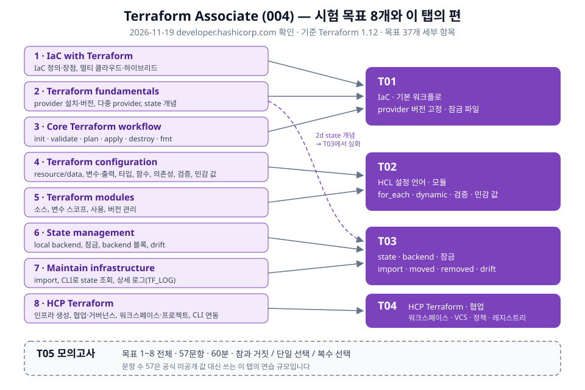
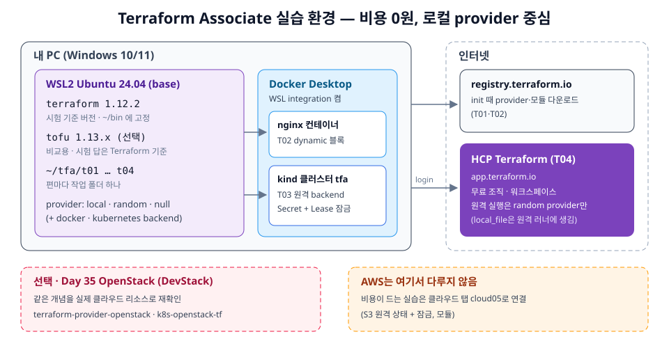

> **자격증 준비 · Terraform Associate** | 난이도 ★★☆☆☆ | 예상 소요 1.5 ~ 2시간 (설치 포함)

> ⚠️ **이 탭의 모든 문항은 HashiCorp가 공개한 Terraform Associate (004) 시험 목표를 바탕으로 이 시리즈가 직접 창작한 연습 문제입니다.** 실제 시험 문제나 유출 문제(덤프)가 아니며, 그런 자료를 옮기거나 재구성하지도 않습니다. HashiCorp 자격증 시험은 응시자가 시험 내용 비공개에 동의하고 치르므로, 실제 문제를 공유하거나 구하는 것은 응시 규정 위반이고 자격 취소 사유가 될 수 있습니다. 덤프로 외운 답은 실무에서도 쓸모가 없습니다.

## 🎯 오늘의 목표

- Terraform Associate가 **무엇을, 어떤 형식으로** 묻는지 공식 페이지 기준으로 설명할 수 있다
- 시험 목표 8개(세부 37개)가 이 탭의 어느 편, 본편의 어느 Day와 이어지는지 지도를 그린다
- 2~3주 학습 계획을 세우고, **시험 기준 버전(Terraform 1.12)** 으로 실습 환경을 맞춘다
- Terraform과 OpenTofu의 차이를 알고, **시험 답은 Terraform 기준**으로 고른다는 원칙을 세운다
- 비용 0원짜리 로컬 provider(local, random, docker, kind)로 첫 `init → plan → apply → destroy`를 돌린다

---

## 1. Terraform Associate는 어떤 시험인가?

Day 35에서 OpenStack 위 Kubernetes 클러스터를 Terraform 코드 한 벌로 만들고 지웠습니다. Terraform Associate는 그때 쓴 개념(provider, state, plan, 모듈)을 **용어와 동작 수준에서 정확히** 아는지 묻는 객관식 입문 자격입니다. CKA처럼 손으로 푸는 실기는 없지만, 선택지가 "거의 맞는 말"로 채워져 있어서 **명령마다 정확히 무엇을 바꾸는지** 모르면 틀립니다.

2026-11-19에 HashiCorp의 [Terraform Associate 자격 페이지](https://developer.hashicorp.com/certifications/terraform-associate), [Infrastructure Automation 자격 목록](https://developer.hashicorp.com/certifications/infrastructure-automation), [004 학습 가이드](https://developer.hashicorp.com/terraform/tutorials/certification-004/associate-study-004), [004 샘플 문항 안내](https://developer.hashicorp.com/terraform/tutorials/certification-004/associate-questions-004)를 확인한 결과입니다.

| 항목 | 내용 (확인일 2026-11-19) |
|---|---|
| 현재 시험 버전 | **Terraform Associate (004)**. 공식 페이지에 올라 있는 Associate 시험은 004 하나뿐 |
| 기준 Terraform 버전 | **Terraform 1.12** ("This exam tests on Terraform 1.12"). HCP Terraform 내용도 포함 |
| 형식 | **객관식**, 온라인 감독(Online Proctored) |
| 문항 유형 | **참과 거짓**, **단일 선택**, **복수 선택**(몇 개를 고를지 문제에 표시). 샘플 문항 페이지 기준 |
| 문항 수 | **공식 페이지에 없음.** 이 탭의 T05 모의고사는 57문항으로 연습합니다 (아래 💡 참고) |
| 시험 시간 | **1시간** |
| 합격 점수 | 공식 페이지에 없음 |
| 응시료 | **US$70.50** + 현지 세금·수수료. **무료 재응시 미포함** |
| 언어 | 영어 |
| 자격 유효기간 | 취득 후 **2년** |
| 재인증 | 004 보유자는 만료 6개월 전부터 004에 다시 합격하면 유효기간 연장. 002·003 보유자는 만료 6개월 전부터 004에 합격하면 새 자격이 따로 발급(기존 만료일은 연장되지 않음). 만료 뒤에는 언제든 현행 시험으로 재취득 |
| 권장 배경 | 기본 터미널 사용, 온프레미스·클라우드 구조 이해. 실무 경력은 권장이지만, 개인 실습 환경에서 목표를 직접 연습해도 된다고 안내 |

> 💡 **문항 수와 합격선.** HashiCorp는 004의 문항 수와 합격 점수를 공식 페이지에 쓰지 않습니다. 여러 교육 업체가 "57문항 안팎"을 언급하지만 공식 값이 아니므로, 이 탭은 **57문항·60분**을 연습 규모로만 쓰고 합격 참고선은 70%로 잡습니다. 실제 시험에는 채점되지 않는 문항이 섞일 수도 있으니 점수보다 **틀린 목표를 다시 보는 것**에 집중하세요.

> 💡 **003 → 004.** 공식 페이지에는 003 종료 날짜가 따로 나오지 않지만, 교육 업체 자료들은 **2026년 1월 초**에 003이 종료되고 004로 바뀌었다고 전합니다. 인터넷에서 찾는 자료 대부분이 아직 003(Terraform 1.x 초반 기준, "Terraform Cloud" 명칭) 이야기이니 **"004 / Terraform 1.12 / HCP Terraform"** 이라는 세 단어로 자료가 최신인지 거르세요. 응시 직전에는 이 표를 공식 페이지에서 다시 확인합니다.

> ⚠️ 2026-11-19 기준 Terraform 최신 버전은 **1.17.2**입니다. 시험은 1.12를 기준으로 출제되므로 **1.13 이후에 새로 생긴 기능은 시험 범위가 아니라고** 생각하는 편이 안전합니다. 이 탭은 1.12에 이미 있던 기능만 문제로 냅니다.

---

## 2. 시험 목표 8개와 이 탭의 지도



| 목표 (공식 영문 제목) | 세부 항목 요지 | 다루는 편 | 본편·다른 탭 |
|---|---|---|---|
| **1. Infrastructure as Code (IaC) with Terraform** | IaC 정의, IaC 패턴의 장점, 멀티 클라우드·하이브리드·서비스 무관 워크플로 | [T01](./t01-iac-workflow-providers.md) | [Day 35](../../05-capstone/day35-terraform.md) 1장 |
| **2. Terraform fundamentals** | provider 설치·버전 관리, provider 동작 방식, 여러 provider 쓰기, state 사용·관리 | [T01](./t01-iac-workflow-providers.md), state는 [T03](./t03-state-backend-import.md) | Day 35 2·4장 |
| **3. Core Terraform workflow** | 워크플로 설명, init, validate, plan 생성·검토, apply, destroy, fmt | [T01](./t01-iac-workflow-providers.md) | Day 35 5장 |
| **4. Terraform configuration** | resource·data 구분, 속성 참조, 변수·출력, 복합 타입, 표현식·함수, 의존성, 커스텀 조건, 민감 데이터(Vault 포함) | [T02](./t02-configuration-modules.md) | Day 35 4장, [해킹 24](../../hacking/hack24-iac-scanning.md) 7장 |
| **5. Terraform modules** | 모듈 소스, 모듈 안 변수 범위, 모듈 사용, 모듈 버전 관리 | [T02](./t02-configuration-modules.md) | — |
| **6. Terraform state management** | local backend, 상태 잠금, backend 블록으로 원격 state, drift와 state 관리 | [T03](./t03-state-backend-import.md) | Day 35 6장 |
| **7. Maintain infrastructure with Terraform** | 기존 인프라 import, CLI로 state 조회, 상세 로그 | [T03](./t03-state-backend-import.md) | Day 35 6-4 |
| **8. HCP Terraform** | HCP Terraform으로 인프라 생성, 협업·거버넌스, 워크스페이스·프로젝트, HCP Terraform 연동 설정 | [T04](./t04-hcp-terraform.md) | 클라우드 탭 [cloud05](../../cloud/cloud05-terraform-aws.md) |
| 종합 | 목표 1~8 전체 | [T05](./t05-mock-exam.md) 모의고사 57문항 | — |

공식 목표 전문은 [자격 페이지](https://developer.hashicorp.com/certifications/terraform-associate)의 "Exam objectives"에 있습니다. 이 탭은 영어 원문을 옮기지 않고 요지만 정리했으니, **시험 직전에 원문 목록을 한 번 소리 내어 읽어 보세요.** 시험 문항도 영어이므로 `drift`, `state locking`, `speculative plan`, `variable set` 같은 용어는 영어 그대로 익혀 두는 편이 낫습니다.

### 2-1. 목표 편(T01~T04)의 구성

모든 목표 편은 같은 순서입니다.

1. **핵심 개념** — 표와 그림으로 정리
2. **직접 따라 하는 짧은 실습** — local·random·docker·kind 같은 로컬 provider, 비용 0원
3. **헷갈리는 포인트** — 선택지에서 자주 섞이는 개념 짝
4. **창작 객관식 12~15문항** — `<details>`를 열면 정답, 해설, 근거가 되는 developer.hashicorp.com 문서 링크
5. **핵심 정리**, 다음 편 예고

---

## 3. 2~3주 학습 계획

하루 1시간 기준입니다. Day 35를 한 번 따라 해 봤다는 전제이고, Terraform이 처음이라면 Day 35 1~6장을 먼저 읽으세요.

| 기간 | 범위 | 핵심 | 점검 |
|---|---|---|---|
| 1주 차 (1~3일) | T00, T01 | 환경 구성, 워크플로·plan 기호, 버전 제약 연산자와 잠금 파일 | T01 문항 80% 이상 |
| 1주 차 (4~7일) | T02 | 변수 우선순위, `for_each`/`count`, 함수·표현식, 모듈 소스·버전 | `terraform console`로 함수 10개 직접 실행 |
| 2주 차 (8~11일) | T03 | state 하위 명령, import·moved·removed, refresh-only, drift, 잠금 | "어디가 바뀌나" 표(T03 그림)를 안 보고 다시 그리기 |
| 2주 차 (12~14일) | T04 | HCP Terraform 무료 조직 만들어 CLI 연동 1회, VCS·정책·변수 세트 개념 | T04 문항 80% 이상 |
| 3주 차 | T05, 공식 자료 | 모의고사 60분 → 틀린 목표 편 재학습 → 공식 [샘플 문항](https://developer.hashicorp.com/terraform/tutorials/certification-004/associate-questions-004)과 [리뷰 가이드](https://developer.hashicorp.com/terraform/tutorials/certification-004/associate-review-004) | 모의고사 70% 이상, 목표별 오답 0~1개 |

> 💡 경험자라면 2주로 줄여도 됩니다. 1주 차에 T01~T02, 2주 차에 T03~T05. 대신 **T04(HCP Terraform)** 는 실무에서 안 써 봤다면 반드시 무료 조직을 만들어 한 번 눌러 보세요. 004에서 HCP Terraform이 독립 목표(8번)로 커졌습니다.

공부 방법 세 가지:

- **명령은 반드시 쳐 본다.** "`terraform state rm`은 실제 리소스를 지우나?" 같은 문항은 외우는 것보다 한 번 쳐 보고 `ls`로 확인하는 쪽이 오래 남습니다.
- **문서를 근거로 확인한다.** 각 문항 해설에 developer.hashicorp.com 링크를 달았습니다. 해설이 이해되지 않으면 링크를 열어 원문 한 단락을 읽으세요.
- **버전 함정에 주의한다.** `taint`(→ `-replace`), `terraform refresh`(→ `-refresh-only`), DynamoDB 잠금(→ S3 `use_lockfile`), "Terraform Cloud"(→ HCP Terraform)처럼 **예전 방식과 지금 권장 방식**을 짝으로 기억합니다.

---

## 4. 실습 환경



### 4-1. 구성 한눈에 보기 — 실습 환경 고정값

| 항목 | 값 | 쓰는 편 |
|---|---|---|
| 작업 셸 | **WSL2 Ubuntu 24.04** (CKA 탭 K00의 `base`와 같은 배포판). Day 35의 DevStack 호스트(Ubuntu 24.04)를 써도 됨 | 전부 |
| Terraform | **1.12.2** (1.12의 마지막 패치) — `~/bin/terraform` | 전부 |
| OpenTofu | 1.13.x (선택, 비교용) — `tofu` | T00 |
| 작업 폴더 | `~/tfa/t01`, `~/tfa/t02`, `~/tfa/t03`, `~/tfa/t04` | 편마다 |
| provider | `hashicorp/local`, `hashicorp/random`, `hashicorp/null`, `kreuzwerker/docker` | T01~T03 |
| Docker | Docker Desktop + WSL integration (CKA K00과 같음) | T02 dynamic 블록, T03 |
| kind | v0.33.0 이상, 클러스터 이름 `tfa` (context `kind-tfa`) | T03 원격 backend |
| HCP Terraform | app.terraform.io 무료 조직 (T04에서 직접 가입) | T04 |
| AWS | **다루지 않음** — 비용이 드는 실습은 클라우드 탭 [cloud05](../../cloud/cloud05-terraform-aws.md) | — |

> 💡 **왜 로컬 provider인가?** 시험은 "AWS에서 VPC를 만드는 법"이 아니라 **Terraform 자체의 동작**을 묻습니다. `local_file`은 결과가 파일로 바로 보이고, `random_*`은 지우고 다시 만들 때마다 값이 바뀌어 "교체(replace)"를 눈으로 확인하기 좋습니다. 실제 클라우드 리소스로 같은 개념을 확인하고 싶다면 Day 35의 OpenStack 코드(`k8s-openstack-tf`)를 그대로 쓰면 됩니다.

### 4-2. Terraform 1.12.2 설치 — 시험 버전에 맞추기

Day 35에서는 HashiCorp apt 저장소로 최신 버전을 설치했습니다. 시험 대비용으로는 **1.12.2 바이너리를 `~/bin`에 따로** 둡니다. 공식 릴리스 사이트에서 받고 SHA256 체크섬을 확인합니다.

```bash
# WSL2 Ubuntu 24.04
sudo apt-get update && sudo apt-get install -y unzip curl

TF_VER=1.12.2
mkdir -p ~/bin ~/tfa && cd /tmp
curl -fsSLO https://releases.hashicorp.com/terraform/${TF_VER}/terraform_${TF_VER}_linux_amd64.zip
curl -fsSLO https://releases.hashicorp.com/terraform/${TF_VER}/terraform_${TF_VER}_SHA256SUMS
grep linux_amd64 terraform_${TF_VER}_SHA256SUMS | sha256sum -c -
# terraform_1.12.2_linux_amd64.zip: OK

unzip -o terraform_${TF_VER}_linux_amd64.zip terraform
mv terraform ~/bin/terraform
grep -q 'HOME/bin' ~/.bashrc || echo 'export PATH="$HOME/bin:$PATH"' >> ~/.bashrc
source ~/.bashrc

terraform version
```

```
Terraform v1.12.2
on linux_amd64
```

최신 버전이 있다는 안내 문구가 함께 나올 수 있는데, 시험 대비용이니 무시합니다. Day 35 때문에 apt로 최신 `terraform`이 이미 깔려 있다면 `which -a terraform`으로 `~/bin/terraform`이 **먼저** 나오는지 확인하세요.

```bash
which -a terraform
# /home/<you>/bin/terraform      ← 1.12.2 (이 탭에서 사용)
# /usr/bin/terraform             ← apt 최신 (Day 35)

terraform -install-autocomplete     # bash 자동완성 (한 번만, 새 셸부터 적용)
```

> 💡 이 탭의 코드는 모두 `required_version = ">= 1.12"`로 씁니다. 최신 1.17로 실습해도 결과는 같지만, **plan 출력 문구나 경고**가 조금 다를 수 있습니다.

### 4-3. OpenTofu는 어떻게 다룰까? (선택)

Day 35 7장에서 봤듯이 OpenTofu는 Terraform 1.5 시점에서 갈라져 나온 MPL 라이선스 포크입니다. 문법과 대부분의 명령이 같아서 이 탭의 실습 코드도 `tofu`로 거의 그대로 돌아갑니다. 하지만 **시험은 Terraform과 HCP Terraform 기준**입니다.

| 구분 | Terraform (시험 기준) | OpenTofu |
|---|---|---|
| 명령 | `terraform` | `tofu` |
| 라이선스 | BSL 1.1 | MPL 2.0 |
| 기본 레지스트리 | `registry.terraform.io` | `registry.opentofu.org` |
| 원격 실행·협업 | **HCP Terraform**, Terraform Enterprise (목표 8) | 같은 기능은 제3자 플랫폼 몫 |
| 고유 기능 예 | HCP Terraform 연동(`cloud` 블록), Sentinel 정책 | state 클라이언트 측 암호화 |
| 이 탭에서 | 모든 문항의 정답 근거 | 비교·참고만 |

> ⚠️ **답을 고를 때 OpenTofu 문서를 근거로 쓰지 마세요.** 예를 들어 "state를 Terraform이 자체 암호화한다"는 선택지는 OpenTofu에서는 설정으로 가능하지만 Terraform 기준으로는 **틀린 말**입니다. 이 탭의 모든 해설은 developer.hashicorp.com 문서를 근거로 합니다.

OpenTofu도 설치해 비교해 보고 싶다면 공식 설치 스크립트의 deb 방식을 씁니다.

```bash
curl --proto '=https' --tlsv1.2 -fsSL https://get.opentofu.org/install-opentofu.sh -o install-opentofu.sh
chmod +x install-opentofu.sh
./install-opentofu.sh --install-method deb
rm -f install-opentofu.sh
tofu version
```

### 4-4. Docker와 kind 확인

CKA 탭 K00에서 Docker Desktop의 WSL integration과 kind를 이미 준비했다면 확인만 합니다.

```bash
docker version --format '{{.Server.Version}}'    # 서버 버전이 나오면 OK
kind version                                      # kind v0.33.0 이상
```

kind 클러스터 `tfa`는 T03에서 원격 backend를 실습할 때 만듭니다. CKA의 `cka-aux`와는 **따로** 만들어, 실습이 끝나면 지워도 다른 탭에 영향이 없게 합니다.

---

## 5. 첫 실습 — 환경 점검 (5분)

설치가 끝났으면 provider 두 개로 한 바퀴를 돌려 봅니다. 자세한 설명은 T01에서 하니 지금은 **끝까지 에러 없이 도는지**만 봅니다.

```bash
mkdir -p ~/tfa/t00 && cd ~/tfa/t00

cat > main.tf <<'EOF'
terraform {
  required_version = ">= 1.12"
  required_providers {
    random = {
      source  = "hashicorp/random"
      version = "~> 3.6"
    }
    local = {
      source  = "hashicorp/local"
      version = "~> 2.5"
    }
  }
}

resource "random_pet" "name" {
  length = 2
}

resource "local_file" "hello" {
  filename = "${path.module}/hello.txt"
  content  = "hello, ${random_pet.name.id}\n"
}

output "pet" {
  value = random_pet.name.id
}
EOF

terraform init
terraform plan
terraform apply -auto-approve
cat hello.txt
terraform destroy -auto-approve
```

```
Plan: 2 to add, 0 to change, 0 to destroy.
...
Apply complete! Resources: 2 added, 0 changed, 0 destroyed.

Outputs:

pet = "proven-lemur"
hello, proven-lemur
...
Destroy complete! Resources: 2 destroyed.
```

`random_pet` 값은 사람마다 다릅니다. `ls -a`로 `.terraform/`, `.terraform.lock.hcl`, `terraform.tfstate`가 생겼는지도 봐 두세요. 세 파일이 각각 무엇인지가 T01의 첫 주제입니다.

> 💡 `-auto-approve`는 실습 속도를 위해서만 씁니다. 실무와 T01 실습에서는 plan을 **읽고** `yes`를 칩니다.

---

## 6. 객관식 시험 요령

| 상황 | 요령 |
|---|---|
| "Choose two/three" 복수 선택 | 문제에 고를 개수가 적혀 있습니다. 하나라도 틀리면 문항 전체가 틀린다고 보고, **확실히 맞는 것부터** 고릅니다 |
| 참과 거짓 | 문장 안의 **절대 표현**("always", "never", "only")과 **주어**(Terraform? provider? HCP Terraform?)를 봅니다 |
| 명령 문항 | "무엇을 바꾸나"를 세 칸으로 생각합니다 — **코드 / state / 실제 인프라** (T03 그림) |
| 예전 명령이 선택지에 있을 때 | `taint`, `refresh`, `terraform import`(명령)도 아직 동작합니다. 문제가 "권장(recommended)"을 묻는지, "가능한(can)"을 묻는지 구분합니다 |
| 시간 | 60분에 57문항이면 문항당 1분 남짓. 2분 넘게 걸리면 표시(flag)하고 넘어갑니다 |
| HCP Terraform 문항 | 무료 기능인지, 유료(Standard 이상)·Enterprise 기능인지 묻는 경우가 있습니다. T04 표로 정리합니다 |

---

## 7. 트러블슈팅

| 증상 | 원인 | 해결 |
|---|---|---|
| `terraform version`이 1.17.x로 나옴 | PATH에서 `/usr/bin/terraform`(apt)이 먼저 잡힘 | `~/.bashrc`의 `export PATH="$HOME/bin:$PATH"` 확인, `hash -r` 또는 새 셸 |
| `sha256sum: WARNING: 1 computed checksum did NOT match` | 다운로드 손상 또는 잘못된 파일 | zip을 지우고 다시 받기. 계속 실패하면 프록시·네트워크 확인 |
| `init`에서 `Failed to query available provider packages` | 인터넷·DNS·프록시 문제 | `curl -I https://registry.terraform.io` 확인, 사내망이면 프록시 환경 변수 |
| `Unsupported Terraform Core version` | 코드의 `required_version`보다 낮은 Terraform 실행 | `terraform version` 확인, 1.12.2 이상 사용 |
| `docker version`에서 서버 정보 없음 | Docker Desktop 꺼짐 또는 WSL integration 꺼짐 | Docker Desktop → Settings → Resources → WSL integration에서 Ubuntu-24.04 켜기 |
| `hello.txt`가 Windows 탐색기에서 안 보임 | WSL 리눅스 파일 시스템 안에 생성됨 | 탐색기 주소창에 `\\wsl$\Ubuntu-24.04\home\<you>\tfa\t00` |

---

## 8. 핵심 정리

- 현재 시험은 **Terraform Associate (004)**, 기준 **Terraform 1.12**, **1시간·온라인 감독·객관식**(참과 거짓 / 단일 선택 / 복수 선택), **US$70.50**(재응시 미포함), 영어, 유효 2년
- 문항 수와 합격 점수는 **공식 미공개**. 이 탭은 57문항·60분·70%를 연습 기준으로만 사용
- 목표 8개: IaC → fundamentals → core workflow → configuration → modules → state → maintain → **HCP Terraform**
- 실습 고정값: WSL2 Ubuntu 24.04, `~/bin/terraform` 1.12.2, 작업 폴더 `~/tfa/tNN`, 로컬 provider(local·random·null·docker), kind `tfa`, HCP Terraform 무료 조직
- OpenTofu는 비교용. **정답 근거는 언제나 developer.hashicorp.com**
- 이 탭의 모든 문항은 공식 목표 기반 **직접 창작** 문항이다

---

## ⏭️ 다음 예고 — T01. IaC 개념과 Terraform 기본 워크플로·provider 버전 고정

IaC가 무엇이고 왜 쓰는지부터 시작해, `init → validate → plan → apply → destroy`가 각각 **무엇을 읽고 무엇을 쓰는지** 정리합니다. 버전 제약 연산자 `~>`가 정확히 어디까지 허용하는지, `.terraform.lock.hcl`이 왜 Git에 올라가야 하는지, `init -upgrade`가 언제 필요한지를 random provider로 직접 확인하고, 창작 객관식 15문항으로 목표 1~3을 점검합니다.
