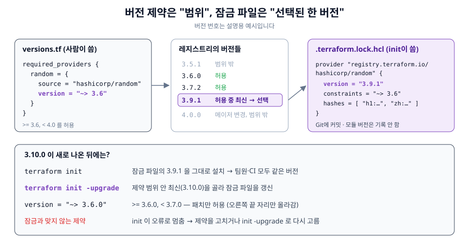
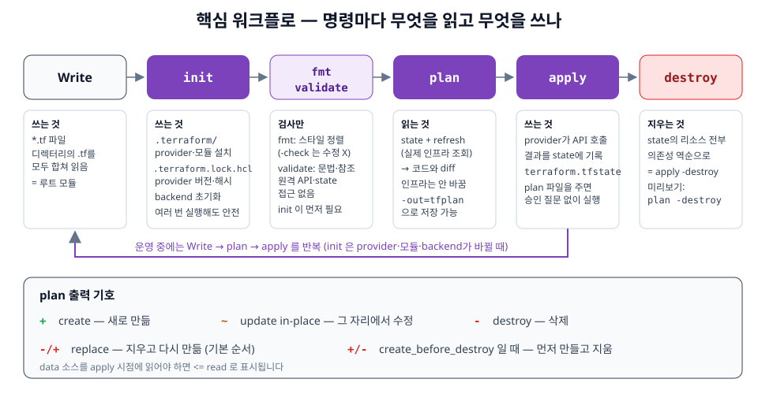

> **자격증 준비 · Terraform Associate** | 난이도 ★★☆☆☆ | 예상 소요 2 ~ 2.5시간 (실습 40분 + 문항 30분)

> ⚠️ **이 편의 모든 문항은 HashiCorp가 공개한 Terraform Associate (004) 시험 목표(1·2·3번)를 바탕으로 직접 창작한 연습 문제입니다.** 실제 시험 문제나 유출 문제(덤프)가 아니며 그런 자료를 재현하지 않습니다.

## 🎯 오늘의 목표

- IaC의 정의와 장점, Terraform이 **멀티 클라우드·하이브리드·서비스 무관** 워크플로를 어떻게 다루는지 설명할 수 있다 (목표 1)
- Terraform Core와 provider 플러그인의 관계, provider **소스 주소·버전 제약·잠금 파일**을 정확히 구분한다 (목표 2a~2c)
- `init → validate → plan → apply → destroy`와 `fmt`가 각각 **무엇을 읽고 무엇을 쓰는지** 말할 수 있다 (목표 3)
- random provider로 `~>` 제약, 잠금 파일, `init -upgrade`, 별칭(alias) provider를 직접 확인한다

---

## 1. 핵심 개념 ① — IaC와 Terraform의 자리

Day 35 1장에서 "수작업 vs IaC" 표를 봤습니다. 시험은 그 표를 **용어**로 묻습니다.

| 용어 | 뜻 | 시험에서 자주 나오는 짝 |
|---|---|---|
| **IaC** | 인프라를 사람이 읽을 수 있는 **설정 파일**로 정의하고, 버전 관리·재사용·공유하는 방식 | 수작업(콘솔 클릭, 일회성 스크립트) |
| **선언형(declarative)** | "최종 상태가 이래야 한다"를 적으면 도구가 순서를 계산 — Terraform HCL | 명령형(imperative) — "이 순서로 이 명령을 실행하라" |
| **멱등성(idempotent)** | 같은 코드를 여러 번 apply 해도 결과가 같음. 차이가 없으면 `No changes` | 스크립트를 두 번 돌리면 리소스가 두 개 |
| **불변 인프라(immutable)** | 고치지 않고 새로 만들어 바꿈 (`-/+` replace) | 가변(mutable) — 그 자리에서 패치 |
| **실행 계획(plan)** | 적용 전에 바뀔 내용을 미리 보여 줌 | 콘솔에서 바로 변경 |

IaC의 장점으로 공식 문서가 강조하는 것은 **버전 관리, 재사용, 공유, 일관된 워크플로, 리뷰 가능성**입니다. "IaC를 쓰면 비용이 저절로 줄어든다"나 "보안 문제가 사라진다" 같은 선택지는 과장입니다. 해킹 24에서 봤듯이 IaC는 **설정 실수도 그대로 복제**합니다.

### 1-1. 멀티 클라우드·하이브리드·서비스 무관

Terraform은 **provider**만 있으면 API가 있는 무엇이든 관리합니다. Day 35에서는 OpenStack과 random을 한 코드에서 썼고, 같은 방식으로 AWS·Kubernetes·DNS·GitHub·모니터링 SaaS도 한 워크플로로 묶을 수 있습니다.

| 오해 | 정확한 이해 |
|---|---|
| "같은 코드가 AWS에서도 Azure에서도 그대로 돈다" | ❌ 리소스 타입(`aws_instance`, `openstack_compute_instance_v2`)은 provider마다 다릅니다. 같은 것은 **언어(HCL)·워크플로·도구**입니다 |
| "Terraform은 클라우드 전용이다" | ❌ 온프레미스(OpenStack, vSphere), SaaS, 로컬 파일까지 provider가 있으면 대상이 됩니다 |
| "여러 클라우드를 쓰면 도구도 여러 개 필요하다" | ❌ 한 설정에 여러 provider를 함께 쓰고, 리소스 사이 **참조로 의존성**을 엮습니다 (예: OpenStack VM IP → DNS 레코드) |

---

## 2. 핵심 개념 ② — Core와 provider

| 구성 요소 | 하는 일 | 어디에 있나 |
|---|---|---|
| **Terraform Core** | 설정 읽기, **의존성 그래프** 계산, state 관리, plan 비교, provider 호출 순서 결정 | `terraform` 바이너리 하나 |
| **Provider (플러그인)** | 특정 API의 인증·호출, 리소스 타입·데이터 소스 정의 | `init`이 `.terraform/providers/` 아래에 내려받는 별도 실행 파일. Core와 **RPC**로 통신 |

provider는 **소스 주소**로 식별합니다. 형식은 `[HOSTNAME/]NAMESPACE/TYPE`이고, 호스트를 생략하면 공개 레지스트리 `registry.terraform.io`입니다.

| 코드에 쓴 값 | 완전한 주소 |
|---|---|
| `hashicorp/random` | `registry.terraform.io/hashicorp/random` |
| `kreuzwerker/docker` | `registry.terraform.io/kreuzwerker/docker` |
| `terraform-provider-openstack/openstack` (Day 35) | `registry.terraform.io/terraform-provider-openstack/openstack` |
| `app.terraform.io/my-org/internal` | HCP Terraform 비공개 레지스트리의 provider (T04) |

레지스트리의 provider는 관리 주체에 따라 **Official**(HashiCorp), **Partner**(검증된 외부 회사), **Community**(개인·커뮤니티)로 표시됩니다.

### 2-1. `required_providers`와 provider 블록은 다르다

```hcl
terraform {
  required_version = ">= 1.12"            # Terraform CLI 자체의 버전 제약
  required_providers {                     # 무엇을, 어느 버전 범위로 설치할지
    random = {
      source  = "hashicorp/random"
      version = "~> 3.6"
    }
  }
}

provider "random" {}                       # 그 provider를 어떻게 설정할지 (인증, 리전 등)

provider "random" {                        # 같은 provider의 두 번째 설정 = 별칭
  alias = "second"
}
```

- `required_providers`의 키(`random`)가 **로컬 이름**입니다. 리소스 타입의 앞부분(`random_pet`)이 이 이름과 맞아야 기본 provider가 자동으로 붙습니다.
- 별칭 provider를 쓰려면 리소스에 `provider = random.second`를 적습니다. 리전이 둘인 AWS(`aws.seoul`, `aws.tokyo`)가 대표적인 예입니다.
- provider 블록 안의 `version` 인수는 **예전 방식(폐기 예정)** 입니다. 버전은 `required_providers`에 씁니다.

### 2-2. 버전 제약 연산자



| 제약 | 허용 범위 | 메모 |
|---|---|---|
| `= 3.6.3` 또는 `3.6.3` | 정확히 3.6.3 | 버전 하나로 고정 |
| `!= 3.7.0` | 3.7.0만 제외 | 문제 있는 버전 피하기 |
| `>= 3.6, < 4.0` | 3.6 이상 4.0 미만 | 쉼표 = AND |
| `~> 3.6` | `>= 3.6, < 4.0` | 마지막 자리(6)만 올라갈 수 있음 → **마이너 업그레이드 허용** |
| `~> 3.6.0` | `>= 3.6.0, < 3.7.0` | **패치만** 허용 |
| `~> 3` | 의미상 `>= 3` 과 거의 같음 | 자릿수가 하나면 범위가 넓어 권장하지 않음 |

> 💡 외우는 법: `~>`는 **오른쪽 끝 자리만 움직일 수 있다**. `~> 1.2.3`이면 3만, `~> 1.2`면 2만 올라갑니다.

### 2-3. 잠금 파일 `.terraform.lock.hcl`

| 질문 | 답 |
|---|---|
| 누가 만드나? | `terraform init` (사람이 손으로 쓰지 않음) |
| 무엇을 기록하나? | provider마다 **선택된 정확한 버전**, 당시 제약, 패키지 **해시** |
| 모듈 버전도 기록하나? | **아니요.** provider만. 모듈은 `version` 인수와 소스의 `ref`로 고정 (T02) |
| Git에 올리나? | **예.** 팀원·CI가 같은 provider 버전을 쓰게 하려면 커밋 |
| 새 버전이 나오면? | 잠금 파일이 있으면 그 버전을 계속 설치. 바꾸려면 `terraform init -upgrade` |
| 다른 OS 해시가 없다는 경고 | `terraform providers lock -platform=linux_amd64 -platform=darwin_arm64 ...` 로 해시 추가 |

---

## 3. 핵심 개념 ③ — 핵심 워크플로



공식 문서는 워크플로를 **Write → Plan → Apply** 세 단계로 설명합니다. 명령 수준에서는 아래와 같습니다.

| 명령 | 하는 일 | 자주 쓰는 옵션 | 인프라를 바꾸나? |
|---|---|---|---|
| `terraform init` | 작업 디렉터리 초기화: backend 설정, provider·모듈 설치, 잠금 파일 생성 | `-upgrade`, `-backend=false`, `-reconfigure`, `-migrate-state` | 아니요 |
| `terraform fmt` | 표준 스타일로 `.tf` 파일 다시 쓰기 | `-check`(검사만, 틀리면 0이 아닌 종료 코드), `-recursive`, `-diff` | 아니요 |
| `terraform validate` | 문법·타입·참조 검사. **원격 API·state 접근 없음** | `-json` | 아니요 |
| `terraform plan` | state와 실제 인프라를 비교해 실행 계획 출력 | `-out=FILE`, `-var`, `-var-file`, `-destroy`, `-refresh-only`, `-target` | 아니요 |
| `terraform apply` | 계획 실행 후 state 갱신 | `PLANFILE`, `-auto-approve`, `-replace=ADDR`, `-parallelism=N`(기본 10) | **예** |
| `terraform destroy` | state의 모든 리소스 삭제 (`apply -destroy`와 같음) | `-auto-approve`, `-target` | **예** |

- `validate`는 provider 스키마가 필요해서 **`init` 뒤에** 실행할 수 있습니다. `init -backend=false`로 backend 접근 없이 초기화하고 validate만 하는 CI 패턴이 흔합니다.
- `apply`에 plan 파일을 주면 **다시 묻지 않고** 그 계획만 실행합니다. 그사이 state가 바뀌었으면 "Saved plan is stale" 오류로 멈춥니다.
- `init`은 여러 번 실행해도 안전합니다. provider·모듈·backend 설정을 바꿨을 때 다시 실행합니다.
- 생성은 의존성 그래프 순서대로, 삭제는 **역순**으로, 서로 독립적인 리소스는 **병렬**로 처리합니다(Day 35 그래프 그림).

---

## 4. 실습 — random provider로 버전 고정과 워크플로 확인 (40분)

실습 환경: T00의 WSL2 Ubuntu 24.04, `~/bin/terraform` 1.12.2. 비용 없음.

### 4-1. 패치만 허용하는 제약으로 시작

```bash
mkdir -p ~/tfa/t01 && cd ~/tfa/t01

cat > versions.tf <<'EOF'
terraform {
  required_version = ">= 1.12"
  required_providers {
    random = {
      source  = "hashicorp/random"
      version = "~> 3.6.0"
    }
  }
}
EOF

cat > main.tf <<'EOF'
resource "random_pet" "server" {
  length = 2
}

output "server_name" {
  value = random_pet.server.id
}
EOF

terraform init
```

```
Initializing provider plugins...
- Finding hashicorp/random versions matching "~> 3.6.0"...
- Installing hashicorp/random v3.6.3...
- Installed hashicorp/random v3.6.3 (signed by HashiCorp)
Terraform has created a lock file .terraform.lock.hcl to record the provider
selections it made above. Include this file in your version control repository
so that Terraform can guarantee to make the same selections by default when
you run "terraform init" in the future.
```

`~> 3.6.0`은 3.6.x만 허용하므로 3.6 계열의 마지막인 **3.6.3**이 선택됐습니다(2026-11-19 레지스트리 기준). 잠금 파일을 봅니다.

```bash
cat .terraform.lock.hcl
ls .terraform/providers/registry.terraform.io/hashicorp/random/
```

```hcl
provider "registry.terraform.io/hashicorp/random" {
  version     = "3.6.3"
  constraints = "~> 3.6.0"
  hashes = [
    "h1:...",
    "zh:...",
    ...
  ]
}
```

### 4-2. 제약을 넓혀도 잠금 파일이 이긴다

```bash
sed -i 's/"~> 3.6.0"/"~> 3.6"/' versions.tf
terraform init
grep version .terraform.lock.hcl
```

```
- Reusing previous version of hashicorp/random from the dependency lock file
- Using previously-installed hashicorp/random v3.6.3
  version     = "3.6.3"
```

제약은 `< 4.0`까지 허용하지만, 잠긴 3.6.3도 그 범위 안이므로 **그대로 씁니다.** 이제 명시적으로 올립니다.

```bash
terraform init -upgrade
grep -E 'version|constraints' .terraform.lock.hcl
```

```
- Finding hashicorp/random versions matching "~> 3.6"...
- Installing hashicorp/random v3.9.1...
  version     = "3.9.1"
  constraints = "~> 3.6"
```

### 4-3. 잠금과 맞지 않는 제약 → 오류

```bash
sed -i 's/"~> 3.6"/"~> 3.6.0"/' versions.tf
terraform init
```

```
Error: Failed to query available provider packages

Could not retrieve the list of available versions for provider hashicorp/random:
locked provider registry.terraform.io/hashicorp/random 3.9.1 does not match
configured version constraint ~> 3.6.0; must use terraform init -upgrade to
allow selection of new versions
```

이 메시지가 시험의 단골 포인트입니다. **잠금 파일과 제약이 충돌하면 `init`은 멈추고, `init -upgrade`가 해결책**입니다. 실습을 이어 가기 위해 `~> 3.6`으로 되돌리고 `init -upgrade`를 한 번 더 합니다.

```bash
sed -i 's/"~> 3.6.0"/"~> 3.6"/' versions.tf && terraform init -upgrade
```

### 4-4. fmt와 validate

일부러 들여쓰기를 망가뜨리고, 없는 변수를 참조해 봅니다.

```bash
cat >> main.tf <<'EOF'
resource "random_integer" "port" {
min = 30000
    max = 32767
  keepers = { env = var.env }
}
EOF

terraform fmt -check ; echo "exit=$?"
terraform validate
```

```
main.tf
exit=3
...
Error: Reference to undeclared input variable

  on main.tf line 11, in resource "random_integer" "port":
  11:   keepers = { env = var.env }

An input variable with the name "env" has not been declared.
```

`fmt -check`는 고쳐야 할 파일 이름만 출력하고 0이 아닌 종료 코드를 돌려줍니다(파일은 그대로). 변수를 선언하고 포맷을 고칩니다.

```bash
cat > variables.tf <<'EOF'
variable "env" {
  type    = string
  default = "dev"
}
EOF
terraform fmt          # main.tf 를 고쳐 쓰고 파일 이름을 출력
terraform validate     # Success! The configuration is valid.
```

### 4-5. plan 파일로 적용하고, 교체를 눈으로 보기

```bash
terraform plan -out=tfplan
terraform apply tfplan          # 질문 없이 바로 실행
terraform output server_name
```

```
Plan: 2 to add, 0 to change, 0 to destroy.
...
Apply complete! Resources: 2 added, 0 changed, 0 destroyed.
"helpful-oriole"
```

`random_pet`의 `length`를 바꾸면 provider는 그 자리에서 고칠 수 없으므로 **교체**합니다.

```bash
sed -i 's/length = 2/length = 3/' main.tf
terraform plan
```

```
  # random_pet.server must be replaced
-/+ resource "random_pet" "server" {
      ~ id        = "helpful-oriole" -> (known after apply)
      ~ length    = 2 -> 3 # forces replacement
        # (1 unchanged attribute hidden)
    }

Plan: 1 to add, 0 to change, 1 to destroy.
```

`random_integer`는 `keepers` 값이 바뀔 때 교체됩니다. 변수만 바꿔 plan을 비교해 보세요.

```bash
terraform plan -var env=stg | grep -E 'must be replaced|Plan:'
```

### 4-6. 별칭 provider

```bash
cat > alias.tf <<'EOF'
provider "random" {
  alias = "second"
}

resource "random_id" "tag" {
  provider    = random.second
  byte_length = 4
}
EOF
terraform plan | grep -E 'random_id|Plan:'
terraform providers
```

```
Providers required by configuration:
.
└── provider[registry.terraform.io/hashicorp/random] ~> 3.6
```

설정이 두 개여도 **설치되는 provider 바이너리는 하나**입니다. 별칭은 "같은 provider의 다른 설정"일 뿐입니다.

### 4-7. 정리

```bash
terraform plan -destroy | tail -1     # 미리보기
terraform destroy -auto-approve
ls -a                                 # .terraform/ .terraform.lock.hcl terraform.tfstate(빈 state) 남음
```

`.gitignore`에 넣을 것과 커밋할 것을 정리합니다(Day 35 6-2와 같음).

```gitignore
.terraform/
*.tfstate
*.tfstate.*
tfplan
# .terraform.lock.hcl 은 넣지 않는다 → 커밋
```

---

## 5. 헷갈리는 포인트

| 짝 | 구분 |
|---|---|
| `required_version` vs provider `version` | 앞은 **Terraform CLI** 버전 제약, 뒤는 `required_providers` 안 **provider** 버전 제약 |
| `~> 3.6` vs `~> 3.6.0` | 앞은 4.0 미만까지(마이너 업 허용), 뒤는 3.7.0 미만(패치만) |
| 잠금 파일 vs state 파일 | 잠금 파일 = provider 버전·해시(**커밋**), state = 리소스 ID·속성(**커밋 금지**, 민감 값 포함) |
| `init` vs `init -upgrade` | `init`은 잠금 파일 우선, `-upgrade`는 제약 안에서 최신으로 다시 고름 |
| `validate` vs `plan` | validate는 코드만 본다(원격 접근 없음), plan은 state와 실제 인프라를 조회한다 |
| `fmt` vs `fmt -check` | 앞은 파일을 고쳐 씀, 뒤는 검사만(CI용) |
| `apply` vs `apply tfplan` | 앞은 새로 plan 후 승인 질문, 뒤는 저장된 계획을 **질문 없이** 실행 |
| `destroy` vs `plan -destroy` | 앞은 실제 삭제, 뒤는 삭제 계획 미리보기 |
| provider 별칭 vs 두 번째 provider | 별칭은 같은 provider의 **다른 설정**(바이너리는 하나), 다른 provider는 `required_providers`에 별도 항목 |
| 선언형 vs 멱등 | 선언형은 "무엇을"을 쓰는 방식, 멱등은 반복 적용해도 같은 결과라는 성질 |

---

## 6. 창작 객관식 15문항

> 모두 이 시리즈가 공식 목표 1~3을 바탕으로 직접 만든 문항입니다. 먼저 풀고 `<details>`를 여세요.

**Q1.** IaC의 장점으로 가장 거리가 먼 것은?
A. 인프라 변경을 코드 리뷰로 검토할 수 있다
B. 같은 구성을 여러 환경에 반복해서 만들 수 있다
C. 인프라 정의를 버전 관리 시스템에 기록할 수 있다
D. 코드에 쓴 설정은 보안상 항상 안전하다는 것이 보장된다

<details><summary>정답·해설</summary>

**D.** IaC는 리뷰·재사용·버전 관리를 가능하게 하지만, 잘못된 설정(예: `0.0.0.0/0` 개방)도 그대로 반복합니다. 그래서 해킹 24의 정적 분석과 T02의 검증 블록이 필요합니다.
근거: [What is Terraform?](https://developer.hashicorp.com/terraform/intro)
</details>

**Q2.** (참과 거짓) Terraform으로 AWS용으로 작성한 리소스 블록은 provider 이름만 바꾸면 Azure에서도 그대로 동작한다.

<details><summary>정답·해설</summary>

**거짓.** 리소스 타입과 인수는 provider마다 다릅니다. Terraform이 멀티 클라우드에서 통일해 주는 것은 **언어와 워크플로**입니다.
근거: [Use cases](https://developer.hashicorp.com/terraform/intro/v1.12.x/use-cases)
</details>

**Q3.** Terraform Core와 provider의 관계로 옳은 것은?
A. provider는 Terraform 바이너리 안에 모두 포함되어 있다
B. provider는 별도 플러그인으로 `terraform init` 때 설치되며 Core와 RPC로 통신한다
C. provider는 state 파일을 직접 관리하고 Core는 API를 호출한다
D. provider는 HCP Terraform에서만 실행된다

<details><summary>정답·해설</summary>

**B.** Core는 설정·그래프·state를 다루고, 실제 API 호출은 별도 실행 파일인 provider가 합니다.
근거: [How Terraform works with plugins](https://developer.hashicorp.com/terraform/plugin/how-terraform-works)
</details>

**Q4.** `source = "hashicorp/random"`의 완전한 provider 주소는?
A. `github.com/hashicorp/random`
B. `registry.terraform.io/hashicorp/random`
C. `app.terraform.io/hashicorp/random`
D. `releases.hashicorp.com/random`

<details><summary>정답·해설</summary>

**B.** 호스트를 생략하면 공개 Terraform 레지스트리 `registry.terraform.io`로 해석됩니다. `app.terraform.io`는 HCP Terraform(비공개 레지스트리)입니다.
근거: [Provider requirements](https://developer.hashicorp.com/terraform/language/v1.12.x/providers/requirements)
</details>

**Q5.** `version = "~> 2.4.1"`이 허용하는 버전은? (두 개 선택)
A. 2.4.1
B. 2.4.9
C. 2.5.0
D. 3.0.0

<details><summary>정답·해설</summary>

**A, B.** `~> 2.4.1`은 `>= 2.4.1, < 2.5.0`입니다. 오른쪽 끝 자리(패치)만 올라갈 수 있습니다.
근거: [Version constraints](https://developer.hashicorp.com/terraform/language/expressions/version-constraints)
</details>

**Q6.** `.terraform.lock.hcl`에 대한 설명으로 옳은 것은?
A. 모듈과 provider의 버전을 모두 기록한다
B. 민감 정보가 들어 있으므로 Git에 올리면 안 된다
C. provider의 선택된 버전과 해시를 기록하며 버전 관리에 포함하는 것이 권장된다
D. `terraform apply`가 실행될 때마다 새로 만들어진다

<details><summary>정답·해설</summary>

**C.** 잠금 파일은 `init`이 만들고 provider만 기록합니다. 모듈 버전은 기록하지 않으며, 커밋을 권장합니다.
근거: [Dependency lock file](https://developer.hashicorp.com/terraform/language/v1.12.x/files/dependency-lock)
</details>

**Q7.** 잠금 파일에 random 3.6.3이 기록되어 있고, 제약은 `~> 3.6`이다. 레지스트리에 3.9.1이 있을 때 팀원이 새로 클론해 `terraform init`을 실행하면?
A. 3.9.1을 설치하고 잠금 파일을 갱신한다
B. 3.6.3을 설치한다
C. 제약과 잠금이 다르므로 오류가 난다
D. 어떤 버전을 쓸지 대화형으로 묻는다

<details><summary>정답·해설</summary>

**B.** 잠긴 버전이 제약을 만족하면 그대로 씁니다. 3.9.1로 올리려면 `terraform init -upgrade`가 필요합니다.
근거: [terraform init](https://developer.hashicorp.com/terraform/cli/v1.12.x/commands/init)
</details>

**Q8.** CI 파이프라인에서 코드 스타일이 표준과 다르면 빌드를 실패시키고 싶다. 알맞은 명령은?
A. `terraform validate -check`
B. `terraform fmt -check -recursive`
C. `terraform plan -lint`
D. `terraform fmt -write=true`

<details><summary>정답·해설</summary>

**B.** `fmt -check`는 파일을 바꾸지 않고, 포맷이 맞지 않으면 0이 아닌 종료 코드를 냅니다. `-recursive`는 하위 디렉터리까지 검사합니다. A·C의 옵션은 없습니다.
근거: [terraform fmt](https://developer.hashicorp.com/terraform/cli/v1.12.x/commands/fmt)
</details>

**Q9.** `terraform validate`에 대한 설명으로 옳은 것은? (두 개 선택)
A. 원격 state와 실제 인프라를 조회해 drift를 찾는다
B. 선언되지 않은 변수 참조 같은 오류를 찾는다
C. provider 스키마가 필요하므로 초기화된 작업 디렉터리에서 실행한다
D. 문제가 없으면 실행 계획 파일을 만든다

<details><summary>정답·해설</summary>

**B, C.** validate는 코드의 문법·타입·참조만 검사하고 원격 서비스에 접근하지 않습니다. 계획 파일은 `plan -out`이 만듭니다.
근거: [terraform validate](https://developer.hashicorp.com/terraform/cli/v1.12.x/commands/validate)
</details>

**Q10.** `terraform plan -out=tfplan` 후 `terraform apply tfplan`을 실행했다. 옳은 것은?
A. 다시 plan을 계산하고 `yes` 입력을 기다린다
B. 저장된 계획을 승인 질문 없이 실행한다
C. `-auto-approve`가 없으면 오류가 난다
D. tfplan은 사람이 읽는 텍스트 파일이라 그대로 PR에 붙인다

<details><summary>정답·해설</summary>

**B.** 저장된 plan을 주면 이미 검토한 것으로 보고 바로 실행합니다. plan 파일은 바이너리이며 민감 값이 들어 있을 수 있어 공유에 주의합니다(사람이 읽으려면 `terraform show tfplan`).
근거: [terraform apply](https://developer.hashicorp.com/terraform/cli/v1.12.x/commands/apply)
</details>

**Q11.** plan 출력에 `-/+ resource "random_pet" "server"`와 `# forces replacement`가 보인다. 의미는?
A. 속성만 그 자리에서 수정한다
B. 기존 리소스를 지우고 새로 만든다
C. 리소스를 state에서만 제거한다
D. 데이터 소스를 다시 읽는다

<details><summary>정답·해설</summary>

**B.** `-/+`는 replace(삭제 후 생성)입니다. `create_before_destroy`가 설정되어 있으면 `+/-`(먼저 생성)로 표시됩니다.
근거: [terraform plan](https://developer.hashicorp.com/terraform/cli/v1.12.x/commands/plan)
</details>

**Q12.** 같은 provider를 서로 다른 리전 두 곳에 쓰려고 한다. 올바른 방법은?
A. `required_providers`에 같은 source를 두 번 적는다
B. provider 블록을 두 개 만들고 하나에 `alias`를 준 뒤, 리소스에서 `provider = <이름>.<별칭>`을 지정한다
C. 리소스마다 `region` 메타 인수를 쓴다
D. 디렉터리를 나누는 방법밖에 없다

<details><summary>정답·해설</summary>

**B.** 별칭 provider 설정을 만들고 리소스·모듈에서 골라 씁니다. 설치되는 provider는 하나입니다.
근거: [Provider configuration](https://developer.hashicorp.com/terraform/language/providers/configuration)
</details>

**Q13.** `terraform destroy`와 같은 동작을 하는 명령은?
A. `terraform plan -destroy`
B. `terraform apply -destroy`
C. `terraform state rm -all`
D. `terraform init -destroy`

<details><summary>정답·해설</summary>

**B.** destroy는 `apply -destroy`의 별칭입니다. `plan -destroy`는 미리보기만 합니다.
근거: [terraform destroy](https://developer.hashicorp.com/terraform/cli/v1.12.x/commands/destroy)
</details>

**Q14.** `terraform init`이 하는 일이 **아닌** 것은?
A. backend 초기화
B. provider 플러그인 설치
C. 모듈 다운로드
D. 리소스 생성

<details><summary>정답·해설</summary>

**D.** init은 작업 디렉터리를 준비할 뿐 인프라를 바꾸지 않습니다. 리소스 생성은 apply입니다.
근거: [terraform init](https://developer.hashicorp.com/terraform/cli/v1.12.x/commands/init)
</details>

**Q15.** Terraform이 서로 의존 관계가 없는 리소스 10개를 만들 때의 기본 동작은?
A. 파일에 적힌 순서대로 하나씩 만든다
B. 의존성 그래프를 보고 독립적인 리소스를 병렬로 만든다(기본 동시 작업 수 10)
C. 알파벳 순서로 만든다
D. `depends_on`이 없으면 만들지 않는다

<details><summary>정답·해설</summary>

**B.** 파일과 블록 순서는 상관없습니다. Core가 그래프를 만들어 독립 노드는 병렬 처리하며, 동시 작업 수는 `-parallelism`(기본 10)으로 조절합니다.
근거: [Resource graph](https://developer.hashicorp.com/terraform/internals/v1.12.x/graph)
</details>

---

## 7. 핵심 정리

- IaC = 인프라를 **선언형 설정 파일**로 정의·버전 관리·재사용. Terraform은 **provider**로 멀티 클라우드·온프레미스·SaaS를 한 워크플로로 다룬다 (코드가 클라우드 사이에 그대로 옮겨지는 것은 아님)
- Core(그래프·state·plan) + provider 플러그인(API 호출, `init`이 설치). 소스 주소 `[HOST/]NAMESPACE/TYPE`, 기본 호스트 `registry.terraform.io`
- `~>`는 **오른쪽 끝 자리만** 올라감: `~> 3.6` = `< 4.0`, `~> 3.6.0` = `< 3.7.0`
- `.terraform.lock.hcl` = provider 버전·해시(모듈 X), **커밋**. 버전 올리기는 `init -upgrade`, 다른 OS 해시는 `providers lock -platform`
- `init`(준비) → `fmt`/`validate`(코드 검사) → `plan`(비교·미리보기, `-out`) → `apply`(실행·state 기록) → `destroy`(= `apply -destroy`)
- plan 기호: `+` 생성, `~` 수정, `-/+` 교체, `+/-` 먼저 생성 후 교체, `-` 삭제
- 같은 provider의 여러 설정은 `alias` + `provider = 이름.별칭`

---

## ⏭️ 다음 예고 — T02. 설정 언어(HCL)와 모듈

변수의 타입과 **값이 들어오는 우선순위**(`-var` > `*.auto.tfvars` > `terraform.tfvars` > `TF_VAR_`), `locals`와 출력, `for` 표현식과 내장 함수, `count`와 `for_each`의 결정적 차이, `dynamic` 블록, `validation`·`precondition`·`check`로 거는 커스텀 조건, `sensitive`와 `ephemeral`로 다루는 민감 값까지 local·docker provider로 실습합니다. 후반에는 로컬 경로·레지스트리·Git 모듈 소스와 버전 고정, 모듈 입력과 출력의 범위를 정리합니다.
