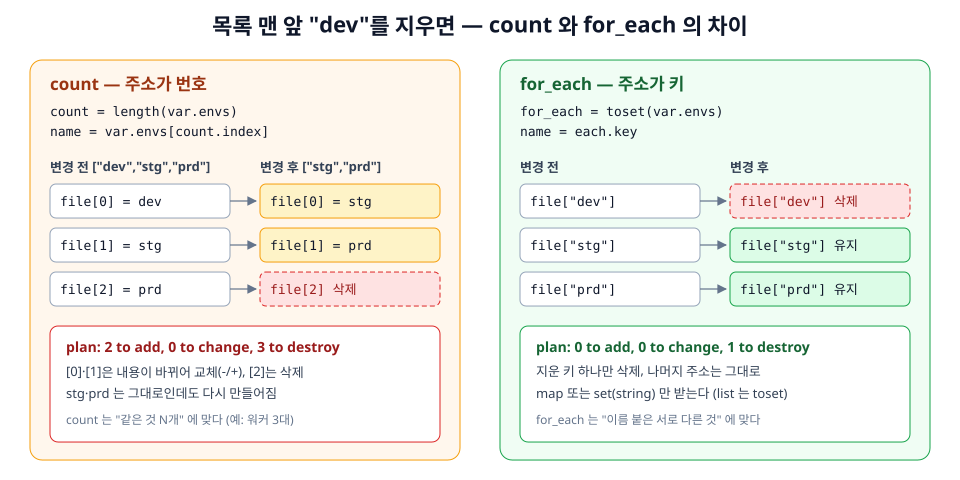
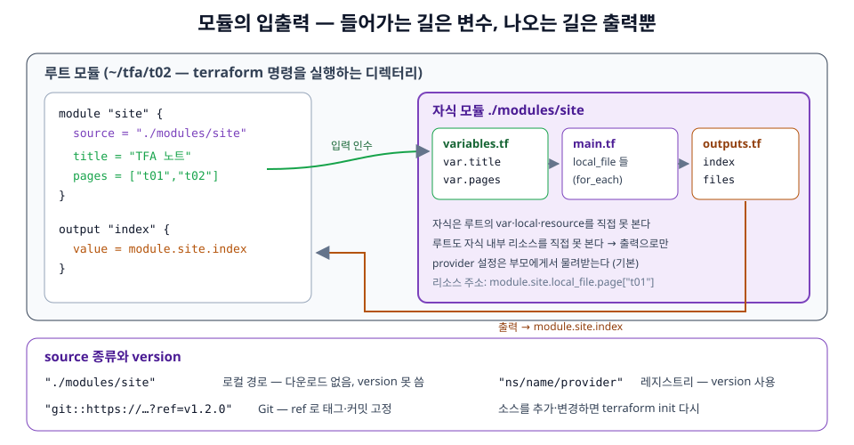

> **자격증 준비 · Terraform Associate** | 난이도 ★★★☆☆ | 예상 소요 3 ~ 3.5시간 (실습 1.5시간 + 문항 40분)

> ⚠️ **이 편의 모든 문항은 HashiCorp가 공개한 Terraform Associate (004) 시험 목표(4·5번)를 바탕으로 직접 창작한 연습 문제입니다.** 실제 시험 문제나 유출 문제(덤프)가 아니며 그런 자료를 재현하지 않습니다.

## 🎯 오늘의 목표

- `resource`와 `data`를 구분하고, 속성 참조로 의존성이 생기는 원리와 `depends_on`이 필요한 경우를 설명한다 (4a·4b·4f)
- 변수 타입, **값 우선순위**, `locals`, 출력을 정확히 쓰고, `for` 표현식·함수·`count`/`for_each`·`dynamic` 블록으로 동적 설정을 만든다 (4c~4e)
- `validation`, `precondition`/`postcondition`, `check`의 차이와 **민감 값**(`sensitive`, `ephemeral`, Vault) 다루는 법을 안다 (4g·4h)
- 모듈 소스 종류와 버전 고정, 모듈 안팎의 **변수 범위**를 local·docker provider로 직접 확인한다 (목표 5)

---

## 1. 핵심 개념 ① — 블록과 참조

| 블록 | 역할 | 참조 방법 |
|---|---|---|
| `resource "TYPE" "NAME"` | Terraform이 **만들고 관리**하는 대상 | `TYPE.NAME.ATTR` (예: `local_file.index.filename`) |
| `data "TYPE" "NAME"` | 이미 있는 것을 **읽기만** (관리 X) | `data.TYPE.NAME.ATTR` |
| `variable "NAME"` | 입력값 | `var.NAME` |
| `locals { NAME = ... }` | 이 모듈 안에서 재사용하는 계산값 (외부에서 못 넣음) | `local.NAME` |
| `output "NAME"` | 결과값 노출 — CLI 표시, 부모 모듈, 원격 state | 부모에서 `module.MOD.NAME` |
| `module "NAME"` | 다른 디렉터리의 설정을 불러와 재사용 | `module.NAME.OUTPUT` |

- **암시적 의존성:** 한 블록이 다른 블록의 속성을 참조하면 Terraform이 순서를 알아서 정합니다 (Day 35의 network → subnet).
- **명시적 의존성 `depends_on`:** 참조로 드러나지 않는 숨은 의존성에만 씁니다 (Day 35의 VM → 라우터 인터페이스). 남용하면 plan이 보수적으로 바뀌어 "known after apply"가 늘어납니다.
- **data 소스를 읽는 시점:** 보통 plan 때 읽지만, 아직 바뀔 예정인 리소스에 기대면 apply 때로 미뤄지고 plan에 `<= read`로 표시됩니다.

---

## 2. 핵심 개념 ② — 변수, 타입, 우선순위

### 2-1. 타입

| 분류 | 타입 | 예 |
|---|---|---|
| 원시(primitive) | `string`, `number`, `bool` | `"dev"`, `3`, `true` |
| 컬렉션(collection) — 원소 타입이 모두 같음 | `list(T)`, `set(T)`, `map(T)` | `list(string)`, `map(number)` |
| 구조(structural) — 원소마다 타입이 다를 수 있음 | `object({...})`, `tuple([...])` | `object({ name = string, port = number })` |
| 아무거나 | `any` | 타입 추론에 맡김 |

`object` 안에서 `optional(TYPE, DEFAULT)`로 생략 가능한 속성을 만들 수 있습니다. `set`은 **순서가 없고 중복이 없으며 인덱스(`[0]`)로 접근할 수 없습니다.**

### 2-2. 변수 값이 들어오는 우선순위

나중에 읽은 값이 이깁니다. 아래로 갈수록 우선순위가 높습니다.

| 순서 | 출처 |
|---|---|
| 1 (가장 낮음) | 변수 블록의 `default` |
| 2 | 환경 변수 `TF_VAR_<이름>` |
| 3 | `terraform.tfvars` |
| 4 | `terraform.tfvars.json` |
| 5 | `*.auto.tfvars` / `*.auto.tfvars.json` (파일 이름 사전순, 뒤가 이김) |
| 6 (가장 높음) | 명령줄 `-var`, `-var-file` (적힌 순서대로, 뒤가 이김) |

`default`도 없고 어디서도 값이 안 들어오면 plan 때 대화형으로 묻습니다(`-input=false`면 오류).

### 2-3. 변수 블록의 주요 인수

```hcl
variable "env" {
  description = "배포 환경"
  type        = string
  default     = "dev"
  nullable    = false          # null 을 넣으면 오류
  sensitive   = false          # true 면 plan/apply 출력에서 가림
  # ephemeral = true           # 1.10+ : state·plan 파일에 저장하지 않는 값 (2-5 참고)

  validation {
    condition     = contains(["dev", "stg", "prd"], var.env)
    error_message = "env 는 dev, stg, prd 중 하나여야 합니다."
  }
}
```

### 2-4. 커스텀 조건 세 가지

| 종류 | 위치 | 실패하면 | 용도 |
|---|---|---|---|
| `validation` | `variable` 블록 (1.9+에서는 다른 변수·data 참조도 가능) | **오류**, plan 중단 | 입력값 검사 |
| `precondition` / `postcondition` | `resource`·`data`·`output`의 `lifecycle` (output은 precondition만) | **오류** | 리소스 만들기 전·후의 가정 검사 |
| `check` 블록 | 최상위 독립 블록, `assert` + 선택적 중첩 `data` | **경고만**, 계속 진행 | 배포 후 상태 점검 (예: 엔드포인트가 200을 돌려주는지) |

### 2-5. 민감 값 다루기 (목표 4h)

| 방법 | 효과 | 한계 |
|---|---|---|
| 변수·출력에 `sensitive = true` | CLI 출력에서 `(sensitive value)`로 가림. 민감 값을 쓰는 출력도 `sensitive = true`가 필요 | **state와 plan 파일에는 평문**으로 남음 |
| `terraform output -json`, `-raw` | 민감 출력도 값을 보여 줌 | 스크립트에서 쓰기 위한 것, 로그 노출 주의 |
| state를 안전한 원격 backend에 | 암호화 저장·접근 제어 (T03, HCP Terraform) | state 접근 권한 = 비밀 접근 권한 |
| `ephemeral = true` 변수·출력, `ephemeral` 리소스 (1.10+) | 값이 **state·plan 파일에 저장되지 않음** | 저장이 필요한 곳(일반 리소스 인수)에는 못 넣음 |
| write-only 인수 (1.11+, `_wo` 접미사 인수를 지원하는 provider) | 리소스에 값을 넘기되 state에 기록하지 않음 | provider가 지원해야 함 |
| **Vault** provider | 비밀을 코드·tfvars 밖에서 가져오고, 짧은 수명의 동적 자격 증명 발급 | `data` 소스로 읽으면 state에 남음 → 가능하면 `ephemeral` 리소스로 |
| HCP Terraform 민감 변수 | 워크스페이스에 쓰기 전용으로 저장 (T04) | — |

> ⚠️ 비밀번호·토큰을 `default`나 `terraform.tfvars`에 쓰고 Git에 올리는 것이 가장 흔한 사고입니다. 해킹 19(의존성·비밀 관리)와 해킹 24에서 본 스캐너도 이것을 잡습니다.

---

## 3. 핵심 개념 ③ — 표현식, 함수, 반복

| 표현식 | 예 | 결과 |
|---|---|---|
| 조건 | `var.env == "prd" ? 3 : 1` | 3 또는 1 |
| `for` → 리스트 | `[for s in ["a","b"] : upper(s)]` | `["A","B"]` |
| `for` → 맵 | `{for k, v in var.pages : k => v.owner}` | 키 → owner 맵 |
| `for` + 필터 | `[for n in [1,2,3,4] : n if n % 2 == 0]` | `[2,4]` |
| splat | `local_file.page[*].filename` (count) / `values(local_file.page)[*].filename` (for_each) | 속성 리스트 |
| 문자열 템플릿 | `"${var.env}-web"`, `%{ if ... }...%{ endif }` | 문자열 |

함수는 **내장 함수만** 쓸 수 있고, 사용자가 HCL로 함수를 새로 정의할 수는 없습니다(1.8부터 provider가 함수를 제공할 수는 있음: `provider::이름::함수`). 자주 나오는 것:

| 분류 | 함수 |
|---|---|
| 문자열 | `format`, `join`, `split`, `upper`, `lower`, `replace`, `trimspace` |
| 컬렉션 | `length`, `concat`, `merge`, `flatten`, `distinct`, `keys`, `values`, `lookup`, `element`, `contains`, `toset`, `tomap`, `zipmap` |
| 파일·인코딩 | `file`, `templatefile`, `jsonencode`, `jsondecode`, `yamlencode`, `base64encode` |
| 네트워크 | `cidrsubnet`, `cidrhost` (Day 35) |
| 오류 처리 | `try`, `can`, `coalesce` |

함수는 `terraform console`에서 바로 시험해 볼 수 있습니다.

### 3-1. `count` vs `for_each`



| | `count` | `for_each` |
|---|---|---|
| 받는 값 | 정수 | **map** 또는 **set(string)** (list는 `toset()`으로) |
| 인스턴스 주소 | `res[0]`, `res[1]` | `res["dev"]`, `res["stg"]` |
| 블록 안에서 | `count.index` | `each.key`, `each.value` |
| 중간 항목 삭제 시 | 뒤 번호가 당겨져 **교체 발생** | 해당 키만 삭제 |
| 같이 쓰기 | 한 블록에 `count`와 `for_each`를 **동시에 쓸 수 없음** | |
| 제약 | 값이 plan 때 알려져 있어야 함 | 키가 plan 때 알려져 있어야 함 (apply 후에야 정해지는 값으로 키 X) |

### 3-2. `dynamic` 블록

리소스 안의 **중첩 블록**(보안 그룹 규칙, 컨테이너 포트 등)을 반복할 때 씁니다. 리소스 자체를 반복하는 `for_each`와 다릅니다.

```hcl
dynamic "ports" {                 # 만들 중첩 블록 이름
  for_each = var.ports
  content {
    internal = ports.value.internal   # 반복 변수 이름 = 블록 이름 (iterator 로 바꿀 수 있음)
    external = ports.value.external
  }
}
```

### 3-3. `lifecycle`

| 인수 | 효과 |
|---|---|
| `create_before_destroy = true` | 교체 시 새것을 먼저 만들고 옛것을 지움 (`+/-`) |
| `prevent_destroy = true` | 이 리소스를 지우는 plan이면 **오류** (블록 자체를 코드에서 지우면 보호도 사라짐) |
| `ignore_changes = [tags]` | 지정 속성의 외부 변경을 무시 (`all` 가능) |
| `replace_triggered_by = [...]` | 다른 리소스·속성이 바뀌면 이 리소스를 교체 |

---

## 4. 핵심 개념 ④ — 모듈



- **루트 모듈:** `terraform` 명령을 실행하는 디렉터리. 모든 설정에는 루트 모듈이 하나 있습니다.
- **자식 모듈:** `module` 블록으로 불러온 다른 디렉터리. 표준 구조는 `main.tf`, `variables.tf`, `outputs.tf`, `README.md`.
- **범위(scope):** 자식은 부모의 변수·local·리소스를 **직접 못 봅니다.** 필요한 값은 입력 변수로 넘기고, 부모는 자식의 출력(`module.NAME.OUTPUT`)만 볼 수 있습니다. 자식 리소스 주소는 `module.NAME.TYPE.NAME`입니다.
- **provider:** 자식 모듈은 기본적으로 부모의 기본 provider 설정을 물려받습니다. 별칭 provider는 `providers = { aws = aws.tokyo }`로 넘깁니다. 재사용 모듈 안에는 provider 설정 블록을 두지 않는 것이 권장입니다.
- **메타 인수:** 모듈에도 `count`, `for_each`, `depends_on`, `providers`를 쓸 수 있습니다.

| 소스 | 형식 예 | `version` 인수 | 메모 |
|---|---|---|---|
| 로컬 경로 | `"./modules/site"`, `"../shared/net"` | ❌ | `./` 또는 `../`로 시작해야 로컬로 인식. 다운로드하지 않고 그대로 사용 |
| 공개 레지스트리 | `"terraform-aws-modules/vpc/aws"` | ✅ | `NAMESPACE/NAME/PROVIDER`. 공개 등록하려면 GitHub 저장소 이름이 `terraform-<PROVIDER>-<NAME>` |
| 비공개 레지스트리 | `"app.terraform.io/ORG/site/local"` | ✅ | HCP Terraform (T04) |
| GitHub / Git | `"github.com/org/repo"`, `"git::https://example.com/repo.git?ref=v1.2.0"` | ❌ | `ref`로 태그·브랜치·커밋 고정, 하위 디렉터리는 `//path` |
| HTTP, S3, GCS 등 | `"https://example.com/mod.zip"` | ❌ | 압축 파일 |

모듈 블록을 추가하거나 `source`·`version`을 바꾸면 **`terraform init`을 다시** 해야 합니다(`terraform get`은 모듈만 받음). 내려받은 모듈은 `.terraform/modules/`에 있고, 잠금 파일에는 기록되지 않습니다.

---

## 5. 실습 — local·docker provider로 언어와 모듈 다루기 (1.5시간)

실습 환경: T00의 WSL2 Ubuntu 24.04, Terraform 1.12.2. 5-4만 Docker Desktop이 필요합니다.

### 5-1. 변수·local·for_each·data·출력

```bash
mkdir -p ~/tfa/t02/lang && cd ~/tfa/t02/lang

cat > versions.tf <<'EOF'
terraform {
  required_version = ">= 1.12"
  required_providers {
    local = {
      source  = "hashicorp/local"
      version = "~> 2.5"
    }
  }
}
EOF

cat > variables.tf <<'EOF'
variable "title" {
  type    = string
  default = "기본값"
}

variable "env" {
  type    = string
  default = "dev"
  validation {
    condition     = contains(["dev", "stg", "prd"], var.env)
    error_message = "env 는 dev, stg, prd 중 하나여야 합니다."
  }
}

variable "pages" {
  description = "페이지 이름 → 담당자와 태그"
  type = map(object({
    owner = string
    tags  = optional(list(string), [])
  }))
  default = {
    t01 = { owner = "alice", tags = ["workflow", "provider"] }
    t02 = { owner = "bob", tags = ["hcl"] }
  }
}

variable "api_token" {
  type      = string
  sensitive = true
}
EOF

cat > main.tf <<'EOF'
locals {
  prefix     = "${var.env}-tfa"
  page_names = sort(keys(var.pages))
  all_tags   = distinct(flatten([for p in var.pages : p.tags]))
}

resource "local_file" "page" {
  for_each = var.pages
  filename = "${path.module}/out/${local.prefix}-${each.key}.md"
  content  = <<-EOT
    # ${var.title} — ${each.key}
    owner: ${each.value.owner}
    tags: ${join(", ", each.value.tags)}
  EOT
}

resource "local_file" "index" {
  filename = "${path.module}/out/${local.prefix}-index.md"
  content  = join("\n", [for k in local.page_names : "- ${k}: ${local_file.page[k].filename}"])

  lifecycle {
    precondition {
      condition     = length(var.pages) <= 5
      error_message = "페이지는 5개 이하로 유지합니다."
    }
  }
}

resource "local_sensitive_file" "token" {
  filename        = "${path.module}/out/.token"
  content         = var.api_token
  file_permission = "0600"
}

data "local_file" "index_read" {
  filename = local_file.index.filename
}

check "index_has_all_pages" {
  assert {
    condition     = length(split("\n", data.local_file.index_read.content)) == length(var.pages)
    error_message = "index 의 줄 수가 페이지 수와 다릅니다."
  }
}
EOF

cat > outputs.tf <<'EOF'
output "files" {
  value = [for f in local_file.page : f.filename]
}

output "all_tags" {
  value = local.all_tags
}

output "token_echo" {
  value = var.api_token
}
EOF

export TF_VAR_api_token="practice-token-123"     # 실습용 가짜 값
terraform init
terraform plan
```

```
│ Error: Output refers to sensitive values
│
│   on outputs.tf line 9:
│    9: output "token_echo" {
│
│ To reduce the risk of accidentally exporting sensitive data that was
│ intended to be only internal, Terraform requires that any root module
│ output containing sensitive data be explicitly marked as sensitive, to
│ confirm your intent.
```

민감 변수를 그대로 내보내는 출력은 **명시적으로** `sensitive = true`를 달아야 합니다.

```bash
sed -i 's/  value = var.api_token/  value     = var.api_token\n  sensitive = true/' outputs.tf
terraform plan | grep -E 'data.local_file|<= read|Plan:'
```

```
  # data.local_file.index_read will be read during apply
 <= data "local_file" "index_read" {
Plan: 4 to add, 0 to change, 0 to destroy.
```

`data.local_file.index_read`는 아직 만들어지지 않은 파일을 읽어야 하므로 **apply 때로 미뤄졌습니다**(`<= read`). 적용하고 결과를 봅니다.

```bash
terraform apply -auto-approve
terraform output
terraform output -raw token_echo ; echo
grep -c practice-token-123 terraform.tfstate
```

```
all_tags = [
  "workflow",
  "provider",
  "hcl",
]
files = [
  "./out/dev-tfa-t01.md",
  "./out/dev-tfa-t02.md",
]
token_echo = <sensitive>
practice-token-123
2
```

화면에서는 가려졌지만 **state에는 평문으로** 들어 있습니다(`local_sensitive_file`의 content와 루트 출력 값, 숫자는 버전에 따라 다를 수 있음). 이것이 "sensitive는 표시만 가린다"의 증거입니다.

### 5-2. 변수 우선순위 확인

```bash
echo 'title = "from terraform.tfvars"' > terraform.tfvars
echo 'title = "from a.auto.tfvars"'    > a.auto.tfvars
echo 'title = "from z.auto.tfvars"'    > z.auto.tfvars
export TF_VAR_title="from env"

echo 'var.title' | terraform console
echo 'var.title' | terraform console -var 'title=from cli'
```

```
"from z.auto.tfvars"
"from cli"
```

환경 변수(`TF_VAR_title`)는 파일보다 약하고, `*.auto.tfvars`는 사전순으로 뒤의 `z`가 이기며, `-var`가 가장 강합니다. 하나씩 지워 가며 결과가 어떻게 바뀌는지 직접 확인하세요.

```bash
rm z.auto.tfvars a.auto.tfvars && echo 'var.title' | terraform console   # "from terraform.tfvars"
rm terraform.tfvars          && echo 'var.title' | terraform console   # "from env"
unset TF_VAR_title           && echo 'var.title' | terraform console   # "기본값"
```

### 5-3. console로 함수·표현식, 그리고 검증 실패

```bash
terraform console
```

```
> [for k, v in var.pages : "${k}=${v.owner}"]
[
  "t01=alice",
  "t02=bob",
]
> {for k, v in var.pages : v.owner => k}
{
  "alice" = "t01"
  "bob" = "t02"
}
> cidrsubnet("10.0.0.0/16", 8, 3)
"10.0.3.0/24"
> try(var.pages["t09"].owner, "없음")
"없음"
> length(toset(["a", "b", "a"]))
2
> values(local_file.page)[*].filename
[
  "./out/dev-tfa-t01.md",
  "./out/dev-tfa-t02.md",
]
> exit
```

```bash
terraform plan -var env=qa
```

```
│ Error: Invalid value for variable
│ ...
│ env 는 dev, stg, prd 중 하나여야 합니다.
```

페이지를 하나 빼면 `for_each`라서 **그 키만** 지워지는지 봅니다(그림의 오른쪽).

```bash
terraform plan -var 'pages={ t02 = { owner = "bob" } }' | grep -E '#|Plan:'
```

```
  # data.local_file.index_read will be read during apply
  # local_file.index must be replaced
  # local_file.page["t01"] will be destroyed
Plan: 1 to add, 0 to change, 2 to destroy.
```

`local_file.page["t02"]`는 목록에 없습니다. **그대로 유지**되기 때문입니다. 지운 키 `t01` 하나가 삭제되고(destroy 1), 내용이 바뀐 `index`는 교체됩니다(add 1 + destroy 1). `local_file`은 그 자리에서 고칠 수 있는 속성이 없어서 내용이 바뀌면 항상 교체됩니다.

### 5-4. dynamic 블록 — docker provider (선택, Docker 필요)

```bash
mkdir -p ~/tfa/t02/docker && cd ~/tfa/t02/docker

cat > main.tf <<'EOF'
terraform {
  required_version = ">= 1.12"
  required_providers {
    docker = {
      source  = "kreuzwerker/docker"
      version = "~> 4.0"
    }
  }
}

provider "docker" {}        # 기본값: unix:///var/run/docker.sock

variable "ports" {
  type = list(object({
    internal = number
    external = number
  }))
  default = [{ internal = 80, external = 8081 }]
}

resource "docker_image" "nginx" {
  name         = "nginx:alpine"
  keep_locally = true
}

resource "docker_container" "web" {
  name  = "tfa-web"
  image = docker_image.nginx.image_id

  dynamic "ports" {
    for_each = var.ports
    content {
      internal = ports.value.internal
      external = ports.value.external
    }
  }
}
EOF

terraform init
terraform apply -auto-approve
curl -s -o /dev/null -w '%{http_code}\n' http://localhost:8081      # 200

terraform plan -var 'ports=[{internal=80,external=8081},{internal=80,external=8082}]' | grep -E 'ports|must be|Plan:'
terraform destroy -auto-approve
```

포트 블록이 하나 늘어나는 plan이 나옵니다. 컨테이너 포트는 바꿀 수 없는 속성이라 **교체(`-/+`)** 로 표시되는 것도 함께 확인하세요.

### 5-5. 모듈 만들기 — 입력, 출력, 범위

```bash
mkdir -p ~/tfa/t02/mod/modules/site && cd ~/tfa/t02/mod

cat > modules/site/variables.tf <<'EOF'
variable "title" {
  type = string
}

variable "pages" {
  type = list(string)
}

variable "out_dir" {
  type = string
}
EOF

cat > modules/site/main.tf <<'EOF'
resource "local_file" "page" {
  for_each = toset(var.pages)
  filename = "${var.out_dir}/${each.key}.md"
  content  = "# ${var.title} — ${each.key}\n"
}

resource "local_file" "index" {
  filename = "${var.out_dir}/index.md"
  content  = join("\n", [for p in sort(var.pages) : "- ${p}"])
}
EOF

cat > modules/site/outputs.tf <<'EOF'
output "index" {
  value = local_file.index.filename
}

output "files" {
  value = [for f in local_file.page : f.filename]
}
EOF

cat > main.tf <<'EOF'
terraform {
  required_version = ">= 1.12"
  required_providers {
    local = {
      source  = "hashicorp/local"
      version = "~> 2.5"
    }
  }
}

variable "env" {
  type    = string
  default = "dev"
}

module "site" {
  source   = "./modules/site"
  for_each = { a = ["t01", "t02"], b = ["t03"] }

  title   = "TFA ${each.key} (${var.env})"
  pages   = each.value
  out_dir = "${path.root}/site-${each.key}"
}

output "indexes" {
  value = { for k, m in module.site : k => m.index }
}
EOF

terraform init
terraform apply -auto-approve
terraform state list
```

```
Initializing modules...
- site in modules/site
...
Outputs:

indexes = {
  "a" = "./site-a/index.md"
  "b" = "./site-b/index.md"
}

module.site["a"].local_file.index
module.site["a"].local_file.page["t01"]
module.site["a"].local_file.page["t02"]
module.site["b"].local_file.index
module.site["b"].local_file.page["t03"]
```

**범위 확인:** 자식 모듈이 루트의 `var.env`를 직접 쓰려고 하면 어떻게 될까요?

```bash
sed -i 's|content  = "# ${var.title} — ${each.key}\\n"|content  = "# ${var.title} — ${each.key} ${var.env}\\n"|' modules/site/main.tf
terraform validate
```

```
│ Error: Reference to undeclared input variable
│
│   on modules/site/main.tf line 4, in resource "local_file" "page":
│ ...
│ An input variable with the name "env" has not been declared.
```

루트에 `env`가 있어도 자식에게는 **선언되지 않은 변수**입니다. 넘기려면 자식에 `variable "env"`를 선언하고 `module` 블록에서 `env = var.env`로 전달해야 합니다. 되돌리고 정리합니다.

```bash
sed -i 's| ${var.env}\\n"|\\n"|' modules/site/main.tf && terraform validate
terraform destroy -auto-approve
cd ~/tfa/t02/lang && terraform destroy -auto-approve
```

> 💡 레지스트리 모듈은 `source`와 `version`을 함께 씁니다. 예: `source = "terraform-aws-modules/vpc/aws"`, `version = "~> 6.0"`. 실제 AWS 리소스가 생기는 예제는 클라우드 탭 [cloud05](../../cloud/cloud05-terraform-aws.md)에서 다룹니다.

---

## 6. 헷갈리는 포인트

| 짝 | 구분 |
|---|---|
| `resource` vs `data` | 만들고 관리 vs 읽기만. data는 destroy 대상이 아님 |
| `variable` vs `locals` | 밖에서 값을 받음 vs 모듈 안에서 계산한 이름 붙은 값(밖에서 못 바꿈) |
| `terraform.tfvars` vs `*.auto.tfvars` | 둘 다 자동 로드, **auto가 더 강함**. 다른 이름의 `.tfvars`는 `-var-file`로 지정해야 로드 |
| `TF_VAR_x` vs `-var x=` | 환경 변수가 **가장 약한 외부 입력**(default 다음), `-var`가 가장 강함 |
| `count` vs `for_each` | 번호 주소 vs 키 주소. 동시 사용 불가. 중간 삭제 시 count는 교체 연쇄 |
| `for_each` vs `dynamic` | 리소스(또는 모듈)를 여러 개 vs 리소스 **안의 중첩 블록**을 여러 개 |
| `list` vs `set` | 순서·중복 있음, 인덱스 가능 vs 순서·중복 없음, 인덱스 불가 |
| `map` vs `object` | 값 타입이 모두 같음 vs 속성마다 타입 지정 |
| `validation` vs `precondition` vs `check` | 입력 검사(오류) vs 리소스 가정 검사(오류) vs 점검(**경고만**) |
| `sensitive` vs `ephemeral` | 출력만 가림(state에는 남음) vs state·plan 파일에 아예 저장 안 함 |
| 로컬 모듈 vs 레지스트리 모듈 | `version` 못 씀(경로 그대로) vs `version` 씀 |
| 모듈 `version` vs 잠금 파일 | 모듈 버전은 `version`·`ref`로 고정, **잠금 파일은 provider만** |
| 사용자 정의 함수 | HCL로 직접 정의하는 함수는 **없음**. 내장 함수와 provider 제공 함수만 |

---

## 7. 창작 객관식 15문항

> 모두 이 시리즈가 공식 목표 4·5를 바탕으로 직접 만든 문항입니다.

**Q1.** 이미 다른 팀이 만든 네트워크의 ID를 조회해 내 리소스에서 쓰고 싶다. 그 네트워크를 Terraform이 관리하게 하지는 않는다. 알맞은 블록은?
A. `resource`
B. `data`
C. `locals`
D. `module`

<details><summary>정답·해설</summary>

**B.** data 소스는 외부의 것을 읽기만 하며 생성·삭제하지 않습니다. 관리 대상으로 넘기려면 import(T03)를 씁니다.
근거: [Data sources](https://developer.hashicorp.com/terraform/language/v1.12.x/data-sources)
</details>

**Q2.** 다음 중 변수 값의 우선순위가 **가장 높은** 것은?
A. `TF_VAR_region` 환경 변수
B. `terraform.tfvars`
C. `prod.auto.tfvars`
D. 명령줄 `-var="region=ap-northeast-2"`

<details><summary>정답·해설</summary>

**D.** 우선순위는 default < `TF_VAR_` < `terraform.tfvars` < `terraform.tfvars.json` < `*.auto.tfvars` < `-var`/`-var-file` 순입니다.
근거: [Input variables — Variable definition precedence](https://developer.hashicorp.com/terraform/language/v1.12.x/values/variables)
</details>

**Q3.** (참과 거짓) 변수에 `sensitive = true`를 지정하면 그 값은 state 파일에도 암호화되어 저장된다.

<details><summary>정답·해설</summary>

**거짓.** `sensitive`는 CLI 출력에서만 값을 가립니다. state에는 평문으로 남으므로 state 저장소 자체를 보호해야 합니다. state·plan에 남기지 않으려면 `ephemeral`(1.10+)을 검토합니다.
근거: [Manage sensitive data](https://developer.hashicorp.com/terraform/language/v1.12.x/manage-sensitive-data)
</details>

**Q4.** 루트 모듈의 출력이 `sensitive = true`인 변수를 그대로 참조한다. 출력에 `sensitive`를 지정하지 않으면?
A. 값이 그대로 출력된다
B. 자동으로 `(sensitive value)`로 가려진다
C. plan 단계에서 오류가 난다
D. 출력이 조용히 생략된다

<details><summary>정답·해설</summary>

**C.** Terraform은 민감 값을 담은 루트 출력에 `sensitive = true`를 명시하라고 요구하며, 없으면 "Output refers to sensitive values" 오류를 냅니다.
근거: [Output values](https://developer.hashicorp.com/terraform/language/v1.12.x/values/outputs)
</details>

**Q5.** `for_each`에 직접 넣을 수 있는 값은? (두 개 선택)
A. `map(string)`
B. `set(string)`
C. `list(string)` 그대로
D. `number`

<details><summary>정답·해설</summary>

**A, B.** `for_each`는 map 또는 set(string)을 받습니다. list는 `toset()`으로 바꿔야 하고, 숫자는 `count`가 받습니다.
근거: [The for_each meta-argument](https://developer.hashicorp.com/terraform/language/meta-arguments/for_each)
</details>

**Q6.** `count = length(var.names)`로 만든 리소스에서 `var.names`의 첫 번째 원소를 지웠다. 예상되는 plan은?
A. 첫 번째 인스턴스 하나만 삭제된다
B. 뒤 인스턴스들의 인덱스가 당겨져 교체·변경이 연쇄적으로 생길 수 있다
C. 아무 변화가 없다
D. 오류가 나서 plan이 실패한다

<details><summary>정답·해설</summary>

**B.** count 인스턴스는 번호로 식별되므로, 앞 원소를 빼면 `[0]`이 원래 `[1]`의 값을 갖게 되어 변경·교체가 연쇄됩니다. 이름 붙은 서로 다른 리소스에는 `for_each`가 맞습니다.
근거: [The count meta-argument](https://developer.hashicorp.com/terraform/language/meta-arguments/count)
</details>

**Q7.** 보안 그룹 리소스 안의 `ingress` 중첩 블록을 변수 목록만큼 반복해 만들고 싶다. 알맞은 기능은?
A. 리소스에 `for_each`
B. `dynamic "ingress"` 블록
C. `count`를 `ingress` 블록 안에 쓴다
D. `locals` 안에 블록을 정의한다

<details><summary>정답·해설</summary>

**B.** 리소스 안의 중첩 블록 반복은 `dynamic` 블록입니다. 리소스 전체를 반복하는 `for_each`·`count`와 구분하세요.
근거: [Dynamic blocks](https://developer.hashicorp.com/terraform/language/expressions/dynamic-blocks)
</details>

**Q8.** 다음 중 HCL에서 **할 수 없는** 것은?
A. `terraform console`에서 내장 함수를 시험한다
B. `merge`, `flatten`, `lookup` 같은 내장 함수를 쓴다
C. `function` 블록으로 나만의 함수를 정의해 여러 곳에서 호출한다
D. `for` 표현식으로 리스트를 맵으로 바꾼다

<details><summary>정답·해설</summary>

**C.** Terraform 언어는 사용자 정의 함수를 지원하지 않습니다. 반복 계산은 `locals`나 모듈로 묶고, provider가 제공하는 함수(1.8+)는 `provider::NAME::FUNC`로 호출합니다.
근거: [Functions](https://developer.hashicorp.com/terraform/language/v1.12.x/functions)
</details>

**Q9.** 배포 후 웹 엔드포인트가 200을 돌려주는지 점검하되, 실패해도 apply를 막지 않고 **경고만** 내고 싶다. 알맞은 것은?
A. 변수 `validation`
B. 리소스 `precondition`
C. 리소스 `postcondition`
D. `check` 블록

<details><summary>정답·해설</summary>

**D.** `check` 블록의 assert가 실패하면 경고만 내고 실행은 계속됩니다. validation·precondition·postcondition은 실패 시 오류로 멈춥니다.
근거: [Validate your configuration](https://developer.hashicorp.com/terraform/language/v1.12.x/validate)
</details>

**Q10.** 리소스 B가 리소스 A의 속성을 전혀 참조하지 않지만, A가 먼저 만들어져야 B가 정상 동작한다. 어떻게 해야 하나?
A. 파일에서 A를 B보다 위에 쓴다
B. B에 `depends_on = [A]`를 추가한다
C. `-parallelism=1`로 실행한다
D. A와 B를 다른 디렉터리로 나눈다

<details><summary>정답·해설</summary>

**B.** 참조로 드러나지 않는 숨은 의존성만 `depends_on`으로 명시합니다. 파일 순서는 의미가 없습니다.
근거: [The depends_on meta-argument](https://developer.hashicorp.com/terraform/language/meta-arguments/depends_on)
</details>

**Q11.** `object({ name = string, port = optional(number, 8080) })` 타입 변수에 `{ name = "web" }`을 넣었다. `port`의 값은?
A. `null`
B. `8080`
C. 타입 오류
D. `0`

<details><summary>정답·해설</summary>

**B.** `optional(TYPE, DEFAULT)`는 속성이 빠졌을 때 기본값을 채웁니다. 기본값 없이 `optional(number)`이면 `null`입니다.
근거: [Type constraints](https://developer.hashicorp.com/terraform/language/v1.12.x/expressions/type-constraints)
</details>

**Q12.** 자식 모듈 안의 리소스가 루트 모듈의 `var.env` 값을 써야 한다. 올바른 방법은?
A. 자식 모듈에서 `var.env`를 그대로 참조한다 — 모든 모듈이 변수를 공유한다
B. 자식 모듈에서 `parent.var.env`로 참조한다
C. 자식 모듈에 `variable "env"`를 선언하고, 루트의 `module` 블록에서 `env = var.env`로 넘긴다
D. 루트에서 `output "env"`를 만들면 자식이 읽을 수 있다

<details><summary>정답·해설</summary>

**C.** 모듈 사이에서 값은 입력 변수(부모 → 자식)와 출력(자식 → 부모)으로만 오갑니다.
근거: [Modules — module block](https://developer.hashicorp.com/terraform/language/v1.12.x/modules/configuration)
</details>

**Q13.** `version` 인수를 **쓸 수 있는** 모듈 소스는? (두 개 선택)
A. `source = "./modules/net"`
B. `source = "hashicorp/consul/aws"`
C. `source = "app.terraform.io/acme/net/aws"`
D. `source = "git::https://example.com/net.git?ref=v1.0.0"`

<details><summary>정답·해설</summary>

**B, C.** `version`은 공개·비공개 **레지스트리** 모듈에만 씁니다. Git 소스는 `ref`로, 로컬 경로는 고정할 버전 개념이 없습니다.
근거: [Module sources](https://developer.hashicorp.com/terraform/language/modules/sources)
</details>

**Q14.** 모듈의 `source`를 다른 Git 태그로 바꾼 직후 `terraform plan`을 실행했더니 모듈을 다시 설치하라는 오류가 났다. 먼저 실행할 명령은?
A. `terraform refresh`
B. `terraform init`
C. `terraform validate`
D. `terraform providers lock`

<details><summary>정답·해설</summary>

**B.** 모듈을 추가하거나 소스·버전을 바꾸면 `init`(또는 `terraform get`)으로 모듈을 다시 받아야 합니다. `providers lock`은 provider 해시만 다룹니다.
근거: [terraform init](https://developer.hashicorp.com/terraform/cli/v1.12.x/commands/init)
</details>

**Q15.** Vault에서 데이터베이스 비밀번호를 가져와 리소스에 넘긴다. 비밀이 state에 남는 것을 최소화하는 방법으로 가장 알맞은 것은?
A. Vault `data` 소스로 읽고 출력에 `sensitive = true`를 단다
B. 비밀번호를 `terraform.tfvars`에 쓰고 `.gitignore`에 넣는다
C. Vault `ephemeral` 리소스로 읽고, write-only 인수나 ephemeral 값으로 전달한다
D. `TF_LOG=TRACE`로 값을 확인한 뒤 하드코딩한다

<details><summary>정답·해설</summary>

**C.** data 소스로 읽은 값은 state에 기록됩니다. 1.10부터 ephemeral 리소스는 값을 state·plan에 남기지 않으며, provider가 지원하는 write-only 인수(1.11+)와 함께 쓰면 리소스에도 저장되지 않게 넘길 수 있습니다.
근거: [Manage sensitive data](https://developer.hashicorp.com/terraform/language/v1.12.x/manage-sensitive-data), [Inject secrets with Vault](https://developer.hashicorp.com/terraform/tutorials/secrets/secrets-vault)
</details>

---

## 8. 핵심 정리

- `resource`는 관리, `data`는 읽기. 참조 = 암시적 의존성, 숨은 의존성만 `depends_on`
- 타입: 원시(string·number·bool) / 컬렉션(list·set·map, 원소 타입 동일) / 구조(object·tuple). `optional(T, 기본값)`
- 변수 우선순위: default < `TF_VAR_` < `terraform.tfvars` < `.tfvars.json` < `*.auto.tfvars` < `-var`/`-var-file`
- `count`(정수, 번호 주소) vs `for_each`(map·set, 키 주소). 중첩 블록 반복은 `dynamic`
- 조건: `validation`(입력, 오류) / `precondition`·`postcondition`(리소스, 오류) / `check`(경고)
- 민감 값: `sensitive`는 표시만 가림 → state 보호 필수. `ephemeral`(1.10+)·write-only(1.11+)·Vault로 state 노출 줄이기
- 모듈: 입력은 변수, 출력은 output만. 자식은 부모 변수를 못 본다. `version`은 레지스트리 소스만, Git은 `ref`. 소스 바꾸면 `init`

---

## ⏭️ 다음 예고 — T03. 상태·백엔드·임포트

state가 정확히 무엇을 담고 있는지, local backend에서 kind 클러스터의 **kubernetes backend**로 state를 옮기며(`init -migrate-state`) **잠금**이 동시 apply를 어떻게 막는지 확인합니다. `terraform state list/show/mv/rm/pull`, `import` 블록과 `-generate-config-out`, `moved`·`removed` 블록, `-refresh-only`와 drift, `-replace`, `TF_LOG` 상세 로그까지 "코드·state·실제 인프라 중 무엇이 바뀌나" 표 하나로 정리합니다.
