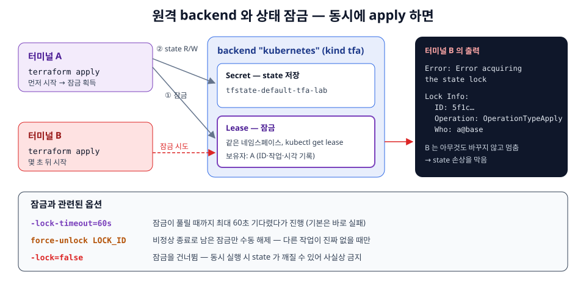
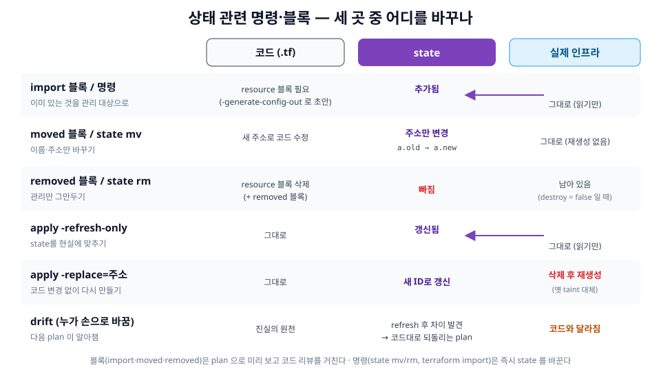

> **자격증 준비 · Terraform Associate** | 난이도 ★★★☆☆ | 예상 소요 3 ~ 3.5시간 (실습 1.5시간 + 문항 40분)

> ⚠️ **이 편의 모든 문항은 HashiCorp가 공개한 Terraform Associate (004) 시험 목표(2d·6·7번)를 바탕으로 직접 창작한 연습 문제입니다.** 실제 시험 문제나 유출 문제(덤프)가 아니며 그런 자료를 재현하지 않습니다.

## 🎯 오늘의 목표

- state가 무엇을 담고 왜 필요한지, local backend와 원격 backend, **상태 잠금**을 설명한다 (2d·6a~6c)
- `terraform state` 하위 명령과 `show`·`output`으로 state를 조회하고, `mv`·`rm`이 무엇을 바꾸는지 안다 (7b)
- `import` 블록과 명령, `moved`·`removed` 블록, `-refresh-only`, `-replace`가 **코드·state·실제 인프라** 중 어디를 바꾸는지 구분한다 (6d·7a)
- `TF_LOG`로 상세 로그를 남기고, kind 클러스터의 kubernetes backend로 state를 옮겨 잠금을 직접 확인한다 (7c·6b)

---

## 1. 핵심 개념 ① — state

Day 35 6장에서 state를 "코드의 리소스 ↔ 실제 리소스 ID 매핑"이라고 했습니다. 시험은 여기에 몇 가지를 더 묻습니다.

| 질문 | 답 |
|---|---|
| state에 무엇이 있나? | 리소스 주소 ↔ 실제 ID, 리소스 속성 값(**민감 값 포함, 평문**), 의존성 메타데이터, 루트 출력 값 |
| 왜 필요한가? | 실제 세계와 코드의 **매핑**, 삭제 순서 등 **메타데이터** 보존, 많은 리소스를 매번 전부 조회하지 않는 **성능** |
| 형식은? | JSON. 하지만 **손으로 편집하지 않음** — `terraform state` 명령과 블록을 씀 |
| 기본 위치는? | local backend: 작업 디렉터리의 `terraform.tfstate`, 직전 버전은 `terraform.tfstate.backup` |
| 사람이 읽으려면? | `terraform show`(사람용), `terraform show -json`(기계용), `terraform state list/show` |
| 잃어버리면? | 실제 리소스는 남지만 Terraform은 "없다"고 보고 다시 만들려 함 → 하나씩 import 해야 함 |

## 2. 핵심 개념 ② — backend와 잠금



| backend | state 위치 | 잠금 |
|---|---|---|
| `local` (기본) | 로컬 파일 `terraform.tfstate` (`path`로 변경) | 같은 시스템 안에서 파일 잠금 |
| `s3` | S3 버킷 객체 (Day 35의 MinIO처럼 S3 호환도 가능) | `use_lockfile = true` — **S3 네이티브 잠금**(1.10+). 예전의 DynamoDB 테이블 잠금은 폐기 예정 |
| `azurerm`, `gcs` | Azure Blob, Google Cloud Storage | 지원 |
| `kubernetes` | Kubernetes Secret | Lease로 지원 (오늘 실습) |
| `pg`, `consul`, `http` 등 | PostgreSQL, Consul, HTTP 엔드포인트 | backend마다 다름 |
| HCP Terraform | `cloud` 블록 (backend 블록이 아님, T04) | 지원 + 원격 실행 |

backend 블록의 규칙:

- `terraform { backend "TYPE" { ... } }` 안에 **하나만** 씁니다.
- **변수·local·data 참조를 쓸 수 없습니다.** 환경마다 다른 값이나 인증 정보는 **부분 설정**(partial configuration)으로 빼고 `terraform init -backend-config=FILE` 또는 `-backend-config="key=value"`로 넣습니다.
- backend를 바꾸면 `terraform init`을 다시 합니다. 기존 state를 새 곳으로 옮기려면 `-migrate-state`, 옮기지 않고 설정만 새로 하려면 `-reconfigure`.

상태 잠금은 **state를 쓸 수 있는 모든 작업**(plan, apply, destroy, state mv 등)에서 자동으로 걸립니다. 잠금을 얻지 못하면 작업은 아무것도 바꾸지 않고 멈춥니다.

| 옵션·명령 | 용도 |
|---|---|
| `-lock-timeout=60s` | 잠금이 풀릴 때까지 기다림 (기본 0s = 바로 실패) |
| `terraform force-unlock LOCK_ID` | 비정상 종료로 남은 잠금 수동 해제. **다른 작업이 없을 때만** |
| `-lock=false` | 잠금 끄기 — 권장하지 않음 |

### 2-1. CLI 워크스페이스

같은 설정 디렉터리에서 **state를 여러 벌** 두는 기능입니다. 시작할 때는 `default` 워크스페이스 하나가 있습니다.

| 명령 | 동작 |
|---|---|
| `terraform workspace list` / `show` | 목록 / 현재 이름 |
| `terraform workspace new stg` | 새 워크스페이스(빈 state)를 만들고 전환 |
| `terraform workspace select dev` | 전환 |
| `terraform workspace delete stg` | 삭제 (`default`는 삭제 불가) |

local backend에서는 `default` 외의 state가 `terraform.tfstate.d/<이름>/terraform.tfstate`에 저장되고, 코드에서는 `terraform.workspace`로 이름을 읽습니다. **HCP Terraform의 워크스페이스(T04)와 이름만 같고 다른 개념**입니다.

---

## 3. 핵심 개념 ③ — state를 바꾸는 명령과 블록



| 하고 싶은 일 | 권장 방법 (리뷰·plan 가능) | 즉시 적용되는 명령 |
|---|---|---|
| 이미 있는 인프라를 관리 대상으로 | **`import` 블록** (1.5+, `for_each`는 1.7+) + `plan -generate-config-out=FILE`로 코드 초안 | `terraform import ADDR ID` (resource 블록이 먼저 있어야 함) |
| 리소스 이름·모듈 위치 변경 | **`moved` 블록** (1.1+) | `terraform state mv SRC DST` |
| 실제 리소스는 두고 관리만 중단 | **`removed` 블록** + `lifecycle { destroy = false }` (1.7+) | `terraform state rm ADDR` |
| state를 실제에 맞추기 | `terraform plan/apply -refresh-only` | (`terraform refresh` — 폐기 예정, 확인 없이 적용) |
| 코드는 그대로, 리소스만 다시 만들기 | `terraform apply -replace=ADDR` | (`terraform taint` — 폐기 예정) |
| 일부 리소스만 대상으로 | `-target=ADDR` — **예외 상황에만** | — |

조회 명령:

| 명령 | 출력 |
|---|---|
| `terraform state list` | state의 모든 리소스 주소 |
| `terraform state show ADDR` | 리소스 하나의 속성 |
| `terraform show` / `show -json` | 전체 state(또는 plan 파일) 사람용 / JSON |
| `terraform output [-json\|-raw] [NAME]` | 루트 출력 |
| `terraform state pull` / `push` | 원격 state를 stdout으로 / 로컬 파일을 원격에 덮어쓰기(위험) |
| `terraform state replace-provider OLD NEW` | state 안 provider 주소 변경 (provider가 이사했을 때) |

### 3-1. drift

drift는 Terraform 밖에서(콘솔, 다른 스크립트) 실제 인프라가 바뀌어 **코드·state와 달라진 상태**입니다. 보통의 `plan`도 먼저 refresh를 하므로 drift를 발견하고 "코드대로 되돌리는" 계획을 세웁니다.

- 바뀐 현실을 **받아들이려면** 코드를 고치거나 `apply -refresh-only`로 state만 갱신
- 현실을 **되돌리려면** 일반 `apply`
- 특정 속성의 외부 변경을 계속 허용하려면 `lifecycle { ignore_changes = [...] }` (T02)
- HCP Terraform은 drift를 주기적으로 검사하는 기능(health assessment)이 있습니다(T04)

### 3-2. 상세 로그 — `TF_LOG`

| 환경 변수 | 값 |
|---|---|
| `TF_LOG` | `TRACE`(가장 자세함), `DEBUG`, `INFO`, `WARN`, `ERROR`, `JSON`(TRACE 수준을 JSON으로) |
| `TF_LOG_PATH` | 로그를 파일로 (지정 안 하면 stderr) |
| `TF_LOG_CORE` / `TF_LOG_PROVIDER` | Core와 provider 로그 수준을 따로 |

Terraform이 비정상 종료(panic)하면 `crash.log`가 생깁니다. 로그에는 민감 값이 섞일 수 있으니 이슈에 붙이기 전에 확인하세요.

---

## 4. 실습 — state 다루기 (1.5시간)

실습 환경: T00의 WSL2 Ubuntu 24.04, Terraform 1.12.2. 4-6은 Docker Desktop, kind, kubectl이 필요합니다(CKA 탭 K00 base와 같음).

### 4-1. 준비와 state 조회

```bash
mkdir -p ~/tfa/t03 && cd ~/tfa/t03

cat > main.tf <<'EOF'
terraform {
  required_version = ">= 1.12"
  required_providers {
    random = {
      source  = "hashicorp/random"
      version = "~> 3.6"
    }
    local = {
      source  = "hashicorp/local"
      version = "~> 2.5"
    }
  }
}

resource "random_pet" "name" {
  length = 2
}

resource "local_file" "note" {
  filename = "${path.module}/note.txt"
  content  = "owner: ${random_pet.name.id}\n"
}

output "pet" {
  value = random_pet.name.id
}
EOF

terraform init
terraform apply -auto-approve
terraform state list
terraform state show random_pet.name
terraform show -json | python3 -m json.tool | head -20
ls terraform.tfstate*
```

```
local_file.note
random_pet.name

# random_pet.name:
resource "random_pet" "name" {
    id        = "wise-gecko"
    length    = 2
    separator = "-"
}
...
terraform.tfstate
```

한 번 더 apply하면(변경 없어도) `terraform.tfstate.backup`이 생깁니다. state의 `serial`(변경 번호)과 `lineage`(이 state의 고유 ID)도 `head -5 terraform.tfstate`로 봐 두세요.

### 4-2. drift와 `-refresh-only`

Terraform 밖에서 파일을 지워 drift를 만듭니다.

```bash
rm note.txt
terraform plan
```

```
  # local_file.note will be created
  + resource "local_file" "note" {
...
Plan: 1 to add, 0 to change, 0 to destroy.
```

plan이 refresh 중 파일이 사라진 것을 알아채고 **코드대로 다시 만들겠다**고 합니다. 반대로 "없어진 현실"을 state에만 반영하려면:

```bash
terraform plan -refresh-only
```

```
Note: Objects have changed outside of Terraform

Terraform detected the following changes made outside of Terraform since the
last "terraform apply" which may have affected this plan:

  # local_file.note has been deleted
  - resource "local_file" "note" {
...
```

`apply -refresh-only`를 하면 state에서 `local_file.note`가 빠집니다. 여기서는 일반 apply로 되돌립니다.

```bash
terraform apply -auto-approve      # note.txt 다시 생성
```

### 4-3. `-replace` — 코드 변경 없이 다시 만들기

```bash
terraform apply -replace=random_pet.name -auto-approve
terraform output pet
cat note.txt
```

```
  # random_pet.name will be replaced, as requested
-/+ resource "random_pet" "name" {
...
Plan: 2 to add, 0 to change, 2 to destroy.
```

`random_pet`이 새 이름을 받자, 그 값을 참조하는 `local_file.note`도 내용이 바뀌어 **함께 교체**됐습니다. 예전에는 `terraform taint`로 표시한 뒤 apply 했지만, 지금은 plan으로 영향을 바로 보여 주는 `-replace`가 권장입니다.

### 4-4. `moved`와 `removed` — 리팩터링

`local_file.note`를 `local_file.memo`로 이름만 바꿉니다. `moved` 블록이 없으면 "삭제 후 생성"이 됩니다.

```bash
sed -i 's/resource "local_file" "note"/resource "local_file" "memo"/' main.tf
terraform plan | tail -1          # Plan: 1 to add, 0 to change, 1 to destroy.

cat > refactor.tf <<'EOF'
moved {
  from = local_file.note
  to   = local_file.memo
}
EOF
terraform plan
```

```
  # local_file.note has moved to local_file.memo
    resource "local_file" "memo" {
        id       = "..."
        # (9 unchanged attributes hidden)
    }

Plan: 0 to add, 0 to change, 0 to destroy.
```

```bash
terraform apply -auto-approve
terraform state list            # local_file.memo
```

> 💡 `moved` 블록은 apply 뒤에도 바로 지우지 말고 한동안 둡니다. 이 코드를 아직 적용하지 않은 다른 환경(다른 워크스페이스, 팀원의 state)이 있을 수 있기 때문입니다. 공유 모듈이라면 특히 그렇습니다.

이번에는 `memo` 파일을 **실제로는 남기고** Terraform 관리에서만 뺍니다.

```bash
# main.tf 에서 resource "local_file" "memo" 블록 삭제
python3 - <<'PY'
import re
s = open("main.tf").read()
s = re.sub(r'resource "local_file" "memo" \{.*?\n\}\n', '', s, flags=re.S)
open("main.tf", "w").write(s)
PY

cat > refactor.tf <<'EOF'
removed {
  from = local_file.memo
  lifecycle {
    destroy = false
  }
}
EOF

terraform plan
```

```
  # local_file.memo will no longer be managed by Terraform
...
│ Warning: Some objects will no longer be managed by Terraform
│
│ If you apply this plan, Terraform will discard its tracking information
│ for the following objects, but it will not delete them:
│  - local_file.memo
```

출력 문구와 요약 줄의 표기는 버전에 따라 조금 다를 수 있지만, **destroy 개수가 0**이라는 점이 핵심입니다.

```bash
terraform apply -auto-approve
terraform state list            # random_pet.name 만 남음
ls note.txt                     # 파일은 그대로
```

`removed` 블록 없이 resource 블록만 지웠다면 plan은 **파일 삭제**를 제안했을 것입니다. 같은 효과를 즉시 내는 명령이 `terraform state rm local_file.memo`입니다(plan 없이 바로 state에서 제거).

### 4-5. import — 이미 있는 것을 관리 대상으로

`random_string`은 문자열 값 자체를 ID로 import 할 수 있습니다. "누군가 이미 만들어 둔 값"이라고 가정합니다.

```bash
cat > import.tf <<'EOF'
import {
  to = random_string.legacy
  id = "k8s7qz"
}

resource "random_string" "legacy" {
  length = 6
}
EOF

terraform plan
```

```
  # random_string.legacy will be imported
    resource "random_string" "legacy" {
        id               = "k8s7qz"
        length           = 6
        result           = "k8s7qz"
        ...
    }

Plan: 1 to import, 0 to add, 0 to change, 0 to destroy.
```

import도 **plan으로 미리 보고** apply 때 state에 들어갑니다. plan에 `must be replaced`가 섞여 나온다면 resource 블록의 인수가 실제 값과 다르다는 뜻이니 맞춰 줍니다.

```bash
terraform apply -auto-approve
terraform state show random_string.legacy | grep result
```

코드를 직접 쓰기 어려울 때는 resource 블록 없이 import 블록만 두고 **초안을 생성**합니다(1.5+, 문서상 실험적 기능).

```bash
cat > import2.tf <<'EOF'
import {
  to = random_string.legacy2
  id = "p0rt4l"
}
EOF

terraform plan -generate-config-out=generated.tf
cat generated.tf
```

```hcl
# __generated__ by Terraform
# Please review these resources and move them into your main configuration files.

# __generated__ by Terraform from "p0rt4l"
resource "random_string" "legacy2" {
  keepers          = null
  length           = 6
  lower            = true
  ...
}
```

생성된 코드는 **반드시 검토하고 정리**한 뒤 apply 합니다. 비교를 위해 예전 방식인 CLI import도 기억해 둡니다.

```bash
terraform import random_string.legacy3 abc999
# Error: resource address "random_string.legacy3" does not exist in the configuration.
```

CLI import는 **resource 블록이 먼저 있어야** 하고, plan 없이 state에 바로 씁니다. 여러 개를 한 번에, 리뷰를 거쳐 하려면 import 블록이 낫습니다.

다음 실습에 섞이지 않도록 생성 실습 파일은 지웁니다.

```bash
rm -f import2.tf generated.tf
```

### 4-6. 원격 backend와 잠금 — kind의 kubernetes backend

```bash
kind create cluster --name tfa
kubectl config current-context        # kind-tfa
```

`main.tf`의 `terraform` 블록 안에 backend를 추가합니다.

```bash
python3 - <<'PY'
s = open("main.tf").read()
s = s.replace('  required_version = ">= 1.12"\n',
'''  required_version = ">= 1.12"

  backend "kubernetes" {
    secret_suffix  = "tfa-lab"
    config_path    = "~/.kube/config"
    config_context = "kind-tfa"
  }
''', 1)
open("main.tf", "w").write(s)
PY

terraform init -migrate-state
```

```
Initializing the backend...
Do you want to copy existing state to the new backend?
  Pre-existing state was found while migrating the previous "local" backend to the
  newly configured "kubernetes" backend. No existing state was found in the newly
  configured "kubernetes" backend. Do you want to copy this state to the new
  "kubernetes" backend? Enter "yes" to copy and "no" to start with an empty state.

  Enter a value: yes

Successfully configured the backend "kubernetes"!
```

```bash
kubectl get secret tfstate-default-tfa-lab
terraform state list           # 이제 클러스터의 Secret 에서 읽음
```

이제 잠금을 봅니다. **터미널 두 개**를 엽니다.

```bash
# 터미널 A — 승인 질문에서 멈춰 둔다 (이 동안 잠금 유지)
cd ~/tfa/t03 && terraform apply -replace=random_pet.name
```

```bash
# 터미널 B
cd ~/tfa/t03 && terraform plan
```

```
│ Error: Error acquiring the state lock
│
│ Error message: ...
│ Lock Info:
│   ID:        ...
│   Path:      ...
│   Operation: OperationTypeApply
│   Who:       <you>@<host>
│   Version:   1.12.2
│   Created:   ...
│
│ Terraform acquired the state lock while ... 
```

```bash
# 터미널 B — 기다리기
kubectl get lease                         # 잠금용 Lease 확인
terraform plan -lock-timeout=120s         # 터미널 A 에서 no 를 입력하면 곧 진행된다
```

터미널 A에서 `no`를 입력해 apply를 취소하면 잠금이 풀리고, 기다리던 터미널 B의 plan이 이어서 실행됩니다.

> ⚠️ `force-unlock`은 apply 도중 노트북이 꺼지는 등 **잠금이 주인 없이 남았을 때만** 씁니다. 다른 사람이 실제로 apply 중인데 풀면 state가 깨질 수 있습니다.

### 4-7. 상세 로그

```bash
TF_LOG=DEBUG TF_LOG_PATH=./tf-debug.log terraform plan > /dev/null
grep -c '\[DEBUG\]' tf-debug.log
grep -m3 'backend/remote-state/kubernetes\|provider' tf-debug.log
```

로그 첫 줄들에 Terraform 버전, 읽은 설정 파일, provider 실행 경로가 나옵니다. 문제를 재현할 때는 `TRACE`가 가장 자세합니다.

### 4-8. 정리 — local로 되돌리고 지우기

```bash
# backend 블록 삭제
python3 - <<'PY'
import re
s = open("main.tf").read()
s = re.sub(r'\n  backend "kubernetes" \{.*?\n  \}\n', '\n', s, flags=re.S)
open("main.tf", "w").write(s)
PY

terraform init -migrate-state          # kubernetes → local 로 state 복사 (yes)
terraform destroy -auto-approve
kind delete cluster --name tfa
rm -f note.txt tf-debug.log
```

---

## 5. 헷갈리는 포인트

| 짝 | 구분 |
|---|---|
| `state rm` vs `destroy` | state에서만 빠짐(실제 남음) vs 실제 삭제 |
| `removed` 블록 vs resource 블록만 삭제 | `destroy = false`면 관리만 중단 vs 다음 apply에서 **실제 삭제** |
| `moved` 블록 vs `state mv` | plan·리뷰를 거침, 다른 환경에도 적용됨 vs 지금 이 state에 즉시 |
| `import` 블록 vs `terraform import` | plan으로 미리 봄·여러 개·`-generate-config-out` vs 즉시 state 기록, resource 블록 필수 |
| `-refresh-only` vs `-refresh=false` | state를 현실에 맞추는 계획 vs refresh를 **건너뛰는** 옵션(빠르지만 drift 못 봄) |
| `terraform refresh` vs `apply -refresh-only` | 확인 없이 바로 state 갱신(폐기 예정) vs 변경을 보여 주고 승인받음 |
| `-replace` vs `taint` | 현재 권장 vs 폐기 예정(state에 표시만 남김) |
| `-migrate-state` vs `-reconfigure` | 기존 state를 새 backend로 복사 vs 복사 없이 새 설정만 |
| backend 블록 vs `cloud` 블록 | 저장 위치만 vs HCP Terraform 연동(저장 + 원격 실행) |
| CLI 워크스페이스 vs HCP 워크스페이스 | 같은 디렉터리의 state 여러 벌 vs 설정·변수·state·권한·run 기록을 가진 관리 단위 |
| backend 설정에 변수 | **불가** — 부분 설정과 `-backend-config`로 |
| `sensitive` 값과 state | state에는 평문 → state 저장소 암호화·접근 제어가 필요 |

---

## 6. 창작 객관식 15문항

> 모두 이 시리즈가 공식 목표 2d·6·7을 바탕으로 직접 만든 문항입니다.

**Q1.** Terraform state의 목적이 **아닌** 것은?
A. 설정의 리소스와 실제 객체 ID를 연결한다
B. 삭제 순서 계산에 필요한 의존성 메타데이터를 보존한다
C. 큰 인프라에서 매번 모든 리소스를 조회하지 않도록 성능을 돕는다
D. provider 플러그인 바이너리를 저장한다

<details><summary>정답·해설</summary>

**D.** provider 바이너리는 `.terraform/providers/`에 설치되며 state와 무관합니다. state의 목적은 매핑, 메타데이터, 성능입니다.
근거: [Purpose of Terraform state](https://developer.hashicorp.com/terraform/language/v1.12.x/state/purpose)
</details>

**Q2.** backend 블록을 설정하지 않았을 때 state는 어디에 저장되나?
A. HCP Terraform
B. 작업 디렉터리의 `terraform.tfstate`
C. `~/.terraform.d/state`
D. 메모리에만 있고 저장되지 않는다

<details><summary>정답·해설</summary>

**B.** 기본 backend는 `local`이며 작업 디렉터리의 `terraform.tfstate`에 씁니다.
근거: [Backend type: local](https://developer.hashicorp.com/terraform/language/backend/local)
</details>

**Q3.** (참과 거짓) backend 블록의 `bucket` 값에 `var.env`를 써서 환경마다 다른 버킷을 지정할 수 있다.

<details><summary>정답·해설</summary>

**거짓.** backend 블록에는 변수·local·data 참조를 쓸 수 없습니다. 부분 설정으로 비워 두고 `terraform init -backend-config=...`로 값을 넣습니다.
근거: [Backend configuration](https://developer.hashicorp.com/terraform/language/v1.12.x/backend)
</details>

**Q4.** 동료가 apply 중일 때 내가 plan을 실행했더니 "Error acquiring the state lock"이 났다. 옳은 설명은? (두 개 선택)
A. 잠금은 state를 쓸 수 있는 작업에서 자동으로 걸린다
B. 즉시 `terraform force-unlock`으로 풀고 진행하는 것이 표준 절차다
C. `-lock-timeout`을 주면 잠금이 풀릴 때까지 기다렸다가 진행할 수 있다
D. 잠금 오류가 나면 내 plan이 일부 리소스를 이미 변경했을 수 있다

<details><summary>정답·해설</summary>

**A, C.** 잠금을 얻지 못한 작업은 아무것도 바꾸지 않고 멈춥니다. `force-unlock`은 주인 없는 잠금이 남았을 때만 씁니다.
근거: [State locking](https://developer.hashicorp.com/terraform/language/state/locking)
</details>

**Q5.** 리소스 이름을 `aws_instance.web`에서 `aws_instance.frontend`로 바꾸면서 실제 서버는 재생성하지 않으려 한다. 코드 리뷰를 거칠 수 있는 권장 방법은?
A. `terraform state mv`
B. `moved` 블록
C. `terraform import`
D. `-replace`

<details><summary>정답·해설</summary>

**B.** `moved` 블록은 plan에 "has moved to"로 표시되고 코드로 남아 다른 환경에도 적용됩니다. `state mv`도 가능하지만 즉시 적용되는 수동 작업입니다.
근거: [moved block](https://developer.hashicorp.com/terraform/language/v1.12.x/block/moved)
</details>

**Q6.** `terraform state rm local_file.memo`를 실행했다. 결과로 옳은 것은?
A. 파일이 삭제되고 state에서도 빠진다
B. state에서만 빠지고 파일은 그대로 남는다
C. 코드에서 resource 블록이 자동으로 지워진다
D. 다음 plan에서 아무 변화가 없다고 나온다

<details><summary>정답·해설</summary>

**B.** `state rm`은 Terraform이 추적을 멈추게 할 뿐 실제 객체를 지우지 않습니다. 코드에 resource 블록이 남아 있다면 다음 plan은 **새로 만들겠다**고 합니다(그래서 D도 틀림).
근거: [Remove a resource from state](https://developer.hashicorp.com/terraform/language/v1.12.x/state/remove)
</details>

**Q7.** 코드에서 resource 블록을 지우면서 실제 리소스는 남기고 싶다. plan으로 미리 확인할 수 있는 방법은?
A. resource 블록만 지우고 apply
B. `removed` 블록에 `lifecycle { destroy = false }`
C. `lifecycle { prevent_destroy = true }`를 추가한 채 블록 삭제
D. `-refresh=false`로 apply

<details><summary>정답·해설</summary>

**B.** `removed` 블록(1.7+)은 "will no longer be managed by Terraform"으로 표시되고 실제 객체는 남깁니다. A는 실제 삭제, C는 블록을 지우면 `prevent_destroy`도 함께 사라집니다.
근거: [Remove a resource from state](https://developer.hashicorp.com/terraform/language/v1.12.x/state/remove)
</details>

**Q8.** `import` 블록에 대한 설명으로 옳은 것은? (두 개 선택)
A. plan에서 "will be imported"로 미리 볼 수 있다
B. `terraform plan -generate-config-out=FILE`로 resource 블록 초안을 만들 수 있다
C. import 블록이 실행되면 실제 리소스가 새로 만들어진다
D. Terraform 0.12부터 지원된다

<details><summary>정답·해설</summary>

**A, B.** import 블록은 1.5부터, 대량 import용 `for_each`는 1.7부터입니다. import는 기존 객체를 state에 들이는 것이지 새로 만드는 것이 아닙니다.
근거: [Import](https://developer.hashicorp.com/terraform/language/v1.12.x/import)
</details>

**Q9.** `terraform import aws_instance.web i-0abc...` 명령을 실행했더니 "resource address does not exist in the configuration" 오류가 났다. 원인은?
A. 인스턴스 ID가 틀렸다
B. 설정에 `aws_instance.web` resource 블록이 없다
C. backend가 local이라 import를 지원하지 않는다
D. 잠금 파일이 없다

<details><summary>정답·해설</summary>

**B.** CLI import는 대상 resource 블록이 설정에 먼저 있어야 합니다. 코드를 자동으로 만들지도 않습니다.
근거: [terraform import](https://developer.hashicorp.com/terraform/cli/commands/import)
</details>

**Q10.** 누군가 콘솔에서 보안 그룹 설명을 바꿨다. 이 변경을 **받아들여** state만 현실에 맞추고 인프라는 건드리지 않으려 한다. 알맞은 명령은?
A. `terraform apply -refresh-only`
B. `terraform apply -refresh=false`
C. `terraform apply -replace=aws_security_group.web`
D. `terraform state push`

<details><summary>정답·해설</summary>

**A.** `-refresh-only`는 외부 변경을 보여 주고 승인하면 state만 갱신합니다. 코드에는 여전히 옛 값이 있으니, 다음 일반 plan에서 되돌리지 않으려면 코드도 고칩니다.
근거: [Use refresh-only mode to sync Terraform state](https://developer.hashicorp.com/terraform/tutorials/state/refresh)
</details>

**Q11.** 손상된 VM을 코드 변경 없이 다시 만들고 싶다. 현재 권장 방법은?
A. `terraform taint` 후 apply
B. `terraform apply -replace=ADDR`
C. `terraform state rm` 후 apply
D. `terraform destroy` 후 apply

<details><summary>정답·해설</summary>

**B.** `-replace`는 plan에서 교체를 보여 주고 한 번에 처리합니다. `taint`는 폐기 예정이며, C는 옛 VM이 고아로 남고, D는 전부 지웁니다.
근거: [terraform plan — replace](https://developer.hashicorp.com/terraform/cli/v1.12.x/commands/plan)
</details>

**Q12.** state에 있는 모든 리소스 주소를 나열하는 명령은?
A. `terraform show -list`
B. `terraform state list`
C. `terraform output -all`
D. `terraform providers`

<details><summary>정답·해설</summary>

**B.** 리소스 하나의 속성은 `terraform state show ADDR`로 봅니다.
근거: [terraform state list](https://developer.hashicorp.com/terraform/cli/v1.12.x/commands/state/list)
</details>

**Q13.** local backend에서 S3 backend로 바꾸고 기존 state를 그대로 옮기려 한다. 실행할 명령은?
A. `terraform init -reconfigure`
B. `terraform init -migrate-state`
C. `terraform state push`
D. `terraform apply -backend=s3`

<details><summary>정답·해설</summary>

**B.** `-migrate-state`는 기존 state를 새 backend로 복사할지 묻습니다. `-reconfigure`는 기존 state를 무시하고 설정만 새로 합니다.
근거: [terraform init](https://developer.hashicorp.com/terraform/cli/v1.12.x/commands/init)
</details>

**Q14.** provider 오류를 재현해 지원팀에 보낼 자세한 로그를 파일로 남기려 한다. 알맞은 설정은?
A. `TF_LOG=TRACE`, `TF_LOG_PATH=./tf.log`
B. `TF_DEBUG=1`, `TF_OUTPUT=./tf.log`
C. `terraform plan -verbose > tf.log`
D. `TF_LOG=FILE`

<details><summary>정답·해설</summary>

**A.** `TF_LOG`로 수준(TRACE가 가장 자세함)을, `TF_LOG_PATH`로 파일 경로를 지정합니다. Core와 provider를 따로 하려면 `TF_LOG_CORE`, `TF_LOG_PROVIDER`.
근거: [Debugging Terraform](https://developer.hashicorp.com/terraform/internals/v1.12.x/debugging)
</details>

**Q15.** CLI 워크스페이스에 대한 설명으로 옳은 것은?
A. 워크스페이스마다 다른 provider 버전을 쓸 수 있다
B. 같은 설정으로 state를 여러 벌 관리하며, `default` 워크스페이스는 삭제할 수 없다
C. HCP Terraform 워크스페이스와 같은 개념으로, 팀 권한과 변수 세트를 가진다
D. 워크스페이스를 바꾸면 backend 설정도 자동으로 바뀐다

<details><summary>정답·해설</summary>

**B.** CLI 워크스페이스는 같은 설정·같은 backend 안에서 state만 나눕니다. HCP Terraform 워크스페이스는 설정·변수·권한·run 기록을 가진 별도 관리 단위입니다.
근거: [Workspaces](https://developer.hashicorp.com/terraform/language/state/workspaces)
</details>

---

## 7. 핵심 정리

- state = 매핑 + 메타데이터 + 성능. JSON이지만 **손으로 편집 금지**, 민감 값이 **평문**
- 기본은 local backend(`terraform.tfstate`, `.backup`). 팀은 잠금되는 원격 backend. backend 블록에는 **변수 불가** → `-backend-config`, 바꾸면 `init -migrate-state`
- 잠금은 자동. 기다리려면 `-lock-timeout`, 주인 없는 잠금만 `force-unlock`. S3는 `use_lockfile`(1.10+), DynamoDB 잠금은 폐기 예정
- 조회: `state list/show`, `show [-json]`, `output`. 변경: `moved`(이름) / `removed`(관리 중단) / `import`(편입) 블록이 권장, `state mv/rm`·`terraform import`는 즉시 적용
- drift: plan이 되돌리려 함. 받아들이려면 `-refresh-only`(+코드 수정). 재생성은 `-replace`(taint 대체)
- `TF_LOG`(TRACE~ERROR, JSON) + `TF_LOG_PATH`
- CLI 워크스페이스 ≠ HCP Terraform 워크스페이스

---

## ⏭️ 다음 예고 — T04. HCP Terraform과 협업

오늘 kind에 옮겼던 state를 이번에는 **HCP Terraform**(옛 Terraform Cloud)에 둡니다. 무료 조직을 만들고 `terraform login`과 `cloud` 블록으로 CLI 기반 워크스페이스를 연결해 **원격 실행**을 직접 돌려 봅니다. 조직 → 프로젝트 → 워크스페이스 구조, VCS 연동과 speculative plan, Sentinel·OPA 정책, 비공개 레지스트리, 변수 세트와 우선순위, 팀 권한과 동적 자격 증명, drift 감지까지 목표 8을 정리합니다.
