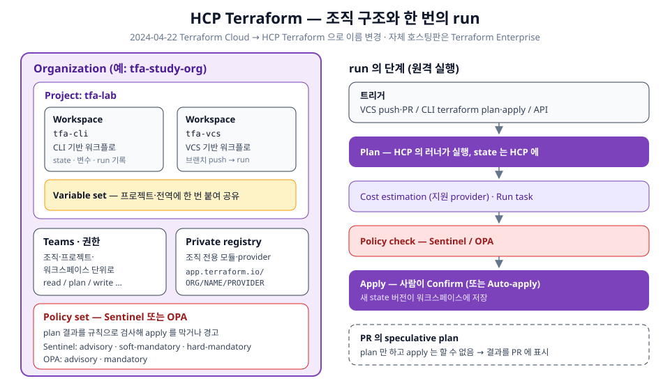

> **자격증 준비 · Terraform Associate** | 난이도 ★★★☆☆ | 예상 소요 2.5 ~ 3시간 (가입·실습 1시간 + 문항 40분)

> ⚠️ **이 편의 모든 문항은 HashiCorp가 공개한 Terraform Associate (004) 시험 목표(8번)를 바탕으로 직접 창작한 연습 문제입니다.** 실제 시험 문제나 유출 문제(덤프)가 아니며 그런 자료를 재현하지 않습니다.

## 🎯 오늘의 목표

- HCP Terraform의 **현재 공식 명칭**과 Terraform Enterprise, 에디션별 차이의 큰 줄기를 말할 수 있다
- 조직 → **프로젝트** → **워크스페이스** 구조와 VCS·CLI·API 세 가지 워크플로를 구분한다 (8a·8c)
- 원격 실행의 run 단계, speculative plan, Sentinel·OPA 정책, 비공개 레지스트리, 변수 세트, 팀 권한을 설명한다 (8b)
- `terraform login`과 `cloud` 블록으로 CLI 기반 워크스페이스를 연결해 **원격 plan·apply**를 직접 돌린다 (8d)

---

## 1. 이름부터 정확히

| 이름 | 무엇 | 확인 |
|---|---|---|
| **HCP Terraform** | HashiCorp가 운영하는 SaaS. **2024-04-22에 Terraform Cloud에서 이름이 바뀜**(기능은 그대로). 주소 `app.terraform.io` | [HCP Terraform 문서](https://developer.hashicorp.com/terraform/cloud-docs) (2026-11-19) |
| **Terraform Enterprise** | HCP Terraform의 **자체 호스팅** 배포판. 보안·규정 준수 요구가 큰 조직용. 2026-11 가격 페이지에는 "IBM Terraform Enterprise"로 표기 | 같은 문서, HashiCorp 가격 페이지 |
| Terraform (CLI) | 오늘까지 쓴 `terraform` 명령. 시험 목표에서는 Community Edition과 구분해 묻기도 함 | 자격 페이지 |
| HCP | HashiCorp Cloud Platform. Terraform·Vault 등 관리형 서비스 묶음 | — |

> 💡 인터넷 자료에 "Terraform Cloud"라고 나오면 2024년 4월 이전 자료입니다. 004 시험은 **HCP Terraform**이라는 이름을 씁니다. 기능 설명은 대부분 그대로 통하지만, 프로젝트·변수 세트 범위·Explorer·Change requests처럼 그 뒤에 커진 기능은 최신 문서로 확인하세요.

### 1-1. 에디션 — 무료로 어디까지

2026-11-19 [HCP Terraform 개요 문서](https://developer.hashicorp.com/terraform/cloud-docs/overview)의 비교표 기준입니다. 가격과 구성은 자주 바뀌니 응시 전에 다시 확인하세요.

| 항목 | Free | 유료(Essentials·Standard·Premium) |
|---|---|---|
| 관리 리소스 | **500개까지** | 제한 없음 (리소스당 과금) |
| 사용자 | 제한 없음 | 제한 없음 |
| 동시 원격 run | **1개** | 3 / 10 / 200 |
| 비공개 레지스트리, run task, SSO | 사용 가능 | 사용 가능 |
| 팀(Teams)·세분화 권한 | **불가** | 가능 |
| 정책(Sentinel·OPA) | 문서 안에서 표기가 엇갈림 (정책 세트 1개·정책 5개까지라는 설명과 "불가" 표기가 함께 있음) | Standard 이상 |
| 감사 로그 | 불가 | Premium |
| drift 감지·continuous validation | — | Standard 이상 |

시험은 가격표보다 **"이 기능이 무엇을 해결하는가"** 를 묻습니다. 다만 "팀 권한·정책·drift 감지는 무료 기본 기능이 아니다" 정도는 구분해 두세요.

---

## 2. 핵심 개념 ① — 조직, 프로젝트, 워크스페이스



| 단위 | 담는 것 | 메모 |
|---|---|---|
| **Organization** | 프로젝트, 팀, 정책 세트, 변수 세트, 비공개 레지스트리, VCS 연결 | 과금·SSO의 단위 |
| **Project** | 관련 워크스페이스 묶음 | 팀 권한·변수 세트를 **프로젝트 단위**로 한 번에 부여. 모든 워크스페이스는 어떤 프로젝트에 속함(기본 프로젝트 포함) |
| **Workspace** | 한 설정 디렉터리를 관리하는 데 필요한 것 전부: **state(버전 이력), 변수, run 기록, 설정(실행 모드, Terraform 버전, VCS 연결), 권한** | CLI 워크스페이스(T03)보다 훨씬 큰 개념. 보통 "환경 × 구성 요소" 하나당 하나 (예: `network-prod`) |

### 2-1. 세 가지 워크플로

| 워크플로 | run을 시작하는 것 | 특징 |
|---|---|---|
| **VCS 기반** | 연결된 저장소 브랜치에 push → plan·apply / **PR → speculative plan** | 코드 리뷰와 배포가 Git 흐름에 붙음. PR에 plan 결과 링크 |
| **CLI 기반** | 내 터미널의 `terraform plan`·`apply` | 명령은 로컬에서 치지만 **실행은 HCP의 러너**에서. 출력이 터미널로 스트리밍 |
| **API 기반** | CI·스크립트가 API로 설정 버전 업로드 후 run 생성 | 자체 파이프라인과 통합 |

- **speculative plan**: 적용할 수 없는 plan. PR 검토용이며, CLI 기반 워크스페이스에서 `terraform plan`을 쳐도 speculative plan이 됩니다.
- **실행 모드(execution mode)**: `Remote`(기본, HCP 러너에서 실행) / `Local`(내 PC에서 실행, **state만** HCP에 저장) / `Agent`(내 네트워크 안의 **HCP Terraform agent**가 실행 — 홈랩의 Day 35 OpenStack처럼 인터넷에서 닿지 않는 대상).
- **run trigger**: 한 워크스페이스의 apply가 끝나면 다른 워크스페이스의 run을 자동으로 시작(네트워크 → 클러스터 순서 연결). 다른 워크스페이스의 출력은 `tfe_outputs` 데이터 소스나 `terraform_remote_state`로 읽습니다.

### 2-2. run의 단계

| 단계 | 하는 일 |
|---|---|
| Plan | 원격 러너가 `terraform plan`. state는 워크스페이스에서 가져옴 |
| (Post-plan) run task | 외부 서비스(보안 스캐너 등)에 plan 결과를 보내 결과 받기 — 해킹 24의 IaC 스캔을 여기에 붙일 수 있음 |
| Cost estimation | 지원 provider 리소스의 월 비용 추정 |
| **Policy check** | 정책 세트로 plan 결과 검사 — 통과 못 하면 apply 불가(강제 수준에 따라) |
| Apply | 사람이 **Confirm & Apply**(또는 Auto-apply 설정) → 새 state 버전 저장 |

---

## 3. 핵심 개념 ② — 협업과 거버넌스

### 3-1. 변수와 변수 세트

| 구분 | 내용 |
|---|---|
| 변수 종류 | **Terraform variable**(코드의 `variable`에 들어감) / **Environment variable**(러너 셸에 export — provider 자격 증명, `TF_LOG` 등) |
| Sensitive 표시 | 저장 후 UI·API로 다시 볼 수 없음(**쓰기 전용**). run에서는 사용됨 |
| HCL 체크 | 리스트·맵 같은 HCL 값을 넣을 때 |
| **변수 세트(variable set)** | 여러 워크스페이스에 같은 변수를 한 번에. 범위: **전역**(조직 전체) / **프로젝트** / 선택한 **워크스페이스** |
| priority 변수 세트 | 더 좁은 범위의 같은 이름 변수까지 **덮어씀**(조직 표준 강제용) |

공식 문서의 우선순위(높은 것부터)를 줄이면 다음과 같습니다.

1. **priority** 변수 세트 (전역 → 프로젝트 → 워크스페이스 순)
2. CLI 기반 워크플로의 `-var`·`-var-file`, 로컬 `TF_VAR_`
3. **워크스페이스 변수**
4. 일반 변수 세트 — 범위가 **좁을수록** 우선 (워크스페이스 범위 > 프로젝트 범위 > 전역)
5. `*.auto.tfvars` → `terraform.tfvars`

> 💡 같은 범위의 일반 변수 세트끼리 충돌하면 **이름이 사전순으로 앞선** 세트가 이깁니다. 변수 세트로 넣은 `AWS_ACCESS_KEY_ID` 같은 정적 키보다 아래의 **동적 자격 증명**이 권장입니다.

### 3-2. 정책 — Sentinel과 OPA

| | Sentinel | OPA (Open Policy Agent) |
|---|---|---|
| 언어 | HashiCorp의 정책 언어 Sentinel | Rego |
| 강제 수준 | `advisory`(경고), `soft-mandatory`(실패 시 권한 있는 사람이 override 가능), `hard-mandatory`(override 불가) | `advisory`, `mandatory` |
| 묶는 단위 | **정책 세트(policy set)** — 조직 전체, 특정 프로젝트, 특정 워크스페이스에 연결. VCS 저장소에서 가져올 수 있음 |
| 시점 | **plan 뒤, apply 전** |

예: "모든 리소스에 `owner` 태그가 있어야 한다", "인스턴스 타입은 목록 안에서만", "0.0.0.0/0 인그레스 금지". 해킹 24의 Checkov·Trivy가 **PR 단계에서 코드를** 본다면, 정책 검사는 **apply 직전에 plan 결과를** 봅니다.

### 3-3. 비공개 레지스트리

- 조직 안에서만 쓰는 **모듈과 provider**를 공유합니다.
- 모듈은 VCS 저장소를 연결해 게시하고(태그 기반 버전, 또는 브랜치 기반), 공개 레지스트리처럼 `version`으로 고정합니다.

```hcl
module "site" {
  source  = "app.terraform.io/tfa-study-org/site/local"   # 호스트/조직/이름/provider
  version = "~> 1.0"
}
```

- 공개 레지스트리 모듈·provider를 조직 레지스트리에 추가해 "승인된 목록"처럼 쓸 수도 있습니다.
- 유료 에디션에는 모듈로 입력값만 받아 셀프서비스로 인프라를 만드는 **no-code provisioning**이 있습니다.

### 3-4. 그 밖의 협업 기능

| 기능 | 해결하는 문제 |
|---|---|
| **팀과 권한** | 조직·프로젝트·워크스페이스 단위로 read / plan / write / admin 등 부여. `owners` 팀은 조직 전체 관리 |
| **동적 프로바이더 자격 증명** | 워크스페이스가 OIDC로 AWS·Azure·GCP·Vault에서 **run마다 짧은 수명의 자격 증명**을 받음 — 정적 키 저장 불필요 |
| **Health (drift 감지, continuous validation)** | 주기적으로 refresh-only plan을 돌려 drift를 알리고, `check` 블록·postcondition(T02)을 계속 평가 |
| **state 버전 이력** | apply마다 state 버전이 쌓여 이전 버전을 보고 비교 |
| **Explorer** | 조직 전체 워크스페이스·모듈·provider·Terraform 버전을 한눈에 조회 |
| **Change requests** | 워크스페이스에 필요한 변경을 요청·추적하는 작업 목록 |
| 알림 | Slack·이메일·웹훅으로 run 상태 알림 |

---

## 4. 핵심 개념 ③ — CLI 연동

```hcl
terraform {
  cloud {
    organization = "tfa-study-org"
    # hostname = "app.terraform.io"     # 기본값. Terraform Enterprise면 그 주소

    workspaces {
      project = "tfa-lab"
      name    = "tfa-cli"               # 또는 tags = { ... } 로 여러 워크스페이스 연결
    }
  }
}
```

| 포인트 | 내용 |
|---|---|
| `cloud` 블록 vs `backend` 블록 | HCP Terraform·Terraform Enterprise 연동은 `cloud` 블록. 예전의 `backend "remote"`는 레거시. 한 설정에 둘을 같이 쓰지 않음 |
| 인증 | `terraform login` → 브라우저에서 API 토큰 생성 → `~/.terraform.d/credentials.tfrc.json`에 저장. CI에서는 환경 변수 `TF_TOKEN_app_terraform_io` |
| 기존 state 옮기기 | 로컬·다른 backend를 쓰던 설정에 `cloud` 블록을 넣고 `terraform init` → 마이그레이션 안내 |
| `name` vs `tags` | `name`은 워크스페이스 하나, `tags`는 태그가 맞는 여러 워크스페이스(이때 `terraform workspace select`로 전환) |
| 로컬 파일 | 원격 실행에서는 **러너의 파일 시스템**에서 실행됨 → `local_file`은 내 PC가 아니라 러너에 생기고 사라짐 |

---

## 5. 실습 — 무료 조직에서 CLI 기반 원격 실행 (1시간)

실습 환경: T00의 WSL2 Ubuntu 24.04, Terraform 1.12.2, 웹 브라우저. 비용 없음(Free, 리소스 몇 개).

> ⚠️ 계정 가입과 이메일 인증, 조직 생성, API 토큰 발급은 **본인이 직접** 브라우저에서 합니다. 토큰은 비밀번호와 같으니 채팅·이슈·스크린숏에 붙이지 마세요. 원격 실행에는 random provider만 씁니다 — 클라우드 자격 증명이 필요한 실습은 클라우드 탭 [cloud05](../../cloud/cloud05-terraform-aws.md)에서 합니다.

### 5-1. UI에서 준비

1. `app.terraform.io`에서 가입하고 조직을 만듭니다. 조직 이름은 전 세계에서 유일해야 하므로 `tfa-study-<내아이디>`처럼 짓습니다. 아래 코드의 `tfa-study-org`를 그 이름으로 바꾸세요.
2. **Projects → New project**로 `tfa-lab`을 만듭니다.
3. `tfa-lab` 안에서 **New workspace → CLI-driven workflow**, 이름 `tfa-cli`.
4. 워크스페이스 **Variables**에 Terraform variable `env` = `stg`를 추가합니다.
5. 조직 **Settings → Variable sets**에서 `tfa-common`을 만들고 범위를 **프로젝트 `tfa-lab`** 으로, Terraform variable `owner` = `team-a`, `env` = `dev`를 넣습니다.

### 5-2. 로그인과 연결

```bash
terraform login
```

```
Terraform will request an API token for app.terraform.io using your browser.
...
Token for app.terraform.io:
  Enter a value:            ← 브라우저에서 만든 토큰 붙여넣기 (화면에 안 보임)

Retrieved token for user <you>
```

```bash
mkdir -p ~/tfa/t04 && cd ~/tfa/t04

cat > main.tf <<'EOF'
terraform {
  required_version = ">= 1.12"

  cloud {
    organization = "tfa-study-org"       # 내 조직 이름으로 변경
    workspaces {
      project = "tfa-lab"
      name    = "tfa-cli"
    }
  }

  required_providers {
    random = {
      source  = "hashicorp/random"
      version = "~> 3.6"
    }
  }
}

variable "env" {
  type = string
}

variable "owner" {
  type = string
}

resource "random_pet" "app" {
  prefix = var.env
  length = 2
}

output "app_name" {
  value = "${random_pet.app.id} (owner: ${var.owner})"
}
EOF

terraform init
```

```
Initializing HCP Terraform...
...
HCP Terraform has been successfully initialized!
```

### 5-3. 원격 plan과 변수 우선순위

```bash
terraform plan
```

```
Running plan in HCP Terraform. Output will stream here. Pressing Ctrl-C
will stop streaming the logs, but will not stop the plan running remotely.

Preparing the remote plan...

To view this run in a browser, visit:
https://app.terraform.io/app/tfa-study-org/tfa-cli/runs/run-xxxxxxxx

Waiting for the plan to start...
...
  + resource "random_pet" "app" {
      + id        = (known after apply)
      + length    = 2
      + prefix    = "stg"
      + separator = "-"
    }

Plan: 1 to add, 0 to change, 0 to destroy.
```

- `env`는 워크스페이스 변수(`stg`)와 프로젝트 범위 변수 세트(`dev`)에 모두 있지만 **워크스페이스 변수가 이겼습니다**.
- `owner`는 워크스페이스에 없으므로 변수 세트의 `team-a`가 들어갑니다.
- 브라우저 링크를 열면 이 run이 **speculative plan**(적용 불가)으로 표시됩니다.

CLI에서 값을 주면 워크스페이스 변수보다 우선합니다.

```bash
terraform plan -var env=cli | grep prefix       # + prefix = "cli"
```

### 5-4. 원격 apply와 state

```bash
terraform apply
```

plan이 끝나면 터미널에서 `yes`를 입력합니다(UI의 **Confirm & Apply**와 같음). 완료 후 확인합니다.

```bash
terraform output app_name
ls -a                         # terraform.tfstate 가 없다 — state 는 HCP 에
terraform state list          # 원격 state 를 읽어 옴
```

UI의 워크스페이스 **States** 탭에서 state 버전이, **Runs** 탭에서 plan·apply 기록이 보입니다.

### 5-5. 원격 실행에서 `local_file`은 어디에 생길까?

```bash
cat >> main.tf <<'EOF'

resource "terraform_data" "where" {
  provisioner "local-exec" {
    command = "hostname; pwd"
  }
}
EOF
terraform apply -auto-approve 2>&1 | grep -A3 'local-exec'
ls ~/tfa/t04
```

`local-exec` 출력의 호스트 이름과 경로가 **내 PC가 아니라 HCP 러너**입니다. 같은 이유로 원격 실행 모드에서 `local_file`을 만들면 내 디렉터리에는 아무것도 생기지 않습니다. 워크스페이스 **Settings → General → Execution Mode**를 `Local`로 바꾸면 실행은 내 PC에서, state만 HCP에 저장됩니다. (`terraform_data`는 1.4부터 내장된 리소스로 provider 설치가 필요 없습니다.)

### 5-6. 정리

```bash
terraform destroy             # yes
```

UI에서 워크스페이스 **Settings → Destruction and Deletion**으로 `tfa-cli`를 삭제하고, 필요 없으면 변수 세트·프로젝트도 지웁니다. 로그인 토큰을 지우려면 `terraform logout`.

### 5-7. VCS 연동 (선택, 개념 확인)

GitHub 개인 저장소가 있다면 `~/tfa/t04`의 코드(`cloud` 블록 제외)를 올리고 **New workspace → Version control workflow**로 연결해 보세요.

- 기본 브랜치에 push → 자동 plan → Confirm 후 apply
- PR을 열면 **speculative plan**이 돌고 결과가 PR 상태 체크에 링크로 붙음
- VCS 워크스페이스에서는 CLI로 `terraform apply`를 할 수 없음(변경은 Git으로)

---

## 6. 헷갈리는 포인트

| 짝 | 구분 |
|---|---|
| HCP Terraform vs Terraform Enterprise | HashiCorp가 운영하는 SaaS vs 자체 호스팅 배포판(기능 대부분 같음) |
| HCP Terraform vs Terraform Cloud | **같은 제품**, 2024-04-22 이름 변경 |
| HCP 워크스페이스 vs CLI 워크스페이스 | state·변수·권한·run 기록·설정을 가진 관리 단위 vs 같은 디렉터리의 state 여러 벌 |
| 프로젝트 vs 워크스페이스 | 워크스페이스 묶음(권한·변수 세트 부여 단위) vs 설정 하나의 실행 단위 |
| 워크스페이스 변수 vs 변수 세트 | 한 워크스페이스 전용 vs 여러 곳 공유. 일반 세트는 워크스페이스 변수보다 약하고, **priority** 세트는 더 강함 |
| Terraform variable vs Environment variable | 코드의 `var.x`에 들어감 vs 러너 셸 환경(`TF_VAR_`, provider 자격 증명, `TF_LOG`) |
| speculative plan vs 일반 plan | 적용 불가(PR·CLI plan) vs 적용 가능한 run의 plan |
| Remote vs Local vs Agent 실행 | HCP 러너 vs 내 PC(state만 원격) vs 내 네트워크의 에이전트 |
| Sentinel vs OPA | HashiCorp 언어, 3단계 강제 vs Rego, 2단계 강제 |
| soft-mandatory vs hard-mandatory | 권한 있는 사람이 override 가능 vs 불가 |
| 정책 검사 vs run task | HCP 안의 정책 세트 평가 vs 외부 서비스 연동(스캐너 등) |
| `cloud` 블록 vs `backend "remote"` | 현재 방식 vs 레거시 |
| 정적 자격 증명 vs 동적 자격 증명 | 변수에 키 저장 vs run마다 OIDC로 단기 자격 증명 |

---

## 7. 창작 객관식 15문항

> 모두 이 시리즈가 공식 목표 8을 바탕으로 직접 만든 문항입니다.

**Q1.** (참과 거짓) HCP Terraform은 Terraform Cloud의 새 이름이며, 이름 변경과 함께 핵심 기능이 바뀌지는 않았다.

<details><summary>정답·해설</summary>

**참.** 2024-04-22부터 Terraform Cloud는 HCP Terraform이 되었고, 문서는 기능이 그대로라고 안내합니다.
근거: [HCP Terraform documentation](https://developer.hashicorp.com/terraform/cloud-docs)
</details>

**Q2.** 보안 규정상 인프라 관리 플랫폼을 자사 데이터센터 안에서 직접 운영해야 한다. 알맞은 제품은?
A. HCP Terraform Free
B. Terraform Enterprise
C. Terraform Registry
D. HCP Terraform agent만 설치

<details><summary>정답·해설</summary>

**B.** Terraform Enterprise는 HCP Terraform의 자체 호스팅 배포판입니다. agent(D)는 **실행만** 내부 네트워크에서 하고 플랫폼 자체는 SaaS입니다.
근거: [HCP Terraform documentation](https://developer.hashicorp.com/terraform/cloud-docs)
</details>

**Q3.** HCP Terraform 워크스페이스가 담고 있는 것이 **아닌** 것은?
A. state와 그 버전 이력
B. Terraform 변수와 환경 변수
C. run 기록
D. 조직의 SSO 설정

<details><summary>정답·해설</summary>

**D.** SSO는 조직 단위 설정입니다. 워크스페이스는 한 설정을 관리하는 데 필요한 state, 변수, run, 설정, 권한을 가집니다.
근거: [Workspaces](https://developer.hashicorp.com/terraform/cloud-docs/workspaces)
</details>

**Q4.** 팀별로 관련 워크스페이스 20개에 같은 권한과 같은 변수 세트를 한 번에 적용하고 싶다. 가장 알맞은 단위는?
A. 조직을 팀마다 새로 만든다
B. 워크스페이스를 프로젝트로 묶고 프로젝트에 권한과 변수 세트를 부여한다
C. CLI 워크스페이스를 20개 만든다
D. 워크스페이스 태그만 붙인다

<details><summary>정답·해설</summary>

**B.** 프로젝트는 워크스페이스 묶음이며, 팀 권한과 변수 세트를 프로젝트 범위로 줄 수 있습니다.
근거: [Projects](https://developer.hashicorp.com/terraform/cloud-docs/projects)
</details>

**Q5.** VCS 기반 워크스페이스에서 PR을 열었을 때 자동으로 실행되는 것은?
A. apply까지 자동 실행
B. 적용할 수 없는 speculative plan
C. 아무것도 실행되지 않는다
D. destroy plan

<details><summary>정답·해설</summary>

**B.** PR에서는 speculative plan이 돌고 결과가 PR에 표시됩니다. 병합(기본 브랜치 push) 후에 적용 가능한 run이 생깁니다.
근거: [Remote operations](https://developer.hashicorp.com/terraform/cloud-docs/workspaces/run/remote-operations)
</details>

**Q6.** CLI 기반 워크스페이스에 연결된 디렉터리에서 `terraform plan`을 실행했다. 옳은 것은? (두 개 선택)
A. plan은 HCP Terraform의 러너에서 실행되고 출력이 터미널로 스트리밍된다
B. plan은 내 PC에서 실행되고 결과만 업로드된다 (실행 모드가 Remote일 때)
C. 이 plan은 speculative plan이다
D. state가 내 작업 디렉터리에 `terraform.tfstate`로 내려받아 저장된다

<details><summary>정답·해설</summary>

**A, C.** Remote 실행 모드에서는 원격 러너가 실행합니다. CLI의 `plan`은 적용할 수 없는 speculative plan이며, state는 워크스페이스에 남습니다.
근거: [CLI-driven run workflow](https://developer.hashicorp.com/terraform/cloud-docs/workspaces/run/cli)
</details>

**Q7.** 홈랩의 OpenStack API는 인터넷에서 접근할 수 없다. HCP Terraform 워크플로를 유지하면서 이 인프라를 관리하는 방법은?
A. 실행 모드를 Agent로 하고 내부 네트워크에 HCP Terraform agent를 둔다
B. OpenStack provider를 비공개 레지스트리에 올린다
C. 변수 세트에 OpenStack 비밀번호를 넣는다
D. 불가능하다

<details><summary>정답·해설</summary>

**A.** agent는 내부 네트워크에서 HCP Terraform에 바깥 방향으로 연결해 run을 받아 실행합니다.
근거: [HCP Terraform agents](https://developer.hashicorp.com/terraform/cloud-docs/agents)
</details>

**Q8.** 다음 설정에서 `region` 값은? 워크스페이스 변수 `region = "b"`, 같은 프로젝트에 범위를 둔 일반 변수 세트 `region = "c"`, `terraform.tfvars`에 `region = "a"`. (CLI에서 `-var`는 주지 않음)
A. `a`
B. `b`
C. `c`
D. 충돌 오류

<details><summary>정답·해설</summary>

**B.** 워크스페이스 변수는 일반 변수 세트와 tfvars 파일보다 우선합니다. 변수 세트가 priority였다면 `c`가 이깁니다.
근거: [Variables — precedence](https://developer.hashicorp.com/terraform/cloud-docs/variables)
</details>

**Q9.** 조직의 모든 워크스페이스가 어떤 경우에도 특정 태그 값을 쓰도록, 워크스페이스 변수보다 **더 강하게** 값을 지정하려 한다. 알맞은 기능은?
A. 전역 범위 일반 변수 세트
B. priority 변수 세트
C. `terraform.tfvars`
D. 환경 변수 `TF_VAR_`

<details><summary>정답·해설</summary>

**B.** priority 변수 세트는 더 좁은 범위의 같은 변수까지 덮어씁니다. 다만 코드에 값을 하드코딩하는 것까지 막지는 못하므로 엄격한 강제는 정책 검사와 함께 씁니다.
근거: [Variables — priority variable sets](https://developer.hashicorp.com/terraform/cloud-docs/variables)
</details>

**Q10.** Sentinel 정책의 강제 수준 중, 실패하면 apply를 막지만 권한 있는 사용자가 **override**해서 진행할 수 있는 것은?
A. advisory
B. soft-mandatory
C. hard-mandatory
D. mandatory

<details><summary>정답·해설</summary>

**B.** advisory는 경고만, hard-mandatory는 override 불가입니다. `mandatory`는 OPA의 강제 수준 이름입니다.
근거: [Policy enforcement](https://developer.hashicorp.com/terraform/cloud-docs/workspaces/policy-enforcement)
</details>

**Q11.** HCP Terraform에서 정책 검사는 run의 어느 시점에 실행되나?
A. `terraform init` 직후, plan 전
B. plan 뒤, apply 전
C. apply 뒤
D. VCS push 직후, plan 전

<details><summary>정답·해설</summary>

**B.** 정책은 plan 결과를 대상으로 평가되며, 통과해야 apply로 넘어갑니다.
근거: [Policy enforcement](https://developer.hashicorp.com/terraform/cloud-docs/workspaces/policy-enforcement)
</details>

**Q12.** 조직 비공개 레지스트리의 모듈을 쓰는 `source` 형식으로 옳은 것은?
A. `source = "tfa-org/site/local"`
B. `source = "app.terraform.io/tfa-org/site/local"`
C. `source = "registry.terraform.io/private/tfa-org/site"`
D. `source = "hcp://tfa-org/site"`

<details><summary>정답·해설</summary>

**B.** 비공개 레지스트리 주소는 `<HOSTNAME>/<ORG>/<NAME>/<PROVIDER>`이며, 레지스트리 모듈이므로 `version`도 쓸 수 있습니다. A는 공개 레지스트리로 해석됩니다.
근거: [Private registry](https://developer.hashicorp.com/terraform/cloud-docs/registry)
</details>

**Q13.** CLI를 HCP Terraform에 인증하는 방법으로 옳은 것은? (두 개 선택)
A. `terraform login`으로 토큰을 받아 자격 증명 파일에 저장한다
B. CI에서는 `TF_TOKEN_app_terraform_io` 환경 변수에 토큰을 넣는다
C. `cloud` 블록에 `password` 인수를 쓴다
D. `terraform init -token=...`이 유일한 방법이다

<details><summary>정답·해설</summary>

**A, B.** `terraform login`은 `~/.terraform.d/credentials.tfrc.json`에 토큰을 저장합니다. 자격 증명을 코드(`cloud` 블록)에 쓰지 않습니다.
근거: [terraform login](https://developer.hashicorp.com/terraform/cli/v1.12.x/commands/login)
</details>

**Q14.** AWS 액세스 키를 워크스페이스 변수에 오래 저장하지 않고, run마다 짧은 수명의 자격 증명을 쓰고 싶다. 알맞은 기능은?
A. sensitive 환경 변수
B. 동적 프로바이더 자격 증명(dynamic provider credentials)
C. 변수 세트
D. run trigger

<details><summary>정답·해설</summary>

**B.** 워크스페이스가 OIDC 신뢰 관계로 클라우드에서 run마다 임시 자격 증명을 받습니다. sensitive 변수는 숨겨질 뿐 장기 키라는 점은 같습니다.
근거: [Dynamic provider credentials](https://developer.hashicorp.com/terraform/cloud-docs/workspaces/dynamic-provider-credentials)
</details>

**Q15.** 누군가 콘솔에서 바꾼 설정을 apply 없이도 주기적으로 찾아 알려 주는 HCP Terraform 기능은?
A. Cost estimation
B. Health assessments의 drift detection
C. Speculative plan
D. Run trigger

<details><summary>정답·해설</summary>

**B.** health assessment는 주기적으로 refresh-only plan을 돌려 drift를 감지하고, continuous validation으로 check 블록 등을 다시 평가합니다(유료 에디션 기능).
근거: [Health](https://developer.hashicorp.com/terraform/cloud-docs/workspaces/health)
</details>

---

## 8. 핵심 정리

- **HCP Terraform** = 옛 Terraform Cloud(2024-04-22 개명), SaaS. 자체 호스팅은 **Terraform Enterprise**
- 구조: Organization → **Project** → **Workspace**(state 이력·변수·run·설정·권한). CLI 워크스페이스와 다른 개념
- 워크플로: VCS(push → run, PR → speculative plan) / CLI(로컬에서 치고 원격에서 실행) / API
- 실행 모드: Remote / Local(state만 원격) / Agent(내부망)
- run: plan → (run task) → cost estimation → **policy check** → apply(Confirm 또는 auto-apply)
- 변수: Terraform·환경 변수, sensitive는 쓰기 전용. 변수 세트(전역·프로젝트·워크스페이스), priority 세트가 최상위, 일반 세트는 워크스페이스 변수보다 약함
- 정책: Sentinel(advisory·soft·hard-mandatory), OPA(advisory·mandatory), 정책 세트, plan 뒤·apply 전
- 비공개 레지스트리 `app.terraform.io/ORG/NAME/PROVIDER` + `version`
- CLI 연동: `terraform login` + `cloud` 블록(`organization`, `workspaces { project, name | tags }`)
- Free: 관리 리소스 500개, 동시 원격 run 1개, 팀 기능 없음 (2026-11-19 확인, 변동 가능)

---

## ⏭️ 다음 예고 — T05. 모의고사

T01~T04에서 다룬 목표 1~8 전체를 **57문항·60분**으로 한 번에 풉니다. 참과 거짓, 단일 선택, 복수 선택을 실제 형식처럼 섞었고, 끝에 정답표와 목표별 채점표, 문항마다 해설과 developer.hashicorp.com 근거 링크를 붙였습니다. 타이머를 켜고 풀어 본 뒤, 틀린 목표의 편으로 돌아가 다시 보세요.
